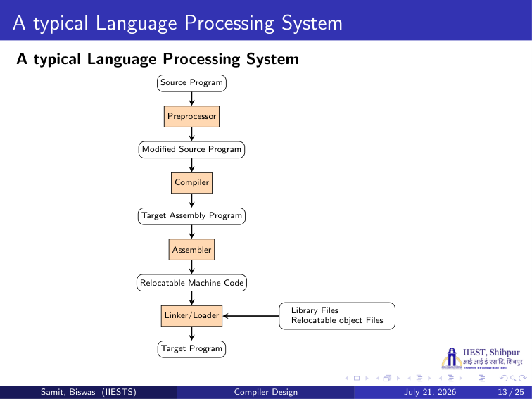
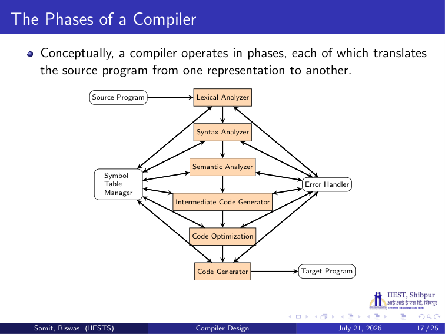
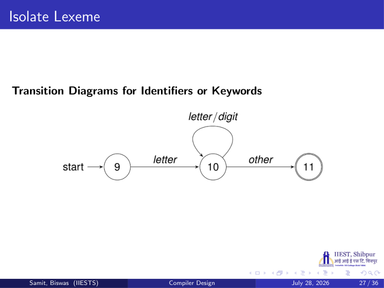
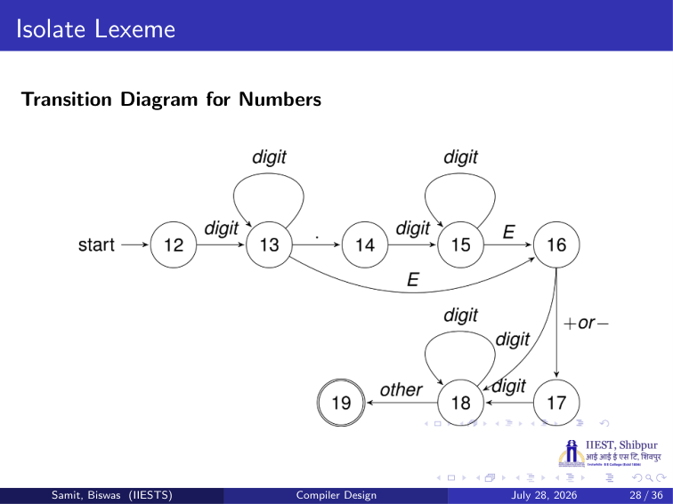
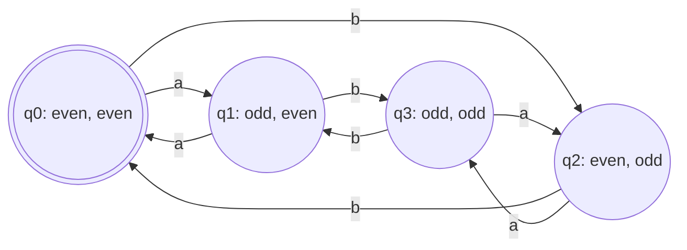
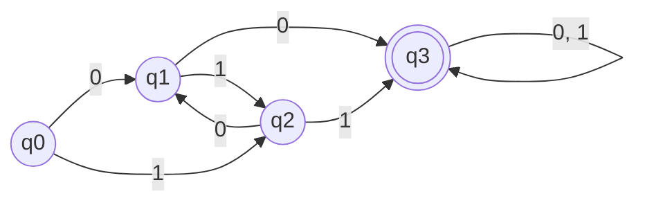
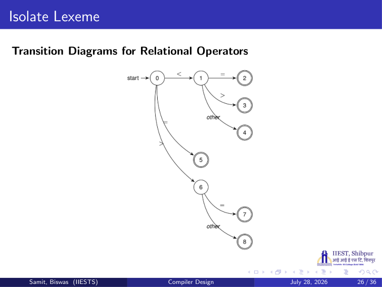
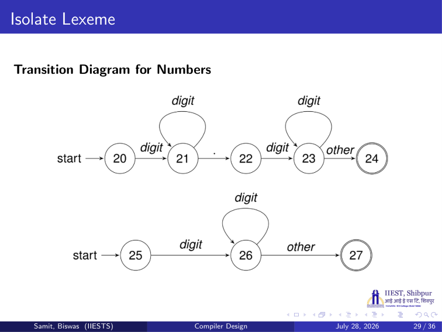

# Compiler Design PYQ Solutions: CD 01, CD 02, CD 03

## Q1. Compiler producing assembly language instead of machine language [3 marks]

> **2025 Mid Q1(a):** What advantages are there to a language-processing system in which the compiler produces assembly language rather than machine language?

In a typical language-processing system, the compiler is only one step:

1. **Preprocessor:** source program → modified source program (expands `#include`, `#define`).
2. **Compiler:** modified source program → **target assembly program**.
3. **Assembler:** assembly program → **relocatable machine code**.
4. **Linker/loader:** relocatable machine code + library files + other relocatable object files → target program.



**Advantages of producing assembly language:**

1. **The compiler is simpler.** It only has to emit readable mnemonics such as `MOVF`, `MULF`, `ADDF`. Turning mnemonics into binary instructions is left to the assembler.
2. **Relocation and linking are left to other tools.** The assembler produces relocatable code (addresses starting from 0), and the linker/loader joins it with libraries and other object files and fixes the addresses. The compiler does not have to handle any of this.
3. **The output is easy to read and check.** Assembly code can be read by a person, so the compiler's output is easy to inspect and debug. For example, `position = initial + rate * 60` becomes:

```text
MOVF id3, R2
MULF #60.0, R2
MOVF id2, R1
ADDF R2, R1
MOVF R1, id1
```

Each line can be checked against the source statement.

---

## Q2. Symbol table in the phases of a compiler [5 marks / 6 marks]

> **2025 End Q5(b):** Why symbol-table is needed in various phases of compilers? How hashing can be used to design symbol-table? [5]
>
> **2023 End Q4(a):** Explain the use of symbol table in compilation process. List out the various attributes for implementing the symbol table. [6]

The **symbol table** is a data structure with **one record per name** in the program (variables, functions). Each record holds attributes of the name, such as its type. The **symbol table manager** is connected to all six phases of the compiler: every phase can read the table or add to it.



**Why each phase needs it:**

| Phase | Use of the symbol table |
| :--- | :--- |
| Lexical analyzer | Enters each name it reads. The token `id` carries an attribute value that is a **pointer to the symbol table entry** (in `position = initial + rate * 60`, the names become `id1`, `id2`, `id3`). Keywords are put into the table before scanning, so a lexeme like `if` is recognised as a keyword when it is looked up. |
| Syntax analyzer | Uses the tokens and their pointers to build the tree. |
| Semantic analyzer | Looks up the **type** of each name to check that operations are valid; for example, it inserts `inttoreal(60)` because `rate` is real. |
| Intermediate code generator | Refers to names through their entries (`id1 = temp3`). |
| Code optimization and code generation | Synthesis builds the target program from the intermediate representation **and the information in the symbol table**. |

**Attributes stored in an entry:**

| Attribute | Example |
| :--- | :--- |
| Name (the lexeme) | `position`, `score` |
| Token / kind | `id`, or a keyword such as `if` |
| Type | real, integer |

Hashing is not covered in the CD 01–03 guides.

---

## Q3. Functions of the lexical analyzer and reasons for separating the analysis phases [3 marks]

> **2024 Mid Q1(a), 2023 Mid Q1(a):** List out the functions of a Lexical Analyzer. State the reasons for the separation of Analysis programs into Lexical, Syntax, and Semantic Analyses.

**Functions of the lexical analyzer:**

1. **Main task:** read the input characters and produce a sequence of **tokens** for the parser. The parser asks for the next token by calling `getNextToken`.
2. **Strip comments and white space** (blanks, tabs, newlines) from the source program.
3. **Correlate error messages with the source program**, for example by keeping track of line numbers so an error can say "line 12".
4. Enter names into the **symbol table** and return a pointer to the entry as the token's attribute.

**Reasons for separating analysis into lexical, syntax and semantic phases:**

1. **Simpler design.** Translating a whole language in one step is too hard, so the job is split into phases, each doing one simple job. The parser never has to deal with spaces or comments, and the semantic analyzer works on a tree that is already known to be well formed.
2. **Speed.** Reading characters is the slowest part of compiling. A dedicated scanner can use fast buffering techniques.
3. **Portability.** Differences in the input character set stay inside the scanner; the other phases are unaffected.

---

## Q4. Tokens, patterns and lexemes [3 marks]

> **2025 Mid Q1(b):** Explain tokens, patterns, and lexemes. Demonstrate the same with examples.

- **Token:** a pair of a **token name** and an optional **attribute value**. The token name is an abstract symbol for a kind of lexical unit, such as a particular keyword or an identifier.
- **Pattern:** the rule that describes the set of strings for a token. The pattern **matches** each string in the set.
- **Lexeme:** a sequence of characters in the source program that matches the pattern for a token. It is identified as an instance of that token.

**Example:** `printf ("Total = %d", score) ;`

| Token | Sample lexemes | Pattern |
| :--- | :--- | :--- |
| if | `if` | characters i, f |
| else | `else` | characters e, l, s, e |
| comparison | `<=`, `!=` | `<` or `>` or `<=` or `>=` or `==` or `!=` |
| id | `printf`, `score`, `pi`, `d2` | letter followed by letters and digits |
| number | `3.14159`, `0`, `6.02e23` | any numeric constant |
| literal | `"Total = %d"` | anything but `"`, surrounded by `"` |

The statement gives 7 tokens:

| Lexeme | Token | Attribute value |
| :--- | :--- | :--- |
| `printf` | id | pointer to the symbol table entry for printf |
| `(` | `(` | none |
| `"Total = %d"` | literal | pointer to the string |
| `,` | `,` | none |
| `score` | id | pointer to the symbol table entry for score |
| `)` | `)` | none |
| `;` | `;` | none |

`printf` and `score` have the same token name `id`, but different attribute values. The attribute tells the later phases which name it was.

---

## Q5. Lexical analysis: lexemes, tokens and patterns in a program segment [4 marks]

> **2024 End Q2(a):** What is meant by lexical analysis? Identify the lexemes that make up the token in the following program segment. Indicate the corresponding token and pattern:
>
> ```c
> void swap(int i, int j)
> {
>     int t;
>     t = i;
>     i = j;
>     j = t;
> }
> ```

**Lexical analysis** is the first phase of a compiler. The lexical analyzer (scanner) reads the source program character by character, groups the characters into lexemes, and outputs a sequence of tokens. It also strips white space and comments, and enters names into the symbol table.

| Lexeme | Token | Pattern |
| :--- | :--- | :--- |
| `void` | void (keyword) | characters v, o, i, d |
| `int` | int (keyword) | characters i, n, t |
| `swap`, `i`, `j`, `t` | id (attribute: pointer to its symbol table entry) | letter followed by letters and digits |
| `(` | `(` | character ( |
| `)` | `)` | character ) |
| `,` | `,` | character , |
| `{` | `{` | character { |
| `}` | `}` | character } |
| `;` | `;` | character ; |
| `=` | `=` (assignment) | character = |

The keywords `void` and `int` also match the identifier pattern; they are recognised as keywords because they are put into the symbol table before scanning starts.

The whole segment gives **26 tokens**: `void swap ( int i , int j ) { int t ; t = i ; i = j ; j = t ; }`.

---

## Q6. Regular expressions for identifiers and constants of C, and finite automata for tokens [4 marks / 2 marks]

> **2025 Mid Q2(a), 2024 Mid Q2(a), 2023 Mid Q2(a):** Write regular expressions for specifying identifiers and constants of C. Discuss how finite automata is used to represent tokens and performs lexical analysis with examples. [4]
>
> **2023 End Q1(a):** Write regular expressions to specify the identifiers and constants of C. [2]

### 1. Regular expressions

Here `|` means "or", writing two items side by side means "one after the other", `*` means "zero or more times", and `?` means "optional".

```text
letter  →  A | B | ... | Z | a | b | ... | z | _
digit   →  0 | 1 | ... | 9

id      →  letter ( letter | digit )*
number  →  digit digit* ( . digit digit* )? ( E ( + | - )? digit digit* )?
```

- **Identifier:** a letter (in C, `_` counts as a letter) followed by any number of letters or digits. Examples: `score`, `d2`, `_tmp`.
- **Numeric constant:** one or more digits, then an optional fraction, then an optional exponent. Examples: `60`, `3.14`, `3.5E+2`.

### 2. How finite automata recognise tokens

Each token's regular expression is turned into a small finite automaton called a **transition diagram**. The scanner follows the diagram one character at a time. When it reaches an **accepting state**, it knows which token it has read and returns the token with its attribute value.

**Identifier (states 9–11):** state 9 on a letter goes to 10; state 10 loops on a letter or digit; on any other character it goes to 11, which is accepting. The scanner has read one character too many, so it **retracts** it before returning the token.



**Numbers (states 12–19):** digits, an optional `.` and digits, then `E`, an optional sign and digits; state 19 is accepting. Simpler diagrams handle `3.14` (states 20–24) and integers like `60` (states 25–27).



**Example: scanning `if x1 >= 3.5E+2 then`**

| Lexeme | Path through the diagram | Token returned |
| :--- | :--- | :--- |
| `if` | 9 →(i) 10 →(f) 10 →(blank) 11, retract | if (keyword found in the table) |
| `x1` | 9 →(x) 10 →(1) 10 →(blank) 11, retract | id, pointer to x1 |
| `>=` | 0 →(>) 6 →(=) 7 | relop, GE |
| `3.5E+2` | 12 →(3) 13 →(.) 14 →(5) 15 →(E) 16 →(+) 17 →(2) 18 →(blank) 19, retract | num, pointer to 3.5E+2 |
| `then` | 9 → 10 → 10 → 10 → 10 → 11 | then |

The blanks go through the white-space diagram and produce no token. The line gives 5 tokens.

---

## Q7. Regular expression for strings with an even number of a's and b's [3 marks]

> **2024 End Q1(b):** Write the regular expressions to describe languages consisting of strings made of even numbers of a and b.

The language is all strings over {a, b} with an **even number of a's and an even number of b's** (λ included).

**DFA.** Track the parity (even or odd) of a's and of b's: four states.

| State | Meaning | on a | on b |
| :--- | :--- | :--- | :--- |
| → q0 (start, final) | a even, b even | q1 | q2 |
| q1 | a odd, b even | q0 | q3 |
| q2 | a even, b odd | q3 | q0 |
| q3 | a odd, b odd | q2 | q1 |



**Regular expression:**

```math
\big( aa + bb + (ab + ba)(aa + bb)^\ast(ab + ba) \big)^\ast
```

**Why it works.** Read the string two symbols at a time:

- `aa` or `bb` keeps both counts even (q0 → q0 through q1 or q2).
- `ab` or `ba` makes both counts odd (q0 → q3). While both are odd, `aa` or `bb` keeps them odd (q3 → q3). Another `ab` or `ba` makes both even again (q3 → q0).

So each block of the star starts and ends with both counts even, and any such string can be split into these blocks. Examples: λ, `aa`, `bb`, `abab`, `abba`, `aabb` are in the language; `a`, `ab`, `aab` are not.

---

## Q8. Finite automaton for (0 + 1)\*(00 + 11)(0 + 1)\* [3 marks]

> **2025 End Q2(c):** Construct a Finite Automata equivalent to the regular expression: $(0 + 1)^{\ast}(00 + 11)(0 + 1)^{\ast}$

**Language:** all binary strings that contain `00` or `11` somewhere as consecutive symbols.

**DFA** $M = (Q, \Sigma, \delta, q_0, F)$ with $Q = \lbrace q_0, q_1, q_2, q_3 \rbrace$, $\Sigma = \lbrace 0, 1 \rbrace$, start state $q_0$ and $F = \lbrace q_3 \rbrace$.

| State | Meaning | on 0 | on 1 |
| :--- | :--- | :--- | :--- |
| → q0 (start) | nothing read yet | q1 | q2 |
| q1 | last symbol was 0 | q3 | q2 |
| q2 | last symbol was 1 | q1 | q3 |
| q3 (final) | `00` or `11` found | q3 | q3 |



**Runs:**

- `0100`: q0 → q1 → q2 → q1 → q3. Ends in q3: accepted (contains `00`).
- `0101`: q0 → q1 → q2 → q1 → q2. Ends in q2: rejected (no `00` or `11`).

---

## Q9. Transition diagrams for relational operators and unsigned numbers [7 marks]

> **2024 End Q2(b):** Draw the transition diagram for relational operators and unsigned numbers.

### 1. Relational operators

The scanner returns the token **relop** with an attribute that says which operator it is: LT, LE, EQ, NE, GT, GE.



| From | On | To | Token returned |
| :--- | :--- | :--- | :--- |
| 0 | `<` | 1 | |
| 1 | `=` | 2 | relop, LE (`<=`) |
| 1 | `>` | 3 | relop, NE (`<>`) |
| 1 | other | 4 * | relop, LT (`<`) |
| 0 | `=` | 5 | relop, EQ (`=`) |
| 0 | `>` | 6 | |
| 6 | `=` | 7 | relop, GE (`>=`) |
| 6 | other | 8 * | relop, GT (`>`) |

States 2, 3, 4, 5, 7 and 8 are accepting. In states 4 and 8 (marked `*`), the scanner has read one character too many, so it **retracts** it before returning the token. Example: `>` followed by a blank goes 0 → 6 → 8, returns relop GT, and pushes the blank back.

### 2. Unsigned numbers

**With fraction and exponent (states 12–19)**, for numbers like `3.5E+2`:

| From | On | To |
| :--- | :--- | :--- |
| 12 | digit | 13 |
| 13 | digit | 13 (loop) |
| 13 | `.` | 14 |
| 13 | E | 16 |
| 14 | digit | 15 |
| 15 | digit | 15 (loop) |
| 15 | E | 16 |
| 16 | `+` or `-` | 17 |
| 16 | digit | 18 |
| 17 | digit | 18 |
| 18 | digit | 18 (loop) |
| 18 | other | 19 * (accepting) |


**Without exponent (states 20–24)** for numbers like `3.14`: digits, `.`, digits, then other → 24. **Integers (states 25–27)** like `60`: digits, then other → 27.



The scanner tries the diagrams in order: 12–19, then 20–24, then 25–27, and takes the first that succeeds. Trying the longest form first makes sure `3.5E2` is read as one number, not as `3.5` followed by `E2`. In every case the accepting state returns **num** with a pointer to the number's entry, after retracting the extra character.

---

## Q10. Errors in the different phases of a compiler [3 marks]

> **2024 Mid Q1(b), 2023 Mid Q1(b):** Explain the various errors encountered in different phases of compiler.

| Type of error | Found by | Example |
| :--- | :--- | :--- |
| **Lexical error** | lexical analyzer | misspelling an identifier, keyword or operator; `int 9x;` (an identifier cannot start with a digit); `a = b @ c;` (`@` is not an operator) |
| **Syntactic error** | syntax analyzer | an arithmetic expression with unbalanced parentheses: `x = (a + b;` |
| **Semantic error** | semantic analyzer | an operator applied to an incompatible operand: `int a; a = "hello" * 2;` |
| **Logical error** | usually not found by the compiler; shows up at run time | an infinitely recursive call: `int f(int n) { return f(n); }` |

When a phase finds an error, the **error handler** decides what to do, so that compiling can go on and more errors can be reported.

---

## Q11. Error handling and error recovery in the syntax analyzer [4 marks]

> **2025 End Q1(a):** Explain the error handling and error recovery mechanism of syntax analyser.

### 1. Error handling

When the parser finds an error, there are two choices:

1. **Stop immediately** and signal an error. The user must then recompile after every small fix.
2. **Record the error and try to continue.** The user sees more errors at once, but may get a series of messages all caused by the same problem.

A good parser records the error, recovers, and continues.

### 2. The four error-recovery strategies

| Strategy | How it works | Example |
| :--- | :--- | :--- |
| **Panic mode** | Skip input symbols until one of a set of **synchronizing tokens** (such as `;`) appears. | `a = b + c` (missing `;`) `d = e + f;`: tokens are discarded until the `;`. |
| **Phrase-level recovery** | Perform a **local correction** on the input, such as inserting a missing token. | `int id 5;` becomes `int id = 5;` |
| **Error productions** | Add productions for **common erroneous constructs** to the grammar, so the mistake is parsed and reported precisely. | Add `T' → F T'` to accept `id id` (a missing `*`). |
| **Global correction** | Choose a **minimal sequence of changes** that gives a globally least-cost correction. | Mainly of theoretical interest; too slow and complex in practice. |

| Strategy | Strength | Weakness |
| :--- | :--- | :--- |
| Panic mode | simple; never loops, because it always moves forward | skips input, so errors in the skipped part are missed |
| Phrase level | repairs small mistakes | a bad fix can cause new errors; must be written so it always ends |
| Error production | very precise messages | productions must be added by hand |
| Global correction | cheapest fix overall | too costly in time and space |

### 3. In an LR parser

Each empty (error) entry of the LR table holds a pointer to an **error routine**. The routine assumes the most likely cause, repairs it and prints a message. For the expression grammar:

| Routine | Situation | Action | Message |
| :--- | :--- | :--- | :--- |
| e1 | expecting `id` or `(`, found `+`, `*` or `$` | push state 5 (pretend an `id` was read) | missing operand |
| e2 | unexpected `)` | remove `)` from the input | unmatched right parenthesis |
| e3 | expecting `+`, found `id` or `(` | push state 6 (assume `+`) | missing + |
| e4 | expecting `+`, found `*` | push state 6 and remove `*` | `*` instead of `+` |
| e5 | expecting `)`, found `$` | push state 11 (assume `)`) | missing right parenthesis |

---

## Q12. Panic-mode error recovery in predictive parsing [4 marks]

> **2024 Mid Q2(b), 2023 Mid Q2(b):** Explain panic mode error recovery strategy for predictive parsing method using a suitable example.

### 1. When an error is detected

A predictive parser detects an error when:

- the terminal on top of the stack does not match the next input symbol, or
- nonterminal $A$ is on top of the stack, $a$ is the next input symbol, and the table entry $M[A, a]$ is empty.

### 2. Choosing the synchronizing set of A

1. Put all symbols of FOLLOW(A) into the synchronizing set of A. Skip tokens until an element of FOLLOW(A) is seen, then pop A from the stack.
2. Add the symbols of FIRST(A) to the synchronizing set of A. Then parsing can resume according to A when a symbol of FIRST(A) appears.
3. If a terminal on top of the stack cannot be matched, pop it and issue a message saying the terminal was inserted.

### 3. What the parser does on an error

- Entry $M[A, a]$ is **blank**: skip the input symbol $a$.
- Entry $M[A, a]$ is **synch**: pop the nonterminal $A$.
- A **token** on top of the stack does not match the input: pop the token.

### 4. Example

Grammar: $E \to TE'$, $E' \to +TE' \mid \epsilon$, $T \to FT'$, $T' \to \ast FT' \mid \epsilon$, $F \to (E) \mid \text{id}$.

| Set | Value |
| :--- | :--- |
| FIRST(E) = FIRST(T) = FIRST(F) | { (, id } |
| FIRST(E') | { +, ε } |
| FIRST(T') | { *, ε } |
| FOLLOW(E) = FOLLOW(E') | { ), $ } |
| FOLLOW(T) = FOLLOW(T') | { +, ), $ } |
| FOLLOW(F) | { *, +, ), $ } |

**Parsing table with synchronizing tokens** ("synch" = a FOLLOW symbol with no production in that row):

| Nonterminal | id | + | * | ( | ) | $ |
| :--- | :--- | :--- | :--- | :--- | :--- | :--- |
| E | E → TE' | | | E → TE' | synch | synch |
| E' | | E' → +TE' | | | E' → ε | E' → ε |
| T | T → FT' | synch | | T → FT' | synch | synch |
| T' | | T' → ε | T' → *FT' | | T' → ε | T' → ε |
| F | F → id | synch | synch | F → (E) | synch | synch |

**Trace on the erroneous input `) id * + id`** (a stray `)` at the start, and `*` with no operand after it):

| Step | Stack | Input | Action |
| :--- | :--- | :--- | :--- |
| 1 | $E | ) id * + id $ | error, skip `)` |
| 2 | $E | id * + id $ | E → TE' |
| 3 | $E'T | id * + id $ | T → FT' |
| 4 | $E'T'F | id * + id $ | F → id |
| 5 | $E'T'id | id * + id $ | match id |
| 6 | $E'T' | * + id $ | T' → *FT' |
| 7 | $E'T'F* | * + id $ | match * |
| 8 | $E'T'F | + id $ | error, M[F, +] = synch: pop F |
| 9 | $E'T' | + id $ | T' → ε |
| 10 | $E' | + id $ | E' → +TE' |
| 11 | $E'T+ | + id $ | match + |
| 12 | $E'T | id $ | T → FT' |
| 13 | $E'T'F | id $ | F → id |
| 14 | $E'T'id | id $ | match id |
| 15 | $E'T' | $ | T' → ε |
| 16 | $E' | $ | E' → ε |
| 17 | $ | $ | accept |

- **Step 1:** $M[E, )]$ is synch, but E is the only symbol on the stack. Popping it would end the parse at once, so the `)` is skipped instead.
- **Step 8:** after `*` the parser expects an operand F but sees `+`. Since `+` is in FOLLOW(F), the entry is synch, and F is popped, as if the operand had been there.

The parser reports two errors and still reads the whole input.
