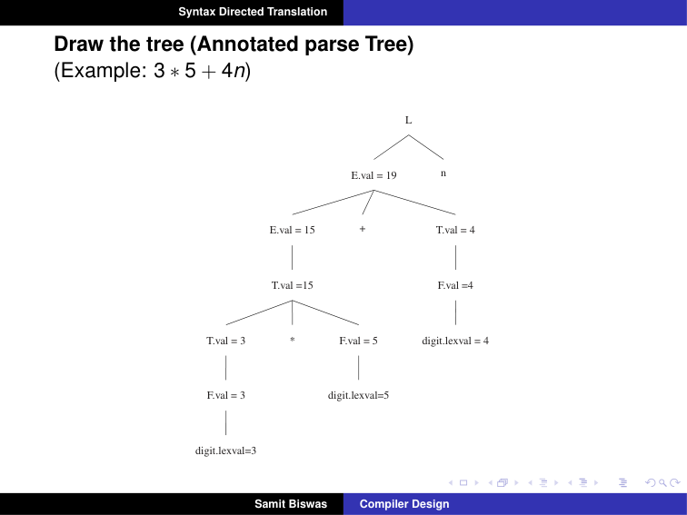
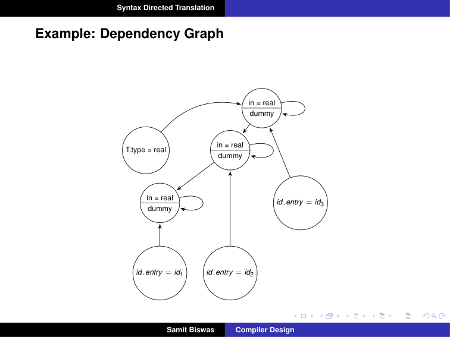
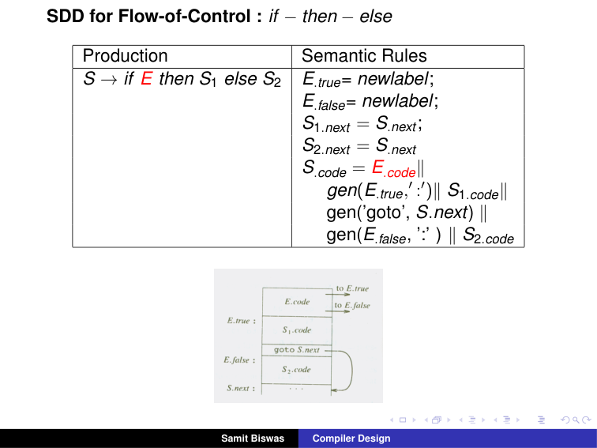
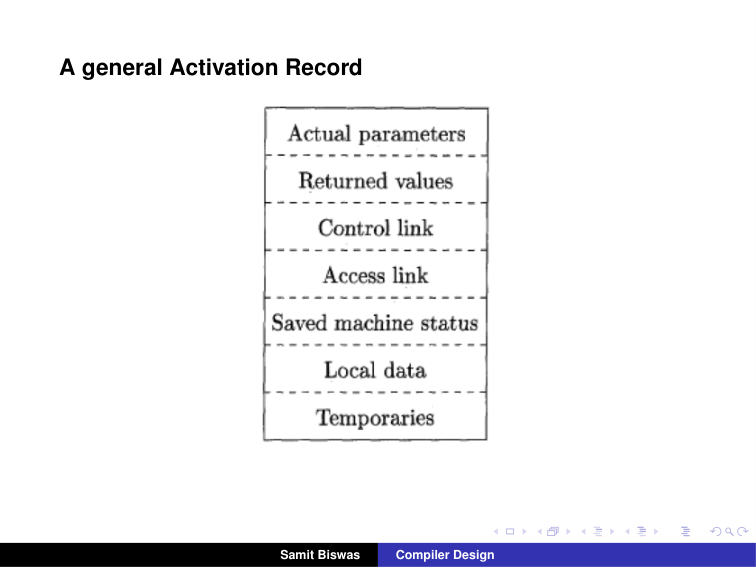
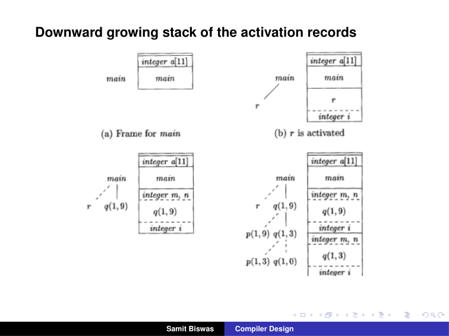

# Compiler Design PYQ Solutions: CD 04, CD 05, CD 06

## Q1. Evaluation order of Syntax-Directed Translation [6 marks]

> **2024 End Q5(a):** Describe the evaluation order of Syntax Directed Translation (SDT) with an example.

### 1. What has to be ordered

In syntax-directed translation, each grammar symbol carries **attributes**, and each production carries **semantic rules** of the form

```math
b = f(c_1, c_2, \ldots, c_k)
```

A rule can run only after every $c_i$ it uses is known. So the question is: in what order do we evaluate the rules at the nodes of the parse tree?

There are two kinds of attribute:

| Kind | Computed from | Direction in the tree | Example |
| :--- | :--- | :--- | :--- |
| **Synthesized** | attributes of the node's **children** | upward | $E \to E_1 + T$: $E.val = E_1.val + T.val$ |
| **Inherited** | attributes of the node's **parent and siblings** | downward or sideways | $D \to T\ L$: $L.in = T.type$ |

### 2. The dependency graph decides the order

The steps are: input → parse tree → **dependency graph** → evaluation order → evaluate the rules.

**Building the dependency graph:**

1. Make one graph node for every attribute of every parse-tree node.
2. For each rule $b = f(c_1, \ldots, c_k)$ used at a node, draw an edge **from each $c_i$ to $b$** ("compute $c_i$ before $b$").
3. A rule that is only a procedure call (such as `print(E.val)` or `addtype(...)`) gets a **dummy** synthesized attribute, so it also becomes a node.

```text
for each node n in the parse tree do
    for each attribute a of the grammar symbol at n do
        construct a node in the dependency graph for a
for each node n in the parse tree do
    for each semantic rule b = f(c1, ..., ck) of the production used at n do
        for i = 1 to k do
            construct an edge from the node for ci to the node for b
```

**The rule for the order:** any **topological sort** of the dependency graph is a valid evaluation order. That means: list an attribute only after every attribute that points to it. If the graph has a **cycle**, no such order exists, and the SDD cannot be evaluated.

### 3. Example A: synthesized attributes only (input `3 * 5 + 4 n`)

| Production | Semantic rule |
| :--- | :--- |
| $L \to E\ \text{n}$ | print(E.val) |
| $E \to E_1 + T$ | $E.val = E_1.val + T.val$ |
| $E \to T$ | $E.val = T.val$ |
| $T \to T_1 \ast F$ | $T.val = T_1.val \times F.val$ |
| $T \to F$ | $T.val = F.val$ |
| $F \to (E)$ | $F.val = E.val$ |
| $F \to \text{digit}$ | $F.val = \text{digit}.lexval$ |




Because every edge points upward, the order is simply **bottom-up (post-order)**:

| Order | Attribute | Value |
| :---: | :--- | :--- |
| 1 | digit.lexval = 3, then F.val, then T.val | 3 |
| 2 | digit.lexval = 5, then F.val | 5 |
| 3 | $T.val = T_1.val \times F.val$ | $3 \times 5 = 15$ |
| 4 | $E.val = T.val$ | 15 |
| 5 | digit.lexval = 4, then F.val, then T.val | 4 |
| 6 | $E.val = E_1.val + T.val$ | $15 + 4 = 19$ |
| 7 | dummy = print(E.val) | prints **19** |

### 4. Example B: inherited attributes (input `real id1, id2, id3`)

| Production | Semantic rules |
| :--- | :--- |
| $D \to T\ L$ | $L.in = T.type$ |
| $T \to \text{int}$ | $T.type = \text{integer}$ |
| $T \to \text{real}$ | $T.type = \text{real}$ |
| $L \to L_1, \text{id}$ | $L_1.in = L.in$; addtype(id.entry, L.in) |
| $L \to \text{id}$ | addtype(id.entry, L.in) |




Number the attributes: 1–3 = id1.entry, id2.entry, id3.entry; 4 = T.type; 5, 7, 9 = L.in of the top, middle and lowest L; 6, 8, 10 = their addtype dummies. A topological order:

1. $a_4 = \text{real}$
2. $a_5 = a_4$
3. addtype(id3.entry, $a_5$)
4. $a_7 = a_5$
5. addtype(id2.entry, $a_7$)
6. $a_9 = a_7$
7. addtype(id1.entry, $a_9$)

All three names get type real.

Here a plain bottom-up order would **fail**: L.in must be known before the addtype calls below it, so information has to flow down and sideways.

### 5. The three methods of choosing the order

| Method | How the order is chosen | Limitation |
| :--- | :--- | :--- |
| **Parse-tree method** | At compile time, by topologically sorting the dependency graph of each parse tree. | Fails if the graph has a cycle. |
| **Rule-based method** | At compiler-construction time, the rules of each production are analysed (by hand or by a tool) and an order is fixed per production. | |
| **Oblivious method** | The order is forced by the parsing method, without looking at the rules. | Works only for a restricted class of SDDs. |

### 6. Two classes of SDD with a fixed, simple order

- **S-attributed** (only synthesized attributes): evaluate **bottom-up**. An LR parser can do it *while it parses*, by keeping each value on the stack next to its symbol. For $E \to E_1 + T$ the code is `val[ntop] = val[top-2] + val[top]`.
- **L-attributed** (each inherited attribute depends only on the parent and on siblings to its **left**): evaluate in **one depth-first, left-to-right pass**. This suits top-down (LL) parsing. Example B is L-attributed: L.in depends on T, its left sibling.

---

## Q2. The simple type checker for expressions, statements and functions [6 marks]

> **2025 End Q6(a):** Explain the simplification of simple type checker for statements, expressions and functions.

### 1. What a type checker does

Type checking verifies that every operation in the program respects the **type system** of the language: all operands have the right types and number. A static type checker does this at compile time, using the types recorded in the symbol table from the declarations.

**Type expressions** describe types:

- Basic types: `boolean`, `char`, `integer`, `real`, plus two special ones: **type_error** (signals an error) and **void** (no value; used to check statements).
- Constructors build bigger types: `array(I, T)`, products $T_1 \times T_2$, `record(...)`, `pointer(T)`, and functions $D \to R$.

The checker gives every expression and statement an attribute **`.type`**, computed bottom-up from its parts.

### 2. The language

```text
P → D ; E
D → D ; D | id : T
T → char | integer | array [ num ] of T | ↑T
E → literal | num | id | E mod E | E [ E ] | E↑
```

**Step 0: declarations save each name's type in the symbol table.**

| Production | Action |
| :--- | :--- |
| $D \to \text{id} : T$ | { addtype(id.entry, T.type) } |
| $T \to \text{char}$ | { T.type = char } |
| $T \to \text{integer}$ | { T.type = integer } |
| $T \to \uparrow T_1$ | { T.type = pointer(T1.type) } |
| $T \to \text{array [num] of } T_1$ | { T.type = array(1..num.val, T1.type) } |

### 3. Checking expressions

An expression's type is the type of the value it produces.

| Production | Rule |
| :--- | :--- |
| $E \to \text{literal}$ | E.type = char |
| $E \to \text{num}$ | E.type = integer |
| $E \to \text{id}$ | E.type = lookup(id.entry) |
| $E \to E_1 \text{ mod } E_2$ | E.type = **if** E1.type = integer **and** E2.type = integer **then** integer **else** type_error |
| $E \to E_1 [ E_2 ]$ | E.type = **if** E2.type = integer **and** E1.type = array(s, t) **then** t **else** type_error |
| $E \to E_1 \uparrow$ | E.type = **if** E1.type = pointer(t) **then** t **else** type_error |

In words: `mod` needs two integers; indexing needs an array and an integer index and gives the element type; dereferencing needs a pointer and gives the type it points to.

### 4. Checking statements

A statement produces no value. So a **correct statement gets type void**, and a wrong one gets type_error.

| Production | Rule |
| :--- | :--- |
| $S \to \text{id} = E$ | S.type = **if** id.type == E.type **then** void **else** type_error |
| $S \to \text{if } E \text{ then } S_1$ | S.type = **if** E.type == boolean **then** S1.type **else** type_error |
| $S \to \text{while } E \text{ do } S_1$ | S.type = **if** E.type == boolean **then** S1.type **else** type_error |
| $S \to S_1 ; S_2$ | S.type = **if** S1.type == void **and** S2.type == void **then** void **else** type_error |

In words: both sides of an assignment must have the same type; a condition must be boolean; a sequence is correct only if every part is.

### 5. Checking functions

| Production | Action |
| :--- | :--- |
| $T \to T_1 \text{ '→' } T_2$ | { T.type = T1.type → T2.type } |
| $E \to E_1 ( E_2 )$ | { E.type = **if** E2.type == s **and** E1.type == s → t **then** t **else** type_error } |

In words: a function of type $s \to t$ may be applied only to an argument of the domain type $s$, and the call then has the range type $t$.

### 6. Worked example

```text
a : array [10] of integer ;
p : ↑integer ;
a [ p↑ ] mod 3
```

| Subexpression | Rule used | Type |
| :--- | :--- | :--- |
| `a` | lookup | array(1..10, integer) |
| `p` | lookup | pointer(integer) |
| `p↑` | E1.type = pointer(t), so t | integer |
| `a[p↑]` | index is integer and a is array(s, t), so t | integer |
| `3` | num | integer |
| `a[p↑] mod 3` | both integer | **integer** ✓ |

**Error cases:**

- With `c : char`, the expression `c mod 2` gets type_error, because E1.type = char is not integer.
- With `x : integer`, the statement `while x do x = 1` gets type_error. The body is void (integer == integer), but the condition `x` is integer, not boolean.

---

## Q3. Intermediate code and SDD for an if-else statement [5 marks]

> **2024 End Q5(b) and 2023 End Q4(b):** Generate intermediate code for the following code segment along with the required syntax directed definition:
>
> ```c
> if (a > b)
>     x = a + b;
> else
>     x = a - b;
> ```
>
> Here the datatype for x, a and b is int.

### 1. The attributes used

- **E.place**: the name that holds the value of expression E. **E.code**: the three-address code that computes it.
- **B.true / B.false**: the labels to jump to when condition B is true / false.
- **S.next**: the label of the code that follows statement S.
- `newtemp` returns a new temporary, `newlabel` a new label, `gen(...)` makes one statement, and `∥` joins code.

### 2. The syntax-directed definition

| Production | Semantic rules |
| :--- | :--- |
| $S \to \text{if } (B) \ S_1 \text{ else } S_2$ | B.true = newlabel; B.false = newlabel; S1.next = S.next; S2.next = S.next; S.code = B.code ∥ gen(B.true ':') ∥ S1.code ∥ gen('goto' S.next) ∥ gen(B.false ':') ∥ S2.code |
| $B \to \text{id}_1 \text{ relop id}_2$ | B.code = gen('if' id1.place relop.op id2.place 'goto' B.true) ∥ gen('goto' B.false) |
| $S \to \text{id} = E$ | S.code = E.code ∥ gen(id.place '=' E.place) |
| $E \to E_1 + E_2$ | E.place = newtemp; E.code = E1.code ∥ E2.code ∥ gen(E.place '=' E1.place '+' E2.place) |
| $E \to E_1 - E_2$ | E.place = newtemp; E.code = E1.code ∥ E2.code ∥ gen(E.place '=' E1.place '-' E2.place) |
| $E \to \text{id}$ | E.place = id.place; E.code = '' (empty) |

Here `relop` is `>`. Since x, a and b are all `int`, no type conversion (such as `inttoreal`) is needed anywhere.




### 3. Applying the rules

Let S.next = **L3** (the code after the statement).

| Rule | Result |
| :--- | :--- |
| B.true = newlabel | L1 |
| B.false = newlabel | L2 |
| S1.next = S2.next = S.next | L3 |
| B.code for `a > b` | `if a > b goto L1`, `goto L2` |
| S1: `x = a + b` | t1 = newtemp: `t1 = a + b`, `x = t1` |
| S2: `x = a - b` | t2 = newtemp: `t2 = a - b`, `x = t2` |

### 4. The generated three-address code

```text
100:       if a > b goto L1      (B.code)
101:       goto L2
102: L1:   t1 = a + b            (S1.code)
103:       x = t1
104:       goto L3               (goto S.next)
105: L2:   t2 = a - b            (S2.code)
106:       x = t2
107: L3:                         (next statement)
```

With numbered statements, the labels are L1 = 102, L2 = 105, L3 = 107.

---

## Q4. Quadruples, triples and indirect triples for -(a+b)*(c+d)+(a+b+c) [5 marks]

> **2025 End Q7(b), 2024 End Q7(b), 2023 End Q6(a):** Translate the expression $-(a+b)*(c+d)+(a+b+c)$ into (i) quadruples, (ii) triples and (iii) indirect triples.

### 1. Grouping

Unary minus binds tightest, then `*`, then `+` (left to right). So the expression is

```math
\big( (-(a+b)) \ast (c+d) \big) + \big( (a+b) + c \big)
```

### 2. Three-address code first

Each operator gets a new temporary, generated bottom-up, left to right:

```text
t1 = a + b
t2 = uminus t1
t3 = c + d
t4 = t2 * t3
t5 = a + b
t6 = t5 + c
t7 = t4 + t6
```

The expression has 7 operators (`+`, unary `-`, `+`, `*`, `+`, `+`, `+`), so there are 7 statements and 7 temporaries. The result is in t7.

### 3. (i) Quadruples: (op, arg1, arg2, result)

The result is named by a temporary in its own field. Unary minus leaves arg2 empty.

| | op | arg1 | arg2 | result |
| :--- | :--- | :--- | :--- | :--- |
| (0) | + | a | b | t1 |
| (1) | uminus | t1 | | t2 |
| (2) | + | c | d | t3 |
| (3) | * | t2 | t3 | t4 |
| (4) | + | a | b | t5 |
| (5) | + | t5 | c | t6 |
| (6) | + | t4 | t6 | t7 |

### 4. (ii) Triples: (op, arg1, arg2)

There is no result field. A value is referred to by the **number of the triple** that computes it. Replace t1 → (0), t2 → (1), t3 → (2), t4 → (3), t5 → (4), t6 → (5).

| | op | arg1 | arg2 |
| :--- | :--- | :--- | :--- |
| (0) | + | a | b |
| (1) | uminus | (0) | |
| (2) | + | c | d |
| (3) | * | (1) | (2) |
| (4) | + | a | b |
| (5) | + | (4) | c |
| (6) | + | (3) | (5) |

### 5. (iii) Indirect triples

The triples are stored once (numbered here from 14), and a separate **statement list** holds pointers to them in execution order.

| Statement | Points to |
| :--- | :--- |
| (0) | (14) |
| (1) | (15) |
| (2) | (16) |
| (3) | (17) |
| (4) | (18) |
| (5) | (19) |
| (6) | (20) |

| | op | arg1 | arg2 |
| :--- | :--- | :--- | :--- |
| (14) | + | a | b |
| (15) | uminus | (14) | |
| (16) | + | c | d |
| (17) | * | (15) | (16) |
| (18) | + | a | b |
| (19) | + | (18) | c |
| (20) | + | (17) | (19) |

### 6. Comparison of the three forms

- **Quadruples:** results have names, so statements can be moved freely by an optimizer; but every temporary needs a symbol-table entry. 7 × 4 = 28 fields.
- **Triples:** save the result field and the temporaries (7 × 3 = 21 fields); but moving a triple changes its number, so all references to it must be updated.
- **Indirect triples:** to reorder the code, only the statement list is reordered; the triples keep their numbers. 21 + 7 = 28 fields.

---

## Q5. Activation record: definition, fields and their purpose [3 marks]

> **2025 End Q7(c), 2024 End Q7(c):** Define the activation record. What are the contents of an activation record?
>
> **2023 End Q6(b):** List the fields in an activation record. Write down the purpose of each of these fields in an activation record.

### 1. Definition

Each execution of a procedure is an **activation**. An **activation record** (also called a **frame**) is the block of memory that holds all the information needed by one activation of a procedure. Calls and returns are managed by a run-time stack, the **control stack**: each call pushes an activation record, and each return pops it. The record of the running procedure is on top; the record of `main` is at the bottom.

### 2. Fields and their purpose




| Field | Purpose |
| :--- | :--- |
| **Actual parameters** | Hold the actual parameters supplied by the calling procedure. |
| **Returned value** | Space for the value the called function returns to the caller. |
| **Control link** (dynamic link) | Points to the activation record of the **caller**, so the stack can be restored on return. |
| **Access link** (static link) | Used to refer to **non-local data** held in other activation records (needed in languages with nested procedures, such as Pascal). |
| **Saved machine status** | The state of the machine just before the call: the **return address**, and register values that must be restored. |
| **Local data** | The variables local to this execution of the procedure. |
| **Temporaries** | Values that arise while evaluating expressions (for example compiler temporaries such as t1, t2). |

> **Control link vs access link:** the control link follows the **calls** (who called me); the access link follows the **program text** (who encloses me). In C, functions are not nested, so the access link is not needed.

---

## Q6. Stack allocation for a function call [3 marks]

> **2025 End Q7(a), 2024 End Q7(a), 2023 End Q6(c):** Explain the sequence of the stack allocation process for a function call using a suitable example.

### 1. Why a stack

Run-time memory is divided into **Code | Static | Heap → free memory ← Stack**. Local data of procedures goes on the **stack**, because calls end in last-in, first-out order: the last procedure called is the first to return. Each call pushes an activation record; each return pops it. A register **top_sp** marks the top of the stack.

### 2. The calling sequence (what happens on a call)

1. **Caller** evaluates the actual parameters (and puts them in the callee's record).
2. **Caller** stores the **return address** and the old value of **top_sp** in the callee's activation record, then **increments top_sp** past its own local data and temporaries and the callee's parameter and status fields. The new record is now on top.
3. **Callee** saves the register values and other status information.
4. **Callee** initialises its local data and begins execution.

### 3. The return sequence (what happens on a return)

1. **Callee** places the return value next to the caller's activation record.
2. Using the information in its status field, **callee** restores top_sp and the other registers, and branches to the **return address** in the caller's code. The callee's record is thereby popped.

### 4. Example: quicksort

```c
int a[11];
void readArray() { int i; ... }
int partition(int m, int n) { ... }
void quicksort(int m, int n) {
    int i;
    if (n > m) {
        i = partition(m, n);
        quicksort(m, i-1);
        quicksort(i+1, n);
    }
}
main() { readArray(); a[0] = -9999; a[10] = 9999; quicksort(1, 9); }
```

The global array `a` lives in the **static** area. Each call gets a record on the **stack**:




| Moment | Stack, bottom to top | What happened |
| :--- | :--- | :--- |
| (a) | main | program starts; main's record is pushed |
| (b) | main, readArray (`int i`) | main calls readArray: push |
| (c) | main, quicksort(1,9) (`int m, n, i`) | readArray returned (pop), then main called quicksort(1,9) (push) |
| (d) | main, quicksort(1,9), quicksort(1,3) | partition(1,9) was pushed and popped; then quicksort(1,3) was pushed |

**The call `i = partition(1, 9)` inside quicksort(1,9), step by step:**

| Step | Who | Effect |
| :---: | :--- | :--- |
| 1 | caller quicksort(1,9) | evaluates m = 1, n = 9 into partition's parameter fields |
| 2 | caller | stores the return address (the instruction that assigns to i) and the old top_sp in partition's record; moves top_sp up |
| 3 | callee partition(1,9) | saves the registers it will use |
| 4 | callee | initialises its locals and runs |
| 5 | callee | places the result (here 4) in the return-value field |
| 6 | callee | restores top_sp and registers, jumps to the return address: record popped |
| 7 | caller | picks up 4 and stores it in i |
