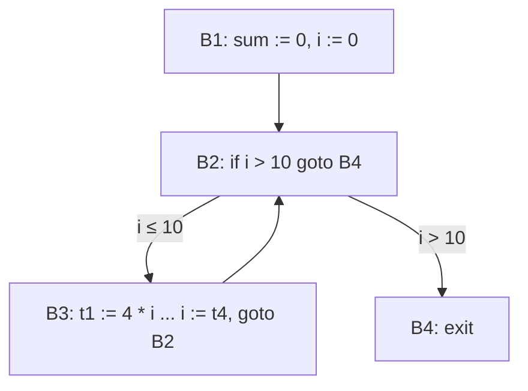
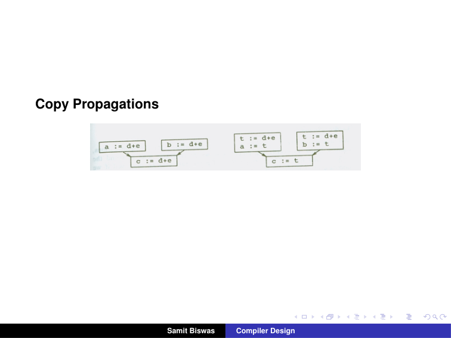
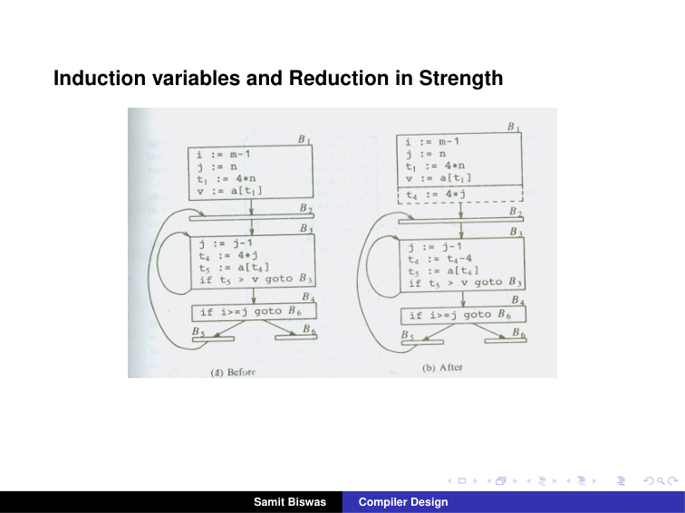

# Compiler Design PYQ Solutions: CD 07

## Q1. Leaders, three-address code and basic blocks [3 marks]

> **2025 End Q5(a):** Write down the algorithm to find the leader in basic block. Write down the three-address code and construct the basic blocks for the following program segment:
>
> ```c
> sum = 0;
> i = 0;
> while (i <= 10)
> {
>     sum = sum + a[i];
>     i++;
> }
> ```
>
> where the datatype for a, b and x are integer.

### 1. Basic block

A **basic block** is a sequence of consecutive statements in which flow of control enters at the beginning and leaves at the end, without halting or branching except at the end.

### 2. Algorithm: partition into basic blocks

**Input:** a sequence of three-address statements. **Output:** a list of basic blocks, with each statement in exactly one block.

1. Find the **leaders**, the first statements of the basic blocks:
   1. The first statement is a leader.
   2. Any statement that is the target of a conditional or unconditional goto is a leader.
   3. Any statement that immediately follows a goto or conditional goto statement is a leader.
2. For each leader, its basic block is the leader and all statements up to, but not including, the next leader or the end of the program.

### 3. Three-address code

An integer takes 4 bytes, so the address offset of `a[i]` is `4 * i`.

```text
(1)  sum := 0
(2)  i := 0
(3)  if i > 10 goto (11)
(4)  t1 := 4 * i
(5)  t2 := a[t1]
(6)  t3 := sum + t2
(7)  sum := t3
(8)  t4 := i + 1
(9)  i := t4
(10) goto (3)
(11) ...                  /* statement after the loop */
```

### 4. Finding the leaders

| Rule | Statements |
| :--- | :--- |
| (i) first statement | (1) |
| (ii) target of a goto | (3), target of `goto (3)`; (11), target of `if ... goto (11)` |
| (iii) follows a goto | (4), after the conditional goto (3); (11), after `goto (10)` |

**Leaders:** (1), (3), (4), (11).

### 5. Basic blocks and flow graph

| Block | Statements | Role |
| :--- | :--- | :--- |
| B1 | (1)–(2) | initialisation |
| B2 | (3) | loop test |
| B3 | (4)–(10) | loop body |
| B4 | (11) | exit (code after the loop) |



---

## Q2. Peephole optimization: redundant code and unreachable code [2 marks]

> **2025 End Q1(b):** Explain the following peephole optimization techniques: (a) Elimination of Redundant Code, (b) Elimination of Unreachable Code. [1 + 1]

**(a) Elimination of redundant code.** A redundant instruction does work whose result is already available or is never needed, so it can be removed without changing the meaning of the program. Examples:

| Before | After | Why |
| :--- | :--- | :--- |
| `x = 32;`<br>`x = x + 32;` | `x = 64;` | x is known to be 32, so the value is computed at compile time |
| `x = x + 0` | removed | adding 0 does nothing |
| `x = 32`, where x is not used afterwards | removed | the value is never used (dead code) |

**(b) Elimination of unreachable code.** Code that control can never reach is removed. A statement right after an unconditional jump, with no label that any jump targets, can never run:

| Before | After |
| :--- | :--- |
| `goto L2;`<br>`x = x + 1;` | `goto L2;` |

The statement `x = x + 1` is never reached, so it is unneeded.

---

## Q3. Characteristics of peephole optimization [3 marks]

> **2025 End Q5(c):** Explain the characteristics of peephole code optimization technique.

**Peephole optimization** examines a short sequence of target instructions and replaces it with a shorter or faster sequence. The **peephole** is a small moving window on the target program. Like every optimization, it must be **safe**: it must preserve the meaning of the program.

**Characteristic peephole optimizations:**

| Optimization | Before | After |
| :--- | :--- | :--- |
| 1. Redundant-instruction elimination | `x = 32;`<br>`x = x + 32;` | `x = 64;` |
| 2. Flow-of-control optimization (jump to a jump) | `goto L1;`<br>`...`<br>`L1: goto L2` | `goto L2;`<br>`...`<br>`L1: goto L2` |
| 3. Algebraic simplification | `x = x + 0` | removed |
| 4. Use of machine idioms | `i := i + 1` | `INC i` (one increment instruction instead of load, add, store) |

Other transformations done in the window:

- **Unreachable code:** `goto L2; x = x + 1;` → `goto L2;`
- **Dead code:** `x = 32`, where x is not used afterwards → removed.
- **Reduction in strength:** `x = x * 2` → `x = x + x` (a cheaper operation replaces an expensive one).

**Limitations:**

- Local in nature: it never sees beyond the window.
- Pattern-driven: it only finds the sequences it has patterns for.
- Limited by the size of the window.

---

## Q4. Algebraic transformations in local optimization [3 marks]

> **2023 End Q5(a):** Explain the algebraic translations of local machine-independent optimizations.

Algebraic transformations replace an expression with a simpler or cheaper one that always gives the **same value**. They are local: they look only at a statement or a few neighbouring statements.

| Transformation | Before | After | Why it is correct |
| :--- | :--- | :--- | :--- |
| **Algebraic simplification** | `x = x + 0` | removed | adding 0 leaves x unchanged |
| **Constant folding** | `x = 32;`<br>`x = x + 32;` | `x = 64;` | x is 32, so x + 32 = 64 can be computed at compile time |
| **Using a known value** | `x = 32;`<br>`x = x + y` | `x = y + 32` | after the first statement x = 32, so the second computes 32 + y; the first statement then becomes dead |
| **Reduction in strength** | `x = x * 2` | `x = x + x` | x × 2 = x + x for every x, and an add is cheaper than a multiply |

---

## Q5. Dead code elimination and copy propagation [4 marks]

> **2024 End Q6(a), 2023 End Q5(b):** Discuss the following: (i) Dead code elimination and (ii) copy propagation.

### (i) Dead code elimination

A name is **live** at a point if its value is used after that point, perhaps in another basic block. Otherwise it is **dead**. A statement that computes a value which is never used afterwards is **dead code**, and it can be removed without changing what the program does.

| Before | After |
| :--- | :--- |
| `x = 32`, where x is not used after the statement | removed |

Dead code often appears as a result of other optimizations. For example, after `x = 32; x = x + y` is rewritten as `x = y + 32`, the first statement `x = 32` is dead and is removed.

Unreachable code (code that control can never reach) is removed in the same way: `goto L2; x = x + 1;` becomes `goto L2;`.

### (ii) Copy propagation

A **copy statement** has the form `a := t`. **Copy propagation** means: after `a := t`, replace later uses of `a` by `t`. The copy `a := t` then often becomes dead and can be removed.

**Example.** Two blocks compute `d + e` and both flow into a third block that computes `d + e` again:



| Before | After |
| :--- | :--- |
| Block 1: `a := d + e` | Block 1: `t := d + e`, `a := t` |
| Block 2: `b := d + e` | Block 2: `t := d + e`, `b := t` |
| Block 3: `c := d + e` | Block 3: `c := t` |

The value of `d + e` is computed into the same new name `t` in both upper blocks. Whichever way control reaches block 3, `t` holds `d + e`, so block 3 copies `t` instead of computing `d + e` again.

---

## Q6. Loop optimization [5 marks / 4 marks]

> **2025 End Q6(b) [5], 2024 End Q6(c) [4], 2023 End Q5(c) [4]:** Explain loop optimization in detail using a suitable example.

Programs spend most of their time in loops, so saving one instruction inside a loop saves it on every pass. Loop optimizations move work out of the loop or make the work inside cheaper. The three most used ones:

| Technique | What it does |
| :--- | :--- |
| Code motion | moves loop-invariant code outside the loop |
| Induction-variable elimination | removes variables that only change in lockstep with another variable |
| Reduction in strength | replaces an expensive operation with a cheaper one, such as multiplication by addition |

### 1. Code motion

An expression is **loop-invariant** if it has the same value on every pass. Code motion computes it once, before the loop.

```c
while (i <= limit - 2)    /* statement does not change limit */
```

becomes

```c
t = limit - 2;
while (i <= t)            /* statement does not change limit or t */
```

If the loop runs 1,000 times, `limit - 2` was evaluated 1,001 times (once per test, including the final failing one). After code motion it is evaluated once.

### 2. Induction variables and reduction in strength

Take the inner loop B3 of quicksort (`do j = j-1; while (a[j] > v);`). Every time `j` decreases by 1, `t4 = 4 * j` decreases by 4. So `j` and `t4` are **induction variables**: they change in lockstep. The multiplication can be replaced by a subtraction:

| Before | After |
| :--- | :--- |
| B1: `i := m-1`, `j := n`, `t1 := 4*n`, `v := a[t1]` | B1: `i := m-1`, `j := n`, `t1 := 4*n`, `v := a[t1]`, **`t4 := 4*j`** |
| B3: `j := j-1`, `t4 := 4*j`, `t5 := a[t4]`, `if t5 > v goto B3` | B3: `j := j-1`, **`t4 := t4-4`**, `t5 := a[t4]`, `if t5 > v goto B3` |



`t4` gets its starting value once, in B1. Inside the loop, the multiplication is replaced by a cheaper subtraction. This is correct because $4(j - 1) = 4j - 4$. For example, with n = 9:

| Pass of B3 | j | Old: t4 = 4 × j | New: t4 = t4 − 4 |
| :--- | :--- | :--- | :--- |
| start (B1) | 9 | | 36 |
| 1 | 8 | 32 | 32 |
| 2 | 7 | 28 | 28 |
| 3 | 6 | 24 | 24 |

### 3. Induction-variable elimination

After strength reduction, `j` is used in the loop only to compute `t4` and in the test `i >= j`. Since `t2 = 4 * i` and `t4 = 4 * j`, the test can be written as `t2 >= t4`. Then `i` and `j` are no longer needed inside the loops at all, and they are eliminated from the inner loops B2 and B3.
