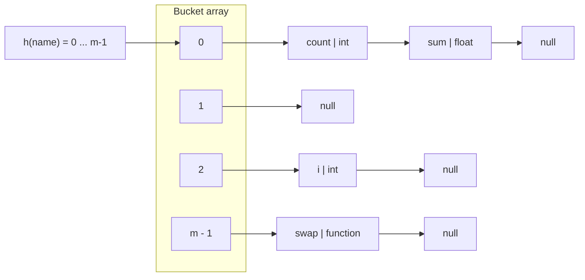
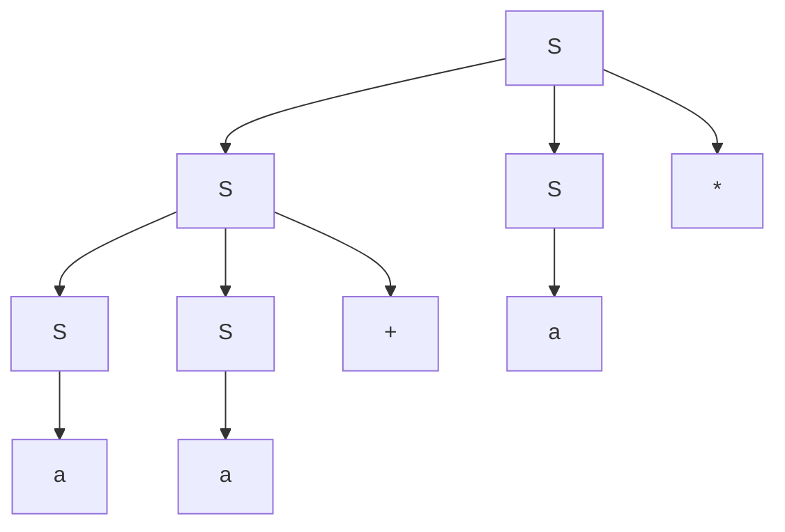
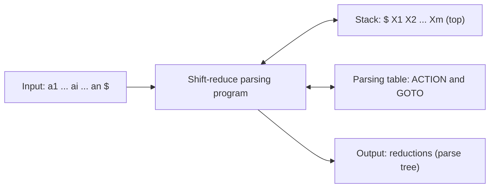
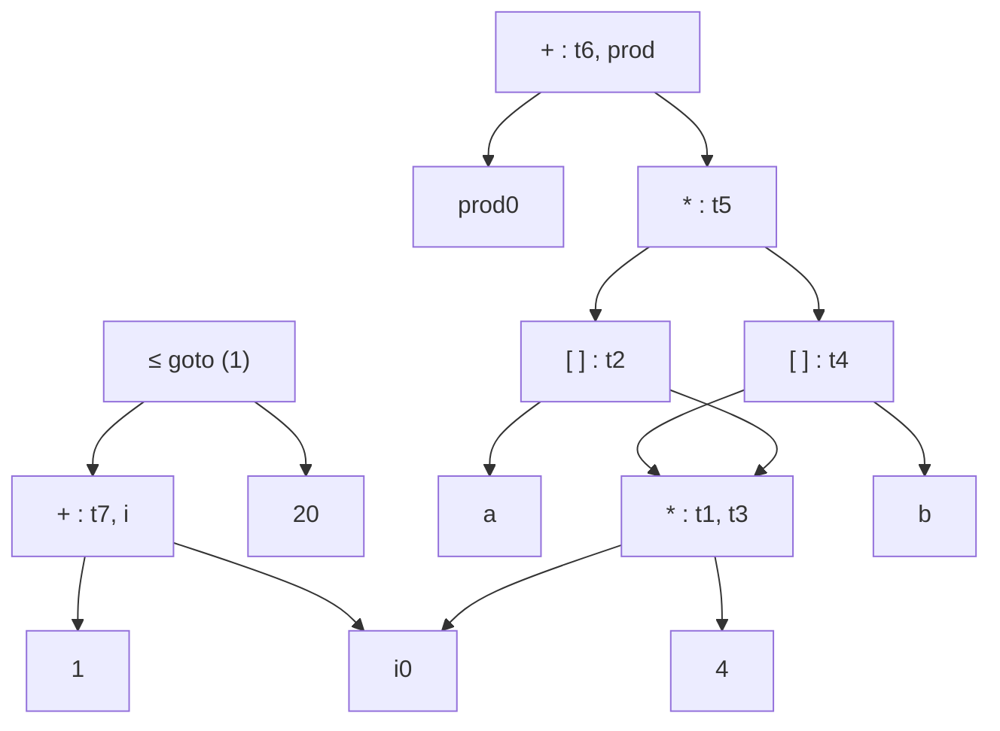

# Compiler Design PYQ Solutions: Remaining Questions

## Q1. Hash-table based symbol table [3 marks]

> **2024 End Q1(a):** Describe hash-table based data structures for symbol table management.
>
> **2025 End Q5(b), second part:** How hashing can be used to design symbol-table?

The symbol table is searched every time a name is seen and gets a new entry for every declaration, so both **lookup** and **insert** must be fast. A hash table gives close to constant time for both.

**Structure (hashing with chaining):**

1. An array of **m buckets** (m is usually a prime number). Each bucket holds a pointer to a linked list.
2. A **hash function** h(name) maps a name to a bucket number from 0 to m − 1. For example, add up the character codes of the name, multiplying by a constant at each step, and take the result mod m.
3. Each bucket's list holds the entries of all names that hash to that bucket. An entry stores the name and its attributes (type, scope, offset and so on) and a pointer to the next entry.



**Operations:**

| Operation | Steps |
| :--- | :--- |
| lookup(name) | compute h(name), then search only that bucket's list |
| insert(name) | compute h(name), then add a new entry at the front of that list |

With n names in m buckets, a list has about n/m entries, so the average cost is O(1 + n/m). Two names that hash to the same bucket (a **collision**) simply share one list.

**Scopes:** for block-structured languages, keep one hash table per scope on a stack. Entering a block pushes a new table, and leaving it pops the table. A lookup searches the innermost (top) table first and then the outer tables.

---

## Q2. Postfix grammar: derivations, parse tree and ambiguity [4 marks]

> **2025 Mid Q2(b):** Consider the following Context Free Grammar where S is the start symbol: S → SS+ | SS\* | a, and the string aa+a\*.  
> i. Give the leftmost derivation of the string. ii. Give rightmost derivation of the string. iii. Give the parse tree of the string. iv. Is the grammar ambiguous or unambiguous? Justify your answer.

**i. Leftmost derivation** (always replace the leftmost S):

S ⇒ SS\* ⇒ SS+S\* ⇒ aS+S\* ⇒ aa+S\* ⇒ aa+a\*

**ii. Rightmost derivation** (always replace the rightmost S):

S ⇒ SS\* ⇒ Sa\* ⇒ SS+a\* ⇒ Sa+a\* ⇒ aa+a\*

**iii. Parse tree:**



The leaves read left to right give a a + a \*.

**iv. The grammar is unambiguous.**

The grammar generates **postfix** expressions: every operator comes after its two operands. A postfix string can be grouped in only one way:

- The last symbol decides the production used at the root: `a` means S → a, `+` means S → SS+, and `*` means S → SS\*.
- Reading left to right, each operator must combine the two complete subexpressions just before it. This is how a stack evaluates postfix: push for `a`, and for an operator pop two and push one. The choice is forced at every step.

In aa+a\*, the `+` must combine the first two a's, and the `*` must combine (aa+) with the last a. No other grouping exists, so the string has exactly one parse tree. This holds for every string, so the grammar is unambiguous. The leftmost and rightmost derivations above are two orders of building the **same** tree.

---

## Q3. Is the grammar S → L = R | R ambiguous? [4 marks]

> **2025 End Q2(a):** Consider the following Context Free Grammar where S is the start symbol: S → L = R, S → R, L → \*R, L → id, R → L. Check whether the grammar is ambiguous or not.

**The grammar is unambiguous.**

A grammar is ambiguous if some string has two different parse trees (two different leftmost derivations). Here every string has only one:

1. **The `=` decides the first step.** A string containing `=` can only come from S → L = R, and a string without `=` can only come from S → R. The grammar has only one `=`, so it is clear which part is L and which part is R.
2. **L and R have only one choice each.**
   - L → \*R if the string starts with `*`, and L → id if it is `id`. The first symbol decides.
   - R has a single production, R → L.

So at every step of a leftmost derivation only one production can be used. Examples:

| String | The only leftmost derivation |
| :--- | :--- |
| id = id | S ⇒ L = R ⇒ id = R ⇒ id = L ⇒ id = id |
| \*id = id | S ⇒ L = R ⇒ \*R = R ⇒ \*L = R ⇒ \*id = R ⇒ \*id = L ⇒ \*id = id |
| \*id | S ⇒ R ⇒ L ⇒ \*R ⇒ \*L ⇒ \*id |

A second proof is in Q14: the canonical LR(1) (CLR) table of this grammar has no conflicts. Every LR(1) grammar is unambiguous.

The grammar is **not SLR(1)** (see Q12). That is a weakness of the SLR method, not ambiguity.

---

## Q4. Left factoring [2 marks]

> **2023 End Q1(b):** What do you mean by left factoring of grammar? Explain.

**Left factoring** rewrites productions of a non-terminal that start with the same prefix, so that a top-down (predictive) parser can choose a production by looking at only the next input symbol.

If A → αβ₁ | αβ₂, the parser cannot tell from the next symbol which alternative to use, because both start with α. The common prefix α is taken out and the choice is postponed until α has been read:

A → αA'  
A' → β₁ | β₂

**Example (dangling else):**

S → if E then S | if E then S else S

becomes

S → if E then S S'  
S' → else S | ε

---

## Q5. Recursive descent parsing [4 marks]

> **2025 End Q2(b):** What is recursive descent parsing? List the problems faced in designing such a parser.

**Recursive descent parsing** is a top-down method. The parser has one procedure for each non-terminal. The procedure for A chooses a production A → X₁X₂…Xₖ and goes through the right-hand side: for a terminal it matches the input symbol, and for a non-terminal it calls that non-terminal's procedure. Parsing starts by calling the procedure for the start symbol, and the input is accepted if that call returns after consuming all of the input.

```c
void A() {
    choose an A-production, A -> X1 X2 ... Xk;
    for (i = 1 to k) {
        if (Xi is a non-terminal) call Xi();
        else if (Xi == current input symbol) advance input;
        else error();   /* or backtrack */
    }
}
```

**Problems in designing a recursive descent parser:**

1. **Left recursion.** For A → Aα, the procedure A() calls A() again without consuming any input, so it loops forever. Left recursion must be eliminated first.
2. **Backtracking.** If the wrong production is chosen, the parser must go back to an earlier input position and try another alternative. This is slow, and actions already done (such as symbol-table entries) may have to be undone.
3. **Common prefixes.** Alternatives such as A → αβ₁ | αβ₂ cannot be told apart from the next symbol. The grammar must be left factored to avoid backtracking.
4. **Order of alternatives.** With backtracking, the order in which alternatives are tried can change which string is accepted. For example, with A → a | ab, trying A → a first may make the parser fail on input `ab`.
5. **Error reporting.** When the parser backtracks, it is hard to tell where the real error is, so error messages are poor.

---

## Q6. Left recursion elimination and LL(1) check for the A, B grammar [2 + 6 marks]

> **2025 Mid Q3:** Consider the following Grammar, G = ({A, B}, {a, b, c, d}, P, A) where P is the set of production rules as follows:  
> A → Aa | Aab | Bc  
> B → BAa | d  
> (a) Eliminate left recursion from the above grammar. (b) Compute FIRST & FOLLOW set for the non-terminals. Check the grammar is LL(1) or not; Show the parsing for dcab. [2 + 6]

### (a) Eliminating left recursion

**Rule:** A → Aα₁ | … | Aαₘ | β₁ | … | βₙ becomes

A → β₁A' | … | βₙA'  
A' → α₁A' | … | αₘA' | ε

**For A** (α₁ = a, α₂ = ab, β = Bc):

A → BcA'  
A' → aA' | abA' | ε

**For B** (α = Aa, β = d). B → BAa starts with B, not with A, so no substitution is needed:

B → dB'  
B' → AaB' | ε

**Grammar without left recursion:**

A → BcA'  
A' → aA' | abA' | ε  
B → dB'  
B' → AaB' | ε

### (b) FIRST, FOLLOW and the LL(1) check

| Non-terminal | FIRST | FOLLOW |
| :--- | :--- | :--- |
| A | { d } | { a, $ } |
| A' | { a, ε } | { a, $ } |
| B | { d } | { c } |
| B' | { d, ε } | { c } |

- FIRST(A) = FIRST(B) = { d }, because A → BcA' and B → dB'.
- FOLLOW(A) contains $ (start symbol) and a (from B' → AaB').
- FOLLOW(A') = FOLLOW(A), since A' is at the end of A → BcA' and A' → aA' | abA'.
- FOLLOW(B) = { c } from A → BcA', and FOLLOW(B') = FOLLOW(B).

**Parsing table:**

| | a | b | c | d | $ |
| :--- | :--- | :--- | :--- | :--- | :--- |
| A | | | | A → BcA' | |
| A' | A' → aA'<br>A' → abA'<br>A' → ε | | | | A' → ε |
| B | | | | B → dB' | |
| B' | | | B' → ε | B' → AaB' | |

**The grammar is not LL(1).** The entry M[A', a] has three productions:

- A' → aA' and A' → abA' both start with a, so FIRST(aA') ∩ FIRST(abA') = { a }.
- A' → ε is also placed under a, because a ∈ FOLLOW(A').

**Parsing dcab.** At M[A', a] the parser must guess. Choosing A' → abA' gives:

| Step | Stack | Input | Action |
| :--- | :--- | :--- | :--- |
| 1 | $ A | d c a b $ | A → BcA' |
| 2 | $ A' c B | d c a b $ | B → dB' |
| 3 | $ A' c B' d | d c a b $ | match d |
| 4 | $ A' c B' | c a b $ | B' → ε |
| 5 | $ A' c | c a b $ | match c |
| 6 | $ A' | a b $ | conflict at M[A', a]; choose A' → abA' |
| 7 | $ A' b a | a b $ | match a |
| 8 | $ A' b | b $ | match b |
| 9 | $ A' | $ | A' → ε |
| 10 | $ | $ | accept |

dcab is in the language. A deterministic LL(1) parser cannot parse it without guessing, because of the conflict at step 6.

---

## Q7. Left recursion and LL(1) parsing for the E, T, F grammar [2 + 6 marks / 3 + 8 marks]

> **2024 Mid Q3, 2023 Mid Q3:** Consider the following Grammar production rules where E is the start symbol:  
> E → E + T | T  
> T → TF | F  
> F → F\* | a | b  
> (a) Eliminate left recursion from the above grammar. (b) Compute FIRST & FOLLOW set for the non-terminals. Check the grammar is LL(1) or not; Show the parsing for a + a + a. [2 + 6]
>
> **2024 End Q3:** For the same grammar: (a) Write the rules to eliminate left recursion in a grammar. Eliminate left recursion from the above grammar. (b) Compute FIRST & FOLLOW set for the non-terminals. Check the grammar is LL(1) or not; Show the parsing for a + b + a. [3 + (4 + 1 + 3)]

### (a) Rules to eliminate left recursion

A grammar is **left recursive** if it has a non-terminal A with A ⇒⁺ Aα. A top-down parser loops forever on such a grammar.

**Immediate left recursion.** Group the A-productions as

A → Aα₁ | Aα₂ | … | Aαₘ | β₁ | β₂ | … | βₙ

where no βᵢ starts with A. Replace them by

A → β₁A' | β₂A' | … | βₙA'  
A' → α₁A' | α₂A' | … | αₘA' | ε

**General algorithm** (also removes indirect left recursion; the grammar must have no cycles or ε-productions):

1. Arrange the non-terminals in some order A₁, A₂, …, Aₙ.
2. For i = 1 to n:
   1. For j = 1 to i − 1, replace each production Aᵢ → Aⱼγ by Aᵢ → δ₁γ | δ₂γ | … | δₖγ, where Aⱼ → δ₁ | δ₂ | … | δₖ are the current Aⱼ-productions.
   2. Eliminate the immediate left recursion among the Aᵢ-productions.

**Applying the rule to the grammar:**

| Productions | α | β | Result |
| :--- | :--- | :--- | :--- |
| E → E + T \| T | + T | T | E → TE', E' → +TE' \| ε |
| T → TF \| F | F | F | T → FT', T' → FT' \| ε |
| F → F\* \| a \| b | \* | a, b | F → aF' \| bF', F' → \*F' \| ε |

**Grammar without left recursion:**

E → TE'  
E' → +TE' | ε  
T → FT'  
T' → FT' | ε  
F → aF' | bF'  
F' → \*F' | ε

### (b) FIRST, FOLLOW, LL(1) table and parsing

| Non-terminal | FIRST | FOLLOW |
| :--- | :--- | :--- |
| E | { a, b } | { $ } |
| E' | { +, ε } | { $ } |
| T | { a, b } | { +, $ } |
| T' | { a, b, ε } | { +, $ } |
| F | { a, b } | { a, b, +, $ } |
| F' | { \*, ε } | { a, b, +, $ } |

- FOLLOW(T) = (FIRST(E') − ε) ∪ FOLLOW(E) = { +, $ }.
- FOLLOW(F) = (FIRST(T') − ε) ∪ FOLLOW(T') = { a, b, +, $ }.
- FOLLOW(F') = FOLLOW(F).

**Parsing table:**

| | a | b | + | \* | $ |
| :--- | :--- | :--- | :--- | :--- | :--- |
| E | E → TE' | E → TE' | | | |
| E' | | | E' → +TE' | | E' → ε |
| T | T → FT' | T → FT' | | | |
| T' | T' → FT' | T' → FT' | T' → ε | | T' → ε |
| F | F → aF' | F → bF' | | | |
| F' | F' → ε | F' → ε | F' → ε | F' → \*F' | F' → ε |

**The grammar is LL(1):** every entry has at most one production. For each ε-production, FOLLOW does not meet FIRST of the other alternative. For example, FIRST(FT') = { a, b } and FOLLOW(T') = { +, $ } are disjoint.

**Parsing a + a + a:**

| Step | Stack | Input | Action |
| :--- | :--- | :--- | :--- |
| 1 | $ E | a + a + a $ | E → TE' |
| 2 | $ E' T | a + a + a $ | T → FT' |
| 3 | $ E' T' F | a + a + a $ | F → aF' |
| 4 | $ E' T' F' a | a + a + a $ | match a |
| 5 | $ E' T' F' | + a + a $ | F' → ε |
| 6 | $ E' T' | + a + a $ | T' → ε |
| 7 | $ E' | + a + a $ | E' → +TE' |
| 8 | $ E' T + | + a + a $ | match + |
| 9 | $ E' T | a + a $ | T → FT' |
| 10 | $ E' T' F | a + a $ | F → aF' |
| 11 | $ E' T' F' a | a + a $ | match a |
| 12 | $ E' T' F' | + a $ | F' → ε |
| 13 | $ E' T' | + a $ | T' → ε |
| 14 | $ E' | + a $ | E' → +TE' |
| 15 | $ E' T + | + a $ | match + |
| 16 | $ E' T | a $ | T → FT' |
| 17 | $ E' T' F | a $ | F → aF' |
| 18 | $ E' T' F' a | a $ | match a |
| 19 | $ E' T' F' | $ | F' → ε |
| 20 | $ E' T' | $ | T' → ε |
| 21 | $ E' | $ | E' → ε |
| 22 | $ | $ | accept |

**Parsing a + b + a** follows the same 22 steps. The only differences are steps 10 and 11, where the second operand is b:

| Step | Stack | Input | Action |
| :--- | :--- | :--- | :--- |
| 9 | $ E' T | b + a $ | T → FT' |
| 10 | $ E' T' F | b + a $ | F → bF' |
| 11 | $ E' T' F' b | b + a $ | match b |
| 12 | $ E' T' F' | + a $ | F' → ε |

All other rows are the same as for a + a + a, with b in place of the second a in the Input column. The string is accepted at step 22.

---

## Q8. LL(1) check and parsing of ghhg [3 + 8 marks]

> **2023 End Q2:** Consider the following Grammar production rules where S is the start symbol:  
> S → ACB | CbB | Ba  
> A → da | BC  
> B → g | ε  
> C → h | ε  
> (a) Eliminate left recursion from the above grammar. (b) Compute FIRST & FOLLOW set for the non-terminals. Check the grammar is LL(1) or not; Show the parsing for "ghhg". [3 + (4 + 1 + 3)]

### (a) Left recursion

The grammar has **no left recursion**, so no change is needed:

- B and C produce only g, h or ε, never a non-terminal.
- A → da | BC: A starts with d or with B, and B never derives A.
- S → ACB | CbB | Ba: S does not appear on any right-hand side, so S ⇒⁺ Sα is impossible.

No non-terminal derives a string that starts with itself, either directly or indirectly.

### (b) FIRST, FOLLOW, LL(1) check and parsing

**FIRST sets:**

- FIRST(B) = { g, ε } and FIRST(C) = { h, ε }.
- FIRST(A) = { d } ∪ FIRST(BC) = { d, g, h, ε }, since B and C can both be ε.
- FIRST(S):
  - FIRST(ACB) = { d, g, h, ε }
  - FIRST(CbB) = { h, b }
  - FIRST(Ba) = { g, a }
  - So FIRST(S) = { a, b, d, g, h, ε }.

**FOLLOW sets:**

- FOLLOW(S) = { $ }.
- FOLLOW(A): from S → ACB, it is FIRST(CB) − ε = { h, g }, plus FOLLOW(S) = { $ } since CB ⇒ ε. So FOLLOW(A) = { g, h, $ }.
- FOLLOW(B) = { a, g, h, $ }:
  - $ from the end of S → ACB and S → CbB.
  - a from S → Ba.
  - From A → BC: FIRST(C) − ε = { h }, plus FOLLOW(A) = { g, h, $ } since C ⇒ ε.
- FOLLOW(C) = { b, g, h, $ }:
  - b from S → CbB.
  - g and $ from S → ACB (FIRST(B) and FOLLOW(S)).
  - FOLLOW(A) from A → BC.

| Non-terminal | FIRST | FOLLOW |
| :--- | :--- | :--- |
| S | { a, b, d, g, h, ε } | { $ } |
| A | { d, g, h, ε } | { g, h, $ } |
| B | { g, ε } | { a, g, h, $ } |
| C | { h, ε } | { b, g, h, $ } |

**Parsing table:**

| | a | b | d | g | h | $ |
| :--- | :--- | :--- | :--- | :--- | :--- | :--- |
| S | S → Ba | S → CbB | S → ACB | S → ACB<br>S → Ba | S → ACB<br>S → CbB | S → ACB |
| A | | | A → da | A → BC | A → BC | A → BC |
| B | B → ε | | | B → g<br>B → ε | B → ε | B → ε |
| C | | C → ε | | C → ε | C → h<br>C → ε | C → ε |

**The grammar is not LL(1).** Four entries have two productions:

| Entry | Productions | Reason |
| :--- | :--- | :--- |
| M[S, g] | S → ACB, S → Ba | g is in FIRST(ACB) and in FIRST(Ba) |
| M[S, h] | S → ACB, S → CbB | h is in FIRST(ACB) and in FIRST(CbB) |
| M[B, g] | B → g, B → ε | g ∈ FOLLOW(B) |
| M[C, h] | C → h, C → ε | h ∈ FOLLOW(C) |

**Parsing ghhg.** At each conflict, the parser has to pick the right production. With the choices shown, the string is accepted:

| Step | Stack | Input | Action |
| :--- | :--- | :--- | :--- |
| 1 | $ S | g h h g $ | S → ACB (conflict at M[S, g]) |
| 2 | $ B C A | g h h g $ | A → BC |
| 3 | $ B C C B | g h h g $ | B → g (conflict at M[B, g]) |
| 4 | $ B C C g | g h h g $ | match g |
| 5 | $ B C C | h h g $ | C → h (conflict at M[C, h]) |
| 6 | $ B C h | h h g $ | match h |
| 7 | $ B C | h g $ | C → h (conflict at M[C, h]) |
| 8 | $ B h | h g $ | match h |
| 9 | $ B | g $ | B → g (conflict at M[B, g]) |
| 10 | $ g | g $ | match g |
| 11 | $ | $ | accept |

The derivation is S ⇒ ACB ⇒ BCCB ⇒ gCCB ⇒ ghCB ⇒ ghhB ⇒ ghhg. A predictive parser cannot make these choices with one symbol of lookahead, which confirms the grammar is not LL(1).

---

## Q9. FIRST, FOLLOW, predictive table and LL(1) check for S → ABD [3 + 3 + 3 + 2 marks]

> **2025 End Q3:** Consider the following grammar production rules where S is the start symbol:  
> S → ABD  
> A → a | DB | ε  
> B → gD | dA | ε  
> D → e | f  
> (a) Construct FIRST and FOLLOW for each non-terminal of the above grammar. (b) Construct the predictive parsing table for the above grammar. (c) Show the parsing on a valid string and on an invalid string. (d) Check whether the grammar is LL(1). Give justification.

### (a) FIRST and FOLLOW

**FIRST sets:**

- FIRST(D) = { e, f }.
- FIRST(B) = { g, d, ε }.
- FIRST(A) = { a } ∪ FIRST(DB) ∪ { ε } = { a, e, f, ε }.
- FIRST(S) = FIRST(ABD) = (FIRST(A) − ε) ∪ (FIRST(B) − ε) ∪ FIRST(D) = { a, d, e, f, g }.
  - A and B can be ε, and D cannot.

**FOLLOW sets:**

- FOLLOW(S) = { $ }.
- FOLLOW(A): from S → ABD, it gets (FIRST(B) − ε) ∪ FIRST(D) = { d, g, e, f }. From B → dA, it also gets FOLLOW(B).
- FOLLOW(B): from S → ABD, it gets FIRST(D) = { e, f }. From A → DB, it also gets FOLLOW(A).
- So FOLLOW(A) = FOLLOW(B) = { d, e, f, g }.
- FOLLOW(D) = { $, d, e, f, g }:
  - $ from S → ABD.
  - (FIRST(B) − ε) and FOLLOW(A) from A → DB.
  - FOLLOW(B) from B → gD.

| Non-terminal | FIRST | FOLLOW |
| :--- | :--- | :--- |
| S | { a, d, e, f, g } | { $ } |
| A | { a, e, f, ε } | { d, e, f, g } |
| B | { d, g, ε } | { d, e, f, g } |
| D | { e, f } | { $, d, e, f, g } |

### (b) Predictive parsing table

For each A → α: put A → α in M[A, t] for every t in FIRST(α). If α ⇒ ε, also put it in M[A, t] for every t in FOLLOW(A).

| | a | d | e | f | g | $ |
| :--- | :--- | :--- | :--- | :--- | :--- | :--- |
| S | S → ABD | S → ABD | S → ABD | S → ABD | S → ABD | |
| A | A → a | A → ε | A → DB<br>A → ε | A → DB<br>A → ε | A → ε | |
| B | | B → dA<br>B → ε | B → ε | B → ε | B → gD<br>B → ε | |
| D | | | D → e | D → f | | |

### (c) Parsing a valid and an invalid string

**Valid string: ae** (S ⇒ ABD ⇒ aBD ⇒ aD ⇒ ae)

| Step | Stack | Input | Action |
| :--- | :--- | :--- | :--- |
| 1 | $ S | a e $ | S → ABD |
| 2 | $ D B A | a e $ | A → a |
| 3 | $ D B a | a e $ | match a |
| 4 | $ D B | e $ | B → ε |
| 5 | $ D | e $ | D → e |
| 6 | $ e | e $ | match e |
| 7 | $ | $ | accept |

**Invalid string: aa**

| Step | Stack | Input | Action |
| :--- | :--- | :--- | :--- |
| 1 | $ S | a a $ | S → ABD |
| 2 | $ D B A | a a $ | A → a |
| 3 | $ D B a | a a $ | match a |
| 4 | $ D B | a $ | error: M[B, a] is empty |

### (d) Is the grammar LL(1)?

**No.** Four entries of the table hold two productions:

| Entry | Productions | Reason |
| :--- | :--- | :--- |
| M[A, e], M[A, f] | A → DB, A → ε | FIRST(DB) = { e, f } meets FOLLOW(A) = { d, e, f, g } |
| M[B, d] | B → dA, B → ε | d ∈ FIRST(dA) and d ∈ FOLLOW(B) |
| M[B, g] | B → gD, B → ε | g ∈ FIRST(gD) and g ∈ FOLLOW(B) |

A grammar is LL(1) only if no table entry has more than one production. Equivalently, for each A → α | β with β ⇒ ε, FIRST(α) and FOLLOW(A) must be disjoint, and that fails here.

---

## Q10. Shift-reduce parser: model, uses and conflicts [3 marks / 5 marks]

> **2025 Mid Q4(a), 2024 Mid Q4(a), 2023 Mid Q4(a):** What are the use of shift reduces parser? Explain conflicts that may occur during shift-reduce parsing. [3]
>
> **2025 End Q4(a), 2024 End Q4(a), 2023 End Q3(a):** Explain the model of shift reduces parser? Explain conflicts that may occur during shift-reduce parsing. [5]

**Shift-reduce parsing** is bottom-up parsing. It builds the parse tree from the leaves (the input) up to the root (the start symbol). It reduces the input string to the start symbol, tracing a **rightmost derivation in reverse**.

### Model



- **Stack:** holds grammar symbols (in an LR parser, states). It starts as `$`.
- **Input buffer:** holds the string followed by `$`.
- **Parsing table:** an LR parser uses ACTION[state, terminal] and GOTO[state, non-terminal] to decide each move.

The parser makes four kinds of moves:

| Move | Meaning |
| :--- | :--- |
| Shift | move the next input symbol onto the top of the stack |
| Reduce | the top of the stack is a handle β for some A → β: pop β and push A |
| Accept | the stack holds `$ S` and the input is `$`: parsing is successful |
| Error | no valid move: call the error-recovery routine |

**Example:** parsing aa+ with S → SS+ | SS\* | a:

| Stack | Input | Action |
| :--- | :--- | :--- |
| $ | a a + $ | shift |
| $ a | a + $ | reduce S → a |
| $ S | a + $ | shift |
| $ S a | + $ | reduce S → a |
| $ S S | + $ | shift |
| $ S S + | $ | reduce S → SS+ |
| $ S | $ | accept |

### Uses

- It handles a larger class of grammars than predictive (LL) parsing, including all LR grammars. Most programming-language constructs can be written as LR grammars.
- Left-recursive grammars work directly, so the grammar does not have to be rewritten.
- It works in one left-to-right pass without backtracking, in time proportional to the input length.
- It detects a syntax error as soon as possible in a left-to-right scan.
- Parser generators such as YACC/Bison build shift-reduce (LALR) parsers.

### Conflicts

For some grammars, the parser cannot decide on the next move from the stack and the next input symbol:

**1. Shift/reduce conflict:** both a shift and a reduce are possible. Example (dangling else):

S → if E then S | if E then S else S

With `if E then S` on the stack and `else` as the next input, the parser can reduce `if E then S` to S, or shift `else` to build the longer statement. Parsers usually resolve this by shifting, which matches each `else` with the nearest `if`.

**2. Reduce/reduce conflict:** two different reductions are possible. Example: with A → id and B → id, when `id` is on top of the stack the parser cannot tell whether to reduce it to A or to B. For instance, in a language where `p(i)` can be a procedure call or an array reference, the name `i` can be reduced to an expression or to a parameter.

A grammar whose LR table has such a conflict is not LR (for that method). An ambiguous grammar always gives conflicts.

---

## Q11. Handle and handle pruning [2 marks / 5 marks]

> **2023 End Q1(c):** What is a handle in bottom up parsing? Explain. [2]
>
> **2025 Mid Q4(b), 2024 Mid Q4(b), 2023 Mid Q4(b):** What do you mean by handle pruning in bottom-up parsing? Explain with the help of the grammar S → SS+ | SS\* | a and input string aaa\*a++. In each reduction indicate the corresponding handle. [5]

**Handle.** A handle of a right-sentential form γ is a production A → β and a position in γ where β can be replaced by A to give the previous right-sentential form of a rightmost derivation. If

S ⇒\*ᵣₘ αAw ⇒ᵣₘ αβw

then A → β at the position after α is a handle of αβw. The string w to the right of a handle contains only terminals.

A handle is not just any substring that matches a right-hand side. Reducing it must lead back to the start symbol. In a shift-reduce parser the handle always appears on **top of the stack**.

**Handle pruning.** A rightmost derivation in reverse is found by repeatedly locating the handle in the current right-sentential form and replacing it by the left side of its production ("pruning the handle"). This continues until only the start symbol remains:

1. Start with the input w = γₙ.
2. Find the handle βₙ in γₙ and replace it with Aₙ (production Aₙ → βₙ) to get γₙ₋₁.
3. Repeat until γ₀ = S.

**Example: aaa\*a++ with S → SS+ | SS\* | a.**

| Right-sentential form | Handle | Reducing production |
| :--- | :--- | :--- |
| a a a \* a + + | first a | S → a |
| S a a \* a + + | a (2nd symbol) | S → a |
| S S a \* a + + | a (3rd symbol) | S → a |
| S S S \* a + + | S S \* (symbols 2–4) | S → SS\* |
| S S a + + | a (3rd symbol) | S → a |
| S S S + + | S S + (symbols 2–4) | S → SS+ |
| S S + | S S + | S → SS+ |
| S | | accept |

Read from bottom to top, the table is the rightmost derivation:

S ⇒ SS+ ⇒ SSS++ ⇒ SSa++ ⇒ SSS\*a++ ⇒ SSa\*a++ ⇒ Saa\*a++ ⇒ aaa\*a++

---

## Q12. Is the grammar S → L = R | R SLR(1)? [5 + 3 marks]

> **2025 Mid Q5:** Check whether the following grammar is SLR(1) or not. Explain your answer with Reasons:  
> S → L = R, S → R, L → \*R, L → id, R → L

**Augmented grammar:**

| No. | Production |
| :--- | :--- |
| 0 | S' → S |
| 1 | S → L = R |
| 2 | S → R |
| 3 | L → \*R |
| 4 | L → id |
| 5 | R → L |

**FOLLOW sets:**

- FOLLOW(S) = { $ }.
- = ∈ FOLLOW(L), from S → L = R.
- FOLLOW(R) gets FOLLOW(S) = { $ } from S → R, and FOLLOW(L) from L → \*R.
- FOLLOW(L) gets FOLLOW(R) from R → L.
- So FOLLOW(L) = FOLLOW(R) = { =, $ }.

**Canonical collection of LR(0) items:**

| State | Items | Transitions |
| :--- | :--- | :--- |
| I0 | S' → ·S<br>S → ·L = R<br>S → ·R<br>L → ·\*R<br>L → ·id<br>R → ·L | S → I1, L → I2, R → I3, \* → I4, id → I5 |
| I1 | S' → S· | |
| I2 | S → L· = R<br>R → L· | = → I6 |
| I3 | S → R· | |
| I4 | L → \*·R<br>R → ·L<br>L → ·\*R<br>L → ·id | R → I8, L → I7, \* → I4, id → I5 |
| I5 | L → id· | |
| I6 | S → L = ·R<br>R → ·L<br>L → ·\*R<br>L → ·id | R → I9, L → I7, \* → I4, id → I5 |
| I7 | R → L· | |
| I8 | L → \*R· | |
| I9 | S → L = R· | |

**SLR parsing table** (sN = shift to state N, rN = reduce by production N):

| State | = | \* | id | $ | S | L | R |
| :--- | :--- | :--- | :--- | :--- | :--- | :--- | :--- |
| 0 | | s4 | s5 | | 1 | 2 | 3 |
| 1 | | | | acc | | | |
| 2 | **s6 / r5** | | | r5 | | | |
| 3 | | | | r2 | | | |
| 4 | | s4 | s5 | | | 7 | 8 |
| 5 | r4 | | | r4 | | | |
| 6 | | s4 | s5 | | | 7 | 9 |
| 7 | r5 | | | r5 | | | |
| 8 | r3 | | | r3 | | | |
| 9 | | | | r1 | | | |

**The grammar is not SLR(1).** State I2 has a shift/reduce conflict on `=`:

- The item S → L· = R says **shift** `=` (go to I6).
- The item R → L· says **reduce** by R → L on every symbol in FOLLOW(R) = { =, $ }, which includes `=`.

So ACTION[2, =] = { s6, r5 }.

SLR reduces by R → L whenever the next symbol is in FOLLOW(R). But no right-sentential form starts with R = …, so reducing there is never correct. SLR's FOLLOW sets are too coarse to see this. The grammar is not ambiguous (Q3), and the canonical LR(1) table has no conflict (Q14).

---

## Q13. SLR sets of items and parsing table for the E, T, F grammar [5 + 3 marks]

> **2023 Mid Q5:** Construct the SLR sets of items for the grammar where E is the start symbol:  
> E → E + T | T  
> T → TF | F  
> F → F\* | a | b  
> Show the SLR parsing table for this grammar. Is the grammar SLR?

**Augmented grammar:**

| No. | Production |
| :--- | :--- |
| 0 | E' → E |
| 1 | E → E + T |
| 2 | E → T |
| 3 | T → TF |
| 4 | T → F |
| 5 | F → F\* |
| 6 | F → a |
| 7 | F → b |

**FOLLOW sets:**

- FOLLOW(E) = { +, $ }.
- FOLLOW(T) = FOLLOW(E) ∪ FIRST(F) = { +, $, a, b }, since T → TF puts FIRST(F) after T.
- FOLLOW(F) = FOLLOW(T) ∪ { \* } = { +, \*, a, b, $ }.

**Canonical collection of LR(0) items:**

| State | Items | Transitions |
| :--- | :--- | :--- |
| I0 | E' → ·E<br>E → ·E + T<br>E → ·T<br>T → ·TF<br>T → ·F<br>F → ·F\*<br>F → ·a<br>F → ·b | E → I1, T → I2, F → I3, a → I4, b → I5 |
| I1 | E' → E·<br>E → E· + T | + → I6 |
| I2 | E → T·<br>T → T·F<br>F → ·F\*<br>F → ·a<br>F → ·b | F → I7, a → I4, b → I5 |
| I3 | T → F·<br>F → F·\* | \* → I8 |
| I4 | F → a· | |
| I5 | F → b· | |
| I6 | E → E + ·T<br>T → ·TF<br>T → ·F<br>F → ·F\*<br>F → ·a<br>F → ·b | T → I9, F → I3, a → I4, b → I5 |
| I7 | T → TF·<br>F → F·\* | \* → I8 |
| I8 | F → F\*· | |
| I9 | E → E + T·<br>T → T·F<br>F → ·F\*<br>F → ·a<br>F → ·b | F → I7, a → I4, b → I5 |

**SLR parsing table:**

| State | + | \* | a | b | $ | E | T | F |
| :--- | :--- | :--- | :--- | :--- | :--- | :--- | :--- | :--- |
| 0 | | | s4 | s5 | | 1 | 2 | 3 |
| 1 | s6 | | | | acc | | | |
| 2 | r2 | | s4 | s5 | r2 | | | 7 |
| 3 | r4 | s8 | r4 | r4 | r4 | | | |
| 4 | r6 | r6 | r6 | r6 | r6 | | | |
| 5 | r7 | r7 | r7 | r7 | r7 | | | |
| 6 | | | s4 | s5 | | | 9 | 3 |
| 7 | r3 | s8 | r3 | r3 | r3 | | | |
| 8 | r5 | r5 | r5 | r5 | r5 | | | |
| 9 | r1 | | s4 | s5 | r1 | | | 7 |

**The grammar is SLR(1):** no entry has more than one action. The states that hold both a complete item and a shift are checked below:

| State | Shift on | Reduce on | Overlap |
| :--- | :--- | :--- | :--- |
| I1 | + | $ (accept) | none |
| I2 | a, b | FOLLOW(E) = { +, $ } for E → T | none |
| I3 | \* | FOLLOW(T) = { +, a, b, $ } for T → F | none |
| I7 | \* | FOLLOW(T) = { +, a, b, $ } for T → TF | none |
| I9 | a, b | FOLLOW(E) = { +, $ } for E → E + T | none |

---

## Q14. CLR parsing table for S → L = R | R [6 marks]

> **2023 End Q3(b):** Construct the CLR parsing table for the following grammar where S is the start symbol:  
> S → L = R | R  
> L → \*R | id  
> R → L

**Augmented grammar:** (0) S' → S, (1) S → L = R, (2) S → R, (3) L → \*R, (4) L → id, (5) R → L.

An LR(1) item [A → α·β, a] carries a lookahead a. A reduction by A → α is done only on its own lookahead a, not on all of FOLLOW(A). When closing [A → α·Bβ, a], each item [B → ·γ, b] is added for every b in FIRST(βa).

**Canonical collection of LR(1) items** (lookaheads after the comma, `=/$` meaning both):

| State | Items | Transitions |
| :--- | :--- | :--- |
| I0 | [S' → ·S, $]<br>[S → ·L = R, $]<br>[S → ·R, $]<br>[L → ·\*R, =/$]<br>[L → ·id, =/$]<br>[R → ·L, $] | S → I1, L → I2, R → I3, \* → I4, id → I5 |
| I1 | [S' → S·, $] | |
| I2 | [S → L· = R, $]<br>[R → L·, $] | = → I6 |
| I3 | [S → R·, $] | |
| I4 | [L → \*·R, =/$]<br>[R → ·L, =/$]<br>[L → ·\*R, =/$]<br>[L → ·id, =/$] | R → I8, L → I7, \* → I4, id → I5 |
| I5 | [L → id·, =/$] | |
| I6 | [S → L = ·R, $]<br>[R → ·L, $]<br>[L → ·\*R, $]<br>[L → ·id, $] | R → I10, L → I9, \* → I11, id → I12 |
| I7 | [R → L·, =/$] | |
| I8 | [L → \*R·, =/$] | |
| I9 | [R → L·, $] | |
| I10 | [S → L = R·, $] | |
| I11 | [L → \*·R, $]<br>[R → ·L, $]<br>[L → ·\*R, $]<br>[L → ·id, $] | R → I13, L → I9, \* → I11, id → I12 |
| I12 | [L → id·, $] | |
| I13 | [L → \*R·, $] | |

In I0, the items for L get lookahead `=` from S → ·L = R and `$` from R → ·L.

**CLR parsing table:**

| State | = | \* | id | $ | S | L | R |
| :--- | :--- | :--- | :--- | :--- | :--- | :--- | :--- |
| 0 | | s4 | s5 | | 1 | 2 | 3 |
| 1 | | | | acc | | | |
| 2 | s6 | | | r5 | | | |
| 3 | | | | r2 | | | |
| 4 | | s4 | s5 | | | 7 | 8 |
| 5 | r4 | | | r4 | | | |
| 6 | | s11 | s12 | | | 9 | 10 |
| 7 | r5 | | | r5 | | | |
| 8 | r3 | | | r3 | | | |
| 9 | | | | r5 | | | |
| 10 | | | | r1 | | | |
| 11 | | s11 | s12 | | | 9 | 13 |
| 12 | | | | r4 | | | |
| 13 | | | | r3 | | | |

There are no conflicts, so the grammar is **CLR(1)**. In state 2, the item [R → L·, $] reduces only on `$`, so it no longer clashes with the shift on `=`. This removes the SLR conflict of Q12.

---

## Q15. CLR parsing table for S → CC, C → cC | d | ε [6 marks]

> **2025 End Q4(b), 2024 End Q4(b):** Construct the CLR parsing table for the following grammar where S is the start symbol:  
> S → CC  
> C → cC | d | ε

**Augmented grammar:** (0) S' → S, (1) S → CC, (2) C → cC, (3) C → d, (4) C → ε.

FIRST(C) = { c, d, ε }. In I0, the first C of S → ·CC is followed by C$, so its lookaheads are FIRST(C$) = { c, d, $ }.

**Canonical collection of LR(1) items:**

| State | Items | Transitions |
| :--- | :--- | :--- |
| I0 | [S' → ·S, $]<br>[S → ·CC, $]<br>[C → ·cC, c/d/$]<br>[C → ·d, c/d/$]<br>[C → ·, c/d/$] | S → I1, C → I2, c → I3, d → I4 |
| I1 | [S' → S·, $] | |
| I2 | [S → C·C, $]<br>[C → ·cC, $]<br>[C → ·d, $]<br>[C → ·, $] | C → I5, c → I6, d → I7 |
| I3 | [C → c·C, c/d/$]<br>[C → ·cC, c/d/$]<br>[C → ·d, c/d/$]<br>[C → ·, c/d/$] | C → I8, c → I3, d → I4 |
| I4 | [C → d·, c/d/$] | |
| I5 | [S → CC·, $] | |
| I6 | [C → c·C, $]<br>[C → ·cC, $]<br>[C → ·d, $]<br>[C → ·, $] | C → I9, c → I6, d → I7 |
| I7 | [C → d·, $] | |
| I8 | [C → cC·, c/d/$] | |
| I9 | [C → cC·, $] | |

**CLR parsing table:**

| State | c | d | $ | S | C |
| :--- | :--- | :--- | :--- | :--- | :--- |
| 0 | **s3 / r4** | **s4 / r4** | r4 | 1 | 2 |
| 1 | | | acc | | |
| 2 | s6 | s7 | r4 | | 5 |
| 3 | **s3 / r4** | **s4 / r4** | r4 | | 8 |
| 4 | r3 | r3 | r3 | | |
| 5 | | | r1 | | |
| 6 | s6 | s7 | r4 | | 9 |
| 7 | | | r3 | | |
| 8 | r2 | r2 | r2 | | |
| 9 | | | r2 | | |

**States 0 and 3 have shift/reduce conflicts on c and on d.** Each has the item [C → ·, c/d/$], which says reduce by C → ε, together with items that shift c and d.

The conflicts cannot be removed by any LR method, because the grammar is **ambiguous**. The string `c` has two parse trees:

- S ⇒ CC ⇒ cC C ⇒ c (first C → cC with inner C → ε, second C → ε)
- S ⇒ CC ⇒ C cC ⇒ c (first C → ε, second C → cC with inner C → ε)

So the grammar is not CLR(1). Without the ε-production (C → cC | d), the same construction gives no conflicts (see Q16).

---

## Q16. LALR(1) grammar and LALR parsing table [3 + 5 marks]

> **2024 Mid Q5:** What is LALR(1) grammar? Construct LALR parsing table for the following grammar:  
> S → CC  
> C → cC  
> C → c | d

### LALR(1) grammar

**LALR** (lookahead LR) parsing builds the canonical LR(1) items and then **merges every set of states that have the same core**. The core is the set of LR(0) items, ignoring the lookaheads. The merged state takes the union of the lookaheads. GOTO targets are merged the same way, which is always consistent because GOTO depends only on the core.

A grammar is **LALR(1)** if the merged table has no conflicts.

- The LALR table has the same number of states as the SLR table, which is far fewer than CLR.
- It keeps the lookaheads, so it handles more grammars than SLR. Most programming languages are LALR(1), and YACC builds LALR parsers.
- Merging can never create a new shift/reduce conflict, but it can create a reduce/reduce conflict. In that case the grammar is CLR(1) but not LALR(1).

### LALR table for the given grammar

**Augmented grammar:** (0) S' → S, (1) S → CC, (2) C → cC, (3) C → c, (4) C → d.

**LR(1) states:**

| State | Items | Transitions |
| :--- | :--- | :--- |
| I0 | [S' → ·S, $]<br>[S → ·CC, $]<br>[C → ·cC, c/d]<br>[C → ·c, c/d]<br>[C → ·d, c/d] | S → I1, C → I2, c → I3, d → I4 |
| I1 | [S' → S·, $] | |
| I2 | [S → C·C, $]<br>[C → ·cC, $]<br>[C → ·c, $]<br>[C → ·d, $] | C → I5, c → I6, d → I7 |
| I3 | [C → c·C, c/d]<br>[C → c·, c/d]<br>[C → ·cC, c/d]<br>[C → ·c, c/d]<br>[C → ·d, c/d] | C → I8, c → I3, d → I4 |
| I4 | [C → d·, c/d] | |
| I5 | [S → CC·, $] | |
| I6 | [C → c·C, $]<br>[C → c·, $]<br>[C → ·cC, $]<br>[C → ·c, $]<br>[C → ·d, $] | C → I9, c → I6, d → I7 |
| I7 | [C → d·, $] | |
| I8 | [C → cC·, c/d] | |
| I9 | [C → cC·, $] | |

**Merging states with the same core:**

| Merged state | From | Lookaheads |
| :--- | :--- | :--- |
| I36 | I3 and I6 | c/d/$ |
| I47 | I4 and I7 | c/d/$ |
| I89 | I8 and I9 | c/d/$ |

**LALR parsing table:**

| State | c | d | $ | S | C |
| :--- | :--- | :--- | :--- | :--- | :--- |
| 0 | s36 | s47 | | 1 | 2 |
| 1 | | | acc | | |
| 2 | s36 | s47 | | | 5 |
| 36 | **s36 / r3** | **s47 / r3** | r3 | | 89 |
| 47 | r4 | r4 | r4 | | |
| 5 | | | r1 | | |
| 89 | r2 | r2 | r2 | | |

State 36 has shift/reduce conflicts on c and d. [C → c·, c/d/$] says reduce by C → c, while [C → ·cC] and [C → ·d] say shift. The conflict is already in CLR state I3, so it is not caused by merging.

**So the grammar as given is not LALR(1).** It is ambiguous: `ccd` can be split as C = c, C = cd, or as C = cc, C = d.

**For the standard grammar S → CC, C → cC | d**, with (1) S → CC, (2) C → cC, (3) C → d, the same merging gives a conflict-free table. That grammar is LALR(1):

| State | c | d | $ | S | C |
| :--- | :--- | :--- | :--- | :--- | :--- |
| 0 | s36 | s47 | | 1 | 2 |
| 1 | | | acc | | |
| 2 | s36 | s47 | | | 5 |
| 36 | s36 | s47 | | | 89 |
| 47 | r3 | r3 | r3 | | |
| 5 | | | r1 | | |
| 89 | r2 | r2 | r2 | | |

---

## Q17. DAG for a basic block [3 marks]

> **2024 End Q6(b):** Construct the DAG for the following sequence of codes:
>
> ```text
> 1.  t1 := 4 * i
> 2.  t2 := a[t1]
> 3.  t3 := 4 * i
> 4.  t4 := b[t3]
> 5.  t5 := t2 * t4
> 6.  t6 := prod + t5
> 7.  prod := t6
> 8.  t7 := i + 1
> 9.  i := t7
> 10. if i <= 20 goto 1
> ```

In a DAG for a basic block:

- **Leaves** are the initial values of names (written i₀, prod₀) and constants.
- **Interior nodes** are operators.
- Each node carries a list of the names that hold its value.

**Construction, statement by statement:**

| Statement | Action on the DAG |
| :--- | :--- |
| t1 := 4 \* i | create leaves 4 and i₀, and node \* (4, i₀); label it t1 |
| t2 := a[t1] | create leaf a and node [ ] (a, t1); label it t2 |
| t3 := 4 \* i | node \* (4, i₀) **already exists**, so add label t3 to it (common subexpression) |
| t4 := b[t3] | create leaf b and node [ ] (b, t3); label it t4 |
| t5 := t2 \* t4 | create node \* (t2, t4); label it t5 |
| t6 := prod + t5 | create leaf prod₀ and node + (prod₀, t5); label it t6 |
| prod := t6 | no new node: add label prod to the node of t6 |
| t7 := i + 1 | create leaf 1 and node + (i₀, 1); label it t7 |
| i := t7 | no new node: add label i to the node of t7 |
| if i <= 20 goto 1 | create leaf 20 and node ≤ (t7/i, 20), with jump target (1) |



The node \* (4, i₀) is shared by t1 and t3. So 4 \* i is computed once, and t3 := 4 \* i can be removed (t4 := b[t1]). The block can be rewritten from the DAG as:

```text
t1 := 4 * i
t2 := a[t1]
t4 := b[t1]
t5 := t2 * t4
prod := prod + t5
i := i + 1
if i <= 20 goto (1)
```
