# Compiler Design: An Introduction — Learning Guide

Source: `L0_CD.pdf`, Slides 1–25. Slide numbers are the ones printed in the slide footer (for example "19 / 25").

**Who this is for:** a beginner starting compiler design. After reading, you can say what a compiler is, how it differs from an interpreter, name the six phases and follow one statement through all of them.

**How to read this guide:** Read the sections in order. Each section first says why the idea exists, then how it works, then shows a picture, then gives the exact details and checks. Facts come from the slides. Extra explanations that are not on the slides are marked **Background (not in the slides)**.

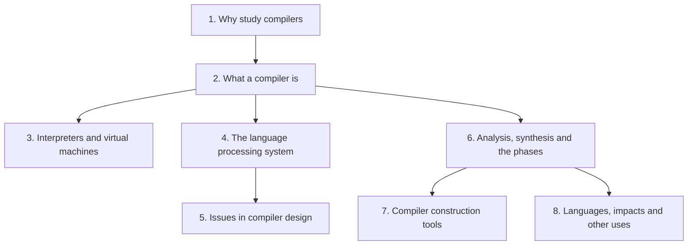

## Contents

1. [Why study compilers](#1-why-study-compilers)
2. [What a compiler is](#2-what-a-compiler-is)
3. [Interpreters, bytecode and virtual machines](#3-interpreters-bytecode-and-virtual-machines)
4. [The language processing system](#4-the-language-processing-system)
5. [Issues in compiler design](#5-issues-in-compiler-design)
6. [Analysis, synthesis and the phases of a compiler](#6-analysis-synthesis-and-the-phases-of-a-compiler)
7. [Compiler construction tools](#7-compiler-construction-tools)
8. [How languages evolved, and other uses of compiler ideas](#8-how-languages-evolved-and-other-uses-of-compiler-ideas)

---

## 1. Why study compilers

### 1.1 The Problem & Intuition

You use a compiler every time you build and run a program. Yet most programmers treat it as a black box. When you know what happens inside, error messages make sense. You also learn why some code runs fast and some does not.

### 1.2 Mechanism & Architecture

**Pre-requisite courses (Slide 3).** The course assumes three things:

- A strong programming background in C, C++ or Java.
- Formal Language and Automata Theory: regular expressions (REs), NFAs, DFAs, context-free grammars (CFGs) and pushdown automata (PDAs).
- Assembly language programming and machine architecture.

**Understanding compilers is useful (Slide 5).** Why study compilers?

- Compilers are complex programs.
- You often need compilers, whenever you write and run a program.
- If you understand how compilers work, you will know what to expect and how to get the best out of them.

**Building compilers is useful (Slide 6).** Compiler-like programs are everywhere. All sorts of programs can be viewed as compilers:

| Kind of program | Example on the slide |
| :--- | :--- |
| Query languages | GraphQL |
| Browser engines | WebKit |
| Text processors | sed, grep |
| Document processors | LaTeX |
| Build systems | make |
| Automation | GitHub Actions |
| Game engine scripting | Lua |
| Blockchain platforms | Solidity |
| Financial contracts | MLFI |
| Legal contracts | Catala |
| Music systems | Csound |
| Text editors | emacs |
| Interactive testing systems | expect |
| Hardware description | VHDL |
| Compiler compilers | yacc |
| Statistics language | R |
| Wikis | MediaWiki |

### 1.3 Visual Anchor

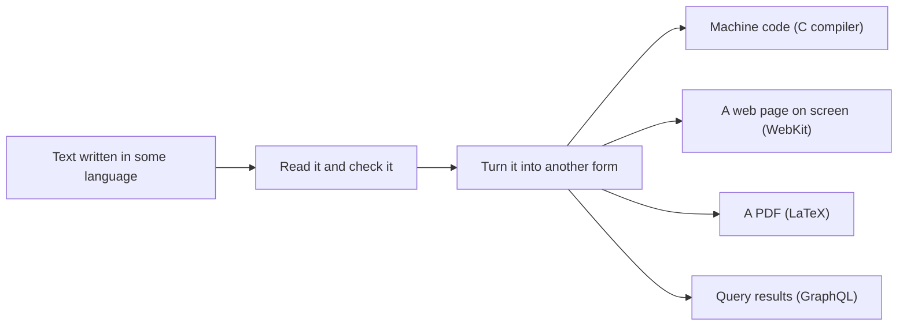

*Figure: Every program in the table reads structured text, checks it and turns it into something else. That is the same job a compiler does.*

### 1.4 Verified Formulas, Trade-offs & Calculations

> **Background (not in the slides):** Each prerequisite is used later in the course. Regular expressions and DFAs describe tokens in lexical analysis. Context-free grammars and PDAs are the basis of parsing. Assembly and machine architecture are needed for code generation.

---

## 2. What a compiler is

### 2.1 The Problem & Intuition

A computer can only run machine instructions. People do not want to write programs in machine code. So we write in a high-level language, and a program translates it. That translator is the **compiler**.

### 2.2 Mechanism & Architecture

**What is a compiler? (Slide 7).**

- Before a program can be run, it must first be translated into a form that a computer can execute. This form is the **target program**.
- Compiling is the translation of a program written in a **source language** into a **semantically equivalent** program written in a **target language**. "Semantically equivalent" means it does exactly the same thing.

**The full definition (Slide 8).** A compiler is a program that translates (or compiles) a program written in a high-level programming language (the source language) into low-level machine language (the target language). The high-level language suits human programmers. The machine language is what computers require. During this process, the compiler also tries to find and report obvious programming errors that it detects during translation.

**High-level versus low-level languages (Slide 8).**

| High-level language | Low-level language |
| :--- | :--- |
| Machine-independent | Machine-specific |
| Complex syntax | Simple syntax |
| Complex type system | Simple types |
| Variables | Memory, registers, words |
| Nested scope | Single flat scope |
| Procedures, functions | |
| Modules, objects | |
| Cannot be run directly | Can be run directly |

**Example: C to assembly code (Slide 9).**

High-level language:

```c
position = initial + rate * 60;
```

Low-level language:

```text
MOVF id3, R2
MULF #60.0, R2
MOVF id2, R1
ADDF R2, R1
MOVF R1, id1
```

### 2.3 Visual Anchor

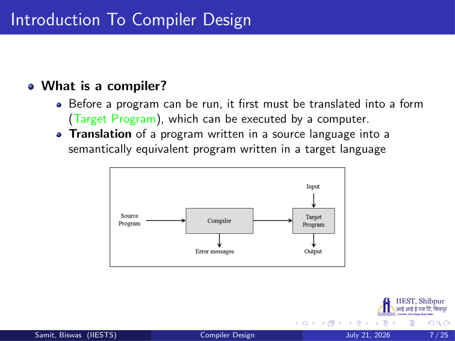
*Figure: Slide 7. The compiler turns the source program into a target program and also produces error messages. Later, the target program takes input and produces output.*

### 2.4 Verified Formulas, Trade-offs & Calculations

**Reading the assembly of Slide 9.** Here `id1`, `id2` and `id3` stand for `position`, `initial` and `rate` (Section 6 shows where these names come from).

> **Background (not in the slides):** The `F` at the end of each instruction means a floating-point operation. `#60.0` means the constant 60.0 itself, not a memory address.

| Instruction | Meaning | Register state after it |
| :--- | :--- | :--- |
| `MOVF id3, R2` | copy `rate` into register R2 | R2 = rate |
| `MULF #60.0, R2` | multiply R2 by 60.0 | R2 = rate × 60.0 |
| `MOVF id2, R1` | copy `initial` into R1 | R1 = initial |
| `ADDF R2, R1` | add R2 to R1 | R1 = initial + rate × 60.0 |
| `MOVF R1, id1` | store R1 into `position` | position = initial + rate × 60.0 |

The last line is exactly the C statement. So the target program is semantically equivalent to the source program.

---

## 3. Interpreters, bytecode and virtual machines

### 3.1 The Problem & Intuition

Translating a whole program first is not the only way to run it. Another way is to read the program and carry out each instruction straight away. That is what an **interpreter** does. Java mixes the two ideas.

### 3.2 Mechanism & Architecture

**Interpreter (Slide 10).** An interpreter is another common kind of language processor. It does not produce a target program as a translation. Instead, it appears to directly execute the operations in the source program, on inputs supplied by the user.

**Compiler versus interpreter (Slide 11).**

| Compiler | Interpreter |
| :--- | :--- |
| Takes the entire program as input | Takes a single instruction as input |
| It is faster | It is slower |
| Intermediate object code is generated | No intermediate code is generated |
| Errors are displayed after the entire program has been checked | Errors are displayed for every instruction interpreted |
| Examples: C, C++ | Examples: Python, Ruby, BASIC |

**Bytecode and virtual machine (Slide 12).** A Java source program may first be compiled into an intermediate form called **bytecodes**. The bytecodes are then interpreted by a **virtual machine**. A benefit: bytecodes compiled on one machine can be interpreted on another machine, perhaps across a network.

### 3.3 Visual Anchor

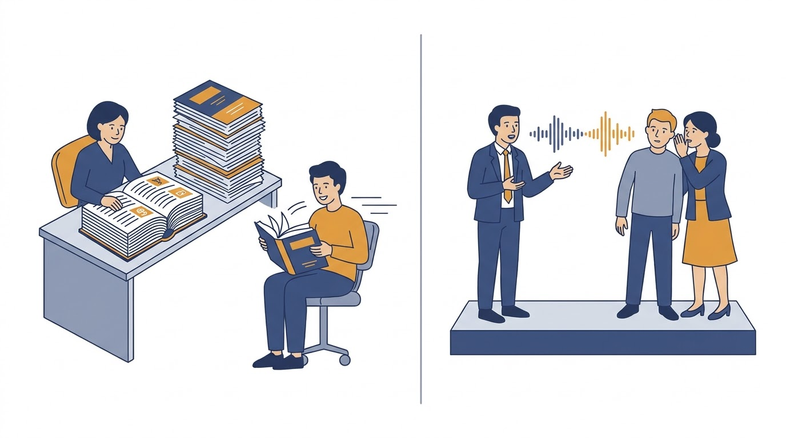
*Figure (illustration, not from the slides): A compiler is like a book translator. The whole text is translated first, then read as often as you like. An interpreter is like a live interpreter at a talk: each sentence is translated as it is spoken, every time.*

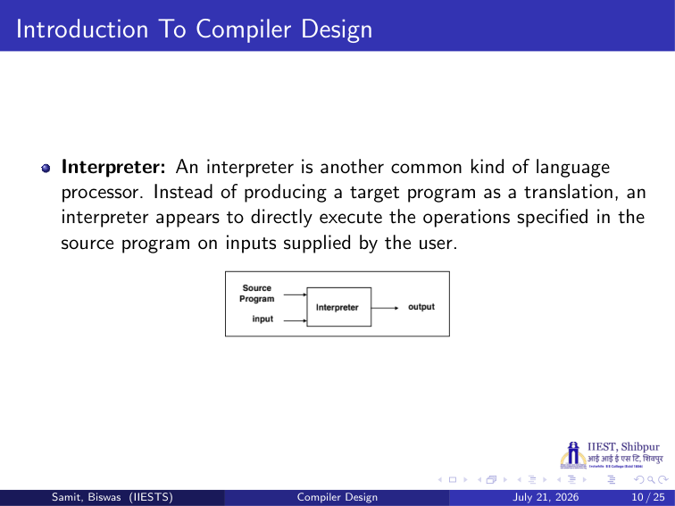
*Figure: Slide 10. The interpreter receives the source program and the input at the same time and produces the output directly.*

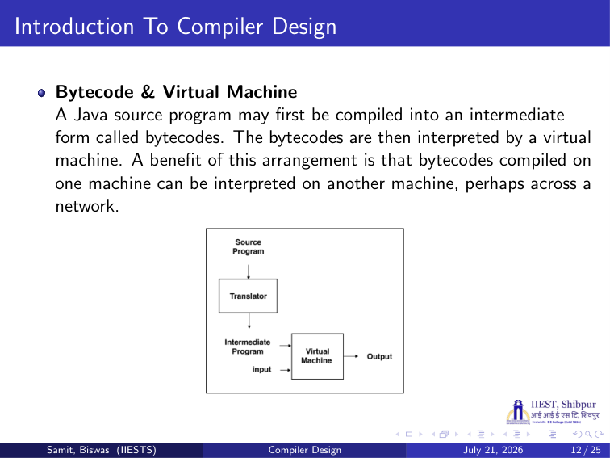
*Figure: Slide 12. A translator turns the source program into an intermediate program (bytecode). The virtual machine runs it on the input.*

### 3.4 Verified Formulas, Trade-offs & Calculations

**Why "faster" and "slower" (Slide 11).**

> **Background (not in the slides):** The compiled program runs faster because translation happens once, before running. An interpreter analyses each statement again every time it reaches it, for example in every pass of a loop. In return, the interpreter can usually give better error messages, because it still has the source statement in hand when the error happens.

> **Background (not in the slides):** The table is a simplified textbook view. Real "interpreted" languages often compile to bytecode first: Python, for example, compiles source to bytecode and then interprets it, much like Java on Slide 12.

---

## 4. The language processing system

### 4.1 The Problem & Intuition

The compiler is only one step between your source file and a running program. Other tools run before it and after it. Together they form the **language processing system**.

### 4.2 Mechanism & Architecture

**A typical language processing system (Slide 13).** The steps, in order:

1. **Source program** goes into the **preprocessor**, which outputs a **modified source program**.
2. The **compiler** turns it into a **target assembly program**.
3. The **assembler** turns that into **relocatable machine code**.
4. The **linker/loader** combines it with **library files** and other **relocatable object files**. The result is the **target program**.

> **Background (not in the slides):** What each tool does:
> - **Preprocessor:** expands macros and file inclusions, for example `#include` and `#define` in C.
> - **Assembler:** turns assembly mnemonics like `MOVF` into binary machine instructions.
> - **Relocatable:** the addresses in the code start from 0. They can be moved (relocated) to any place in memory later.
> - **Linker:** joins several object files and libraries into one program and fixes the addresses between them.
> - **Loader:** puts the program into memory so it can run.

### 4.3 Visual Anchor

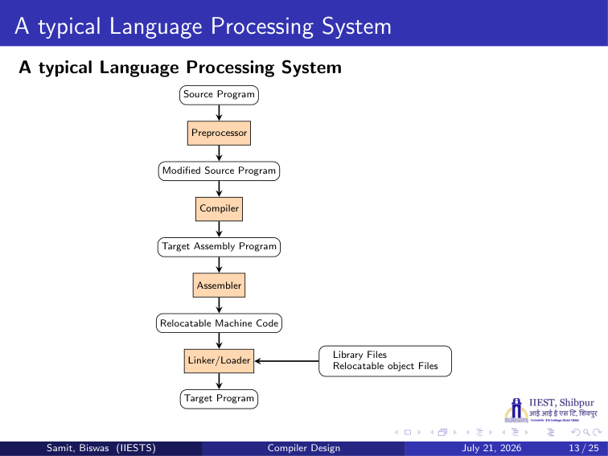
*Figure: Slide 13. Source program → preprocessor → modified source program → compiler → target assembly program → assembler → relocatable machine code → linker/loader (with library files and relocatable object files) → target program.*

### 4.4 Verified Formulas, Trade-offs & Calculations

The system has four tools and five forms of the program:

| Step | Tool | Input | Output |
| :--- | :--- | :--- | :--- |
| 1 | Preprocessor | Source program | Modified source program |
| 2 | Compiler | Modified source program | Target assembly program |
| 3 | Assembler | Target assembly program | Relocatable machine code |
| 4 | Linker/Loader | Relocatable machine code, library files, relocatable object files | Target program |

Only step 2 is the compiler itself. This course is about that step.

---

## 5. Issues in compiler design

### 5.1 The Problem & Intuition

A compiler can be built in many ways. Each design choice trades one goal against another. The slide lists the goals a designer must balance.

### 5.2 Mechanism & Architecture

**Issues related to compiler design (Slide 14):**

1. Correctness
2. Speed (runtime and compile time)
3. Degrees of optimization
4. Multiple passes
5. Space
6. Feedback to user
7. Debugging

### 5.3 Visual Anchor

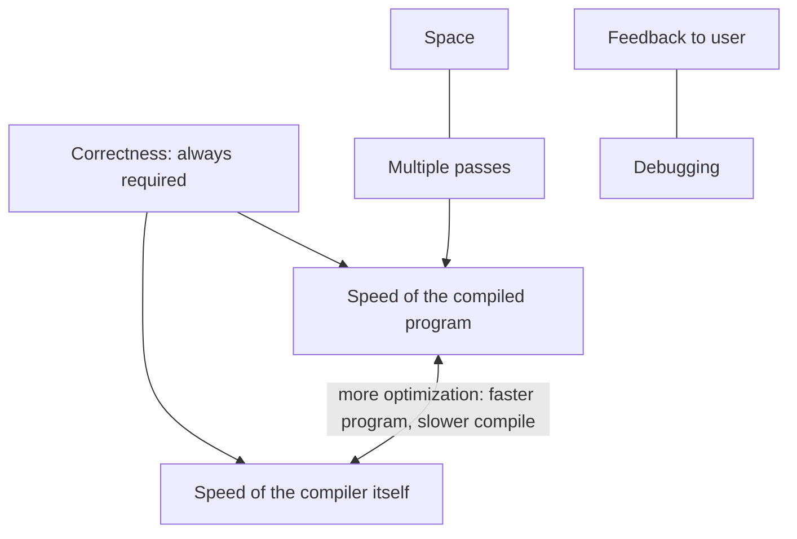

*Figure: Correctness comes first. Faster target code needs more optimization, which makes compiling slower.*

### 5.4 Verified Formulas, Trade-offs & Calculations

> **Background (not in the slides):** What each issue means:
> - **Correctness:** the target program must do exactly what the source program says. A fast but wrong compiler is useless.
> - **Speed:** runtime speed is how fast the compiled program runs. Compile-time speed is how fast the compiler itself works.
> - **Degrees of optimization:** compilers often let you choose how hard to optimize (for example `-O0` to `-O3` in GCC). More optimization gives faster code but takes longer to compile.
> - **Multiple passes:** a pass is one reading of the whole program. More passes allow more analysis but cost time and memory.
> - **Space:** the memory the compiler uses, and the size of the code it produces.
> - **Feedback to user:** clear error and warning messages.
> - **Debugging:** the compiled program should still be debuggable, for example by keeping a link between machine code and source lines.

---

## 6. Analysis, synthesis and the phases of a compiler

### 6.1 The Problem & Intuition

Translating a whole language in one step is too hard. So the compiler splits the job. First it understands the program (analysis). Then it builds the new program (synthesis). Each half is split again into **phases**, and each phase does one simple job.

### 6.2 Mechanism & Architecture

**The analysis–synthesis model of compilation (Slide 16).** There are two parts of compilation:

- **Analysis** breaks up the source program into its constituent pieces and creates an **intermediate representation** of the source program. If the analysis part finds that the source program is syntactically ill-formed or semantically unsound, it must give informative messages, so the user can take corrective action.
- **Synthesis** constructs the desired target program from the intermediate representation and the information in the **symbol table**.

**The phases of a compiler (Slide 17).** Conceptually, a compiler operates in phases. Each phase translates the source program from one representation to another. In order:

1. Lexical analyzer
2. Syntax analyzer
3. Semantic analyzer
4. Intermediate code generator
5. Code optimization
6. Code generator

Two helpers work with every phase: the **symbol table manager** and the **error handler**.

**What each phase hands to the next (Slide 18):**

- The lexical analyser takes the source program as input and produces a long string of **tokens**.
- The syntax analyser takes the output of the lexical analyser and produces a large **tree**.
- The semantic analyser takes the output of the syntax analyser and produces another tree.
- The intermediate code generator takes the tree produced by the semantic analyser and produces **intermediate code**.

> **Background (not in the slides):**
> - **Analysis** is the first three phases (the **front end**). **Synthesis** is the last three (the **back end**).
> - The **symbol table** is a data structure with one record per name in the program (variables, functions). Each record holds attributes such as the type. Every phase can read it or add to it.
> - The **error handler** decides what to do when a phase finds an error, so that compiling can go on and more errors can be reported.

### 6.3 Visual Anchor

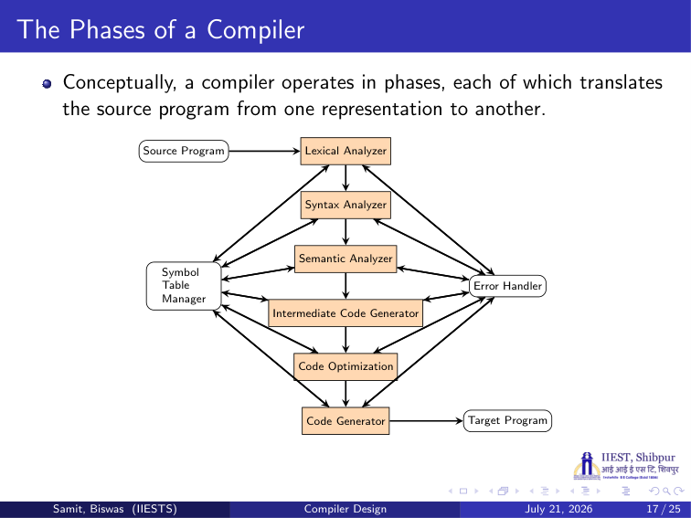
*Figure: Slide 17. The six phases in a chain from source program to target program. The symbol table manager and the error handler connect to all of them.*

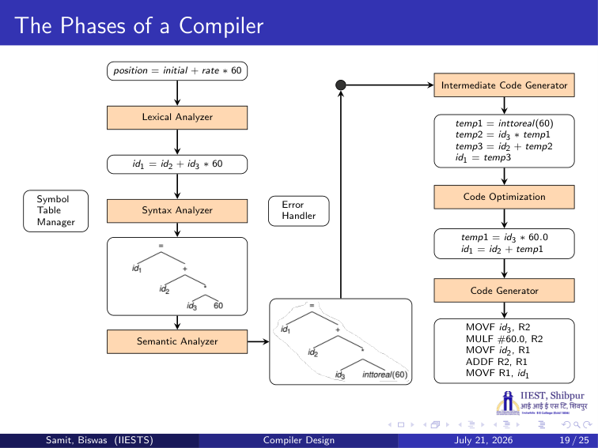
*Figure: Slide 19. One assignment followed through every phase. Section 6.4 walks through each step.*

### 6.4 Verified Formulas, Trade-offs & Calculations

**Following `position = initial + rate * 60` through the phases (Slide 19).**

| Phase | Output on Slide 19 | What happened |
| :--- | :--- | :--- |
| Input | `position = initial + rate * 60` | the source statement |
| Lexical analyzer | `id1 = id2 + id3 * 60` | each name became a token `id` with a number pointing to its symbol table entry: position is id1, initial is id2, rate is id3 |
| Syntax analyzer | a tree: `=` at the root, `id1` on the left, `+` on the right; under `+` are `id2` and `*`; under `*` are `id3` and `60` | the tree shows that `*` binds tighter than `+` |
| Semantic analyzer | the same tree, but `60` is replaced by `inttoreal(60)` | the variables are real numbers and 60 is an integer, so a conversion is added |
| Intermediate code generator | `temp1 = inttoreal(60)`<br>`temp2 = id3 * temp1`<br>`temp3 = id2 + temp2`<br>`id1 = temp3` | three-address code: at most one operator on the right of each line |
| Code optimization | `temp1 = id3 * 60.0`<br>`id1 = id2 + temp1` | 2 lines instead of 4 |
| Code generator | `MOVF id3, R2`<br>`MULF #60.0, R2`<br>`MOVF id2, R1`<br>`ADDF R2, R1`<br>`MOVF R1, id1` | machine instructions with registers |

**What the optimizer did.** It made two improvements:

1. `inttoreal(60)` always gives 60.0. The compiler can do this once, at compile time. So it writes the constant `60.0` and drops `temp1 = inttoreal(60)`.
2. `temp3` is only copied into `id1`. So the sum can go straight into `id1`, and `temp3` disappears.

Result: 4 statements became 2. The values computed are the same: $\text{id1} = \text{id2} + \text{id3} \times 60.0$.

**Check the tree order.** Multiplication is done first: `temp2 = id3 * temp1` comes before `temp3 = id2 + temp2`. This matches the tree, where `*` is below `+`.

---

## 7. Compiler construction tools

### 7.1 The Problem & Intuition

Writing every phase by hand is a lot of work. Many phases follow fixed patterns. So tools exist that build a phase automatically from a short description.

### 7.2 Mechanism & Architecture

**Software tools to implement compiler phases (Slide 21):**

1. **Scanner generators** produce lexical analysers from a regular expression.
2. **Parser generators** automatically produce syntax analysers.
3. **Syntax-directed translation engines.**
4. **Data-flow analysis engines** help gather information about how values are passed from one part of a program to each other part. Data-flow analysis is a key part of code optimization.
5. **Code-generator generators** produce a code generator from a collection of rules. The rules translate each operation of the intermediate language into the machine language of a target machine.

### 7.3 Visual Anchor

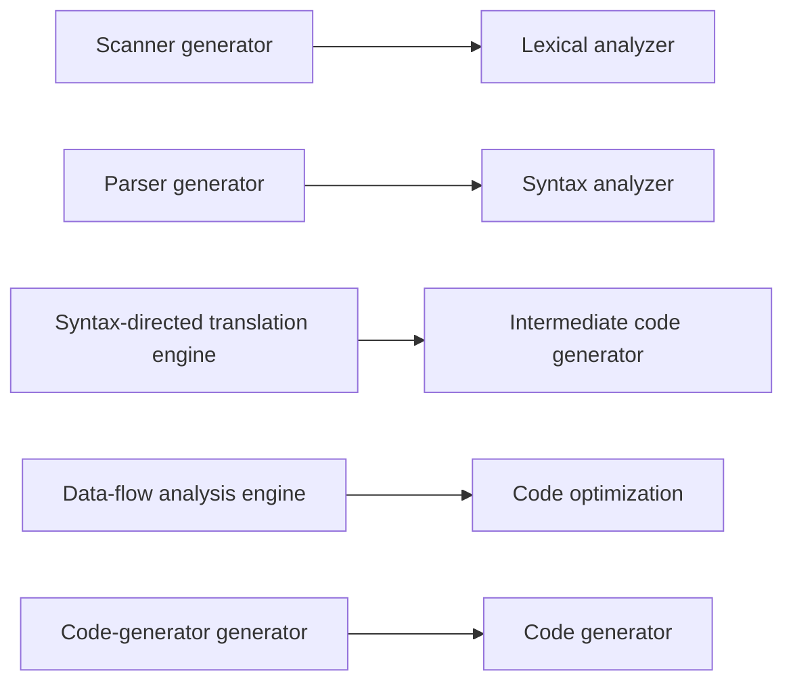

*Figure: Which phase each tool helps to build.*

### 7.4 Verified Formulas, Trade-offs & Calculations

> **Background (not in the slides):** Well-known examples: **Lex** and **Flex** are scanner generators (the Lexical Analyzer lecture covers Lex). **Yacc** and **Bison** are parser generators (the Error Recovery lecture shows Yacc). A syntax-directed translation engine walks the parse tree and runs code at each node, which the Semantic Analysis lecture describes.

---

## 8. How languages evolved, and other uses of compiler ideas

### 8.1 The Problem & Intuition

Compilers changed as languages changed. Their techniques are also useful far outside compilers. This section gives the history and those other uses.

### 8.2 Mechanism & Architecture

**Classification by generation (Slide 22):**

| Generation | Kind | Examples |
| :--- | :--- | :--- |
| First | Machine languages | |
| Second | Assembly languages | |
| Third | Higher-level languages | Fortran, Cobol, Lisp, C, C++, C#, Java |
| Fourth | Languages designed for specific applications | NOMAD for report generation, SQL for database queries, PostScript for text formatting |
| Fifth | Logic- and constraint-based languages | Prolog, OPS5 |

**Impacts on compilers (Slide 23):**

- Advances in programming languages placed new demands on compiler writers.
- Compiler writers must take maximal advantage of new hardware capabilities.
- Good software-engineering techniques are essential for creating and evolving modern language processors.

**Other applications (Slide 24):**

- Techniques used in a lexical analyzer can be used in text editors, information retrieval systems and pattern recognition programs.
- Techniques used in a parser can be used in a query processing system such as SQL.
- Much software with a complex front end needs compiler techniques. Example: a symbolic equation solver takes an equation as input, so it must parse that equation.
- Most of the techniques used in compiler design can be used in Natural Language Processing (NLP) systems.

**Reference (Slide 25):** Alfred V. Aho, Ravi Sethi, Jeffrey D. Ullman, *Compilers: Principles, Techniques and Tools*, Pearson Education.

### 8.3 Visual Anchor

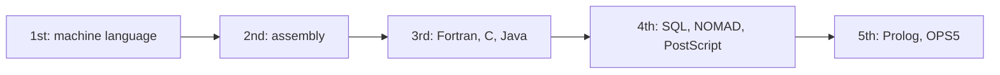

*Figure: Each generation moves further from the machine and closer to the problem.*

### 8.4 Verified Formulas, Trade-offs & Calculations

| Compiler phase | Technique | Other use (Slide 24) |
| :--- | :--- | :--- |
| Lexical analyzer | regular expressions, finite automata | text editors (search), information retrieval, pattern recognition |
| Parser | grammars, parse trees | SQL query processing, equation solvers |
| Most phases | grammars, trees, translation | NLP systems |
