# The Lexical Analyzer — Learning Guide

Source: `L01_Lexical analyzer.pdf`, Slides 1–36. Slide numbers are the ones printed in the slide footer (for example "18 / 36").

**Who this is for:** a beginner studying the first phase of a compiler. After reading, you can split a statement into tokens, write and read regular expressions, run a DFA by hand, and follow the transition diagrams that recognise identifiers, numbers and relational operators.

**How to read this guide:** Read the sections in order. Each section first says why the idea exists, then how it works, then shows a picture, then gives the exact definitions and worked checks. Facts come from the slides. Extra explanations are marked **Background (not in the slides)**. Errors on the slides are marked **Slide note**.

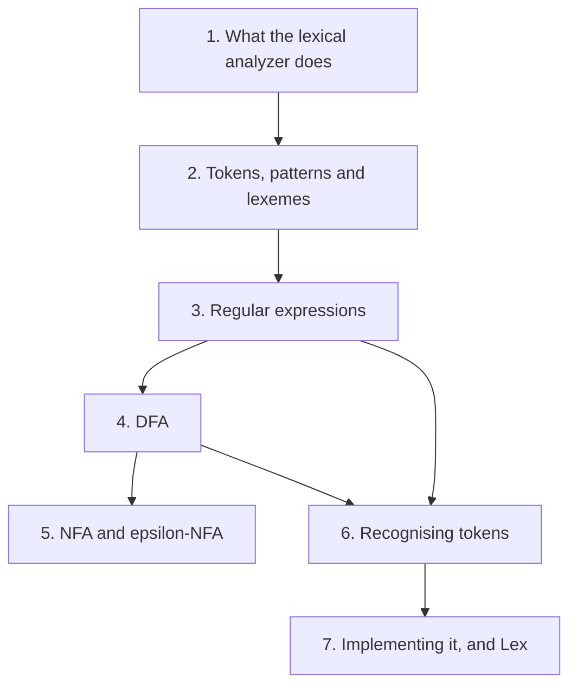

## Contents

1. [What the lexical analyzer does](#1-what-the-lexical-analyzer-does)
2. [Tokens, patterns and lexemes](#2-tokens-patterns-and-lexemes)
3. [Regular expressions](#3-regular-expressions)
4. [Deterministic finite automata (DFA)](#4-deterministic-finite-automata-dfa)
5. [NFA and ε-NFA](#5-nfa-and-ε-nfa)
6. [Recognising tokens with transition diagrams](#6-recognising-tokens-with-transition-diagrams)
7. [Implementing a transition diagram, and Lex](#7-implementing-a-transition-diagram-and-lex)

---

## 1. What the lexical analyzer does

### 1.1 The Problem & Intuition

A source file is just a long row of characters: letters, digits, spaces, symbols. The parser does not want to deal with single characters. It wants words, like "keyword `if`", "a name", "a number". The **lexical analyzer** (also called the **scanner**) groups the characters into these words. It is the first phase of the compiler.

### 1.2 Mechanism & Architecture

**Where it sits (Slide 3).** The lexical analyzer is the first of the six phases. It comes before the syntax analyzer, semantic analyzer, intermediate code generator, code optimization and code generator. It also uses the symbol table manager and the error handler.

**Its tasks (Slide 4):**

1. **Main task:** read the input characters and produce as output a sequence of **tokens**.
2. Strip comments and **white space** (blanks, tabs and newlines) from the source program.
3. Correlate error messages from the compiler with the source program. For example, it keeps track of line numbers so an error can say "line 12".

**How it talks to the parser (Slide 5).** The syntax analyser asks for the next token by calling **getNextToken**. The lexical analyser reads enough characters, then returns one **token**. Both of them use the **symbol table**. The syntax analyser passes its result on to semantic analysis.

### 1.3 Visual Anchor

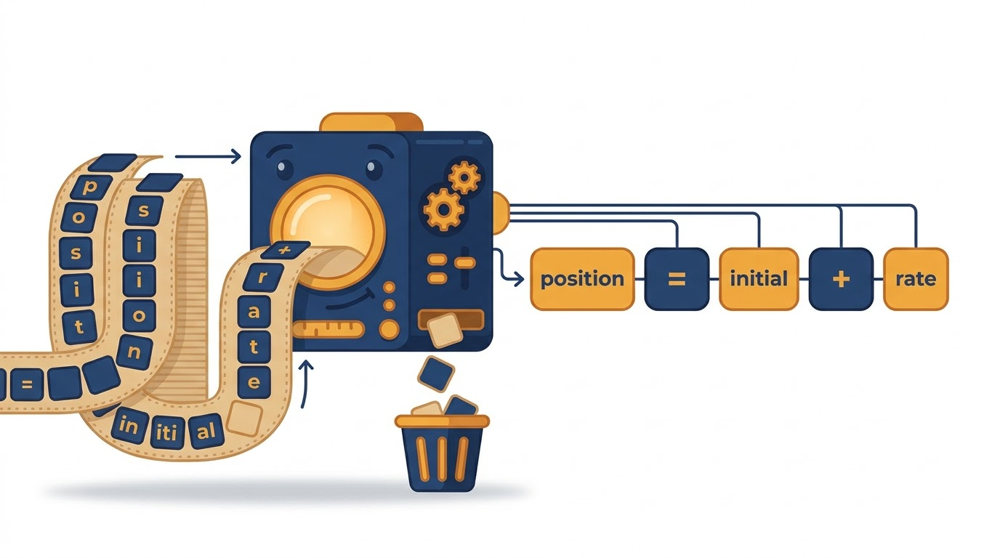
*Figure (illustration, not from the slides): The lexical analyser reads the source one character at a time, throws away white space and comments, and hands out whole tokens: `position`, `=`, `initial`, `+`, `rate`.*

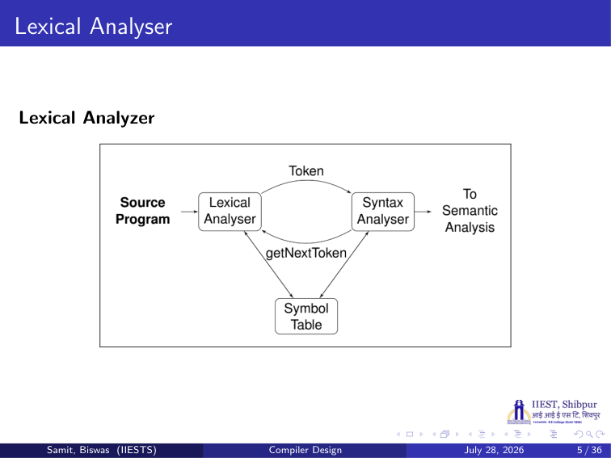
*Figure: Slide 5. Source program → lexical analyser. The syntax analyser sends getNextToken; the lexical analyser answers with a token. Both use the symbol table.*

### 1.4 Verified Formulas, Trade-offs & Calculations

> **Background (not in the slides):** Why make lexing a separate phase?
> - **Simpler design:** the parser never sees spaces or comments.
> - **Speed:** reading characters is the slowest part of compiling. A dedicated scanner can use fast buffering.
> - **Portability:** differences in the input character set stay inside the scanner.

**Worked check.** Take the line `x = y + 10; /* add */`. The scanner strips the blanks and the comment and returns 6 tokens: `id(x)`, `=`, `id(y)`, `+`, `num(10)`, `;`. The parser gets these 6 tokens instead of 21 characters.

---

## 2. Tokens, patterns and lexemes

### 2.1 The Problem & Intuition

The words `score`, `pi` and `d2` are different, but the parser treats them the same way: each one is "a name". So we need two levels: the **kind** of word (the token) and the **actual text** (the lexeme). The rule that says which texts belong to a kind is the **pattern**.

### 2.2 Mechanism & Architecture

**Definitions (Slide 7):**

- A **token** is a pair: a **token name** and an optional **attribute value**. The token name is an abstract symbol for a kind of lexical unit, for example a particular keyword, or a sequence of characters that forms an identifier.
- A **pattern** is the rule that describes the set of strings for a token. The pattern is said to **match** each string in the set.
- A **lexeme** is a sequence of characters in the source program that matches the pattern for a token. The lexical analyser identifies it as an instance of that token. Lexemes are the smallest logical units (words) of a program, such as `A`, `B`, `1.0`, `true`, `+`, `<=`.

**Example (Slide 8).** Consider the C statement:

```c
printf ("Total = %d", score) ;
```

- `printf` and `score` are lexemes that match the pattern for the token **id**.
- `"Total = %d"` is a lexeme matching **literal**.

| Token | Sample lexemes | Pattern |
| :--- | :--- | :--- |
| if | if | characters i, f |
| else | else | characters e, l, s, e |
| comparison | | |
| id | pi, score, d2 | letters followed by letters and digits |
| number | | any numeric constant |
| literal | "Total = %d" | Total = %d |

> **Slide note (Slide 8):** The **comparison** row is empty, and **number** has no sample lexemes. In the standard textbook table (Aho et al.), comparison has the pattern "`<` or `>` or `<=` or `>=` or `==` or `!=`" with sample lexemes such as `<=` and `!=`. Number has sample lexemes such as `3.14159`, `0` and `6.02e23`. The literal's pattern is "anything but `"`, surrounded by `"`".

### 2.3 Visual Anchor

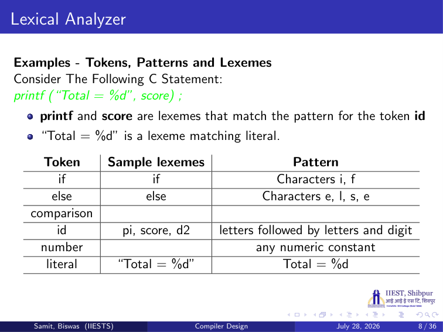
*Figure: Slide 8. The token / sample lexemes / pattern table for the printf example.*

### 2.4 Verified Formulas, Trade-offs & Calculations

**Tokenising the Slide 8 statement.**

| # | Lexeme | Token | Attribute value |
| :--- | :--- | :--- | :--- |
| 1 | `printf` | id | pointer to the symbol table entry for printf |
| 2 | `(` | `(` | none |
| 3 | `"Total = %d"` | literal | pointer to the string |
| 4 | `,` | `,` | none |
| 5 | `score` | id | pointer to the symbol table entry for score |
| 6 | `)` | `)` | none |
| 7 | `;` | `;` | none |

So the statement gives 7 tokens. Two of them have the same token name `id` but different attribute values. The attribute is what tells the later phases *which* name it was.

---

## 3. Regular expressions

### 3.1 The Problem & Intuition

To build a scanner we must state exactly which strings each token allows. Writing out every identifier is impossible, since there are infinitely many. A **regular expression** is a short formula that describes a whole (possibly infinite) set of strings.

### 3.2 Mechanism & Architecture

**Ways to specify tokens (Slide 10):** regular expressions, deterministic finite automata, non-deterministic finite automata, and non-deterministic finite automata with empty transitions. Sections 3 to 5 cover them in this order.

**What a regular expression is (Slide 11).**

- The languages accepted by finite automata are easily described by simple expressions called **regular expressions**.
- A regular expression is a way to represent a language.
- Regular expressions describe **regular languages**.

Example: $(a + bc)^\ast$ describes the language

```math
\lbrace a, bc \rbrace^\ast = \lbrace \lambda, a, bc, aa, abc, bca, \ldots \rbrace
```

Here $\lambda$ is the empty string. The $+$ means "or", writing two things side by side means "one after the other", and $^\ast$ means "repeat zero or more times".

**Recursive definition (Slide 12).**

- **Primitive** regular expressions: $\Phi$ (the empty set), $\lambda$ (the empty string) and $\alpha$ (any single symbol of the alphabet).
- If $r_1$ and $r_2$ are regular expressions, then so are $r_1 + r_2$, $r_1 \cdot r_2$, $r_1^\ast$ and $(r_1)$.
- $(a + bc)^\ast(c + \Phi)$ is a regular expression.
- $(a + b +)$ is **not** a regular expression: the last $+$ has nothing on its right.

**The language of a regular expression (Slide 13).** $L(r)$ is the language of the regular expression $r$.

| Expression | Its language |
| :--- | :--- |
| $\Phi$ | $L(\Phi) = \Phi$, no strings at all |
| $\lambda$ | $L(\lambda) = \lbrace \lambda \rbrace$ |
| $a$ | $L(a) = \lbrace a \rbrace$ |
| $r_1 + r_2$ | $L(r_1) \cup L(r_2)$ |
| $r_1 \cdot r_2$ | $L(r_1) L(r_2)$: a string of $L(r_1)$ followed by a string of $L(r_2)$ |
| $r_1^\ast$ | $(L(r_1))^\ast$ |
| $(r_1)$ | $L(r_1)$ |

**Examples (Slide 14).**

| Regular expression | Language |
| :--- | :--- |
| $(a + b) \cdot a^\ast$ | $\lbrace a, aa, aaa, \ldots, b, ba, baa, \ldots \rbrace$ (see the slide note below) |
| $(a + b)^\ast(a + bb)$ | $\lbrace a, bb, aa, abb, ba, bbb, \ldots \rbrace$ |
| $(aa)^\ast(bb)^\ast b$ | $\lbrace a^{2n} b^{2m} b : n, m \geq 0 \rbrace$ |
| $(0 + 1)^\ast 00 (0 + 1)^\ast$ | all strings with at least two consecutive 0s |
| $(1 + 01)^\ast(0 + \lambda)$ | all strings without two consecutive 0s |

**Equivalent regular expressions (Slide 15).** $r_1$ and $r_2$ are **equivalent** if $L(r_1) = L(r_2)$. Example, for $L$ = all strings without two consecutive 0s:

```math
r_1 = (1 + 01)^\ast(0 + \lambda), \qquad r_2 = (1^\ast 0 1 1^\ast)^\ast(0 + \lambda) + 1^\ast(0 + \lambda)
```

$L(r_1) = L(r_2) = L$, so $r_1$ and $r_2$ are equivalent.

**Regular expressions and regular languages (Slide 16).** The languages generated by regular expressions are exactly the regular languages.

- **Theorem 1:** for any regular expression $r$, the language $L(r)$ is regular.
- **Theorem 2:** for any regular language $L$, there is a regular expression $r$ with $L(r) = L$.

### 3.3 Visual Anchor

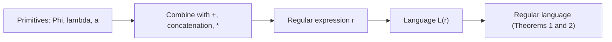

*Figure: Build expressions from primitives with three operators. Every such expression describes a regular language, and every regular language has such an expression.*

### 3.4 Verified Formulas, Trade-offs & Calculations

All languages below were checked by listing every string up to length 8 with a program.

**Working out $L((a + b) \cdot a^\ast)$ step by step (Slide 14).**

```math
L((a+b) \cdot a^\ast) = L(a+b)\,L(a^\ast) = \lbrace a, b \rbrace \lbrace \lambda, a, aa, \ldots \rbrace
```

Put each first letter in front of each string of $a$'s:

- from $a$: $a, aa, aaa, \ldots$
- from $b$: $b, ba, baa, \ldots$

> **Slide note (Slide 14):** The slide writes the result as $\lbrace a, aa, aaa, \ldots, b, bb, bbb, \ldots \rbrace$. After the first symbol, only $a$'s can follow, so $bb$ is not in the language. The correct set is $\lbrace a, aa, aaa, \ldots, b, ba, baa, \ldots \rbrace$.

> **Slide note (Slide 13):** The slide's example $L((a + b + c)^\ast) = \lbrace \lambda, a, bc, aa, abc, bca, \ldots \rbrace$ repeats the strings of $(a + bc)^\ast$ from Slide 11. Those strings are in $L((a + b + c)^\ast)$, but the language has many more: $b$, $c$, $ab$, $cb$ and every other string of $a$, $b$, $c$.

> **Slide note (Slide 15):** The slide writes $r_1 = (0 + 01)^\ast(0 + \lambda)$. That expression allows $00$ (take $0$ twice from the star), so it does not describe "no two consecutive 0s". The correct $r_1$ is $(1 + 01)^\ast(0 + \lambda)$, the same as on Slide 14. With that fix, a check of all strings up to length 8 confirms $L(r_1) = L(r_2)$.

**Why $(1 + 01)^\ast(0 + \lambda)$ has no $00$.** Each block inside the star is $1$ or $01$. Every $0$ inside a block is followed by a $1$. The only $0$ not followed by a $1$ is the optional final $0$. So two 0s can never be next to each other.

**$(aa)^\ast(bb)^\ast b$ for small $n$ and $m$:**

| $n$ | $m$ | String $a^{2n} b^{2m} b$ |
| :--- | :--- | :--- |
| 0 | 0 | b |
| 1 | 0 | aab |
| 0 | 1 | bbb |
| 2 | 0 | aaaab |
| 1 | 1 | aabbb |

These are exactly the strings of length 5 or less that a program finds.

---

## 4. Deterministic finite automata (DFA)

### 4.1 The Problem & Intuition

A regular expression says *which* strings are allowed. A scanner needs a *machine* that can check a string fast. A **DFA** reads the string one symbol at a time. At each step it is in one state and moves to exactly one next state. At the end, it accepts if it stopped in a final state.

### 4.2 Mechanism & Architecture

**Definition (Slide 17).** A DFA is a 5-tuple:

```math
M = (Q, \Sigma, \delta, q_0, F)
```

- $Q$: a finite set of states.
- $\Sigma$: the input alphabet.
- $\delta$: the transition function, $\delta : Q \times \Sigma \to Q$. Given a state and a symbol, it gives exactly one next state.
- $q_0$: the initial state.
- $F$: the set of final states, $F \subseteq Q$.

**Transition function example (Slide 18).** The slide gives a DFA with states $q_0$ to $q_5$ over $\Sigma = \lbrace a, b \rbrace$. Some of its moves are $\delta(q_0, a) = q_1$, $\delta(q_0, b) = q_5$ and $\delta(q_2, b) = q_3$. The full table:

| State | a | b |
| :--- | :--- | :--- |
| → $q_0$ (start) | $q_1$ | $q_5$ |
| $q_1$ | $q_5$ | $q_2$ |
| $q_2$ | $q_5$ | $q_3$ |
| $q_3$ | $q_4$ | $q_5$ |
| $q_4$ (final) | $q_5$ | $q_5$ |
| $q_5$ | $q_5$ | $q_5$ |

**The language of a DFA (Slide 19).**

```math
L(M) = \lbrace w \in \Sigma^\ast : \delta^\ast(q_0, w) \in F \rbrace
```

In words: $M$ accepts the string $w$ if, starting from $q_0$ and reading all of $w$, it ends in a final state. Here $\delta^\ast : Q \times \Sigma^\ast \to Q$ is the **extended transition function**: it takes a whole string instead of one symbol.

> **Background (not in the slides):** $\delta^\ast$ is defined one symbol at a time: $\delta^\ast(q, \lambda) = q$, and $\delta^\ast(q, wa) = \delta(\delta^\ast(q, w), a)$. Read the string, apply $\delta$ once per symbol.

### 4.3 Visual Anchor

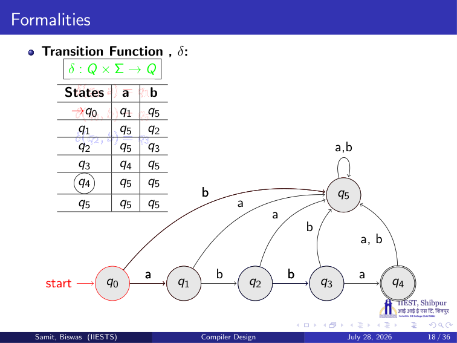
*Figure: Slide 18. Start state $q_0$, final state $q_4$ (double circle). Every wrong symbol leads to $q_5$, which loops on a and b.*

### 4.4 Verified Formulas, Trade-offs & Calculations

**Run the DFA on `abba`:**

| Step | State | Symbol read | Next state |
| :--- | :--- | :--- | :--- |
| 1 | $q_0$ | a | $q_1$ |
| 2 | $q_1$ | b | $q_2$ |
| 3 | $q_2$ | b | $q_3$ |
| 4 | $q_3$ | a | $q_4$ |

The run ends in $q_4 \in F$, so `abba` is accepted.

**Run it on `abb`:** $q_0 \to q_1 \to q_2 \to q_3$. The run ends in $q_3$, which is not final. Rejected.

**Run it on `abbab`:** after `abba` it is in $q_4$; reading `b` moves to $q_5$. Rejected.

**What language is this?** A program tried every string over $\lbrace a, b \rbrace$ up to length 6. Only `abba` is accepted. So $L(M) = \lbrace abba \rbrace$.

> **Background (not in the slides):** $q_5$ is a **trap** (dead) state. Once there, every symbol keeps the DFA in $q_5$, so the string can never be accepted. A DFA must have a move for every state and symbol, so a trap state is how it says "this can never match".

---

## 5. NFA and ε-NFA

### 5.1 The Problem & Intuition

Building a DFA by hand can be hard, because every state needs exactly one move per symbol. An **NFA** (nondeterministic finite accepter) is more relaxed. From one state, a symbol may lead to several states, or to none. An **ε-NFA** may also move without reading any symbol. These machines are much easier to build from a regular expression.

### 5.2 Mechanism & Architecture

**NFA (Slide 20).**

```math
M = (Q, \Sigma, \delta, q_0, F), \qquad \delta : Q \times \Sigma \to 2^Q
```

$Q$, $\Sigma$, $q_0$ and $F$ mean the same as for a DFA. The difference is $\delta$: it returns a **set** of states. $2^Q$ is the set of all subsets of $Q$.

**ε-NFA (Slide 21).**

```math
M = (Q, \Sigma \cup \lbrace \epsilon \rbrace, \delta, q_0, F), \qquad \delta : Q \times (\Sigma \cup \lbrace \epsilon \rbrace) \to 2^Q
```

Now $\epsilon$ is a member of the input alphabet. A transition on $\epsilon$ moves to another state without reading a symbol.

**Comparison:**

| Machine | Transition function | Moves per state and symbol |
| :--- | :--- | :--- |
| DFA | $Q \times \Sigma \to Q$ | exactly one |
| NFA | $Q \times \Sigma \to 2^Q$ | zero, one or many |
| ε-NFA | $Q \times (\Sigma \cup \lbrace \epsilon \rbrace) \to 2^Q$ | zero, one or many, and moves without input |

> **Background (not in the slides):** An NFA accepts a string if **at least one** sequence of choices ends in a final state. DFAs, NFAs and ε-NFAs all accept exactly the regular languages. So any of them can be turned into a DFA, using the **subset construction**: each DFA state is a set of NFA states.

### 5.3 Visual Anchor

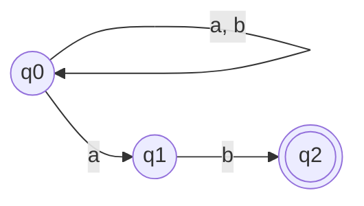

*Figure (Background, not in the slides): An NFA for "strings over a, b that end in ab". On reading `a` in $q_0$ it may stay in $q_0$ or guess that the final `ab` has started and move to $q_1$.*

### 5.4 Verified Formulas, Trade-offs & Calculations

**Background (not in the slides): turning that NFA into a DFA.** Its transitions are $\delta(q_0, a) = \lbrace q_0, q_1 \rbrace$, $\delta(q_0, b) = \lbrace q_0 \rbrace$, $\delta(q_1, b) = \lbrace q_2 \rbrace$, and every other move is the empty set. Start with the set $\lbrace q_0 \rbrace$ and follow each symbol:

| DFA state (set of NFA states) | on a | on b | Final? |
| :--- | :--- | :--- | :--- |
| $A = \lbrace q_0 \rbrace$ (start) | $\lbrace q_0, q_1 \rbrace = B$ | $\lbrace q_0 \rbrace = A$ | no |
| $B = \lbrace q_0, q_1 \rbrace$ | $\lbrace q_0, q_1 \rbrace = B$ | $\lbrace q_0, q_2 \rbrace = C$ | no |
| $C = \lbrace q_0, q_2 \rbrace$ | $\lbrace q_0, q_1 \rbrace = B$ | $\lbrace q_0 \rbrace = A$ | yes, it contains $q_2$ |

Check with `aab`: $A \xrightarrow{a} B \xrightarrow{a} B \xrightarrow{b} C$. $C$ is final, and `aab` does end in `ab`. Check with `aba`: $A \to B \to C \to B$, not final, and `aba` does not end in `ab`.

---

## 6. Recognising tokens with transition diagrams

### 6.1 The Problem & Intuition

Now we put the theory to work. For each token we draw a small finite automaton called a **transition diagram**. The scanner follows the diagram character by character. When it reaches an accepting state it knows which token it has read, and it returns the token with its attribute value.

### 6.2 Mechanism & Architecture

**The translation table (Slide 23).** Each regular expression is mapped to a token and an attribute value:

| Regular expression | Token | Attribute value |
| :--- | :--- | :--- |
| WS (white space) | – | – |
| if | if | – |
| then | then | – |
| else | else | – |
| id | id | pointer to table entry |
| num | num | pointer to table entry |
| `<` | relop | LT |
| `<=` | relop | LE |
| `>` | relop | GT |
| `>=` | relop | GE (see slide note) |
| `=` | relop | EQ |
| `<>` | relop | NE |

> **Slide note (Slide 23):** The table lists `<=` → relop, LE twice, and never lists `>=`. The second entry, after `>` → GT, should be `>=` → relop, **GE**. The transition diagrams on Slides 25–26 do recognise `>=`.

White space produces no token: the scanner skips it and looks for the next token.

**The task (Slide 24).** Construct a lexical analyser that isolates the lexeme for the next token in the input buffer. It must produce as output a pair: the token and its attribute value, using the translation table above.

**Transition diagram for `>=` (Slide 25).** Start in state 0. On `>` go to state 6. From 6, on `=` go to state 7; on any other character go to state 8.

**Transition diagrams for relational operators (Slide 26).**

| From | On | To | Meaning when the diagram stops there |
| :--- | :--- | :--- | :--- |
| 0 | `<` | 1 | |
| 1 | `=` | 2 | `<=`: relop, LE |
| 1 | `>` | 3 | `<>`: relop, NE |
| 1 | other | 4 | `<`: relop, LT |
| 0 | `=` | 5 | `=`: relop, EQ |
| 0 | `>` | 6 | |
| 6 | `=` | 7 | `>=`: relop, GE |
| 6 | other | 8 | `>`: relop, GT |

> **Background (not in the slides):** The slides draw the states but not the return actions. States 2, 3, 4, 5, 7 and 8 are accepting. States 4 and 8 are reached on "other": the scanner has read one character too many. It must **retract** (push that character back into the input) before returning the token. The textbook marks such states with a `*`.

**Transition diagram for identifiers or keywords (Slide 27).** State 9 on a letter goes to 10. State 10 loops on a letter or digit. On any other character it goes to 11, which is accepting (and needs a retract).

> **Background (not in the slides):** Keywords such as `if` also match this diagram. The usual trick is to put all keywords into the symbol table before scanning starts. When state 11 is reached, the scanner looks the lexeme up: a keyword gives its own token; anything else gives `id` with a pointer to its entry.

**Transition diagram for numbers (Slide 28).** This one handles numbers with a fraction and an exponent, such as `3.5E+2`.

| From | On | To |
| :--- | :--- | :--- |
| 12 | digit | 13 |
| 13 | digit | 13 (loop) |
| 13 | `.` | 14 |
| 13 | E | 16 |
| 14 | digit | 15 |
| 15 | digit | 15 (loop) |
| 15 | E | 16 |
| 16 | `+` or `-` | 17 |
| 16 | digit | 18 |
| 17 | digit | 18 |
| 18 | digit | 18 (loop) |
| 18 | other | 19 (accepting) |

**Simpler number diagrams (Slide 29).**

- States 20–24: digits, a `.`, digits, then other → 24. This is a number with a fraction and no exponent, like `3.14`.
- States 25–27: digits, then other → 27. This is an integer, like `60`.

> **Background (not in the slides):** Why three number diagrams? The Slide 28 diagram only accepts in state 19, after an exponent. So `3.14` would fail there, and `60` would too. The scanner tries the diagrams in order: first 12–19, then 20–24, then 25–27. It takes the first that succeeds. Trying the longest form first makes sure `3.5E2` is read as one number, not as `3.5` followed by `E2`.

**Transition diagram for white space (Slide 30).** State 28 on a delimiter (blank, tab or newline) goes to 29. State 29 loops on delimiters. On any other character it goes to 30. No token is returned; the scanner restarts at the beginning of the next lexeme.

### 6.3 Visual Anchor

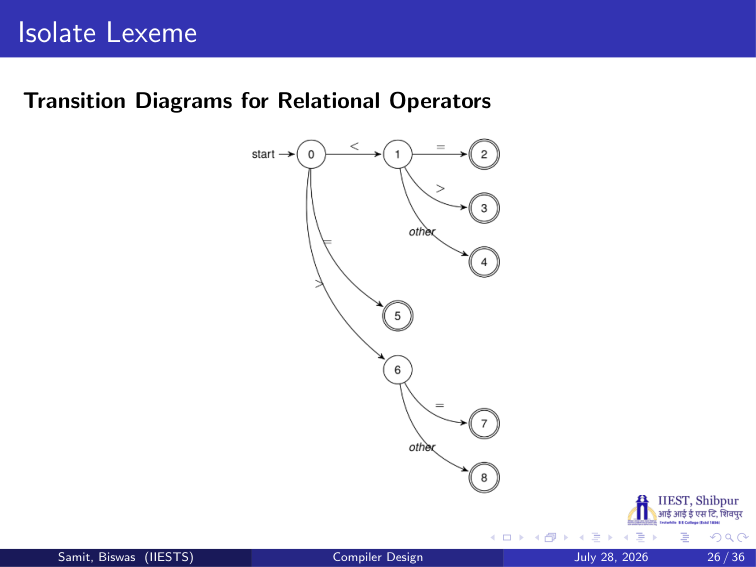
*Figure: Slide 26. One diagram for all six relational operators, starting from state 0.*

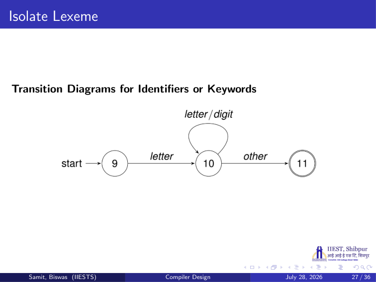
*Figure: Slide 27. A letter, then any number of letters or digits, then any other character.*

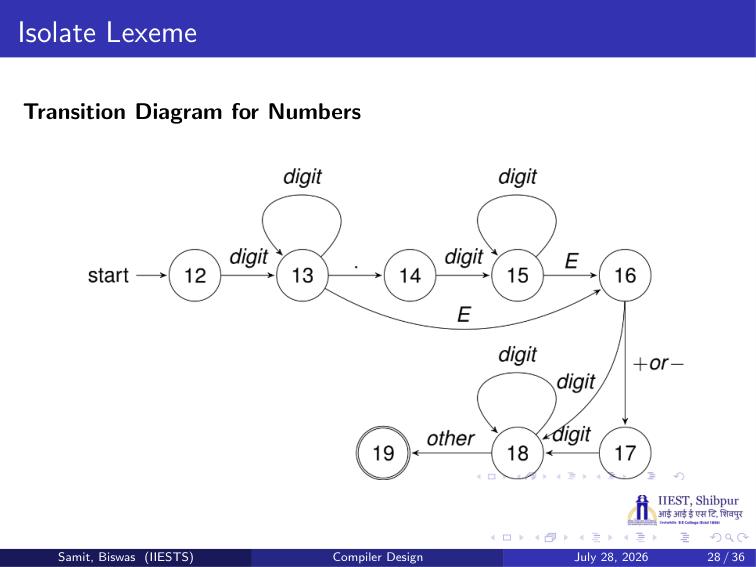
*Figure: Slide 28. States 12–19 recognise numbers such as 3.5E+2.*

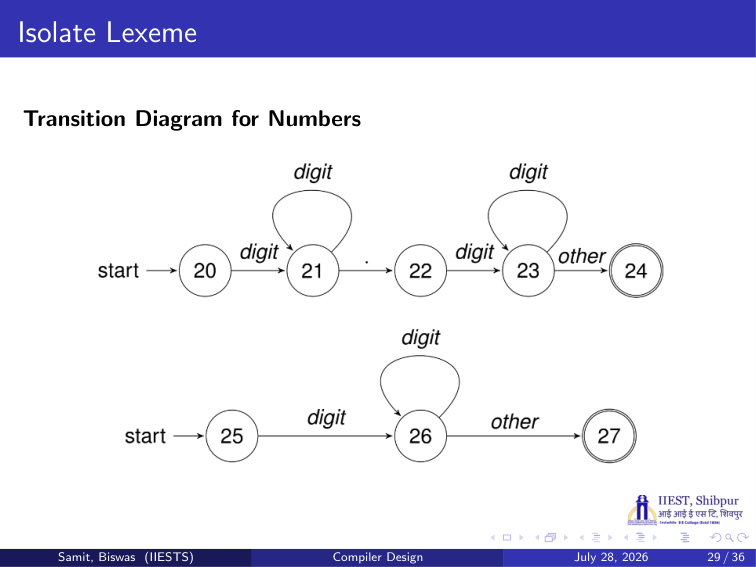
*Figure: Slide 29. States 20–24 for numbers like 3.14; states 25–27 for integers like 60.*

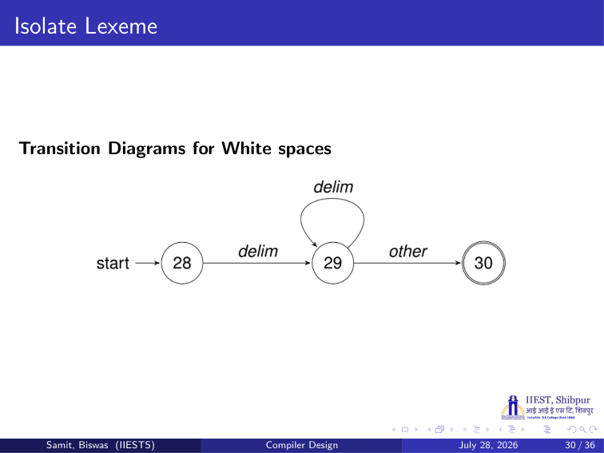
*Figure: Slide 30. One or more delimiters, then any other character.*

### 6.4 Verified Formulas, Trade-offs & Calculations

**Worked example: scan `if x1 >= 3.5E+2 then`.**

| Lexeme | Diagram and path | Token returned |
| :--- | :--- | :--- |
| `if` | 9 →(i) 10 →(f) 10 →(blank, other) 11, retract | if (it is a keyword in the table) |
| blank | 28 → 29 → 30, retract | none, skipped |
| `x1` | 9 →(x) 10 →(1) 10 →(blank) 11, retract | id, pointer to x1 |
| blank | white space | none |
| `>=` | 0 →(>) 6 →(=) 7 | relop, GE |
| blank | white space | none |
| `3.5E+2` | 12 →(3) 13 →(.) 14 →(5) 15 →(E) 16 →(+) 17 →(2) 18 →(blank) 19, retract | num, pointer to 3.5E+2 |
| blank | white space | none |
| `then` | 9 → 10 → 10 → 10 → 10 → 11 | then |

The line gives 5 tokens: `if`, `id`, `relop(GE)`, `num`, `then`.

**Worked example: `>` followed by a space.** 0 →(>) 6 →(blank, other) 8. State 8 means relop, GT. The blank was read too early, so the scanner retracts it. The next call then starts on the blank.

---

## 7. Implementing a transition diagram, and Lex

### 7.1 The Problem & Intuition

A transition diagram turns into code very directly: one variable holds the current state, and a `switch` picks the code for that state. Writing this by hand for a whole language is long and error-prone. **Lex** writes it for you from a list of regular expressions.

### 7.2 Mechanism & Architecture

**Implementing a transition diagram (Slide 31).** The function `nexttoken()` loops forever and switches on the current state:

```c
token nexttoken()
{ while (1) {
    switch (state) {
    case 0: c = nextchar();
        if (c==blank || c==tab || c==newline) {
            state = 0;
            lexeme_beginning++;
        }
        else if (c=='<') state = 1;
        else if (c=='=') state = 5;
        else if (c=='>') state = 6;
        else state = fail();
        break;
    case 1:
        ...
    case 9: c = nextchar();
        if (isletter(c)) state = 10;
        else state = fail();
        break;
    case 10: c = nextchar();
        if (isletter(c)) state = 10;
        else if (isdigit(c)) state = 10;
        else state = 11;
        break;
    ...
```

- `nextchar()` reads the next input character.
- In state 0, a blank, tab or newline keeps the state at 0 and moves `lexeme_beginning` forward. So white space is skipped.
- `<`, `=` and `>` move to states 1, 5 and 6, as in the relop diagram.
- `fail()` is called when the current diagram cannot go on.

> **Background (not in the slides):** `fail()` resets the input pointer to `lexeme_beginning` and returns the start state of the **next** diagram to try (for example 9 after the relop diagram fails, then 12, then 20, then 25). If every diagram fails, it reports a lexical error.

**Lexical analyzer generators: Lex (Slides 32–33).**

- **Token specifications** go into **LEX**, which writes **lex.yy.c**: C code for a lexical analyzer.
- The **C compiler** turns lex.yy.c into **object code**: the **lexical analyzer**.
- The lexical analyzer reads the **input program** and outputs **tokens**.
- A lexical analyzer converts the input program into a sequence of tokens. It can be implemented with the help of finite automata.

**Programmer's view (Slide 34).** A `main` program opens the input file given on the command line as `yyin`. While the file is not at its end, it calls `token = yylex();` and prints the token with `printf("%d", token)`. Then it closes the file. `yylex()` is the scanner function that Lex generates. `yytext` (a `char *`) holds the text of the current lexeme.

**Loop and switch approach (Slide 35).** Each token gets an integer code with `#define`:

| Group | Definitions on the slide |
| :--- | :--- |
| Single-character lexemes | `LPAREN_TOK '('`, `GT_TOK '>'`, `RPAREN_TOK ')'`, `EQ_TOK '='`, `MINUS_TOK '-'`, `SEMICOLON_TOK ';'` |
| Reserved words | `WHILE_TOK 256` |
| Identifiers, constants | `ID_TOK 350`, `INTCONST 351` |

Single-character tokens use their own character code. Others use numbers from 256 up, so they never clash with a character.

**Reference (Slide 36):** Aho, Sethi, Ullman, *Compilers: Principles, Techniques and Tools*, Pearson Education.

### 7.3 Visual Anchor

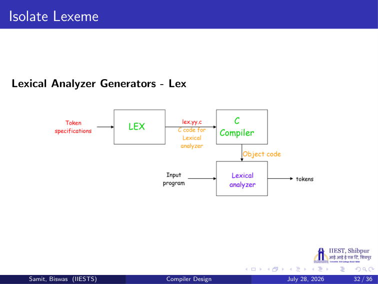
*Figure: Slide 32. Token specifications → LEX → lex.yy.c → C compiler → lexical analyzer, which turns the input program into tokens.*

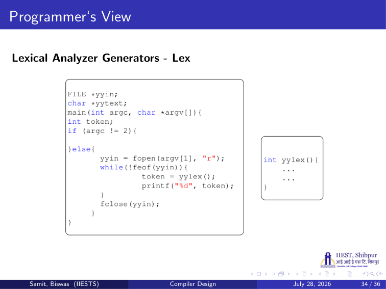
*Figure: Slide 34. The main program calls yylex() in a loop and prints each token code.*

### 7.4 Verified Formulas, Trade-offs & Calculations

**Why character codes below 256 are safe.** A single byte holds values 0 to 255. So the code of any one-character token, such as `'('` = 40 or `';'` = 59, is less than 256. `WHILE_TOK` = 256 and `ID_TOK` = 350 can never be confused with a character.

**The programmer's loop on the input `while (x > 0);`:** with the codes of Slide 35, `yylex()` returns, in order: `WHILE_TOK` (256), `LPAREN_TOK` (40), `ID_TOK` (350), `GT_TOK` (62), `INTCONST` (351), `RPAREN_TOK` (41), `SEMICOLON_TOK` (59). The program prints `256 40 350 62 351 41 59` (without spaces, since the format is `"%d"`).

> **Slide note (Slide 34):** The `if (argc != 2) { }` branch is empty. A real program would print a usage message there, because no input file was given.

> **Background (not in the slides):** A Lex specification has three parts separated by `%%`: definitions, rules (a regular expression followed by the C action to run when it matches) and user code. When two rules match, Lex picks the **longest** match; if they are equally long, it picks the rule listed **first**. That is why keywords are listed before the identifier rule.
