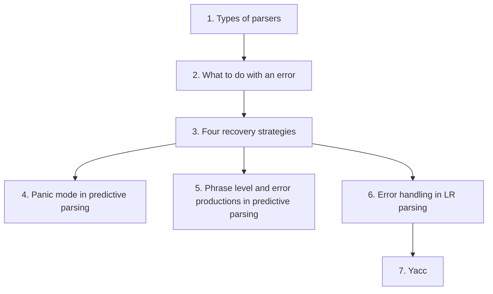
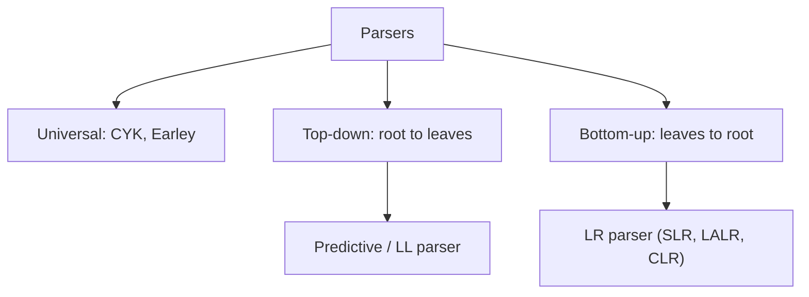
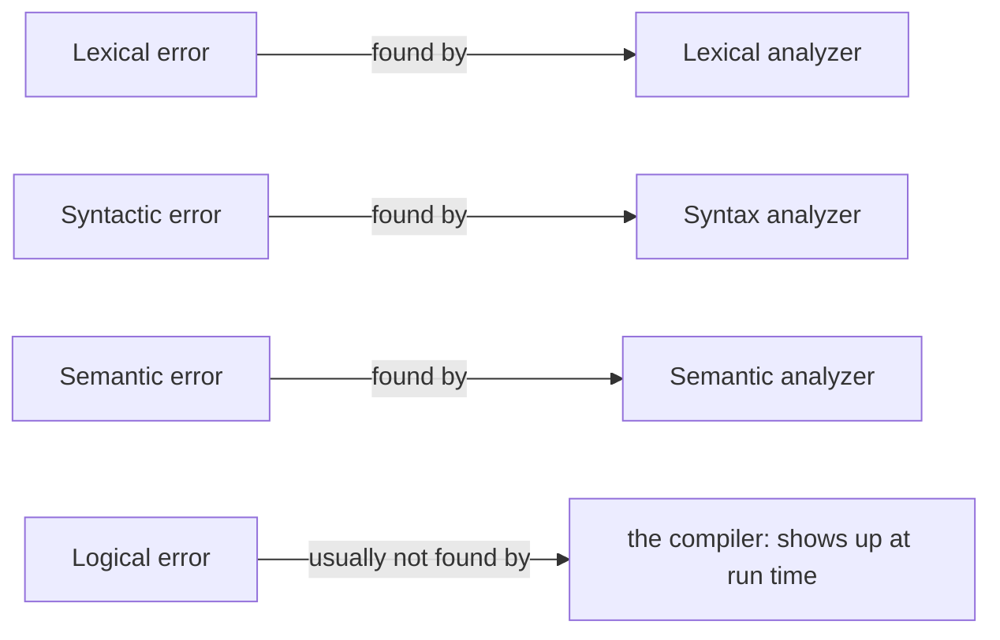
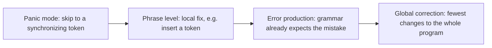
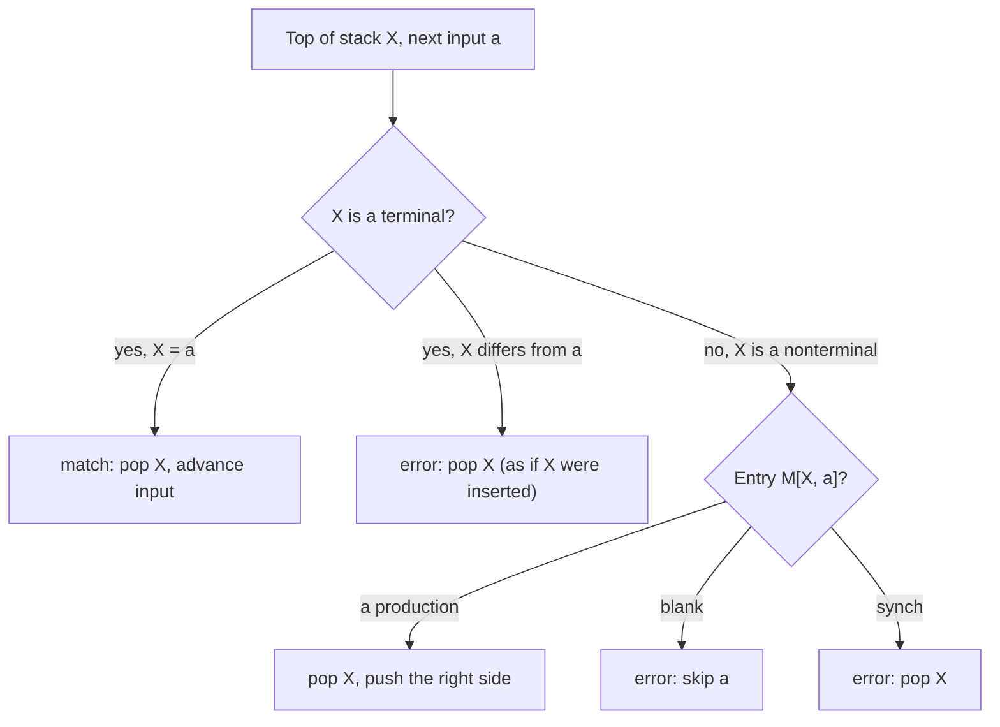
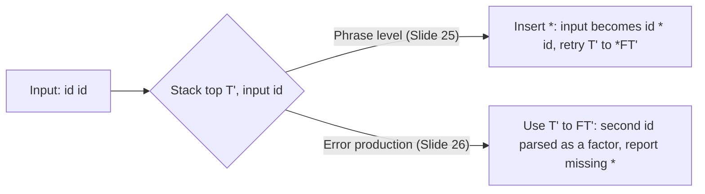
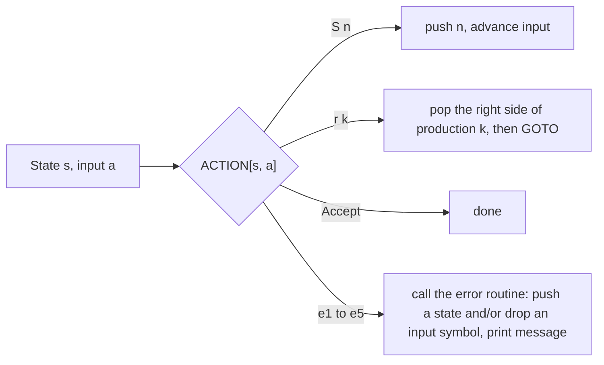
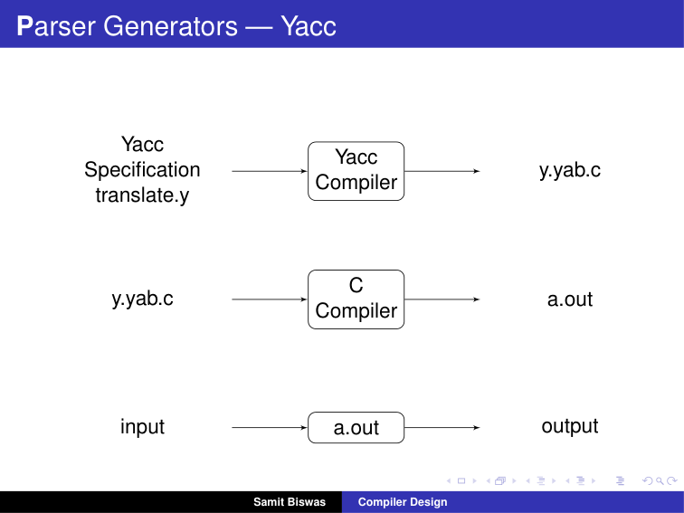

# Error-Recovery Strategies — Learning Guide

Source: `Error_Recovery.pdf`, Slides 1–30. This deck has no printed slide numbers, so "Slide N" means page N of the PDF.

**Who this is for:** a student who knows what a parser is and now asks: what happens when the input is wrong? After reading, you can name the four kinds of errors and the four recovery strategies, run a predictive parser with synchronizing tokens by hand, and explain the error routines of an LR parser.

**How to read this guide:** Read the sections in order. Each section first says why the idea exists, then how it works, then shows a picture, then gives the exact tables and worked checks. Facts come from the slides. Extra explanations are marked **Background (not in the slides)**. Errors on the slides are marked **Slide note**.



## Contents

1. [Types of parsers](#1-types-of-parsers)
2. [What to do with an error, and the four kinds of error](#2-what-to-do-with-an-error-and-the-four-kinds-of-error)
3. [The four error-recovery strategies](#3-the-four-error-recovery-strategies)
4. [Panic mode in predictive parsing](#4-panic-mode-in-predictive-parsing)
5. [Phrase-level recovery and error productions in predictive parsing](#5-phrase-level-recovery-and-error-productions-in-predictive-parsing)
6. [Error handling in LR parsing](#6-error-handling-in-lr-parsing)
7. [Parser generators: Yacc](#7-parser-generators-yacc)

---

## 1. Types of parsers

### 1.1 The Problem & Intuition

A parser checks whether the tokens follow the grammar, and builds a tree. There are different ways to build that tree. Error recovery depends on the kind of parser, so we first list the kinds.

### 1.2 Mechanism & Architecture

**Types of parsers (Slide 2):**

| Type | How it works | Notes |
| :--- | :--- | :--- |
| Universal | Can parse any grammar. Examples: the Cocke–Younger–Kasami (CYK) method and Earley's algorithm. | Inefficient, so not used in production compilers. |
| Top-down | Builds parse trees from the top (root) to the bottom (leaves). | Predictive (LL) parsers are of this kind (Sections 4–5). |
| Bottom-up | Starts from the leaves and works up to the root. | LR parsers are of this kind (Section 6). |

Both top-down and bottom-up parsers scan the input from left to right, one symbol at a time.

### 1.3 Visual Anchor



*Figure: The three types of parser. Production compilers use top-down or bottom-up parsers.*

### 1.4 Verified Formulas, Trade-offs & Calculations

> **Background (not in the slides):** "Inefficient" is concrete. The CYK algorithm takes time proportional to $n^3$ for an input of $n$ tokens. For a 10,000-token file that is $10^{12}$ steps. Top-down and bottom-up parsers for suitable grammars run in time proportional to $n$, which is $10^4$ steps for the same file.

---

## 2. What to do with an error, and the four kinds of error

### 2.1 The Problem & Intuition

Real programs contain mistakes. A compiler that stops at the first one is annoying: you fix one typo, recompile, and find the next. A compiler that keeps going may print a flood of messages, all caused by one mistake. Good error handling sits between these two.

### 2.2 Mechanism & Architecture

**What should happen when the parser finds an error in the user's input? (Slides 3–6).** Two choices:

1. **Stop immediately** and signal an error.
2. **Record the error but try to continue.**

With the first, the user must recompile from scratch after every trivial fix. With the second, the user might be overwhelmed by a whole series of error messages, all caused by essentially the same problem.

**The four types of error (Slide 7):**

| Type | Example from the slide |
| :--- | :--- |
| Lexical error | misspelling an identifier, keyword or operator |
| Syntactic error | an arithmetic expression with unbalanced parentheses |
| Semantic error | an operator applied to an incompatible operand |
| Logical error | an infinitely recursive call |

### 2.3 Visual Anchor



*Figure (Background): Which part of the compiler normally catches each kind of error.*

### 2.4 Verified Formulas, Trade-offs & Calculations

> **Background (not in the slides):** Examples in C for each type:
> - Lexical: `int 9x;` (an identifier cannot start with a digit) or `a = b @ c;` (`@` is not an operator).
> - Syntactic: `x = (a + b;` (missing `)`).
> - Semantic: `int a; a = "hello" * 2;` (`*` applied to a string).
> - Logical: `int f(int n) { return f(n); }` compiles fine but never stops.

---

## 3. The four error-recovery strategies

### 3.1 The Problem & Intuition

Once the parser finds an error, it must get back into a state where it can go on parsing. The strategies range from very simple (throw input away) to very clever (find the smallest fix to the whole program).

### 3.2 Mechanism & Architecture

**The strategies (Slide 8):** panic mode, phrase-level recovery, error productions and global correction.

**Panic mode (Slide 9).** Skip input symbols until one of a chosen set of **synchronizing tokens** appears. Example, with a missing semicolon:

```c
a = b + c    // no semi-colon
d = e + f;
```

The compiler discards all following tokens until it meets a semicolon.

**Phrase-level recovery (Slide 10).** Perform a **local correction** on the input to repair the error. For example, change the input by inserting a missing token: `int id 5;` becomes `int id = 5;`.

**Error production (Slide 11).** Add productions for common erroneous constructs to the grammar.

**Global correction (Slide 12).** Choose a minimal sequence of changes that gives a globally **least-cost** correction.

### 3.3 Visual Anchor


*Figure (illustration, not from the slides): Panic mode is like a hiker lost in fog. They stop trying to follow every step and walk on until they reach a known trail marker (the synchronizing token, such as `;`), then carry on normally. Whatever lay in the fog is skipped.*



*Figure: From simplest to most ambitious.*

### 3.4 Verified Formulas, Trade-offs & Calculations

| Strategy | Strength | Weakness |
| :--- | :--- | :--- |
| Panic mode | Simple. Never loops forever, because it always moves forward in the input. | Skips a lot of input, so errors inside the skipped part are missed. |
| Phrase level | Repairs small mistakes such as a missing `=` or `;`. | A bad fix can cause a chain of new errors; must be written carefully so it always ends. |
| Error production | Gives a very precise message for errors the designer expects. | Each production must be added by hand (Slide 26). |
| Global correction | Finds the cheapest fix overall. | Too slow and complex to use in practice; mainly of theoretical interest. |

> **Background (not in the slides):** In the panic mode example, the parser reads `a = b + c d`. After `c` it expects `;` or an operator but sees the identifier `d`. It reports "missing `;`", skips `d = e + f`, finds `;` and starts again from the next statement. The second statement is never checked.

---

## 4. Panic mode in predictive parsing

### 4.1 The Problem & Intuition

A **predictive parser** keeps a stack of grammar symbols and a parsing table $M$. For the nonterminal on top of the stack and the next input token, the table says which production to use. When the table has no answer, we need a rule for what to do. Panic mode answers: skip input or pop the stack until a **synchronizing** token lines things up again.

### 4.2 Mechanism & Architecture

**When an error is detected (Slide 13):**

- the terminal on top of the stack does not match the next input symbol, or
- nonterminal $A$ is on top of the stack, $a$ is the next input symbol, and the table entry $M[A, a]$ is empty.

**Heuristics for choosing the synchronizing set of nonterminal $A$ (Slide 14):**

1. As a starting point, put all symbols of $\text{FOLLOW}(A)$ into the synchronizing set of $A$. Skip tokens until an element of $\text{FOLLOW}(A)$ is seen, then pop $A$ from the stack. It is likely that parsing can then continue.
2. If we add the symbols of $\text{FIRST}(A)$ to the synchronizing set of $A$, it may be possible to resume parsing according to $A$ when a symbol of $\text{FIRST}(A)$ appears in the input.
3. If a terminal on top of the stack cannot be matched, a simple idea is to pop the terminal, issue a message saying that the terminal was inserted, and continue parsing.

**The grammar used.**

> **Background (not in the slides):** The slides use the standard expression grammar without left recursion:
> $E \to T E'$, $\ E' \to + T E' \mid \epsilon$, $\ T \to F T'$, $\ T' \to \ast F T' \mid \epsilon$, $\ F \to (E) \mid \text{id}$.

**FIRST and FOLLOW sets (Slide 15):**

| Set | Value |
| :--- | :--- |
| FIRST(E) = FIRST(T) = FIRST(F) | { (, id } |
| FIRST(E') | { +, ε } |
| FIRST(T') | { *, ε } |
| FOLLOW(E) = FOLLOW(E') | { ), $ } |
| FOLLOW(T) = FOLLOW(T') | { +, ), $ } |
| FOLLOW(F) | { *, +, ), $ } |

**The parsing table with synchronizing tokens (Slide 15).** "synch" marks an entry taken from FOLLOW of the nonterminal. A blank cell is an empty entry.

| Nonterminal | id | + | * | ( | ) | $ |
| :--- | :--- | :--- | :--- | :--- | :--- | :--- |
| E | E → TE' | | | E → TE' | synch | synch |
| E' | | E' → +TE' | | | E' → ε | E' → ε |
| T | T → FT' | synch | | T → FT' | synch | synch |
| T' | | T' → ε | T' → *FT' | | T' → ε | T' → ε |
| F | F → id | synch | synch | F → (E) | synch | synch |

> **Slide note (Slide 15):** The slide's entry $M[T, (]$ reads T' → FT'. It should be **T → FT'**, the same as $M[T, \text{id}]$, because the row is for T. Slide 25 shows it correctly.

**What the driver does on an error (Slide 16):**

- **synch:** the driver pops the current nonterminal $A$ and skips input until a synch token, or skips input until one of $\text{FIRST}(A)$ is found.
- If the entry $M[A, a]$ is **blank**, the input symbol $a$ is skipped.
- If the entry is **synch**, the nonterminal on top of the stack is popped.
- If a **token** on top of the stack does not match the input symbol, the token is popped from the stack.

### 4.3 Visual Anchor



*Figure: The driver's decision at each step, including the three error rules of Slide 16.*

### 4.4 Verified Formulas, Trade-offs & Calculations

**Checking the FIRST and FOLLOW sets.**

- $F$ starts with `(` or `id`. $T \to F T'$ and $E \to T E'$ both start with the first symbol of $F$. So all three FIRST sets are { (, id }.
- $E'$ either starts with `+` or is empty, so FIRST(E') = { +, ε }. Likewise FIRST(T') = { *, ε }.
- $E$ is the start symbol, so `$` is in FOLLOW(E). In $F \to (E)$, `)` follows $E$. So FOLLOW(E) = { ), $ }. $E'$ is always at the right end of an $E$ production, so it gets the same set.
- $T$ is followed by $E'$, which can begin with `+` or vanish. So FOLLOW(T) = { + } ∪ FOLLOW(E) = { +, ), $ }. $T'$ gets the same.
- $F$ is followed by $T'$, which can begin with `*` or vanish. So FOLLOW(F) = { * } ∪ FOLLOW(T) = { *, +, ), $ }.

All six sets match Slide 15. The synch entries are exactly the FOLLOW symbols that have no production in that row. (E' and T' have no synch entries, because they can derive ε: their FOLLOW cells already hold an ε-production.)

**The full trace on the erroneous input `) id * + id` (Slides 17–23).** The input has two errors: a stray `)` at the start, and `*` with no operand after it.

| Step | Stack | Input | Output |
| :--- | :--- | :--- | :--- |
| 1 | $E | ) id * + id $ | error, skip ) |
| 2 | $E | id * + id $ | id is in FIRST(E) |
| 3 | $E'T | id * + id $ | |
| 4 | $E'T'F | id * + id $ | |
| 5 | $E'T'id | id * + id $ | |
| 6 | $E'T' | * + id $ | |
| 7 | $E'T'F* | * + id $ | |
| 8 | $E'T'F | + id $ | error, M[F, +] = synch |
| 9 | $E'T' | + id $ | F has been popped |
| 10 | $E' | + id $ | |
| 11 | $E'T+ | + id $ | |
| 12 | $E'T | id $ | |
| 13 | $E'T'F | id $ | |
| 14 | $E'T'id | id $ | |
| 15 | $E'T' | $ | |
| 16 | $E' | $ | |
| 17 | $ | $ | accept (parsing finishes) |

A program that runs the table and the Slide 16 rules produces exactly these 17 steps.

**Why step 1 skips `)` instead of popping E.** $M[E, )]$ is synch, so the rule would pop $E$. But $E$ is the only symbol on the stack. Popping it would leave only `$` while input remains, and the parse would end at once.

> **Background (not in the slides):** That is why, when the synch nonterminal is the start symbol alone on the stack, the parser skips the input symbol instead. This is how the textbook (Aho et al.) handles this same example.

**Why step 8 pops F.** After `*` the parser expects an operand $F$, but sees `+`. $M[F, +]$ is synch, because `+` is in FOLLOW(F). Popping $F$ pretends the operand was there. Parsing continues with `+ id` and ends normally. The parser reported two errors and read the whole input.

---

## 5. Phrase-level recovery and error productions in predictive parsing

### 5.1 The Problem & Intuition

Panic mode only throws things away. Sometimes we can do better: guess the missing token and put it back. Or we can teach the grammar a common mistake so it is parsed on purpose, with a precise message.

### 5.2 Mechanism & Architecture

**Phrase-level recovery in predictive parsing (Slide 24):**

- Each blank cell of the table can be filled with a pointer to a special-purpose **error routine**.
- Such routines typically remove tokens from the input and/or pop an item from the stack.
- It is ill-advised to change the input or the stack **without removing** items. Then it is hard to guarantee that error recovery will always terminate.

**Example: insert a missing `*` (Slide 25).** Change the input stream by inserting missing tokens: `id id` is changed into `id * id`. The table gets one new entry, in row T' under id: **Insert ***. The driver inserts the missing `*` and retries the production.

| Nonterminal | id | + | * | ( | ) | $ |
| :--- | :--- | :--- | :--- | :--- | :--- | :--- |
| E | E → TE' | | | E → TE' | synch | synch |
| E' | | E' → +TE' | | | E' → ε | E' → ε |
| T | T → FT' | synch | | T → FT' | synch | synch |
| T' | **Insert *** | T' → ε | T' → *FT' | | T' → ε | T' → ε |
| F | F → id | synch | synch | F → (E) | synch | synch |

**Recovery using an error production (Slide 26):**

- Include productions for common errors.
- For example, to accept the missing `*` in `id id`, add the error production **T' → FT'**. It goes in row T' under id.
- This is a powerful recovery method, but the productions must be added by hand.

> **Slide note (Slide 26):** In this table the entry $M[E', +]$ reads E' → TE'. It should be **E' → +TE'**, as on Slides 15 and 25. Only the T' row is meant to change.

### 5.3 Visual Anchor



*Figure: The same mistake, `id id`, handled by the two methods.*

### 5.4 Verified Formulas, Trade-offs & Calculations

**Trace `id id` with phrase-level recovery (Slide 25 table).**

| Step | Stack | Input | Action |
| :--- | :--- | :--- | :--- |
| 1 | $E | id id $ | E → TE' |
| 2 | $E'T | id id $ | T → FT' |
| 3 | $E'T'F | id id $ | F → id |
| 4 | $E'T'id | id id $ | match id |
| 5 | $E'T' | id $ | M[T', id] = Insert *: input becomes * id $ |
| 6 | $E'T' | * id $ | T' → *FT' |
| 7 | $E'T'F* | * id $ | match * |
| 8 | $E'T'F | id $ | F → id |
| 9 | $E'T'id | id $ | match id |
| 10 | $E'T' | $ | T' → ε |
| 11 | $E' | $ | E' → ε |
| 12 | $ | $ | accept, with one "missing *" message |

**Why "insert" is safe here.** After the insert, the parser immediately matches the inserted `*` and then consumes the next `id`. Input is still used up, so the parser cannot loop forever. This is the termination concern of Slide 24.

**With the error production instead (Slide 26).** At step 5, $M[T', \text{id}]$ = T' → FT'. The parser pops T' and pushes F T'. Then F → id matches the second `id`, and parsing ends the same way. The grammar itself absorbed the mistake, so the parser can print an exact message like "missing `*` between operands".

---

## 6. Error handling in LR parsing

### 6.1 The Problem & Intuition

An LR parser is a bottom-up parser driven by a table of states. Each cell says **shift**, **reduce**, **accept** or **error**. Instead of a single "error", we can write a different error routine into each empty cell. Each routine guesses the most likely cause and repairs it.

### 6.2 Mechanism & Architecture

**Phrase-level recovery in LR parsing (Slide 27).** For each error entry in the table, insert a pointer to a particular error procedure. The procedure assumes the most likely cause and takes the right action.

**The grammar (Slide 27):**

1. $E \to E + T$
2. $E \to T$
3. $T \to T \ast F$
4. $T \to F$
5. $F \to (E)$
6. $F \to \text{id}$

**The SLR parsing table with error routines (Slide 28).** "S5" means shift and go to state 5. "r2" means reduce by production 2. e1–e5 are error routines.

| State | id | + | * | ( | ) | $ | E | T | F |
| :--- | :--- | :--- | :--- | :--- | :--- | :--- | :--- | :--- | :--- |
| 0 | S5 | e1 | e1 | S4 | e2 | e1 | 1 | 2 | 3 |
| 1 | e3 | S6 | e4 | e3 | e2 | Accept | | | |
| 2 | e3 | r2 | S7 | e3 | r2 | r2 | | | |
| 3 | e3 | r4 | r4 | e3 | r4 | r4 | | | |
| 4 | S5 | e1 | e1 | S4 | e2 | e1 | 8 | 2 | 3 |
| 5 | e3 | r6 | r6 | e3 | r6 | r6 | | | |
| 6 | S5 | e1 | e1 | S4 | e2 | e2 | | 9 | 3 |
| 7 | S5 | e1 | e1 | S4 | e2 | e2 | | | 10 |
| 8 | e3 | S6 | e4 | e3 | S11 | e5 | | | |
| 9 | e3 | r1 | S7 | e3 | r1 | r1 | | | |
| 10 | e3 | r3 | r3 | e3 | r3 | r3 | | | |
| 11 | e3 | r5 | r5 | e3 | r5 | r5 | | | |

**The error procedures (Slide 29):**

| Routine | Situation | Action | Message |
| :--- | :--- | :--- | :--- |
| e1 | expecting `id` or `(`, but finding `+`, `*` or `$` | push state 5 (pretend an `id` was read) | "missing operand" |
| e2 | finding an unexpected `)` | remove `)` from the input (ignore it) | "unmatched right parenthesis" |
| e3 | expecting `+`, finding `id` or `(` | push state 6 (assume `+`) | "missing +" |
| e4 | expecting `+`, finding `*` | push state 6 (assume `+`) and remove `*` from the input | "`*` instead of `+`" |
| e5 | expecting `)`, finding `$` | push state 11 (assume `)`) | "missing right parenthesis" |

### 6.3 Visual Anchor



*Figure: An LR parser with phrase-level recovery. Every former "error" cell now names a routine.*

### 6.4 Verified Formulas, Trade-offs & Calculations

**The shift and reduce entries are correct.** A program built the SLR(1) table for this grammar from scratch. After renaming its states to the slide's numbers, every shift, reduce, accept and GOTO entry matches Slide 28.

**Worked example 1: `( id` (missing right parenthesis).**

| Stack (states) | Input | Action |
| :--- | :--- | :--- |
| 0 | ( id $ | S4 |
| 0 4 | id $ | S5 |
| 0 4 5 | $ | r6: F → id, GOTO(4, F) = 3 |
| 0 4 3 | $ | r4: T → F, GOTO(4, T) = 2 |
| 0 4 2 | $ | r2: E → T, GOTO(4, E) = 8 |
| 0 4 8 | $ | **e5**: push 11, "missing right parenthesis" |
| 0 4 8 11 | $ | r5: F → (E), pop 3 states, GOTO(0, F) = 3 |
| 0 3 | $ | r4, then r2: E → T, GOTO(0, E) = 1 |
| 0 1 | $ | Accept |

One message, and the parse finishes.

**Worked example 2: `id + )`.** After `id +` the stack is 0 1 6. On `)`, ACTION[6, )] = e2: the `)` is removed, "unmatched right parenthesis". Now the input is `$`, and ACTION[6, $] = e2 again.

> **Slide note (Slide 28):** ACTION[6, $] and ACTION[7, $] are e2 ("unexpected `)`"). But the input there is `$`, not `)`. e2 would try to remove the end marker, and the parser gets stuck, as a simulation shows. In states 6 and 7 the parser has just read `+` or `*` and needs an operand, so these entries should be **e1** ("missing operand"), as in states 0 and 4. With e1, `id + )` finishes: push 5, then r6, r4, r1, and Accept, with two messages.

---

## 7. Parser generators: Yacc

### 7.1 The Problem & Intuition

Building LR tables by hand, as in Section 6, is slow and error-prone for a real language. A **parser generator** builds the parser from the grammar automatically. Yacc ("yet another compiler-compiler") is the classic one.

### 7.2 Mechanism & Architecture

**Yacc (Slide 30).** Three steps:

1. The Yacc specification `translate.y` goes into the **Yacc compiler**, which outputs the C file `y.tab.c`.
2. `y.tab.c` goes into the **C compiler**, which outputs the program `a.out`.
3. `a.out` takes the **input** and produces the **output**.

> **Slide note (Slide 30):** The slide writes the file name as `y.yab.c`. Yacc's output file is called **`y.tab.c`**.

### 7.3 Visual Anchor


*Figure: Slide 30. translate.y → Yacc compiler → y.tab.c → C compiler → a.out; then input → a.out → output.*

### 7.4 Verified Formulas, Trade-offs & Calculations

> **Background (not in the slides):** Yacc builds an LALR(1) parser, a close cousin of the SLR table in Section 6. For error recovery it offers a special token `error`. A rule such as `stmt : error ';'` is an error production combined with panic mode. On an error, the parser pops states until it can shift `error`, then skips input until it finds `;`. The parser in `a.out` usually gets its tokens from `yylex()`, the scanner that Lex generates.
