# Semantic Analysis: Syntax-Directed Translation and Type Checking — Learning Guide

Source: `Semantic_Analysis.pdf`, Slides 1–67. This deck has no printed slide numbers, so "Slide N" means page N of the PDF.

**Who this is for:** a student who knows grammars and parse trees. After reading, you can attach attributes and semantic rules to a grammar, tell synthesized from inherited attributes, draw an annotated parse tree and a dependency graph, build a syntax tree, run a bottom-up calculator, and type-check expressions and statements.

**How to read this guide:** Read the sections in order. Each section first says why the idea exists, then how it works, then shows a picture, then gives the exact rules and worked checks. Facts come from the slides. Extra explanations are marked **Background (not in the slides)**. Errors on the slides are marked **Slide note**.

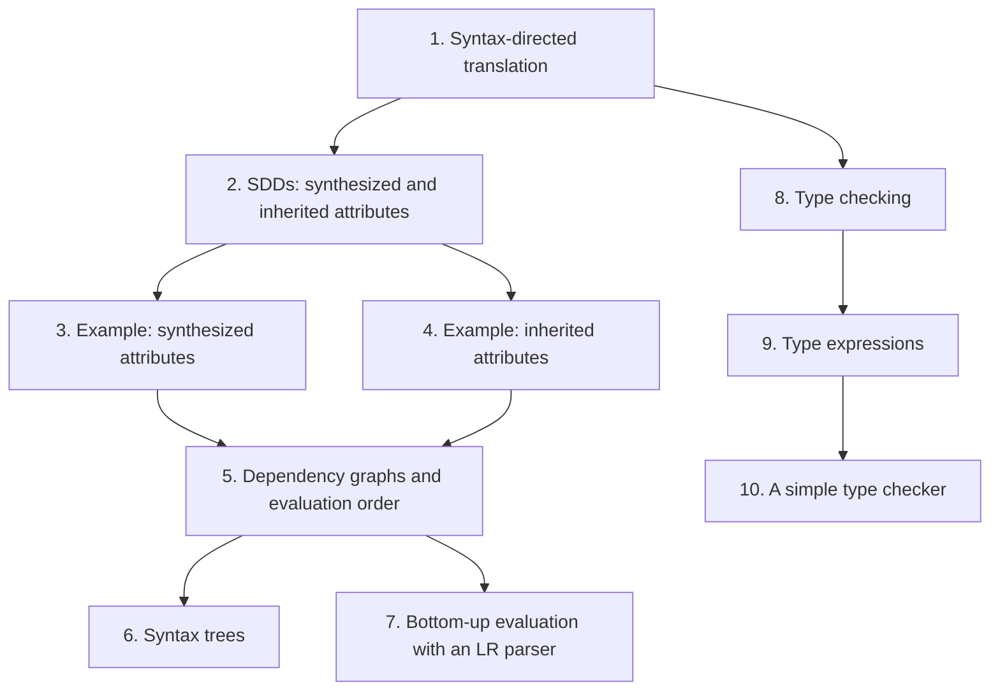

## Contents

1. [Syntax-directed translation: the idea](#1-syntax-directed-translation-the-idea)
2. [Syntax-directed definitions: synthesized and inherited attributes](#2-syntax-directed-definitions-synthesized-and-inherited-attributes)
3. [Example 1: synthesized attributes (a desk calculator)](#3-example-1-synthesized-attributes-a-desk-calculator)
4. [Example 2: inherited attributes (declarations)](#4-example-2-inherited-attributes-declarations)
5. [Dependency graphs and evaluation order](#5-dependency-graphs-and-evaluation-order)
6. [Syntax trees](#6-syntax-trees)
7. [Bottom-up evaluation of S-attributed definitions](#7-bottom-up-evaluation-of-s-attributed-definitions)
8. [Type checking: static and dynamic](#8-type-checking-static-and-dynamic)
9. [Type expressions](#9-type-expressions)
10. [A simple type checker](#10-a-simple-type-checker)

---

## 1. Syntax-directed translation: the idea

### 1.1 The Problem & Intuition

The parser only checks that the program has the right **shape**. It does not know what `3 * 5` is worth, which type `x` has, or what code to generate. **Syntax-directed translation** hangs that extra information on the grammar itself. Each grammar symbol carries values (**attributes**), and each production says how to compute them (**semantic rules**). Parsing then drives the translation.

### 1.2 Mechanism & Architecture

**Syntax-directed translation (Slide 4):**

- We associate information with programming-language constructs by attaching **attributes** to grammar symbols.
- The values of these attributes are computed by **semantic rules** associated with the production rules.
- Evaluating these semantic rules:
  - may generate intermediate code,
  - may put information into the symbol table,
  - may perform type checking.
- An attribute may hold almost anything: a string, a number, a memory location, a complex record.

**Two notations (Slide 7).** When we attach semantic rules to productions, we use two notations:

| Notation | What it gives | Order of evaluation |
| :--- | :--- | :--- |
| Syntax-directed definition (SDD) | A high-level specification of the translation. It hides implementation details such as the order of evaluation. | Not stated: we give a set of semantic actions for each production, but not when they are evaluated. |
| Translation scheme | The semantic actions placed inside the productions. | Stated: it indicates the order in which the actions of a production are evaluated. |

**The conceptual steps (Slide 8).** With both SDDs and translation schemes, we conceptually:

1. parse the input token stream,
2. build the parse tree,
3. traverse the tree to evaluate the semantic rules at the parse-tree nodes.

Input stream → parse tree → dependency graph → evaluation order for semantic rules.

### 1.3 Visual Anchor

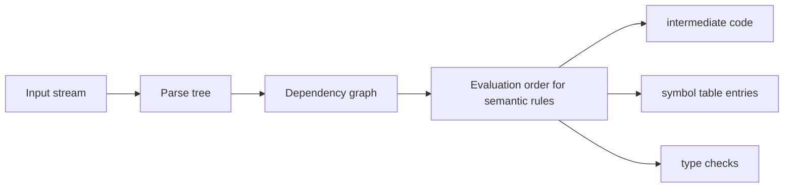

*Figure: Slide 8's pipeline, and the three kinds of result from Slide 4.*

### 1.4 Verified Formulas, Trade-offs & Calculations

> **Background (not in the slides):** The same production written both ways:
> - SDD: production $E \to E_1 + T$ with the rule $E.val = E_1.val + T.val$. It says *what* $E.val$ is, not *when* to compute it.
> - Translation scheme: $E \to E_1 + T \ \lbrace \text{print}('+') \rbrace$. The action sits after $T$, so it runs after $T$ has been parsed. Its position fixes the order.

---

## 2. Syntax-directed definitions: synthesized and inherited attributes

### 2.1 The Problem & Intuition

Some information flows **up** the tree: the value of `3 * 5` comes from its children. Some flows **down** or **sideways**: in `real x, y`, the type `real` is on the left, but the names that need it are further right. So there are two kinds of attribute.

### 2.2 Mechanism & Architecture

**Syntax-directed definitions (Slide 10).** An SDD is a generalisation of a context-free grammar in which:

- Each grammar symbol has a set of attributes, split into two kinds: **synthesized attributes** and **inherited attributes**.
- Each production rule has a set of semantic rules.
- The value of an attribute at a parse-tree node is defined by the semantic rule of the production used at that node.
- A **synthesized** attribute at a node is computed from the attribute values at the **children** of that node.
- An **inherited** attribute at a node is computed from the attribute values at the **siblings and parent** of that node.

**Examples (Slide 12):**

- Synthesized: $E \to E_1 + E_2$ with $\lbrace E.val = E_1.val + E_2.val \rbrace$.
- Inherited: $A \to XYZ$ with $\lbrace Y.val = 2 \ast A.val \rbrace$.
- Semantic rules set up dependencies between attributes. These can be drawn as a **dependency graph**.
- The dependency graph decides the evaluation order of the semantic rules.
- Evaluating a semantic rule defines the value of an attribute. A semantic rule may also have **side effects**, such as printing a value.

**Annotated parse tree (Slide 15):**

- A parse tree that shows the attribute values at each node is an **annotated parse tree**.
- The attribute values at its nodes are either initialised to constants or by the lexical analyzer, or computed by the semantic rules.
- Computing the attribute values at the nodes is called **annotating** or **decorating** the parse tree.
- The order of these computations depends on the dependency graph induced by the semantic rules.

**The general form of a semantic rule (Slide 16).** In an SDD, each production $A \to \alpha$ has a set of semantic rules of the form

```math
b = f(c_1, c_2, c_3, \ldots, c_k)
```

where $f$ is a function, and either:

- $b$ is a **synthesized** attribute of $A$, and $c_1, \ldots, c_k$ are attributes of the grammar symbols in $\alpha$; or
- $b$ is an **inherited** attribute of one of the symbols on the right side, and $c_1, \ldots, c_k$ are attributes of the symbols in $A$ and $\alpha$.

### 2.3 Visual Anchor

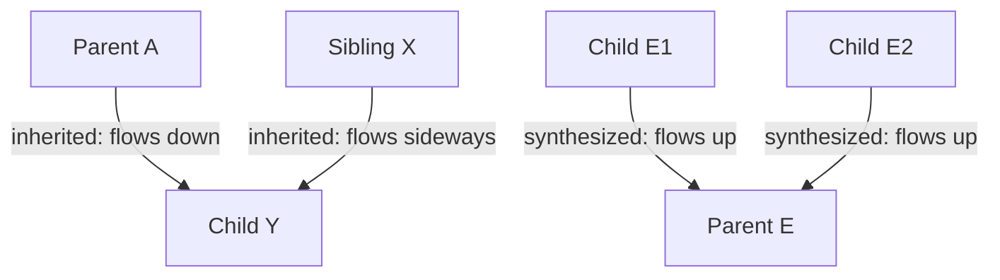

*Figure: Synthesized attributes come up from the children. Inherited attributes come from the parent or the siblings.*

### 2.4 Verified Formulas, Trade-offs & Calculations

**Classifying the two Slide 12 rules with the Slide 16 form.**

| Rule | $b$ | $c_1, \ldots, c_k$ | Kind |
| :--- | :--- | :--- | :--- |
| $E.val = E_1.val + E_2.val$ | $E.val$, on the left side $A$ | $E_1.val$, $E_2.val$, in $\alpha$ | synthesized |
| $Y.val = 2 \ast A.val$ | $Y.val$, on the right side | $A.val$, the left side | inherited |

> **Background (not in the slides):** An SDD that uses only synthesized attributes is called **S-attributed**. Section 7 shows that it can be evaluated during an LR parse.

---

## 3. Example 1: synthesized attributes (a desk calculator)

### 3.1 The Problem & Intuition

The classic first example is a calculator. Each expression node computes its value from its children. The final value is printed. Every attribute here is synthesized.

### 3.2 Mechanism & Architecture

**The setup (Slides 17, 26):**

- Grammar symbols: $L, E, T, F, \text{n}, +, \ast, (, ), \text{digit}$. (Here `n` marks the end of the input line.)
- Nonterminals $L, E, T, F$ have an attribute called $val$.
- The terminal digit has an attribute called $lexval$. The lexical analyser provides its value.

**The SDD (Slide 26):**

| Production | Semantic rule |
| :--- | :--- |
| $L \to E\ \text{n}$ | print(E.val) |
| $E \to E_1 + T$ | $E.val = E_1.val + T.val$ |
| $E \to T$ | $E.val = T.val$ |
| $T \to T_1 \ast F$ | $T.val = T_1.val \times F.val$ |
| $T \to F$ | $T.val = F.val$ |
| $F \to (E)$ | $F.val = E.val$ |
| $F \to \text{digit}$ | $F.val = \text{digit}.lexval$ |

> **Slide note (Slide 17):** The first version of this table writes $E.val = E.val + T.val$ and $T.val = T.val \ast F.val$. The two $E$'s are different nodes, so the right-hand one needs a subscript: $E_1.val$ and $T_1.val$. Slide 26 fixes this. Both slides also write `print("E.val")` with quotes, which would print the text "E.val". The rule means print the value $E.val$.

### 3.3 Visual Anchor

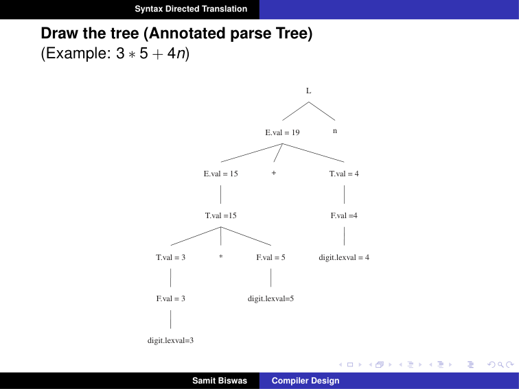
*Figure: Slides 19 and 27. Each node shows its $val$. The values flow upward: 3 and 5 give 15, then 15 and 4 give 19.*

### 3.4 Verified Formulas, Trade-offs & Calculations

**Annotating the tree for `3 * 5 + 4 n` from the bottom up (Slides 19, 27).**

| Node | Rule used | Value |
| :--- | :--- | :--- |
| digit (3) | from the lexer | lexval = 3 |
| F | $F.val = \text{digit}.lexval$ | 3 |
| T | $T.val = F.val$ | 3 |
| digit (5) | from the lexer | lexval = 5 |
| F | $F.val = \text{digit}.lexval$ | 5 |
| T | $T.val = T_1.val \times F.val = 3 \times 5$ | 15 |
| E | $E.val = T.val$ | 15 |
| digit (4) | from the lexer | lexval = 4 |
| F, then T | copy rules | 4 |
| E (root of the expression) | $E.val = E_1.val + T.val = 15 + 4$ | 19 |
| L | print(E.val) | prints 19 |

Check: $3 \times 5 + 4 = 19$. The tree computes the product first because $\ast$ sits lower in the tree than $+$.

---

## 4. Example 2: inherited attributes (declarations)

### 4.1 The Problem & Intuition

In the declaration `real id1, id2, id3`, the type comes first. The names that need it come later, further down the tree. So the type must be **passed down** into the list. That is an inherited attribute.

### 4.2 Mechanism & Architecture

**The SDD (Slides 20, 29).** A declaration generated by the nonterminal $D$ consists of the keyword `int` or `real` followed by a list of identifiers.

| Production | Semantic rules |
| :--- | :--- |
| $D \to T\ L$ | $L.in = T.type$ |
| $T \to \text{int}$ | $T.type = \text{integer}$ |
| $T \to \text{real}$ | $T.type = \text{real}$ |
| $L \to L_1, \text{id}$ | $L_1.in = L.in$; addtype(id.entry, L.in) |
| $L \to \text{id}$ | addtype(id.entry, L.in) |

- $T.type$ is **synthesized**: it comes from the keyword below $T$.
- $L.in$ is **inherited**: it comes from the sibling $T$ (in $D \to T L$) or from the parent $L$ (in $L \to L_1, \text{id}$).
- addtype(id.entry, L.in) records the type in the symbol table entry of the identifier. It is a side effect.

### 4.3 Visual Anchor

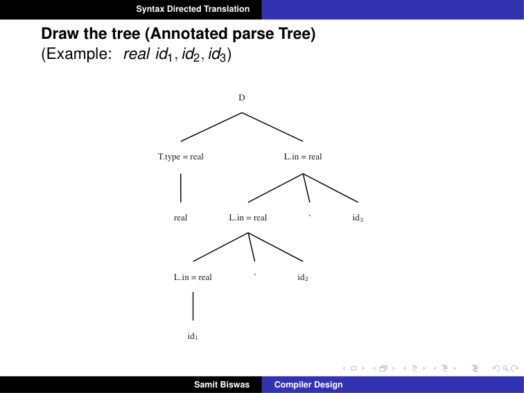
*Figure: Slides 22 and 30. T.type = real is passed across to the top L and then down the chain: every L has in = real.*

### 4.4 Verified Formulas, Trade-offs & Calculations

**Annotating `real id1, id2, id3` (Slides 22, 30).** The list is left-recursive, so the top $L$ covers all three names and the lowest $L$ covers only id1.

| Step | Rule | Result |
| :--- | :--- | :--- |
| 1 | $T \to \text{real}$: $T.type = \text{real}$ | T.type = real |
| 2 | $D \to T L$: $L.in = T.type$ | top L.in = real |
| 3 | top $L \to L_1, \text{id}_3$: addtype(id3.entry, L.in) | id3 is real |
| 4 | same production: $L_1.in = L.in$ | middle L.in = real |
| 5 | middle $L \to L_1, \text{id}_2$: addtype(id2.entry, L.in) | id2 is real |
| 6 | same production: $L_1.in = L.in$ | lowest L.in = real |
| 7 | lowest $L \to \text{id}_1$: addtype(id1.entry, L.in) | id1 is real |

All three identifiers end up with type real in the symbol table.

---

## 5. Dependency graphs and evaluation order

### 5.1 The Problem & Intuition

With inherited and synthesized attributes mixed, we cannot just evaluate "bottom-up". A rule may only run after the attributes it uses are known. The **dependency graph** records "this attribute needs that one". Any order that respects the arrows is a valid evaluation order.

### 5.2 Mechanism & Architecture

**Dependency graph (Slide 23):**

- It is a directed graph.
- It shows the dependencies between attributes.
- Construction: first put each semantic rule into the form $b = f(c_1, \ldots, c_k)$. A rule that is a procedure call gets a **dummy** synthesized attribute $b$. For example, $L \to E\ \text{n}$ with print(E.val) becomes dummy = print(E.val).

**Construction algorithm (Slide 25):**

```text
for each node n in the parse tree do
    for each attribute a of the grammar symbol at n do
        construct a node in the dependency graph for a
for each node n in the parse tree do
    for each semantic rule b = f(c1, c2, ..., ck) of the production used at n do
        for i = 1 to k do
            construct an edge from the node for ci to the node for b
```

An edge from $c_i$ to $b$ means "$b$ needs $c_i$, so compute $c_i$ first".

**Evaluation order for the declaration example (Slide 32).** The parse tree's attributes are numbered 1 to 10. The order given is:

1. $a_4 = \text{real}$
2. $a_5 = a_4$
3. addtype(id3.entry, $a_5$)
4. $a_7 = a_5$
5. addtype(id2.entry, $a_7$)
6. $a_9 = a_7$
7. addtype(id1.entry, $a_9$)

**Methods for evaluating semantic rules (Slide 33):**

| Method | How the order is chosen | Limitation |
| :--- | :--- | :--- |
| Parse-tree method | At compile time, from the dependency graph built from the parse tree. | Fails if the dependency graph contains a cycle. |
| Rule-based methods | The semantic rules are analysed by hand or by specialised tools at compiler-construction time. The order for each production is fixed then. | |
| Oblivious methods | The order is chosen without looking at the semantic rules; it is forced by the parsing method. | Restricts the class of SDDs that can be implemented. |

### 5.3 Visual Anchor

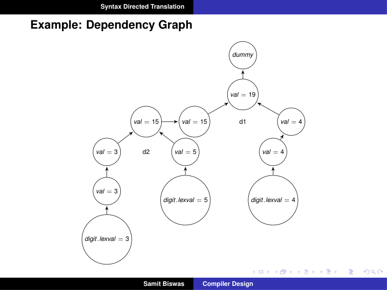
*Figure: Slide 28. Every arrow points upward, from a child's val to its parent's val, ending in the dummy node of print. A graph with only upward arrows means all attributes are synthesized.*

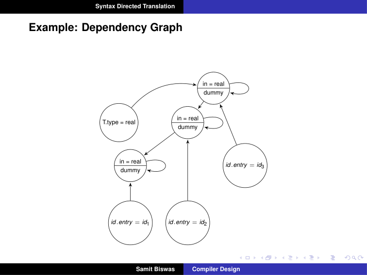
*Figure: Slide 31. T.type = real feeds the top in = real, which feeds the next one down, and so on. Each in node also feeds its own dummy (the addtype call).*

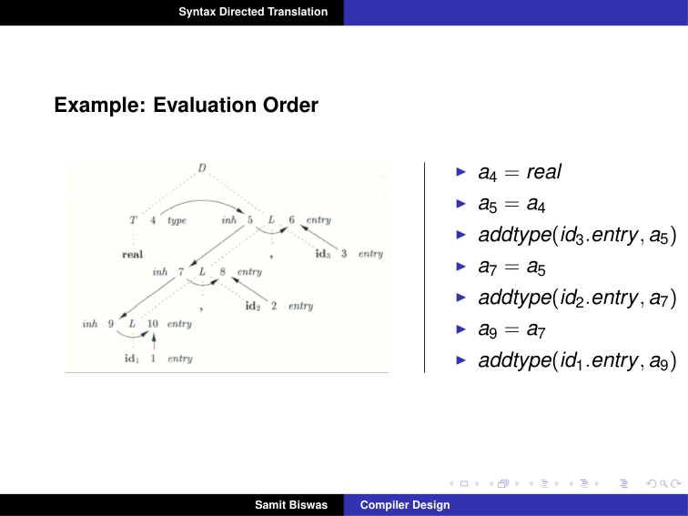
*Figure: Slide 32. The attribute nodes numbered 1–10 on the parse tree, with the evaluation order on the right.*

### 5.4 Verified Formulas, Trade-offs & Calculations

**Decoding the numbers of Slide 32.** Reading the numbers off the figure:

| Number | Attribute |
| :--- | :--- |
| 1, 2, 3 | id1.entry, id2.entry, id3.entry (known from the lexer) |
| 4 | T.type |
| 5, 6 | top L: in, and its addtype dummy |
| 7, 8 | middle L: in, and its dummy |
| 9, 10 | lowest L: in, and its dummy |

**Checking that the order respects every edge.**

- $a_5 = a_4$ comes after $a_4$ is set. ✓
- addtype(id3.entry, $a_5$) needs $a_3$ (known) and $a_5$ (step 2). ✓
- $a_7 = a_5$ needs $a_5$. ✓ And so on down the chain.

> **Background (not in the slides):** Any **topological sort** of the dependency graph is a valid order: list a node only after every node that points to it. If the graph has a cycle, no such list exists. That is why the parse-tree method fails on cycles.

---

## 6. Syntax trees

### 6.1 The Problem & Intuition

A parse tree has a node for every grammar step, including chains like $E \to T \to F$ that add nothing. A **syntax tree** keeps only what matters: operators and their operands. It is a compact intermediate representation that later phases can work on.

### 6.2 Mechanism & Architecture

**Syntax tree (Slides 34–35):**

- An intermediate representation of the compiler's input.
- A condensed form of the parse tree.
- It shows the syntactic structure of the program while omitting irrelevant details.
- Operators and keywords are associated with the interior nodes.
- Chains of simple productions are collapsed.
- Syntax-directed translation can be based on a syntax tree as well as a parse tree.

**Example: `5 + 3 * 4` (Slide 36).** The root is `+`, with children `5` and `*`; `*` has children `3` and `4`.

- Leaves: identifiers or constants.
- Internal nodes: labelled with operations.
- The children of a node are its operands.

**Constructing syntax trees for expressions (Slide 37):**

- Each node can be implemented as a record with several fields.
- In an operator node, one field identifies the operator (the **label** of the node) and the other fields hold pointers to the operands.
- Nodes may also have fields for the values (or pointers to values) of attributes.
- Three functions create nodes; each returns a pointer to a newly created node:

| Function | Creates |
| :--- | :--- |
| mknode(op, left, right) | an operator node with label op and two children |
| mkleaf(id, entry) | a leaf for an identifier, pointing to its symbol table entry |
| mkleaf(num, val) | a leaf for a number, holding its value |

**Example: `a - 4 + c` (Slide 38):**

1. p1 = mkleaf(id, entry_a);
2. p2 = mkleaf(num, 4);
3. p3 = mknode('−', p1, p2);
4. p4 = mkleaf(id, entry_c);
5. p5 = mknode('+', p3, p4);

**SDD for constructing syntax trees (Slide 39).** The attribute $nptr$ is a pointer to the tree built so far.

| Production | Semantic rule |
| :--- | :--- |
| $E \to E_1 + T$ | $E.nptr = \text{mknode}('+', E_1.nptr, T.nptr)$ |
| $E \to E_1 - T$ | $E.nptr = \text{mknode}('-', E_1.nptr, T.nptr)$ |
| $E \to T$ | $E.nptr = T.nptr$ |
| $T \to (E)$ | $T.nptr = E.nptr$ |
| $T \to \text{id}$ | $T.nptr = \text{mkleaf}(\text{id}, \text{id.entry})$ |
| $T \to \text{num}$ | $T.nptr = \text{mkleaf}(\text{num}, \text{num.val})$ |

**Directed acyclic graphs for expressions (Slide 41).** The slide gives only this title.

> **Background (not in the slides):** A **DAG** (directed acyclic graph) is a syntax tree in which identical subexpressions are shared. Before creating a node, `mknode` first looks for an existing node with the same label and the same children, and returns it if found. For `a + a * (b - c) + (b - c) * d`, the leaf `a` and the whole subtree `b - c` are each built only once. The Intermediate Code lecture uses the DAG for `a = b * -c + b * -c`.

### 6.3 Visual Anchor

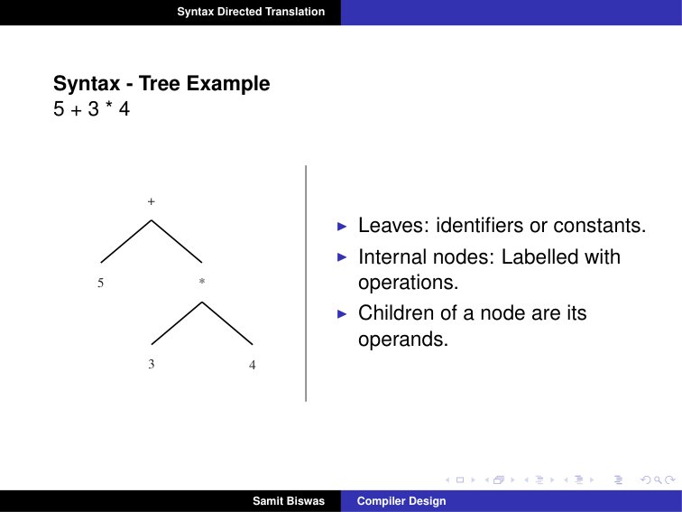
*Figure: Slide 36. Operators at the interior nodes, constants at the leaves.*

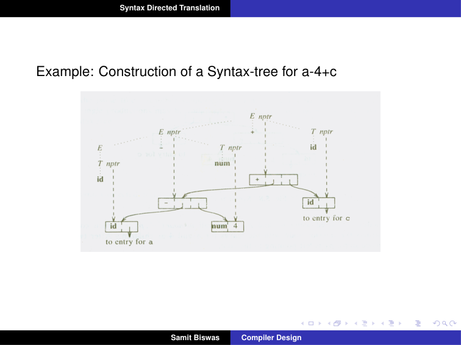
*Figure: Slide 40. The dotted lines are the parse tree; the solid boxes are the syntax tree nodes that the nptr attributes point to.*

### 6.4 Verified Formulas, Trade-offs & Calculations

**Checking the call sequence for `a - 4 + c` against the SDD.** The grammar is left-recursive, so `a - 4 + c` is grouped as `(a - 4) + c`.

| Reduction in a bottom-up parse | Rule fired | Call |
| :--- | :--- | :--- |
| $T \to \text{id}$ for a | $T.nptr = \text{mkleaf}(\text{id}, \ldots)$ | p1 = mkleaf(id, entry_a) |
| $E \to T$ | copy | E.nptr = p1 |
| $T \to \text{num}$ for 4 | mkleaf(num, 4) | p2 |
| $E \to E_1 - T$ | mknode('−', p1, p2) | p3 |
| $T \to \text{id}$ for c | mkleaf(id, entry_c) | p4 |
| $E \to E_1 + T$ | mknode('+', p3, p4) | p5, the root |

This is exactly the five-step sequence of Slide 38. The tree has 5 nodes, while the parse tree for the same input has 11 (E, E, E, T, T, T, id, −, num, +, id), which shows how much a syntax tree saves.

---

## 7. Bottom-up evaluation of S-attributed definitions

### 7.1 The Problem & Intuition

An LR parser already reduces the input from the leaves upward. Synthesized attributes are also computed from the leaves upward. So the parser can compute them **while it parses**, by keeping each symbol's value next to it on the stack. No separate tree walk is needed.

### 7.2 Mechanism & Architecture

**Bottom-up evaluation (Slide 42):**

- A translator for an S-attributed definition can often be implemented with an LR parser.
- From an S-attributed definition, the parser generator can build a translator that evaluates attributes as it parses the input.
- The values of the synthesized attributes are kept on the parser stack, which has extra fields to hold them.

**The calculator with an LR parser (Slide 43).** `val[top]` is the value at the top of the stack. When a production with $r$ symbols on its right is reduced, its result goes into `val[ntop]`, where $ntop = top - r + 1$ is the new top after the pop.

| Production | Code fragment |
| :--- | :--- |
| $L \to E\ \text{n}$ | print(val[top]) |
| $E \to E_1 + T$ | val[ntop] = val[top − 2] + val[top] |
| $E \to T$ | (none) |
| $T \to T_1 \ast F$ | val[ntop] = val[top − 2] × val[top] |
| $T \to F$ | (none) |
| $F \to (E)$ | val[ntop] = val[top − 1] |
| $F \to \text{digit}$ | (none) |

### 7.3 Visual Anchor

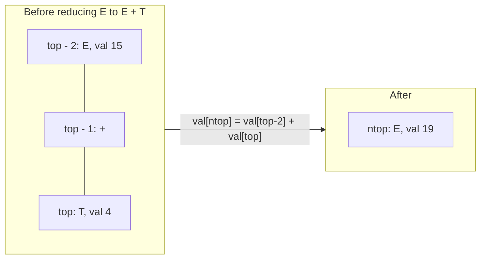

*Figure: The three stack entries for $E + T$ are replaced by one entry for $E$, holding the sum.*

### 7.4 Verified Formulas, Trade-offs & Calculations

**Why some productions have no code.** For $E \to T$, $T \to F$ and $F \to \text{digit}$, the right side has one symbol. So $ntop = top$, and the value is already in the right place. For $F \to \text{digit}$, the lexer has put the digit's value on the stack when it was shifted. For $F \to (E)$, the value of $E$ is in the middle, at $top - 1$, between the two parentheses.

**The moves on input `3*5+4n` (Slide 44).**

| Input | Stack (symbols) | val | Production used |
| :--- | :--- | :--- | :--- |
| 3*5+4n | – | – | |
| *5+4n | 3 | 3 | |
| *5+4n | F | 3 | F → digit |
| *5+4n | T | 3 | T → F |
| 5+4n | T * | 3 _ | |
| +4n | T * 5 | 3 _ 5 | |
| +4n | T * F | 3 _ 5 | F → digit |
| +4n | T | 15 | T → T * F |
| +4n | E | 15 | E → T |
| 4n | E + | 15 _ | |
| n | E + 4 | 15 _ 4 | |
| n | E + F | 15 _ 4 | F → digit |
| n | E + T | 15 _ 4 | T → F |
| n | E | 19 | E → E + T |
| (end of input) | E n | 19 _ | |
| | L | 19 | L → E n |

(`_` marks a stack slot whose value is not used, such as the one under `*` or `+`.)

> **Slide note (Slide 44):** Two rows on the slide differ from the table above. The row after shifting 5 and reducing reads "F * F"; it should be **T * F**, because the 3 was already reduced to T. And the row that gives val 19 names the production T → F; the production used there is **E → E + T** (it adds 15 and 4).

Check: at "T → T * F", val[top − 2] × val[top] = 3 × 5 = 15. At "E → E + T", 15 + 4 = 19. The printed result is 19, the same as the annotated tree of Section 3.

**Bottom-up evaluation of inherited attributes (Slide 45).** The slide gives only this title.

> **Background (not in the slides):** Inherited attributes do not fit the bottom-up scheme directly, because their values come from the left or from above. For **L-attributed** definitions (each inherited attribute depends only on the parent and on siblings to its left), the value can often be found already on the stack, just below the current symbol. For example, in $D \to T L$, $L.in$ equals $T.type$, which sits one slot below $L$ on the stack.

---

## 8. Type checking: static and dynamic

### 8.1 The Problem & Intuition

`"hello" * 2` is grammatically fine, but meaningless. Most of what the semantic analysis phase does is to catch such mistakes by checking **types**. Some checks can be done before the program runs; others only while it runs.

### 8.2 Mechanism & Architecture

**Type checking (Slide 47):**

- Type checking is the process of verifying that each operation executed in a program respects the **type system** of the language.
- This generally means that all operands in any expression are of appropriate types and number.
- Most of what we do in the semantic analysis phase is type checking.

**Designing a type checker (Slide 52).** The process:

1. Identify the types that are available in the language.
2. Identify the language constructs that have types associated with them.
3. Identify the semantic rules for the language.

- If a problem is found, for example trying to add a character to a double in C, we have a **type error**.
- A language is **strongly typed** if every type error is detected during compilation.
- Type checking can be done at compile time or at execution time.

**Static type checking (Slide 54):**

- Done at compile time. The type information the checker needs comes from declarations and is stored in a master symbol table.
- After this information is collected, the types involved in each operation are checked.
- Some errors usually cannot be found at compile time. Example: if `a` and `b` are of type int and hold very large values, `a * b` may not fit in the range of ints. Or computing the ratio of two integers may divide by zero.

**Dynamic type checking (Slide 55):**

- Done by keeping type information for each data location at run time.
- For example, a variable of type double holds both the actual double value and a tag meaning "double type".
- Every operation first checks these type tags. It is carried out only if everything checks out. Otherwise a type error occurs, which usually halts execution.

### 8.3 Visual Anchor

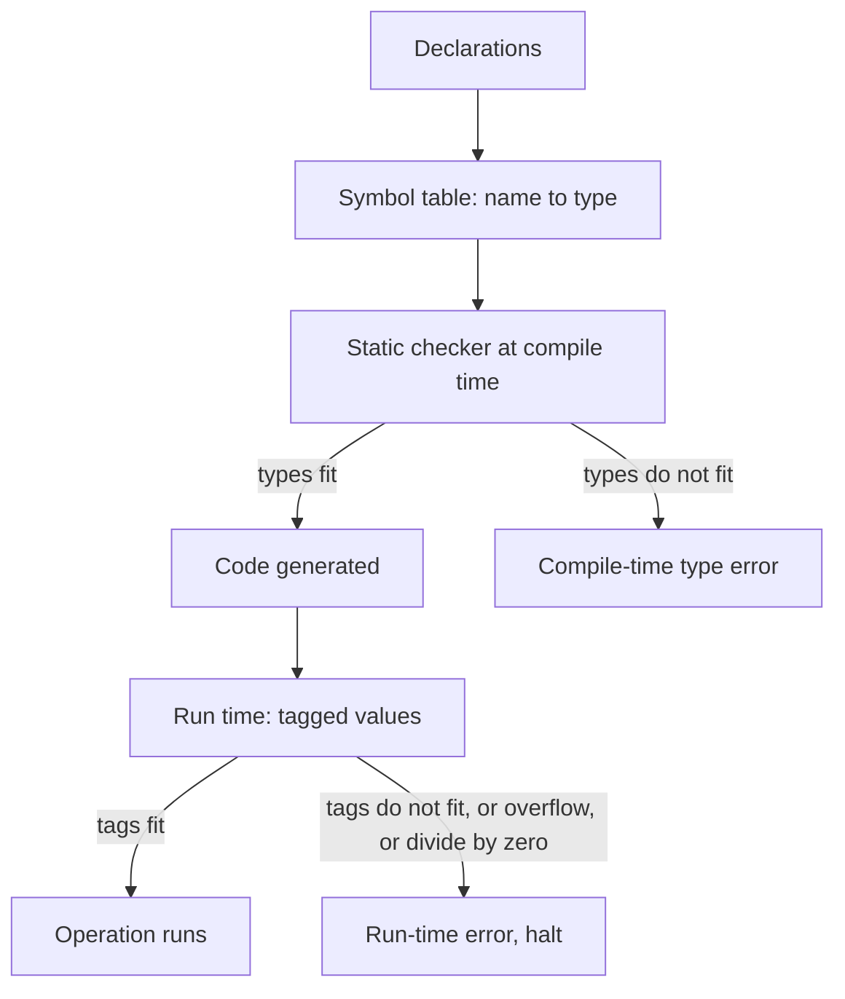

*Figure: Static checks use the symbol table before the program runs. Dynamic checks use tags on values while it runs.*

### 8.4 Verified Formulas, Trade-offs & Calculations

**Why overflow cannot be caught statically (Slide 54).** A 32-bit int holds values up to $2^{31} - 1 = 2{,}147{,}483{,}647$. If `a = b = 50000`, then `a * b` = 2,500,000,000, which is too large. But the compiler sees only `int * int`, which is a legal int operation. The values are unknown until run time.

| | Static checking | Dynamic checking |
| :--- | :--- | :--- |
| When | compile time | run time |
| Information used | declarations in the symbol table | a type tag stored with each value |
| Cost at run time | none | a tag check before every operation, plus memory for tags |
| Catches | type mismatches in the program text | errors that depend on values (and mismatches, if not checked statically) |

---

## 9. Type expressions

### 9.1 The Problem & Intuition

To check types, the compiler needs a way to **write types down**, including complicated ones like "array of 10 pointers to records". A **type expression** builds such types from basic types with **type constructors**, the way an arithmetic expression builds values from numbers with operators.

### 9.2 Mechanism & Architecture

**Type expressions (Slide 57).** The type of a language construct is denoted by a type expression.

- The **basic types** are boolean, char, integer and real. A special basic type, **type_error**, signals an error during type checking. The basic type **void**, "the absence of a value", allows statements to be checked.
- A type expression may be **named**: a type name is a type expression.
- A **type constructor** applied to type expressions is a type expression. The constructors are arrays, products, records, pointers and functions.

| Constructor | Definition | Example from the slides |
| :--- | :--- | :--- |
| Arrays (Slide 58) | If $T$ is a type expression, array(I, T) is the type of an array with elements of type $T$ and index set $I$ (often a range of integers). | `var A: array[1..10] of integer;` gives A the type array(1..10, integer). |
| Products (Slide 59) | If $T_1$ and $T_2$ are type expressions, their Cartesian product $T_1 \times T_2$ is a type expression. | |
| Records (Slide 60) | The record constructor is applied to a tuple of field names and field types. | see below |
| Pointers (Slide 61) | If $T$ is a type expression, pointer(T) is the type "pointer to an object of type $T$". | `var p: ↑row` gives p the type pointer(row). |
| Functions (Slide 62) | A function maps a domain type $D$ to a range type $R$; its type is $D \to R$. | `function f(a, b: char): ↑integer;` has type char × char → pointer(integer). |

**The record example (Slide 60):**

```pascal
type row = record
    address: integer;
    lexeme: array [1..15] of char
end;
var table: array[1..10] of row;
```

This declares the name `row` for the type expression

```math
\text{record}((\text{address} \times \text{integer}) \times (\text{lexeme} \times \text{array}(1..15, \text{char})))
```

and declares `table` to be an array of records of this type.

### 9.3 Visual Anchor

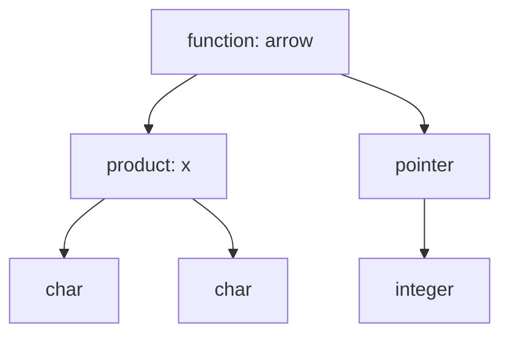

*Figure: The type of `f` from Slide 62, char × char → pointer(integer), drawn as a tree. Constructors are interior nodes; basic types are leaves.*

### 9.4 Verified Formulas, Trade-offs & Calculations

**Building the type of `table` (Slide 60) step by step.**

| Step | Piece | Type expression |
| :--- | :--- | :--- |
| 1 | field `address` | address × integer |
| 2 | field `lexeme` | lexeme × array(1..15, char) |
| 3 | the record `row` | record((address × integer) × (lexeme × array(1..15, char))) |
| 4 | `table` | array(1..10, row) |

**Size of `table`.**

> **Background (not in the slides):** Assume 4 bytes for an integer and 1 byte for a char. One row takes $4 + 15 \times 1 = 19$ bytes, and `table` takes $10 \times 19 = 190$ bytes (ignoring padding). This is one reason the compiler needs type expressions: to lay out memory.

---

## 10. A simple type checker

### 10.1 The Problem & Intuition

We now put it together. A small language has declarations followed by one expression. A translation scheme first records each declared name's type in the symbol table. Then it computes the type of every expression and statement from its parts, and reports type_error when the parts do not fit.

### 10.2 Mechanism & Architecture

**The language (Slide 63).** A program $P$ is a sequence of declarations $D$ followed by a single expression $E$:

```text
P → D ; E
D → D ; D | id : T
T → char | integer | array [ num ] of T | ↑T
E → literal | num | id | E mod E | E [ E ] | E↑
```

**Saving the type of each identifier (Slide 64):**

| Production | Action |
| :--- | :--- |
| $P \to D ; E$ | |
| $D \to D ; D$ | |
| $D \to \text{id} : T$ | { addtype(id.entry, T.type) } |
| $T \to \text{char}$ | { T.type = char } |
| $T \to \text{integer}$ | { T.type = integer } |
| $T \to \uparrow T_1$ | { T.type = pointer(T1.type) } |
| $T \to \text{array [num] of } T_1$ | { T.type = array(1..num.val, T1.type) } |

**Type checking of expressions (Slide 65):**

| Production | Rule |
| :--- | :--- |
| $E \to \text{literal}$ | E.type = char |
| $E \to \text{num}$ | E.type = integer |
| $E \to \text{id}$ | E.type = lookup(id.entry) |
| $E \to E_1 \text{ mod } E_2$ | E.type = if E1.type = integer and E2.type = integer then integer else type_error |
| $E \to E_1 [ E_2 ]$ | E.type = if E2.type = integer and E1.type = array(s, t) then t else type_error |
| $E \to E_1 \uparrow$ | E.type = if E1.type = pointer(t) then t else type_error |

**Type checking of statements (Slide 66).** Statements have no value, so a correct statement gets type **void**.

| Production | Rule |
| :--- | :--- |
| $S \to \text{id} = E$ | S.type = if id.type == E.type then void else type_error |
| $S \to \text{if } E \text{ then } S_1$ | S.type = if E.type == boolean then S1.type else type_error |
| $S \to \text{while } E \text{ do } S_1$ | S.type = if E.type == boolean then S1.type else type_error |
| $S \to S_1 ; S_2$ | S.type = if S1.type == void and S2.type == void then void else type_error |

**Type checking of functions (Slide 67):**

| Production | Action |
| :--- | :--- |
| $T \to T_1 \text{ '→' } T_2$ | { T.type = T1.type → T2.type } |
| $E \to E_1 ( E_2 )$ | { E.type = if E2.type == s and E1.type == s → t then t else type_error } |

In words: a function call is correct if the argument has the domain type $s$; the result then has the range type $t$.

### 10.3 Visual Anchor

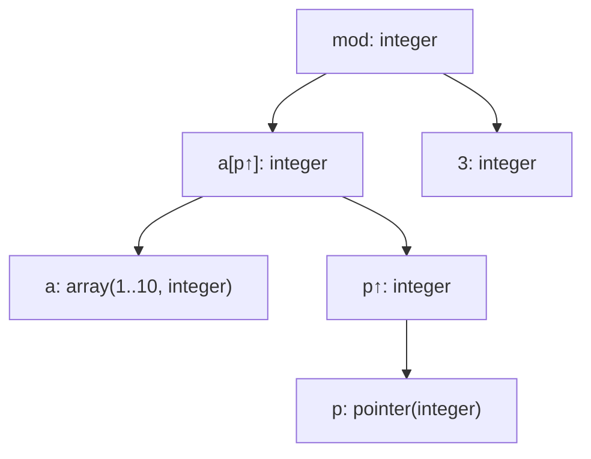

*Figure (worked example below): types computed bottom-up for `a[p↑] mod 3`.*

### 10.4 Verified Formulas, Trade-offs & Calculations

**Worked example (Background, not in the slides).** The program:

```text
a : array [10] of integer ;
p : ↑integer ;
a [ p↑ ] mod 3
```

Declarations (Slide 64): a gets array(1..10, integer); p gets pointer(integer).

| Subexpression | Rule (Slide 65) | Type |
| :--- | :--- | :--- |
| `a` | lookup | array(1..10, integer) |
| `p` | lookup | pointer(integer) |
| `p↑` | E1.type = pointer(t), so t | integer |
| `a[p↑]` | index is integer and a is array(s, t), so t | integer |
| `3` | num | integer |
| `a[p↑] mod 3` | both integer | integer |

The whole expression type-checks to integer.

**An error case.** With `c : char ;` and the expression `c mod 2`: E1.type = char, which is not integer. So E.type = type_error, and the checker reports it.

**A statement case (Slide 66).** If `x : integer` and the statement is `while x do x = 1`: the body `x = 1` has type void (integer == integer). But the condition `x` has type integer, not boolean. So the while statement gets type_error.
