# Intermediate Code Generation — Learning Guide

Source: `Intermediate_Code (1).pdf`, Slides 1–35. This deck has no printed slide numbers, so "Slide N" means page N of the PDF.

**Who this is for:** a student who knows syntax-directed definitions (the Semantic Analysis lecture). After reading, you can draw the syntax tree and DAG of an expression, write its three-address code, store that code as quadruples, triples or indirect triples, and generate jump code for `if`, `while` and boolean expressions.

**How to read this guide:** Read the sections in order. Each section first says why the idea exists, then how it works, then shows a picture, then gives the exact rules and worked checks. Facts come from the slides. Extra explanations are marked **Background (not in the slides)**.

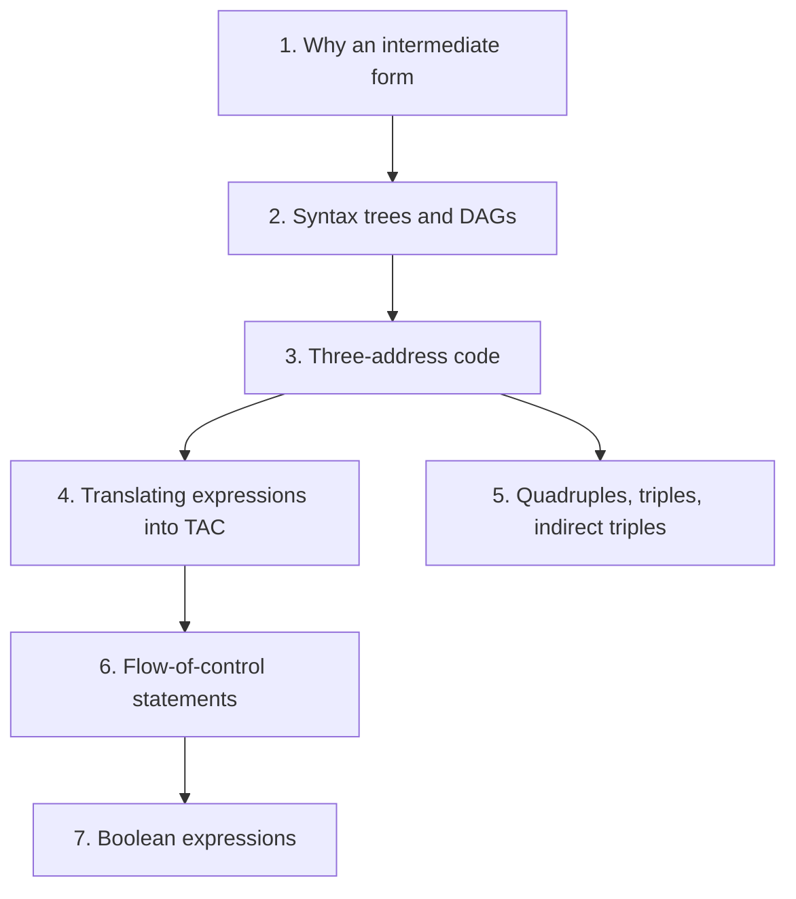

## Contents

1. [Why an intermediate form](#1-why-an-intermediate-form)
2. [Syntax trees and DAGs](#2-syntax-trees-and-dags)
3. [Three-address code and its kinds of statement](#3-three-address-code-and-its-kinds-of-statement)
4. [Syntax-directed translation into three-address code](#4-syntax-directed-translation-into-three-address-code)
5. [Implementing three-address code: quadruples, triples, indirect triples](#5-implementing-three-address-code-quadruples-triples-indirect-triples)
6. [Flow-of-control statements](#6-flow-of-control-statements)
7. [Boolean expressions with jumps](#7-boolean-expressions-with-jumps)

---

## 1. Why an intermediate form

### 1.1 The Problem & Intuition

A compiler could translate the source straight into machine code. But then every new machine would need a whole new compiler. Instead, the front end produces a **machine-independent** intermediate form. One back end per machine then turns that form into machine code.

### 1.2 Mechanism & Architecture

**Benefits of a machine-independent intermediate form (Slide 3):**

- **Retargeting is easier.** To support a new machine, you write only a new back end.
- A **machine-independent code optimizer** can be applied to the intermediate representation.

**Intermediate representations (Slide 4):**

1. Syntax trees
2. DAGs (directed acyclic graphs)
3. Three-address code

### 1.3 Visual Anchor

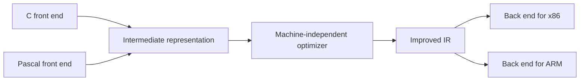

*Figure (Background): one shared intermediate form lets front ends and back ends be mixed and matched, and one optimizer serves them all.*

### 1.4 Verified Formulas, Trade-offs & Calculations

> **Background (not in the slides):** The saving is easy to count. With $m$ source languages and $n$ target machines, direct translation needs $m \times n$ compilers. With a shared intermediate form it needs $m$ front ends plus $n$ back ends. For 3 languages and 4 machines: $3 \times 4 = 12$ compilers, versus $3 + 4 = 7$ parts.

---

## 2. Syntax trees and DAGs

### 2.1 The Problem & Intuition

A syntax tree shows the structure of an expression. But if the same subexpression appears twice, the tree builds it twice, and the code computes it twice. A **DAG** shares the repeated part, so it is computed once.

### 2.2 Mechanism & Architecture

**Example: `a = b * -c + b * -c` (Slide 5).**

- **Syntax tree:** the root `assign` has children `a` and `+`. Under `+` there are two separate `*` subtrees. Each `*` has children `b` and `uminus`, and each `uminus` has child `c`.
- **DAG:** the same, but `+` has only **one** `*` child, reached by two edges. The subexpression `b * -c` exists once.

`uminus` is unary minus: the `-` in `-c`.

**SDD that produces syntax trees for assignment statements (Slide 6):**

| Production | Semantic rule |
| :--- | :--- |
| $S \to \text{id} = E$ | S.nptr = mknode('assign', mkleaf(id, id.place), E.nptr) |
| $E \to E_1 + E_2$ | E.nptr = mknode('+', E1.nptr, E2.nptr) |
| $E \to E_1 \ast E_2$ | E.nptr = mknode('*', E1.nptr, E2.nptr) |
| $E \to -E_1$ | E.nptr = mkunode('uminus', E1.nptr) |
| $E \to (E_1)$ | E.nptr = E1.nptr |
| $E \to \text{id}$ | E.nptr = mkleaf(id, id.place) |

`mkunode` makes a node with one child, for a unary operator.

**Two ways to store the tree (Slide 6).** The figure shows the syntax tree of `a = b * -c + b * -c`:

1. as records linked by pointers, and
2. as an array of records, where a child is named by its array index:

| Index | Label | Fields |
| :--- | :--- | :--- |
| 0 | id | b |
| 1 | id | c |
| 2 | uminus | 1 |
| 3 | * | 0, 2 |
| 4 | id | b |
| 5 | id | c |
| 6 | uminus | 5 |
| 7 | * | 4, 6 |
| 8 | + | 3, 7 |
| 9 | id | a |
| 10 | assign | 9, 8 |

### 2.3 Visual Anchor

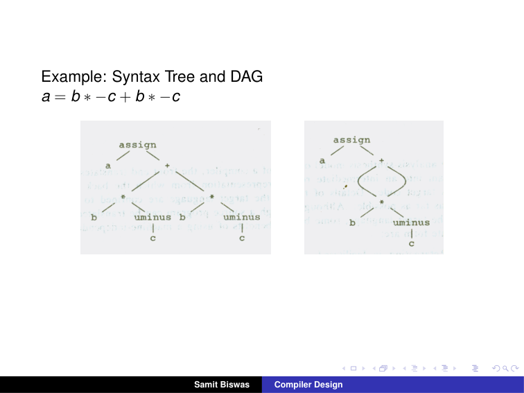
*Figure: Slide 5. Left: the syntax tree, with `b * -c` built twice. Right: the DAG, where `+` points twice to one shared `*` node.*

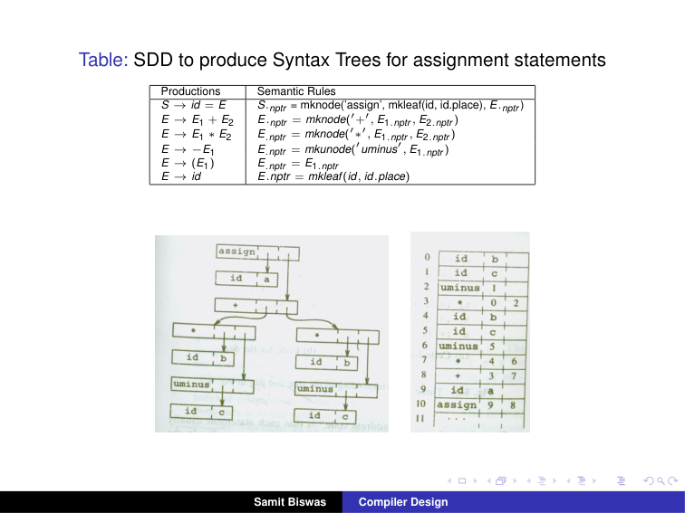
*Figure: Slide 6. Pointer records (left) and the same tree stored in an array of records (right).*

### 2.4 Verified Formulas, Trade-offs & Calculations

**Counting nodes.**

| Representation | Nodes | Which ones |
| :--- | :--- | :--- |
| Syntax tree | 11 | assign, a, +, two × (*, b, uminus, c) |
| DAG | 7 | assign, a, +, *, b, uminus, c |

Check the tree count against the array: indices 0 to 10 make 11 records. ✓ The DAG saves $11 - 7 = 4$ nodes, exactly the second copy of `*`, `b`, `uminus`, `c`.

**Reading the array.** Record 3 is `*` with fields 0 and 2: it multiplies record 0 (`b`) by record 2 (`uminus` of record 1, which is `c`). So record 3 is `b * -c`. Record 8 adds records 3 and 7, the two copies. Record 10 assigns record 8 to record 9 (`a`).

---

## 3. Three-address code and its kinds of statement

### 3.1 The Problem & Intuition

Trees are good for structure, but machines run instructions one after another. **Three-address code** (TAC) is a list of simple instructions, each with at most one operator. It is close to machine code, but still independent of any machine.

### 3.2 Mechanism & Architecture

**Three-address code (Slide 7).** TAC is a sequence of statements of the general form

```text
x = y op z
```

where `x`, `y` and `z` are names, constants or compiler-generated **temporaries**, and `op` is an operator. "Three addresses" means at most three names: two operands and one result. For example, `x + y * z` might become:

```text
t1 = y * z
t2 = x + t1
```

**TAC is a linearised syntax tree or DAG (Slide 8).** For `a = b * -c + b * -c`:

| Code for the syntax tree | Code for the DAG |
| :--- | :--- |
| `t1 = -c` | `t1 = -c` |
| `t2 = b * t1` | `t2 = b * t1` |
| `t3 = -c` | `t5 = t2 + t2` |
| `t4 = b * t3` | `a = t5` |
| `t5 = t2 + t4` | |
| `a = t5` | |

**The kinds of three-address statement (Slides 9–19):**

| Kind | Form | Meaning |
| :--- | :--- | :--- |
| Assignment, binary | `x = y op z` | op is a binary arithmetic or logical operation |
| Assignment, unary | `x = op z` | op is a unary operation |
| Copy | `x = y` | the value of y is assigned to x |
| Unconditional jump | `goto L` | the statement with label L is executed next |
| Conditional jump | `if x relop y goto L` | jump to L if the relation holds; otherwise go on to the next statement |
| Procedure call | `param x`, `call p, n`, `return y` | set a parameter; call procedure p with n parameters; return with value y (optional) |
| Indexed assignment | `x = y[i]`, `x[i] = y` | read from or write to an array element |
| Address and pointer assignment | `x = &y`, `x = *y` | take an address; read through a pointer |

**A procedure call (Slide 19).** `p(x1, x2, x3, ..., xn)` becomes:

```text
param x1
param x2
param x3
...
param xn
call p, n
```

**A conditional value (Slide 14).** `if a < b then 1 else 0` becomes:

```text
100: if a < b goto 103
101: t = 0
102: goto 104
103: t = 1
104:
```

**A loop (Slide 16).**

```text
while a < b do
    if c < d then
        x = y + z
    else
        x = y - z
```

becomes:

```text
L1:    if a < b goto L2
       goto Lnext
L2:    if c < d goto L3
       goto L4
L3:    t1 = y + z
       x = t1
       goto L1
L4:    t2 = y - z
       x = t2
       goto L1
Lnext:
```

### 3.3 Visual Anchor

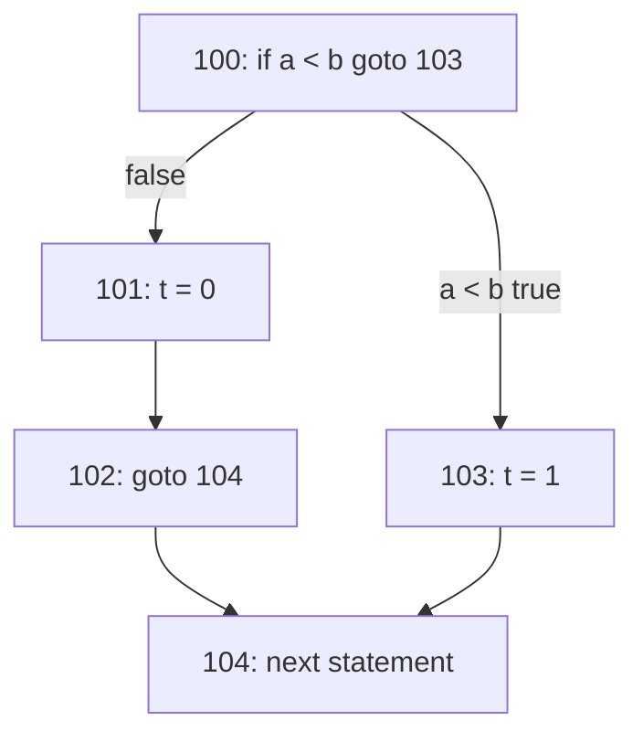

*Figure: The jumps of the Slide 14 example. Exactly one of `t = 0` and `t = 1` runs.*

### 3.4 Verified Formulas, Trade-offs & Calculations

**Running the Slide 14 code.**

| a, b | Path | Final t |
| :--- | :--- | :--- |
| a = 2, b = 5 | 100 (2 < 5 true) → 103 → 104 | 1 |
| a = 7, b = 5 | 100 (false) → 101 → 102 → 104 | 0 |

Both match `if a < b then 1 else 0`.

**Running the Slide 16 loop** with a = 0, b = 2, c = 1, d = 3, y = 10, z = 4, and a body that does not change a or b. The condition `a < b` is always true, so the loop never ends, exactly as the source would. One pass: L1 (0 < 2) → L2 (1 < 3) → L3: t1 = 14, x = 14 → goto L1. With c = 5 instead, one pass goes L2 → L4: t2 = 6, x = 6 → goto L1. With a = 2 the first test fails and control goes to Lnext at once.

**The DAG code is shorter.** The tree code has 6 statements; the DAG code has 4. The DAG computes `b * -c` once (into t2) and uses it twice in `t5 = t2 + t2`.

---

## 4. Syntax-directed translation into three-address code

### 4.1 The Problem & Intuition

We want the compiler to produce TAC automatically while parsing. An SDD can do this. Each expression gets two attributes: **place**, the name that will hold its value, and **code**, the list of TAC statements that compute it.

### 4.2 Mechanism & Architecture

**The SDD (Slide 20).** `newtemp` returns a new temporary name each time. `gen(...)` makes one TAC statement. `||` joins code lists.

| Production | Semantic rules |
| :--- | :--- |
| $S \to \text{id} = E$ | S.code = E.code ∥ gen(id.place '=' E.place) |
| $E \to E_1 + E_2$ | E.place = newtemp; E.code = E1.code ∥ E2.code ∥ gen(E.place '=' E1.place '+' E2.place) |
| $E \to E_1 \ast E_2$ | E.place = newtemp; E.code = E1.code ∥ E2.code ∥ gen(E.place '=' E1.place '*' E2.place) |
| $E \to -E_1$ | E.place = newtemp; E.code = E1.code ∥ gen(E.place '=' 'uminus' E1.place) |
| $E \to (E_1)$ | E.place = E1.place; E.code = E1.code |
| $E \to \text{id}$ | E.place = id.place; E.code = '' (empty) |

**Result for `a = b * -c + b * -c` (Slide 21):**

```text
t1 = -c
t2 = b * t1
t3 = -c
t4 = b * t3
t5 = t2 + t4
a = t5
```

### 4.3 Visual Anchor

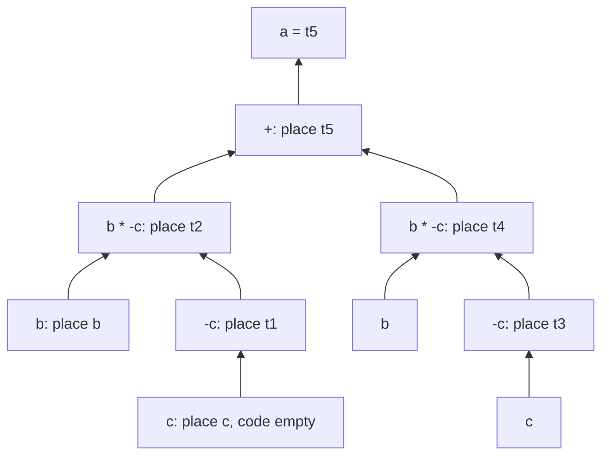

*Figure: Each node's `place`. Temporaries are created bottom-up, left to right, which gives the numbering t1 to t5.*

### 4.4 Verified Formulas, Trade-offs & Calculations

**Building the code step by step (Slides 20–21).**

| Reduction | place | New statement added |
| :--- | :--- | :--- |
| $E \to \text{id}$ (c) | c | none |
| $E \to -E_1$ | t1 | `t1 = -c` |
| $E \to \text{id}$ (b) | b | none |
| $E \to E_1 \ast E_2$ | t2 | `t2 = b * t1` |
| $E \to -E_1$ (second c) | t3 | `t3 = -c` |
| $E \to E_1 \ast E_2$ | t4 | `t4 = b * t3` |
| $E \to E_1 + E_2$ | t5 | `t5 = t2 + t4` |
| $S \to \text{id} = E$ | | `a = t5` |

That is 5 calls to `newtemp` and 6 statements, the same as Slide 21. The SDD follows the syntax tree, so it repeats `b * -c`. Getting the shorter DAG code needs the shared DAG nodes of Section 2.

---

## 5. Implementing three-address code: quadruples, triples, indirect triples

### 5.1 The Problem & Intuition

TAC is an abstract idea. Inside the compiler it must be stored in a data structure. Each statement becomes a **record** with fields for the operator and the operands. There are three common layouts, which trade space against flexibility.

### 5.2 Mechanism & Architecture

**Implementations (Slide 22).** TAC is an abstract form of intermediate code. It can be implemented as records with fields for the operator and the operands. Three such representations: quadruples, triples and indirect triples.

**Quadruples (Slide 23).** A record with four fields: (op, arg1, arg2, result).

- `x = y op z` is stored with y in arg1, z in arg2 and x in result.
- `x = -y` or `x = y` does not use arg2.
- arg1, arg2 and result are pointers to the symbol table.

**Quadruples for `a = b * -c + b * -c` (Slide 24):**

| | op | arg1 | arg2 | result |
| :--- | :--- | :--- | :--- | :--- |
| (0) | uminus | c | | t1 |
| (1) | * | b | t1 | t2 |
| (2) | uminus | c | | t3 |
| (3) | * | b | t3 | t4 |
| (4) | + | t2 | t4 | t5 |
| (5) | = | t5 | | a |

**Triples (Slide 25).** A record with three fields: (op, arg1, arg2). arg1 and arg2 are either pointers to the symbol table or pointers into the triple structure itself. There is no result field: a value is referred to by the number of the triple that computes it.

| | op | arg1 | arg2 |
| :--- | :--- | :--- | :--- |
| (0) | uminus | c | |
| (1) | * | b | (0) |
| (2) | uminus | c | |
| (3) | * | b | (2) |
| (4) | + | (1) | (3) |
| (5) | = | a | (4) |

**Indirect triples (Slides 26–27).** A separate list holds pointers to the triples, in execution order:

| Statement | Points to |
| :--- | :--- |
| (0) | (14) |
| (1) | (15) |
| (2) | (16) |
| (3) | (17) |
| (4) | (18) |
| (5) | (19) |

| | op | arg1 | arg2 |
| :--- | :--- | :--- | :--- |
| (14) | uminus | c | |
| (15) | * | b | (14) |
| (16) | uminus | c | |
| (17) | * | b | (16) |
| (18) | + | (15) | (17) |
| (19) | = | a | (18) |

### 5.3 Visual Anchor

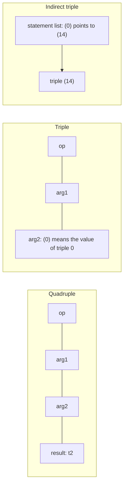

*Figure: Quadruples name results with temporaries; triples name them by position; indirect triples add a list that fixes the execution order.*

### 5.4 Verified Formulas, Trade-offs & Calculations

**The three tables say the same thing.** Map each temporary to the statement that creates it: t1 = (0), t2 = (1), t3 = (2), t4 = (3), t5 = (4). Replace each temporary in the quadruples by its statement number, and you get the triples: quadruple (1) `* b t1` becomes triple (1) `* b (0)`. Add 14 to every triple number, and you get the indirect triples. ✓

**Space (fields per statement).**

| Representation | Fields per statement | For 6 statements |
| :--- | :--- | :--- |
| Quadruples | 4 | 24 |
| Triples | 3 | 18 |
| Indirect triples | 3, plus 1 pointer in the list | 18 + 6 = 24 |

> **Background (not in the slides):** Why have three forms?
> - **Quadruples** need a symbol table entry for every temporary. But statements can be moved freely, because results are named, not numbered. Optimizers like this.
> - **Triples** save the result field and the temporaries. But moving a triple changes its number, so every reference to it must be updated.
> - **Indirect triples** fix that. To reorder the program, the optimizer only reorders the statement list; the triples and their numbers stay put. They also let one triple be listed more than once.

---

## 6. Flow-of-control statements

### 6.1 The Problem & Intuition

`if` and `while` are not computed; they **choose where to go next**. In TAC that means labels and jumps. The trick is to decide, for each condition, where to jump when it is true and where when it is false, and to pass those labels down through the tree.

### 6.2 Mechanism & Architecture

**The statements (Slide 28):**

```text
S → if E then S1
  | if E then S1 else S2
  | while E do S1
```

We assume a three-address statement can be given a symbolic label, and the function `newlabel` returns a new label each time it is called. Two labels go with each boolean expression $E$:

- **E.true:** the label control flows to if E is true.
- **E.false:** the label control flows to if E is false.

Each statement $S$ also has **S.next**: the label of the code that follows S.

**if–then (Slide 29):**

| Production | Semantic rules |
| :--- | :--- |
| $S \to \text{if } E \text{ then } S_1$ | E.true = newlabel; E.false = S.next; S1.next = S.next; S.code = E.code ∥ gen(E.true ':') ∥ S1.code |

**if–then–else (Slide 30):**

| Production | Semantic rules |
| :--- | :--- |
| $S \to \text{if } E \text{ then } S_1 \text{ else } S_2$ | E.true = newlabel; E.false = newlabel; S1.next = S.next; S2.next = S.next; S.code = E.code ∥ gen(E.true ':') ∥ S1.code ∥ gen('goto' S.next) ∥ gen(E.false ':') ∥ S2.code |

**while–do (Slide 31):**

| Production | Semantic rules |
| :--- | :--- |
| $S \to \text{while } E \text{ do } S_1$ | S.begin = newlabel; E.true = newlabel; E.false = S.next; S1.next = S.begin; S.code = gen(S.begin ':') ∥ E.code ∥ gen(E.true ':') ∥ S1.code ∥ gen('goto' S.begin) |

### 6.3 Visual Anchor

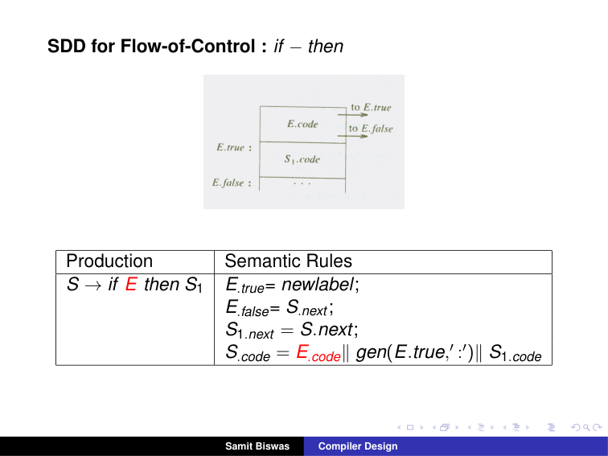
*Figure: Slide 29. E.code jumps to E.true (the start of S1.code) or to E.false (the code after the statement).*

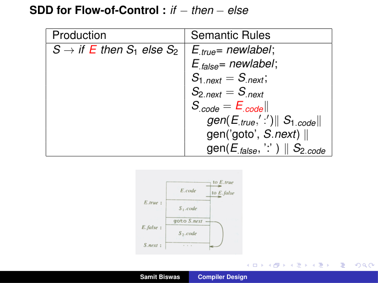
*Figure: Slide 30. After S1.code, a `goto S.next` skips over S2.code.*

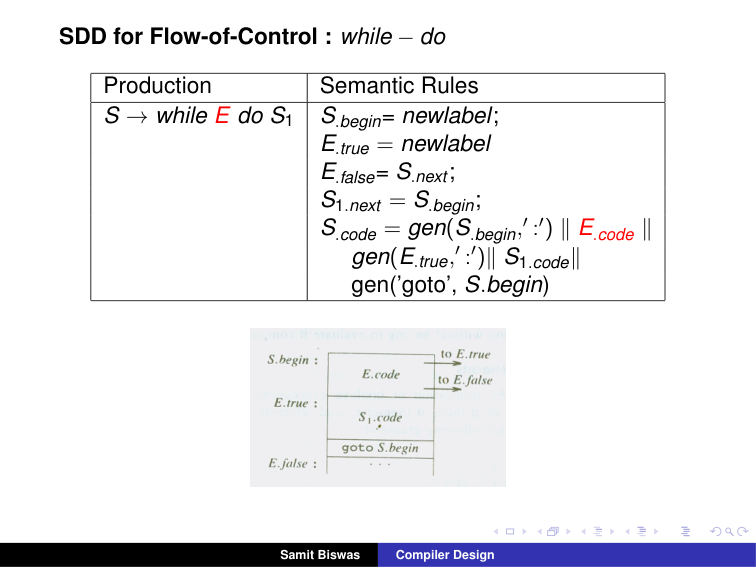
*Figure: Slide 31. S.begin labels the test. After S1.code, `goto S.begin` jumps back to the test.*

### 6.4 Verified Formulas, Trade-offs & Calculations

**Generating the Slide 32 code from the rules.** The statement is `while a < b do if c < d then x = y + z else x = y - z`. Call its S.next "Lnext".

| Rule applied | Label values |
| :--- | :--- |
| while: S.begin = newlabel | L1 |
| while: E.true = newlabel | L2 |
| while: E.false = S.next | Lnext |
| while: S1.next = S.begin | the if statement's next = L1 |
| if–else: E.true = newlabel | L3 |
| if–else: E.false = newlabel | L4 |
| if–else: S1.next = S2.next = S.next | L1 |

Now paste the code in the order of the rules:

| Piece | Code |
| :--- | :--- |
| gen(S.begin ':') | `L1:` |
| E.code for `a < b` | `if a < b goto L2` / `goto Lnext` |
| gen(E.true ':') | `L2:` |
| inner E.code for `c < d` | `if c < d goto L3` / `goto L4` |
| gen(inner E.true ':') ∥ S1.code | `L3: t1 = y + z` / `x = t1` |
| gen('goto' S.next) | `goto L1` |
| gen(inner E.false ':') ∥ S2.code | `L4: t2 = y - z` / `x = t2` |
| while's gen('goto' S.begin) | `goto L1` |
| the statement after | `Lnext:` |

The result is line for line the code on Slides 16 and 32. Notice that the first `goto L1` comes from the if–else rule (S.next of the inner statement is L1), and the second from the while rule.

---

## 7. Boolean expressions with jumps

### 7.1 The Problem & Intuition

`a < b or c < d` does not need a true/false value stored anywhere. We only need to **jump** to the right place. And with `or`, if the left part is already true, the right part need not be tested at all. This is called **short-circuit** evaluation, and jump code gives it for free.

### 7.2 Mechanism & Architecture

**Example (Slide 33).** Take `a < b or c < d and e < f`, and suppose its true and false exits are already set to **Ltrue** and **Lfalse**. The code is:

```text
     if a < b goto Ltrue
     goto L1
L1:  if c < d goto L2
     goto Lfalse
L2:  if e < f goto Ltrue
     goto Lfalse
```

**The SDD for boolean expressions (Slides 34–35):**

| Production | Semantic rules |
| :--- | :--- |
| $E \to E_1 \text{ or } E_2$ | E1.true = E.true; E1.false = newlabel; E2.true = E.true; E2.false = E.false; E.code = E1.code ∥ gen(E1.false ':') ∥ E2.code |
| $E \to E_1 \text{ and } E_2$ | E1.true = newlabel; E1.false = E.false; E2.true = E.true; E2.false = E.false; E.code = E1.code ∥ gen(E1.true ':') ∥ E2.code |
| $E \to \text{not } E_1$ | E1.true = E.false; E1.false = E.true; E.code = E1.code |
| $E \to (E_1)$ | E1.true = E.true; E1.false = E.false; E.code = E1.code |
| $E \to \text{id}_1 \text{ relop id}_2$ | E.code = gen('if' id1.place relop.op id2.place 'goto' E.true) ∥ gen('goto' E.false) |
| $E \to \text{true}$ | E.code = gen('goto' E.true) |
| $E \to \text{false}$ | E.code = gen('goto' E.false) |

In words:

- **or:** if $E_1$ is true, the whole thing is true: jump straight to E.true. Only if $E_1$ is false do we test $E_2$.
- **and:** if $E_1$ is false, the whole thing is false: jump straight to E.false. Only if $E_1$ is true do we test $E_2$.
- **not:** swap the two exits. No code is generated for `not` itself.

### 7.3 Visual Anchor

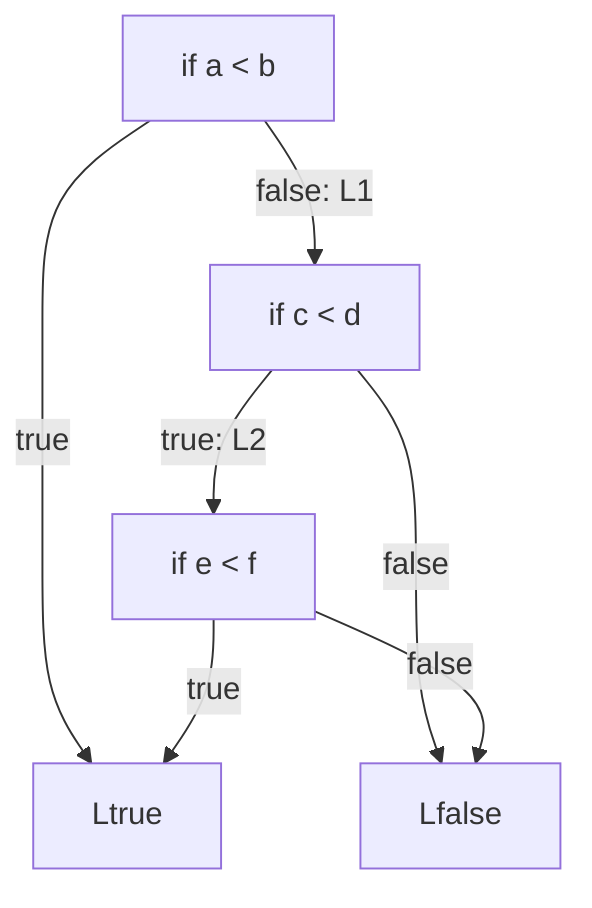

*Figure: The Slide 33 code as a decision graph. Each test is reached only when it can still change the answer.*

### 7.4 Verified Formulas, Trade-offs & Calculations

**Deriving the Slide 33 code.** `and` binds tighter than `or`, so the expression is `a < b or (c < d and e < f)`.

| Node | true exit | false exit | New label |
| :--- | :--- | :--- | :--- |
| whole `or` | Ltrue | Lfalse | |
| left: `a < b` | Ltrue (= E.true) | L1 (newlabel) | L1 |
| right: the `and` | Ltrue | Lfalse | |
| `c < d` | L2 (newlabel) | Lfalse | L2 |
| `e < f` | Ltrue | Lfalse | |

Apply the relop rule to each test and the or/and rules to join them: `a < b` code, then `L1:`, then `c < d` code, then `L2:`, then `e < f` code. That is exactly the six lines of Slide 33.

**Checking every case.** There are $2^3 = 8$ combinations of the three tests. A short check:

| `a < b` | `c < d` | `e < f` | Expression | Code ends at | Tests run |
| :--- | :--- | :--- | :--- | :--- | :--- |
| T | any | any | true | Ltrue | 1 |
| F | F | any | false | Lfalse | 2 |
| F | T | T | true | Ltrue | 3 |
| F | T | F | false | Lfalse | 3 |

All 8 combinations fall into these 4 rows, and the code always agrees with the expression. When `a < b` is true, the other two tests are never run: that is short-circuit evaluation.

**`not` costs nothing.** For `not a < b`, the rule swaps the exits, so the code is `if a < b goto E.false` / `goto E.true`. No extra statement is needed.
