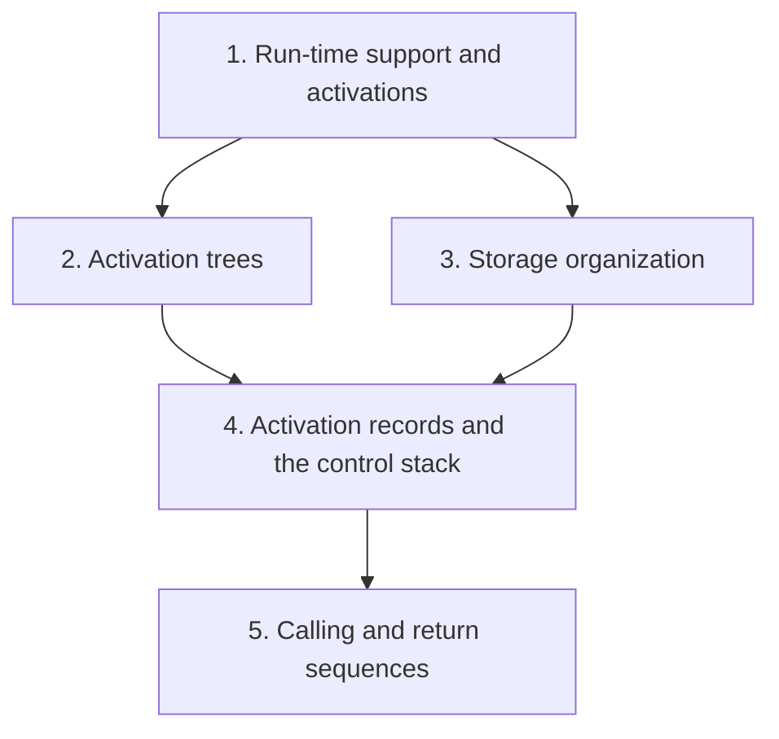
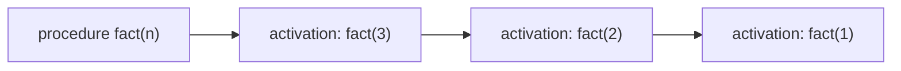
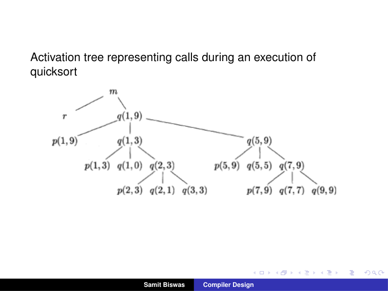
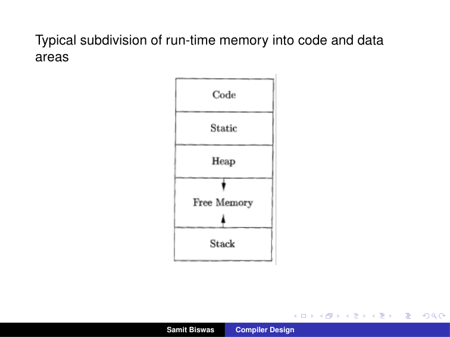
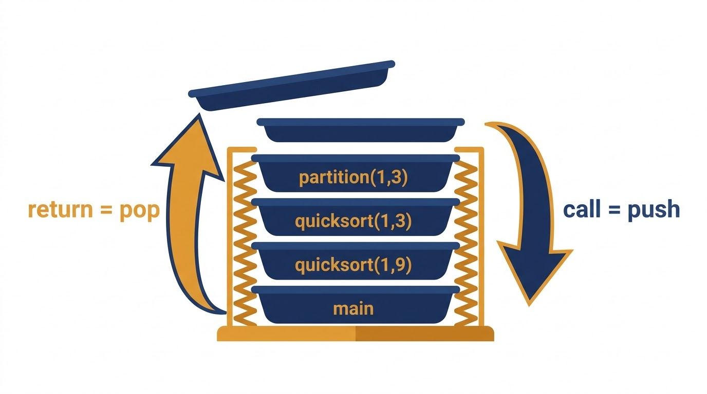
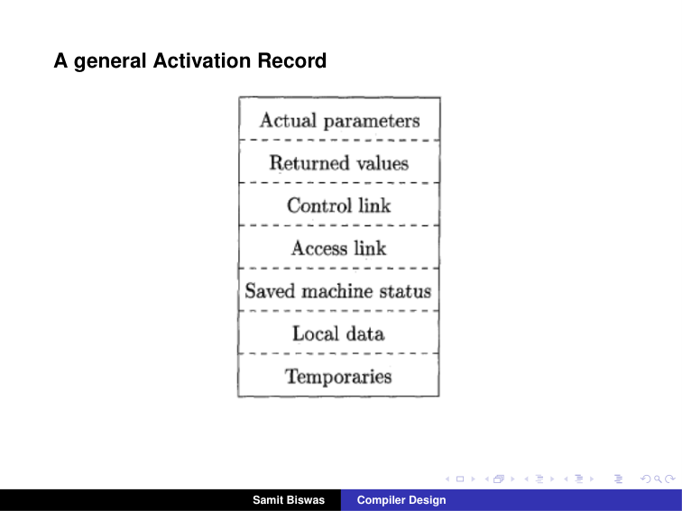
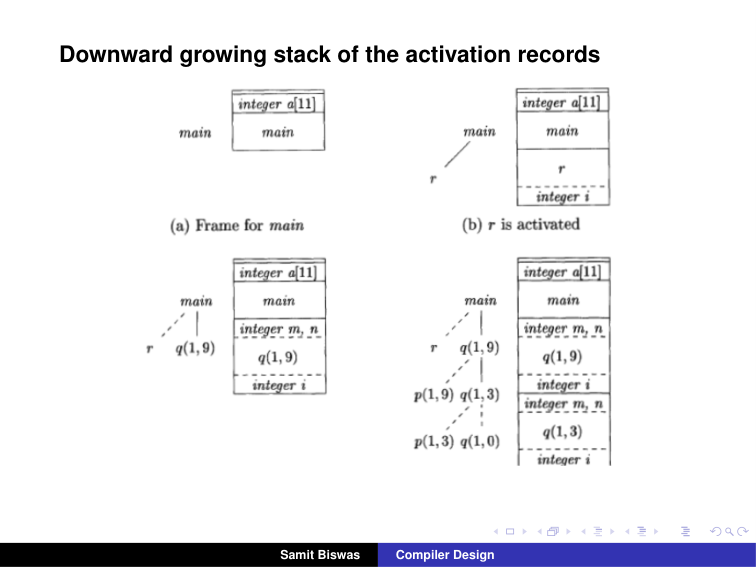
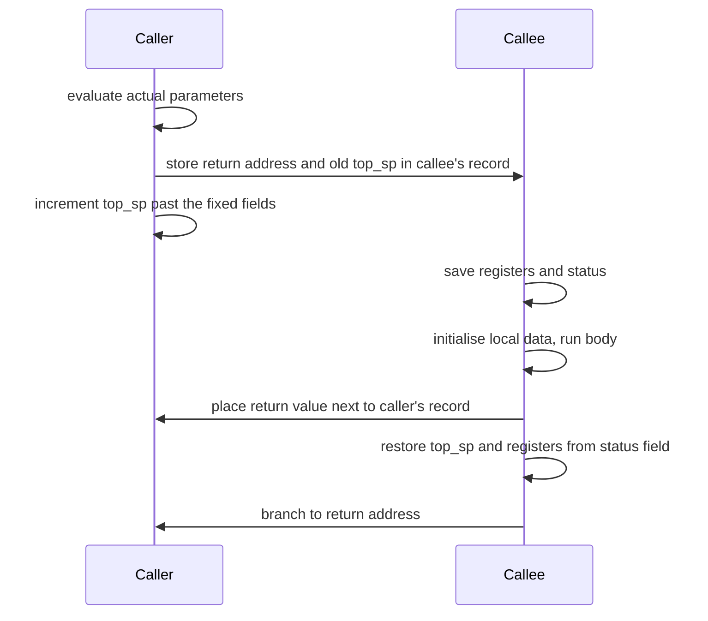

# Run-Time Environments — Learning Guide

Source: `RunTimeE.pdf`, Slides 1–16. This deck has no printed slide numbers, so "Slide N" means page N of the PDF.

**Who this is for:** a student who knows how procedures are called in C. After reading, you can draw the activation tree of a recursive program, explain how run-time memory is divided, list the fields of an activation record, and describe what the caller and the callee do on a call and a return.

**How to read this guide:** Read the sections in order. Each section first says why the idea exists, then how it works, then shows a picture, then gives the exact details and worked checks. Facts come from the slides. Extra explanations are marked **Background (not in the slides)**.



## Contents

1. [Run-time support and activations](#1-run-time-support-and-activations)
2. [Activation trees](#2-activation-trees)
3. [Storage organization](#3-storage-organization)
4. [Activation records and the control stack](#4-activation-records-and-the-control-stack)
5. [Calling and return sequences](#5-calling-and-return-sequences)

---

## 1. Run-time support and activations

### 1.1 The Problem & Intuition

So far the compiler only translated code. But when the program runs, its variables need memory. A recursive function may be running several times at once, and each copy needs its own variables. The compiler must plan where all this data lives and how to reach it.

### 1.2 Mechanism & Architecture

**What the compiler must do (Slide 3).** The compiler must do the storage allocation and provide access to variables and data.

- The allocation and deallocation of data objects is managed by the **run-time support package**. It consists of routines loaded together with the generated target code.
- Each execution of a procedure is called an **activation** of the procedure.
- If the procedure is recursive, several of its activations may be **alive** at the same time.

### 1.3 Visual Anchor



*Figure (Background): one procedure, three activations alive at once during a recursive call. Each needs its own copy of n.*

### 1.4 Verified Formulas, Trade-offs & Calculations

> **Background (not in the slides):** With `int fact(int n) { return n <= 1 ? 1 : n * fact(n - 1); }`, calling `fact(3)` creates the activations fact(3), fact(2) and fact(1). While fact(1) runs, all three are alive, holding n = 3, 2 and 1. The results come back in reverse order: fact(1) = 1, fact(2) = 2 × 1 = 2, fact(3) = 3 × 2 = 6. Three activations alive at once means three separate places to store n.

---

## 2. Activation trees

### 2.1 The Problem & Intuition

To plan memory, we need a picture of which activations exist and when. Calls nest inside each other, like brackets. That nesting is naturally a **tree**: each call is a child of the call that made it.

### 2.2 Mechanism & Architecture

**Assumptions about the flow of control (Slide 4):**

- Control flows **sequentially**: the execution of a program is a sequence of steps, and at each step control is at one specific point in the program.
- Each execution of a procedure starts at the **beginning** of the procedure body. It eventually returns control to the point **immediately after** the place where the procedure was called.

**Lifetime (Slide 4).** The lifetime of an activation is the consecutive sequence of steps during its execution.

**A sketch of a quicksort program (Slide 5):**

```c
int a[11];
void readArray() { /* Reads 9 integers into a[1], ..., a[9]. */
    int i;
    ...
}
int partition(int m, int n) {
    /* Picks a separator value v, and partitions a[m..n] so that
       a[m..p-1] are less than v, a[p] = v, and a[p+1..n] are
       equal to or greater than v. Returns p. */
    ...
}
void quicksort(int m, int n) {
    int i;
    if (n > m) {
        i = partition(m, n);
        quicksort(m, i-1);
        quicksort(i+1, n);
    }
}
main() {
    readArray();
    a[0] = -9999;
    a[10] = 9999;
    quicksort(1,9);
}
```

**Activations for quicksort (Slide 6).** One possible run prints:

```text
enter main()
    enter readArray()
    leave readArray()
    enter quicksort(1,9)
        enter partition(1,9)
        leave partition(1,9)
        enter quicksort(1,3)
            ...
        leave quicksort(1,3)
        enter quicksort(5,9)
            ...
        leave quicksort(5,9)
    leave quicksort(1,9)
leave main()
```

**In an activation tree (Slide 7):**

- Each node represents an activation of a procedure.
- The root represents the activation of the main program.
- The node for $a$ is the parent of the node for $b$ if and only if control flows from activation $a$ to $b$ (that is, $a$ calls $b$).
- The node for $a$ is to the left of the node for $b$ if and only if the lifetime of $a$ occurs before the lifetime of $b$.

### 2.3 Visual Anchor


*Figure: Slide 8. m is main, r is readArray, p is partition and q is quicksort. Children are listed left to right in the order they were called.*

### 2.4 Verified Formulas, Trade-offs & Calculations

**Reading the tree (Slide 8).** Each `q(m, n)` calls `p(m, n)`, gets back a position $i$, and then calls `q(m, i-1)` and `q(i+1, n)`. From the children we can read what each partition returned:

| Activation | Children | So partition returned |
| :--- | :--- | :--- |
| q(1,9) | p(1,9), q(1,3), q(5,9) | 4, since q(1, 4−1) and q(4+1, 9) |
| q(1,3) | p(1,3), q(1,0), q(2,3) | 1, since q(1, 0) and q(2, 3) |
| q(2,3) | p(2,3), q(2,1), q(3,3) | 2 |
| q(5,9) | p(5,9), q(5,5), q(7,9) | 6 |
| q(7,9) | p(7,9), q(7,7), q(9,9) | 8 |

Every pair of child ranges fits the code `quicksort(m, i-1); quicksort(i+1, n);`. ✓

**Why some q nodes have no children.** q(1,0), q(2,1), q(3,3), q(5,5), q(7,7) and q(9,9) all have $n \leq m$. The test `if (n > m)` fails, so they return at once. These are ranges of 0 or 1 elements, which are already sorted.

**Counting activations.**

| Procedure | Activations | Count |
| :--- | :--- | :--- |
| main | m | 1 |
| readArray | r | 1 |
| quicksort | q(1,9), q(1,3), q(1,0), q(2,3), q(2,1), q(3,3), q(5,9), q(5,5), q(7,9), q(7,7), q(9,9) | 11 |
| partition | p(1,9), p(1,3), p(2,3), p(5,9), p(7,9) | 5 |
| Total | | 18 |

**Why `a[0] = -9999` and `a[10] = 9999`.**

> **Background (not in the slides):** These are **sentinels**: a value smaller and a value larger than any real element. partition's inner loops scan left and right without checking the array bounds; the sentinels make sure the scans stop inside the array. That is why `a` has 11 slots for 9 numbers.

---

## 3. Storage organization

### 3.1 The Problem & Intuition

When the program starts, it gets a block of memory. Different kinds of data need different handling. Code never changes. Global data lives for the whole run. Local data comes and goes with calls. Some data is created on request. So the block is split into areas.

### 3.2 Mechanism & Architecture

**Storage organization (Slide 9).** Suppose the compiler obtains a block of storage from the operating system for the compiled program to run in. The run-time storage might be divided to hold:

- the generated target code,
- data objects, and
- a counterpart of the control stack, to keep track of procedure activations.

**Typical subdivision of run-time memory (Slide 10)**, from one end to the other:

| Area | Holds |
| :--- | :--- |
| Code | the generated target code |
| Static | data objects whose size and place are fixed at compile time |
| Heap | data allocated and freed during the run; grows toward the free memory |
| Free memory | unused space between heap and stack |
| Stack | activation records; grows toward the free memory |

### 3.3 Visual Anchor


*Figure: Slide 10. The heap and the stack grow toward each other into the free memory.*

### 3.4 Verified Formulas, Trade-offs & Calculations

> **Background (not in the slides):** Where things from the quicksort program go:
> - **Code:** the machine code of main, readArray, partition and quicksort.
> - **Static:** the global array `int a[11]`, which exists for the whole run.
> - **Stack:** one activation record per live call, holding `i`, `m`, `n`, and so on.
> - **Heap:** nothing here; it would hold memory from `malloc` in C or `new` in Java.

> **Background (not in the slides):** Why let the heap and the stack grow toward each other? Neither size is known in advance. With the free space shared between them, either one can use it as needed. Memory runs out only when they actually meet.

---

## 4. Activation records and the control stack

### 4.1 The Problem & Intuition

Calls start and end in last-in, first-out order: the last procedure called is the first to return. That is exactly how a **stack** works. So each call pushes a block of data for itself, the **activation record**, and each return pops it.

### 4.2 Mechanism & Architecture

**Activation records (Slide 11):**

- Procedure calls and returns are usually managed by a run-time stack called the **control stack**.
- Each live activation has an **activation record** (sometimes called a **frame**).
- The root of the activation tree is at the bottom of the stack.
- The current execution path decides what is on the stack: the record of the last activation is at the top.

**A general activation record (Slide 12)**, field by field:

| Field | What it holds (Slide 13) |
| :--- | :--- |
| Actual parameters | the actual parameters used by the calling procedure |
| Returned values | space for the return value of the called function |
| Control link | points to the activation record of the **caller** |
| Access link | used to refer to non-local data held in other activation records |
| Saved machine status | information about the state of the machine just before the call, typically including the **return address** |
| Local data | data local to this execution of the procedure |
| Temporaries | values that arise in the evaluation of expressions |

**The stack of activation records (Slide 14).** Four snapshots during the quicksort run:

| Snapshot | Records on the stack, bottom to top |
| :--- | :--- |
| (a) Frame for main | main (with the global `integer a[11]` shown above it) |
| (b) r is activated | main; r (with `integer i`) |
| (c) r has returned, q(1,9) is active | main; q(1,9) (with `integer m, n` and `integer i`) |
| (d) control is back in q(1,3) | main; q(1,9); q(1,3) |

In the tree beside each snapshot, dashed lines mark activations that have already ended.

### 4.3 Visual Anchor


*Figure (illustration, not from the slides): The control stack works like a cafeteria tray dispenser. Each call pushes a new tray (activation record) on top; each return lifts the top tray off. Only the top tray, the running procedure, can be used.*


*Figure: Slide 12. From top to bottom: actual parameters, returned values, control link, access link, saved machine status, local data, temporaries.*


*Figure: Slide 14. The activation tree so far (left of each stack) and the records on the stack (right). Only the activations on the path from the root to the current one are on the stack.*

### 4.4 Verified Formulas, Trade-offs & Calculations

**The stack holds exactly the path to the current activation.** In snapshot (d) the current activation is q(1,3). Its path from the root of the tree is main → q(1,9) → q(1,3). The finished calls r, p(1,9), p(1,3) and q(1,0) are not on the path, and they are not on the stack. ✓

**Deepest stack in the Slide 8 run.** The longest root-to-leaf path in the activation tree is main → q(1,9) → q(1,3) → q(2,3) → p(2,3) (or q(2,1), q(3,3)). That is 5 activations. Since the stack only ever holds one path, at most 5 records are on the stack at once, even though the run has 18 activations in total.

**Control link versus access link.**

> **Background (not in the slides):** The **control link** follows the *calls*: it points to the caller's record, so the stack can be unwound on return. The **access link** follows the *program text*: in languages with nested procedures (like Pascal), it points to the record of the enclosing procedure, so the code can reach that procedure's variables. In C, functions are not nested, so the access link is not needed.

---

## 5. Calling and return sequences

### 5.1 The Problem & Intuition

A call needs work from both sides. Someone must push the new record, store the return address, and fill in the parameters. Someone must restore everything on return. The **calling sequence** and the **return sequence** split this work between the **caller** and the **callee**.

### 5.2 Mechanism & Architecture

**A possible calling sequence (Slide 15):**

1. The caller evaluates the actual parameters.
2. The caller stores a return address and the old value of **top_sp** into the callee's activation record. The caller then increments top_sp, moving it past the caller's local data and temporaries and the callee's parameter and status fields.
3. The callee saves the register values and other status information.
4. The callee initialises its local data and begins execution.

**A possible return sequence (Slide 16):**

1. The callee places the return value next to the activation record of the caller.
2. Using the information in the status field, the callee restores top_sp and the other registers, and branches to the return address in the caller's code.

> **Background (not in the slides):** **top_sp** is a register that points into the activation record at the top of the stack: usually to the end of its fixed-size fields (parameters, return value, links and saved status). Fields before that point are at known offsets, so code can reach them as top_sp minus a constant. Local data and temporaries come after it.

### 5.3 Visual Anchor



*Figure: Who does what on a call (Slide 15) and a return (Slide 16).*

### 5.4 Verified Formulas, Trade-offs & Calculations

**Following the call `i = partition(m, n)` inside q(1,9).**

| Step | Who | Effect |
| :--- | :--- | :--- |
| 1 | caller q(1,9) | evaluates m = 1 and n = 9 into the parameter fields of p's record |
| 2 | caller | stores the return address (the instruction that assigns to i) and the old top_sp in p's record, then moves top_sp to p's record |
| 3 | callee p(1,9) | saves the registers it will use |
| 4 | callee | sets up its local data and runs the partition loop |
| 5 | callee | places the result, 4, in the return-value field |
| 6 | callee | restores top_sp and the registers, and jumps back |
| 7 | caller | finds 4 next to its own record and stores it into i |

Then q(1,9) calls q(1,3) with the same sequence.

> **Background (not in the slides):** Why split the work this way? Code in the **callee** appears once, in the procedure. Code in the **caller** is copied at every call site. A procedure is often called from many places, so putting as much work as possible in the callee keeps the program smaller. The caller still has to do the parts only it knows, such as evaluating the parameters and the return address.
