# Code Generation and Code Optimization — Learning Guide

Source: `Code_Gen (2).pdf`, Slides 1–41. This deck has no printed slide numbers, so "Slide N" means page N of the PDF.

**Who this is for:** a student who can read three-address code (the Intermediate Code lecture). After reading, you can translate three-address statements into machine instructions, track registers with descriptors, split code into basic blocks, and apply peephole, common-subexpression, copy-propagation and loop optimizations by hand.

**How to read this guide:** Read the sections in order. Each section first says why the idea exists, then how it works, then shows a picture, then gives the exact rules and worked checks. Facts come from the slides. Extra explanations are marked **Background (not in the slides)**. Errors on the slides are marked **Slide note**.

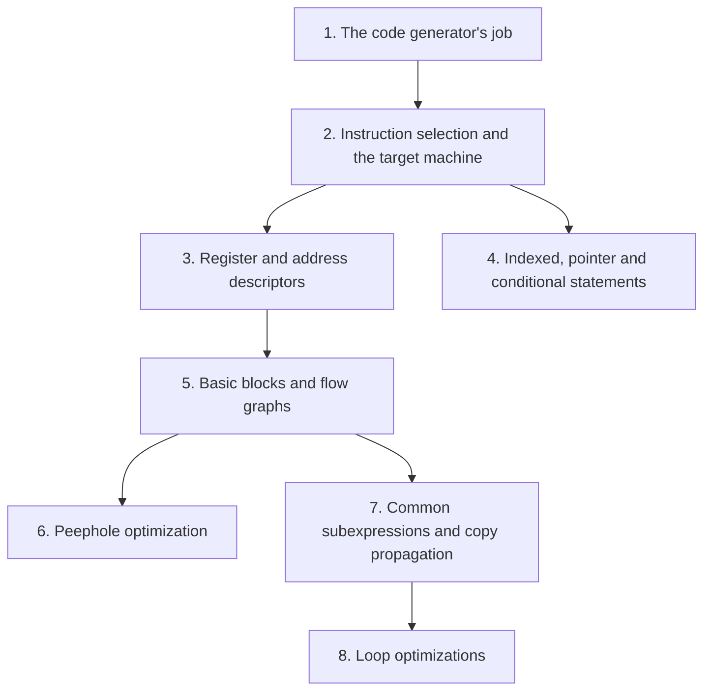

## Contents

1. [The code generator's job](#1-the-code-generators-job)
2. [Instruction selection and the target machine](#2-instruction-selection-and-the-target-machine)
3. [Generating code with register and address descriptors](#3-generating-code-with-register-and-address-descriptors)
4. [Indexed, pointer and conditional statements](#4-indexed-pointer-and-conditional-statements)
5. [Basic blocks and flow graphs](#5-basic-blocks-and-flow-graphs)
6. [Peephole optimization](#6-peephole-optimization)
7. [The code optimizer: common subexpressions and copy propagation](#7-the-code-optimizer-common-subexpressions-and-copy-propagation)
8. [Loop optimizations](#8-loop-optimizations)

---

## 1. The code generator's job

### 1.1 The Problem & Intuition

The intermediate code is still abstract: unlimited temporaries, no registers, no real instructions. The **code generator** is the last phase. It turns that code into instructions for a real machine, with a small, fixed set of registers.

### 1.2 Mechanism & Architecture

**Code generation (Slide 3):**

- The final phase of a compiler is the code generator.
- It receives an intermediate representation (IR) together with extra information in the symbol table.
- It produces a semantically equivalent target program.
- Its main tasks:
  1. **Instruction selection**: which machine instructions to use.
  2. **Register allocation and selection**: which values live in registers, and in which register.
  3. **Instruction ordering**: in what order to run the instructions.

**Code generation issues (Slide 4):**

- The most important criterion is that it produces **correct** target code.
- **Input to the code generator:** the IR plus the symbol table. We assume the front end produces a low-level IR, whose values can be manipulated directly by machine instructions.
- **The target program:** the prerequisite is knowing the target machine and its instruction set.

### 1.3 Visual Anchor

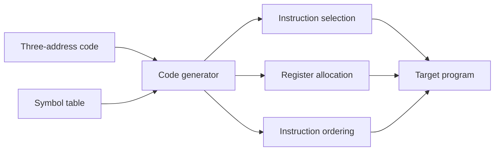

*Figure: The code generator's inputs (Slide 4) and its three tasks (Slide 3).*

### 1.4 Verified Formulas, Trade-offs & Calculations

> **Background (not in the slides):** Why each task matters:
> - **Instruction selection:** a machine often has several ways to do the same thing. `a = a + 1` can be three instructions (load, add, store) or a single increment instruction, if the machine has one.
> - **Register allocation:** registers are far faster than memory but few. Keeping a value in a register saves a memory access each time it is used.
> - **Instruction ordering:** some orders need fewer registers, or let the processor overlap instructions.

---

## 2. Instruction selection and the target machine

### 2.1 The Problem & Intuition

The simplest code generator has a fixed **template** for each kind of three-address statement. That is easy and always correct, but it can produce wasteful code, because each statement is translated without looking at its neighbours.

### 2.2 Mechanism & Architecture

**Instruction selection by template (Slide 5).** Every three-address statement of the form `x = y + z` is translated into:

```text
MOV y, R0    /* load y into register R0 */
ADD z, R0    /* add z to R0 */
MOV R0, x    /* store R0 to x */
```

**The quality problem (Slide 6).** With this template,

```text
a = b + c
d = a + e
```

becomes:

```text
MOV b, R0
ADD c, R0
MOV R0, a
MOV a, R0
ADD e, R0
MOV R0, d
```

**A simple target machine model (Slide 7):**

- A byte-addressable machine with four bytes to a word.
- $n$ general-purpose registers, $R0, R1, \ldots, R(n-1)$.
- Two-address instructions of the form `op source, destination`. `op` is an op-code; source and destination are data fields.
- Op-codes include:
  - `MOV`: move source to destination
  - `ADD`: add source to destination
  - `SUB`: subtract source from destination

**Address modes (Slide 8).** contents(a) means the contents of the register or memory address that a stands for.

| Mode | Form | Address |
| :--- | :--- | :--- |
| absolute | M | M |
| register | R | R |
| indexed | c(R) | c + contents(R) |
| indirect register | *R | contents(R) |
| indirect indexed | *c(R) | contents(c + contents(R)) |

### 2.3 Visual Anchor

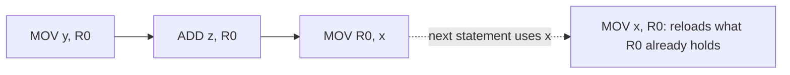

*Figure: Translating each statement on its own leads to a load of a value that is already in the register.*

### 2.4 Verified Formulas, Trade-offs & Calculations

**What is wasteful in the Slide 6 code.** The 4th instruction, `MOV a, R0`, loads `a` into R0. But R0 already holds `a`, from the 3rd instruction. So the 4th instruction can be deleted. If `a` is not used later, the 3rd instruction (`MOV R0, a`) can be deleted too. The 6 instructions shrink to 5, or to 4.

**Address modes worked through.** Suppose R1 holds 100, memory word 100 holds 500, and memory word 108 holds 700.

| Operand | Address used | Value |
| :--- | :--- | :--- |
| `R1` | register R1 | 100 |
| `*R1` | contents(R1) = 100 | contents of 100 = 500 |
| `8(R1)` | 8 + contents(R1) = 108 | contents of 108 = 700 |
| `*8(R1)` | contents(8 + 100) = contents(108) = 700 | contents of 700 |

> **Background (not in the slides):** The textbook (Aho et al.) gives each instruction a **cost**: 1 for the instruction, plus 1 for each operand that is a memory address or a constant (register operands are free). The template for `x = y + z` then costs (1+1) + (1+1) + (1+1) = 6. Keeping values in registers lowers the cost, which is what Section 3 does.

---

## 3. Generating code with register and address descriptors

### 3.1 The Problem & Intuition

To avoid reloading values, the code generator must **remember** what each register holds and where each variable's current value is. It keeps two small tables for this: the **register descriptor** and the **address descriptor**.

### 3.2 Mechanism & Architecture

**Descriptors (Slide 20):**

- A **register descriptor** keeps track of what is currently in each register. It is consulted whenever a new register is needed.
- An **address descriptor** keeps track of the location (or locations) where the current value of a name can be found at run time.

**A code generation algorithm (Slide 21).** The input is a sequence of three-address statements that forms a basic block (Section 5). For each statement `x = y op z`:

1. Call the function **getreg** to choose the location $L$ where the result of `y op z` should be stored.
2. Consult the address descriptor. If the value of `y` is not already in $L$, generate `MOV y, L` to put a copy of `y` in $L$.
3. Generate `OP z, L`. If $L$ is a register, update the descriptors to show it holds the value of `x`, and remove `x` from all other register descriptors.
4. If the current values of `y` and/or `z` have no next uses (they are not **live** on exit from the block), update the register descriptor: those registers no longer hold anything useful.

**The function getreg (Slide 22).** It returns the location $L$ to hold the value of `x` for `x = y op z`:

1. If `y` is in a register that holds no other names, and `y` is not live and has no next use after this statement, return the register of `y` as $L$. Update the address descriptor of `y` to show `y` is no longer in $L$.
2. Failing (1), return an empty register, if there is one.
3. Failing (2), find an occupied register $R$ and free it.
4. If `x` is not used in the block, or no suitable occupied register can be found, choose the memory location of `x` as $L$.

**Example (Slide 9).** The assignment `d = (a - b) + (a - c) + (a - c)` might be translated into this TAC, with `d` live at the end:

```text
t = a - b
u = a - c
v = t + u
d = v + u
```

| Statement | Code generated | Register descriptor | Address descriptor |
| :--- | :--- | :--- | :--- |
| | | registers empty | |
| `t = a - b` | `MOV a, R0`<br>`SUB b, R0` | R0 contains t | t in R0 |
| `u = a - c` | `MOV a, R1`<br>`SUB c, R1` | R0 contains t<br>R1 contains u | t in R0<br>u in R1 |
| `v = t + u` | `ADD R1, R0` | R0 contains v<br>R1 contains u | u in R1<br>v in R0 |
| `d = v + u` | `ADD R1, R0` | R0 contains d | d in R0 |
| (end of block) | `MOV R0, d` | | d in R0 and memory |

### 3.3 Visual Anchor

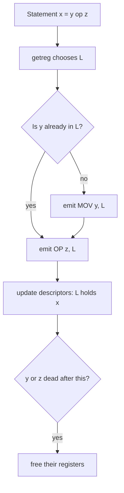

*Figure: The four steps of the Slide 21 algorithm for one statement.*

### 3.4 Verified Formulas, Trade-offs & Calculations

**Following getreg through the Slide 9 example.**

| Statement | getreg case | Why |
| :--- | :--- | :--- |
| `t = a - b` | (2) empty register R0 | `a` is a program variable in memory, not in a register |
| `u = a - c` | (2) empty register R1 | R0 holds t, which is still needed |
| `v = t + u` | (1) reuse R0 | t is in R0 alone and is not used again |
| `d = v + u` | (1) reuse R0 | v is in R0 alone and is not used again |

At the end of the block, `d` is live but only in R0, so `MOV R0, d` stores it.

**Counting.** The descriptor method gives 6 instructions inside the block plus 1 store = 7. Using the Slide 5 template for each of the 4 statements would give $4 \times 3 = 12$. The descriptors save 5 instructions, because t, u and v never go to memory.

**Check the values.** With a = 10, b = 3, c = 4: R0 = 10 − 3 = 7 (t); R1 = 10 − 4 = 6 (u); R0 = 7 + 6 = 13 (v); R0 = 13 + 6 = 19 (d). And directly, $(10 - 3) + (10 - 4) + (10 - 4) = 7 + 6 + 6 = 19$. ✓

---

## 4. Indexed, pointer and conditional statements

### 4.1 The Problem & Intuition

Arrays, pointers and jumps need their own instruction patterns. The best pattern depends on where the index or pointer is right now: already in a register (cheap) or still in memory (needs a load first).

### 4.2 Mechanism & Architecture

**Indexed assignments (Slide 10).** Indexing is handled like a binary operation. For `a = b[i]` and `a[i] = b`:

| Statement | i in register Ri | i in memory Mi |
| :--- | :--- | :--- |
| `a = b[i]` | `MOV b(Ri), R` | `MOV Mi, R`<br>`MOV b(R), R` |
| `a[i] = b` | `MOV b, a(Ri)` | `MOV Mi, R`<br>`MOV b, a(R)` |

**Pointer assignments (Slide 11).** For `a = *p` and `*p = a`:

| Statement | p in register Rp | p in memory Mp |
| :--- | :--- | :--- |
| `a = *p` | `MOV *Rp, a` | `MOV Mp, R`<br>`MOV *R, R` |
| `*p = a` | `MOV a, *Rp` | `MOV Mp, R`<br>`MOV a, *R` |

**Conditional statements (Slide 12):**

- For branches, the machine keeps a **condition code**. It shows whether the last value computed or loaded into a register is negative, zero or positive.
- The compare instruction **CMP** sets the condition code without actually computing a value. `CMP x, y` sets the condition code to positive if $x > y$, and so on.
- A conditional-jump instruction makes the jump if a given condition $<, =, >, \leq, \neq, \geq$ holds.

`if x < y goto z` can be translated to:

```text
CMP x, y
CJ< z
```

> **Slide note (Slide 12):** The comment on `CJ<` reads "jump if the condition code is negative or zero". For `<` the jump is taken only if the condition code is **negative** ($x - y < 0$). "Negative or zero" would be `CJ<=`.

**Example (Slide 13).**

```text
x = y + z
if x < 0 goto z
```

becomes:

```text
MOV y, R0
ADD z, R0
MOV R0, x
CJ< z
```

The condition code was already set by `x` after `ADD z, R0`, so no `CMP` is needed.

### 4.3 Visual Anchor

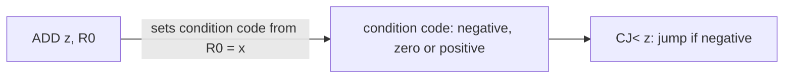

*Figure: In Slide 13, the ADD already leaves the sign of x in the condition code, so the jump can use it directly.*

### 4.4 Verified Formulas, Trade-offs & Calculations

**Why the register case is cheaper.** For `a = b[i]` with i in register Ri, one instruction does it: `MOV b(Ri), R` uses the indexed address $b + \text{contents}(Ri)$. With i in memory, i must first be loaded into a register: 2 instructions.

> **Background (not in the slides):** On this byte-addressable machine with 4-byte words, `i` here is a byte offset. For an integer array, the intermediate code first computes `t = 4 * i`, and the indexed mode uses t. That is why the quicksort code in Section 7 is full of `4*i` and `4*j`.

**Checking Slide 13 with numbers.** y = 2, z = −5: R0 = 2 + (−5) = −3, so x = −3 and the condition code is negative. `CJ<` jumps, which is right because $x < 0$. With y = 2, z = 5: x = 7, the condition code is positive, and there is no jump.

> **Background (not in the slides):** In Slide 13, `z` is used both as a variable (`y + z`) and as a jump label (`goto z`). These are two different things; a real program would give the label its own name.

---

## 5. Basic blocks and flow graphs

### 5.1 The Problem & Intuition

The descriptor algorithm of Section 3 works on straight-line code, where every statement runs if the first one does. Real code has jumps. So we cut the code into **basic blocks**: maximal straight-line pieces. Then we draw the jumps between blocks as a **flow graph**.

### 5.2 Mechanism & Architecture

**Flow graphs (Slide 14):**

- A graph representation of three-address code is called a **flow graph**.
- Nodes in the flow graph represent computations (basic blocks).
- Edges represent the flow of control.
- Some register-assignment algorithms use flow graphs to find the **inner loops**, where a program is expected to spend most of its time.

**Basic block and liveness (Slide 15):**

- A **basic block** is a sequence of consecutive statements in which flow of control enters at the beginning and leaves at the end, without halting or branching except at the end.
- A name in a basic block is **live** at a given point if its value is used after that point in the program, perhaps in another basic block.

**Algorithm: partition into basic blocks (Slide 16).**
Input: a sequence of three-address statements. Output: a list of basic blocks, with each statement in exactly one block.

1. Find the **leaders**, the first statements of the basic blocks:
   1. The first statement is a leader.
   2. Any statement that is the target of a conditional or unconditional goto is a leader.
   3. Any statement that immediately follows a goto or conditional goto statement is a leader.
2. For each leader, its basic block is the leader and all statements up to, but not including, the next leader or the end of the program.

**Example: dot product (Slides 17–19).** This code computes the dot product of two vectors `a` and `b` of length 20:

```pascal
begin
    prod := 0;
    i := 1;
    do begin
        prod := prod + a[i] * b[i];
        i := i + 1
    end
    while i <= 20
end
```

Its three-address code (Slide 18):

```text
(1)  prod := 0
(2)  i := 1
(3)  t1 := 4 * i
(4)  t2 := a [ t1 ]        /* compute a[i] */
(5)  t3 := 4 * i
(6)  t4 := b [ t3 ]        /* compute b[i] */
(7)  t5 := t2 * t4
(8)  t6 := prod + t5
(9)  prod := t6
(10) t7 := i + 1
(11) i := t7
(12) if i <= 20 goto (3)
```

### 5.3 Visual Anchor

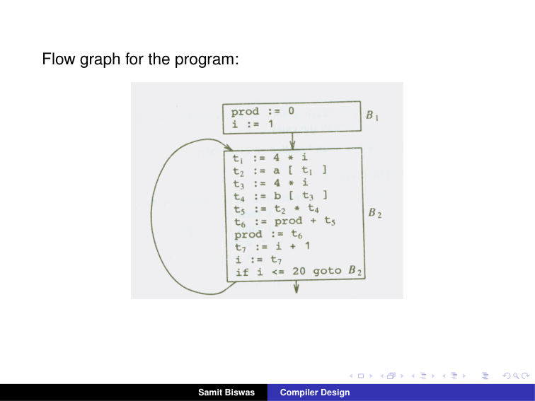
*Figure: Slide 19. B1 holds statements (1)–(2). B2 holds (3)–(12). B2 has an edge back to itself: the loop.*

### 5.4 Verified Formulas, Trade-offs & Calculations

**Finding the leaders in the dot product code.**

| Rule | Statement | Leader? |
| :--- | :--- | :--- |
| (i) the first statement | (1) | yes |
| (ii) target of a goto | (3), the target of `goto (3)` | yes |
| (iii) follows a goto | the statement after (12) | none: (12) is the last statement |

Leaders: (1) and (3). So B1 = (1)–(2) and B2 = (3)–(12). This matches Slide 19.

**Edges.** B1 falls through into B2. B2 ends with `if i <= 20 goto (3)`: one edge back to B2 (when true) and one edge out of the program (when false).

**How often each block runs.** B1 runs once. B2 runs for i = 1, 2, …, 20: that is 20 times. So B2 runs $20 \times 10 = 200$ statements in total, against 2 for B1. This is why optimizers look for inner loops: B2 is where the time goes.

**Liveness at the end of B2.** `prod` and `i` are used again (in the next pass of B2, or after the loop), so they are live. The temporaries t1 to t7 are not used outside B2, so they are dead at the end of B2. The code generator need not store them to memory.

---

## 6. Peephole optimization

### 6.1 The Problem & Intuition

Even good code generators leave small inefficiencies: a load right after a store, a jump to a jump, an add of zero. **Peephole optimization** slides a small window over the target code and replaces wasteful little sequences with better ones. It is simple and surprisingly effective.

### 6.2 Mechanism & Architecture

**Code optimization (Slide 24):**

- A transformation of a program to make it run faster and/or take less space.
- Optimization must be **safe**: it must preserve the meaning of the program.
- Code optimization is an important part of a compiler.

**Getting better performance (Slide 25).** Improvements can be made at three places:

| Where | Who | What they can do |
| :--- | :--- | :--- |
| Source code | the user | profile the program, change the algorithm, transform loops |
| Intermediate code | the compiler | improve loops, procedure calls, address calculations |
| Target code | the compiler | use registers, select instructions, do peephole transformations |

**Levels (Slide 26):**

- **Window:** peephole optimization.
- **Procedural:** global optimization, on the control flow graph.

**Peephole optimization (Slide 27):**

- Examines a short sequence of target instructions and replaces it with a faster sequence.
- The **peephole** is a small moving window on the target program.
- Characteristic peephole optimizations:
  1. redundant-instruction elimination
  2. flow-of-control optimizations
  3. algebraic simplifications
  4. use of machine idioms

**Examples (Slides 28–30):**

| Name on the slide | Before | After |
| :--- | :--- | :--- |
| Copy folding | `x = 32;`<br>`x = x + 32;` | `x = 64;` |
| Unreachable code | `goto L2;`<br>`x = x + 1;` | `goto L2;` (the `x = x + 1` is never reached, so it is unneeded) |
| Flow-of-control optimization | `goto L1;`<br>`...`<br>`L1: goto L2` | `goto L2;`<br>`...`<br>`L1: goto L2` |
| Algebraic simplification | `x = x + 0` | removed (unneeded) |
| Dead code | `x = 32`, where x is not used after the statement | removed |
| Using a known value | `x = 32;`<br>`x = x + y` | `x = y + 32` |
| Reduction in strength | `x = x * 2` | `x = x + x` |

Reduction in strength means replacing an expensive operation with a cheaper one.

**Limitations of peephole optimization (Slide 31):**

- Local in nature.
- Pattern-driven.
- Limited by the size of the window.

### 6.3 Visual Anchor


*Figure (illustration, not from the slides): The peephole optimizer slides a small window along the target code. Inside the window it replaces a short sequence with a shorter or faster one. It never sees beyond the window, which is why it is local.*

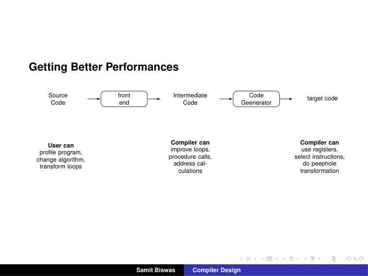
*Figure: Slide 25. The user improves the source; the compiler improves the intermediate code and the target code.*

### 6.4 Verified Formulas, Trade-offs & Calculations

**Checking each rewrite keeps the meaning.**

- Copy folding: after `x = 32; x = x + 32`, x is $32 + 32 = 64$. The rewrite sets x to 64 directly. ✓
- `x = 32; x = x + y`: after the first statement x is 32, so the second computes $32 + y$. Writing `x = y + 32` gives the same value and lets the first statement go (it becomes dead). ✓
- `x * 2 = x + x` for every number x. On most machines an add is cheaper than a multiply. ✓
- Jump to a jump: control reaching `goto L1` ends up at L2 anyway, one jump later. Jumping to L2 directly saves one jump each time. If nothing else jumps to L1, the `L1: goto L2` line itself can then be removed.

> **Slide note (Slide 28):** The usual name for `x = 32; x = x + 32` → `x = 64` is **constant folding** (with constant propagation): the compiler computes a constant expression at compile time. "Copy" usually refers to statements like `x = y`, which Section 7 handles.

> **Background (not in the slides):** A **machine idiom** is a special instruction that does a common job in one step. For example, many machines have an increment instruction, so `i := i + 1` can become `INC i` instead of load, add, store.

---

## 7. The code optimizer: common subexpressions and copy propagation

### 7.1 The Problem & Intuition

Peephole optimization only sees a few instructions at a time. A real **code optimizer** works on the whole flow graph of a procedure. It finds work done twice and removes it, even when the two copies are far apart.

### 7.2 Mechanism & Architecture

**Structure of an optimizing compiler (Slide 32).** The code optimizer sits between the front end and the code generator. It does three things, in order: **control-flow analysis**, **data-flow analysis**, and **transformations**.

**The running example: quicksort (Slide 33).**

```c
void quicksort(m, n)
int m, n;
{
    int i, j;
    int v, x;
    if ( n <= m ) return;
    /* fragment begins here */
    i = m-1; j = n; v = a[n];
    while (1) {
        do i = i+1; while ( a[i] < v );
        do j = j-1; while ( a[j] > v );
        if (i >= j) break;
        x = a[i]; a[i] = a[j]; a[j] = x;
    }
    x = a[i]; a[i] = a[n]; a[n] = x;
    /* fragment ends here */
    quicksort(m,j); quicksort(i+1,n);
}
```

Its three-address code (Slide 34) splits into six blocks (Slide 35):

| Block | Statements | Role |
| :--- | :--- | :--- |
| B1 | `i := m-1`, `j := n`, `t1 := 4*n`, `v := a[t1]` | set up |
| B2 | `i := i+1`, `t2 := 4*i`, `t3 := a[t2]`, `if t3 < v goto B2` | `do i = i+1 while (a[i] < v)` |
| B3 | `j := j-1`, `t4 := 4*j`, `t5 := a[t4]`, `if t5 > v goto B3` | `do j = j-1 while (a[j] > v)` |
| B4 | `if i >= j goto B6` | the break test |
| B5 | `t6 := 4*i`, `x := a[t6]`, `t7 := 4*i`, `t8 := 4*j`, `t9 := a[t8]`, `a[t7] := t9`, `t10 := 4*j`, `a[t10] := x`, `goto B2` | swap a[i] and a[j] |
| B6 | `t11 := 4*i`, `x := a[t11]`, `t12 := 4*i`, `t13 := 4*n`, `t14 := a[t13]`, `a[t12] := t14`, `t15 := 4*n`, `a[t15] := x` | swap a[i] and a[n] |

**Common subexpressions (Slide 36):**

- In B5, t7 and t10 recompute the common subexpressions $4 \ast i$ and $4 \ast j$.
- They are eliminated by using t6 instead of t7, and t8 instead of t10.

**Going further (Slide 37).** After this, B5 still evaluates $4 \ast i$ and $4 \ast j$. Both are common subexpressions with earlier blocks. In particular, the three statements `t8 = 4*j; t9 = a[t8]; a[t8] = x` in B5 can be replaced by `t9 = a[t4]; a[t4] = x`, using t4 from B3.

**Copy propagation (Slide 38).** The figure shows two predecessor blocks, `a := d+e` and `b := d+e`, both flowing into a block with `c := d+e`. To avoid recomputing `d+e` in the third block, a new name `t` is used: the first two blocks become `t := d+e; a := t` and `t := d+e; b := t`, and the third becomes `c := t`.

### 7.3 Visual Anchor

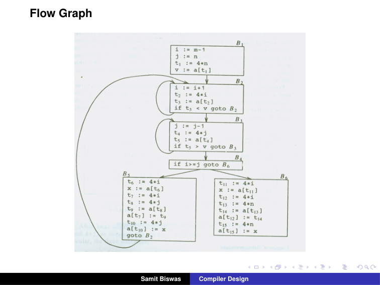
*Figure: Slide 35. B2 and B3 are small loops. B5 jumps back to B2. B4 decides between B5 and B6.*

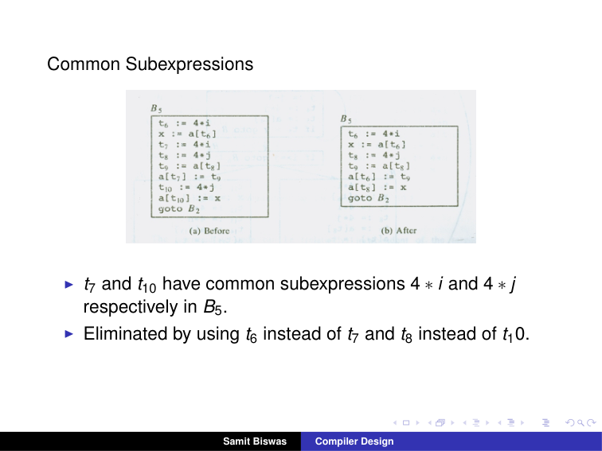
*Figure: Slide 36. (a) before: t7 and t10 recompute 4*i and 4*j. (b) after: t6 and t8 are reused.*

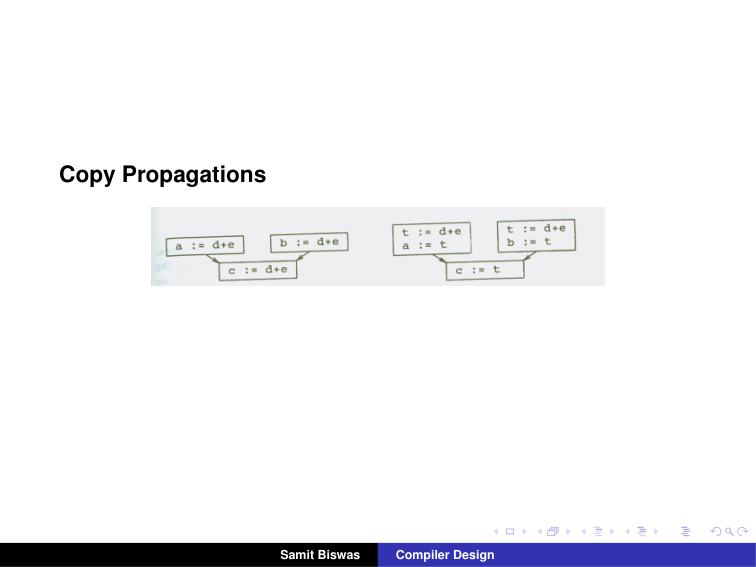
*Figure: Slide 38. Left: d+e computed in three blocks. Right: it is computed into t in the two upper blocks, and the lower block just copies t.*

### 7.4 Verified Formulas, Trade-offs & Calculations

**B5 before and after local elimination (Slide 36).**

| Before | After |
| :--- | :--- |
| `t6 := 4*i` | `t6 := 4*i` |
| `x := a[t6]` | `x := a[t6]` |
| `t7 := 4*i` | (removed) |
| `t8 := 4*j` | `t8 := 4*j` |
| `t9 := a[t8]` | `t9 := a[t8]` |
| `a[t7] := t9` | `a[t6] := t9` |
| `t10 := 4*j` | (removed) |
| `a[t10] := x` | `a[t8] := x` |
| `goto B2` | `goto B2` |

9 statements become 7, and the 4 multiplications become 2. The meaning is unchanged: t7 and t6 both equal $4 \ast i$, because i does not change between them.

**Why Slide 37 can use t4.** Control reaches B5 only through B3 and B4. B3 ends with `t4 := 4*j` and nothing after it changes j or t4 before B5. So when B5 runs, t4 already equals $4 \ast j$, and `t8 := 4*j` is not needed. The same holds for $4 \ast i$: it was computed into t2 in B2.

> **Background (not in the slides):** Following this to the end (as the textbook does), B5 shrinks to `x := t3; a[t2] := t5; a[t4] := x; goto B2`: t3 and t5 already hold a[i] and a[j] from B2 and B3. That is 4 statements, down from 9.

**What copy propagation means.**

> **Background (not in the slides):** After a copy statement `a := t`, later uses of `a` can be replaced by `t`. The Slide 38 rewrite creates such copies so that `c := t` reuses the value instead of computing `d+e` again. Often the copy `a := t` then becomes dead and can be removed.

**Why `t` must be the same name in both blocks.** The lower block can be reached from either upper block. Whichever way control comes, `t` holds `d+e`, so `c := t` is always right. If the two blocks used different temporaries, the lower block would not know which one to read.

---

## 8. Loop optimizations

### 8.1 The Problem & Intuition

Programs spend most of their time in loops (Section 5 showed B2 running 200 statements against 2). So saving one instruction inside a loop saves it on every pass. Loop optimizations move work out of the loop or make the work inside cheaper.

### 8.2 Mechanism & Architecture

**The most used loop optimizations (Slide 39):**

| Technique | What it does |
| :--- | :--- |
| Code motion | moves code outside the loop |
| Induction-variable elimination | in the quicksort example, eliminates i and j from the inner loops B2 and B3 |
| Reduction in strength | replaces an expensive operation with a cheaper one, such as multiplication by addition |

**Code motion (Slide 40).**

```c
while (i <= limit - 2)    /* statement does not change limit */
```

becomes the equivalent of

```c
t = limit - 2;
while (i <= t)            /* statement does not change limit or t */
```

`limit - 2` is **loop-invariant**: it has the same value on every pass. So it is computed once, before the loop.

**Induction variables and reduction in strength (Slide 41).** In B3, j and t4 change in lockstep: every time j decreases by 1, $t4 = 4 \ast j$ decreases by 4.

| Before | After |
| :--- | :--- |
| B1: `i := m-1`, `j := n`, `t1 := 4*n`, `v := a[t1]` | B1: `i := m-1`, `j := n`, `t1 := 4*n`, `v := a[t1]`, **`t4 := 4*j`** |
| B3: `j := j-1`, `t4 := 4*j`, `t5 := a[t4]`, `if t5 > v goto B3` | B3: `j := j-1`, **`t4 := t4-4`**, `t5 := a[t4]`, `if t5 > v goto B3` |

The multiplication in the loop is replaced by a subtraction, and `t4` is given its starting value once, in B1.

### 8.3 Visual Anchor

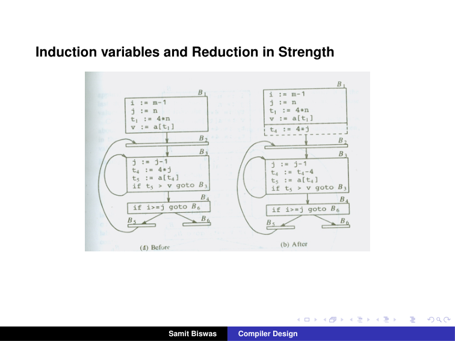
*Figure: Slide 41. (a) Before: B3 computes t4 := 4*j on every pass. (b) After: t4 := 4*j once in B1, and t4 := t4 - 4 in B3.*

### 8.4 Verified Formulas, Trade-offs & Calculations

**Checking the strength reduction with numbers.** Take n = 9, so B1 sets j = 9 and t4 = 4 × 9 = 36.

| Pass of B3 | j after `j := j-1` | Old: t4 = 4 × j | New: t4 = t4 − 4 |
| :--- | :--- | :--- | :--- |
| 1 | 8 | 32 | 36 − 4 = 32 |
| 2 | 7 | 28 | 32 − 4 = 28 |
| 3 | 6 | 24 | 28 − 4 = 24 |

The two columns agree on every pass, because $4(j - 1) = 4j - 4$. ✓ Each pass now does a subtraction instead of a multiplication.

**Code motion saves work in proportion to the passes.** If the Slide 40 loop runs 1,000 times, the original evaluates `limit - 2` 1,001 times (once per test, including the final failing test). After code motion it is evaluated once.

> **Background (not in the slides):** After strength reduction, j is used in B3 only to compute t4, and in B4 for the test `i >= j`. Since t2 = 4i and t4 = 4j, the test can become `t2 >= t4`. Then i and j are no longer needed in the loops at all. That is **induction-variable elimination**, the second technique of Slide 39.
