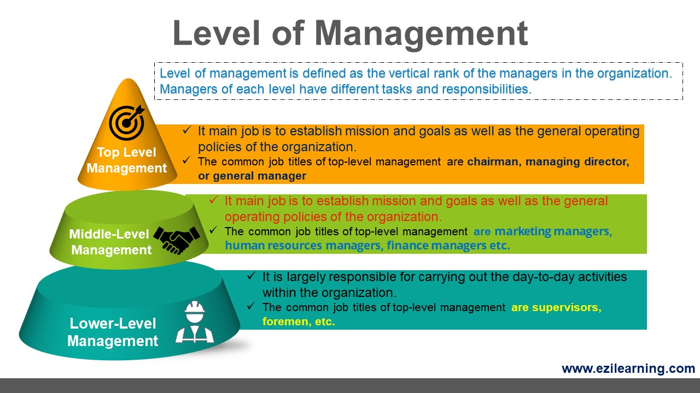
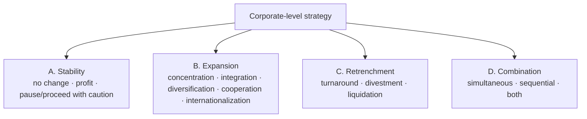

# Module III — Management: Exam Questions and Answers (HU-4101)

This file goes with three sources:

- [Management_Concepts_and_Leadership_Styles_Learning_Guide.md](Management_Concepts_and_Leadership_Styles_Learning_Guide.md), which covers the decks `1 & 2 - MGT CONCEPT.pptx` and `3 - MGT STYLES.pptx`;
- the management part (§3) of [Finance_Economics_and_Management_Midterm_Study_Guide.md](Finance_Economics_and_Management_Midterm_Study_Guide.md);
- the deck `4 - CORPORATE STRATEGIES.pptx`. This deck has no guide yet, so its answers below are written straight from the slides.

Try each question yourself first. Then read the answer.

**How the end-sem asks management:**

- Mostly **case studies** (8–10 marks). Each case has sub-questions and says "attempt any two". There is often an OR between two cases.
- A set of short applied questions (2 marks each, about 6 marks in total).
- Sometimes a 5-mark theory question.

In this file, **Part A** has the short and theory questions, and **Part B** has the case studies.

**Tags used in this file:**

- 🎯 = asked in a real paper (the year and question number are given). "HU-4201" means the 8th-semester paper of the same course.
- ✍️ = a practice question, added so that every part of the notes is covered.
- 📘 = goes a little beyond the notes.
- 💡 = a short line to help you remember.

**Not in the notes yet:** past end-sems also asked about the marketing mix (4Ps) and channels (2024 End), linear models of communication (2023 End), and the Hawthorne studies (2023 Mid). These will be added when that part of the syllabus arrives.

| Topic in the notes | Question |
| :--- | :--- |
| Definition, efficiency vs effectiveness, characteristics | A1, A3 |
| Functions of management, Fayol's 14 principles | A2, A6 |
| Science, art or profession | A4, B4 |
| Levels of management, importance, functional areas | A5, A7 |
| Leadership vs management, three styles | A8, A9, B2 |
| Trait theory, Ohio State / Michigan, Managerial Grid | A10, A11, A12, B5 |
| Situational, path-goal, LMX, transactional vs transformational | A13, A14, A15, B1, B3, B5 |
| Applied 2-mark questions | A16 |
| Vision, mission, goals, objectives, SMART (deck 4) | A17, A18 |
| Strategy and its levels; types of corporate strategy | A19, A20 |
| Stability strategy | A21, B8(a) |
| Expansion: concentration and Ansoff, integration, diversification | A22, A23, A24, B7, B8(c) |
| Cooperation: M&A, JV, strategic alliance | A25, A26 |
| International strategies (Bartlett–Ghoshal) | A27, B9 |
| Retrenchment and combination | A28, A29, B6, B8(b) |
| 📘 Porter's generic strategies, five forces, strategic-management process | A30 |

---

## Part A — Short and theory questions (2–5 marks)

### A1. Define management. What is the difference between efficiency and effectiveness? ✍️ [3]

**Management** means **getting work done through and with other people**, so that the organisation reaches its goals **efficiently and effectively**.

Three famous definitions:

- **Mary Parker Follett:** "the art of getting things done through people."
- **Henri Fayol:** "to manage is to forecast and plan, to organise, to command, to co-ordinate and to control."
- **Peter Drucker:** management has many purposes. It manages a business, it manages managers, and it manages workers and work.

| Efficiency | Effectiveness |
| :--- | :--- |
| **doing things right** | **doing the right things** |
| using the fewest resources (money, time, material) for a given output | actually reaching the goal (the target, the deadline, the quality) |
| about the **means** (how) | about the **ends** (what is achieved) |

A good manager needs both: reach the goal, and waste nothing on the way.

> 💡 Efficiency = the right way. Effectiveness = the right goal.

### A2. What are the different functions of management? 🎯 2023 Mid Q3 [5]

Henri Fayol gave five functions. They are often remembered as **POSDC**:

1. **Planning:** looking ahead and deciding in advance **what** to do, **how** and **when**. It includes setting objectives. Example: aiming for a 15% rise in market share over three years.
2. **Organising:** dividing the work, grouping it into departments, giving people and resources to each task, and deciding who reports to whom.
3. **Staffing / commanding (directing):** hiring and training people, then instructing, guiding and motivating them to do their tasks.
4. **Coordinating:** making all departments work together in the same direction. Example: production makes what the sales team can actually sell.
5. **Controlling:** comparing actual results with the plan, finding the gap, and correcting it.

These five form a **cycle**: what we learn while controlling shows us what to plan next.

> 💡 Plan → Organise → Staff/Direct → Coordinate → Control → back to Plan.

### A3. State the characteristics of management. ✍️ [4]

1. **Goal-oriented:** it exists to reach set objectives.
2. **Universal:** every organisation needs it: a business, a hospital, the army, a university.
3. **A continuous process:** a never-ending cycle of planning, doing, checking and adjusting.
4. **Dynamic:** it changes to fit new markets, new technology and changes in society.
5. **A group activity:** it is about people working together, not one person alone.
6. **Interdisciplinary:** it borrows ideas from many subjects: economics, psychology, sociology, statistics and engineering.
7. **A system of authority:** there is a chain of command, and managers have the right to give directions.
8. **Decision-making:** managers must choose between options, even when the future is uncertain.
9. **A profession:** it has an organised body of knowledge, formal training and a code of ethics.
10. **Intangible:** you cannot see or touch it. You notice it only through its effects: order, team spirit (morale) and results.

> 💡 It has a goal, it is everywhere, it never stops, it changes, it is about people, and it is invisible.

### A4. Is management a science, an art or a profession? 🎯 HU-4201 2025 Mid A(ii), 🎯 2024 Mid Q2(b) [2–5]

It is **all three**.

- **Science:**
  - It has an organised body of knowledge and principles (like Fayol's 14).
  - It has cause-and-effect links that have been tested with evidence.
  - It uses data, statistics, and methods such as **TQM** (total quality management) and statistical quality control.
- **Art:**
  - Using that knowledge needs personal skill, judgement, creativity and a feel for people. These get better with practice.
  - Example: handling a sudden **breakdown in the supply chain**. The manager must find new suppliers fast and calm worried staff. No textbook gives the exact steps.
- **Profession:**
  - It is learned through formal education (like an MBA).
  - It has professional bodies and a code of conduct.
  - Managers are appointed for their ability, not because they own the firm.
  - But it is not a profession in the strict sense, like law or medicine, because no licence is required to practise it.

**Different functions lean different ways:**

- **Planning and controlling** lean towards **science**: forecasts, budgets, and variance analysis (comparing actual results with planned ones).
- **Directing, motivating and handling conflict** lean towards **art**.

> 💡 Science tells you what works. Art tells you how to make it work with these particular people.

### A5. Explain the levels of management. How do authority and accountability flow? ✍️ [4]

| Level | Who | Main job |
| :--- | :--- | :--- |
| **Top** | board of directors, chairman, CEO, managing director | sets the objectives, policies and long-term strategy; deals with investors and the outside world |
| **Middle** | heads of departments, regional or plant managers | turns the top level's strategy into department plans and budgets; links the top and the bottom; coordinates departments |
| **Lower (supervisory)** | supervisors, foremen, team leads | gives out daily work, supervises workers directly, keeps up quality and discipline, reports upwards |

- **Authority flows down:** top → middle → lower. (Authority is the right to give orders.)
- **Accountability flows up:** lower → middle → top. Each level must answer for its results to the level above it.

> 💡 Orders go down. Reports go up.

### A6. Discuss Henri Fayol's contribution to modern management (his 14 principles). 🎯 HU-4201 2024 Mid Q1 [5]

Fayol was a French mining engineer. He is called the **father of modern (administrative) management**. He showed that management is a separate skill that can be **taught**. He described its five functions (see A2) and gave 14 principles:

1. **Division of work:** when each person specialises in one task, skill and output go up.
2. **Authority and responsibility:** the right to give orders comes with responsibility for the results.
3. **Discipline:** everyone obeys the rules and agreements.
4. **Unity of command:** each employee takes orders from **only one** boss.
5. **Unity of direction:** activities with the same objective have one head and one plan.
6. **Subordination of individual interest to general interest:** the interest of the group comes before the interest of one person.
7. **Remuneration:** pay is fair, and satisfies both the worker and the firm.
8. **Centralisation:** the right balance between decisions taken at the top and decisions passed down to lower levels (delegation).
9. **Scalar chain:** an unbroken line of authority from the top to the bottom. In an emergency, people at the same level may talk directly. This shortcut is called a "gang plank".
10. **Order:** a place for everything and everyone, and everything and everyone in its place.
11. **Equity:** workers are treated with kindness and fairness.
12. **Stability of tenure:** people keep their jobs for a long time, so few people leave (low staff turnover).
13. **Initiative:** employees are allowed to suggest ideas and carry them out.
14. **Esprit de corps:** team spirit and harmony. ("Union is strength.")

> 💡 Fayol: 5 functions + 14 principles = management as a subject you can study.

### A7. Why is management important and needed? What are its functional areas? 🎯 HU-4201 2024 End Q5(b) [4]

**Why management is important:**

1. It helps the group reach its goals, by directing everyone towards them.
2. It makes the **best use of scarce resources** (people, money, materials, machines). It cuts waste and cost.
3. It keeps the organisation stable, and helps it survive and grow when the world around it changes.
4. It builds a sound organisation with clear roles, so there is no overlap or confusion.
5. It keeps good relations with employees and keeps them motivated.
6. It helps the nation develop, by creating jobs, more output and better products.

**Functional areas (the scope of management):** finance, human resources (personnel), marketing, production, materials, purchasing, maintenance and office management.

> 💡 Without management, resources are just a pile of things.

### A8. How is leadership different from management? ✍️ [3]

| | Management | Leadership |
| :--- | :--- | :--- |
| Aim | order, consistency and efficiency of the existing system | vision, direction and change |
| Power comes from | the formal **position** and its authority | personal **influence**, trust and respect |
| Focus | plans, budgets, processes, control | people: inspiring them, uniting them, motivating them |
| Change | keeps things stable; reacts to events | drives change; acts before events happen (proactive) |
| Time | short term | long term |

A manager has **subordinates** (people who report to them). A leader has **followers** (people who choose to follow). The best managers are also leaders.

> 💡 Managers do things right. Leaders do the right things and bring people along.

### A9. What are the three main management styles? Explain with examples. 🎯 HU-4201 2024 End Q4 [1 + 7]

| | Autocratic (authoritarian) | Democratic (participative) | Laissez-faire (free rein) |
| :--- | :--- | :--- | :--- |
| Who decides | the manager alone | the manager, after talking with the team; decisions are shared | the team, with little interference from the manager |
| Communication | one-way: orders from the top | two-way: open discussion | mostly among team members |
| Strengths | quick decisions, clear command, tight control | commitment, creativity, better ideas, high morale | freedom, new ideas, people motivate themselves |
| Weaknesses | low morale, no initiative, everyone depends on the boss, many people leave | slower decisions; discussion can go on and on | drifting and confusion if people lack skill or discipline |
| Best when | emergencies, crises, tight deadlines, unskilled or new staff | complex problems, knowledge workers, engineering and software teams | highly skilled, self-motivated experts (R&D labs, senior designers) |
| Example | an army in battle; the early Infosys founders | a product design team | research scientists |

**No style is best in every situation.** A good manager matches the style to the task and to the people.

> 💡 Autocratic: "I decide." Democratic: "We decide." Laissez-faire: "You decide."

### A10. What is trait theory? What are its limits? ✍️ [2]

**Trait theory** says leaders are **born, not made**. Leaders have certain personal qualities (traits) that make them rise to the top: intelligence, confidence, energy, height, and **charisma**.

- **Charisma** is a personal charm that draws people to someone. Its traits include vision, self-confidence, persuasive speech and warmth.
- Example: Steve Jobs at Apple.

**Limits of trait theory:**

- No single list of traits fits all leaders.
- It ignores the **situation** and the followers.
- Having the traits does not guarantee success.

These problems led to the **behavioural theories**, which study what leaders **do**, not what they are.

> 💡 Traits = who the leader is. Behaviour = what the leader does.

### A11. Explain the Ohio State and Michigan studies of leadership. ✍️ [4]

Both studies looked at what leaders **do** (their behaviour), not at their traits.

**Ohio State studies:** found two **separate** dimensions. A leader can be high or low on each one, independently.

- **Initiating structure (task side):** defining roles, setting goals, deadlines and procedures.
- **Consideration (people side):** trust, respect for subordinates' ideas, and care for their feelings.

**University of Michigan studies:** found two **opposite** orientations. A leader leans towards one or the other.

- **Employee-oriented:** focuses on relationships and the workers' needs.
- **Production-oriented:** focuses on the technical task and the output. Workers are just a means to reach the target.

Michigan found that employee-oriented leaders had groups that were more productive and more satisfied. Both studies led to the Managerial Grid (see A12).

> 💡 Ohio = two separate dials. Michigan = one dial with two ends.

### A12. Explain Blake and Mouton's Managerial Grid with a diagram. 🎯 2023 Mid Q1 [5]

Blake and Mouton scored a manager from 1 to 9 on two things:

- **concern for production** (the x-axis);
- **concern for people** (the y-axis).

This gives 81 possible positions. Five of them are the key ones:

| Position | Style | Meaning |
| :--- | :--- | :--- |
| (1, 1) | **Impoverished** | little concern for either; does just enough to keep the job |
| (9, 1) | **Task / produce or perish** | output at any cost; people are only tools; based on authority and obedience |
| (1, 9) | **Country club** | comfort and friendliness come first; output suffers |
| (5, 5) | **Middle of the road** | a balance by compromise; good enough, but not excellent |
| (9, 9) | **Team management** | high concern for both; committed people work together for shared goals (linked to McGregor's Theory Y). This is the **best** style. |

> 💡 Aim for (9, 9): high concern for people, high concern for production.

### A13. Explain Hersey and Blanchard's situational leadership theory. ✍️ [4]

The right style depends on how **ready** the follower is. Readiness has two parts:

- **ability:** do they have the skill for the task?
- **willingness:** are they confident and motivated to do it?

As the follower becomes more ready, the leader gives **less direction**.

| Follower readiness | Style | Task behaviour | Relationship behaviour |
| :--- | :--- | :---: | :---: |
| R1: unable and unwilling | **S1 Telling (directing)**: step-by-step instructions, close supervision | high | low |
| R2: unable but willing | **S2 Selling (coaching)**: explain decisions, guide and encourage | high | high |
| R3: able but unwilling or unsure | **S3 Participating (supporting)**: share decisions, praise, build confidence | low | high |
| R4: able and willing | **S4 Delegating**: hand over the responsibility | low | low |

Example: a fresh engineering graduate (R1/R2) needs telling or selling. An engineer with 10 years' experience (R4) should be left to deliver.

> 💡 Tell, sell, participate, delegate: as readiness grows, let go.

### A14. Write notes on the path-goal theory and the leader-member exchange (LMX) theory. ✍️ [3]

- **Path-goal theory (Robert House):**
  - The leader's job is to help followers reach their goals by **clearing the path** for them.
  - The leader gives direction, resources and support, and removes obstacles.
  - The leader also makes it clear that effort leads to good performance, and good performance leads to rewards.
- **LMX (leader-member exchange) theory:**
  - A leader builds a **different one-to-one relationship** with each subordinate.
  - The **in-group** (trusted, go-getting performers) gets more responsibility, more communication, more guidance (mentoring) and faster careers.
  - The **out-group** gets a formal, rule-based relationship and normal supervision.

> 💡 Path-goal: clear the road. LMX: in-group vs out-group.

### A15. Differentiate between transactional and transformational leadership. 🎯 2023 Mid Q4 [5]

| | Transactional | Transformational |
| :--- | :--- | :--- |
| Based on | an **exchange**: reward for good work, penalty for failure | **inspiration**: a shared vision and shared values |
| Works | inside the existing system | changes the system |
| Motivation | from outside (extrinsic): pay, bonus | from inside (intrinsic): purpose, growth |
| Approach | reacts to problems; corrects mistakes; follows procedures | acts ahead; encourages new ideas; questions old ways |
| Result | steady, predictable performance | performance beyond what was expected; lasting change |

**The four I's of transformational leadership:**

- **Idealised influence:** the leader is a role model that people trust.
- **Inspirational motivation:** the leader gives an exciting vision.
- **Individualised consideration:** the leader coaches each person.
- **Intellectual stimulation:** the leader questions old beliefs and encourages new ideas.

Example: Mahatma Gandhi inspired millions of people to put a shared cause above their own interest.

> 💡 Transactional = "do this, get that". Transformational = "let us change the world".

### A16. Short applied questions. 🎯 HU-4201 2025 Mid A + 🎯 HU-4201 2024 End Q5(a) [2 each]

**(a) How should an engineer coordinate the functions of management in a systematic way?**
Treat them as a closed loop, like a control system in engineering:

- **plan** with clear, measurable targets;
- **organise** the tasks and people (who does what, by when);
- **direct** with clear instructions and support;
- **coordinate** through regular reviews across teams;
- **control** by measuring results against the plan, and feed the gaps back into the next plan.

**(b) How can employee attrition (people leaving their jobs) be reduced?**
Follow these steps in order:

1. hire people who fit the job and the culture;
2. welcome and train them well (onboarding);
3. give fair pay and recognition (Fayol's remuneration and equity);
4. offer career paths and job security (stability of tenure);
5. give them a say in decisions, and **psychological safety** (feeling safe to speak up);
6. give regular feedback.

Also hold **exit interviews** to learn why people leave.

**(c) How can capacity leakage be reduced?**
**Capacity leakage** means output that is lost because machines and people sit idle, wait, redo work, or are poorly coordinated. Fix it with:

- good planning and scheduling;
- preventive maintenance (fixing machines before they break);
- removing waste (Toyota's **lean** methods and **kaizen**, which means small, continuous improvements);
- training people in many skills (multi-skilling);
- tracking how fully resources are used (utilisation).

**(d) How can managerial success be measured?**

- results against goals: targets met, profit, cost, quality;
- efficiency: output per unit of resource;
- people results: morale, attrition, absenteeism;
- customer satisfaction;
- growth and new ideas (innovation).

**(e) What is CSR, and how can it help the Sustainable Development Goals?** 📘
**Corporate social responsibility (CSR)** is a firm's duty to society, beyond making profit. In India, companies above a certain size must spend 2% of their profit on CSR. Projects in education, health, clean water, renewable energy and skill training directly help SDGs (Sustainable Development Goals) such as quality education, good health and clean energy.

> 💡 Use theory words (Fayol, styles, lean) in every applied answer.

---

### Corporate strategy (deck 4)

### A17. How is vision different from mission? Give examples. ✍️ [3]

| | Vision | Mission |
| :--- | :--- | :--- |
| Question it answers | "What will success look like?" What the firm wants to **become**. | "What does the firm give to society?" What the firm **is now**. |
| Time | the future, the long run (5–10 years or more) | the present: why the firm exists and how it serves its stakeholders |
| Length | short | longer; often sums up the firm's values |
| Role | a picture of success that motivates people to work together | a road map to reach the vision; says which products and markets the firm works in, and what makes it different from similar firms |

**Examples:**

- **Vision:**
  - BSNL: "To become the largest telecom service provider in Asia."
  - Walt Disney: "Make people happy."
  - Stokes Eye Clinic: "Our vision is to take care of your vision."
- **IIEST Shibpur:**
  - Vision: to become one of the best institutes in the world for multi-disciplinary research.
  - Mission: to create and spread knowledge, and to produce engineers, scientists and entrepreneurs of the highest quality.

> 💡 Vision = where we want to be. Mission = what we do today to get there.

### A18. How are goals different from objectives? What are the types of goals, and what makes an objective SMART? ✍️ [4]

- **Goal:** a broad, long-term result that serves the mission.
- **Objective:** "the end result of planned activity". It says **what** must be done and **by when**, in numbers where possible.
- Goals sit above objectives: **goals serve the mission, and objectives serve the goals.**

| | Goal | Objective |
| :--- | :--- | :--- |
| How specific | a general aim or direction | specific and exact |
| Scope | broad; covers the whole | narrow; covers small parts of the whole |
| Measurement | hard to measure; often not in numbers | easy to measure; must be measurable |
| Time | long term | short to medium term |
| Example | increase the number of international customers | win 28% more customers from the UK, Australia and Germany in the next 3 months |

**Three types of goals:**

- **Strategic goals:** set by and for top management. Example: raise market share by 15% in three years.
- **Tactical goals:** for middle managers. Example: add more products to the product line.
- **Operational goals:** short-term goals for lower-level managers. Example: raise the store's customer-satisfaction score by 10% this quarter.

**SMART objectives** are:

- **S**pecific
- **M**easurable
- **A**chievable
- **R**elevant
- **T**ime-bound

Example from 3M: 10% growth in EPS (earnings per share), 20–25% return on equity, and 27% return on capital employed.

**Areas where firms set objectives:** markets, productivity, innovation, products, profitability, financial resources, physical facilities, structure, manager performance, employee performance and attitude, customer service, and social responsibility.

**Why objectives matter:**

- they define the firm's place in its environment;
- they coordinate decisions and the people who make them;
- they guide strategy;
- they give standards for judging performance.

### A19. What is strategy? Explain the levels of strategy. ✍️ [3]

**Strategy** is "a plan of action or policy designed to achieve a major or overall aim."

There are three levels. Picture a pyramid: responsibility grows as you go from the bottom to the top.

1. **Corporate level (grand strategies):** top management's overall plan for the whole firm and all its **strategic business units (SBUs)**. (An SBU is a part of the firm that runs as a separate business.)
   - It chooses the direction of the whole firm. It is the blueprint for growth.
   - It decides how far, how fast and when the firm will grow.
   - Its decisions are the highest-level, the most value-based and the most conceptual.
2. **Business level (generic strategies):** how each business or SBU competes in its own market.
3. **Functional or operational level:** how each function (production, marketing, finance, HR) supports the business strategy and creates value for the customer.

### A20. What are the types of corporate-level strategy? Draw the classification. 🎯 2023 End Q4 (part) ✍️ [4]

- **Stability:** make no change to what the firm is doing now.
- **Expansion:** make the firm's activities bigger or wider.
- **Retrenchment:** cut down the firm's activities.
- **Combination:** a mix of the three above.

### A21. What is a stability strategy? When is it chosen, and what are its types? ✍️ [4]

**Meaning.** The firm keeps its present strategy. It stays with its current products and markets, keeps the same level of effort, and is happy with **slow, step-by-step growth** (incremental growth). It does **not**:

- invest in new factories,
- chase a bigger market share, or
- enter new areas.

**When a firm chooses it:**

1. The business world around it is disturbed, changing fast or uncertain, so the firm waits.
2. Things are calm and the firm sees no major threat.
3. The firm has just grown fast and must **consolidate** (settle and strengthen what it has) before growing again.
4. The firm's growth ambitions are modest.
5. The industry is **mature** (it has stopped growing much), and the firm is comfortably placed in it.

**Types:**

- **No-change strategy:** a conscious decision to do nothing new and keep the business as it is. ("Taking no decision is a decision too.") Common in small and medium firms that work in a familiar niche with proven technology.
- **Profit strategy:** when profits start slipping, the firm props them up for a while. It cuts investment and costs, raises prices, or improves productivity, to get through a temporary difficulty.
- **Pause/proceed-with-caution strategy:** a short rest after a burst of expansion, or a test of the ground before a full new strategy. It gives time for changes to reach every level, and for structures and systems to adjust.

### A22. Explain expansion through concentration, using Ansoff's product-market matrix. 🎯 2023 End Q5(a) [4]

An **expansion** (growth) strategy aims at fast growth. The firm widens its customer groups, the needs it serves (customer functions), or its technologies. This speeds up growth in sales, profit and market share.

**Ansoff's matrix** (by Igor Ansoff) is a tool for finding ways to grow. It asks two questions: is the product old or new, and is the market old or new?

| Product ↓ / Market → | Present market | New market |
| :--- | :--- | :--- |
| **Present product** | Market penetration | Market development |
| **New product** | Product development | Diversification |

**Concentration** covers the first three boxes:

1. **Market penetration:** sell **more of the same products** in the **same market**. Ways to do it:
   - make existing customers buy more often and in bigger amounts (volume discounts, bonus cards, keeping customers loyal);
   - win customers from rivals (better design, quality or price);
   - attract people in the market who do not yet buy (lower prices, service, publicity).
   - Example: Big Bazaar's "Wednesday Bazaar" discounts.
2. **Market development:** take **present products** to **new markets**. Ways to do it:
   - new regions, in the country or abroad, through more sales staff, channel partners, agents or franchising;
   - new customer groups (segments), through slightly changed versions of the product, other sales channels or other media.
3. **Product development:** **new or improved products** for the **present market**. Examples: McDonald's new burgers; Diet, Vanilla and Ginger Coke; Google Chrome for existing internet users.

The fourth box, **diversification** (new product + new market), is the riskiest. See A24.

> 💡 Read the matrix from the safest corner (penetration) to the riskiest (diversification).

### A23. Explain integration strategies: vertical (backward, forward, full, taper) and horizontal. ✍️ [4]

**Integration** means joining activities that are related to what the firm already does. The firm chooses them using **value-chain analysis** (looking at each step that adds value, from raw material to the customer).

**Vertical integration** means the firm takes over activities that **supply its inputs** or **sell its outputs**. Picture the chain:

commodity producers → suppliers → **manufacturer** → importers → stores → buyers

- **Backward (upstream) integration:** moving **towards the source** of raw materials. Example: Nirma set up its own plants to make soda ash and linear alkyl benzene (raw materials for its detergent).
- **Forward (downstream) integration:** moving **nearer to the final customer**. Example: DCM, Mafatlal and National Textile Corporation opened their own retail shops.
- **Full integration:** the firm has its own suppliers, its own manufacturing and its own distributors.
- **Taper integration:** the firm makes **part** of what it needs and buys the rest from outside suppliers. Or it sells part through its own shops and the rest through independent distributors. (The slide spells it "tapper".)

**Horizontal integration** means getting more business **in the same line**, at the **same stage** of the value chain. It is done by growing internally, or by merging with firms that sell similar products. Examples:

- Aditya Birla Group bought L&T's cement business.
- IDBI Bank took over United Western Bank. Its branches went up from 181 to 410, and it added farm loans.
- Vodafone–Idea, Marriott–Starwood, Arcelor–Mittal, Exxon–Mobil, JP Morgan Chase.

| | Vertical | Horizontal |
| :--- | :--- | :--- |
| Direction | up or down the supply chain | sideways, at the same stage |
| Goal | control over inputs or selling; lower costs of dealing with outsiders | bigger scale, more market share, less competition |
| Risk | the firm is tied to one industry; costly to get out | competition authorities may object (antitrust); hard to merge similar firms smoothly |

### A24. What is diversification? How is related diversification different from unrelated diversification? When is it a good idea? ✍️ [4]

**Diversification** means moving into **new lines of business**: new products for new markets. The firm's definition of its own business changes a lot. Example: L&T.

1. **Related (concentric) diversification:** the new business is **linked** to the existing one.
   - *Linked by marketing:* a sewing-machine maker adds kitchenware, sold through the same shops.
   - *Linked by technology:* an insurer of institutions starts insuring individuals.
   - *Linked by both:* a maker of plastic water tanks adds plastic doors and windows, sold through the same hardware dealers.
   - Amul moved from dairy products (milk, desserts, spreads, cheese) to non-dairy products (vegetable oils, snacks, instant food).
2. **Unrelated (conglomerate) diversification:** **completely new** products, technologies and markets.
   - ITC: agribusiness, FMCG (fast-moving consumer goods), hotels, IT, paperboards.
   - Aditya Birla: aluminium, cement, chemicals, telecom, textiles and more.
   - Tata: engineering, materials, chemicals, consumer products, IT, energy and services.

**When diversification is a good idea:**

- to raise the share price or the growth rate;
- when investing outside is a better use of money than growing inside;
- to make earnings and sales more stable;
- to balance or fill out the product line;
- to get a needed resource quickly;
- to save tax;
- to raise efficiency and profit.

### A25. Explain expansion through cooperation. How are a merger, an acquisition, a joint venture and a strategic alliance different? ✍️ [5]

**Cooperation.** Rival firms can compete and cooperate at the same time. This is called **co-opetition**. It makes the whole market grow. It works because rivals often have interests that fit together (complementary interests). A cooperative strategy:

- creates value for the customer;
- costs less than creating that value in some other way;
- puts the firm in a better position against its competitors.

**Mergers and acquisitions (M&A).** A merger combines two or more organisations. Either:

- one firm takes over the other's assets and liabilities, paying with shares or cash; or
- both firms are dissolved, and a new company with new shares is formed.

For the buyer it is an **acquisition**. For the firm being bought, it is a **merger**.

**Types of merger** (using a footwear firm as the example):

| Type | Meaning | Example |
| :--- | :--- | :--- |
| Horizontal | same industry, similar products | footwear firm + footwear firm |
| Vertical | same product, different stages of making it | footwear firm + leather tannery |
| Concentric | related customer groups or uses | footwear firm + specialty footwear firm |
| Conglomerate | different industries | footwear firm + medicine (pharmaceutical) firm |

**Why firms do M&A:**

- to reduce competition;
- to grow faster and gain market share;
- to raise the share price;
- to get a resource quickly;
- **synergy** (together they are worth more than apart);
- resources to keep operations stable;
- economies of scale.

| | Merger | Acquisition | Joint venture | Strategic alliance |
| :--- | :--- | :--- | :--- | :--- |
| Who | usually two firms of equal size | a large firm takes over a smaller one | two or more firms form a **new firm** for a task or a period | two or more firms **agree** to work together |
| Nature | voluntary and friendly; shares are swapped | often hostile: the buyer offers the target's shareholders a better price | always friendly; ownership (equity) is shared | cooperation to work better; may involve no ownership |
| The parent firms | stop existing | the target stops existing | keep working in their own areas | keep working normally; each stays independent |

> 💡 The parent firms survive in a joint venture and an alliance, but not in a merger.

### A26. What are the types of joint ventures and strategic alliances? ✍️ [4]

**Joint venture (JV):** a **new firm** formed by two or more parties under a long-term contract. They put in money (equity) and share income, expenses, control, profits and losses. It can be for one project or for an ongoing relationship. Examples: Sony Ericsson; Samsung–Sony S-LCD.

**Types of JV by who the partners are:**

- Two Indian firms in the same industry: NTPC and Indian Railways formed Bharatiya Rail Bijlee Company.
- Two Indian firms in different industries: ActionAid India and TISS offer degree courses in rural India.
- An Indian firm and a foreign firm, in India: DLF and Nakheel (UAE) for building integrated townships.
- An Indian firm and a foreign firm, in that foreign country: Kirloskar Pumps and SPP Pumps (UK) for the EU market.
- An Indian firm and a foreign firm, in a third country: Apollo Tyres and Continental AG built a tyre plant in Malaysia.

**Types of JV by purpose:**

- **Project-based:** formed for one task.
- **Vertical:** the partners work at different stages of making the same product.
- **Horizontal:** the partners are competitors.
- **Functional-based:** formed for synergy and benefit to both.

**Strategic alliance:** an agreement to work together towards a common goal, while each firm stays **independent**. It is simpler and less binding than a JV, and **no new firm** is formed. Partners bring products, sales channels, factory capacity or know-how. Examples:

- Barnes & Noble with Starbucks (coffee shops inside bookshops);
- Vodafone India with ICICI Bank (m-pesa mobile money);
- MasterCard with Apple Pay;
- Chevrolet with Disney (the Test Track ride at EPCOT).

**Types of strategic alliance:**

- **Equity alliance:** the partners own different shares of what they set up. Example: Panasonic invested USD 30 million in Tesla's batteries, which grew into the Nevada battery plant.
- **Non-equity alliance:** just a contract to share resources and skills; no ownership.
- **Pro-competitive:** links along the value chain, between makers and their suppliers.
- **Non-competitive:** firms in the same industry that do not compete with each other, for example because they work in different regions.
- **Competitive:** rivals that cooperate closely.
- **Pre-competitive:** firms from different industries working together, for example on new technology.

### A27. Explain the four international strategies using the Bartlett–Ghoshal model. 🎯 2024 End Case 4 (theory part) [5]

A firm that operates in more than one country is a **multinational corporation (MNC)**. It faces two pressures:

1. **Pressure to cut costs** and be efficient.
2. **Pressure to be locally responsive**: to suit each country's tastes and conditions.

Each pressure can be low or high. This gives four strategies:

| Cost pressure ↓ / Local responsiveness → | Low | High |
| :--- | :--- | :--- |
| **High** | **Global** | **Transnational** |
| **Low** | **International** | **Multi-domestic** |

1. **International (low cost pressure, low local pressure):** sells the home product abroad with little change and no price cut. Buyers want it **because** it is different. Examples: Harley-Davidson, Belgian chocolate, Starbucks, Rolex.
2. **Multi-domestic (low cost pressure, high local pressure):** changes the product to suit each country, but does not cut prices much. Examples: Netflix's local shows; Heinz ketchup without onion and garlic for India; Outback Steakhouse.
3. **Global (high cost pressure, low local pressure):** the **same product everywhere**, to get economies of scale and low cost, with only small changes. Examples: Microsoft software (only the language changes); P&G's global brands; Intel; Lenovo. It suits products the customer does not see directly, where price matters more than taste.
4. **Transnational (high, high):** the middle path. A global brand and core product for efficiency, plus local touches. Example: McDonald's and KFC keep the same core menu, but McDonald's sells wine in France, serves the McArabia in Saudi Arabia, and sells no pork there.

> 💡 Transnational = "think global, act local".

### A28. What is a retrenchment strategy? Explain turnaround, divestment and liquidation. 🎯 2025 End Case 1 (theory part) [4]

**Retrenchment** means cutting down operations or expenses to get back to a financially stable position. Firms use it to shrink or restructure after an economic slowdown, losses or legal trouble.

1. **Turnaround:** reverse earlier wrong decisions and make a loss-making unit profitable again. Three steps:
   1. change the management;
   2. cut costs;
   3. reduce assets (sell what is not needed).
2. **Divestment:** **sell or close** a unit that is not core, and use the money to grow the core business. Examples:
   - VST sold its food business to Global Green (Thapar group). Reasons: shortage of raw material, no working capital, and the parent itself was losing money.
   - GEC of India sold Genelec in 1987, a year after its top management changed, to pay for its own expansion.
   - Indian Organic Chemicals sold its "Futura" foods business. Reasons: competition from unorganised sellers, technology problems, a factory mindset in a marketing business, and no money.
3. **Liquidation:** **close** the firm or unit and sell its assets. It is bankruptcy: the last resort and the worst form of retrenchment. Jobs, opportunities and the brand are all lost. Causes: continuing losses, political instability, conflicts, poor management. Example:
   - Empress Mills, Nagpur (Tata, 1986). Reasons: about 50 years without modernisation, government policy that hurt cotton textiles, failed plans for a merger and for voluntary retirement (VRS), and no rescue package.
   - Lesson: if action is not taken in time, even the biggest group cannot save a unit.

**Divestment vs liquidation:** divestment sells off a non-core part to make the core stronger, and **the firm carries on**. Liquidation sells everything and **shuts the door**.

### A29. What is a combination strategy? Give examples. 🎯 2025 End Part B Q2 (theory) [3]

A **combination strategy** mixes stability, expansion and retrenchment, to make the overall business better. The mix can be:

- **Simultaneous** (at the same time, in different businesses):
  - sell off one SBU or product line while adding another;
  - turn around some units while growing others;
  - "harvest" some products (take their cash without investing more) while growing others.
- **Sequential** (one after another, in the same business):
  - grow first, then stabilise; or
  - turn around first, then grow once things improve.

**Examples:**

- **ITC:** backward integration into packaging and printing (1925); diversification into hotels (1975) and agribusiness (1990); turnaround of Triveni Tissues; divestment of financial services.
- **Aditya Birla:** bought Novelis, formed JVs abroad, and over the years diversified, divested, merged and demerged (split) businesses.

### A30. Porter's generic strategies, the strategic-management process and the five forces. 📘 🎯 2023 End Q4, Q5(b) [8]

The deck names business-level strategies as "generic strategies" but does not explain them. The standard textbook answers are given below.

**The four phases of the strategic-management process:**

1. **Environmental scanning:** study the firm's inside and outside using SWOT (strengths, weaknesses, opportunities, threats).
2. **Strategy formulation:** set the vision, mission and objectives, and choose a strategy.
3. **Strategy implementation:** put it into action through structure, resources, policies and programmes.
4. **Evaluation and control:** measure the results against the objectives, and correct.

**Porter's five forces** (the five things that decide how hard competition is in an industry):

- the threat of new firms entering;
- the bargaining power of suppliers;
- the bargaining power of buyers;
- the threat of substitute products;
- rivalry among the firms already there.

The **threat of new entrants is low** when it is hard to enter (high entry barriers). Barriers include: economies of scale, high capital needs, strong brands, high switching costs for customers, access to sales channels, patents and licences, government policy, and the fear that existing firms will fight back.

**Porter's generic strategies:**

- **Cost leadership:** have the lowest cost in the industry.
- **Differentiation:** offer something unique that buyers will pay more for.
- **Focus:** use cost leadership or differentiation, but aim at one narrow customer group.

**How a firm becomes the cost leader:**

- economies of scale and high volume;
- the learning-curve effect (costs fall as workers gain experience);
- efficient, standard processes and automation;
- tight cost control and low overheads;
- cheap inputs (backward integration, bulk buying);
- simple, no-frills products;
- efficient distribution.

Examples: Walmart, Nirma, Patanjali, IndiGo.

---

## Part B — Case studies (8–10 marks)

### B1. 🎯 2025 Mid (Module III) — How Infosys's leadership changed [10]

*In its early years, Infosys used a fairly autocratic style. The founders made the decisions, which gave strict control, speed and steady quality while the company grew. As it spread across the world, this rigid style began to show its limits: decisions were too concentrated at the top, so morale and new ideas suffered. Infosys slowly moved to a democratic, participative style: employees took part in project decisions, there were feedback sessions, and managers kept an open door. At the same time, leaders such as Narayana Murthy showed transformational leadership, built on values, ethics and the vision of a globally respected Indian IT company.*

Attempt any two:
**(1)** Why was an autocratic style useful early on, and why did it become a problem later?
**(2)** As a manager, how would you balance democratic participation with quick decisions in a fast-moving IT company?
**(3)** Is transformational leadership more sustainable than autocratic leadership in knowledge industries like IT?

**(1) Answer.**

*Why it was useful early on:*

- A small, young company needs **speed, focus and steady quality**.
- The founders had the vision and the expertise. When they made the decisions, there was no confusion, standards stayed the same everywhere, and there was a clear chain of command (Fayol's unity of command and unity of direction).
- There were few staff, and they were new. So close direction suited them. (In situational leadership terms: telling or selling, for followers with low readiness.)

*Why it became a problem later:*

- A large, global firm full of skilled **knowledge workers** (people whose work is based on their expertise) cannot send every decision to the top.
- Decisions became slow. People closest to the customers could not act. Initiative and creativity were crushed. Morale fell, and more people left.
- Autocracy treats experts as people who just follow orders. This wastes their knowledge. (On the Managerial Grid, this is position 9,1: high concern for production, low concern for people.)

**(2) Answer.**

- **Split decisions by type:**
  - Routine and urgent decisions: hand them to the team to decide on the spot.
  - Strategic decisions: ask for everyone's views, but set a **deadline**. After the deadline, the manager decides. ("Consult, then decide.")
- **Set clear goals and limits** (which decisions are made at which level), then delegate inside those limits. Example: Southwest Airlines lets its front-line staff decide many things themselves.
- **Use agile routines:** short daily stand-up meetings and sprint reviews give everyone a voice quickly, without long meetings.
- **Use the situational approach:** more direction for new hires; delegation for experienced engineers.
- **Build psychological safety** (from Google's Project Aristotle): when people feel safe to speak up early, problems are solved **faster**, not slower.

**(3) Answer.** Yes, mostly.

- In IT, the main asset is people's knowledge and creativity.
- Transformational leadership raises **intrinsic motivation** (drive from inside) through a shared vision, coaching and intellectual challenge (the four I's). This leads to new ideas, commitment, and staff who stay. Knowledge firms need all of these to survive.
- Autocratic leadership gives control in the short term. But it kills initiative and drives people away, and talented employees can easily find other jobs.
- However, a crisis or a strict legal deadline may still need a firm, directive approach for a short time. So the best approach is a **transformational base**, with **directive action when the situation needs it**.

> 💡 Autocracy builds the house. Participation and inspiration keep people living in it.

### B2. 🎯 2024 End Case 3 — The autocratic production manager [8]

*A production manager in a well-organised Indian factory makes all decisions alone, sets tight deadlines and expects strict obedience. Deadlines are met, but employees feel unmotivated, more people leave than is normal for the industry, and the quality of work goes up and down.*

**(i)** What is the effect of autocratic management on employee motivation and on keeping staff? **[2]**
**(ii)** How could involving employees in decisions affect productivity? **[2]**
**(iii)** Discuss which management styles suit a manufacturing set-up, from an engineering point of view. **[4]**

**(i) Answer.**

- Workers have no voice, so they feel like machines.
- Morale is low. They feel no ownership of their work. They work out of fear, not commitment.
- Motivated people leave for better workplaces, so **staff turnover rises**. The factory keeps losing trained workers and keeps paying to hire and train new ones.
- Effort that is given unwillingly also shows up as **quality that goes up and down**.

**(ii) Answer.**

- Workers on the shop floor know the machines and processes best.
- Involving them (through quality circles, suggestion schemes and *kaizen*) brings practical ideas to cut defects and waste.
- People also carry out decisions they helped to make with more commitment.
- Result: higher productivity, better quality, fewer absences and fewer people leaving.
- Example: the Toyota Production System.

**(iii) Answer.**

| Situation in the factory | Suitable style | Why |
| :--- | :--- | :--- |
| safety-critical work, emergencies, standards required by law | **autocratic** (directive) | must be fast and exact; there is no time for debate during a fire or a breakdown |
| improving processes, solving quality problems, launching a new product | **democratic** (participative) | needs the knowledge of operators and engineers; builds commitment to the change |
| R&D cell, highly skilled maintenance or design experts | **laissez-faire** (delegative) | experts work best with freedom |

**From an engineering point of view, the factory is a system.**

- Standard operating procedures and safety need firm control.
- But continuous improvement needs participation.
- So the manager should be **situational**: directive on safety and standards, participative on improvement, and delegative with experts. The aim is the 9,9 team style.
- **Recommended change for this manager:** keep firm standards, but involve the workers in planning and problem-solving.

> 💡 Firm on safety, open on improvement.

### B3. 🎯 HU-4201 2025 Mid (OR) — Restructuring SwiftTech [5 × 2]

*SwiftTech is a fast-growing software company that now has more than 500 employees. But its management has not kept up:*
*(a) the structure is rigid and top-heavy, and middle managers are left out of decisions;*
*(b) coordination is poor, and projects are delayed;*
*(c) morale is low, and staff turnover is up by 20%;*
*(d) there is no system for continuous improvement.*
*The CEO, Mr Arjun, wants to restructure the company.*

**(i)** Identify the management problems. Which of Fayol's principles are missing?
**(ii)** Which leadership style should Mr Arjun use to improve motivation? Give examples.
**(iii)** Compare top-down decision-making with a participative approach. Which one suits SwiftTech?
**(iv)** How can SwiftTech use Toyota's lean principles?
**(v)** Suggest a management structure with top, middle and lower levels.

**(i) Answer.**

**The problems:**

- slow decisions, all made at the top;
- middle managers left out;
- poor coordination between teams, causing delays;
- low morale, and people leaving.

**Fayol's principles that are missing:**

- **Centralisation** (the balance is wrong: everything is too centralised);
- **Scalar chain** (the middle level is bypassed);
- **Unity of direction** and **coordination**;
- **Initiative**;
- **Esprit de corps** (team spirit);
- **Stability of tenure**;
- possibly **equity** and **remuneration**.

**(ii) Answer.** A **transformational and participative** style:

- share a clear vision for the company's next stage (inspirational motivation);
- coach the managers and engineers (individualised consideration);
- invite new ideas (intellectual stimulation);
- give real authority to middle managers (delegation).

Examples: open town-hall meetings, goal setting at team level, recognition programmes, and clear career paths.

**(iii) Answer.**

| Top-down | Participative |
| :--- | :--- |
| fast for simple decisions; clear control | slower at first, but gives better decisions for complex work |
| low commitment; ideas from the people doing the work are lost | high commitment; uses everyone's knowledge |
| suits crises and small firms | suits large firms full of skilled knowledge workers |

SwiftTech is large and full of skilled software engineers. So **participative** management works better. But it should have clear limits and deadlines, so that decisions are not delayed.

**(iv) Answer.** **Lean** means **removing waste** and **improving all the time**. SwiftTech can:

- map out how work gets delivered, and remove delays and unnecessary hand-overs;
- use small teams that mix different skills (cross-functional teams);
- use *kaizen*: anyone may suggest an improvement;
- use visual task boards (*kanban*) to show what work is in progress;
- fix problems where they start;
- show respect for people.

This makes the company more efficient and gives employees a voice.

**(v) Answer.**

- **Top:** the CEO and the leadership team. They set the vision and strategy, and provide resources.
- **Middle:** the heads of engineering, product, delivery and HR. They are now **part of decision-making**. They turn strategy into plans, coordinate teams, and own the results.
- **Lower:** team leads and scrum masters. They do daily planning, remove obstacles, and coach the engineers.

Also add:

- monthly reviews that bring all levels together;
- clear rules on who decides what at each level;
- a channel for feedback to flow upwards.

Authority flows down. Accountability and information flow up.

> 💡 Bring the middle managers back into the chain.

### B4. 🎯 2024 Mid Q2 (OR) — Google's Project Aristotle, and science vs art [5 + 5]

**(a)** Google's Project Aristotle studied what makes teams successful. What role does management play in making teams successful? **[5]**
**(b)** How do the functions of management need both systematic, evidence-based methods and intuitive, creative thinking? Where does management rely more on one than the other? Give examples. **[5]**

**(a) Answer.**

**What Google found:** Google studied about **180 teams**. It found that **who** was in a team (star performers, high IQ, top universities) mattered much less than **how** the team worked together.

- The most important factor was **psychological safety**: members felt safe to speak up, take risks and admit mistakes without being laughed at.
- The other factors were: dependability (members can rely on each other), clear structure and roles, meaning (the work matters to them) and impact (the work makes a difference).

**Management creates exactly these conditions:**

- **Planning and organising** give clear goals, roles and structure.
- **Directing and leading** build trust and safety. The manager listens, invites everyone to speak, and treats mistakes as chances to learn (a democratic, transformational style).
- **Coordinating** makes members able to rely on each other.
- **Controlling** gives fair feedback, not blame.

So successful teams are not luck. They are the result of good management of people and processes.

**(b) Answer.** (See also A4.)

- **Science (systematic, evidence-based):** forecasting demand from data, budgeting, scheduling, quality control (TQM, statistical process control), and measuring performance.
- **Art (intuitive, creative):** lifting a team that has lost heart, bargaining with a difficult supplier, solving conflicts, and deciding quickly in a crisis without full information.
- **Which function leans which way:**
  - **Planning and controlling** rely more on systematic, evidence-based methods.
  - **Directing, motivating and handling crises** rely more on gut feeling (intuition) and creativity.
- **Example:** a start-up uses Agile measurements (science), but it needs creative changes of direction (pivots) when the market shifts (art).

> 💡 Teams win through safety and clarity, and managers build both.

### B5. ✍️ — A new hospital ward [10]

*A hospital opens a new ward. The ward manager has three groups of staff:*
*(1) newly hired nurses, who are eager but have little experience;*
*(2) experienced nurses, who are skilled but have lost motivation after being passed over for promotion;*
*(3) two senior specialists, who know their work far better than the manager does.*
*The previous manager gave every group the same detailed orders, and complaints went up.*

**(a)** Using situational leadership theory, suggest a style for each group. **[6]**
**(b)** Where was the previous manager on the Managerial Grid, and where should the new manager aim to be? **[4]**

**(a) Answer.**

| Group | Readiness | Style | What the manager does |
| :--- | :--- | :--- | :--- |
| new nurses | R2: unable but willing | **S2 Selling (coaching)** | gives clear procedures and close guidance, plus encouragement and explanations of why |
| experienced nurses who have lost motivation | R3: able but unwilling | **S3 Participating (supporting)** | involves them in ward decisions, recognises their skill, talks about career paths; gives little task instruction |
| senior specialists | R4: able and willing | **S4 Delegating** | agrees goals with them, gives them freedom and resources, stays available if needed |

**Why the complaints went up:** giving everyone the same detailed orders (the "telling" style) insulted the experts. It also did nothing to lift the morale of the demotivated nurses.

**(b) Answer.**

- The previous manager focused on tasks and orders, with little concern for people. That is about **(9, 1): task / produce or perish**.
- The new manager should aim for **(9, 9): team management**. This means high standards of patient care (concern for production) together with trust, involvement and respect for the staff (concern for people).

> 💡 One style for everyone fits no one.

---

### Corporate strategy cases (deck 4)

> The full case texts for B6–B9 are not in this folder. Only their summaries in the past-paper solution files are. The facts below are the well-known public history of each company. In the exam, use the facts given in the paper, and link them to the same strategy terms.

### B6. 🎯 2025 End Case 1 — How Nokia reinvented itself [10]

**Case (summary).** Nokia once led the mobile-phone market, and then lost it to smartphones. It reinvented itself as a company that makes telecom networks and technology.

- **(a)** Evaluate Nokia's change using retrenchment, turnaround and renewal strategies.
- **(b)** Suggest a combination strategy for its future in 5G and AI.

**(a) Answer.**

1. **Retrenchment through divestment.** Nokia sold its phones and services business to Microsoft (2013–14). This business was no longer core and was losing money. The cash went into the core business. Liquidation was avoided: the firm carried on, and only one part was sold.
2. **Turnaround.** All three steps from the deck happened:
   - *change in management:* a new CEO and a new board;
   - *cost cutting:* restructuring and job cuts;
   - *reducing assets:* selling the phone business and the HERE maps business.
3. **Renewal and expansion.**
   - *Horizontal integration through acquisition:* Nokia bought Siemens's half of Nokia Siemens Networks, and bought Alcatel-Lucent (2016), to become bigger in network equipment.
   - *Licensing* the Nokia phone brand to HMD Global. This is an alliance-type deal with no ownership (non-equity).
   - *Licensing its patents* to other firms, as a new source of income.
4. **Evaluation.** Retrenchment saved the firm, and the acquisitions renewed it. The price was losing its consumer brand and several years of weak growth.

**(b) Answer: a combination strategy.**

- **Simultaneous (at the same time, in different parts of the business):**
  - *Expansion* in 5G and AI: develop 5G radio products and private wireless networks for factories (product development), and AI-based network software.
  - *Strategic alliances and joint ventures* with telecom operators, chip makers and cloud firms (co-opetition).
  - *Stability (profit strategy)* in the older, mature network product lines.
  - *Divestment* of units that have no future.
- **Sequential (one after another):** first consolidate after the turnaround (pause/proceed with caution), then grow.
- **International strategy: transnational.** Global 5G platforms give scale and low cost, while local changes suit each telecom operator and each country's regulator.

> 💡 Nokia = divest → turn around → integrate → grow (a sequential combination).

### B7. 🎯 2025 End Case 2 (OR) — Reliance Industries: diversification and divestment [10]

**Case (summary).** Reliance grew from textiles into petrochemicals and oil refining, and then into telecom (Jio), retail and new energy.

- **(a)** Analyse its diversification using Ansoff's product-market matrix.
- **(b)** Assess a strategy of selectively selling off (divesting) parts of its fossil-fuel business.

**(a) Answer: Ansoff's matrix.**

| | Present market | New market |
| :--- | :--- | :--- |
| **Present product** | **Market penetration:** more refining and petrochemical capacity, and more exports to existing buyers | **Market development:** fuels and plastics (polymers) sold to new countries and customer groups; its own fuel pumps |
| **New product** | **Product development:** new polymers, speciality chemicals, branded fuels | **Diversification:** Jio telecom and digital services; Reliance Retail; green energy (solar, batteries, hydrogen) |

- **The early moves were backward vertical integration:** textiles → polyester → the raw materials for polyester → oil refining. These are **related** diversification.
- **Jio, Retail and New Energy are unrelated (conglomerate) diversification:** new technology and new customers.
- Jio entered the market with very low prices (**penetration pricing**). Later it formed **strategic alliances**, selling small stakes to Facebook (Meta) and Google.
- **Assessment:**
  - **Good:** earnings stay stable through ups and downs, and cash from oil pays for the new businesses.
  - **Bad:** the risk is high and a lot of capital is needed.
  - These moves match the deck's reasons for diversifying: faster growth, more stable earnings, better use of funds, and getting resources quickly.

**(b) Answer: selective divestment.**

- **What it means:** sell, or reduce its share in, assets that are not core or that produce a lot of carbon. For example, sell a stake in the oil-to-chemicals business to a strategic partner. Use the cash for green energy, digital and retail. This is **divestment, not liquidation**: the core business continues.
- **Why do it:** the world is moving away from fossil fuels (the energy transition), carbon rules are getting stricter, it lowers debt, and it releases value for shareholders.
- **Risks:**
  - fossil fuels still bring in most of the cash;
  - selling too fast would starve the new businesses of money;
  - the benefit depends on getting a good price.
- **Verdict: use a combination strategy:**
  - a *profit or stability* strategy for the refining business, which brings in the cash;
  - *gradual divestment* of high-carbon assets;
  - *expansion* in new energy;
  - done **sequentially**, as the green businesses grow large enough.

### B8. 🎯 2025 End Part B — Three applied situations [2 × 3]

**(a) A firm in a saturated market (where demand has stopped growing) decides not to expand. Which strategy is this, and is it sensible?**

- This is a **stability strategy** (a no-change strategy, or a profit strategy).
- The deck says this suits a firm in a **mature** industry with few chances to grow, when the firm is comfortably placed.
- It is sensible in the short run. But the firm should keep looking for new markets, because "no organisation can continue indefinitely with a no-change strategy".

**(b) A car maker closes a poorly performing factory while investing in electric-vehicle (EV) production. Name the strategy.**

- This is a **simultaneous combination strategy**.
- It is **retrenchment** (closing or selling off the weak factory) plus **expansion** (product development or diversification into EVs), both at the same time, in different units.

**(c) Under pressure from competition, should a firm integrate vertically or horizontally?**

- **Vertical integration** (backward into making parts, or forward into owning dealers) secures inputs and profit margins, and makes the firm less dependent on suppliers.
- **Horizontal integration** (buying a rival) gives scale, market share and cost savings, and reduces competition.
- **Which to choose depends on where the pressure comes from:**
  - if it comes from **price wars with rivals**, horizontal integration fits;
  - if it comes from **powerful suppliers or problems with distribution**, vertical integration fits.
- Use the comparison table in A23.

### B9. 🎯 2024 End Case 4 — Sun Pharma's international strategy [8]

**Case (summary).** About Indian MNCs abroad. Explain how Sun Pharmaceuticals follows a **transnational strategy**, balancing the same product everywhere (standardisation) with changes for each country (local responsiveness).

**Answer.**

1. **The model.** In Bartlett–Ghoshal terms, the medicine (pharma) business faces **both** pressures at once:
   - *Cost pressure:* generic medicines compete on price. So large-scale manufacturing, shared R&D and global supply chains matter.
   - *Local pressure:* the rules for approving drugs (the US FDA and others), doctors' preferences, pricing rules and common diseases are different in each country.
   - High cost pressure + high local pressure = **transnational**.
2. **The standardisation side:**
   - large factories that make the same medicines (molecules) for many markets;
   - central R&D and central know-how on regulations;
   - global brands for generic medicines;
   - **acquisitions** for scale: Ranbaxy (2014), Taro (Israel) and specialty businesses in the US. These are horizontal integration.
3. **The local-responsiveness side:**
   - branded generics, marketed through doctors, in India and other emerging markets;
   - specialty drugs for the US market;
   - local factories, partners and teams;
   - approval documents (dossiers) written to suit each country's regulator.
4. **Why not the other three strategies:**
   - *Global* would ignore local rules and local brands.
   - *Multi-domestic* would lose the cost advantage that Indian generic medicines are built on.
   - *International* (exporting the product unchanged) could not pass foreign regulators or win over local doctors.
5. **Risks:**
   - regulators sending warning letters about factories;
   - falling prices for generic medicines in the US;
   - the difficulty of running both sides at once.

> 💡 Same core, local outer layer: McDonald's does it in food, Sun Pharma does it in medicine.
