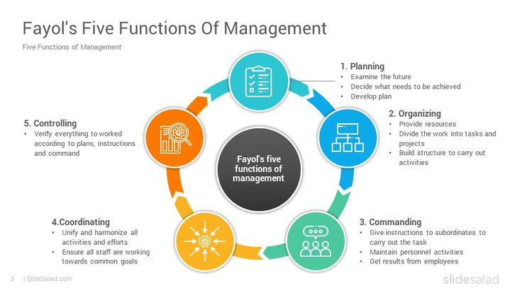
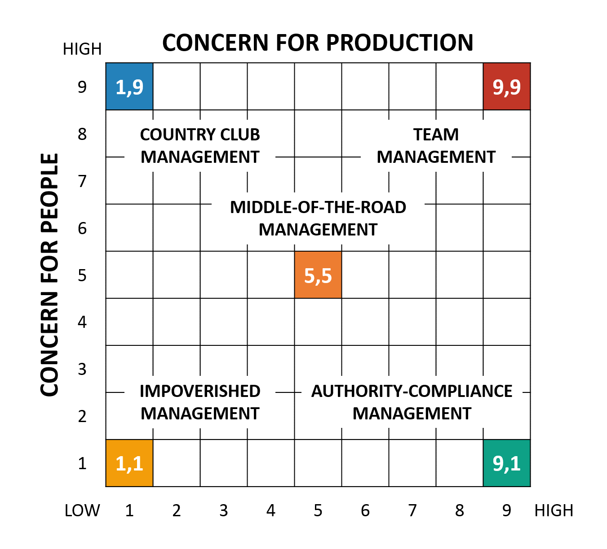
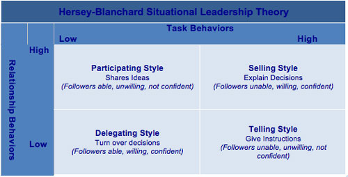
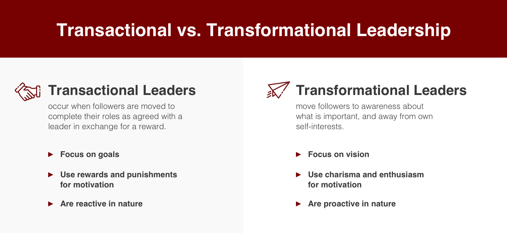
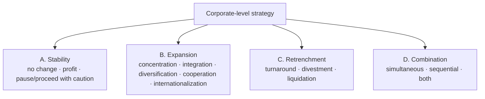

# Module III — Management: Exam Questions and Answers (HU-4101)

Companion to [Management_Concepts_and_Leadership_Styles_Learning_Guide.md](Management_Concepts_and_Leadership_Styles_Learning_Guide.md) (decks `1 & 2 - MGT CONCEPT.pptx` and `3 - MGT STYLES.pptx`), the management part of [Finance_Economics_and_Management_Midterm_Study_Guide.md](Finance_Economics_and_Management_Midterm_Study_Guide.md) (§3), and the deck `4 - CORPORATE STRATEGIES.pptx`, which has no guide yet, so its answers below are written straight from the slides. Try each question first, then read the answer.

**Pattern (end-sem):** the management half is mostly **case studies** (8–10 marks, "attempt any two" sub-questions, with an OR between two cases), plus a set of short applied questions (2 marks each, about 6 marks) and occasional 5-mark theory questions. In this file, Part A holds the short and theory questions and Part B the case studies.
**Tags:** 🎯 real paper (year, question; HU-4201 = the 8th-semester paper of the same course); ✍️ practice to cover the notes; 📘 beyond the notes. 💡 = memory hook.
**Not in the notes yet:** past end-sems also asked the marketing mix (4Ps) and channels (2024 End), linear models of communication (2023 End) and the Hawthorne studies (2023 Mid). They will be added when that part of the syllabus arrives.

| Topic in the notes | Question |
| :--- | :--- |
| Definition, efficiency vs effectiveness, characteristics | A1, A3 |
| Functions of management, Fayol's 14 principles | A2, A6 |
| Science, art or profession | A4, B4 |
| Levels of management, importance, functional areas | A5, A7 |
| Leadership vs management, three styles | A8, A9, B2 |
| Trait, Ohio State / Michigan, Managerial Grid | A10, A11, A12, B5 |
| Situational, path-goal, LMX, transactional vs transformational | A13, A14, A15, B1, B3, B5 |
| Applied 2-markers | A16 |
| Vision, mission, goals, objectives, SMART (deck 4) | A17, A18 |
| Strategy and its levels; corporate-level types | A19, A20 |
| Stability strategy | A21, B8(a) |
| Expansion: concentration and Ansoff, integration, diversification | A22, A23, A24, B7, B8(c) |
| Cooperation: M&A, JV, strategic alliance | A25, A26 |
| International strategies (Bartlett–Ghoshal) | A27, B9 |
| Retrenchment and combination | A28, A29, B6, B8(b) |
| 📘 Porter's generic strategies, five forces, strategic-management process | A30 |

---

## Part A — Short and theory questions (2–5 marks)

### A1. Define management. What is the difference between efficiency and effectiveness? ✍️ [3]

Management is **getting things done through and with other people** to reach the organisation's goals **efficiently and effectively**.

- **Mary Parker Follett:** "the art of getting things done through people."
- **Henri Fayol:** "to manage is to forecast and plan, to organise, to command, to co-ordinate and to control."
- **Peter Drucker:** a body with many purposes: it manages a business, manages managers, and manages workers and work.

| Efficiency | Effectiveness |
| :--- | :--- |
| **doing things right** | **doing the right things** |
| using the least resources (money, time, material) for a given output | actually reaching the goal (target, deadline, quality) |
| about **means** | about **ends** |

A good manager needs both: reaching the goal while wasting nothing.

> 💡 Efficiency = right way; effectiveness = right goal.

### A2. What are the different types of managerial functions? 🎯 2023 Mid Q3 [5]

Henri Fayol's five functions (often taught as POSDC):

1. **Planning:** looking ahead, setting objectives, and deciding in advance what to do, how and when. For example, targeting a 15% rise in market share over three years.
2. **Organising:** dividing the work, grouping it into departments, giving people and resources to each task, and fixing who reports to whom.
3. **Staffing / commanding (directing):** recruiting and training people, then instructing, guiding and motivating them to do their tasks.
4. **Coordinating:** fitting the efforts of all departments together so they pull in the same direction (production makes what sales can sell).
5. **Controlling:** measuring actual performance against the plan, finding the gap and correcting it.

They form a **cycle**: control shows what to plan next.

> 💡 Plan → Organise → Staff/Direct → Coordinate → Control → back to Plan.

### A3. State the characteristics of management. ✍️ [4]

1. **Goal-oriented:** exists to achieve set objectives.
2. **Universal:** needed in every organisation (business, hospital, army, university).
3. **Continuous process:** never-ending cycle of planning, doing, checking and adjusting.
4. **Dynamic:** adapts to changing markets, technology and society.
5. **Group activity:** concerns people working together, not a single person.
6. **Interdisciplinary:** uses ideas from many subjects: economics, psychology, sociology, statistics, engineering.
7. **System of authority:** has a chain of command; managers have the right to direct.
8. **Decision-making:** choosing between options when the future is uncertain.
9. **Profession:** systematic knowledge, formal training and a code of ethics.
10. **Intangible:** cannot be seen or touched; it is felt only through order, morale (team spirit) and results.

> 💡 Goal, everywhere, always, changing, people, invisible.

### A4. Is management a science, an art or a profession? 🎯 HU-4201 2025 Mid A(ii), 🎯 2024 Mid Q2(b) [2–5]

It is **all three**.

- **Science:** it has an organised body of knowledge, principles (Fayol's 14), and cause-and-effect links tested by evidence. It uses data, statistics and methods such as **TQM** (total quality management) and statistical quality control.
- **Art:** using that knowledge needs personal skill, judgment, creativity and a feel for people. These improve with practice. For example, handling a sudden **supply-chain breakdown**: finding new suppliers fast and calming worried staff.
- **Profession:** it is learned through formal education (MBA). It has professional bodies and a code of conduct. Managers are appointed for their ability, not because they own the firm. (It is not a profession in the strict sense of law or medicine: there is no compulsory licence.)

Different functions lean different ways. **Planning and controlling** lean on science (forecasts, budgets, variance analysis, that is, comparing actual with planned). **Directing, motivating and handling conflict** lean on art.

> 💡 Science tells you what works; art tells you how to make it work with these people.

### A5. Explain the levels of management. How do authority and accountability flow? ✍️ [4]

| Level | Who | Main job |
| :--- | :--- | :--- |
| **Top** | board of directors, chairman, CEO, managing director | sets objectives, policies and long-term strategy; deals with investors and the outside world |
| **Middle** | department heads, regional or plant managers | turns top-level strategy into department plans and budgets; links top and bottom; coordinates departments |
| **Lower (supervisory)** | supervisors, foremen, team leads | assigns daily work, supervises workers directly, keeps quality and discipline, reports upward |

- **Authority flows downward:** top → middle → lower.
- **Accountability flows upward:** lower → middle → top; each level answers for its results to the level above.

> 💡 Orders go down, reports go up.

### A6. Discuss Henri Fayol's contribution to modern management (his 14 principles). 🎯 HU-4201 2024 Mid Q1 [5]

Fayol, a French mining engineer, is called the **father of modern (administrative) management**. He showed that management is a separate skill that can be taught. He defined its five functions (A2) and gave 14 principles:

1. **Division of work:** specialisation raises skill and output.
2. **Authority and responsibility:** the right to give orders comes with responsibility for results.
3. **Discipline:** obeying rules and agreements.
4. **Unity of command:** each employee takes orders from **one** boss only.
5. **Unity of direction:** one head and one plan for activities with the same objective.
6. **Subordination of individual interest** to the general interest: the group's interest comes before one person's.
7. **Remuneration:** fair pay, satisfying to both sides.
8. **Centralisation:** the right balance between decisions made at the top and decisions passed down (delegation).
9. **Scalar chain:** an unbroken line of authority from top to bottom (with a "gang plank" for urgent direct contact between equals).
10. **Order:** a place for everything and everyone, and each in its place.
11. **Equity:** kindness and fairness to workers.
12. **Stability of tenure:** people keep their jobs for a long time; low staff turnover (few people leaving).
13. **Initiative:** let employees propose and carry out ideas.
14. **Esprit de corps:** team spirit and harmony ("union is strength").

> 💡 Fayol: 5 functions + 14 principles = management as a subject.

### A7. What are the importance and needs of management? What are its functional areas? 🎯 HU-4201 2024 End Q5(b) [4]

**Importance / need:**

1. achieves group goals by directing everyone towards them;
2. makes the **best (optimum) use of scarce resources** (men, money, materials, machines), cutting waste and cost;
3. brings stability and helps the organisation survive and grow in a changing environment;
4. creates a sound organisation with clear roles, so there is no overlap or confusion;
5. maintains good relations with employees and keeps them motivated;
6. contributes to national development: jobs, output, better products.

**Functional areas (scope):** financial, human resource (personnel), marketing, production, materials, purchasing, maintenance and office management.

> 💡 Without management, resources are just a pile of things.

### A8. Distinguish leadership from management. ✍️ [3]

| | Management | Leadership |
| :--- | :--- | :--- |
| Aim | order, consistency, efficiency of the existing system | vision, direction and change |
| Power from | formal **position** and authority | personal **influence**, trust, respect |
| Focus | plans, budgets, processes, control | people: inspiring, aligning, motivating |
| Change | keeps things stable; reacts to events | drives change; acts ahead of events (proactive) |
| Time | short term | long term |

A manager has subordinates; a leader has **followers**. The best managers are also leaders.

> 💡 Managers do things right; leaders do the right things and bring people along.

### A9. What are the three main management styles? Explain with examples. 🎯 HU-4201 2024 End Q4 [1 + 7]

| | Autocratic (authoritarian) | Democratic (participative) | Laissez-faire (free rein) |
| :--- | :--- | :--- | :--- |
| Who decides | the manager alone | manager after consulting the team; shared | the team, with little interference |
| Communication | one-way, top-down orders | two-way, open discussion | mostly among the team |
| Strengths | quick decisions, clear command, tight control | commitment, creativity, better ideas, high morale | freedom, innovation, self-motivation |
| Weaknesses | low morale, no initiative, everyone depends on the boss, many people leave (high turnover) | slower decisions; endless discussion | drift and confusion if people lack skill or discipline |
| Best when | emergencies, crises, tight deadlines, unskilled or new staff | complex problems, knowledge workers, engineering and software teams | highly skilled, motivated experts (R&D labs, senior designers) |
| Example | army in battle; early-stage Infosys founders | product design team | research scientists |

No style is best in every situation. A good manager matches the style to the task and the people.

> 💡 I decide / we decide / you decide.

### A10. What is trait theory? What are its limitations? ✍️ [2]

Trait theory says leaders are **born**, not made. They have certain personal qualities (intelligence, confidence, energy, height, **charisma**) that make them rise as leaders. Charisma means personal charm that draws people; its traits include vision, self-confidence, persuasive speech and warmth. For example, Steve Jobs at Apple.

Limitations:

- No single list of traits fits all leaders.
- It ignores the **situation** and the followers.
- Having the traits does not guarantee success.

This led to the behavioural theories, which study what leaders **do**.

> 💡 Traits = who the leader is; behaviour = what the leader does.

### A11. Explain the Ohio State and Michigan studies of leadership. ✍️ [4]

Both looked at leader **behaviour** instead of traits.

**Ohio State studies:** two **independent** dimensions, so a leader can be high or low on each:

- **Initiating structure (task):** defining roles, setting goals, deadlines and procedures.
- **Consideration (people):** trust, respect for subordinates' ideas, concern for their feelings.

**University of Michigan studies:** two **opposite** orientations:

- **Employee-oriented:** stresses relationships and workers' needs.
- **Production-oriented:** stresses the technical task and output; workers are a means to the target.

Michigan found employee-oriented leaders had more productive and satisfied groups. Both studies feed into the Managerial Grid (A12).

> 💡 Ohio = two separate dials; Michigan = one dial with two ends.

### A12. Explain the Managerial Grid of Blake and Mouton with a diagram. 🎯 2023 Mid Q1 [5]

Blake and Mouton rated a manager from 1 to 9 on two axes: **concern for production** (x-axis) and **concern for people** (y-axis). This gives 81 positions. Five are key:

| Position | Style | Meaning |
| :--- | :--- | :--- |
| (1, 1) | **Impoverished** | little concern for either; does the minimum to keep the job |
| (9, 1) | **Task / produce or perish** | output at any cost; people are tools; authority and obedience |
| (1, 9) | **Country club** | comfort and friendliness first; output suffers |
| (5, 5) | **Middle of the road** | balance by compromise; adequate but not excellent |
| (9, 9) | **Team management** | high concern for both; committed people work together for shared goals (linked to McGregor's Theory Y) — the **best** style |

> 💡 Aim for (9, 9): high people, high production.

### A13. Explain Hersey and Blanchard's situational leadership theory. ✍️ [4]

The right style depends on the follower's **readiness**, that is, their **ability** (skill) and **willingness** (confidence, motivation) for the task. As readiness rises, the leader gives less direction.

| Follower readiness | Style | Task behaviour | Relationship behaviour |
| :--- | :--- | :---: | :---: |
| R1: unable and unwilling | **S1 Telling (directing)**: step-by-step instructions, close supervision | high | low |
| R2: unable but willing | **S2 Selling (coaching)**: explain decisions, guide and encourage | high | high |
| R3: able but unwilling or insecure | **S3 Participating (supporting)**: share decisions, praise, build confidence | low | high |
| R4: able and willing | **S4 Delegating**: hand over responsibility | low | low |

For example, a fresh graduate engineer (R1/R2) needs telling or selling; a 10-year veteran (R4) should be left to deliver.

> 💡 Tell, sell, participate, delegate: as readiness grows, let go.

### A14. Write notes on the path-goal theory and the leader-member exchange (LMX) theory. ✍️ [3]

- **Path-goal theory (Robert House):** the leader's job is to help followers reach their goals by **clearing the path**. The leader gives direction, resources and support, and removes obstacles. The leader also makes clear that effort leads to performance, and performance leads to rewards.
- **LMX theory:** a leader forms a **different one-to-one relationship** with each subordinate. The **in-group** (trusted, go-ahead performers) gets more responsibility, more communication, more guidance (mentoring) and faster careers. The **out-group** gets a formal, rule-based relationship and normal supervision.

> 💡 Path-goal: clear the road. LMX: in-group vs out-group.

### A15. Differentiate between transactional and transformational leadership. 🎯 2023 Mid Q4 [5]

| | Transactional | Transformational |
| :--- | :--- | :--- |
| Basis | **exchange**: reward for performance, penalty for failure | **inspiration**: shared vision and values |
| Works | within the existing system | changes the system |
| Motivation | extrinsic: from outside (pay, bonus) | intrinsic: from inside (purpose, growth) |
| Approach | reacts to problems; corrects mistakes; follows procedures | acts ahead; encourages new ideas; questions old ways |
| Result | stable, predictable performance | performance beyond expectations, lasting change |

**The four I's of transformational leadership:**

- **Idealised influence:** a role model people trust.
- **Inspirational motivation:** an exciting vision.
- **Individualised consideration:** coaching each person.
- **Intellectual stimulation:** questioning old beliefs and encouraging new ideas.

For example, Mahatma Gandhi inspired millions to put a shared cause above self-interest.

> 💡 Transactional = "do this, get that"; transformational = "let us change the world".

### A16. Short applied questions. 🎯 HU-4201 2025 Mid A + 🎯 HU-4201 2024 End Q5(a) [2 each]

**(a) How should an engineer coordinate the management functions systematically?** Treat them as a closed loop, like a control system:

- **plan** with clear, measurable targets;
- **organise** the tasks and people (who does what, by when);
- **direct** with clear instructions and support;
- **coordinate** through regular reviews across teams;
- **control** by measuring results against the plan, and feed the gaps back into the next plan.

**(b) How can employee attrition (people leaving the job) be reduced?** A simple model: hire people who fit → welcome and train them (onboarding) → fair pay and recognition (Fayol's remuneration, equity) → career paths and stability of tenure → a say in decisions and psychological safety (feeling safe to speak up) → regular feedback. Also hold exit interviews to learn why people leave.

**(c) How can capacity leakage be reduced?** Capacity leakage means output lost through idle machines and people, waiting, rework and poor coordination. Fix it with planning and scheduling, preventive maintenance (fixing machines before they break), removing waste (Toyota's lean, *kaizen*, that is, small continuous improvements), training people in many skills (multi-skilling), and tracking how fully resources are used (utilisation).

**(d) How can managerial success be measured?** By results against goals (targets met, profit, cost, quality), efficiency (output per unit of resource), people outcomes (morale, attrition, absenteeism), customer satisfaction, and growth and innovation.

**(e) What is CSR and how can it serve the Sustainable Development Goals?** 📘 Corporate social responsibility (CSR) is a firm's duty to society beyond making profit. In India, companies above a size limit must spend 2% of profit on CSR. Projects in education, health, clean water, renewable energy and skill development directly serve SDGs such as quality education, good health and clean energy.

> 💡 Use the theory words (Fayol, styles, lean) in every applied answer.

---

### Corporate strategy (deck 4)

### A17. Distinguish vision from mission, with examples. ✍️ [3]

| | Vision | Mission |
| :--- | :--- | :--- |
| Question it answers | "What will success look like?" What the firm wants to **become** | "What does the firm provide to society?" What the firm **is now** |
| Time | Future-oriented, long run (5–10 years or more) | Present: reason for being and how it serves stakeholders |
| Length | Brief | Longer; often sums up the firm's values |
| Role | An image of success that motivates people to work together | A road map to reach the vision; defines scope in product and market terms and sets the firm apart from similar firms |

- **Vision examples:** BSNL, "To become the largest telecom service provider in Asia"; Walt Disney, "Make people happy"; Stokes Eye Clinic, "Our vision is to take care of your vision".
- **IIEST Shibpur:** vision, to become one of the best institutes in the world for multi-disciplinary research; mission, create and spread knowledge and produce engineers, scientists and entrepreneurs of the highest quality.

> 💡 Vision = where we want to be. Mission = what we do today to get there.

### A18. Distinguish goals from objectives. What are the types of goals, and what makes an objective SMART? ✍️ [4]

**Goal:** a broad, long-term outcome that serves the mission. **Objective:** "the end result of planned activity"; it states **what** is to be done **by when**, quantified if possible. Goals sit above objectives: goals serve the mission, objectives serve the goals.

| | Goal | Objective |
| :--- | :--- | :--- |
| Specificity | General intention or direction | Specific, precise |
| Scope and size | Broad, the whole | Narrow, small parts of the whole |
| Measurement | Hard; often intangible | Easy; must be measurable |
| Time frame | Long term | Short to medium term |
| Example | Increase the international customer base | Win 28% more customers from the UK, Australia and Germany in the next 3 months |

**Three types of goals:**
- **Strategic goals** are set by and for top management. Example: raise market share by 15% in three years.
- **Tactical goals** are for middle managers. Example: expand the product line.
- **Operational goals** are short-term goals for lower-level managers. Example: raise store customer-satisfaction scores by 10% this quarter.

**SMART objectives:** Specific, Measurable, Achievable, Relevant, Time-bound. Example from 3M: 10% growth in EPS, 20–25% return on equity, 27% return on capital employed.

**Areas of objectives:** markets, productivity, innovation, product, profitability, financial resources, physical facilities, structure, manager performance, employee performance and attitude, customer service, and social responsibility.

**Why objectives matter:** they define the firm in its environment, coordinate decisions and decision makers, guide strategy, and give standards for judging performance.

### A19. What is strategy? Explain the levels of strategy. ✍️ [3]

**Strategy** is "a plan of action or policy designed to achieve a major or overall aim."

There are three levels. Responsibility rises from the bottom of the pyramid to the top.
1. **Corporate level (grand strategies).** Top management's overall plan for the whole firm and its strategic business units (SBUs).
   - It chooses the firm's direction; it is the blueprint for growth.
   - It sets the extent, pace and timing of growth.
   - Its decisions are the highest-level, most value-oriented and conceptual.
2. **Business level (generic strategies).** How each business or SBU competes in its market.
3. **Functional or operational level.** How each function (production, marketing, finance, HR) supports the business strategy and creates value for the customer.

### A20. What are the types of corporate-level strategies? Draw the classification. 🎯 2023 End Q4 (part) ✍️ [4]

- **Stability:** make no change to current activities.
- **Expansion:** widen the firm's activities.
- **Retrenchment:** reduce the level of activity.
- **Combination:** a mix of the three.

### A21. What is a stability strategy? When is it chosen, and what are its types? ✍️ [4]

**Meaning.** The firm keeps its present corporate strategy, stays with its current products and markets, keeps its present level of effort and is happy with **incremental growth** (slow, step-by-step growth). It does not invest in new factories, chase market share or enter new territories.

**When it is chosen:**
1. The environment is disturbed, volatile or uncertain, so the firm waits.
2. Turbulence is minimal and the firm sees no major threat.
3. The firm has just grown fast and must **consolidate** (settle and strengthen what it has) before growing again.
4. Growth ambitions are modest.
5. The industry is **mature**, with little growth, and the firm is comfortably placed.

**Types:**
- **No change.** A conscious decision to do nothing new and keep the present business definition ("taking no decision is a decision too"). Common for small and medium firms in a familiar niche with time-tested technology.
- **Profit.** When profits drift lower, the firm props them up artificially for a while: it cuts investment and costs, raises prices or improves productivity to tide over a temporary difficulty.
- **Pause/proceed with caution.** A temporary rest after a burst of expansion, or a test of the ground before a full strategy. It lets changes seep down the levels and lets structures and systems adjust.

### A22. Explain expansion through concentration with Ansoff's product-market matrix. 🎯 2023 End Q5(a) [4]

**Expansion** (growth or intensification) strategy aims at high growth by broadening a business's customer groups, customer functions or technologies. It speeds up growth in sales, profit and market share.

**Ansoff's matrix** (Igor Ansoff) is used to find growth opportunities:

| Product ↓ / Market → | Present market | New market |
| :--- | :--- | :--- |
| **Present product** | Market penetration | Market development |
| **New product** | Product development | Diversification |

**Concentration** covers the first three cells:
1. **Market penetration:** sell more of the same products in the same market.
   - Make existing customers buy more often and in larger quantity (volume discounts, bonus cards, retention).
   - Win competitors' customers (better design, quality, price).
   - Attract non-users in the current market (price concessions, service, publicity).
   - Example: Big Bazaar's "Wednesday Bazaar" discounts.
2. **Market development:** take present products to new markets.
   - New regions, nationally or abroad, through more sales staff, channel partners, agents or franchising.
   - New segments, through slightly changed product versions, other distribution channels or other media.
3. **Product development:** new or improved products for the present market. Examples: McDonald's new burgers; Diet, Vanilla and Ginger Coke; Google Chrome for existing internet users.

The fourth cell, **diversification** (new product, new market), is the riskiest; see A24.

> 💡 Read the matrix from the safest corner (penetration) to the riskiest (diversification).

### A23. Explain integration strategies: vertical (backward, forward, full, taper) and horizontal. ✍️ [4]

**Integration** combines activities related to the firm's present activity, chosen with value-chain analysis.

**Vertical integration** means taking on activities that supply the firm's inputs or distribute its outputs. Picture the chain: commodity producers → suppliers → **manufacturer** → importers → stores → buyers.
- **Backward (upstream)** moves toward the source of materials. Example: Nirma set up plants to make soda ash and linear alkyl benzene.
- **Forward (downstream)** moves nearer the final customer. Example: DCM, Mafatlal and National Textile Corporation set up their own retail outlets.
- **Full integration:** in-house suppliers, in-house manufacturing and in-house distributors.
- **Taper integration:** the firm makes part of its needs itself and buys the rest from outside suppliers; or it sells part through its own outlets and the rest through independent distributors. ("Tapper" on the slide.)

**Horizontal integration** means acquiring or growing more business in the **same line** or at the **same stage** of the value chain. It is done by internal expansion or by mergers with firms selling similar products.
- Aditya Birla Group bought L&T's cement business.
- IDBI Bank took over United Western Bank, which raised its branches from 181 to 410 and added agricultural credit.
- Vodafone–Idea, Marriott–Starwood, Arcelor–Mittal, Exxon–Mobil, JP Morgan Chase.

| | Vertical | Horizontal |
| :--- | :--- | :--- |
| Direction | Up or down the supply chain | Across, at the same stage |
| Goal | Control of inputs or distribution, lower transaction cost | Scale, market share, less competition |
| Risk | Locked into one industry; costly to exit | Antitrust scrutiny; integration of similar firms |

### A24. What is diversification? Distinguish related from unrelated diversification. When is it favoured? ✍️ [4]

**Diversification** means moving into new lines of business: new products for new markets, with a substantial change in the business definition. Example: L&T.

1. **Related (concentric):** the new activity is linked to the existing business.
   - *Marketing-related:* a sewing-machine maker adds kitchenware sold through the same stores.
   - *Technology-related:* an insurer of institutions starts insuring individuals.
   - *Marketing- and technology-related:* a synthetic water-tank maker adds synthetic doors and windows through the same hardware dealers.
   - Amul went from dairy (milk, desserts, spreads, cheese) to non-dairy (vegetable oils, snacks, instant food).
2. **Unrelated (conglomerate):** entirely new products, technologies and markets.
   - ITC: agribusiness, FMCG, hotels, IT, paperboards.
   - Aditya Birla: aluminium, cement, chemicals, telecom, textiles and more.
   - Tata: engineering, materials, chemicals, consumer products, IT, energy and services.

**Conditions favouring diversification:** to raise stock value or the growth rate; when investing outside is a better use of funds than internal growth; to stabilise earnings and sales; to balance or fill out the product line; to get a needed resource quickly; to save tax; to raise efficiency and profitability.

### A25. Explain expansion through cooperation. Differentiate merger, acquisition, joint venture and strategic alliance. ✍️ [5]

**Cooperation.** Rivals can compete and cooperate at the same time ("co-opetition") so that the whole market grows. The basis is the complementary interests of rival firms. A cooperative strategy creates value for the customer, costs less than creating that value another way, and puts the firm in a better position against competitors.

**Mergers and acquisitions.** A merger combines two or more organisations. One may take over the other's assets and liabilities for shares or cash, or both may be dissolved and a new company formed with new stock. For the buyer it is an acquisition; for the firm bought it is a merger.

**Types of merger** (footwear example):

| Type | Meaning | Example |
| :--- | :--- | :--- |
| Horizontal | Same industry, similar products | Footwear firm + footwear firm |
| Vertical | Same product, different stages | Footwear firm + leather tannery |
| Concentric | Related customer groups or functions | Footwear firm + specialty footwear firm |
| Conglomerate | Different industries | Footwear firm + pharmaceutical firm |

**Reasons for M&A:** reduce competition; grow faster and gain market share; raise share value; get a resource quickly; synergy; resources to stabilise operations; economies of scale.

| | Merger | Acquisition | Joint venture | Strategic alliance |
| :--- | :--- | :--- | :--- | :--- |
| Who | Usually two firms of equal size | Large firm takes over a smaller one | Two or more firms form a new entity for a task or period | Two or more firms agree to act together |
| Nature | Voluntary, friendly; stock swap | Often hostile: the buyer offers target shareholders a better price | Always friendly; equity shared | Cooperation to improve efficiency; may involve no equity |
| Parents | Cease to exist | Target ceases to exist | Keep working in their own areas | Keep working normally, each independent |

> 💡 The parents survive in a JV and an alliance, but not in a merger.

### A26. What are the types of joint ventures and strategic alliances? ✍️ [4]

**Joint venture:** a new entity formed by two or more parties under a long-term contract. They contribute equity and share revenue, expenses, control, profits and losses, for one project or an ongoing relationship. Example: Sony Ericsson (also Samsung–Sony S-LCD).

**By the parties involved:**
- Two Indian firms in one industry: NTPC and Indian Railways formed Bharatiya Rail Bijlee Company.
- Two Indian firms in different industries: ActionAid India and TISS offer degree courses in rural India.
- An Indian and a foreign firm in India: DLF and Nakheel (UAE) for integrated townships.
- An Indian and a foreign firm in that foreign country: Kirloskar Pumps and SPP Pumps (UK) for the EU market.
- An Indian and a foreign firm in a third country: Apollo Tyres and Continental AG built a tyre plant in Malaysia.

**By purpose:**
- **Project-based:** formed for one task.
- **Vertical:** the parties work at different stages of the same product.
- **Horizontal:** the parties are competitors.
- **Functional-based:** formed for synergy and mutual benefit.

**Strategic alliance:** an agreement to act together toward a common goal while each firm stays independent. It is simpler and less binding than a JV, and no separate firm is formed. Partners bring products, distribution channels, manufacturing capacity or know-how. Examples: Barnes & Noble with Starbucks; Vodafone India with ICICI Bank (m-pesa); MasterCard with Apple Pay; Chevrolet with Disney (Test Track at EPCOT).
- **Equity alliance:** the partners own different shares of what they set up. Example: Panasonic's USD 30 million investment in Tesla's batteries, which grew into the Nevada battery plant.
- **Non-equity alliance:** a contract to share resources and capabilities.
- **Pro-competitive:** vertical value-chain links between manufacturers and suppliers.
- **Non-competitive:** firms in the same industry that do not compete, such as firms in different regions.
- **Competitive:** rivals cooperating closely.
- **Pre-competitive:** firms from different industries working together, for example on new technology.

### A27. Explain the four international strategies using the Bartlett–Ghoshal model. 🎯 2024 End Case 4 (theory part) [5]

A firm operating in more than one country is a **multinational corporation (MNC)**. It faces two pressures: (1) **cost reduction and efficiency**, and (2) **local responsiveness** to tastes and conditions. How it answers each pressure, low or high, gives four strategies:

| Cost pressure ↓ / Local responsiveness → | Low | High |
| :--- | :--- | :--- |
| **High** | **Global** | **Transnational** |
| **Low** | **International** | **Multi-domestic** |

1. **International (low, low).** Sells the home product abroad with little change and no price cut; buyers want it because it is different. Examples: Harley-Davidson, Belgian chocolate, Starbucks, Rolex.
2. **Multi-domestic (low cost focus, high local).** Adapts to each country but does not cut prices much. Examples: Netflix local programming; Heinz ketchup without onion and garlic for India; Outback Steakhouse.
3. **Global (high cost focus, low local).** The same product everywhere for economies of scale and low cost, with only minor changes. Examples: Microsoft software with only the language changed; P&G global brands; Intel; Lenovo. It suits products hidden from the customer, where price matters more than taste.
4. **Transnational (high, high).** The middle path: global brand and core product for efficiency, with local touches. Examples: McDonald's and KFC keep the same core menu, but McDonald's sells wine in France, serves the McArabia in Saudi Arabia and has no pork there.

> 💡 Transnational = "think global, act local".

### A28. What is a retrenchment strategy? Explain turnaround, divestment and liquidation. 🎯 2025 End Case 1 (theory part) [4]

**Retrenchment** cuts operations or expenses to reach a financially stable position. It is used after an economic downturn, losses or legal trouble, to downsize or restructure.

1. **Turnaround.** Reverse earlier wrong decisions and make a loss-making unit profitable again. Steps: (i) change in management, (ii) cost reduction, (iii) asset reduction.
2. **Divestment.** Sell or close a non-core unit and use the money to grow the core business.
   - VST sold its food business to the Thapar group's Global Green: raw-material shortage, no working capital, and the parent was itself losing money.
   - GEC of India sold Genelec in 1987, a year after top management changed, to fund its own expansion.
   - Indian Organic Chemicals divested its "Futura" foods: unorganised competition, technology problems, a manufacturing mindset in a marketing business, and no funds.
3. **Liquidation.** Close the firm or unit and sell its assets: bankruptcy, the last resort and the worst form. Jobs, opportunity and brand are lost. Causes: continuing losses, political instability, conflicts, poor management.
   - Empress Mills, Nagpur (Tata, 1986): about 50 years of no modernisation, unfavourable government policy for cotton textiles, failed merger and VRS plans, and no rescue package.
   - Lesson: if action is not taken in time, even the largest group cannot save a unit.

**Divestment vs liquidation:** divestment sells a non-strategic part to strengthen the core and the firm carries on; liquidation sells up and shuts the door.

### A29. What is a combination strategy? Give examples. 🎯 2025 End Part B Q2 (theory) [3]

A **combination strategy** mixes stability, expansion and retrenchment. The mix is either at the same time in different businesses, or at different times in the same business, to improve the overall business.
- **Simultaneous:** divest one SBU or product line while adding another; turn around some units while growing others; harvest some products while growing others.
- **Sequential:** grow first, then stabilise; or turn around first, then grow once things improve.
- **ITC:** backward integration into packaging and printing (1925), diversification into hotels (1975) and agribusiness (1990), turnaround of Triveni Tissues, and divestment of financial services.
- **Aditya Birla:** acquired Novelis, formed JVs abroad, and over time diversified, divested, merged and demerged.

### A30. Porter's generic strategies, the strategic-management process and the five forces. 📘 🎯 2023 End Q4, Q5(b) [8]

The deck names business-level strategies as "generic strategies" but does not explain them. The standard textbook answers follow.

**Four phases of the strategic-management process:**
1. **Environmental scanning:** SWOT, internal and external.
2. **Strategy formulation:** vision, mission, objectives and the choice of strategy.
3. **Strategy implementation:** structure, resources, policies, programmes.
4. **Evaluation and control:** measure results against objectives and correct.

**Porter's five forces:**
- threat of new entrants
- bargaining power of suppliers
- bargaining power of buyers
- threat of substitutes
- rivalry among existing firms

The **threat of new entrants** is low when entry barriers are high: economies of scale, high capital needs, strong brands and switching costs, access to distribution, patents and licences, government policy, and expected retaliation by incumbents.

**Porter's generic strategies:**
- **Cost leadership:** the lowest cost in the industry.
- **Differentiation:** something unique that buyers pay more for.
- **Focus:** cost or differentiation aimed at a narrow segment.

**How a firm achieves cost leadership:** economies of scale and high volume; learning-curve effects; efficient, standardised processes and automation; tight cost control and lean overheads; cheap access to inputs (backward integration, bulk buying); simple, no-frills products; efficient distribution. Examples: Walmart, Nirma, Patanjali, IndiGo.

---

## Part B — Case studies (8–10 marks)

### B1. 🎯 2025 Mid (Module III) — Infosys's leadership evolution [10]

*In its early years, Infosys used a fairly autocratic style: decisions were centralised among the founders, which gave strict control, speed and consistent quality while it grew. As it expanded globally, this rigid style showed limits: morale and innovation suffered because decision-making was too top-heavy. Infosys gradually moved to a democratic, participative style (employees involved in project decisions, feedback sessions, open-door policies), while leaders such as Narayana Murthy showed transformational leadership built on values, ethics and the vision of a globally respected Indian IT company.*

Attempt any two:
**(1)** Why was an autocratic style useful early on, and why did it become a limitation later?
**(2)** As a manager, how would you balance democratic participation with quick decision-making in a fast-paced IT company?
**(3)** Is transformational leadership more sustainable than autocratic leadership in knowledge industries like IT?

**(1) Answer.**

*Useful early:*

- A small, young company needs **speed, focus and consistent quality**.
- The founders had the vision and the expertise. Decisions made at the top avoided confusion, kept standards the same everywhere, and gave a clear chain of command (Fayol's unity of command and direction).
- Staff were few and new, so close direction suited them (situational leadership: telling/selling for low readiness).

*Limitation later:*

- A large global firm of skilled **knowledge workers** (people who work with their expertise) cannot send every decision to the top.
- Decisions became slow. People closest to customers could not act. Initiative and creativity were crushed. Morale fell and more people left.
- Autocracy treats experts as order-takers, which wastes their knowledge (grid position 9,1: production high, people low).

**(2) Answer.**

- **Split decisions by type:** routine and urgent ones are handed to the team to decide on the spot. Strategic ones use participation, but with a **deadline**; after it, the manager decides ("consult, then decide").
- **Set clear goals and boundaries** (what is decided where), then delegate within them, like Southwest Airlines' empowered front line.
- **Agile routines:** short daily stand-up meetings and sprint reviews give everyone a voice quickly, without long meetings.
- **Situational approach:** more direction for new hires, delegation for experienced engineers.
- Build **psychological safety** (Project Aristotle): people feel safe to speak up early. This actually speeds up problem-solving.

**(3) Answer.** Yes, mostly.

- In IT the main asset is people's knowledge and creativity.
- Transformational leadership raises **intrinsic motivation** (drive from inside) through a shared vision, coaching and intellectual stimulation (the four I's). This drives new ideas, commitment and staff staying on: what knowledge firms need to survive.
- Autocratic leadership gives control in the short term, but it kills initiative and makes people leave. Talented employees can easily find other jobs.
- But a crisis or a strict legal deadline may still need a firm, directive approach for a short time. So a leader should keep a transformational base and use directive action when the situation needs it.

> 💡 Autocracy builds the house; participation and inspiration keep the people living in it.

### B2. 🎯 2024 End Case 3 — Autocratic production manager [8]

*A production manager in a structured Indian manufacturing plant makes all decisions alone, sets tight deadlines and expects strict obedience. Deadlines are met, but employees feel unmotivated, turnover is above the industry average and work quality is inconsistent.*

**(i)** The impact of autocratic management on employee motivation and retention. **[2]**
**(ii)** How could involving employees in decisions influence productivity? **[2]**
**(iii)** Discuss the suitability of different management styles for a manufacturing set-up from an engineering perspective. **[4]**

**(i) Answer.** Workers have no voice, so they feel like machines. Morale is low, they feel no ownership, and they work from fear, not commitment. Motivated people leave for better workplaces, so **turnover rises**. The plant keeps losing trained staff and paying to hire and train new ones. Unwilling effort also shows up as **inconsistent quality**.

**(ii) Answer.** Workers on the shop floor know the machines and processes best. Involving them (quality circles, suggestion schemes, *kaizen*) brings practical ideas to cut defects and waste. People also carry out decisions they helped make with more commitment. Result: higher productivity, better quality, fewer absences and fewer people leaving. Example: the Toyota Production System.

**(iii) Answer.**

| Situation in the plant | Suitable style | Why |
| :--- | :--- | :--- |
| safety-critical operations, emergencies, legal (statutory) standards | **autocratic** (directive) | must be fast and exact; no debate during a fire or a breakdown |
| process improvement, quality problems, new product introduction | **democratic** (participative) | needs the knowledge of operators and engineers; commitment to change |
| R&D cell, highly skilled maintenance or design experts | **laissez-faire** (delegative) | experts work best with freedom |

From an engineering view the plant is a **system**. Standard operating procedures and safety need firm control, but continuous improvement needs participation. So the manager should be **situational**: directive on safety and standards, participative on improvement, and delegative with experts (aim for the 9,9 team style). Recommended change here: keep firm standards, but involve workers in planning and problem-solving.

> 💡 Firm on safety, open on improvement.

### B3. 🎯 HU-4201 2025 Mid (OR) — SwiftTech restructuring [5 × 2]

*SwiftTech, a fast-growing software company, now has 500+ employees, but its management has not kept up: (a) a rigid, top-heavy structure in which middle managers are left out of decisions; (b) poor coordination and project delays; (c) low morale, with turnover up 20%; (d) no system for continuous improvement. The CEO, Mr Arjun, wants to restructure.*

**(i)** Identify the management challenges. Which of Fayol's principles are missing?
**(ii)** What leadership style should Mr Arjun adopt to improve motivation? Give examples.
**(iii)** Compare top-down decision-making with a participative approach. Which suits SwiftTech?
**(iv)** How can SwiftTech use Toyota's lean principles?
**(v)** Propose a management structure with top, middle and lower levels.

**(i) Answer.** Challenges: slow decisions all made at the top; middle managers left out; poor coordination between teams; delays; low morale and people leaving. Missing Fayol principles: **centralisation balance** (too centralised), **scalar chain** (middle level bypassed), **unity of direction** and **coordination**, **initiative**, **esprit de corps**, **stability of tenure**, and possibly **equity and remuneration**.

**(ii) Answer.** A **transformational and participative** style:

- share a clear vision for the company's next stage (inspirational motivation);
- coach managers and engineers (individualised consideration);
- invite ideas (intellectual stimulation);
- hand real authority to middle managers (delegation).

Examples: open town halls, team-level goal setting, recognition programmes, career paths.

**(iii) Answer.**

| Top-down | Participative |
| :--- | :--- |
| fast for simple decisions; clear control | slower at first, but better decisions for complex work |
| low commitment; ideas from the floor are lost | high commitment; uses everyone's knowledge |
| suits crises and small firms | suits large firms of skilled knowledge workers |

SwiftTech is large and full of skilled software engineers, so **participative** management is more effective, with clear limits and deadlines so decisions are not delayed.

**(iv) Answer.** Lean means **removing waste** and **continuous improvement**:

- map the delivery process and remove delays and hand-offs;
- small teams that mix different skills (cross-functional teams);
- *kaizen*: everyone may suggest improvements;
- visual task boards (*kanban*) to show work in progress;
- fix problems where they start;
- respect for people.

This raises efficiency and gives employees a voice.

**(v) Answer.**

- **Top:** CEO and leadership team: vision, strategy, resources.
- **Middle:** heads of engineering, product, delivery and HR, now **in the decision loop**: turn strategy into plans, coordinate teams, own outcomes.
- **Lower:** team leads and scrum masters: daily planning, removing blockers, coaching engineers.

Add regular cross-level reviews (monthly), clear decision rights at each level, and a feedback channel upward. Authority flows down, accountability and information flow up.

> 💡 Bring the middle back into the chain.

### B4. 🎯 2024 Mid Q2 (OR) — Google's Project Aristotle and science vs art [5 + 5]

**(a)** Google's Project Aristotle studied what makes teams successful. What is the relevance of management in making successful teams? **[5]**
**(b)** How do management functions need both systematic, evidence-based approaches and intuitive, creative thinking? Where does management rely more on one than the other? Give examples. **[5]**

**(a) Answer.** Google studied about **180 teams**. It found that **who** was in a team (stars, high IQ, top universities) mattered far less than **how** the team worked. The top factor was **psychological safety**: members felt safe to speak up, take risks and admit mistakes without being laughed at. Other factors were dependability, clear structure and roles, meaning and impact.

Management creates exactly these conditions:

- **Planning and organising** give clear goals, roles and structure.
- **Directing and leadership** build trust and safety: the manager listens, invites every voice, treats mistakes as learning (democratic, transformational style).
- **Coordinating** makes members depend on each other reliably.
- **Controlling** gives fair feedback, not blame.

So successful teams are not luck; they are the result of good management of people and process.

**(b) Answer.** See A4.

- **Science:** forecasting demand with data, budgeting, scheduling, quality control (TQM, statistical process control), performance measures.
- **Art:** motivating a team that has lost heart, bargaining with a difficult supplier, solving conflict, deciding quickly in a crisis with incomplete data.
- **Planning and controlling** lean more on systematic, evidence-based methods. **Directing, motivating and crisis handling** lean more on gut feel (intuition) and creativity. For example, a start-up uses Agile metrics (science) but needs creative pivots when the market shifts (art).

> 💡 Teams win on safety and clarity, and managers build both.

### B5. ✍️ — New hospital ward [10]

*A hospital opens a new ward. The ward manager has three groups: (1) newly hired nurses, eager but inexperienced; (2) experienced nurses who are skilled but demotivated after being passed over for promotion; (3) two senior specialists who know their work far better than the manager. The previous manager gave every group the same detailed orders, and complaints rose.*

**(a)** Using situational leadership theory, recommend a style for each group. **[6]**
**(b)** Where on the Managerial Grid was the previous manager, and where should the new one aim? **[4]**

**(a) Answer.**

| Group | Readiness | Style | What the manager does |
| :--- | :--- | :--- | :--- |
| new nurses | R2: unable but willing | **S2 Selling (coaching)** | clear procedures and close guidance, plus encouragement and explanation of why |
| experienced, demotivated nurses | R3: able but unwilling | **S3 Participating (supporting)** | involve them in ward decisions, recognise their skill, discuss career paths; little task instruction |
| senior specialists | R4: able and willing | **S4 Delegating** | agree goals, give them freedom and resources, stay available |

Giving everyone the same detailed orders (telling) insulted the experts. It also did nothing for the demotivated nurses' morale. This explains the complaints.

**(b) Answer.** The previous manager focused on tasks and orders with little concern for people: about **(9, 1), task / produce-or-perish**. The new manager should aim for **(9, 9), team management**: high standards of patient care (production) together with trust, involvement and respect for staff (people).

> 💡 One style for everyone fits no one.

---

### Corporate strategy cases (deck 4)

> The full case texts for B6–B9 are not in this folder; only their summaries in the PYQ solution files are. The facts below are the well-known public history of each company. Use the paper's own facts in the exam and hang them on the same strategy words.

### B6. 🎯 2025 End Case 1 — The strategic reinvention of Nokia [10]

**Case (summary).** Nokia led the mobile-phone market and then lost it to smartphones. It reinvented itself as a telecom-network and technology company.
- **(a)** Evaluate Nokia's transformation using retrenchment, turnaround and renewal strategies.
- **(b)** Suggest a combination strategy for its future in 5G and AI.

**(a) Answer.**
1. **Retrenchment through divestment.** Nokia sold its devices and services business to Microsoft (2013–14). This was a non-core, loss-making unit, and the cash went to the core. Liquidation was avoided: the firm carried on and only sold a part.
2. **Turnaround.** The deck's three steps all happened:
   - *change in management* (a new CEO and board);
   - *cost reduction* (restructuring and job cuts);
   - *asset reduction* (selling handsets and the HERE maps business).
3. **Renewal and expansion.**
   - *Horizontal integration through acquisition:* Nokia bought out Siemens's half of Nokia Siemens Networks and acquired Alcatel-Lucent (2016) to gain scale in network equipment.
   - *Licensing* of the Nokia phone brand to HMD Global, a non-equity, alliance-type arrangement.
   - *Patent licensing* as a new income stream.
4. **Evaluation.** Retrenchment saved the firm; the acquisitions renewed it. The cost was the consumer brand and years of weak growth.

**(b) Answer: a combination strategy.**
- **Simultaneous:**
  - *Expansion* in 5G and AI: product development of 5G radio and private wireless networks for factories, and AI-based network software.
  - *Strategic alliances and JVs* with operators, chip makers and cloud firms for co-opetition.
  - *Stability (profit strategy)* in the mature legacy network lines.
  - *Divestment* of units with no future.
- **Sequential:** consolidate after the turnaround (pause/proceed with caution), then grow.
- **International strategy:** transnational. Global 5G platforms bring scale; local adaptation suits each operator and regulator.

> 💡 Nokia = divest → turnaround → integrate → grow (sequential combination).

### B7. 🎯 2025 End Case 2 (OR) — Reliance Industries: diversification and divestment [10]

**Case (summary).** Reliance grew from textiles into petrochemicals and refining, then telecom (Jio), retail and new energy.
- **(a)** Analyse its diversification using Ansoff's product-market matrix.
- **(b)** Assess a strategy of selective divestment in fossil fuels.

**(a) Answer: Ansoff's matrix.**

| | Present market | New market |
| :--- | :--- | :--- |
| **Present product** | **Penetration:** more refining and petrochemical capacity and exports to existing buyers | **Market development:** fuels and polymers to new countries and segments; retail fuel outlets |
| **New product** | **Product development:** new polymers, speciality chemicals, branded fuels | **Diversification:** Jio telecom and digital; Reliance Retail; green energy (solar, batteries, hydrogen) |

- The early moves were **backward vertical integration**: textiles → polyester → polyester raw materials → refining. They are related diversification.
- Jio, Retail and New Energy are **unrelated (conglomerate) diversification**: new technology, new customers.
- Jio entered with very low prices (penetration pricing). It later formed **strategic alliances**, with minority stakes sold to Facebook (Meta) and Google.
- **Assessment:**
  - Earnings are stable across cycles, and cash from oil funds the new businesses.
  - But the risk is high and capital needs are heavy; the deck's conditions for diversification are higher growth, stable earnings, better use of funds, and getting resources quickly.

**(b) Answer: selective divestment.**
- **What:** sell or reduce stakes in non-core or high-carbon assets, for example a stake in the oil-to-chemicals business to a strategic partner. Use the cash for green energy, digital and retail. This is **divestment**, not liquidation: the core continues.
- **Why:** energy transition, carbon rules, lower debt, and value unlocked for shareholders.
- **Risks:** fossil fuels are still the cash engine; selling too fast starves the new businesses of funds; it depends on the price paid.
- **Verdict:** a **combination strategy**.
  - *Profit or stability* for the refining cash engine.
  - *Gradual divestment* of high-carbon assets.
  - *Expansion* in new energy.
  - Done **sequentially** as the green businesses reach scale.

### B8. 🎯 2025 End Part B — Three applied scenarios [2 × 3]

**(a) A firm in a saturated market chooses not to expand. Which strategy is this, and is it sound?**
This is a **stability strategy**: no change, or a profit strategy. The deck lists it as suitable when the industry is mature with few growth prospects and the firm is comfortably placed. It is sound in the short run. The firm should keep watching for new markets, because "no organisation can continue indefinitely with a no-change strategy".

**(b) A car maker closes an underperforming plant while investing in EV production. Name the strategy.**
This is a **simultaneous combination strategy**: **retrenchment** (divest or close the weak plant) plus **expansion**, through product development or diversification into EVs, at the same time in different units.

**(c) Under competitive pressure, should a firm integrate vertically or horizontally?**
- **Vertical** (backward into parts, forward into dealers) secures inputs and margins and cuts dependence on suppliers.
- **Horizontal** (buying a rival) adds scale, market share and cost savings, and reduces competition.
- If pressure comes from **price wars with rivals**, horizontal integration fits.
- If it comes from **supplier power or distribution**, vertical integration fits.
- Apply the A23 table.

### B9. 🎯 2024 End Case 4 — Sun Pharma's international strategy [8]

**Case (summary).** Indian MNCs abroad. Explain how Sun Pharmaceuticals follows a **transnational strategy**, balancing standardisation with local responsiveness.

**Answer.**
1. **Model.** In Bartlett–Ghoshal terms, pharma faces **both** pressures:
   - *cost pressure:* generic medicines compete on price, so scale manufacturing, shared R&D and global supply chains matter;
   - *local pressure:* drug approvals (the US FDA and others), doctors' preferences, pricing rules and disease patterns differ by country.
   - High plus high = **transnational**.
2. **Standardisation side:**
   - large plants that make the same molecules for many markets;
   - central R&D and regulatory know-how;
   - global generic brands;
   - **acquisitions** for scale: Ranbaxy (2014), Taro (Israel) and US specialty businesses, which are horizontal integration.
3. **Local-responsiveness side:**
   - branded generics and doctor-led marketing in India and emerging markets;
   - specialty drugs for the US;
   - local plants, partners and teams;
   - dossiers adapted to each regulator.
4. **Why not the other three:**
   - *global* would ignore regulation and local brands;
   - *multi-domestic* would lose the cost advantage that Indian generics are built on;
   - *international* (export unchanged) cannot pass foreign regulators or win local doctors.
5. **Risks:** regulatory warning letters at plants, price erosion in US generics, and the complexity of running both sides.

> 💡 Same core, local shell: McDonald's in food, Sun Pharma in medicine.
