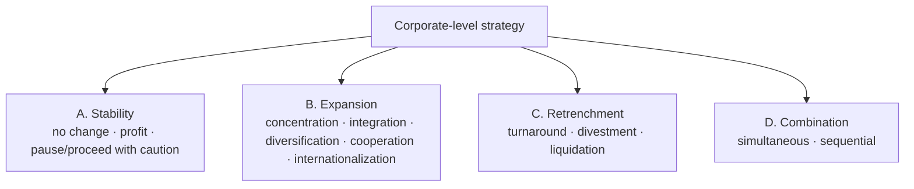

# Module III — Management: Exam Questions and Answers (HU-4101)

**Syllabus for the end-sem:** only the deck `4 - CORPORATE STRATEGIES.pptx` (129 slides), which was shared after the midsem. Everything in this file comes from that deck. The midsem topics (management concepts, Fayol, leadership styles) are not here.

Try each question yourself first. Then read the answer.

**How the end-sem asks management:**

- Mostly **case studies** (8–10 marks). Each case has sub-questions and says "attempt any two". There is often an OR between two cases.
- A set of short applied questions (2 marks each, about 6 marks in total).
- Sometimes a 4–5 mark theory question.

In this file, **Part A** has the short and theory questions, and **Part B** has the case studies.

**Tags used in this file:**

- 🎯 = asked in a real paper (the year and question number are given).
- ✍️ = a practice question, added so that every part of the deck is covered.
- 💡 = a short line to help you remember.

| Topic in the deck | Question |
| :--- | :--- |
| Vision and mission: definitions, examples, differences | A1, A2 |
| Goals and objectives: definitions, differences, types of goals | A3, A4 |
| SMART goals, areas of objectives, why objectives matter | A5 |
| Strategy and its three levels | A6 |
| Types of corporate-level strategy | A7 |
| Stability strategy | A8, B3(a) |
| Expansion strategy: meaning, reasons, five types | A9 |
| Concentration and Ansoff's matrix | A10, B2 |
| Integration: vertical (backward, forward, full, taper) and horizontal | A11, B3(c) |
| Diversification: related and unrelated | A12, B2 |
| Cooperation: M&A, joint venture, strategic alliance | A13, A14 |
| Internationalization (Bartlett–Ghoshal) | A15, B4 |
| Retrenchment: turnaround, divestment, liquidation | A16, B1, B3(b) |
| Combination: simultaneous and sequential | A17, B1, B3(b) |

---

## Part A — Short and theory questions (2–5 marks)

### A1. Define vision and mission. Give examples. ✍️ [3]

**Vision**

- A vision is a **picture of the future**. It describes the kind of place a person or a firm wants to create over a long time.
- It answers the question **"What will success look like?"**
- Chasing this picture of success is what **motivates people to work together**.
- In short: a vision says **what the firm would like to become**.

**Mission**

- A mission is the **basic purpose** of the firm: **why it exists**, what business it is in, and which customers it wants to serve.
- It is a **lasting statement of purpose** that makes one firm different from other, similar firms.
- It shows the firm's **scope**: which products and which markets it works in. (The deck says the mission names the product, market and technology areas the business focuses on.)
- In short: a mission says **what the firm is now**, and answers **"What is the company giving to society?"**

**Examples from the deck:**

- **Vision:**
  - BSNL: "To become the largest telecom service provider in Asia."
  - Walt Disney: "Make people happy."
  - Stokes Eye Clinic: "Our vision is to take care of your vision."
- **Mission:** Newport News Shipbuilding: "We shall build good ships here, at a profit if we can, at a loss if we must, but always good ships."
- **IIEST Shibpur:**
  - Vision: to become one of the best institutes in the world for multi-disciplinary research, building world-class technology for a developed India.
  - Mission: to create and spread knowledge; to produce engineers, scientists and entrepreneurs of the highest quality; and to develop new technology for society.

> 💡 Vision = the dream. Mission = the job we do every day.

### A2. How is a vision statement different from a mission statement? ✍️ [4]

| | Vision statement | Mission statement |
| :--- | :--- | :--- |
| What it is about | **where** the firm wants to be | **how** the firm will get there; its purpose and main aims |
| Question it answers | "Where do we aim to be?" | "What do we do? What makes us different?" |
| Time | the **future** (usually 5–10 years or more) | the **present**, leading to the future |
| Job | inspires people; tells them why they work here | lists the broad goals; mainly for leaders, the team and shareholders |
| Length | short | longer; often sums up the firm's values |
| Change | should change as little as possible | may change, but must stay tied to values, customer needs and the vision |
| Questions to ask when writing it | Where are we going? When do we want to get there? How? | What do we do today? For whom? Why? |
| A good one is | clear, hopeful, easy to remember, realistic, and in line with the firm's values and culture | clear about the firm's purpose and values, who its main stakeholders are, and what it owes them |

**How they fit together:** the vision describes the long-run goal. The mission is like a **road map** for reaching that goal.

> 💡 Vision = where. Mission = what, for whom and why.

### A3. What are goals and objectives? What are a business's objectives? ✍️ [3]

**Goals**

- Organisational goals are aims that top management sets to **show the expected results** and to **guide employees' efforts**.
- A goal is the expected result of planning. Goals are **broad and general**. They express the firm's guiding principles and hopes.
- A goal is usually **long-term**.

**Objectives**

- Objectives are **"the end results of planned activity."**
- They are **precise targets** needed to reach the goals. They are detailed statements of results that can be **measured**, in numbers (quantitatively) or in quality (qualitatively).
- An objective says **what** must be done and **by when**, in numbers if possible.
- Organisational objectives are **short-term and medium-term**. They shape the firm's policies and decide how its resources are shared out. Reaching them helps the firm reach its overall goals.

**Order:** goals serve the **mission**, and objectives serve the **goals**. So goals are higher than objectives.

**Objectives of a business:** what the business wants to achieve over a given period. For example:

- earn a profit, so it can grow;
- give customers good-quality goods;
- protect the environment.

> 💡 Mission → goals → objectives: each level serves the one above.

### A4. Differentiate between goals and objectives. What are the three types of organisational goals? ✍️ [4]

| | Goal | Objective |
| :--- | :--- | :--- |
| Definition | the direction and final destination that helps the firm reach its vision | the exact actions and steps the firm must take to reach its goals |
| How specific | a general aim or direction | specific and exact |
| Scope | broad | narrow |
| Size | large; the whole | small pieces; part of the whole |
| Action | a general result | specific, measurable steps |
| Measurement | hard; goals are often not in numbers | easy; must be measurable |
| Time | long term | short to medium term |
| Example | increase the number of international customers | win 28% more customers from the UK, Australia and Germany in the next 3 months |

**Three types of goals** (example: a retail company):

1. **Strategic goals:** set by and for **top management**. Long term.
   - Example: raise market share by 15% in the next three years.
2. **Tactical goals:** for **middle managers**. They say what actions are needed to reach the strategic goal.
   - Example: add new product categories, or improve existing ones.
3. **Operational goals:** for **lower-level managers**. Short term; they deal with day-to-day problems.
   - Example: raise the store's customer-satisfaction score by 10% this quarter, through better staff training, faster checkout and a better store layout.

> 💡 Strategic = top, years. Tactical = middle, months. Operational = bottom, weeks.

### A5. What are SMART goals? Name the areas where firms set objectives, and say why objectives matter. ✍️ [4]

A **SMART** goal is carefully planned, short and easy to track. It is:

- **S**pecific: says exactly what the person or business wants to achieve.
- **M**easurable: has numbers that show progress.
- **A**chievable: realistic. If it is not, people will be tempted to give up.
- **R**elevant: fits the firm's values and long-term objectives.
- **T**ime-based: has a deadline, which helps to track progress and set milestones.

SMART goals are more likely to be reached, and they bring the whole firm together behind them.

**Example (3M, Minnesota Mining & Manufacturing), financial objectives:**

- 10% growth in earnings per share;
- 20–25% return on equity;
- 27% return on capital employed.

**Twelve areas of objectives:**

1. markets
2. productivity
3. innovation
4. products
5. profitability
6. financial resources
7. physical facilities
8. organisation structure and activities
9. manager performance and development
10. employee performance and attitude
11. customer service
12. social responsibility

**Why objectives matter:**

1. They define the firm's place in its environment.
2. They help to coordinate decisions and the people who make them.
3. They help in forming strategies.
4. They give standards for judging the firm's performance.

### A6. What is strategy? Explain the levels of strategy. ✍️ [3]

**Strategy** is "a plan of action or policy designed to achieve a major or overall aim."

There are three levels. Picture a pyramid: **responsibility increases** as you go from the bottom to the top.

1. **Corporate level (grand strategies):** top management's overall plan for the whole firm and all its **strategic business units (SBUs)**. (An SBU is a part of the firm that runs as a separate business.)
   - It is the choice of **direction** the firm takes to reach its objectives.
   - It is the **blueprint for the firm's growth**, and sets the overall direction.
   - It decides **how far, how fast and when** the firm will grow.
   - It is the **highest level of decision-making**. Its decisions are more value-based and conceptual than at the levels below.
2. **Business level (generic strategies):** how each business or SBU competes in its own market.
3. **Functional or operational level:** how each function (production, marketing, finance, HR) supports the business.

> 💡 Corporate = which businesses? Business = how to compete? Functional = how to do each job?

### A7. What are the types of corporate-level strategy? Draw the classification. 🎯 2023 End Q4 (part) ✍️ [4]

- **A. Stability:** make no change to what the firm is doing now.
- **B. Expansion:** make the firm's activities bigger.
- **C. Retrenchment:** cut down the firm's activities.
- **D. Combination:** a mix of the three above.

> 💡 Stay, grow, shrink, or mix.

### A8. What is a stability strategy? When is it chosen, and what are its types? ✍️ [4]

**Meaning.**

- The firm **keeps its present strategy** at the corporate level. It keeps focusing on its present products and markets.
- It makes **no change** to its current activities. It keeps the same level of effort, and is happy with **slow, step-by-step (incremental) growth**.
- It does **not** invest in new factories and assets, chase a bigger market share, or enter new regions.
- Firms choose it when the industry has slow or no growth, or after a period of fast expansion, when they need to **consolidate** (settle and strengthen what they have) before growing again.

**Conditions that favour a stability strategy:**

1. The industry or the economy is disturbed; the environment is unstable and uncertain.
2. The environment is calm, and the firm sees no major threat to itself or its industry.
3. The firm has just grown fast and needs to consolidate its gains before growing more.
4. The firm's growth ambitions are modest; it is happy with slow growth.
5. The industry is **mature** (has few or no growth chances), and the firm is comfortably placed in it.

**Three types:**

1. **No-change strategy:**
   - A **conscious decision to do nothing new**, and carry on with the present business.
   - "Taking no decision is sometimes a decision too."
   - Used by many small and medium firms in a familiar, often narrow (niche) market, using proven technology.
2. **Profit strategy:**
   - No firm can follow a no-change strategy for ever. Things change, and it must do something.
   - When profits start to slip, the firm props them up with **short-term measures**: cut investment, cut costs, raise prices, or raise productivity, to get through a temporary difficulty.
3. **Pause/proceed-with-caution strategy:**
   - The firm **tests the ground** before moving ahead with a full new strategy, or **rests for a while** after very fast expansion.
   - It gives time for the changes to reach every level of the firm, and for its structure and systems to adjust.
   - It is a **temporary** strategy.
   - Example from the deck: Bata and Liberty, in a market dominated by global brands like Adidas, Nike and Reebok.

> 💡 Stability = hold, hold for profit, or hold and then move.

### A9. What is an expansion strategy? Why do firms choose it, and what are its types? ✍️ [4]

**Meaning.**

- Also called a **growth** or **intensification** strategy. It **expands the company's activities**.
- The firm aims at high growth by **widening the scope** of one of its businesses, in terms of:
  - its **customer groups** (who it sells to),
  - its **customer functions** (which needs it serves), and
  - its **alternative technologies** (how it makes things).
- It speeds up growth in sales, profit and market share, by entering new markets, getting new resources, developing new technology and building new management skills.

**Why firms choose a growth strategy:**

- to increase profits;
- to increase market share or sales;
- to increase their scale of operations;
- to lower the production cost per unit.

**Examples from the deck:**

- A chocolate maker whose customers are children and teenagers starts selling to **middle-aged and older people** too (a new customer group).
- A printing firm moves from old letter-press printing to **desktop publishing**, to raise output and efficiency (a new technology).
- In both cases, the firm moves in a new direction and **changes its present business definition** a lot.

**Five types of expansion:**

| Type | Sub-types | Question |
| :--- | :--- | :--- |
| B1. Concentration | market penetration, market development, product development | A10 |
| B2. Integration | vertical, horizontal | A11 |
| B3. Diversification | related (concentric), unrelated (conglomerate) | A12 |
| B4. Cooperation | mergers, takeovers, joint ventures, strategic alliances | A13, A14 |
| B5. Internationalization | international, multi-domestic, global, transnational | A15 |

> 💡 Concentrate, integrate, diversify, cooperate, go international.

### A10. Explain expansion through concentration, using Ansoff's product-market matrix. 🎯 2023 End Q5(a) [4]

**Ansoff's product-market matrix** was first given by **Igor Ansoff (1968)**. It helps a firm find ways to grow. It asks two questions: is the product present or new, and is the market present or new?

| Product ↓ / Market → | Present market | New market |
| :--- | :--- | :--- |
| **Present product** | Market penetration | Market development |
| **New product** | Product development | Diversification |

**Concentration** covers the first three boxes:

1. **Market penetration:** sell **more of the same products** in the **same market**. The firm believes there is still room to grow by pushing its current products in its current markets. Ways to do it:
   - get existing customers to buy **more often** and in **larger amounts** (volume discounts, bonus cards, keeping customers);
   - win **rivals' customers** (attractive design, quality, attractive price);
   - attract **new customers** in the same market (price cuts, better service, more publicity).
   - Example: Big Bazaar's "Wednesday Bazaar" discounts.
2. **Market development:** sell the **same products** in **new markets**. Ways to do it:
   - **new places:** regional, national or international expansion, through more sales staff, new channel partners, sales agents or manufacturer's representatives, and franchising;
   - **new customer groups (segments):** small changes to the product to suit a new group, other sales channels, or advertising in other media.
   - Example: the deck shows a Cadbury Dairy Milk advert aimed at adults, not just children.
3. **Product development:** sell **new or improved products** in the **same market**. Ways to do it:
   - develop new products;
   - make different or improved versions of current products;
   - change current products to suit what different customers like and dislike.
   - Examples: McDonald's keeps launching new burgers; Coca-Cola launched Diet Coke, Vanilla Coke and Ginger Coke to use the Coke brand; Google made the Chrome browser for existing internet users.

The fourth box, **diversification** (new product + new market), is the riskiest. See A12.

> 💡 Read the matrix from the safest corner (penetration) to the riskiest (diversification).

### A11. Explain integration strategies: vertical (backward, forward, full, taper) and horizontal. ✍️ [4]

**Integration** means joining activities that are **related to what the firm already does**. The firm chooses them using **value-chain analysis** (looking at each step that adds value, from raw material to the final customer).

**Vertical integration**

- The firm moves **backward** into the industry that makes its inputs, or **forward** into the industry that sells its products.
- In simple words: the firm starts making something that serves **its own needs**, either supplying its raw materials or selling its output.
- Picture the chain: commodity producers → suppliers → **manufacturer** → importers → stores → buyers.

Four types of vertical integration:

1. **Backward (upstream) integration:** moving **back towards the source** of raw materials.
   - Example: Nirma set up plants to make soda ash and linear alkyl benzene, the raw materials for its detergent.
2. **Forward (downstream) integration:** moving **ahead, nearer to the final customer**.
   - Example: DCM, Mafatlal and National Textile Corporation set up their own retail shops, to control how their cloth is sold.
3. **Full integration:** the firm owns **all** the steps: its own suppliers, its own factory and its own distributors.
4. **Taper integration:** a middle path between full integration and none (the slide spells it "tapper"). The firm:
   - makes **part** of what it needs and buys the rest from outside suppliers (backward integration plus outside supplies); or
   - sells **part** through its own outlets and the rest through independent distributors (forward integration plus outside distribution).

**Horizontal integration**

- Getting more business **in the same line of business**, at the **same stage** of the value chain: the same type of product, at the same level of making or selling.
- It can come from growing inside the firm, or from **mergers and acquisitions** of firms that sell similar products.
- Examples:
  - Aditya Birla Group bought L&T's cement business.
  - IDBI Bank took over United Western Bank. Its branches went up from 181 to 410. It added farm loans to its industrial loans, and got cheaper deposits.
  - Vodafone–Idea, Marriott–Starwood, Arcelor–Mittal, Exxon–Mobil, JP Morgan Chase.

| | Vertical | Horizontal |
| :--- | :--- | :--- |
| Direction | up or down the supply chain | sideways, at the same stage |
| Goal | control over inputs or over selling | bigger scale, more market share, less competition |
| Example | Nirma making its own soda ash | IDBI taking over United Western Bank |

> 💡 Vertical = up and down the chain. Horizontal = buy the shop next door.

### A12. What is diversification? How is related diversification different from unrelated diversification? When is it a good idea? ✍️ [4]

**Diversification** means moving into **new lines of business**: new products for new markets (the fourth box of Ansoff's matrix). It means a **big change in the firm's business definition**. Example: L&T.

**1. Related (concentric) diversification.** The new activity is **linked** to the existing business. Three types:

- **Marketing-related:** a sewing-machine maker adds kitchenware and household appliances, sold through the same retail shops to the same families.
- **Technology-related:** an insurance company that insures institutions starts insuring individuals too.
- **Marketing- and technology-related:** a maker of plastic water tanks also makes plastic doors and windows, sold through its hardware dealers.
- Example: Amul moved from dairy (milk, drinks and desserts, bread spreads, cheese) to non-dairy products (vegetable oils, snacks, instant food).

**2. Unrelated (conglomerate) diversification.** The new activities have **nothing to do** with the existing business. The firm adds new products, using new technology, in new markets.

- ITC: agribusiness, FMCG (fast-moving consumer goods), hotels, IT, tyres.
- Aditya Birla Group: aluminium, outsourcing, cement, chemicals, copper, gas, mining, retail, software, telecom, textiles.
- Tata: engineering, services, materials, energy and communications, IT, consumer products, chemicals.

**When diversification is a good idea:**

- to raise the firm's share price;
- to raise its growth rate;
- when investing is a better use of money than growing internally;
- to make earnings and sales more stable;
- to balance or fill out the product line;
- to diversify the product line;
- to get a needed resource quickly;
- to save tax;
- to raise efficiency and profit.

> 💡 Related = same family. Unrelated = a stranger.

### A13. Explain expansion through cooperation. How are a merger, an acquisition, a joint venture and a strategic alliance different? ✍️ [5]

**Cooperation**

- Normally, one firm gains at the cost of others. It is a **win-lose** situation: if one wins, others lose.
- But **competition can live side by side with cooperation**. Firms can cooperate with rivals while still competing with them, so that the whole market grows.
- This is called **co-opetition**: competing and cooperating at the same time, for the good of both.
- The key idea is that rival firms often have interests that **fit together** (complementary interests).

A **cooperative strategy** is one where firms **work together to reach a shared objective**. Cooperating is a good strategy when it:

- creates value for a customer;
- costs less than creating that value in other ways;
- puts the firm in a better position than its competitors.

**Three types:** (i) mergers and acquisitions (takeovers), (ii) joint ventures, (iii) strategic alliances.

**Mergers and acquisitions (M&A)**

A merger combines two or more organisations. Either:

- one firm takes over the other's assets and liabilities, paying with shares or cash; or
- both firms are dissolved, their assets and liabilities are combined, and new shares are issued.

For the firm that buys, it is an **acquisition**. For the firm that is bought, it is a **merger**.

**Types of merger** (using a footwear firm as the example):

| Type | Meaning | Example |
| :--- | :--- | :--- |
| Horizontal | same industry, similar products | footwear firm + footwear firm |
| Vertical | same product, different stages of making it | footwear firm + leather tannery |
| Concentric | related customer needs or customer groups | footwear firm + specialty footwear firm |
| Conglomerate | different industries | footwear firm + medicine (pharmaceutical) firm |

**Why firms do M&A:**

- to reduce competition;
- to grow faster and gain market share;
- to raise the value of the firm's shares;
- to get a needed resource quickly;
- to gain **synergy** (together they are worth more than apart);
- to get resources that keep operations stable;
- to get economies of scale.

**The four compared:**

| | Merger | Acquisition | Joint venture | Strategic alliance |
| :--- | :--- | :--- | :--- | :--- |
| Who | usually two firms of equal size | a large firm takes over a smaller one | two or more firms form a **new firm** for a task or a period | two or more firms **agree** to support each other |
| Nature | voluntary and friendly; a **stock swap** (both give up their shares and get shares of the new firm) | often forceful or unfriendly: the buyer offers the target's shareholders a better price | always friendly; one partner gets money, management help and technology from the stronger partner | aims to make the firms more efficient; **no equity** (ownership) investment |
| The parent firms | stop existing | stop existing | keep working in their own areas | keep working normally, supporting each other |

> 💡 The parent firms survive in a joint venture and an alliance, but not in a merger or an acquisition.

### A14. Explain joint ventures and strategic alliances, and their types. ✍️ [4]

**Joint venture (JV)**

- A **new entity** formed by two or more parties under a **long-term contract**, to do a specific activity together.
- The parties put in money (equity) and share its income, expenses and control, and its **profits and losses**.
- It can be for **one project only**, or for a **continuing** business relationship.
- Unlike a merger, the **parent firms do not stop existing**.
- Examples: Sony Ericsson; Samsung and Sony's S-LCD.

**Types of JV by who the partners are** (Indian examples from the deck):

| Partners | Example |
| :--- | :--- |
| two Indian firms in the **same industry** | NTPC + Indian Railways = Bharatiya Rail Bijlee Company |
| two Indian firms in **different industries** | ActionAid India + TISS = degree courses in rural India |
| an Indian and a foreign firm, **in India** | DLF + Nakheel (UAE) = two integrated townships in India |
| an Indian and a foreign firm, **in that foreign country** | Kirloskar Pumps + SPP Pumps (UK) = serving the EU market |
| an Indian and a foreign firm, **in a third country** | Apollo Tyres + Continental AG (Germany) = tyre plant in Malaysia |

**Types of JV by purpose:**

1. **Project-based:** the partners join to finish one particular task.
2. **Vertical:** the partners work at different stages of the same product.
3. **Horizontal:** the partners are competitors.
4. **Functional-based:** the partners join for a benefit to both, from the synergy between them.

**Strategic alliance**

- An agreement between two or more parties that they will **act in a certain way to reach a common goal**, while **each stays independent**.
- It is simpler and **less binding** than a JV. In a JV the firms pool resources to create a separate business; in an alliance they do not.
- Partners may bring: **products**, **distribution channels**, **manufacturing capability**, and **knowledge and expertise**.
- Examples:
  - Barnes & Noble with Starbucks (coffee shops inside bookshops);
  - Vodafone India with ICICI Bank (m-pesa mobile money);
  - MasterCard with Apple Pay;
  - Chevrolet with Disney (the Test Track ride at EPCOT, Walt Disney World).

**Alliance vs JV in one line:** in an alliance each firm stays independent; in a JV the firms **share the risks** of the venture.

**Types of strategic alliance:**

- **Equity alliance:** two or more firms own **different percentages** of a company they set up together, combining their resources.
  - Example: Panasonic invested USD 30 million in Tesla's battery work. This grew into a lithium-ion battery plant in Nevada.
- **Non-equity alliance:** firms only sign a **contract** to share resources and skills. No one owns a share.
- **Pro-competitive alliance:** along the value chain, between makers and their suppliers (vertical).
- **Non-competitive alliance:** firms in the same industry that do not compete, for example because they are in different regions.
- **Competitive alliance:** two **rivals** cooperate closely.
- **Pre-competitive alliance:** firms from **different industries** work together on a clear task, such as new technology.

> 💡 JV = a new baby company. Alliance = a handshake.

### A15. Explain expansion through internationalization, using the Bartlett–Ghoshal model. 🎯 2024 End Case 4 (theory part) [5]

**Internationalization** means selling the firm's products or services **beyond its home country**. A firm that operates in more than one country is a **multinational corporation (MNC)**, such as Kia or Walmart. It must choose an international strategy.

**Two pressures** decide the choice (the **C. A. Bartlett and S. Ghoshal** model):

1. **Cost reduction:** the need to keep costs low and be efficient.
2. **Local responsiveness:** the need to suit each country's tastes and market conditions (quick response, or a different product).

Each pressure can be low or high. This gives four strategies:

| Cost pressure ↓ / Local responsiveness → | Low | High |
| :--- | :--- | :--- |
| **High** | **Global** | **Transnational** |
| **Low** | **International** | **Multi-domestic** |

1. **International strategy (low cost pressure, low local pressure):**
   - The firm sells its product abroad with **little or no change**, and does not cut its price.
   - Buyers want it **because** it is different from local products.
   - Examples: Harley-Davidson (people abroad want the American look, sound and power); Belgian chocolate in the US (no price cut against Hershey's, no change in taste); Starbucks; Rolex.
2. **Multi-domestic strategy (low cost pressure, high local pressure):**
   - The firm **changes the product to suit each country**, but does not focus on cost.
   - Examples: Netflix makes shows for each country (New Zealand, Portugal, Pakistan, India); Heinz sells ketchup without onion and garlic in India; Outback Steakhouse adapts to local tastes but does not cut prices much.
3. **Global strategy (high cost pressure, low local pressure):**
   - The firm gives up local changes to get **low cost and efficiency**. It is the exact **opposite of multi-domestic**.
   - It sells **the same product everywhere**, with only small changes, to get economies of scale.
   - Examples: Microsoft (the same software, only the language changes); Procter & Gamble's global brands; Intel; Lenovo.
   - It suits products the customer does not see (like Intel's chips), where price matters more than local taste.
4. **Transnational strategy (high cost pressure, high local pressure):**
   - The **middle path** between multi-domestic and global. It balances low cost with local tastes.
   - Example: McDonald's and KFC keep the same brand and core menu everywhere, but add local touches. McDonald's sells wine in France and the McArabia chicken sandwich in Saudi Arabia, where its breakfast has no pork.

> 💡 Transnational = "think global, act local".

### A16. What is a retrenchment strategy? Explain turnaround, divestment and liquidation. 🎯 2025 End Case 1 (theory part) [4]

**Retrenchment** means **reducing the company's level of activities**: cutting operations or expenses to get back to a **financially stable** position. Firms use it because of an economic slowdown, losses or legal trouble. It is used to **downsize** or **restructure** the business.

**1. Turnaround strategy**

- The firm **reverses its earlier wrong decisions** and makes a loss-making unit profitable again.
- Firms often ignore some units, which then sink into losses. When they see the mistake, they use turnaround to put the unit back on track.
- **Three major steps:**
  1. change in management;
  2. cost reduction;
  3. asset reduction.

**2. Divestment strategy**

- The firm **downsizes or sells a business unit**, to focus on its core and use the money to grow the core business.
- Examples:
  - **VST** sold its food business (VST Natural Products) to the Thapar group's Global Green Company. Reasons: raw materials were not available, there was not enough working capital, and the parent was itself making a loss.
  - **Indian Organic Chemicals** sold its "Futura" foods unit (potato wafers and banana chips) in 1989. Reasons: unfair competition from the unorganised sector, technology problems, a factory mindset in a business that needed marketing skill, and lack of funds.
  - **GEC of India** sold Genelec, a trading company, in 1987, within a year of a change in top management. Reasons: no money to invest in Genelec, and the sale gave funds for GEC's own expansion.

**3. Liquidation strategy**

- The firm **sells off its assets or closes a unit**. Liquidation = **bankruptcy**.
- It is the **worst** form of retrenchment and the **final resort** for a declining company. Business, jobs, opportunities and brand value are all lost.
- Causes: continuous losses, unstable politics, conflicts inside the company, poor management.
- Example: **Empress Mills, Nagpur** (Tata), liquidated in 1986:
  - for nearly 50 years it did not modernise or keep up with competition;
  - government policy was not good for cotton textiles;
  - a plan to merge it with other Tata textile units failed, and so did a voluntary retirement scheme for its 6,000 workers;
  - banks delayed a rescue package, and the state government gave no political support.
  - **Lesson:** if action is not taken in time, even the largest business group cannot save a company.

**Divestment vs liquidation:** in divestment, the firm sells a **non-core** business and uses the money for its **core** business, and **the firm carries on**. In liquidation, it sells the unit and **closes the door**.

> 💡 Turnaround = fix it. Divestment = sell a part. Liquidation = shut it down.

### A17. What is a combination strategy? Give examples. 🎯 2025 End Part B Q2 (theory) [3]

A **combination strategy** is a **mix of stability, expansion and retrenchment**, to improve the business. The mix can happen:

- **at the same time, in different businesses** (simultaneous), or
- **at different times, in the same business** (sequential).

**1. Simultaneous combination:**

- sell off one SBU or product line while adding another one somewhere else;
- turn around some products or businesses while growing others;
- "harvest" some products (take their cash without investing more) while growing others.

**2. Sequential combination:**

- first grow, then switch to stability; or
- first turn around, then grow once things improve.

**Examples:**

- **ITC:** a diversified conglomerate (FMCG, hotels, paperboards and packaging, agribusiness, IT).
  - Started in 1910; backward integration into packaging and printing in 1925.
  - Diversified into hotels in 1975 and agribusiness in 1990.
  - Turnaround of the speciality-paper business Triveni Tissues after acquiring it and merging it with its paperboards business.
  - Divested its financial-services business.
- **Aditya Birla Group:** has used almost every corporate strategy since 1857.
  - Acquired Novelis, becoming the world's largest aluminium rolling company.
  - Has several joint ventures abroad (South East Asia, China).
  - Has diversified, divested, acquired, merged and demerged (split) businesses along the way.

> 💡 Combination = do two things at once, or one after the other.

---

## Part B — Case studies (8–10 marks)

> The full case texts for B1–B4 are not in this folder. Only their summaries in the past-paper solution files are. The facts below are the well-known public history of each company. In the exam, use the facts given in the paper, and link them to the same strategy terms.

### B1. 🎯 2025 End Case 1 — How Nokia reinvented itself [10]

**Case (summary).** Nokia once led the mobile-phone market, and then lost it to smartphones. It reinvented itself as a company that makes telecom networks and technology.

- **(a)** Evaluate Nokia's change using retrenchment, turnaround and renewal strategies.
- **(b)** Suggest a combination strategy for its future in 5G and AI.

**(a) Answer.**

1. **Retrenchment through divestment.** Nokia sold its phones and services business to Microsoft (2013–14). This business was no longer core and was losing money. The cash went into the core business. Liquidation was avoided: the firm carried on, and only one part was sold.
2. **Turnaround.** All three steps from the deck happened:
   - *change in management:* a new CEO and a new board;
   - *cost cutting:* restructuring and job cuts;
   - *reducing assets:* selling the phone business and the HERE maps business.
3. **Renewal and expansion.**
   - *Horizontal integration through acquisition:* Nokia bought Siemens's half of Nokia Siemens Networks, and bought Alcatel-Lucent (2016), to become bigger in network equipment.
   - *Licensing* the Nokia phone brand to HMD Global. This is an alliance-type deal with no ownership (non-equity).
   - *Licensing its patents* to other firms, as a new source of income.
4. **Evaluation.** Retrenchment saved the firm, and the acquisitions renewed it. The price was losing its consumer brand and several years of weak growth.

**(b) Answer: a combination strategy.**

- **Simultaneous (at the same time, in different parts of the business):**
  - *Expansion* in 5G and AI: develop 5G radio products and private wireless networks for factories (product development), and AI-based network software.
  - *Strategic alliances and joint ventures* with telecom operators, chip makers and cloud firms (co-opetition).
  - *Stability (profit strategy)* in the older, mature network product lines.
  - *Divestment* of units that have no future.
- **Sequential (one after another):** first consolidate after the turnaround (pause/proceed with caution), then grow.
- **International strategy: transnational.** Global 5G platforms give scale and low cost, while local changes suit each telecom operator and each country's regulator.

> 💡 Nokia = divest → turn around → integrate → grow (a sequential combination).

### B2. 🎯 2025 End Case 2 (OR) — Reliance Industries: diversification and divestment [10]

**Case (summary).** Reliance grew from textiles into petrochemicals and oil refining, and then into telecom (Jio), retail and new energy.

- **(a)** Analyse its diversification using Ansoff's product-market matrix.
- **(b)** Assess a strategy of selectively selling off (divesting) parts of its fossil-fuel business.

**(a) Answer: Ansoff's matrix.**

| | Present market | New market |
| :--- | :--- | :--- |
| **Present product** | **Market penetration:** more refining and petrochemical capacity, and more exports to existing buyers | **Market development:** fuels and plastics (polymers) sold to new countries and customer groups; its own fuel pumps |
| **New product** | **Product development:** new polymers, speciality chemicals, branded fuels | **Diversification:** Jio telecom and digital services; Reliance Retail; green energy (solar, batteries, hydrogen) |

- **The early moves were backward vertical integration:** textiles → polyester → the raw materials for polyester → oil refining. These are **related** diversification.
- **Jio, Retail and New Energy are unrelated (conglomerate) diversification:** new technology and new customers.
- Jio entered the market with very low prices (**penetration pricing**). Later it formed **strategic alliances**, selling small stakes to Facebook (Meta) and Google.
- **Assessment:**
  - **Good:** earnings stay stable through ups and downs, and cash from oil pays for the new businesses.
  - **Bad:** the risk is high and a lot of capital is needed.
  - These moves match the deck's reasons for diversifying: faster growth, more stable earnings, better use of funds, and getting resources quickly.

**(b) Answer: selective divestment.**

- **What it means:** sell, or reduce its share in, assets that are not core or that produce a lot of carbon. For example, sell a stake in the oil-to-chemicals business to a strategic partner. Use the cash for green energy, digital and retail. This is **divestment, not liquidation**: the core business continues.
- **Why do it:** the world is moving away from fossil fuels (the energy transition), carbon rules are getting stricter, it lowers debt, and it releases value for shareholders.
- **Risks:**
  - fossil fuels still bring in most of the cash;
  - selling too fast would starve the new businesses of money;
  - the benefit depends on getting a good price.
- **Verdict: use a combination strategy:**
  - a *profit or stability* strategy for the refining business, which brings in the cash;
  - *gradual divestment* of high-carbon assets;
  - *expansion* in new energy;
  - done **sequentially**, as the green businesses grow large enough.

### B3. 🎯 2025 End Part B — Three applied situations [2 × 3]

**(a) A firm in a saturated market (where demand has stopped growing) decides not to expand. Which strategy is this, and is it sensible?**

- This is a **stability strategy** (a no-change strategy, or a profit strategy).
- The deck says this suits a firm in a **mature** industry with few chances to grow, when the firm is comfortably placed.
- It is sensible in the short run. But the firm should keep looking for new markets, because "no organisation can continue indefinitely with a no-change strategy".

**(b) A car maker closes a poorly performing factory while investing in electric-vehicle (EV) production. Name the strategy.**

- This is a **simultaneous combination strategy**.
- It is **retrenchment** (closing or selling off the weak factory) plus **expansion** (product development or diversification into EVs), both at the same time, in different units.

**(c) Under pressure from competition, should a firm integrate vertically or horizontally?**

- **Vertical integration** (backward into making parts, or forward into owning dealers) secures inputs and profit margins, and makes the firm less dependent on suppliers.
- **Horizontal integration** (buying a rival) gives scale, market share and cost savings, and reduces competition.
- **Which to choose depends on where the pressure comes from:**
  - if it comes from **price wars with rivals**, horizontal integration fits;
  - if it comes from **powerful suppliers or problems with distribution**, vertical integration fits.
- Use the comparison table in A11.

### B4. 🎯 2024 End Case 4 — Sun Pharma's international strategy [8]

**Case (summary).** About Indian MNCs abroad. Explain how Sun Pharmaceuticals follows a **transnational strategy**, balancing the same product everywhere (standardisation) with changes for each country (local responsiveness).

**Answer.**

1. **The model.** In Bartlett–Ghoshal terms, the medicine (pharma) business faces **both** pressures at once:
   - *Cost pressure:* generic medicines compete on price. So large-scale manufacturing, shared R&D and global supply chains matter.
   - *Local pressure:* the rules for approving drugs (the US FDA and others), doctors' preferences, pricing rules and common diseases are different in each country.
   - High cost pressure + high local pressure = **transnational**.
2. **The standardisation side:**
   - large factories that make the same medicines (molecules) for many markets;
   - central R&D and central know-how on regulations;
   - global brands for generic medicines;
   - **acquisitions** for scale: Ranbaxy (2014), Taro (Israel) and specialty businesses in the US. These are horizontal integration.
3. **The local-responsiveness side:**
   - branded generics, marketed through doctors, in India and other emerging markets;
   - specialty drugs for the US market;
   - local factories, partners and teams;
   - approval documents (dossiers) written to suit each country's regulator.
4. **Why not the other three strategies:**
   - *Global* would ignore local rules and local brands.
   - *Multi-domestic* would lose the cost advantage that Indian generic medicines are built on.
   - *International* (exporting the product unchanged) could not pass foreign regulators or win over local doctors.
5. **Risks:**
   - regulators sending warning letters about factories;
   - falling prices for generic medicines in the US;
   - the difficulty of running both sides at once.

> 💡 Same core, local outer layer: McDonald's does it in food, Sun Pharma does it in medicine.
