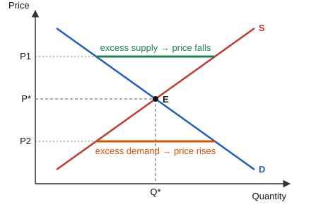
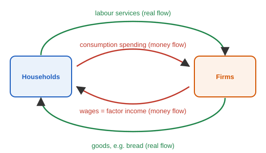

# Module II — Economics: Exam Questions and Answers (HU-4101)

Companion to [Finance_Economics_and_Management_Midterm_Study_Guide.md](Finance_Economics_and_Management_Midterm_Study_Guide.md), sections 1–2 (demand and supply, national income, the Keynesian cross, money and banking). Try each question first, then read the answer.

**Pattern (end-sem):** economics questions are short and come in many small parts: Part A = 1–3 marks (definitions, one-line reasons, small calculations); Part B = 4–7 marks (a graph with explanation, a GDP/GNP calculation, a multiplier argument), usually with an OR.
**Tags:** 🎯 real paper (year, question; HU-4201 = the 8th-semester paper of the same course); ✍️ practice to cover the notes; 📘 beyond the notes. 💡 = memory hook.
**Microeconomics (post-midsem):** marginal utility, indifference curves, the Lagrangian, production and cost are in [Module_II_Microeconomics_QA.md](Module_II_Microeconomics_QA.md).
**Not in the notes yet:** past end-sems also asked the Phillips curve and demand-pull vs cost-push inflation in detail.

| Topic in the guide | Question |
| :--- | :--- |
| Scarcity, micro vs macro (§1.1) | A1 |
| Demand: law, determinants, shifts, elasticity (§1.2) | A2, A3, A4, B1 |
| Supply, equilibrium, shocks (§1.2–1.3) | B1 |
| Circular flow of income (§2.1) | A5, B2 |
| GDP: definition, nominal vs real, deflator, base year (§2.2) | A6, A7, A8, B3 |
| C + I + G + NX, GNP, factor cost, NNP (§2.2) | B3, B4 |
| Consumption function, Keynesian cross, stability (§2.3) | A11, B5 |
| Multipliers: government spending, tax, investment (§2.3) | A11, B6 |
| Money: functions, M1–M4, motives, inflation (§2.4) | A9, A10, A12, A13 |
| Central vs commercial banks, credit creation (§2.4) | B7 |
| Fiscal vs monetary policy (§2.4) | B8 |

---

## Part A — Short questions (1–3 marks)

### A1. What is the basic economic problem? Distinguish microeconomics from macroeconomics. ✍️ [2]

**Economic problem:** human wants are unlimited, but resources (land, labour, capital, time) are **scarce** (limited). They also have **alternative uses**: each can be used in many ways. So society must choose how to use (allocate) them. A good is scarce when, at zero price, people would want more than there is. Food grain is scarce; rotten eggs are not, because no one wants them.

- **Microeconomics** studies **individual** units: one consumer's choice, one firm's price and output, one market.
- **Macroeconomics** studies the **whole economy**: GDP, national income, the general price level (inflation), unemployment, growth.

> 💡 Micro = one tree; macro = the forest.

### A2. State the law of demand. On what does the demand for a good depend? 🎯 2024 End Q1, 2025 Mid Q4 [1 + 2]

**Law of demand:** if other things stay the same (*ceteris paribus*), the quantity demanded of a good **falls when its price rises** and **rises when its price falls**. So the demand curve slopes **downward**.

Demand for good x depends on:

$$q_x = f(P_x,\ M,\ P_y,\ \text{tastes})$$

- $P_x$: its own price;
- $M$: the consumer's income;
- $P_y$: prices of related goods (substitutes such as tea and coffee, complements);
- tastes and preferences, including the **bandwagon effect** (buying because others are buying).

**Desire vs demand:** a desire is only a wish; **demand** is a desire backed by the **ability and willingness to pay**.

> 💡 Price up, quantity down, all else fixed.

### A3. Distinguish a movement along the demand curve from a shift of the demand curve. ✍️ [2]

- **Movement along the curve** (change in **quantity demanded**): caused **only by the good's own price**. A fall in price moves the buyer down the same curve to a larger quantity.
- **Shift of the curve** (change in **demand**): caused by any **other** factor. A rise in income, a rise in the price of a substitute or a favourable change in tastes shifts the whole curve **right** (more is bought at every price); the opposite changes shift it **left**.

> 💡 Own price moves you along; anything else moves the line.

### A4. What does the slope of a demand curve tell us about price sensitivity? ✍️ [2]

- **Flat curve (elastic demand):** a small price change causes a **large** change in quantity. Buyers are very sensitive. There are close substitutes, or the good is not essential (for example, a brand of soft drink).
- **Steep curve (inelastic demand):** even a large price change hardly changes quantity. The good is essential with no substitute (for example, life-saving medicine).

> 💡 Flat = sensitive buyers; steep = they buy anyway.

### A5. Answer about the circular flow model. 🎯 2023 Mid Q2, 2025 Mid Q1(a) [1 + 1 + 1]

**(a)** Factor payments (wages) are made to **(ii) households**, because households own the factors of production (labour).
**(b)** Without leakages and injections, the income flowing round the system remains **(i) constant**.
**(c)** Why is it constant? Firms pay **all** their revenue to households as factor income, and households **spend all** of it on firms' goods. Nothing leaks out (no saving, taxes or imports). Nothing extra comes in (no investment, government spending or exports). So the same amount keeps going round.

> 💡 No leak, no injection, no change.

### A6. Define GDP. Is the sale of your three-year-old mobile phone counted in this year's GDP? Why are last year's goods not counted? 🎯 2024 Mid Q1(a, b), 2023 Mid Q1(b) [1 + 1 + 1]

**GDP (gross domestic product):** the total **market value** of all **final goods and services** produced **within the domestic territory** of a country during a given period (usually a year).

$$\text{GDP} = P_1q_1 + P_2q_2 + \dots + P_nq_n$$

- **Used phone: not counted.** GDP measures **current production**. The phone was made (and counted) three years ago. Reselling it only changes the owner; nothing new is made. (A dealer's commission on the sale would count, because it is a service given now.)
- **Last year's goods** were already counted in last year's GDP. Counting them again would be **double counting**, and this year's production would look bigger than it really is.
- Only **final** goods are counted. Intermediate goods (goods used to make other goods, like flour used by a baker) are already inside the price of the final good.

> 💡 GDP counts what is made this year, inside the border, once.

### A7. GDP vs GNP. What can you infer if a country's GDP is much lower than its GNP? 🎯 2023 Mid Q1(a), 2024 Mid Q1(c) [2 + 1]

| GDP | GNP |
| :--- | :--- |
| production **inside the country's borders**, by anyone (citizens or foreigners) | income earned by the country's **citizens and firms**, anywhere in the world |
| a foreign firm's factory in India counts in India's GDP | an Indian firm's earnings abroad count in India's GNP |

$$\text{GNP} = \text{GDP} + \text{NFIA}$$

NFIA (net factor income from abroad) = factor income earned by residents abroad − factor income paid to foreigners at home.

**GNP much higher than GDP** means NFIA is large and positive. The country's people earn much more abroad than foreigners earn inside it. It is likely a country with many **workers abroad sending money home** (remittances) or large investments abroad, and fairly small production at home. For example, Pakistan (GNP > GDP, remittances); India and China have GDP > GNP.

> 💡 Domestic = where; national = who.

### A8. What is the purpose of fixing a base year? Define the GDP deflator. 🎯 2024 End Q4, 2023 Mid Q3 [2 + 2]

**Base year:** nominal GDP can rise just because **prices** rise, even if no extra goods are made. So we value every year's output at the **same, fixed prices** of one chosen year, the base year. This removes the effect of price changes. The change that is left in GDP shows the real change in **quantity produced**. That is real GDP, and it lets us compare output across years.

**Example (2023 Mid Q3).** Country X produces apples and oranges; base year 2020.

| Good | 2023 price | 2023 output | 2020 price |
| :--- | ---: | ---: | ---: |
| Apples | ₹20 | 100 kg | ₹5 |
| Oranges | ₹12 | 150 kg | ₹8 |

- Nominal GDP 2023 = 20 × 100 + 12 × 150 = 2,000 + 1,800 = **₹3,800**
- Real GDP 2023 (2020 prices) = 5 × 100 + 8 × 150 = 500 + 1,200 = **₹1,700**

**GDP deflator** = (nominal GDP ÷ real GDP) × 100 = 3,800/1,700 × 100 = **223.5**. It is a price index (a measure of the price level) for **all** goods produced in the economy. Here, prices have risen about 124% since 2020.

> 💡 Nominal = today's prices; real = base-year prices; deflator = their ratio.

### A9. State the functions of money. Which functions do cash, Bitcoin and real estate perform? 🎯 2025 Mid Q3(a), 2023 Mid Q5 [1 + 3]

Money removes the problems of **barter** (swapping goods directly): you must find someone who has what you want and wants what you have (double coincidence of wants); there is no common measure of value; and many goods cannot be stored. Its functions:

1. **Medium of exchange:** accepted in payment for everything.
2. **Unit of account:** a common measure in which all prices, GDP and debts are expressed.
3. **Store of value:** holds purchasing power for the future (weakened by inflation).

| Item | Medium of exchange | Unit of account | Store of value |
| :--- | :---: | :---: | :---: |
| Cash | ✓ | ✓ | ✓ (loses value with inflation) |
| Bitcoin | weak: few sellers accept it | ✗: prices are not quoted in it | partly: held as an asset, but its price swings a lot (volatile) |
| Real estate | ✗: cannot buy groceries with land | ✗ | ✓: keeps value, but is hard to turn into cash quickly (illiquid) |

> 💡 Exchange, account, store: only cash does all three well.

### A10. What do M1, M2, M3 and M4 mean? What is broad money? 🎯 HU-4201 2024 Mid Q2 (OR) [2]

The RBI measures the money supply in four steps:

- **M1 (narrow money)** = currency with the public + demand deposits with banks;
- **M2** = M1 + savings deposits with post-office savings banks;
- **M3 (broad money)** = M1 + **time (fixed) deposits** with banks;
- **M4** = M3 + all deposits with post-office savings banks (excluding National Savings Certificates).

**Broad money (M3)** includes fixed deposits, which cannot be spent at once. It is the most used measure of money supply. Liquidity (how quickly money can be spent) falls from M1 (most liquid) to M4 (least liquid).

> 💡 M1 = spendable now; each step adds less liquid deposits.

### A11. What is the marginal propensity to consume? If the investment multiplier is 5, find the MPC. What happens to the multiplier if the MPC rises? 🎯 HU-4201 2024 Mid Q2, HU-4201 2025 Mid Q5, 2023 End Q7 [1 + 2 + 2]

Keynes's consumption function: $C = a + bY$, where $a$ = autonomous (subsistence) consumption, spent even at zero income, and $b$ = **MPC**.

**MPC** = the fraction of each **extra** rupee of income that is spent on consumption: $b = \Delta C/\Delta Y$, with $0 < b < 1$.

**Investment multiplier:** a rise in investment raises income by a multiple of itself, $k = \dfrac{1}{1 - b}$. This is because each round of spending becomes someone's income, and part of it is spent again.

$$5 = \frac{1}{1 - b} \Rightarrow 1 - b = 0.2 \Rightarrow b = 0.8$$

**If MPC rises**, people spend again a larger share in every round, so the **multiplier gets bigger**: MPC 0.75 → k = 4; MPC 0.8 → k = 5; MPC 0.9 → k = 10. Since $0 < b < 1$, the multiplier is always greater than 1.

> 💡 The more people re-spend, the bigger the multiplier.

### A12. Why do people hold money instead of bonds (Keynes's motives)? ✍️ [3]

1. **Transaction motive:** to pay for everyday purchases between one payday and the next.
2. **Precautionary motive:** to meet emergencies (illness, accidents, job loss).
3. **Speculative motive:** if interest rates are expected to **rise**, bond prices will **fall**. Holding cash now avoids that loss, and the person can buy bonds cheaper later.

> 💡 Spend, save for a rainy day, wait for a bargain.

### A13. Define inflation and state its causes. 🎯 2025 Mid Q3(b) [2]

**Inflation** is a **sustained** (steady, lasting) **rise in the general price level**. So each rupee buys less, and money loses value as a store of value.

Causes:

- **Demand side:** total demand exceeds what the economy can produce, for example, a fast increase in money supply, large government spending, easy credit ("too much money chasing too few goods").
- **Cost side:** production costs rise, for example, higher oil prices, wages or raw material costs, and firms pass them on as higher prices.
- **Supply shocks:** war, sanctions or crop failure reduce supply, so prices jump.

> 💡 Demand pulls prices up; costs push them up.

---

## Part B — Longer questions (4–7 marks)

### B1. 🎯 2025 Mid Q4 (OR) + 🎯 2023 End Q8

**(a)** Show how the equilibrium price is determined in a market using demand and supply curves. **[3]**
**(b)** An individual's income rises. What happens to the equilibrium price? Explain with demand and supply curves. **[4]**

**(a) Answer.**

- **Demand curve D** slopes down (law of demand). **Supply curve S** slopes up: a higher price gives sellers more profit, so they supply more ($q_s = f(P, \text{technology}, \dots)$).
- **Equilibrium** is where they cross, at E: quantity demanded = quantity supplied. This gives the equilibrium price P* and quantity Q*.
- **Above P*** (for example, P1): sellers offer more than buyers want. Unsold stock piles up (**excess supply**). Sellers cut prices until P* is reached.
- **Below P*** (for example, P2): buyers want more than there is (**excess demand**, a shortage). Buyers push the price up and sellers supply more, until P* is reached.

So price is set by **both** cost (behind supply) and demand, not by cost alone. For example, a soft drink costs little to make but sells high because demand is strong.

**(b) Answer.**

For a normal good (one people buy more of when richer), higher income raises demand at every price. So the demand curve **shifts right** (D → D′). Supply does not change.

1. At the old price P*, demand is now greater than supply: **excess demand**.
2. Buyers compete for the limited goods and the price is bid **up**.
3. The higher price makes producers supply more (a **movement along** the supply curve).
4. A new equilibrium E1 is reached at a **higher price P1 and a higher quantity Q1**.

📘 The same logic applies to a **supply shock**: war or sanctions shift supply **left**, causing excess demand at the old price, so the price rises and the quantity falls.

> 💡 Demand shifts right → price and quantity both rise.

### B2. 🎯 HU-4201 2025 Mid Q4 + 🎯 2025 Mid Q1(b)

Define GDP. With the circular flow of income model, explain why total factor income equals total expenditure, that is, why national income and national expenditure are identical. **[2 + 3]**

**Answer.**

**GDP** = market value of all final goods and services produced within a country in a year (see A6).

**Simple two-sector model.** Assumptions:

1. only two sectors, **households** and **firms**;
2. firms produce one good (say bread) and use one factor (labour), owned by households;
3. households spend **all** their income; there is no saving, no government and no foreign trade (no leakages, no injections).

- **Real flow:** households give labour to firms; firms give bread to households.
- **Money flow:** firms pay wages to households; households spend those wages on bread.

**Why income = expenditure:**

- Every rupee that households **spend** reaches firms as revenue.
- Firms pay **all** of it out to households as factor income (wages).
- Households spend all their income. So total spending = total revenue of firms = total factor income.
- And total spending is the value of the bread produced. So:

$$\text{National income} = \text{National expenditure} = \text{National product (GDP)}$$

These are three ways of looking at the same flow: what is produced, what is earned by producing it, and what is spent on buying it.

> 💡 One person's spending is another person's income.

### B3. 🎯 2025 End Q1 + 🎯 HU-4201 2024 Mid Q1(c)

**(a)** Calculate GDP and GNP at market prices (₹ crore): consumption 800, investment 500, factor payments to abroad 200, factor income from abroad 50, government expenditure 10, exports 200, imports 100. **[2 + 2]**
**(b)** What is real GDP? What advantage does it have over nominal GDP? Mention one flaw of GDP as a measure of welfare. **[3]**
**(c)** Critics say that when inflation is high, high nominal GDP growth hides weak real activity. Why? **[2]**

**(a) Answer.**

Expenditure method: GDP = C + I + G + (X − M).

$$\text{GDP}_{MP} = 800 + 500 + 10 + (200 - 100) = ₹1{,}410 \text{ crore}$$

$$\text{NFIA} = 50 - 200 = -150, \qquad \text{GNP}_{MP} = 1{,}410 + (-150) = ₹1{,}260 \text{ crore}$$

GNP < GDP because foreigners earn more in this country than its residents earn abroad.

**(b) Answer.**

- **Real GDP** values the current year's output at **base-year (constant) prices**: $\text{GDP}_R = \sum P_{base} \times q_{current}$.
- **Advantage:** nominal GDP rises when prices rise, even if not one extra unit is made. Real GDP removes price changes and shows the true growth of **output**. For example, in the guide's example nominal GDP rose 112.5% but real GDP only 25%; the rest was inflation.
- **Flaw as a welfare measure** (any one):
  - It counts only **market** sales, so unpaid housework and care work (mostly done by women) are left out.
  - It ignores pollution and damage to the environment.
  - It says nothing about how income is **distributed** (shared), so a high GDP can exist alongside widespread poverty.

**(c) Answer.** Nominal GDP = real output × prices. If prices rise fast, nominal GDP grows fast even when real output hardly grows. Much of the reported growth is then just **higher prices**, not more goods and services. So real activity in the economy is weaker than the nominal figure suggests. That is why growth should be judged by real GDP (nominal GDP divided by the GDP deflator).

> 💡 Nominal growth = real growth + inflation (roughly).

### B4. 🎯 2023 Mid Q4 + ✍️

**(a)** Calculate GDP, GNP and GNP at factor cost (₹): final consumption 300, investment 80, exports 250, imports 550, government expenditure 200, payments to factors abroad 100, income from abroad 500, net indirect tax 100, debt interest income 20, depreciation 25. **[3]**
**(b)** Explain the four components of expenditure, and the steps from GDP at market price to national income. Find national income (NNP at factor cost) for: C 600, I 200, G 150, X 80, M 100, factor income from abroad 40, factor payments abroad 70, net indirect taxes 50, depreciation 30. **[4]**

**(a) Answer.**

- GDP = 300 + 80 + 200 + (250 − 550) = 580 − 300 = **₹280**
- NFIA = 500 − 100 = +400 → GNP = 280 + 400 = **₹680**
- GNP at factor cost = GNP − net indirect taxes = 680 − 100 = **₹580**

Debt interest income (a transfer, not payment for current production) and depreciation are not needed for these three.

**(b) Answer.**

**Components of expenditure (GDP = C + I + G + NX):**

1. **C, consumption:** households' spending on durable goods (car, fridge), non-durables (food) and services (haircut, doctor).
2. **I, investment:** new machines and buildings, new houses, and the **change in inventories** (unsold stock).
3. **G, government purchases:** roads, defence, salaries of government staff (not pensions or other transfers).
4. **NX, net exports:** exports − imports.

**The ladder:**

| Step | Rule | Example |
| :--- | :--- | ---: |
| GDP at market price | C + I + G + (X − M) | 600 + 200 + 150 + (80 − 100) = **930** |
| GNP at market price | + NFIA | 930 + (40 − 70) = **900** |
| GNP at factor cost | − net indirect taxes (indirect taxes − subsidies) | 900 − 50 = **850** |
| NNP at factor cost = **national income** | − depreciation | 850 − 30 = **820** |

- **Market price vs factor cost:** market price includes indirect taxes and is lowered by subsidies. Factor cost is what the factors of production (land, labour, capital) actually receive.
- **Gross vs net:** depreciation is the wear and tear of machines. Taking it away gives net product.

> 💡 GDP → (+NFIA) GNP → (−NIT) factor cost → (−depreciation) national income.

### B5. 🎯 2023 End Q7 + 🎯 2025 Mid Q2(a) + 🎯 HU-4201 2025 Mid Q5

Explain the simple Keynesian model of income determination graphically. Why is the Keynesian cross a stable equilibrium? **[3 + 2]**

**Answer.**

**Background:** classical economists believed markets correct themselves, so the government should leave them alone (*laissez-faire*). The Great Depression of the 1930s brought years of mass unemployment. It showed that an economy can stay stuck at low output because of **too little demand**. Keynes argued that total demand decides income, and that the government can raise it ("in the long run we are all dead").

**The model** (no foreign trade; investment I and government spending G fixed):

- consumption $C = a + bY$;
- planned expenditure $PE = C + I + G = (a + I + G) + bY$, a line with intercept $a + I + G$ and slope $b < 1$;
- actual expenditure = output = income, drawn as the **45° line** ($AE = Y$).

**Equilibrium** is at E, where planned expenditure equals output: $Y = (a + I + G) + bY$, so

$$Y^* = \frac{a + I + G}{1 - b}$$

**Why it is stable (inventory adjustment):**

- At **Y1 < Y\*:** planned spending is greater than output. Firms sell more than they produced, so their **inventories fall unexpectedly**. They hire more and produce more, and Y rises towards Y\*.
- At **Y2 > Y\*:** output is greater than planned spending. Unsold goods pile up (**unplanned inventory accumulation**). Firms cut production and Y falls towards Y\*.

Any move away from Y\* sets off forces that bring income back to it. So the equilibrium is stable.

> 💡 Shelves empty → produce more; shelves full → produce less.

### B6. 🎯 2024 End Q6 (OR) + ✍️

**(a)** Explain graphically how, in a Keynesian framework, an autonomous increase in government expenditure affects equilibrium income. **[4]**
**(b)** Does an increase in taxes have the same impact? Explain. **[2]**
**(c)** With $C = 100 + 0.8Y$, $I = 50$, $G = 50$: find equilibrium income, and the change in income if G rises by 20, or if a lump-sum tax of 20 is imposed. **[✍️ 3]**

**(a) Answer.**

A rise in G raises planned expenditure at every income level. So the PE line **shifts up** by ΔG (parallel). It now cuts the 45° line at a **higher income**, and income rises by **more** than ΔG.

Derivation: $Y = a + bY + I + G$ → $Y(1 - b) = a + I + G$ → $Y = \dfrac{a + I + G}{1 - b}$, so

$$\frac{\Delta Y}{\Delta G} = \frac{1}{1 - b} > 1$$

**Why more than ΔG:** the government's spending becomes firms' revenue and workers' income. They spend the fraction b of it. That becomes someone else's income, who again spends b of it, and so on: ΔG + bΔG + b²ΔG + … = ΔG/(1 − b).

**(b) Answer.** No. A tax works in the **opposite direction** and is **weaker**. A lump-sum tax T cuts disposable income to (Y − T), so consumption becomes $C = a + b(Y - T)$:

$$Y = \frac{a + I + G}{1 - b} - \frac{b}{1 - b}T \quad\Rightarrow\quad \frac{\Delta Y}{\Delta T} = -\frac{b}{1 - b}$$

A tax increase **lowers** income. Its size, b/(1 − b), is smaller than the spending multiplier 1/(1 − b) by exactly 1. Why? Households pay part of the tax out of **saving**. So only the fraction b of the tax cuts spending in the first round. But government spending enters demand in full.

**(c) Answer.**

- Equilibrium: $Y = \dfrac{100 + 50 + 50}{1 - 0.8} = \dfrac{200}{0.2} = 1{,}000$; consumption C = 100 + 0.8 × 1,000 = 900.
- G up by 20: multiplier 1/0.2 = 5, so ΔY = 5 × 20 = **+100** (income 1,100).
- Tax of 20: tax multiplier −0.8/0.2 = −4, so ΔY = −4 × 20 = **−80** (income 920).

> 💡 Spending multiplier 1/(1 − b); tax multiplier −b/(1 − b), one smaller.

### B7. 🎯 2023 Mid Q6 + 🎯 2024 Mid Q2(a) + 🎯 HU-4201 2024 End Q3(a)

**(a)** State the differences between a commercial bank and the central bank. **[2]**
**(b)** Explain how commercial banks create money (fractional reserve banking). **[4]**
**(c)** "To increase the money supply, the monetary authority cuts the reserve requirement." Is this valid? Use the money multiplier. **[3]**

**(a) Answer.**

| Central bank (RBI) | Commercial bank (SBI, HDFC) |
| :--- | :--- |
| aims at price stability and the health of the system, not profit | aims at profit |
| sole issuer of currency notes | cannot issue currency |
| banker to banks and to the government; **lender of last resort** | banker to the public and businesses |
| does not take deposits from or lend to the public | accepts public deposits and gives loans |
| controls money supply and credit (CRR, repo rate, open market operations) | is regulated by the central bank |

**(b) Answer.** Banks keep only a **fraction** (part) of deposits as reserves (the cash reserve ratio, CRR) and lend the rest. The loans are spent and come back to banks as new deposits.

For example, CRR = 10%, a customer deposits ₹10,000:

1. Bank A keeps ₹1,000 and lends ₹9,000.
2. The borrower pays someone who deposits ₹9,000 in Bank B; it keeps ₹900 and lends ₹8,100.
3. Bank C receives ₹8,100, keeps ₹810, lends ₹7,290, and so on.

Total deposits = 10,000 + 9,000 + 8,100 + … = 10,000 × 1/0.10 = **₹1,00,000**. So the initial ₹10,000 of cash creates ₹1,00,000 of deposits, that is, ₹90,000 of new money.

$$\text{Money multiplier} = \frac{1}{\text{CRR}}$$

**(c) Answer. Valid.** With a lower reserve requirement, banks keep less of each deposit idle and lend more in every round. So the multiplier rises. For example, CRR 10% → multiplier 10; CRR 5% → multiplier 20. The same reserves now support more deposits in total, so the money supply **increases**. (It works fully only if banks actually lend and people borrow.)

> 💡 Lower reserve ratio → bigger multiplier → more money.

### B8. 🎯 2025 Mid Q2(b) + 🎯 HU-4201 2024 Mid Q2 + ✍️

**(a)** What is an expansionary fiscal policy? What did Keynes suggest to lift an economy out of a sustained recession? **[2 + 1]**
**(b)** Compare fiscal and monetary policy. **[4]**

**(a) Answer.**

- **Expansionary fiscal policy:** the government **raises its spending (G) or cuts taxes (T)** to increase total demand. Through the multiplier, income and employment rise by more than the initial change. It is used in a recession.
- **Keynes's remedy:** in a recession the problem is too little demand (deficient demand), and the market will not fix it quickly. The government should **step in and spend** (public works, infrastructure), even if it runs a budget deficit (spends more than it earns). The multiplier then raises income and jobs.

**(b) Answer.**

| | Fiscal policy | Monetary policy |
| :--- | :--- | :--- |
| Run by | government (Ministry of Finance) | central bank (RBI) |
| Tools | government spending, taxes | money supply, CRR, repo rate, open market operations |
| Expansionary | raise G, cut T | lower interest rates, buy government bonds, cut CRR |
| Contractionary | cut G, raise T | raise interest rates, sell bonds, raise CRR |
| Main aim | directly change total demand, income, jobs | control inflation and credit, keep prices stable |

> 💡 Fiscal = government's purse; monetary = central bank's tap.
