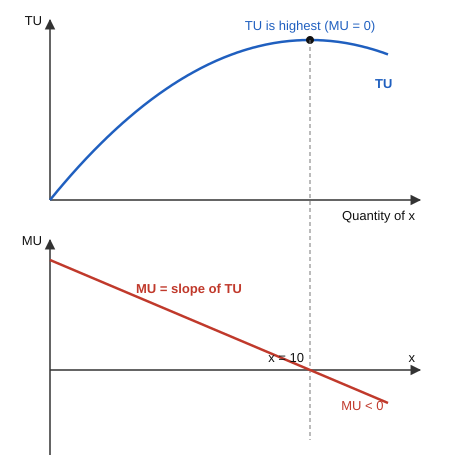
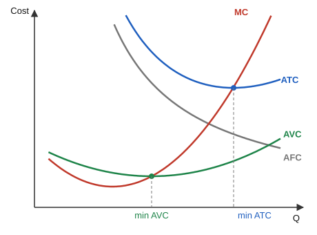
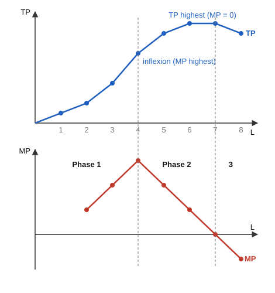
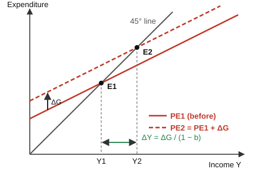
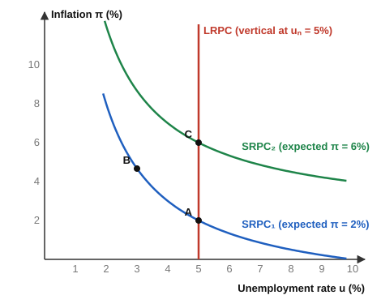

# Module II — Economics: Exam Questions and Answers (HU-4101)

This is the **only** economics guide. It covers exactly the end-sem economics syllabus:

- **After the midsem (class notes):**
  - consumer behaviour (30 Oct);
  - theory of production (6 Nov);
  - theory of cost (13 Nov).
- **From the midsem part:** the **Keynesian cross model** and the **Phillips curve**. (The 13 Nov notes mark these as important: "this class + previous class + Phillips curve + Keynesian model".)

Nothing else is included. Demand and supply, GDP, money and banking, indifference curves, the Lagrangian and similar topics are **not** in the syllabus, so they have been removed. Try each question yourself first. Then read the answer.

**How the end-sem asks economics:** the questions are short and come in many small parts.

- **Part A** = 2–3 marks. A definition, a reason, or a small diagram.
- **Part B** = 4–7 marks. A graph with an explanation, or a table or formula sum. There is usually an OR choice.

**Tags used in this file:**

- 🎯 = asked in a real paper (the year and question number are given). "HU-4201" means the 8th-semester paper of the same course.
- ✍️ = a practice question, added so that every part of the notes is covered.
- 💡 = a short line to help you remember.

| Topic (where it comes from) | Question |
| :--- | :--- |
| Utility and the three approaches (30 Oct) | A1 |
| Cardinal utility: assumptions (30 Oct) | A2 |
| Rational consumer and the three axioms (30 Oct) | A3 |
| TU, MU, saturation, diminishing MU (30 Oct) | A4, A5 |
| Net utility, disutility, first- and second-order conditions (30 Oct) | A6, B1 |
| Production function; short run vs long run (6 Nov) | A7 |
| TP, MP and the law of variable proportions (6 Nov) | A8, B2 |
| Returns to scale (6 Nov) | A9, B3 |
| TFC, TVC, TC (13 Nov) | A10 |
| AFC, AVC, AC and MC (13 Nov) | A11, A12, B4 |
| Keynesian cross, MPC and multipliers (midsem part) | A13, B5, B6 |
| Phillips curve (midsem part) | A14, B7 |

---

## Part A — Short questions (2–3 marks)

### Consumer behaviour (30 Oct)

### A1. What is utility? Name the three approaches to understanding consumer behaviour. ✍️ [2]

**Answer.**

- **Utility** is the satisfaction a person gets from consuming goods and services.
- The theory of consumer behaviour assumes we **can measure (quantify)** this satisfaction.
- **To "maximise utility" means to get the most satisfaction possible.**
- There are **three approaches** to understanding consumer behaviour:
  1. **Cardinal utility approach:** utility can be measured in numbers (units called "utils", or money). This is the approach in our notes.
  2. **Ordinal utility approach:** utility cannot be measured, only ranked (1st choice, 2nd choice, …).
  3. **Revealed preference approach:** we learn what people like from what they actually buy.

💡 *Cardinal = "how much?" Ordinal = "which is better?"*

---

### A2. State the assumptions of the cardinal utility approach. 🎯 2024 End Q1(b) [2]

**Answer.**

The cardinal utility approach makes four assumptions (from the notes):

1. **Utility can be measured objectively.** We can put a number on satisfaction.
2. **The consumer is rational.** Their choices follow the three rules in A3.
3. **The consumer's goal is to get the most utility.** In other words, the most satisfaction.
4. **Marginal utility diminishes.** After a point, each extra unit gives less extra satisfaction than the one before.

💡 *Measurable, rational, maximise, diminishing.*

---

### A3. When is a consumer called rational? State the three axioms of choice. A voter prefers party A to B and B to C, but then prefers C to A. Which axiom is broken? 🎯 2024 End Q2 (part), 🎯 HU-4201 2024 End Q2 [3]

**Answer.**

A consumer is **rational** when their choices are rational. To be rational, they must obey **all three** of these axioms (basic rules) at the same time:

1. **Axiom of completeness:** the consumer has the mental ability and the resources to **compare any two choices**. For any two bundles A and B, they can say: "I prefer A", or "I prefer B", or "I like both equally".
2. **Axiom of consistency:** the consumer's choices must be **consistent**. If they choose A over B once, they must do so **in all cases**, not switch to B next time.
3. **Axiom of transitivity:** choices link up like a chain. If the consumer chooses **A over B** and **B over C**, then when offered A and C, they **must choose A**.

**The voter:** they prefer A to B and B to C. Transitivity says they must then prefer A to C. Since they prefer C to A, they **break the axiom of transitivity**. So this choice is not rational in the economic sense.

(If the same voter also keeps switching between A and B from one election to the next, with nothing else changing, that breaks **consistency**.)

💡 *Compare everything, stay Consistent, choices flow in a chain (Transitive).*

---

### A4. What is marginal utility? What happens to total utility as we keep increasing the quantity consumed? Explain with a diagram. ✍️ [3]

**Answer.**

- **Total utility (TU):** the total satisfaction from all the units consumed.
- **Marginal utility (MU):** the **change in total utility** from consuming **one extra unit** of the good:
$$MU_n = TU_n - TU_{n-1} \qquad \text{or} \qquad MU_x = \frac{d(TU)}{dq_x}$$
  So MU is the **slope of the TU curve**.

**What happens as the quantity rises (from the notes):**

1. **At first, TU rises at an increasing rate.** Each new unit adds more satisfaction than the last one, so **MU is rising**.
2. **After some point, TU rises at a decreasing rate.** Each new unit still adds satisfaction, but less than the last one. So **MU is falling, but still positive**. This is the law of diminishing marginal utility.
   - The point where this change happens is the **inflexion point** of TU (where the curve changes its bend).
   - MU is **highest** at the inflexion point.
3. **At the saturation point, TU is at its highest and MU = 0.** One more unit adds nothing.
4. **After saturation, TU falls and MU is negative.** Extra units actually reduce satisfaction.

**The economic region** is the stretch from the highest MU to the point where MU = 0 (marked in the diagram). This is where a sensible consumer actually consumes:

- Before it, MU is still rising, so it always pays to consume more.
- Beyond it, MU is negative, so consuming more reduces satisfaction.

💡 *TU rises fast, then slowly, then stops at saturation (MU = 0), then falls.*

---

### A5. How much of good X will a consumer consume if X is free? Explain with a utility diagram. 🎯 2025 End Q2 [3]

**Answer.**

**The consumer consumes until MU = 0.** Here is why:

1. The consumer's aim is to make **total utility as large as possible**.
2. The good is **free**, so consuming more costs nothing.
3. So they keep consuming as long as each extra unit adds **some** satisfaction, that is, as long as **MU is positive**.
4. They stop where **MU = 0**. Here **TU is at its highest** (the saturation point in the diagram in A4).
5. They do not go beyond this point, because then MU is negative and TU starts to fall.

**A common mistake:** stopping where MU is **highest**. That is wrong. After that point, MU is smaller but still positive, so each unit still **adds** to TU. Since the aim is the most **total** utility, the consumer carries on until MU = 0.

In terms of the rule in A6: the best point is where MU = price. Here the price is 0, so the best point is MU = 0.

**Example:** TU $= 10x^2 - \tfrac{2}{3}x^3$, so MU $= 20x - 2x^2$. Setting MU = 0 gives $x = 10$. TU is highest there: TU $= 1000 - 666.7 = 333.3$.

💡 *Free good: "keep eating until the next bite gives zero pleasure", not "until the bite you enjoy most".*

---

### A6. A consumer has consumed 5 units of a good and is thinking of buying the 6th. The marginal utility of the 6th unit is ₹20 and its price is ₹10. Will the consumer buy it? ✍️ (class question) [2]

**Answer.** **Yes, the consumer will buy it.**

- When we pay for a good, we **lose** some satisfaction, because we give up money. The notes call this **disutility (DU)**. For one unit it equals the price.
- The 6th unit **adds** ₹20 of satisfaction (MU) and **takes away** ₹10 of satisfaction (the price).
- MU > price, so the net change in satisfaction is ₹20 − ₹10 = **+₹10**. Buying it makes the consumer better off.
- The consumer keeps buying extra units until **MU = price**. Beyond that point, MU < price, and each extra unit would lower net satisfaction.

💡 *Buy while MU > price. Stop where MU = price.*

---

### Production (6 Nov)

### A7. What is a production function? How is the short-run production function different from the long-run one? 🎯 2025 End Q3 (part) [2]

**Answer.**

- **Production function:** a **technical relationship** between the **inputs** used and the **output** made:
$$y = f(x) \qquad \text{or, with labour and capital,} \qquad y = f(L, K)$$
  It is "technical" because it is about engineering and methods, not about prices.

| Short-run production function | Long-run production function |
| :--- | :--- |
| One input (usually capital K) is held **constant**; the others (usually labour L) can change. | **All** inputs are allowed to change. |
| Output is raised by adding more of the variable input to the fixed input. | Output is raised by changing the **scale** of all inputs together. |
| Follows the **law of variable proportions** (A8). | Follows **returns to scale** (A9). |

The short run and the long run are **not fixed lengths of time** (they do not mean "one year"). They depend only on whether all inputs can be changed.

---

### A8. Define total product and marginal product. How do TP and MP change as more labour is added? State the law of variable proportions. ✍️ [3]

**Answer.**

- **Total product (TP):** the total output made with a given amount of labour, while capital stays fixed.
- **Marginal product (MP):** the **change in total output** when **one more unit of an input** is added. It is worked out separately for each variable input:
$$MP_L = TP_L - TP_{L-1} \qquad \text{or} \qquad MP_L = \frac{\partial TP}{\partial L}$$
  So MP is the **slope of the TP curve**.

**How TP and MP change (the TP curve is S-shaped, like TU):**

1. **TP rises at an increasing rate**, so **MP is rising**.
2. **TP rises at a decreasing rate**, so **MP is falling but still positive**. The point where the change happens is the **inflexion point** of TP, where **MP is highest**.
3. **TP reaches its highest point** where **MP = 0**.
4. **After that, TP falls**, because **MP is negative**.

**Law of variable proportions** (also called the **law of diminishing returns to a factor**): when more and more of one variable input is added to a fixed input, the marginal product of the variable input **rises at first, but after some point it falls**, and it can even become negative.

**Why does this happen?** The notes say the **efficiency of the fixed factor drops because the variable factor overcrowds it**. A few extra workers help to use the machines fully. But too many workers crowd around the same machines and get in each other's way.

**Why "variable proportions"?** Labour is added while capital stays fixed, so the **proportion (ratio) of labour to capital keeps changing**.

💡 *TP is highest exactly where MP = 0. MP is highest exactly at the inflexion point of TP.*

---

### A9. What are returns to scale? Explain constant, increasing and decreasing returns to scale. ✍️ [3]

**Answer.**

**Returns to scale** describe what happens to output in the **long run** when **all inputs are increased in the same proportion**.

**Example from the notes:** if we double both inputs and output exactly doubles,
$$f(2x_1, 2x_2) = 2f(x_1, x_2) = 2y$$
then we have **constant returns to scale**.

**General form.** Multiply every input by t (t > 0). If
$$f(tL, tK) = t^v f(L, K)$$
then the value of v tells us the returns to scale:

| v | Name | If all inputs are doubled, output becomes |
| :--- | :--- | :--- |
| v = 1 | **Constant** returns to scale (CRS) | exactly double |
| v > 1 | **Increasing** returns to scale (IRS) | more than double |
| v < 1 | **Decreasing** returns to scale (DRS) | less than double |

**Why decreasing returns happen:** the notes mention **managerial diseconomies**. When a firm grows very large, managers get overloaded and coordination gets worse. So output grows more slowly than inputs.

💡 *Double the inputs: output exactly double = CRS, more = IRS, less = DRS.*

---

### Cost (13 Nov)

### A10. What are fixed cost and variable cost? Explain the shapes of the TFC, TVC and TC curves. ✍️ [3]

**Answer.**

Costs come from production, $Y = f(L, K)$, so the shape of the cost curves follows from the production function.

$$TC = TFC + TVC$$

- **Total fixed cost (TFC):** stays the same **whatever the level of production**, even at zero output. Examples: rent, insurance, salaries of permanent staff.
  - **Shape:** a **flat (horizontal) line**.
- **Total variable cost (TVC):** **changes with the level of production**. It is zero when nothing is made. Examples: raw materials, wages of workers, fuel.
  - **Shape:** as output rises, TVC rises, but at a changing rate:
    - **at first it rises at a decreasing rate** (the curve bends downward);
    - **then it rises at an increasing rate** (the curve bends upward).
  - The point where the bend changes is the inflexion point (point A in the notes).
- **Total cost (TC):** TC = TFC + TVC. It has **the same shape as TVC**, but it starts at the TFC level instead of at zero, because TFC is added on top.

**Why is TVC the "opposite" of the total product curve?** (The notes call TVC the opposite of TP.)

- While MP is **rising** (phase 1 in A8), each extra worker adds more output. So each extra unit of output needs less extra labour, and TVC rises **slowly**.
- Once MP is **falling**, each extra worker adds less output. So each extra unit of output needs more extra labour, and TVC rises **faster and faster**.

💡 *TFC = flat. TVC = rises slowly, then fast. TC = TVC lifted up by TFC.*

---

### A11. Define AFC, AVC and AC. Why is the lowest point of AC to the right of the lowest point of AVC? ✍️ [3]

**Answer.**

Divide TC = TFC + TVC by the quantity q:

$$\frac{TC}{q} = \frac{TFC}{q} + \frac{TVC}{q} \quad\Rightarrow\quad AC = AFC + AVC$$

- **AFC (average fixed cost) = TFC/q:** keeps **falling** as output rises, because the same fixed cost is spread over more units.
- **AVC (average variable cost) = TVC/q:** **U-shaped**. It falls at first, then rises.
- **AC (average cost, also called ATC) = AFC + AVC:** also **U-shaped**.

(In the diagram, AC is labelled ATC.)

**Why AC reaches its lowest point later than AVC (from the notes):**

- After AVC reaches its lowest point, AVC starts **rising**.
- But AFC is **still falling**, and it keeps **pulling AC down**.
- For a while, the **fall in AFC is bigger than the rise in AVC**, so AC keeps falling.
- AC turns up only once the rise in AVC becomes bigger than the fall in AFC.
- So the lowest point of AC is **to the right** of the lowest point of AVC.

💡 *The fall in AFC outweighs the rise in AVC for a while, so AC bottoms out later.*

---

### A12. Define marginal cost. Show that MC cuts AVC and AC at their lowest points. ✍️ [3]

**Answer.**

- **Marginal cost (MC):** the **change in total cost** when output changes by **one unit**:
$$MC = \frac{\Delta TC}{\Delta q} \qquad \text{or} \qquad MC = \frac{\partial (TC)}{\partial q}$$
  - Fixed cost does not change with output, so MC depends only on variable cost.
  - MC is **U-shaped**: it falls at first, then rises. It reaches its lowest point **before** AVC and AC do.

**Why MC cuts AVC and AC at their lowest points (the rule from the notes):**

- **If the marginal addition is above the average, the average is pulled up. If it is below, the average is pulled down.**
- So while MC is below AC, AC is falling. Once MC is above AC, AC is rising.
- The average stops falling and starts rising exactly where **MC = AC**, which is the **lowest point** of AC.
- The same reasoning works for AVC. So MC cuts **AVC first** and **AC later**, each at its lowest point.

💡 *MC is like a new student joining a class: a score above the class average pulls the average up, a score below pulls it down.*

---

### Keynesian cross (midsem part)

### A13. What is the marginal propensity to consume (MPC)? If the investment multiplier is 5, find the MPC. What happens to the multiplier if the MPC rises? 🎯 HU-4201 2024 Mid Q2, HU-4201 2025 Mid Q5, 2023 End Q7 [1 + 2 + 2]

**Answer.**

**Keynes's consumption function:** $C = a + bY$.

- $C$ = consumption (spending by households).
- $Y$ = income.
- $a$ = **autonomous consumption**: what people spend even when income is zero, just to survive.
- $b$ = the **MPC**.

**MPC** is the part of each **extra** rupee of income that people spend. If you earn ₹1 more and spend 80 paise of it, your MPC is 0.8. In symbols: $b = \Delta C/\Delta Y$, and $0 < b < 1$.

**Investment multiplier.** When investment rises, income rises by **more** than the investment. This is because each round of spending becomes someone else's income, and they spend part of it again. The size of the multiplier is:

$$k = \frac{1}{1 - b}$$

**Finding the MPC when k = 5:**

$$5 = \frac{1}{1 - b} \Rightarrow 1 - b = 0.2 \Rightarrow b = 0.8$$

**If the MPC rises,** people spend a bigger share in every round, so the **multiplier gets bigger**:

- MPC 0.75 → k = 4
- MPC 0.8 → k = 5
- MPC 0.9 → k = 10

Because $b$ is always between 0 and 1, the multiplier is always greater than 1.

💡 *The more people spend again, the bigger the multiplier.*

---

### Phillips curve (midsem part)

### A14. What is the Phillips curve? How are inflation and unemployment related in the short run? 🎯 2025 End Q4 (part) [2]

**Answer.**

- **A. W. Phillips (1958)** studied UK data from 1861 to 1957. He found that when **unemployment was low, money wages rose fast**, and when **unemployment was high, wages rose slowly**. So the two moved in **opposite directions**.
- **Samuelson and Solow (1960)** restated this for the USA as a link between **inflation** and **unemployment**. This is the **Phillips curve**: a downward-sloping curve with unemployment on the x-axis and inflation on the y-axis.

**The short-run relation: a trade-off.** Lower unemployment comes with higher inflation, and higher unemployment comes with lower inflation.

**Why?**

1. When demand in the economy is high, firms produce more and hire more, so unemployment falls.
2. With fewer people looking for work, workers are scarce, and firms must **offer higher wages** to get them.
3. Higher wages raise firms' costs, and strong demand lets firms **raise prices**. So inflation rises.
4. The opposite happens when demand is weak: unemployment rises, wage pressure is low, and inflation falls.

So in the short run, the government faces a **choice (a "menu")**: it can have lower unemployment, but only by accepting higher inflation, or the other way round.

💡 *Short run: fewer jobless ↔ faster price rises.*

---

## Part B — Longer questions (4–7 marks)

### B1. 🎯 2023 End Q9 + ✍️ — Getting the most net utility

**(a)** Explain the law of diminishing marginal utility. **[3]**
**(b)** When the consumer has to pay for the good, how much will they consume? Write the first- and second-order conditions. With $TU = 10x^2 - \tfrac{2}{3}x^3$ and a price of ₹32, find the quantity bought. **[4]**

**(a) Answer.**

**Law of diminishing marginal utility:** after a point, each extra unit of a good gives **less extra satisfaction** than the unit before.

Step by step (see the diagram in A4):

1. At first, MU rises, and TU rises faster and faster.
2. After MU reaches its highest point, **MU starts to fall**. This is where the law begins. TU still rises, but more and more slowly.
3. At the saturation point, **MU = 0** and TU is at its highest.
4. After that, MU is negative and TU falls.

**Everyday example:** the first glass of water on a hot day is wonderful, the third is fine, and by the sixth you do not want any more.

**(b) Answer.**

**The idea (from the notes).** When we have to pay for the good, paying causes a **loss of satisfaction** too.

- **Disutility (DU)** = the satisfaction lost by paying = price × quantity: $DU = P_x q_x$. On a graph, this is a straight line from the origin.
- **Net utility (NU)** = satisfaction gained − satisfaction lost:
$$NU = TU - DU = TU(q_x) - P_x q_x$$
- The consumer consumes up to the point where the **gap between the TU curve and the DU line is largest**. That is where NU is at its maximum.

**First-order condition (FOC).** To find the maximum, set the slope of NU to zero:
$$\frac{d(NU)}{dq_x} = \frac{d(TU)}{dq_x} - P_x = 0 \;\Rightarrow\; MU_x - P_x = 0 \;\Rightarrow\; \boxed{MU_x = P_x}$$

So the consumer gets the most net utility where **marginal utility = price**.

But this is only a **necessary condition, not a sufficient one**. A zero slope can also happen at a **minimum** of NU. So we also need the second condition.

**Second-order condition (SOC).** At the best point, NU must be bending downwards:
$$\frac{d^2(TU)}{dq_x^2} < 0$$
This means **MU must be falling** at that point (diminishing marginal utility).

**The sum.** $TU = 10x^2 - \tfrac{2}{3}x^3$, so $MU = 20x - 2x^2$, and price = 32.

- FOC: $20x - 2x^2 = 32 \;\Rightarrow\; x^2 - 10x + 16 = 0 \;\Rightarrow\; (x - 2)(x - 8) = 0$, so **x = 2 or x = 8**.
- SOC: $\dfrac{d(MU)}{dx} = 20 - 4x$.
  - At x = 2: $20 - 8 = 12 > 0$. ✗ MU is still **rising**, so this is a **minimum** of NU.
  - At x = 8: $20 - 32 = -12 < 0$. ✓ MU is **falling**, so this is the **maximum**.
- **Answer: the consumer buys 8 units.**
- Check:
  - at x = 8: TU = 640 − 341.33 = 298.67; spending = 32 × 8 = 256; NU = **42.67** (the most);
  - at x = 2: TU = 40 − 5.33 = 34.67; spending = 64; NU = −29.33 (the least).

This example shows why the FOC alone is not enough: it gives two answers, and the SOC picks the right one.

💡 *FOC: MU = price. SOC: MU must be falling. You need both.*

---

### B2. 🎯 2025 End Q3 + 🎯 HU-4201 2024 End Q3(b) + ✍️ (class table)

**(a)** Using the class table below (capital fixed), find MP for each level of labour and explain the phases of production. **[4]**
**(b)** What is important about the inflexion point of the TP curve? Which law decides the shape of TP? Why is it called the law of variable proportions? **[3]**
**(c)** Find x and y in this table: **[2]**

| L | TP | MP |
| :---: | :---: | :---: |
| 1 | 10 | 10 |
| 2 | 24 | 14 |
| 3 | x | 15 |
| 4 | 48 | y |
| 5 | 50 | 2 |

**(a) Answer.**

| L | TP | MP = TP(L) − TP(L−1) | Phase |
| :---: | :---: | :---: | :--- |
| 1 | 100 | — | 1 |
| 2 | 200 | 100 | 1 |
| 3 | 400 | 200 | 1 |
| 4 | 700 | **300** (highest) | end of 1 (inflexion) |
| 5 | 900 | 200 | 2 |
| 6 | 1000 | 100 | 2 |
| 7 | 1000 | **0** | end of 2 (TP highest) |
| 8 | 900 | −100 | 3 |

**The three phases:**

1. **Phase 1 (L = 1 to 4): TP rises at an increasing rate.** MP rises from 100 to 300. There are too few workers for the fixed machines, so each new worker adds more than the last one.
2. **Phase 2 (L = 4 to 7): TP rises at a decreasing rate.** MP falls (300 → 200 → 100 → 0) but stays positive or zero, so TP still rises, up to its peak of 1000. **Diminishing returns** have started.
3. **Phase 3 (L above 7): TP falls.** MP is negative (−100 at L = 8). Too many workers overcrowd the fixed machines.

A sensible firm will not hire into phase 3, because extra workers there **reduce** output.

**(b) Answer.**

- The **inflexion point** is where the TP curve **changes its bend**: before it, TP rises faster and faster; after it, TP rises more and more slowly.
  - At this point **MP is at its highest** (L = 4 in the table).
  - After it, **diminishing returns begin**.
- The shape of TP is decided by the **law of variable proportions** (also called the **law of diminishing returns to a factor**). See A8.
- **Why "variable proportions"?** Labour is added while capital stays fixed. So the **ratio (proportion) of labour to capital keeps changing**. At first the mix improves. After the best mix, the variable factor overcrowds the fixed factor, so the fixed factor's efficiency drops and MP falls.
- It is a **short-run** law, because one factor must stay fixed.

**(c) Answer.**

- x = TP at L = 3 = TP at L = 2 + MP at L = 3 = 24 + 15 = **39**.
- y = MP at L = 4 = TP at L = 4 − TP at L = 3 = 48 − 39 = **9**.

💡 *MP highest = inflexion of TP. MP = 0 = top of TP. MP negative = TP falling.*

---

### B3. ✍️ — Returns to scale: sums and comparison

**(a)** Find the returns to scale for: (i) $X = L^{0.5}K^{0.5}$; (ii) $X = 4L^{0.6}K^{0.6}$; (iii) $X = L^{0.3}K^{0.5}$. **[3]**
**(b)** How are returns to scale different from returns to a variable factor? **[3]**

**(a) Answer.** Multiply both L and K by t, then pull t out to the front. The power of t is v.

- (i) $(tL)^{0.5}(tK)^{0.5} = t^{1.0}\,L^{0.5}K^{0.5}$. So v = 1: **constant returns**. Doubling the inputs doubles the output (× 2).
- (ii) $4(tL)^{0.6}(tK)^{0.6} = t^{1.2}\cdot 4L^{0.6}K^{0.6}$. So v = 1.2, which is more than 1: **increasing returns**. Doubling the inputs multiplies output by $2^{1.2} \approx 2.30$.
- (iii) $(tL)^{0.3}(tK)^{0.5} = t^{0.8}\,L^{0.3}K^{0.5}$. So v = 0.8, which is less than 1: **decreasing returns**. Doubling the inputs multiplies output by only $2^{0.8} \approx 1.74$.

**Shortcut:** for this kind of function, just **add the powers**. The number in front (like the 4) does **not** change the returns to scale.

**(b) Answer.**

| Returns to a variable factor | Returns to scale |
| :--- | :--- |
| **Short run** | **Long run** |
| One factor changes; the others stay fixed. | **All** factors change by the same proportion. |
| The **mix (proportion)** of factors changes. | The mix stays **the same**; only the **size (scale)** changes. |
| Follows the law of variable proportions: MP rises, then falls. | Can be increasing, constant or decreasing returns to scale. |
| Cause of the fall: the variable factor **overcrowds** the fixed factor. | Cause of decreasing returns: **managerial diseconomies** in a very large firm. |

---

### B4. 🎯 HU-4201 2023 End Q1 (type) + ✍️ — Cost table and cost function

**(a)** A firm has a total fixed cost of ₹100. Its total variable cost is given below. Find TC, AFC, AVC, AC and MC, and comment on the results. **[4]**

| q | 0 | 1 | 2 | 3 | 4 | 5 | 6 | 7 | 8 |
| :--- | ---: | ---: | ---: | ---: | ---: | ---: | ---: | ---: | ---: |
| TVC (₹) | 0 | 40 | 70 | 90 | 120 | 160 | 210 | 280 | 370 |

**(b)** For $TC = 100 + 10q - 2q^2 + 0.2q^3$: find TFC, TVC, AVC and MC, and the output where AVC is lowest. Show that MC = AVC at that output. **[3]**

**(a) Answer.**

| q | TFC | TVC | TC | AFC | AVC | AC | MC |
| :---: | ---: | ---: | ---: | ---: | ---: | ---: | ---: |
| 0 | 100 | 0 | 100 | — | — | — | — |
| 1 | 100 | 40 | 140 | 100 | 40 | 140 | 40 |
| 2 | 100 | 70 | 170 | 50 | 35 | 85 | 30 |
| 3 | 100 | 90 | 190 | 33.33 | 30 | 63.33 | **20** (lowest) |
| 4 | 100 | 120 | 220 | 25 | **30** (lowest) | 55 | 30 |
| 5 | 100 | 160 | 260 | 20 | 32 | 52 | 40 |
| 6 | 100 | 210 | 310 | 16.67 | 35 | **51.67** (lowest) | 50 |
| 7 | 100 | 280 | 380 | 14.29 | 40 | 54.29 | 70 |
| 8 | 100 | 370 | 470 | 12.5 | 46.25 | 58.75 | 90 |

**Formulas used:**

- TC = TFC + TVC
- AFC = TFC/q
- AVC = TVC/q
- AC = TC/q = AFC + AVC
- MC = TC at this q − TC at the previous q

**Comments:**

- TFC stays at 100 at every output, even at q = 0. AFC keeps falling (100, 50, 33.33, …).
- TVC rises slowly at first (+40, +30, +20), then faster and faster (+30, +40, +50, +70, +90). This is the shape described in A10.
- **MC reaches its lowest point first** (q = 3), then **AVC** (q = 3–4), then **AC** (q = 6). This is the usual order (A11).
- At q = 4, MC = 30 = AVC. So **MC meets AVC at its lowest point**.
- MC rises from 50 to 70 as it crosses AC (51.67) between q = 6 and q = 7, which is at the bottom of AC.
- While MC < AC, AC falls. Once MC > AC, AC rises. This is the rule from A12.

**(b) Answer.**

- TFC = **100** (the part that does not depend on q). TVC = $10q - 2q^2 + 0.2q^3$ (the rest).
- $AVC = \dfrac{TVC}{q} = 10 - 2q + 0.2q^2$.
- $MC = \dfrac{d(TC)}{dq} = 10 - 4q + 0.6q^2$.
- Lowest AVC: set its slope to zero. $\dfrac{d(AVC)}{dq} = -2 + 0.4q = 0 \Rightarrow$ **q = 5**. Then AVC = 10 − 10 + 5 = **5**.
- MC at q = 5: 10 − 20 + 15 = **5**, which equals AVC ✓. So **MC cuts AVC at its lowest point**.
- Extra: MC itself is lowest at $q = 10/3 \approx 3.33$, before AVC's lowest point, as expected. AC is lowest at about q = 8.5, after AVC's lowest point (A11).

---

### B5. 🎯 2023 End Q7 + 🎯 2025 Mid Q2(a) + 🎯 HU-4201 2025 Mid Q5 — The Keynesian cross

Explain the simple Keynesian model of income with a graph. Why is the Keynesian cross a stable equilibrium? **[3 + 2]**

**Answer.**

**Background.**

- Older (classical) economists believed markets fix themselves, so the government should stay out. This idea is called *laissez-faire* ("let it be").
- The Great Depression of the 1930s proved them wrong. Millions stayed jobless for years, because people were **not spending enough**.
- Keynes's main idea: **total spending (demand) decides a country's income.** If spending is too low, the government should raise it. He said, "in the long run we are all dead", meaning we cannot just wait for markets to fix themselves.

**The model.** We assume no foreign trade, and fixed investment (I) and government spending (G).

- Consumption: $C = a + bY$ (see A13).
- **Planned expenditure** (what people plan to spend): $PE = C + I + G = (a + I + G) + bY$. On a graph this is a straight line that starts at $a + I + G$ and has slope $b$ (less than 1).
- **Actual expenditure = output = income.** On a graph this is the **45° line** ($AE = Y$). At every point on it, spending equals income.

**Equilibrium** is at E, where planned spending equals output. Solve $Y = (a + I + G) + bY$:

$$Y^* = \frac{a + I + G}{1 - b}$$

**Why the equilibrium is stable.** The key is firms' **inventories** (their stock of unsold goods).

- **If income is at Y1, below Y\*:** people plan to spend more than firms produce. Firms sell more than they made, so their stock of goods **falls unexpectedly**. Firms react by hiring more workers and producing more. Income rises towards Y\*.
- **If income is at Y2, above Y\*:** firms produce more than people plan to buy. Unsold goods pile up (**unplanned inventory build-up**). Firms cut production, and income falls towards Y\*.

So whenever income moves away from Y\*, forces push it back. That is why the equilibrium is stable.

💡 *Shelves empty → make more. Shelves full → make less.*

---

### B6. 🎯 2024 End Q6 (OR) + ✍️ — Government spending and tax multipliers

**(a)** Using a graph, explain how a rise in government spending changes equilibrium income in the Keynesian model. **[4]**
**(b)** Does a rise in taxes have the same effect? Explain. **[2]**
**(c)** With $C = 100 + 0.8Y$, $I = 50$, $G = 50$: find equilibrium income. Then find the change in income if G rises by 20, or if a lump-sum tax of 20 is added. **[✍️ 3]**

**(a) Answer.**

When G rises, planned spending is higher at **every** level of income. So the PE line **shifts up** by ΔG, staying parallel to the old line. The new line cuts the 45° line at a **higher income**. Income rises by **more** than ΔG.

The maths:

$Y = a + bY + I + G$ → $Y(1 - b) = a + I + G$ → $Y = \dfrac{a + I + G}{1 - b}$, so

$$\frac{\Delta Y}{\Delta G} = \frac{1}{1 - b} > 1$$

**Why income rises by more than ΔG:**

1. The government's spending becomes firms' revenue, and then workers' income.
2. The workers spend part b of it. That spending becomes someone else's income.
3. They also spend part b of it, and so on.
4. Adding all the rounds: ΔG + bΔG + b²ΔG + … = ΔG/(1 − b).

**(b) Answer.** No. A tax works in the **opposite direction**, and it is **weaker**.

A lump-sum tax T (a fixed amount, not linked to income) reduces the money people have to spend to (Y − T). So consumption becomes $C = a + b(Y - T)$, and:

$$Y = \frac{a + I + G}{1 - b} - \frac{b}{1 - b}T \quad\Rightarrow\quad \frac{\Delta Y}{\Delta T} = -\frac{b}{1 - b}$$

- The minus sign means a tax rise **lowers** income.
- Its size, b/(1 − b), is smaller than the spending multiplier 1/(1 − b) by exactly 1.
- **Why weaker?** Households pay part of the tax out of their **savings**. So in the first round, only part b of the tax reduces spending. But government spending enters demand **in full** in the first round.

**(c) Answer.**

- Equilibrium income: $Y = \dfrac{100 + 50 + 50}{1 - 0.8} = \dfrac{200}{0.2} = 1{,}000$. Consumption C = 100 + 0.8 × 1,000 = 900.
- G rises by 20: the multiplier is 1/0.2 = 5, so ΔY = 5 × 20 = **+100**. New income = 1,100.
- Tax of 20: the tax multiplier is −0.8/0.2 = −4, so ΔY = −4 × 20 = **−80**. New income = 920.

💡 *Spending multiplier = 1/(1 − b). Tax multiplier = −b/(1 − b), which is one smaller in size.*

---

### B7. 🎯 2025 End Q4 + ✍️ — The Phillips curve in the short run and the long run

**(a)** How are inflation and unemployment related in the short run? Do periods of high inflation **and** high unemployment at the same time prove that the Phillips curve is wrong? Explain. **[3 + 2]**
**(b)** Draw the short-run and long-run Phillips curves. **[2]**
**(c)** Using $\pi = \pi^e - 0.5(u - 5)$, find inflation when expected inflation is 2% and unemployment is 3%, 5% and 7%. Then add a supply shock that raises inflation by 4 points at u = 7%. **[✍️ 3]**

**(a) Answer.**

**The short-run relation.** In the short run, inflation and unemployment move in **opposite directions** (see A14):

- **Strong demand:** firms hire more, so unemployment falls. Wages and prices are pushed up, so inflation rises.
- **Weak demand:** the opposite happens.

This is a **movement along** the Phillips curve. It is **demand-pull inflation**: too much demand pulls prices up and pulls unemployment down.

**What happened in the 1970s: stagflation.** Many countries had **high inflation and high unemployment at the same time**. This is called **stagflation** (stagnation + inflation). It looked as if the Phillips curve had broken down.

**Do such periods prove the Phillips curve wrong? No.** They show that the **curve shifted up**. It did not stop existing. Two things shift it up:

1. **Supply shocks (cost-push inflation).**
   - The oil price shocks of 1973 and 1979 raised firms' costs.
   - Firms raised prices **and** cut output and jobs.
   - So inflation and unemployment rose **together**. Higher costs **pushed** prices up.
2. **Higher expected inflation.**
   - Milton Friedman (1968) and Edmund Phelps (1967) pointed out that workers care about **real** wages (what their pay can actually buy).
   - If workers expect prices to rise faster, they ask for bigger pay rises.
   - This pushes inflation up at **every** level of unemployment, so the whole curve moves up.

**The expectations-augmented Phillips curve** puts both ideas together:
$$\pi = \pi^e - \beta\,(u - u_n)$$

- $\pi$ = actual inflation, $\pi^e$ = expected inflation.
- $u$ = actual unemployment, $u_n$ = the **natural rate of unemployment** (the rate the economy settles at in the long run; also called the NAIRU).
- $\beta$ = how strongly inflation reacts to unemployment.

**Short run vs long run:**

- **Short run:** expected inflation does not change yet, so there **is** a trade-off. Pushing u below $u_n$ makes inflation higher than people expected.
- **Long run:** people learn and adjust their expectations, until actual inflation equals expected inflation ($\pi = \pi^e$). The formula then gives $u = u_n$.
  - So in the long run **there is no trade-off**. Unemployment goes back to its natural rate, whatever the inflation rate.
  - That is why the **long-run Phillips curve is a vertical line** at $u_n$.

**Conclusion:** high inflation with high unemployment does **not** prove the Phillips curve wrong. It proves only that the trade-off is **not fixed for ever**. The short-run trade-off is real, but the curve shifts with supply shocks and expectations.

**Link with the Keynesian cross:** the Keynesian cross (B5) assumes fixed prices, so it says nothing about inflation. The Phillips curve adds the price side: when expansionary policy (B6) raises output and cuts unemployment, inflation rises.

**(b) Answer.**

- **SRPC₁** is the short-run curve when people expect 2% inflation. At **A**, unemployment is at its natural rate (5%) and inflation is 2%.
- If the government pushes unemployment down to 3%, the economy **moves along SRPC₁** to **B**: lower unemployment, but higher inflation (about 4.7%).
- If the government keeps holding unemployment below 5%, people come to expect higher inflation. The short-run curve **shifts up** to **SRPC₂** (expected inflation 6%).
- In the long run, unemployment goes back to 5% at **C**, with **higher inflation** than before.
- Points A and C are both on the **vertical long-run curve (LRPC)** at $u_n = 5\%$. The lasting result of the policy is higher inflation, not lower unemployment.

**(c) Answer.** $\pi = 2 - 0.5(u - 5)$.

- u = 3%: $\pi = 2 - 0.5(-2) = 2 + 1 =$ **3%**
- u = 5%: $\pi = 2 - 0.5(0) =$ **2%** (unemployment is at its natural rate, so inflation equals expected inflation)
- u = 7%: $\pi = 2 - 0.5(2) = 2 - 1 =$ **1%**

So lower unemployment comes with higher inflation: the **short-run trade-off**.

**With a supply shock** that adds 4 points: $\pi = 2 - 0.5(u - 5) + 4$. At u = 7%: $\pi = 1 + 4 =$ **5%**.

Now unemployment (7%) **and** inflation (5%) are both high. This is **stagflation**, and it comes from the curve **shifting up**, not from the Phillips curve being wrong.

💡 *Short run: a trade-off (move along the curve). Shocks and expectations shift the curve. Long run: vertical at the natural rate.*
