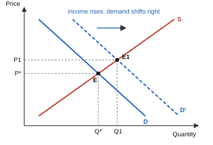
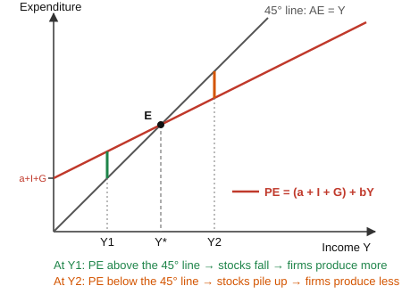

# Module II — Economics: Exam Questions and Answers (HU-4101)

This file goes with [Finance_Economics_and_Management_Midterm_Study_Guide.md](Finance_Economics_and_Management_Midterm_Study_Guide.md), sections 1–2. Those sections cover demand and supply, national income, the Keynesian cross, and money and banking. Try each question yourself first. Then read the answer.

**How the end-sem asks economics:** the questions are short and come in many small parts.

- **Part A** = 1–3 marks. Definitions, one-line reasons, small sums.
- **Part B** = 4–7 marks. A graph with an explanation, a GDP or GNP sum, or a multiplier argument. There is usually an OR choice.

**Tags used in this file:**

- 🎯 = asked in a real paper (the year and question number are given). "HU-4201" means the 8th-semester paper of the same course.
- ✍️ = a practice question, added so that every part of the notes is covered.
- 📘 = goes a little beyond the notes.
- 💡 = a short line to help you remember.

**Microeconomics (after the midsem):** marginal utility, indifference curves, the Lagrangian, production and cost are in a separate file: [Module_II_Microeconomics_QA.md](Module_II_Microeconomics_QA.md).
**Not in the notes yet:** past end-sems also asked about the Phillips curve, and about demand-pull vs cost-push inflation in detail.

| Topic in the guide | Question |
| :--- | :--- |
| Scarcity, micro vs macro (§1.1) | A1 |
| Demand: law, what it depends on, shifts, elasticity (§1.2) | A2, A3, A4, B1 |
| Supply, equilibrium, shocks (§1.2–1.3) | B1 |
| Circular flow of income (§2.1) | A5, B2 |
| GDP: meaning, nominal vs real, deflator, base year (§2.2) | A6, A7, A8, B3 |
| C + I + G + NX, GNP, factor cost, NNP (§2.2) | B3, B4 |
| Consumption function, Keynesian cross, stability (§2.3) | A11, B5 |
| Multipliers: government spending, tax, investment (§2.3) | A11, B6 |
| Money: functions, M1–M4, motives, inflation (§2.4) | A9, A10, A12, A13 |
| Central bank vs commercial bank, credit creation (§2.4) | B7 |
| Fiscal vs monetary policy (§2.4) | B8 |

---

## Part A — Short questions (1–3 marks)

### A1. What is the basic economic problem? How is microeconomics different from macroeconomics? ✍️ [2]

**The economic problem in one line:** we want many things, but we have only a few resources to make them.

- Human wants are **unlimited**. When one want is met, a new one comes up.
- Resources are **scarce**, which means limited. Resources are land, labour (workers), capital (machines, buildings) and time.
- Each resource has **alternative uses**. A piece of land can grow rice, or hold a factory, or hold houses. It cannot do all three at once.
- So every society must **choose** how to use (allocate) its resources.

**When is a good "scarce"?** A good is scarce if, at a price of zero, people would want more of it than there is. Food grain is scarce, because everyone wants it and there is not enough. Rotten eggs are not scarce, because nobody wants them even for free.

**Micro vs macro:**

- **Microeconomics** looks at **single units**: one buyer's choices, one firm's price and output, one market.
- **Macroeconomics** looks at the **whole economy**: GDP, national income, the general price level (inflation), unemployment and growth.

> 💡 Micro = one tree. Macro = the whole forest.

### A2. State the law of demand. What does the demand for a good depend on? 🎯 2024 End Q1, 2025 Mid Q4 [1 + 2]

**Law of demand:** when the price of a good **rises**, people buy **less** of it. When the price **falls**, they buy **more**. This is true only if everything else stays the same. Economists call this condition *ceteris paribus* (Latin for "other things being equal").

Because of this law, the demand curve **slopes downward**: high price, low quantity; low price, high quantity.

**What demand depends on.** The demand for good x is written as:

$$q_x = f(P_x,\ M,\ P_y,\ \text{tastes})$$

Read this as "the quantity of x people want depends on these four things":

- $P_x$: the price of the good itself.
- $M$: the buyer's income.
- $P_y$: the prices of **related goods**. A related good can be a **substitute** (used instead, like tea instead of coffee) or a **complement** (used together, like a car and petrol).
- **Tastes and preferences**. This includes the **bandwagon effect**: people buy something just because others are buying it.

**Desire vs demand:** a desire is only a wish. **Demand** is a desire that the person is **able and willing to pay for**. A poor person may wish for a car, but that is not demand until they can and will pay.

> 💡 Price goes up, quantity goes down, as long as nothing else changes.

### A3. What is the difference between a movement along the demand curve and a shift of the demand curve? ✍️ [2]

- **Movement along the curve.** This is called a change in **quantity demanded**. Only **the good's own price** causes it. If the price falls, the buyer moves down the **same** curve and buys more.
- **Shift of the whole curve.** This is called a change in **demand**. Any **other** factor causes it. For example:
  - income rises,
  - the price of a substitute rises,
  - tastes change in favour of the good.

  Each of these shifts the whole curve to the **right**: more is bought at every price. The opposite changes shift it to the **left**.

> 💡 Its own price moves you along the line. Anything else moves the whole line.

### A4. What does the slope of a demand curve tell us about how sensitive buyers are to price? ✍️ [2]

- **Flat curve = elastic demand.** A small price change causes a **big** change in quantity. Buyers are very sensitive to price. This happens when there are close substitutes, or when the good is not essential. Example: one brand of soft drink. If it costs more, people switch to another brand.
- **Steep curve = inelastic demand.** Even a big price change hardly changes the quantity. This happens when the good is essential and has no substitute. Example: life-saving medicine. People buy it whatever the price.

> 💡 Flat line = buyers react a lot. Steep line = they buy anyway.

### A5. Answer these questions on the circular flow model. 🎯 2023 Mid Q2, 2025 Mid Q1(a) [1 + 1 + 1]

**(a) Who receives factor payments (like wages)?** **(ii) Households.** Households own the factors of production. For example, they own their labour and sell it to firms.

**(b) With no leakages and no injections, what happens to the income flowing round the system?** It stays **(i) constant**.

**(c) Why does it stay constant?**

- Firms pay **all** of their revenue to households as income (wages).
- Households **spend all** of that income on the firms' goods.
- Nothing leaks out. A **leakage** is money that leaves the flow: saving, taxes or imports. There are none.
- Nothing extra comes in. An **injection** is money that enters the flow from outside: investment, government spending or exports. There are none.
- So the same amount of money keeps going round and round.

> 💡 No leak, no injection, no change.

### A6. Define GDP. Is the sale of your three-year-old phone counted in this year's GDP? Why are last year's goods not counted? 🎯 2024 Mid Q1(a, b), 2023 Mid Q1(b) [1 + 1 + 1]

**GDP (gross domestic product)** is the total **market value** of all **final goods and services** made **inside a country's borders** during a given time, usually one year.

$$\text{GDP} = P_1q_1 + P_2q_2 + \dots + P_nq_n$$

This means: for each good, multiply its price ($P$) by the quantity made ($q$), then add them all up.

- **Your used phone: not counted.** GDP counts only what is **made this year**. Your phone was made three years ago, and it was counted in GDP then. Selling it now only changes who owns it. Nothing new is made. (But if a dealer takes a commission for selling it, that commission **is** counted, because the dealer gives a service now.)
- **Last year's goods are not counted** because they were already counted in last year's GDP. Counting them again would be **double counting**. It would make this year's production look bigger than it really is.
- **Only final goods are counted.** A final good is one bought by the person who will use it. Intermediate goods are goods used to make other goods, like the flour a baker uses to make bread. The flour's value is already inside the price of the bread, so we do not count it again.

> 💡 GDP counts what is made this year, inside the border, only once.

### A7. GDP vs GNP. What can you say about a country whose GDP is much lower than its GNP? 🎯 2023 Mid Q1(a), 2024 Mid Q1(c) [2 + 1]

| GDP | GNP |
| :--- | :--- |
| Counts production **inside the country's borders**, by anyone (citizens or foreigners). | Counts income earned by the country's **own citizens and firms**, wherever they are in the world. |
| A foreign company's factory in India counts in **India's GDP**. | An Indian company's earnings abroad count in **India's GNP**. |

$$\text{GNP} = \text{GDP} + \text{NFIA}$$

**NFIA (net factor income from abroad)** = income our residents earn abroad − income foreigners earn inside our country.

**If GNP is much higher than GDP,** NFIA is large and positive. This means the country's people earn far more abroad than foreigners earn inside it. Such a country probably has:

- many **workers abroad who send money home** (these payments are called remittances), or
- large investments in other countries,

along with fairly small production at home.

Example: Pakistan has GNP > GDP because of remittances. India and China have GDP > GNP.

> 💡 Domestic = **where** it is made. National = **who** earns it.

### A8. Why do we fix a base year? Define the GDP deflator. 🎯 2024 End Q4, 2023 Mid Q3 [2 + 2]

**Why a base year?**

- Nominal GDP uses each year's **current** prices.
- So nominal GDP can go up just because **prices** went up, even if no extra goods were made.
- To remove this effect, we pick one year, the **base year**, and value every year's output at that year's **fixed prices**.
- Now any change in GDP comes only from a change in the **quantity produced**. This is **real GDP**. It lets us compare output fairly across years.

**Example (2023 Mid Q3).** Country X grows apples and oranges. The base year is 2020.

| Good | 2023 price | 2023 output | 2020 price |
| :--- | ---: | ---: | ---: |
| Apples | ₹20 | 100 kg | ₹5 |
| Oranges | ₹12 | 150 kg | ₹8 |

- Nominal GDP 2023 (2023 prices × 2023 output) = 20 × 100 + 12 × 150 = 2,000 + 1,800 = **₹3,800**
- Real GDP 2023 (2020 prices × 2023 output) = 5 × 100 + 8 × 150 = 500 + 1,200 = **₹1,700**

**GDP deflator** = (nominal GDP ÷ real GDP) × 100 = 3,800 ÷ 1,700 × 100 = **223.5**.

The deflator is a **price index**: a number that measures the price level of **all** goods made in the economy. A value of 223.5 means prices are about 2.24 times their 2020 level. In other words, prices have risen by about 124% since 2020.

> 💡 Nominal = today's prices. Real = base-year prices. Deflator = nominal ÷ real × 100.

### A9. What are the functions of money? Which of them do cash, Bitcoin and real estate perform? 🎯 2025 Mid Q3(a), 2023 Mid Q5 [1 + 3]

**Why we need money.** Without money we must **barter**, which means swap goods directly. Barter has three problems:

1. You must find someone who has what you want **and** wants what you have. This is called the "double coincidence of wants", and it is rare.
2. There is no common measure of value. How many eggs is one shirt worth?
3. Many goods cannot be stored. Milk goes bad.

Money solves these problems. It has three functions:

1. **Medium of exchange:** people accept it as payment for anything.
2. **Unit of account:** all prices, GDP and debts are measured in it. It is a common measuring stick.
3. **Store of value:** you can keep it and spend it later. (Inflation makes this weaker, because money buys less over time.)

| Item | Medium of exchange | Unit of account | Store of value |
| :--- | :---: | :---: | :---: |
| Cash | ✓ | ✓ | ✓ (but loses value with inflation) |
| Bitcoin | weak: few sellers accept it | ✗: prices are not written in Bitcoin | partly: people hold it as an asset, but its price goes up and down a lot (it is volatile) |
| Real estate | ✗: you cannot buy groceries with land | ✗ | ✓: it keeps its value, but it is hard to turn into cash quickly (it is illiquid) |

> 💡 Exchange, account, store: only cash does all three well.

### A10. What do M1, M2, M3 and M4 mean? What is broad money? 🎯 HU-4201 2024 Mid Q2 (OR) [2]

The RBI measures the money supply at four levels. Each level adds something to the one before:

- **M1 (narrow money)** = currency (notes and coins) with the public + demand deposits in banks. (A demand deposit is money you can take out any time, like a current account.)
- **M2** = M1 + savings deposits in post-office savings banks.
- **M3 (broad money)** = M1 + **time deposits** in banks. (A time deposit is a fixed deposit that is locked for a period.)
- **M4** = M3 + all deposits in post-office savings banks (not counting National Savings Certificates).

**Broad money (M3)** includes fixed deposits, which you cannot spend at once. It is the measure of money supply that is used most often.

**Liquidity** means how quickly money can be spent. M1 is the most liquid. Liquidity falls step by step, and M4 is the least liquid.

> 💡 M1 = money you can spend right now. Each next step adds deposits that are slower to spend.

### A11. What is the marginal propensity to consume (MPC)? If the investment multiplier is 5, find the MPC. What happens to the multiplier if the MPC rises? 🎯 HU-4201 2024 Mid Q2, HU-4201 2025 Mid Q5, 2023 End Q7 [1 + 2 + 2]

**Keynes's consumption function:** $C = a + bY$.

- $C$ = consumption (spending by households).
- $Y$ = income.
- $a$ = **autonomous consumption**: what people spend even when income is zero, just to survive (for food, for example).
- $b$ = the **MPC**.

**MPC** is the part of each **extra** rupee of income that people spend. If you earn ₹1 more and spend 80 paise of it, your MPC is 0.8. In symbols: $b = \Delta C/\Delta Y$, and $0 < b < 1$.

**Investment multiplier.** When investment rises, income rises by **more** than the investment. Why? Each round of spending becomes someone else's income, and they spend part of it again. The size of the multiplier is:

$$k = \frac{1}{1 - b}$$

**Finding the MPC when k = 5:**

$$5 = \frac{1}{1 - b} \Rightarrow 1 - b = 0.2 \Rightarrow b = 0.8$$

**If the MPC rises,** people spend a bigger share in every round. So the **multiplier gets bigger**:

- MPC 0.75 → k = 4
- MPC 0.8 → k = 5
- MPC 0.9 → k = 10

Because $b$ is always between 0 and 1, the multiplier is always greater than 1.

> 💡 The more people spend again, the bigger the multiplier.

### A12. Why do people hold money instead of bonds? (Keynes's three motives) ✍️ [3]

1. **Transaction motive:** to pay for everyday things between one payday and the next.
2. **Precautionary motive:** to be ready for emergencies, like illness, an accident or losing a job.
3. **Speculative motive:** to avoid a loss on bonds. If people expect interest rates to **rise**, bond prices will **fall**. (Bond prices and interest rates move in opposite directions.) So they keep cash now, avoid the loss, and buy bonds later at a lower price.

> 💡 Money to spend, money for a rainy day, money to wait for a bargain.

### A13. Define inflation and give its causes. 🎯 2025 Mid Q3(b) [2]

**Inflation** is a **steady, lasting rise in the general level of prices**. A one-time jump in one good's price is not inflation. Because of inflation, each rupee buys less, so money becomes a weaker store of value.

**Causes:**

- **Demand side ("demand-pull"):** people want to buy more than the economy can produce. This can happen when money supply grows fast, the government spends a lot, or loans are easy to get. People say: "too much money chasing too few goods".
- **Cost side ("cost-push"):** the cost of making goods goes up. For example, oil, wages or raw materials become dearer. Firms pass the extra cost on to buyers as higher prices.
- **Supply shocks:** war, sanctions or a failed crop cut the supply of goods, so prices jump.

> 💡 Demand pulls prices up. Costs push prices up.

---

## Part B — Longer questions (4–7 marks)

### B1. 🎯 2025 Mid Q4 (OR) + 🎯 2023 End Q8

**(a)** Using demand and supply curves, show how the equilibrium price is set in a market. **[3]**
**(b)** A person's income rises. What happens to the equilibrium price? Explain with demand and supply curves. **[4]**

**(a) Answer.**

- The **demand curve D** slopes down. This is the law of demand: at a lower price, people buy more.
- The **supply curve S** slopes up. At a higher price, sellers make more profit, so they offer more. ($q_s = f(P, \text{technology}, \dots)$ means the quantity supplied depends on price, technology and other things.)
- **Equilibrium** is the point E where the two curves cross. Here, the quantity people want to buy equals the quantity sellers want to sell. This gives the equilibrium price P* and the equilibrium quantity Q*.
- **If the price is above P\*** (for example at P1): sellers offer more than buyers want. Unsold goods pile up. This is called **excess supply**. Sellers cut their prices until the price falls back to P*.
- **If the price is below P\*** (for example at P2): buyers want more than is available. This is a shortage, called **excess demand**. Buyers push the price up, and sellers offer more, until the price rises to P*.

So the price is set by **both** cost (which lies behind supply) and demand. It is not set by cost alone. For example, a soft drink costs little to make, but it sells at a high price because demand for it is strong.

**(b) Answer.**

Take a **normal good**, which is a good people buy more of when they become richer. When income rises, people want more of it at **every** price. So the demand curve **shifts to the right** (from D to D′). The supply curve does not move.

Step by step:

1. At the old price P*, people now want more than is supplied. There is **excess demand**.
2. Buyers compete for the limited goods, and the price is pushed **up**.
3. The higher price makes producers supply more. This is a **movement along** the supply curve, not a shift of it.
4. A new equilibrium E1 is reached, with a **higher price P1 and a higher quantity Q1**.

📘 The same logic works for a **supply shock**. War or sanctions shift the supply curve to the **left**. At the old price there is now excess demand. So the price rises and the quantity falls.

> 💡 Demand shifts right → price and quantity both go up.

### B2. 🎯 HU-4201 2025 Mid Q4 + 🎯 2025 Mid Q1(b)

Define GDP. Using the circular flow of income model, explain why total factor income equals total spending. In other words, why are national income and national expenditure the same? **[2 + 3]**

**Answer.**

**GDP** is the market value of all final goods and services made inside a country in a year (see A6).

**The simple two-sector model.** We make three assumptions to keep it simple:

1. There are only two sectors: **households** and **firms**.
2. Firms make one good (say, bread). They use one factor of production (labour), which households own.
3. Households spend **all** of their income. There is no saving, no government and no foreign trade. So there are no leakages and no injections.

Two flows go round in opposite directions:

- **Real flow (things):** households give labour to firms. Firms give bread to households.
- **Money flow (rupees):** firms pay wages to households. Households spend those wages on bread.

**Why income = spending:**

- Every rupee households **spend** reaches the firms as revenue.
- Firms pay **all** of that revenue to households as factor income (wages).
- Households spend all of this income again.
- So: total spending = total revenue of firms = total factor income.
- Total spending is also the value of all the bread that was made. So:

$$\text{National income} = \text{National expenditure} = \text{National product (GDP)}$$

These are just three ways of looking at the **same** flow of money:

1. the value of what is **made** (product),
2. what people **earn** by making it (income),
3. what people **spend** to buy it (expenditure).

> 💡 One person's spending is another person's income.

### B3. 🎯 2025 End Q1 + 🎯 HU-4201 2024 Mid Q1(c)

**(a)** Find GDP and GNP at market prices (₹ crore): consumption 800, investment 500, factor payments to abroad 200, factor income from abroad 50, government spending 10, exports 200, imports 100. **[2 + 2]**
**(b)** What is real GDP? What is its advantage over nominal GDP? Give one weakness of GDP as a measure of people's well-being. **[3]**
**(c)** Critics say that when inflation is high, high nominal GDP growth hides weak real activity. Why? **[2]**

**(a) Answer.**

Use the **expenditure method**: GDP = C + I + G + (X − M). Here C = consumption, I = investment, G = government spending, X = exports and M = imports.

$$\text{GDP}_{MP} = 800 + 500 + 10 + (200 - 100) = ₹1{,}410 \text{ crore}$$

Next, find NFIA (net factor income from abroad) and add it to GDP to get GNP:

$$\text{NFIA} = 50 - 200 = -150, \qquad \text{GNP}_{MP} = 1{,}410 + (-150) = ₹1{,}260 \text{ crore}$$

GNP is less than GDP here because foreigners earn more inside this country than its own people earn abroad.

**(b) Answer.**

- **Real GDP** values this year's output at **base-year (fixed) prices**: $\text{GDP}_R = \sum P_{base} \times q_{current}$. In words: multiply each good's base-year price by this year's quantity, and add.
- **Advantage:** nominal GDP goes up when prices go up, even if not a single extra unit is made. Real GDP removes the price effect and shows the true growth in **output**. In the guide's example, nominal GDP rose 112.5%, but real GDP rose only 25%. The rest was just inflation.
- **Weakness as a measure of well-being** (give any one):
  - It counts only goods and services **sold in the market**. So unpaid housework and care work (mostly done by women) are left out.
  - It ignores pollution and damage to the environment.
  - It says nothing about how income is **shared**. A country can have a high GDP and still have many poor people.

**(c) Answer.**

- Nominal GDP = real output × prices.
- If prices rise fast, nominal GDP grows fast, even if real output hardly grows.
- So much of the "growth" is just **higher prices**, not more goods and services.
- This means real activity is weaker than the nominal figure makes it look.
- That is why growth should be judged by **real GDP** (nominal GDP divided by the GDP deflator).

> 💡 Nominal growth ≈ real growth + inflation.

### B4. 🎯 2023 Mid Q4 + ✍️

**(a)** Find GDP, GNP and GNP at factor cost (₹): final consumption 300, investment 80, exports 250, imports 550, government spending 200, payments to factors abroad 100, income from abroad 500, net indirect tax 100, debt interest income 20, depreciation 25. **[3]**
**(b)** Explain the four parts of spending, and the steps from GDP at market price to national income. Then find national income (NNP at factor cost) for: C 600, I 200, G 150, X 80, M 100, factor income from abroad 40, factor payments abroad 70, net indirect taxes 50, depreciation 30. **[4]**

**(a) Answer.**

- GDP = 300 + 80 + 200 + (250 − 550) = 580 − 300 = **₹280**
- NFIA = 500 − 100 = +400, so GNP = 280 + 400 = **₹680**
- GNP at factor cost = GNP − net indirect taxes = 680 − 100 = **₹580**

Two items are given only to test you. They are **not needed** for these three answers:

- **Debt interest income** is a transfer payment. It is not payment for anything produced this year.
- **Depreciation** is needed only for **net** figures (NNP), not for these gross figures.

**(b) Answer.**

**The four parts of spending (GDP = C + I + G + NX):**

1. **C, consumption:** what households spend on durable goods (car, fridge), non-durable goods (food) and services (haircut, doctor).
2. **I, investment:** spending on new machines and buildings, new houses, and the **change in inventories** (inventories are stocks of goods made but not yet sold).
3. **G, government purchases:** roads, defence, and salaries of government workers. Pensions and other **transfers** are **not** included, because nothing is produced in return for them.
4. **NX, net exports:** exports − imports.

**The ladder from GDP to national income:**

| Step | Rule | Example |
| :--- | :--- | ---: |
| GDP at market price | C + I + G + (X − M) | 600 + 200 + 150 + (80 − 100) = **930** |
| GNP at market price | add NFIA | 930 + (40 − 70) = **900** |
| GNP at factor cost | subtract net indirect taxes (indirect taxes − subsidies) | 900 − 50 = **850** |
| NNP at factor cost = **national income** | subtract depreciation | 850 − 30 = **820** |

Two pairs of words explain the ladder:

- **Market price vs factor cost.** The market price includes indirect taxes (like GST), and it is lowered by subsidies. Factor cost is what the factors of production (land, labour, capital) actually receive. So factor cost = market price − indirect taxes + subsidies.
- **Gross vs net.** Depreciation is the wear and tear of machines during the year. Gross − depreciation = net.

> 💡 GDP → (+NFIA) → GNP → (−net indirect tax) → factor cost → (−depreciation) → national income.

### B5. 🎯 2023 End Q7 + 🎯 2025 Mid Q2(a) + 🎯 HU-4201 2025 Mid Q5

Explain the simple Keynesian model of income with a graph. Why is the Keynesian cross a stable equilibrium? **[3 + 2]**

**Answer.**

**Background.**

- Classical economists believed that markets fix themselves. So the government should leave them alone. This idea is called *laissez-faire* ("let it be").
- Then came the Great Depression of the 1930s, with many years of mass unemployment. It showed that an economy can stay stuck at low output for a long time, because people are **not spending enough** (too little demand).
- Keynes argued that **total demand decides income**, and that the government can raise demand when it is too low. He famously said, "in the long run we are all dead", meaning we cannot just wait for markets to fix themselves.

**The model.** We assume no foreign trade, and fixed investment (I) and government spending (G).

- Consumption: $C = a + bY$.
- **Planned expenditure** (what people plan to spend): $PE = C + I + G = (a + I + G) + bY$. On a graph this is a straight line that starts at $a + I + G$ and has slope $b$ (less than 1).
- **Actual expenditure = output = income.** On a graph this is the **45° line** ($AE = Y$). Every point on it has spending equal to income.

**Equilibrium** is at E, where planned spending equals output. Solve $Y = (a + I + G) + bY$:

$$Y^* = \frac{a + I + G}{1 - b}$$

**Why the equilibrium is stable.** The key is firms' **inventories** (their stock of unsold goods).

- **If income is at Y1, below Y\*:** people plan to spend more than firms produce. Firms sell more than they made, so their stock of goods **falls without warning**. Firms react by hiring more workers and producing more. Income rises towards Y\*.
- **If income is at Y2, above Y\*:** firms produce more than people plan to buy. Unsold goods pile up (**unplanned inventory build-up**). Firms cut production, and income falls towards Y\*.

So whenever income moves away from Y\*, forces push it back. That is why the equilibrium is stable.

> 💡 Shelves empty → make more. Shelves full → make less.

### B6. 🎯 2024 End Q6 (OR) + ✍️

**(a)** Using a graph, explain how a rise in government spending (that does not depend on income) changes equilibrium income in the Keynesian model. **[4]**
**(b)** Does a rise in taxes have the same effect? Explain. **[2]**
**(c)** With $C = 100 + 0.8Y$, $I = 50$, $G = 50$: find equilibrium income. Then find the change in income if G rises by 20, or if a lump-sum tax of 20 is added. **[✍️ 3]**

**(a) Answer.**

When G rises, planned spending is higher at **every** level of income. So the PE line **shifts up** by ΔG, staying parallel to the old line. The new line cuts the 45° line at a **higher income**. Income rises by **more** than ΔG.

The maths:

$Y = a + bY + I + G$ → $Y(1 - b) = a + I + G$ → $Y = \dfrac{a + I + G}{1 - b}$, so

$$\frac{\Delta Y}{\Delta G} = \frac{1}{1 - b} > 1$$

**Why income rises by more than ΔG:**

1. The government's spending becomes firms' revenue, and then workers' income.
2. The workers spend part b of it. That spending becomes someone else's income.
3. They also spend part b of it, and so on.
4. Adding all the rounds: ΔG + bΔG + b²ΔG + … = ΔG/(1 − b).

**(b) Answer.** No. A tax works in the **opposite direction**, and it is **weaker**.

A lump-sum tax T (a fixed amount, not linked to income) reduces the money people have to spend to (Y − T). So consumption becomes $C = a + b(Y - T)$, and:

$$Y = \frac{a + I + G}{1 - b} - \frac{b}{1 - b}T \quad\Rightarrow\quad \frac{\Delta Y}{\Delta T} = -\frac{b}{1 - b}$$

- The minus sign means a tax rise **lowers** income.
- Its size, b/(1 − b), is smaller than the spending multiplier 1/(1 − b) by exactly 1.
- **Why weaker?** Households pay part of the tax out of their **savings**. So in the first round, only part b of the tax reduces spending. But government spending enters demand **in full** in the first round.

**(c) Answer.**

- Equilibrium income: $Y = \dfrac{100 + 50 + 50}{1 - 0.8} = \dfrac{200}{0.2} = 1{,}000$. Consumption C = 100 + 0.8 × 1,000 = 900.
- G rises by 20: the multiplier is 1/0.2 = 5, so ΔY = 5 × 20 = **+100**. New income = 1,100.
- Tax of 20: the tax multiplier is −0.8/0.2 = −4, so ΔY = −4 × 20 = **−80**. New income = 920.

> 💡 Spending multiplier = 1/(1 − b). Tax multiplier = −b/(1 − b), which is one smaller in size.

### B7. 🎯 2023 Mid Q6 + 🎯 2024 Mid Q2(a) + 🎯 HU-4201 2024 End Q3(a)

**(a)** Give the differences between a commercial bank and the central bank. **[2]**
**(b)** Explain how commercial banks create money (fractional reserve banking). **[4]**
**(c)** "To increase the money supply, the central bank lowers the reserve requirement." Is this right? Use the money multiplier. **[3]**

**(a) Answer.**

| Central bank (RBI) | Commercial bank (SBI, HDFC) |
| :--- | :--- |
| Aims at stable prices and a healthy banking system, not profit. | Aims at profit. |
| The only one allowed to print currency notes. | Cannot print currency. |
| Bank of the banks and of the government. It is the **lender of last resort**: it lends to banks when nobody else will. | Bank of the public and of businesses. |
| Does not take deposits from, or lend to, the public. | Takes deposits from the public and gives loans. |
| Controls money supply and credit, using tools like CRR, the repo rate and open market operations. | Is controlled by the central bank. |

**(b) Answer.**

"Fractional" means "a part". Banks keep only a **part** of each deposit as reserves and lend out the rest. The part they must keep is set by the **cash reserve ratio (CRR)**. The loans get spent, and the money comes back into banks as new deposits. Then those are lent again.

Example: CRR = 10%, and a customer deposits ₹10,000.

1. Bank A keeps ₹1,000 and lends ₹9,000.
2. The borrower pays someone, who deposits ₹9,000 in Bank B. Bank B keeps ₹900 and lends ₹8,100.
3. Bank C receives ₹8,100, keeps ₹810 and lends ₹7,290. And so on.

Total deposits = 10,000 + 9,000 + 8,100 + … = 10,000 × 1/0.10 = **₹1,00,000**.

So the first ₹10,000 of cash ends up creating ₹1,00,000 of deposits. That is ₹90,000 of **new** money.

$$\text{Money multiplier} = \frac{1}{\text{CRR}}$$

**(c) Answer. Yes, it is right.**

- When the reserve requirement is lower, banks keep less of each deposit and lend more in every round.
- So the money multiplier gets bigger. For example: CRR 10% → multiplier 10; CRR 5% → multiplier 20.
- The same reserves now support more deposits in total. So the money supply **goes up**.
- One condition: this works fully only if banks actually lend, and people actually borrow.

> 💡 Lower reserve ratio → bigger multiplier → more money.

### B8. 🎯 2025 Mid Q2(b) + 🎯 HU-4201 2024 Mid Q2 + ✍️

**(a)** What is an expansionary fiscal policy? What did Keynes suggest to pull an economy out of a long recession? **[2 + 1]**
**(b)** Compare fiscal and monetary policy. **[4]**

**(a) Answer.**

- **Expansionary fiscal policy:** the government **spends more (raises G) or taxes less (cuts T)** to raise total demand. Because of the multiplier, income and jobs rise by more than the first change. It is used during a recession (a period when the economy shrinks and jobs are lost).
- **Keynes's answer:** in a recession, the problem is that people are not spending enough (deficient demand). The market will not fix this quickly. So the government should **step in and spend**, for example on public works and infrastructure. It should do this even if it means a **budget deficit** (spending more than it collects in taxes). The multiplier will then raise income and jobs.

**(b) Answer.**

| | Fiscal policy | Monetary policy |
| :--- | :--- | :--- |
| Who runs it | the government (Ministry of Finance) | the central bank (RBI) |
| Tools | government spending and taxes | money supply, CRR, repo rate, open market operations |
| To expand the economy | raise G, cut T | lower interest rates, buy government bonds, cut CRR |
| To slow the economy down | cut G, raise T | raise interest rates, sell bonds, raise CRR |
| Main aim | change total demand, income and jobs directly | control inflation and credit, keep prices stable |

> 💡 Fiscal = the government's purse. Monetary = the central bank's tap.
