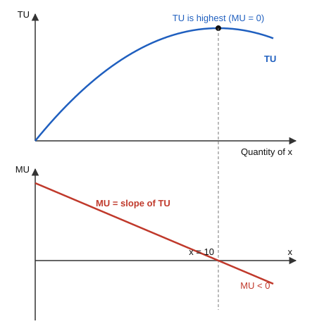
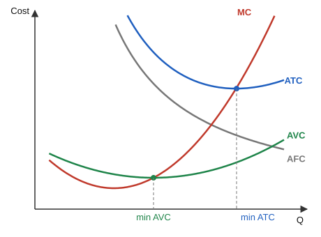
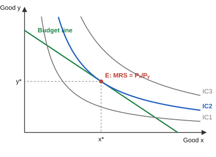
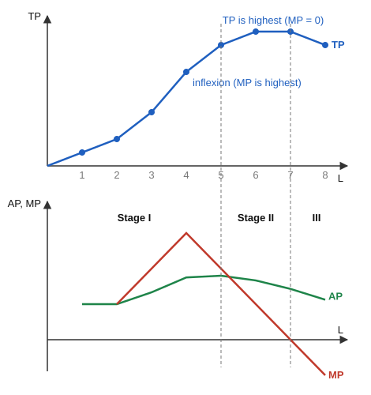

# Module II (Part 2) — Microeconomics: Exam Questions and Answers (HU-4101)

This file covers the **economics taught after the midsem**: how consumers choose, how firms produce, and what production costs. It is built from two sources:

- the class notes of 30 Oct, 6 Nov and 13 Nov;
- the book pages set for study: Koutsoyiannis, *Modern Microeconomics*, 2nd ed., pages 13–26, 67–82 and 105–111.

The macroeconomics part (GDP, the Keynesian cross, money) is in [Module_II_Economics_QA.md](Module_II_Economics_QA.md). Try each question yourself first. Then read the answer.

**How the end-sem asks this part:** the questions are short and come in many small parts.

- **Part A** = 2–3 marks. A definition, a reason, or a small diagram.
- **Part B** = 4–7 marks. A graph with an explanation, a Lagrangian sum, or a production or cost table. There is usually an OR choice.

**Tags used in this file:**

- 🎯 = asked in a real paper (the year and question number are given). "HU-4201" means the 8th-semester paper of the same course.
- ✍️ = a practice question, added so that every part of the notes is covered.
- 📘 = beyond the set book pages (but named in class or asked in a past paper).
- 💡 = a short line to help you remember.

**Note:** for two past-paper questions, the actual tables were not in the files. For those, the answer uses a practice table of the same kind (marked ✍️), so you can still learn the method.

| Topic (class date, book pages) | Question |
| :--- | :--- |
| Utility; cardinal vs ordinal approaches (30 Oct, pp. 13–14) | A1, A8 |
| Cardinal utility: assumptions, TU and MU, law of diminishing MU (30 Oct, pp. 14–17) | A2, A3, B1 |
| Rationality and the axioms of choice (30 Oct, p. 17) | A4 |
| Indifference curves, MRS, properties, shapes (pp. 17–20) | A5, A6 |
| Budget line and consumer equilibrium (pp. 20–23) | A7, B2 |
| Lagrangian method for getting the most utility (pp. 22–23, 26) | B3 |
| Price effect = substitution effect + income effect; Giffen goods (pp. 24–26) | B4 |
| Revealed preference (named in the 30 Oct notes) | A9 |
| Production function; short run vs long run (6 Nov, pp. 67–71) | A10 |
| TP, AP, MP and the law of variable proportions (6 Nov, pp. 71–72, 82) | A11, B5 |
| Isoquants, MRTS, elasticity of substitution (pp. 68–76) | A12 |
| Returns to scale and their causes (6 Nov, pp. 76–82) | A13, A14, B6 |
| Short-run costs: TFC, TVC, TC, AFC, AVC, ATC, MC (13 Nov, pp. 105–111) | A15, A16, A17, B7 |
| Long-run average cost (planning curve) (p. 111) | A18 |
| 📘 Shutdown rule | A19, B8 |

---

## Part A — Short questions (2–4 marks)

### A1. What does the theory of consumer behaviour try to explain? Name the approaches used to study it. ✍️ [2]

**Answer.**

- The theory of consumer behaviour explains **how a typical buyer decides** what to buy, when they have a fixed income and face given prices. From these choices we get the buyer's **demand curve**.
- **Utility** means the satisfaction (pleasure or usefulness) a person gets from using goods and services.
- We assume the consumer is **rational**. This means they spend their income in the way that gives them the **most utility possible**.
- There are three approaches (from the class notes):
  1. **Cardinal utility approach:** utility can be **measured** in numbers. The units are called *utils*, or we can use money.
  2. **Ordinal utility approach (indifference curves):** utility cannot be measured. But the consumer can **rank** bundles of goods: first choice, second choice, third choice, and so on.
  3. **Revealed preference theory:** we learn what the consumer likes by watching the choices they actually make (see A9).

💡 *Cardinal = "how much?" (1, 2, 3 utils). Ordinal = "which is better?" (1st, 2nd, 3rd).*

---

### A2. State the assumptions of cardinal utility analysis. Which assumption makes the demand curve slope downwards? 🎯 2024 End Q1(b) [2]

**Answer.**

The cardinal approach makes five assumptions:

1. **Rationality:** the consumer tries to get the most utility from their fixed income.
2. **Utility can be measured.** The easiest measure is money: how much the consumer is ready to pay for one more unit.
3. **The marginal utility of money stays constant.** Money is the measuring stick, so its own value must not change. (A ruler that stretches would give wrong measurements.)
4. **Diminishing marginal utility:** each extra unit of a good gives **less** extra satisfaction than the unit before.
5. **Total utility depends on the amounts of goods consumed:** $U = f(x_1, x_2, \dots, x_n)$.

**The assumption that makes demand slope down is diminishing marginal utility.** Here is why:

- The consumer keeps buying until $MU_x = P_x$ (the satisfaction from the last unit equals its price).
- As they buy more, MU falls.
- So they will buy more units **only if the price falls** to match the new, lower MU.
- So a lower price goes with a bigger quantity. That is a downward-sloping demand curve (see B1).

---

### A3. Explain marginal utility. Using the law of diminishing marginal utility and the first-order condition, how much of good X will a consumer use if X is free? Explain with a utility diagram. 🎯 2025 End Q2 [3]

**Answer.**

- **Total utility (TU):** the total satisfaction from all the units consumed.
- **Marginal utility (MU):** the **extra** satisfaction from **one more unit**:
$$MU_n = TU_n - TU_{n-1} \qquad \text{or, for small changes,} \qquad MU_x = \frac{d(TU)}{dx}$$
  So MU is the **slope of the TU curve**.
- **Law of diminishing marginal utility:** as you consume more units of a good, each extra unit gives you **less** extra satisfaction.
  - TU keeps rising, but more and more slowly.
  - TU reaches its **highest point** when MU = 0.
  - After that, TU **falls**, because MU becomes negative. Negative MU means the extra unit actually makes you less happy.

**When the good is free:**

- Normally the consumer tries to get the most **net utility**: satisfaction minus what they pay. $NU = TU - P_x \cdot x$.
- The first-order condition (the rule for the best point) is $MU_x = P_x$.
- If X is **free**, then $P_x = 0$. So the rule becomes $MU_x = 0$.
- So the consumer keeps consuming X **until MU falls to zero**. That is the **top of the TU curve** (x = 10 in the diagram).
- They stop there, because one more unit would have negative MU and would lower their total satisfaction.

**Example:** if $TU = 20x - x^2$, then $MU = 20 - 2x$.

- With a price of 4: $20 - 2x = 4$, so x = 8.
- If the good is free: $20 - 2x = 0$, so **x = 10**. Here TU is at its highest (TU = 100).

💡 *Free good: "keep eating until the next bite gives zero pleasure."*

---

### A4. What is a rational consumer? State the axioms of choice. A voter prefers party A to B, and B to C, but then prefers C to A. Which axiom is broken? 🎯 2024 End Q2 (part), 🎯 HU-4201 2024 End Q2 [3]

**Answer.**

A **rational consumer** knows everything about the goods, their prices and their own income. They make the choices that give them the **most satisfaction**. Their choices follow three basic rules, called the **axioms of rationality** (from the class notes). An axiom is a basic rule that we accept without proof.

1. **Completeness:** the consumer can compare **any two** bundles A and B. Either they prefer A to B, or B to A, or they like both equally (they are "indifferent").
2. **Consistency:** if they once choose A over B (when both were available), they will **not** later choose B over A.
   In symbols: if A ≻ B, then not B ≻ A. (The sign ≻ means "is preferred to".)
3. **Transitivity:** choices link up like a chain. If A ≻ B and B ≻ C, then **A ≻ C**.

**The voter:** they prefer A to B, and B to C. Transitivity says they must then prefer A to C. Since they prefer C to A, they **break the axiom of transitivity**. So this choice is not rational in the economic sense.

(If the same voter also keeps switching between A and B from one election to the next, with nothing else changing, that breaks **consistency**.)

💡 *C-C-T: Compare everything, stay Consistent, let choices flow in a chain (Transitive).*

---

### A5. What is an indifference curve? Define MRS and state the properties of indifference curves. ✍️ [3]

**Answer.**

- **Indifference curve (IC):** a curve that joins all the bundles of two goods that give the consumer the **same satisfaction**. The consumer does not care which point on the curve they get. Its equation is $U = f(x, y) = k$, where k is a fixed number.
- **Indifference map:** a set of many ICs drawn together. A **higher** IC means **more** satisfaction.
- **Marginal rate of substitution (MRS):** how many units of y the consumer is willing to **give up to get one more unit of x**, while staying just as happy. It is the slope of the IC (with the minus sign removed):
$$MRS_{x,y} = -\frac{dy}{dx} = \frac{MU_x}{MU_y}$$
  Why does this formula hold? Along an IC, total utility does not change: $dU = MU_x\,dx + MU_y\,dy = 0$. Rearranging this gives the formula above.

**Properties of indifference curves:**

1. **They slope downwards.** To stay equally happy with more x, the consumer must have less y.
2. **A higher IC gives more satisfaction**, because it has more of at least one good.
3. **Two ICs never cross.** If they did, the crossing point would have to give two different levels of satisfaction at once, which is impossible.
4. **They are convex to the origin** (bowed inwards towards the corner). This is because MRS **falls** as we move down the curve (diminishing MRS). The more x a person already has, the less y they will give up for one more x.

---

### A6. If the rule "averages are preferred to extremes" holds, what shape is the indifference curve? Does this rule matter for L-shaped indifference curves? 🎯 2024 End Q2 [3]

**Answer.**

- "Averages are preferred to extremes" means: a **mixed bundle** (some x and some y) is liked at least as much as an extreme bundle (a lot of one good and very little of the other).
- If this is true, then a straight line joining any two points on an IC lies **on or above** the IC. This means the IC is **convex to the origin**, with **diminishing MRS** (property 4 in A5).
- **L-shaped ICs** belong to **perfect complements**: goods that are always used together in a **fixed ratio**, like left and right shoes, or a car and its tyres.
  - There is **no substitution** between them. MRS is either zero or infinite, never in between.
  - One extra unit of one good alone adds nothing. (An extra left shoe without a right shoe is useless.)
  - So the idea of swapping "extremes" for "averages" has no meaning here. The rule is **not relevant** for L-shaped ICs. The book says indifference-curve analysis "breaks down" for them.
- The other extreme is **perfect substitutes**: goods that can fully replace each other. Their IC is a **straight line** (MRS stays constant). The consumer may spend all their income on just one good. This is called a "corner solution".

---

### A7. What is a budget line? Write its equation and slope. ✍️ [2]

**Answer.**

- The **budget line** shows all the bundles of x and y that the consumer can **just afford** when they spend all their income Y, at prices $P_x$ and $P_y$:
$$Y = P_x x + P_y y \quad \Rightarrow \quad y = \frac{Y}{P_y} - \frac{P_x}{P_y}\,x$$
- **Where it meets the axes:**
  - on the y-axis at $Y/P_y$ (all income spent on y);
  - on the x-axis at $Y/P_x$ (all income spent on x).
- **Slope** = $-\dfrac{P_x}{P_y}$, which is the ratio of the two prices.
- **How it moves:**
  - If income rises, the line moves outwards, **parallel** to the old one.
  - If $P_x$ falls, the line **swings** outwards along the x-axis and becomes flatter. (It still starts at the same point on the y-axis.)

---

### A8. Compare the cardinal and ordinal approaches. What are the weaknesses of the cardinal approach? ✍️ [3]

**Answer.**

| Point | Cardinal utility | Ordinal utility (indifference curves) |
| :--- | :--- | :--- |
| Can utility be measured? | Yes, in utils or money | No, it can only be ranked |
| Key law | Diminishing marginal utility | Diminishing MRS (convex ICs) |
| Tool | TU and MU curves | ICs and the budget line |
| Equilibrium (best point) | $MU_x/P_x = MU_y/P_y$ | $MRS_{x,y} = P_x/P_y$ |
| Utility of money | Assumed to stay constant | Not needed |

**Weaknesses of the cardinal approach (from the book):**

1. Satisfaction **cannot really be measured**. Calling the units "utils" does not solve this.
2. The marginal utility of money is **not constant**. As people get richer, one extra rupee means less to them. So money is a ruler that stretches.
3. Diminishing marginal utility comes from **introspection** (looking into our own feelings). It is a law of psychology that we simply accept, without proof.

**Note:** both approaches give the **same rule for the best point**. Since $MRS_{x,y} = MU_x/MU_y$, the rule $\dfrac{MU_x}{MU_y} = \dfrac{P_x}{P_y}$ is the same as $\dfrac{MU_x}{P_x} = \dfrac{MU_y}{P_y}$.

---

### A9. What is revealed preference theory? 📘 [2]

**Answer.**

- It was given by **Paul Samuelson**. It does not ask consumers about their feelings, and it does not draw ICs. Instead, it **watches what consumers actually buy**.
- Suppose a consumer buys bundle A when bundle B was also affordable (B cost the same or less). Then A is **"revealed preferred"** to B. Their choice shows (reveals) that they like A more.
- If we assume the consumer is **consistent** (they never show the opposite choice, B over A, at another time), we can get the downward-sloping demand curve just from their behaviour.
- **Its advantage:** it needs **no measurement of utility** and no assumption about ICs. It uses only what people are seen doing in the market.

---

### A10. What is a production function? How is the short-run production function different from the long-run one? 🎯 2025 End Q3 (part) [2]

**Answer.**

- **Production** means turning inputs (the factors of production, such as workers and machines) into output.
- **Production function:** a purely **technical** link between the inputs used and the output they make: $Y = f(L, K)$. Here L = labour and K = capital. Prices are not part of it.

| Short run | Long run |
| :--- | :--- |
| At least one factor is **fixed**, usually capital (the plant and machines). | **All** factors can be changed. |
| Output is raised by adding more of the variable factor (labour). | Output is raised by changing the **size (scale)** of the whole plant. |
| Follows the **law of variable proportions**. | Follows **returns to scale**. |
| $Y = f(L, \bar K)$ (the bar on K means K is fixed) | $Y = f(L, K)$, both can change |

The short run and the long run are **not fixed lengths of time** (they do not mean "one year"). They depend only on whether all inputs can be changed.

---

### A11. Define total product, average product and marginal product. How are they related? ✍️ [3]

**Answer.**

- **Total product (TP):** the total output made with a given amount of the variable factor (labour), while the other factors stay fixed.
- **Average product (AP):** output per worker: $AP_L = \dfrac{TP}{L}$.
- **Marginal product (MP):** the **extra** output from **one more worker**:
$$MP_L = TP_L - TP_{L-1} \qquad \text{or} \qquad MP_L = \frac{\partial TP}{\partial L}$$
  So MP is the **slope of the TP curve**.

**How they are related:**

1. While MP is **rising**, TP rises faster and faster. While MP is **falling but still positive**, TP still rises, but more slowly. The point where this switch happens is called the **inflexion point** of TP.
2. When **MP = 0**, TP is at its **highest**. When MP is negative, TP falls.
3. When **MP > AP**, AP rises. When **MP < AP**, AP falls. So **MP cuts AP at the highest point of AP**.

💡 *It works like exam marks: if your next test score (the marginal) is above your average, your average goes up.*

---

### A12. What is an isoquant? Define MRTS and the elasticity of substitution. ✍️ [3]

**Answer.**

- **Isoquant** ("iso" = equal, "quant" = quantity): a curve showing all the mixes of L and K that make the **same output**.
  - Higher isoquants mean more output.
  - Isoquants do not cross.
  - In the useful range, they slope down and are **convex** to the origin (bowed inwards).
- **Types of isoquant** (based on how easily one factor can replace the other):
  - **Straight line:** the factors are perfect substitutes.
  - **Right angle (L-shape):** no substitution at all; the factors must be used in fixed proportions. This is called the **Leontief** or **input-output** isoquant.
  - **Kinked:** only a few production methods are possible. It is used in linear programming.
  - **Smooth and convex:** the usual textbook case.
- **Marginal rate of technical substitution (MRTS):** how much capital the firm can give up for one more unit of labour, while keeping output the same. It is the slope of the isoquant:
$$MRTS_{L,K} = -\frac{dK}{dL} = \frac{MP_L}{MP_K}$$
- **Elasticity of substitution (σ):** the MRTS depends on the units we use, so we need a measure without units. σ compares percentage changes:
$$\sigma = \frac{\%\ \text{change in } K/L}{\%\ \text{change in } MRTS} = \frac{d(K/L)\,/\,(K/L)}{d(MRTS)\,/\,MRTS}$$
  For the Cobb-Douglas function $X = b_0 L^{b_1} K^{b_2}$: $MRTS = \dfrac{b_1}{b_2}\cdot\dfrac{K}{L}$ and **σ = 1**.
- **Ridge lines:** lines that join the points where the MP of a factor is zero. Production is technically efficient only in the area **between the ridge lines**.

---

### A13. What are returns to scale? How are they measured for a homogeneous production function? ✍️ [3]

**Answer.**

**Returns to scale** describe what happens to output in the **long run** when **all inputs are increased by the same proportion** (for example, all are doubled).

Suppose we multiply every input by t, and get $f(tL, tK) = t^v f(L, K)$. Then the function is called **homogeneous of degree v**. The value of v tells us the returns to scale:

| v | Name | If all inputs are doubled, output becomes |
| :--- | :--- | :--- |
| v = 1 | **Constant** returns to scale (CRS) | exactly double |
| v > 1 | **Increasing** returns to scale (IRS) | more than double |
| v < 1 | **Decreasing** returns to scale (DRS) | less than double |

For **Cobb-Douglas** $X = b_0 L^{b_1} K^{b_2}$, we get $v = b_1 + b_2$ (just add the powers).
Proof: $b_0 (tL)^{b_1} (tK)^{b_2} = t^{\,b_1+b_2}\, b_0 L^{b_1} K^{b_2}$.

**On an isoquant map:** draw the isoquants for output X, 2X and 3X, and a straight line (ray) from the origin through them.

- Equal gaps between them = CRS.
- Gaps getting **smaller** = IRS (less extra input is needed for each extra X).
- Gaps getting **larger** = DRS.

---

### A14. What causes increasing and decreasing returns to scale? How are internal economies of scale different from external ones? ✍️ [3]

**Answer.**

**Causes of increasing returns (IRS):**

- **Indivisibilities**, both technical and managerial. Some things cannot be split into small pieces. Big machines and mass-production methods (such as a car assembly line) can only be used at a large output. They are more productive than small-scale methods.
- **Specialisation and division of labour** in a large plant: each worker does one task and gets very good at it.
- These lead to **economies of scale**: the cost of each unit falls as the firm grows. (The class example: large-scale manufacturing lowers the cost per unit.)

**Causes of decreasing returns (DRS):**

- **Diminishing returns to management:** as the firm grows, top managers get overloaded, and coordination gets worse.
- **Natural resources that can run out:** doubling a fishing fleet may not double the catch, because there are only so many fish.

**Economies of scale:**

- **Internal economies** come from the **firm's own growth**: bigger machines, better division of labour, buying in bulk. They shape the firm's long-run cost curve.
- **External economies** come from **outside the firm**: growth of the whole industry or region, such as better roads, trained workers nearby, and networks of suppliers. They **shift** the firm's cost curves down.
- Note from the book: returns to scale are purely **technical** (about inputs and outputs). Economies of scale include technical savings **and** money savings (called pecuniary savings, like bulk discounts).

---

### A15. How are short-run costs different from long-run costs? What are fixed and variable costs? ✍️ [2]

**Answer.**

- **Short-run cost:** cost when some factors (plant, machinery, management) are **fixed**. Total cost then has two parts:
$$TC = TFC + TVC$$
- **Long-run cost:** cost when **all** factors can be changed, so all costs are variable. The long-run cost curve is a **planning curve** (see A18).

| Total fixed cost (TFC) | Total variable cost (TVC) |
| :--- | :--- |
| Does **not change** with output. It must be paid even if nothing is made. | **Changes** with the amount of output. It is zero when nothing is made. |
| Examples: rent, salaries of office staff, depreciation (wear and tear) of machines and buildings, insurance | Examples: raw materials, wages of workers on the production line, fuel and power, routine repairs |
| Graph: a **flat (horizontal)** line | Graph: an **upside-down S** shape. It rises fast, then slowly, then fast again. |

TC = TFC + TVC. TFC is a flat line added on top of TVC. So the **TC curve has the same shape as TVC**, but it starts at the TFC level instead of at zero.

---

### A16. Explain the shapes of the AFC, AVC and ATC curves. Why is the lowest point of ATC to the right of the lowest point of AVC? ✍️ [3]

**Answer.**

$$AFC = \frac{TFC}{Q}, \qquad AVC = \frac{TVC}{Q}, \qquad ATC = \frac{TC}{Q} = AFC + AVC$$

- **AFC (average fixed cost) keeps falling** as output rises. The same fixed cost is spread over more and more units. Its curve is a **rectangular hyperbola**: AFC × Q = TFC is the same at every point. The curve gets closer and closer to the x-axis but never touches it.
- **AVC (average variable cost) is U-shaped** because of the **law of variable proportions**.
  - At first, adding workers raises their productivity, so AVC falls.
  - After the best mix of fixed and variable factors is reached, productivity falls, so AVC rises.
- **ATC (average total cost) is also U-shaped**, because ATC = AFC + AVC.

**Why ATC reaches its lowest point later than AVC:**

- Just after AVC starts rising, AFC is still falling.
- For a while, the **fall in AFC is bigger than the rise in AVC**. So ATC keeps falling.
- ATC turns up only when the rise in AVC becomes bigger than the fall in AFC.
- Also, the **gap between ATC and AVC is AFC**. Since AFC keeps shrinking, the AVC curve gets closer and closer to the ATC curve.

---

### A17. Define marginal cost. Show that MC cuts AVC and ATC at their lowest points. ✍️ [3]

**Answer.**

- **Marginal cost (MC):** the **extra** total cost of making **one more unit**:
$$MC_n = TC_n - TC_{n-1} \qquad \text{or} \qquad MC = \frac{d(TC)}{dQ} = \frac{d(TVC)}{dQ}$$
  - Fixed cost does not change, so MC depends only on variable cost.
  - MC is the **slope of the TC curve**.
  - Because TC has an upside-down S shape, **MC is U-shaped**. It reaches its lowest point before AVC and ATC do.

- **Why MC cuts AC at its lowest point** (the average–marginal rule):
  - If the cost of the extra unit (MC) is **below** the average, it **pulls the average down**.
  - If MC is **above** the average, it **pulls the average up**.
  - So the average stops falling and starts rising exactly where **MC = AC**. That is the **lowest point** of AC.
  - The same reasoning works for AVC.

- **With calculus:** $TC = AC \times Q$, so
$$MC = \frac{d(AC \cdot Q)}{dQ} = AC + Q\cdot\frac{d(AC)}{dQ}$$
  - When AC is falling (its slope is negative), MC < AC.
  - When AC is rising (its slope is positive), MC > AC.
  - At the lowest point of AC, the slope is zero, so **MC = AC**.

💡 *MC is like a "new student" who changes the class average. MC crosses AVC first, then ATC, each at its lowest point.*

---

### A18. What is a planning curve (also called the long-run average cost curve or envelope curve)? 🎯 HU-4201 2023 End Q2(b) [3]

**Answer.**

- In the long run, the firm can choose **any size of plant**. Each plant size has its own short-run average cost curve: SAC₁ for a small plant, SAC₂ for a medium plant, SAC₃ for a large plant, and so on.
- For each level of output, the firm picks the plant that gives the **lowest cost**. Joining all these lowest-cost points gives the **long-run average cost (LAC) curve**.
- When there are many possible plant sizes, the LAC becomes a smooth curve. It **touches (is tangent to) each SAC** curve at one point, and lies below all of them everywhere else. It wraps around the SACs from below, like an envelope. That is why it is called the **envelope curve**.
- It is called a **planning curve** because the firm uses it **before investing**, to decide which plant to build for the output it expects. Once the plant is built, the firm works on that plant's short-run curve.
- In traditional theory, the LAC is **U-shaped**:
  - it falls at first because of **economies of scale** (increasing returns);
  - it rises later because of **diseconomies of scale** (decreasing returns).

---

### A19. When should a loss-making firm shut down in the short run? 📘 🎯 HU-4201 2023 End Q2(a) (theory) [3]

**Answer.**

- In the short run, the firm must pay its **fixed cost even if it makes nothing**. So the real question is not "Are we making a loss?" It is "Is our loss **smaller** if we keep producing?"
- **Shutdown rule:** keep producing as long as **price ≥ AVC**. Then the money from sales covers all the variable costs, and each unit also pays off a part of the fixed cost. So the loss is **smaller than the fixed cost**.
- **Shut down if price < the lowest AVC.** Then producing does not even cover the variable cost. The loss would be bigger than the fixed cost, so it is better to stop.
- So the **lowest point of the AVC curve is the shutdown point**. (A worked example is in B8.)

---

## Part B — Longer questions (4–7 marks)

### B1. 🎯 2023 End Q9 + ✍️

**(a)** Explain the law of diminishing marginal utility and derive the demand curve from it. **[5]**
**(b)** Using the net-utility approach, write the first- and second-order conditions for getting the most utility. With $TU = 20x - x^2$ and a price of ₹4, find the quantity bought. **[2]**

**(a) Answer.**

**Law of diminishing marginal utility:** as a consumer uses more and more units of a good (while their use of other goods stays the same), the extra satisfaction from each new unit **keeps falling**.

Example: drinking glasses of water. TU rises with each glass, but by smaller and smaller amounts. TU reaches its peak when MU = 0. After that, TU falls (MU is negative, meaning discomfort).

The law holds under these assumptions:

- the units are standard (same size and quality);
- consumption is continuous (no long gap between units);
- tastes and income stay the same.

**Deriving the demand curve, step by step:**

1. In the cardinal approach (where money measures utility), the consumer is at their best point when $MU_x = P_x$ (see part b).
2. Look at the falling MU curve. At quantity $x_1$, MU is $MU_1$. So the consumer buys $x_1$ only if the price is $P_1 = MU_1$.
3. At a bigger quantity $x_2$, MU is lower ($MU_2$). So they buy $x_2$ only if the price falls to $P_2 = MU_2$.
4. Plot these price–quantity pairs. The **demand curve is the part of the MU curve above the x-axis**. Since MU falls, the demand curve **slopes downwards**. This is the law of demand.
5. The part of the MU curve below zero is **not** part of the demand curve. Nobody pays a positive price for a unit that makes them less happy.

💡 *Demand curve = the MU curve above the x-axis.*

**(b) Answer.**

The consumer tries to get the most **net utility**: satisfaction minus what they pay. The class notes call the payment "disutility", $DU = P_x x$.

$$NU = TU(x) - P_x\,x$$

- **First-order condition (FOC), the necessary condition:** the slope of NU must be zero.
  $\dfrac{dNU}{dx} = \dfrac{d(TU)}{dx} - P_x = 0 \;\Rightarrow\; \boxed{MU_x = P_x}$
- **Second-order condition (SOC), the sufficient condition:** $\dfrac{d^2NU}{dx^2} = \dfrac{d(MU_x)}{dx} = \dfrac{d^2(TU)}{dx^2} < 0$. This means **MU must be falling** at that point, which is exactly the law of diminishing marginal utility. It makes sure the point is a maximum, not a minimum.

**The sum.** With $TU = 20x - x^2$, we get $MU = 20 - 2x$.

- FOC: $20 - 2x = 4 \Rightarrow$ **x = 8 units**.
- SOC: $dMU/dx = -2 < 0$ ✓, so this is a maximum.
- Check: TU = 160 − 64 = 96. Spending = 4 × 8 = 32. Net utility = **64**.

**With many goods,** the rule becomes $\dfrac{MU_1}{P_1} = \dfrac{MU_2}{P_2} = \dots = \dfrac{MU_n}{P_n}$. In words: the last rupee spent on each good gives the same utility. This is the **law of equi-marginal utility**.

---

### B2. ✍️ — Consumer equilibrium with indifference curves

Explain the consumer's equilibrium using indifference curves and the budget line. State the conditions for equilibrium. **[5]**

**Answer.**

The consumer wants to reach the **highest IC** possible. But they must stay **on their budget line**, because they cannot spend more than their income.

- **IC3** would give more satisfaction, but it is **out of reach**: it lies beyond the budget line.
- **IC1** can be reached at two points, but those points are **not the best**. Moving along the budget line towards E puts the consumer on a higher IC.
- The best point is **E**, where the budget line just **touches (is tangent to)** the highest IC that can be reached, IC2. The consumer buys $x^*$ of x and $y^*$ of y.

**Conditions for equilibrium:**

1. **First-order (necessary) condition:** at the point where they touch, the slopes are equal:
$$MRS_{x,y} = \frac{MU_x}{MU_y} = \frac{P_x}{P_y}$$
   In words: the rate at which the consumer is **willing** to swap the goods equals the rate at which the **market** lets them swap.
2. **Second-order (sufficient) condition:** the IC must be **convex to the origin** at that point (diminishing MRS). If not, the touching point could give the **least** satisfaction instead of the most.

**Why not some other point?**

- If $MRS > P_x/P_y$, the consumer values x more than the market does. So they buy more x and less y, and move towards E.
- If $MRS < P_x/P_y$, they do the opposite, and again move towards E.

---

### B3. 🎯 2025 End Q2 (OR) + 🎯 2024 End Q5 + 🎯 HU-4201 2024 End Q1

**(a)** Find the quantities of x and y that give the most utility for $U = x^{1/2} y^{1/2}$, with the budget $2x + 3y = 10$. **[3]**
**(b)** A student has ₹40 to spend on books (₹20 each) and movie tickets (₹10 each). Their utility is $u = \sqrt{b \cdot m}$. Using the Lagrangian multiplier method, find how many of each to buy. **[6]**
**(c)** Maximise $U = x^{1/2} y^{1/2}$ subject to $10x + 20y = 200$. **[5]**

**The method (Lagrangian, from the book).** It finds the best point when there is a limit (here, the budget). Follow these four steps:

1. Write the budget limit so that one side is zero: $(P_x x + P_y y - M) = 0$.
2. Multiply it by a new unknown, the **Lagrangian multiplier λ** (lambda), and subtract it from U:
$$\mathcal{L} = U(x, y) - \lambda\,(P_x x + P_y y - M)$$
3. Take the partial derivative of $\mathcal{L}$ with respect to x, y and λ, and set each one equal to zero: $\dfrac{\partial \mathcal{L}}{\partial x} = 0$, $\dfrac{\partial \mathcal{L}}{\partial y} = 0$, $\dfrac{\partial \mathcal{L}}{\partial \lambda} = 0$.
4. Divide the first equation by the second. This gives $\dfrac{MU_x}{MU_y} = \dfrac{P_x}{P_y}$. Then put the result into the budget equation and solve.

**(a) Answer.**

$$\mathcal{L} = x^{1/2} y^{1/2} - \lambda\,(2x + 3y - 10)$$
$$\frac{\partial \mathcal{L}}{\partial x} = \tfrac12 x^{-1/2} y^{1/2} - 2\lambda = 0 \quad (1)$$
$$\frac{\partial \mathcal{L}}{\partial y} = \tfrac12 x^{1/2} y^{-1/2} - 3\lambda = 0 \quad (2)$$
$$\frac{\partial \mathcal{L}}{\partial \lambda} = -(2x + 3y - 10) = 0 \quad (3)$$

Divide (1) by (2): $\dfrac{y}{x} = \dfrac{2}{3}$, so $y = \dfrac{2x}{3}$.

Put this into (3): $2x + 3 \cdot \dfrac{2x}{3} = 10 \Rightarrow 4x = 10 \Rightarrow$ **x = 2.5**, **y = 5/3 ≈ 1.67**.

Check: 2(2.5) + 3(1.67) = 5 + 5 = 10 ✓.

The most utility is $U = \sqrt{2.5 \times 1.67} \approx 2.04$. Also, $\lambda = \tfrac14\sqrt{2/3} \approx 0.20$. λ means the extra utility the consumer would get from one more rupee of income.

**(b) Answer.**

$$\mathcal{L} = (b\,m)^{1/2} - \lambda\,(20b + 10m - 40)$$
$$\frac{\partial \mathcal{L}}{\partial b} = \tfrac12 b^{-1/2} m^{1/2} - 20\lambda = 0, \qquad \frac{\partial \mathcal{L}}{\partial m} = \tfrac12 b^{1/2} m^{-1/2} - 10\lambda = 0$$

Divide the first by the second: $\dfrac{m}{b} = \dfrac{20}{10} = 2$, so $m = 2b$.

Put this into the budget: $20b + 10(2b) = 40 \Rightarrow 40b = 40 \Rightarrow$ **b = 1 book, m = 2 movie tickets**.

Check: 20 + 20 = 40 ✓. Utility $u = \sqrt{2} \approx 1.41$.

**(c) Answer.**

Same steps. Dividing the two derivative equations gives $\dfrac{MU_x}{MU_y} = \dfrac{y}{x} = \dfrac{10}{20}$, so $x = 2y$.

Put this into the budget: $10(2y) + 20y = 200 \Rightarrow 40y = 200 \Rightarrow$ **y = 5, x = 10**.

Check: 100 + 100 = 200 ✓. Utility $U = \sqrt{50} \approx 7.07$.

💡 **A shortcut to check your answer:** for $U = x^{a} y^{b}$, the consumer spends the fraction $\frac{a}{a+b}$ of their income on x. When $a = b = \tfrac12$, that is **half the income on each good**: $x = \dfrac{M}{2P_x}$ and $y = \dfrac{M}{2P_y}$. In (a): x = 10/4 = 2.5 and y = 10/6 = 1.67 ✓. The book's own example gives the same result, $q_x = \dfrac{Y}{2P_x}$. This is a **demand curve**: as the price goes up, the quantity goes down. **In the exam, still write out all the Lagrangian steps**, because that is what earns the marks.

---

### B4. ✍️ — Price effect, substitution effect and income effect

When the price of x falls, show how the total effect splits into a substitution effect and an income effect. What happens for an inferior good and for a Giffen good? **[5]**

**Answer.**

When $P_x$ falls, the budget line **swings outwards** and becomes flatter. The consumer moves from their old best point $e_1$ on IC I to a new best point $e_2$ on a higher IC II, and buys more x. This total change is called the **price effect**. Slutsky split it into two parts:

1. **Substitution effect:** x is now **cheaper compared with y**, so the consumer swaps some y for x.
   - To see this effect alone, imagine **taking away just enough income** to put the consumer back on their old IC. (This amount is called the **compensating variation**.)
   - On the graph: draw a line parallel to the new budget line that just touches IC I, at a point $e_1'$.
   - The move **$e_1 \to e_1'$** is the substitution effect. It **always** makes the consumer buy more of the good that became cheaper.
2. **Income effect:** the lower price also makes the consumer **richer in real terms**, because their money now buys more. Giving back the income we took away moves them from **$e_1' \to e_2$**.

**Price effect = substitution effect + income effect.**

| Type of good | Income effect when the price falls | Overall result |
| :--- | :--- | :--- |
| **Normal** (people buy more when richer) | they buy more x, adding to the substitution effect | quantity rises, so the demand curve slopes down |
| **Inferior** (people buy less when richer) | they buy less x, working against the substitution effect | usually the substitution effect is bigger, so quantity still rises |
| **Giffen** (a very strongly inferior good) | the opposite income effect is **bigger** than the substitution effect | quantity **falls** when the price falls, so the demand curve slopes **upwards** (very rare) |

**Getting the demand curve from this:** let $P_x$ fall step by step and join all the best points. This line is the **price-consumption curve**. Now plot each price against its quantity of x. This gives the **demand curve**, which slopes down for normal goods.

💡 *Substitution effect: "it's cheaper, so buy more of it" (always). Income effect: "I feel richer" (the result depends on the type of good).*

---

### B5. 🎯 2025 End Q3 + 🎯 HU-4201 2024 End Q3(b) + ✍️ (class table)

**(a)** Fill in MP and AP for the table below (the example from class, with capital fixed), and explain the three stages of production. **[4]**
**(b)** Why is the inflexion point of the TP curve important? What law decides the shape of TP? Why is it called the law of variable proportions? **[3]**
**(c)** Find x and y: **[2]**

| L | TP | MP |
| :---: | :---: | :---: |
| 1 | 10 | 10 |
| 2 | 24 | 14 |
| 3 | x | 15 |
| 4 | 48 | y |
| 5 | 50 | 2 |

**(a) Answer.**

| L | TP | MP = TP(L) − TP(L−1) | AP = TP/L | Stage |
| :---: | :---: | :---: | :---: | :--- |
| 1 | 100 | — | 100 | I |
| 2 | 200 | 100 | 100 | I |
| 3 | 400 | 200 | 133.3 | I |
| 4 | 700 | **300** (highest) | 175 | I |
| 5 | 900 | 200 | **180** (highest) | end of I |
| 6 | 1000 | 100 | 166.7 | II |
| 7 | 1000 | **0** | 142.9 | end of II |
| 8 | 900 | −100 | 112.5 | III |

**The three stages of production:**

1. **Stage I (L = 1 to 5): increasing returns to the factor.**
   - MP rises at first (up to 300 at L = 4).
   - AP rises all through this stage, up to its highest point (180 at L = 5).
   - The fixed capital is **under-used**: there are too few workers for the machines.
   - A sensible firm **will not stop here**, because each extra worker still raises the output per worker.
2. **Stage II (L = 5 to 7): diminishing returns.**
   - AP and MP both fall.
   - But MP is still **positive**, so TP still rises (slowly) up to its peak of 1000, where MP = 0.
   - **A rational firm produces in this stage.**
3. **Stage III (L more than 7): negative returns.**
   - MP is **negative**, and TP falls (900 at L = 8).
   - Too many workers crowd around the fixed machines and get in each other's way.
   - No rational firm works here.

**(b) Answer.**

- The **inflexion point** is where the TP curve **changes its bend**. Before it, TP rises faster and faster (the curve bends upwards). After it, TP rises more and more slowly (the curve bends downwards).
  - At this point **MP is at its highest** (around L = 4 in the table).
  - After this point, **diminishing returns begin**.
- The shape of TP (an "S" that rises steeply, then flattens, then falls) is decided by the **law of variable proportions**, also called the **law of diminishing returns to a factor**. The law says: when more and more of one variable factor is added to fixed factors, the **marginal product of that factor will fall** after some point.
- **Why "variable proportions"?** Labour is added while capital stays fixed. So the **ratio (proportion) of labour to capital keeps changing**. At first the mix gets better (Stage I). After the best mix, the variable factor **overcrowds the fixed factor** (class notes), so MP falls.
- It is a **short-run** law, because one factor must stay fixed.

**(c) Answer.**

- x = TP at L = 3 = TP at L = 2 + MP at L = 3 = 24 + 15 = **39**.
- y = MP at L = 4 = TP at L = 4 − TP at L = 3 = 48 − 39 = **9**.

💡 *TP is highest exactly where MP = 0. AP is highest exactly where MP = AP.*

---

### B6. ✍️ — Returns to scale: sums and graph

**(a)** Find the returns to scale for: (i) $X = L^{0.5}K^{0.5}$; (ii) $X = 4L^{0.6}K^{0.6}$; (iii) $X = L^{0.3}K^{0.5}$. **[3]**
**(b)** For $X = 4L^{0.5}K^{0.5}$, find $MP_L$, $MP_K$ and MRTS. **[2]**
**(c)** How are returns to scale different from returns to a variable factor? **[2]**

**(a) Answer.** Multiply both L and K by t, then pull t out to the front:

- (i) $(tL)^{0.5}(tK)^{0.5} = t^{1.0}\,L^{0.5}K^{0.5}$. So v = 1: **constant returns**. Doubling the inputs doubles the output (× 2).
- (ii) $4(tL)^{0.6}(tK)^{0.6} = t^{1.2}\cdot 4L^{0.6}K^{0.6}$. So v = 1.2, which is more than 1: **increasing returns**. Doubling the inputs multiplies output by $2^{1.2} \approx 2.30$.
- (iii) $(tL)^{0.3}(tK)^{0.5} = t^{0.8}\,L^{0.3}K^{0.5}$. So v = 0.8, which is less than 1: **decreasing returns**. Doubling the inputs multiplies output by only $2^{0.8} \approx 1.74$.

**Rule:** for Cobb-Douglas, just **add the powers**: v = b₁ + b₂. The number in front (like the 4) is the **efficiency parameter**. A better-organised firm has a bigger one. It does **not** change the returns to scale.

**(b) Answer.**

$$MP_L = \frac{\partial X}{\partial L} = 2L^{-0.5}K^{0.5} = 2\sqrt{K/L}, \qquad MP_K = \frac{\partial X}{\partial K} = 2L^{0.5}K^{-0.5} = 2\sqrt{L/K}$$
$$MRTS_{L,K} = \frac{MP_L}{MP_K} = \frac{K}{L}$$

Both MPs **fall** as more of that factor is used. This is diminishing returns to each factor, even though the returns to scale are constant. (The two ideas are different; see part c.)

**(c) Answer.**

| Returns to a variable factor | Returns to scale |
| :--- | :--- |
| **Short run** | **Long run** |
| One factor changes; the others stay fixed. | **All** factors change by the same proportion. |
| The **mix (proportion)** of factors changes. | The mix stays **the same**; only the **size (scale)** changes. |
| Follows the law of variable proportions (MP falls after some point). | Can be increasing, constant or decreasing returns to scale. |
| On the isoquant map: moving **along a flat line** (K fixed). | On the isoquant map: moving **along a ray from the origin**. |

---

### B7. 🎯 HU-4201 2023 End Q1 (type) + ✍️

**(a)** A firm has a total fixed cost of ₹100. Its total variable cost is given below. Find TC, AFC, AVC, ATC and MC, and comment on the results. **[4]**

| Q | 0 | 1 | 2 | 3 | 4 | 5 | 6 | 7 | 8 |
| :--- | ---: | ---: | ---: | ---: | ---: | ---: | ---: | ---: | ---: |
| TVC (₹) | 0 | 40 | 70 | 90 | 120 | 160 | 210 | 280 | 370 |

**(b)** For $TC = 100 + 10Q - 2Q^2 + 0.2Q^3$: find TFC, TVC, AVC and MC, and the output where AVC is lowest. Show that MC = AVC at that output. **[3]**

**(a) Answer.**

| Q | TFC | TVC | TC | AFC | AVC | ATC | MC |
| :---: | ---: | ---: | ---: | ---: | ---: | ---: | ---: |
| 0 | 100 | 0 | 100 | — | — | — | — |
| 1 | 100 | 40 | 140 | 100 | 40 | 140 | 40 |
| 2 | 100 | 70 | 170 | 50 | 35 | 85 | 30 |
| 3 | 100 | 90 | 190 | 33.33 | 30 | 63.33 | **20** (lowest) |
| 4 | 100 | 120 | 220 | 25 | **30** (lowest) | 55 | 30 |
| 5 | 100 | 160 | 260 | 20 | 32 | 52 | 40 |
| 6 | 100 | 210 | 310 | 16.67 | 35 | **51.67** (lowest) | 50 |
| 7 | 100 | 280 | 380 | 14.29 | 40 | 54.29 | 70 |
| 8 | 100 | 370 | 470 | 12.5 | 46.25 | 58.75 | 90 |

**Formulas used:**

- TC = TFC + TVC
- AFC = TFC/Q
- AVC = TVC/Q
- ATC = TC/Q = AFC + AVC
- MC = TC at this Q − TC at the previous Q

**Comments:**

- TFC stays at 100 at every output, even at Q = 0. AFC keeps falling (100, 50, 33.33, …).
- **MC reaches its lowest point first** (Q = 3), then **AVC** (Q = 3–4), then **ATC** (Q = 6). This is the usual order.
- At Q = 4, MC = 30 = AVC. So **MC meets AVC at its lowest point**.
- MC rises from 50 to 70 as it crosses ATC (51.67) between Q = 6 and Q = 7, which is at the bottom of ATC.
- While MC < ATC, ATC falls. Once MC > ATC, ATC rises. This is the average–marginal rule.

**(b) Answer.**

- TFC = **100** (the part that does not depend on Q). TVC = $10Q - 2Q^2 + 0.2Q^3$ (the rest).
- $AVC = \dfrac{TVC}{Q} = 10 - 2Q + 0.2Q^2$.
- $MC = \dfrac{d(TC)}{dQ} = 10 - 4Q + 0.6Q^2$.
- Lowest AVC: set its slope to zero. $\dfrac{d(AVC)}{dQ} = -2 + 0.4Q = 0 \Rightarrow$ **Q = 5**. Then AVC = 10 − 10 + 5 = **5**.
- MC at Q = 5: 10 − 20 + 15 = **5**, which equals AVC ✓. So **MC cuts AVC at its lowest point**.
- Extra: MC itself is lowest at $Q = 10/3 \approx 3.33$, before AVC's lowest point, as expected. ATC is lowest at about Q = 8.5, after AVC's lowest point.

---

### B8. 🎯 HU-4201 2023 End Q2(a) 📘

A firm sells 1000 units at ₹5 each. Its average total cost is ₹7. Of this, the average fixed cost is ₹4 and the average variable cost is ₹3. It is making a loss of ₹2000. Should it keep producing in the short run? **[4]**

**Answer.**

- Total revenue = 5 × 1000 = **₹5,000**.
- Total cost = 7 × 1000 = ₹7,000. This is made up of:
  - TFC = 4 × 1000 = **₹4,000**
  - TVC = 3 × 1000 = **₹3,000**
- **If it keeps producing:** loss = 7,000 − 5,000 = **₹2,000**.
- **If it shuts down:** revenue = 0 and variable cost = 0. But the fixed cost of ₹4,000 must still be paid. So the loss = **₹4,000**.
- Price (₹5) is more than AVC (₹3). So each unit covers its own variable cost and adds ₹2 towards the fixed cost. The 1000 units recover ₹2,000 of the ₹4,000 fixed cost.
- **Decision: keep producing in the short run.** It loses ₹2,000 instead of ₹4,000.
- **Rule:** produce if P ≥ AVC; shut down if P < the lowest AVC. In the long run, the firm must cover ATC (all its costs), or it will leave the industry.

💡 *Short run: "if you cover your variable cost, you are better off staying open."*
