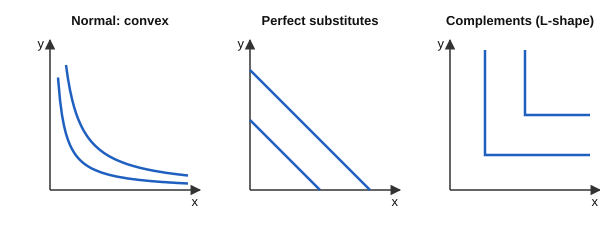

# Module II (Part 2) — Microeconomics: Exam Questions and Answers (HU-4101)

This file covers the **post-midsem economics** part of the syllabus: consumer behaviour, production and cost. It is built from the class notes of 30 Oct, 6 Nov and 13 Nov and from the book pages set for study (Koutsoyiannis, *Modern Microeconomics*, 2nd ed.: pages 13–26, 67–82 and 105–111). The macroeconomics part (GDP, Keynesian cross, money) is in [Module_II_Economics_QA.md](Module_II_Economics_QA.md). Try each question first, then read the answer.

**Pattern (end-sem):** economics questions are short and come in many small parts: Part A = 2–3 marks (a definition, a reason, a small diagram); Part B = 4–7 marks (a graph with explanation, a Lagrangian problem, a production or cost table), usually with an OR.
**Tags:** 🎯 real paper (year, question; HU-4201 = the 8th-semester paper of the same course); ✍️ practice to cover the notes; 📘 beyond the set pages (named in class or asked in a past paper). 💡 = memory hook.
**Where the real-paper tables were not available**, the answer uses a practice table of the same type (marked ✍️), so you can learn the method.

| Topic (class date, book pages) | Question |
| :--- | :--- |
| Utility; cardinal vs ordinal approaches (30 Oct, pp. 13–14) | A1, A8 |
| Cardinal utility: assumptions, TU and MU, law of diminishing MU (30 Oct, pp. 14–17) | A2, A3, B1 |
| Rationality and the axioms of choice (30 Oct, p. 17) | A4 |
| Indifference curves, MRS, properties, shapes (pp. 17–20) | A5, A6 |
| Budget line and consumer equilibrium (pp. 20–23) | A7, B2 |
| Lagrangian method for utility maximisation (pp. 22–23, 26) | B3 |
| Price effect = substitution effect + income effect; Giffen goods (pp. 24–26) | B4 |
| Revealed preference (named in the 30 Oct notes) | A9 |
| Production function; short run vs long run (6 Nov, pp. 67–71) | A10 |
| TP, AP, MP and the law of variable proportions (6 Nov, pp. 71–72, 82) | A11, B5 |
| Isoquants, MRTS, elasticity of substitution (pp. 68–76) | A12 |
| Returns to scale and their causes (6 Nov, pp. 76–82) | A13, A14, B6 |
| Short-run costs: TFC, TVC, TC, AFC, AVC, ATC, MC (13 Nov, pp. 105–111) | A15, A16, A17, B7 |
| Long-run average cost (planning curve) (p. 111) | A18 |
| 📘 Shutdown rule | A19, B8 |

---

## Part A — Short questions (2–4 marks)

### A1. What does the theory of consumer behaviour try to explain? Name the approaches used to study it. ✍️ [2]

**Answer.**
- The theory of consumer behaviour explains **how a typical consumer chooses** what to buy with a given income at given prices. From this choice we get the consumer's **demand curve**.
- **Utility** = the satisfaction a consumer gets from consuming goods and services.
- The consumer is assumed to be **rational**: he spends his income so as to get the **highest possible utility**.
- Three approaches (from the class notes):
  1. **Cardinal utility approach:** utility can be **measured** in numbers (in units called *utils*, or in money).
  2. **Ordinal utility approach (indifference curves):** utility cannot be measured, but the consumer can **rank** bundles of goods (first, second, third…).
  3. **Revealed preference theory:** we learn the consumer's preferences from the choices he actually makes (see A9).

💡 *Cardinal = "how much" (1, 2, 3 utils). Ordinal = "which is better" (1st, 2nd, 3rd).*

---

### A2. State the assumptions of cardinal utility analysis. Which assumption makes the demand curve slope downwards? 🎯 2024 End Q1(b) [2]

**Answer.**
Assumptions of the cardinal approach:
1. **Rationality:** the consumer aims to maximise his utility with his given income.
2. **Cardinal utility:** utility can be measured. The easiest measure is money: the amount the consumer is ready to pay for one more unit.
3. **Constant marginal utility of money:** money is the measuring rod, so its own value must not change (a ruler must not stretch).
4. **Diminishing marginal utility:** each extra unit of a good gives less extra satisfaction than the one before.
5. **Total utility depends on the quantities** of the goods consumed: $U = f(x_1, x_2, \dots, x_n)$.

**The assumption that gives the downward slope is diminishing marginal utility.** The consumer buys up to the point where $MU_x = P_x$. As he buys more, MU falls, so he will buy more units **only if the price falls** to the new, lower MU. So a lower price goes with a larger quantity: the demand curve slopes down (see B1).

---

### A3. Explain marginal utility. Given the law of diminishing marginal utility and the first-order condition, how much of good X will a consumer consume if X is free? Explain with a utility diagram. 🎯 2025 End Q2 [3]

**Answer.**
- **Total utility (TU):** total satisfaction from all units consumed.
- **Marginal utility (MU):** the change in total utility from consuming **one more unit**:
$$MU_n = TU_n - TU_{n-1} \qquad \text{or, for small changes,} \qquad MU_x = \frac{d(TU)}{dx}$$
  So MU is the **slope of the TU curve**.
- **Law of diminishing marginal utility:** as a person consumes more units of a good, the MU of each extra unit **falls**. TU rises, but more and more slowly; it reaches a maximum when MU = 0; after that TU falls (MU is negative, meaning dissatisfaction).

**When the good is free:**
- Normally the consumer maximises **net utility** $NU = TU - P_x \cdot x$. The first-order condition is $MU_x = P_x$.
- If X is **free**, $P_x = 0$, so the condition becomes $MU_x = 0$.
- So the consumer consumes X **until MU becomes zero**, that is, up to the **peak of the TU curve** (x = 10 in the diagram). He stops there: one more unit would give negative MU and reduce TU.
- Example: if $TU = 20x - x^2$, then $MU = 20 - 2x$. With a price of 4, $20 - 2x = 4$ gives x = 8. If the good is free, $20 - 2x = 0$ gives **x = 10**, where TU is highest (TU = 100).

💡 *Free good: "eat until the next bite gives zero pleasure."*

---

### A4. What is a rational consumer? State the axioms of choice. A voter prefers party A to B and B to C, but then prefers C to A. Which axiom is violated? 🎯 2024 End Q2 (part), 🎯 HU-4201 2024 End Q2 [3]

**Answer.**
A **rational consumer** has full knowledge of goods, prices and his income, and makes choices that give him the **highest satisfaction**. His choices obey three **axioms of rationality** (from the class notes):
1. **Completeness:** he can compare **any two** bundles A and B: either A is preferred to B, or B to A, or he is indifferent between them.
2. **Consistency:** if he once chooses A over B (both being available), he will **not** later choose B over A.
   Symbolically: if A ≻ B, then not B ≻ A.
3. **Transitivity:** choices link up in a chain: if A ≻ B and B ≻ C, then **A ≻ C**.

**The voter:** A ≻ B and B ≻ C, so transitivity requires A ≻ C. Preferring C to A **violates the axiom of transitivity**, so this choice is not rational in the economic sense. (If the same voter also switches between A and B from one election to the next with nothing changed, that breaks **consistency**.)

💡 *C-C-T: Compare everything, stay Consistent, choices flow Transitively.*

---

### A5. What is an indifference curve? Define MRS and state the properties of indifference curves. ✍️ [3]

**Answer.**
- **Indifference curve (IC):** a curve joining all bundles of two goods that give the consumer the **same satisfaction**, so he does not mind which one he gets. Equation: $U = f(x, y) = k$ (k constant).
- **Indifference map:** a set of ICs; a higher IC means higher satisfaction.
- **Marginal rate of substitution (MRS):** the number of units of y the consumer will **give up for one more unit of x** while staying equally satisfied. It is the (negative of the) slope of the IC:
$$MRS_{x,y} = -\frac{dy}{dx} = \frac{MU_x}{MU_y}$$
  (Along an IC, $dU = MU_x\,dx + MU_y\,dy = 0$, which rearranges to the formula above.)

**Properties of indifference curves:**
1. **Slope downwards:** to keep satisfaction the same, more of x must mean less of y.
2. **A higher IC gives higher satisfaction:** it has more of at least one good.
3. **Two ICs never cross:** the crossing point would have to give two different levels of satisfaction, which is impossible.
4. **Convex to the origin:** MRS **falls** as we move down the curve (diminishing MRS). The more x a person has, the less y he will give up for one more x.

---

### A6. If the axiom "averages are preferred to extremes" holds, what is the shape of the indifference curve? Is the axiom relevant for L-shaped indifference curves? 🎯 2024 End Q2 [3]

**Answer.**
- "Averages are preferred to extremes" means: a **mixed bundle** (some x and some y) is liked at least as much as an extreme bundle with a lot of one good and very little of the other.
- If so, the straight line joining any two points on an IC lies **on or above** the IC. This means the IC is **convex to the origin**, with **diminishing MRS** (property 4 in A5).
- **L-shaped ICs** belong to **perfect complements** (like left and right shoes, or a car and its tyres). The goods must be used in a **fixed ratio**, so there is **no substitution**: MRS is zero or infinite, never in between. The idea of trading "extremes" for "averages" has no meaning here: extra units of one good alone add nothing. So the axiom is **not relevant** for L-shaped ICs, and the book notes that indifference-curve analysis "breaks down" for them.
- The other extreme is **perfect substitutes**: a straight-line IC (constant MRS). The consumer may spend all his income on one good (a "corner solution").

---

### A7. What is a budget line? Write its equation and slope. ✍️ [2]

**Answer.**
- The **budget line** shows all bundles of x and y that the consumer can **just buy** by spending all his income Y at prices $P_x$ and $P_y$:
$$Y = P_x x + P_y y \quad \Rightarrow \quad y = \frac{Y}{P_y} - \frac{P_x}{P_y}\,x$$
- **Intercepts:** $Y/P_y$ on the y-axis (all income spent on y) and $Y/P_x$ on the x-axis (all income spent on x).
- **Slope** = $-\dfrac{P_x}{P_y}$, the ratio of prices.
- **Shifts:** a rise in income moves the line out **parallel**; a fall in $P_x$ **swings** the line outwards along the x-axis (it gets flatter).

---

### A8. Compare the cardinal and ordinal approaches. What are the weaknesses of the cardinal approach? ✍️ [3]

**Answer.**

| Point | Cardinal utility | Ordinal utility (indifference curves) |
| :--- | :--- | :--- |
| Can utility be measured? | Yes, in utils or money | No, only ranked |
| Key law | Diminishing marginal utility | Diminishing MRS (convex ICs) |
| Tool | TU and MU curves | ICs and the budget line |
| Equilibrium | $MU_x/P_x = MU_y/P_y$ | $MRS_{x,y} = P_x/P_y$ |
| Money's utility | Assumed constant | Not needed |

**Weaknesses of the cardinal approach (from the book):**
1. Satisfaction **cannot be measured** objectively; "utils" do not solve this.
2. The marginal utility of money is **not constant**: as income rises, an extra rupee means less. So money is a stretchy ruler.
3. Diminishing marginal utility comes from **introspection** (looking into our own feelings); it is a psychological law taken on trust.

Note: both approaches give the **same equilibrium condition**, since $MRS_{x,y} = MU_x/MU_y$. So $\dfrac{MU_x}{MU_y} = \dfrac{P_x}{P_y}$ is the same as $\dfrac{MU_x}{P_x} = \dfrac{MU_y}{P_y}$.

---

### A9. What is the revealed preference theory? 📘 [2]

**Answer.**
- Given by **Paul Samuelson**. It does not ask the consumer about his feelings or draw ICs. It **observes his actual choices**.
- If a consumer buys bundle A when bundle B was also affordable (it cost the same or less), then A is **revealed preferred** to B.
- Assuming the consumer is **consistent** (he never reveals B preferred to A at another time), we can derive the downward-sloping demand curve from observed behaviour.
- Its advantage: it needs **no measurement of utility** and no assumption about ICs, only observed market behaviour.

---

### A10. What is a production function? Distinguish the short-run and long-run production function. 🎯 2025 End Q3 (part) [2]

**Answer.**
- **Production** = turning inputs (factors of production) into output.
- **Production function:** a purely **technical** relation between inputs and the output they produce: $Y = f(L, K)$, with L = labour and K = capital. Prices do not enter it.

| Short run | Long run |
| :--- | :--- |
| At least one factor (usually capital: plant, machines) is **fixed** | **All** factors can change |
| Output is raised by adding more of the variable factor (labour) | Output is raised by changing the **scale** of the whole plant |
| Governed by the **law of variable proportions** | Governed by **returns to scale** |
| $Y = f(L, \bar K)$ | $Y = f(L, K)$, both variable |

The short run and long run are **not fixed lengths of time** (not "one year"); they depend on whether all inputs can be changed.

---

### A11. Define total product, average product and marginal product. How are they related? ✍️ [3]

**Answer.**
- **Total product (TP):** total output from a given amount of the variable factor (labour), other factors fixed.
- **Average product (AP):** output per worker: $AP_L = \dfrac{TP}{L}$.
- **Marginal product (MP):** the change in TP from **one more unit** of labour:
$$MP_L = TP_L - TP_{L-1} \qquad \text{or} \qquad MP_L = \frac{\partial TP}{\partial L}$$
  So MP is the **slope of the TP curve**.

**Relations:**
1. When MP is **rising**, TP rises at an increasing rate. When MP is **falling but positive**, TP rises at a decreasing rate. The switch point is the **inflexion point** of TP.
2. When **MP = 0**, TP is at its **maximum**. When MP < 0, TP falls.
3. When **MP > AP**, AP rises; when **MP < AP**, AP falls; so **MP cuts AP at the highest point of AP**.

💡 *Same rule as marks: if your next test score (marginal) is above your average, your average goes up.*

---

### A12. What is an isoquant? Define MRTS and the elasticity of substitution. ✍️ [3]

**Answer.**
- **Isoquant** ("equal quantity"): a curve showing all combinations of L and K that produce the **same output**. Higher isoquants mean more output; isoquants do not cross. In the useful range they slope down and are **convex** to the origin.
- **Types (by how easily factors substitute):** linear (perfect substitutes), right-angle or **Leontief / input-output** (no substitution, fixed proportions), kinked (a few processes; used in linear programming), and smooth convex (the usual textbook case).
- **Marginal rate of technical substitution (MRTS):** how much capital can be given up for one more unit of labour, keeping output the same. It is the slope of the isoquant:
$$MRTS_{L,K} = -\frac{dK}{dL} = \frac{MP_L}{MP_K}$$
- **Elasticity of substitution (σ):** MRTS depends on the units used, so a unit-free measure is better:
$$\sigma = \frac{\%\ \text{change in } K/L}{\%\ \text{change in } MRTS} = \frac{d(K/L)\,/\,(K/L)}{d(MRTS)\,/\,MRTS}$$
  For the Cobb-Douglas function $X = b_0 L^{b_1} K^{b_2}$: $MRTS = \dfrac{b_1}{b_2}\cdot\dfrac{K}{L}$ and **σ = 1**.
- **Ridge lines:** lines joining the points where MP of a factor is zero. Production is technically efficient only **between the ridge lines**.

---

### A13. What are returns to scale? How are they measured for a homogeneous production function? ✍️ [3]

**Answer.**
**Returns to scale** describe what happens to output in the **long run** when **all inputs are raised in the same proportion**.
If we multiply every input by t and get $f(tL, tK) = t^v f(L, K)$, the function is **homogeneous of degree v**, and:

| v | Name | Doubling all inputs gives |
| :--- | :--- | :--- |
| v = 1 | **Constant** returns to scale (CRS) | exactly double the output |
| v > 1 | **Increasing** returns to scale (IRS) | more than double |
| v < 1 | **Decreasing** returns to scale (DRS) | less than double |

For **Cobb-Douglas** $X = b_0 L^{b_1} K^{b_2}$, $v = b_1 + b_2$.
Proof: $b_0 (tL)^{b_1} (tK)^{b_2} = t^{\,b_1+b_2}\, b_0 L^{b_1} K^{b_2}$.

**On an isoquant map** (isoquants for X, 2X, 3X along a ray from the origin): equal gaps mean CRS, gaps getting **smaller** mean IRS, gaps getting **larger** mean DRS.

---

### A14. What causes increasing and decreasing returns to scale? Distinguish internal from external economies of scale. ✍️ [3]

**Answer.**
**Causes of increasing returns (IRS):**
- **Indivisibilities**, technical and managerial. Big machines and mass-production methods (such as the car assembly line) can only be used at a large output, and they are more productive than small-scale methods.
- **Specialisation and division of labour** in a large plant.
- These lead to **economies of scale**: cost per unit falls as the firm grows (the class example: large-scale manufacturing reduces cost per unit).

**Causes of decreasing returns (DRS):**
- **Diminishing returns to management:** as the firm grows, top management gets overloaded and coordination gets worse.
- **Exhaustible natural resources:** doubling a fishing fleet may not double the catch.

**Economies of scale:**
- **Internal economies** come from the **firm's own growth** (bigger machines, better division of labour, bulk buying). They shape the firm's long-run cost curve.
- **External economies** come from **outside the firm**, from growth of the industry or region (better roads, trained workers nearby, supplier networks). They **shift** the firm's cost curves.
- Note from the book: returns to scale are purely **technical**; economies of scale include technical **and** money (pecuniary) savings.

---

### A15. Distinguish short-run and long-run costs. What are fixed and variable costs? ✍️ [2]

**Answer.**
- **Short-run cost:** cost when some factors (plant, machinery, management) are **fixed**. Total cost has two parts:
$$TC = TFC + TVC$$
- **Long-run cost:** cost when **all** factors can change, so all costs are variable. The long-run cost curve is a **planning curve** (see A18).

| Total fixed cost (TFC) | Total variable cost (TVC) |
| :--- | :--- |
| Does **not change** with output; paid even at zero output | **Changes** with the level of output; zero at zero output |
| Rent, salaries of administrative staff, depreciation of machines and buildings, insurance | Raw materials, wages of direct labour, fuel and power, routine repairs |
| Graph: a **horizontal** line | Graph: **inverse-S** shaped (rises fast, then slowly, then fast again) |

Since TFC is a flat line added on top of TVC, the **TC curve has the same shape as TVC**, but it starts at the level of TFC (not at zero).

---

### A16. Explain the shapes of the AFC, AVC and ATC curves. Why is the lowest point of ATC to the right of the lowest point of AVC? ✍️ [3]

**Answer.**
$$AFC = \frac{TFC}{Q}, \qquad AVC = \frac{TVC}{Q}, \qquad ATC = \frac{TC}{Q} = AFC + AVC$$
- **AFC falls all the time** as output rises, because the same fixed cost is spread over more units. Its curve is a **rectangular hyperbola**: AFC × Q = TFC is the same at every point. It gets close to the x-axis but never touches it.
- **AVC is U-shaped** because of the **law of variable proportions**. At first, adding workers raises their productivity, so AVC falls. After the best mix of fixed and variable factors is reached, productivity falls, so AVC rises.
- **ATC is also U-shaped**, since ATC = AFC + AVC.

**Why ATC reaches its minimum later than AVC:** just after AVC starts rising, AFC is still falling. For a while the **fall in AFC is bigger than the rise in AVC**, so ATC keeps falling. ATC turns up only when the rise in AVC becomes bigger than the fall in AFC. Also, the **gap between ATC and AVC is AFC**, which keeps shrinking, so the AVC curve gets closer and closer to the ATC curve.

---

### A17. Define marginal cost. Show that MC cuts AVC and ATC at their lowest points. ✍️ [3]

**Answer.**
- **Marginal cost (MC):** the change in total cost from producing **one more unit**:
$$MC_n = TC_n - TC_{n-1} \qquad \text{or} \qquad MC = \frac{d(TC)}{dQ} = \frac{d(TVC)}{dQ}$$
  (TFC does not change, so MC depends only on variable cost.) MC is the **slope of the TC curve**. Because TC is inverse-S shaped, **MC is U-shaped**, and it reaches its minimum before AVC and ATC do.
- **Why MC cuts AC at its minimum** (the average-marginal rule):
  - If the cost of the extra unit (MC) is **below** the average, it **pulls the average down**.
  - If MC is **above** the average, it **pulls the average up**.
  - So the average stops falling and starts rising exactly where **MC = AC**, at the **lowest point** of AC. The same reasoning applies to AVC.
- **With calculus:** $TC = AC \times Q$, so
$$MC = \frac{d(AC \cdot Q)}{dQ} = AC + Q\cdot\frac{d(AC)}{dQ}$$
  When AC is falling (slope < 0), MC < AC. When AC is rising, MC > AC. At the minimum of AC (slope = 0), **MC = AC**.

💡 *MC is the "new student" who changes the class average. MC crosses AVC first, then ATC, both at their lowest points.*

---

### A18. What is a planning curve (the long-run average cost or envelope curve)? 🎯 HU-4201 2023 End Q2(b) [3]

**Answer.**
- In the long run the firm can choose **any plant size**. Each plant size has its own short-run average cost curve (SAC₁ for a small plant, SAC₂ for a medium plant, SAC₃ for a large plant, and so on).
- For each output the firm picks the plant with the **lowest cost**. Joining these lowest-cost points gives the **long-run average cost (LAC) curve**.
- With many possible plant sizes, the LAC becomes a smooth curve that **touches (is tangent to) each SAC** curve at one point and lies below all the others. It "wraps" the SACs from below, so it is called the **envelope curve**.
- It is called a **planning curve** because the firm uses it **before investing**, to decide which plant to build for the output it expects. Once the plant is built, the firm operates on that plant's short-run curve.
- In traditional theory the LAC is **U-shaped**: it falls at first because of **economies of scale** (IRS) and rises later because of **diseconomies of scale** (DRS).

---

### A19. When should a firm making a loss shut down in the short run? 📘 🎯 HU-4201 2023 End Q2(a) (theory) [3]

**Answer.**
- In the short run the firm must pay its **fixed cost even if it produces nothing**. So the question is not "Is there a loss?" but "Is the loss **smaller** if we keep producing?"
- **Shutdown rule:** keep producing as long as **price ≥ AVC** (total revenue covers total variable cost). Each unit then also pays for part of the fixed cost, so the loss is **smaller than the fixed cost**.
- **Shut down if price < minimum AVC.** Producing would not even cover variable cost, so the loss would be bigger than the fixed cost.
- So the **minimum point of AVC is the shutdown point**. (A numerical example is in B8.)

---

## Part B — Longer questions (4–7 marks)

### B1. 🎯 2023 End Q9 + ✍️

**(a)** Explain the law of diminishing marginal utility and derive the demand curve from it. **[5]**
**(b)** Using the net-utility approach, write the first- and second-order conditions for utility maximisation. With $TU = 20x - x^2$ and price ₹4, find the quantity bought. **[2]**

**(a) Answer.**
**Law of diminishing marginal utility:** as a consumer takes more and more units of a good (with the consumption of other goods unchanged), the extra satisfaction from each additional unit **keeps falling**.
Example: TU rises with each glass of water, but by smaller and smaller amounts. It peaks when MU = 0, and then falls (MU < 0, dissatisfaction).
Assumptions: the units are standard (same size and quality), consumption is continuous (no long gap), and tastes and income stay the same.

**Deriving the demand curve:**
1. Under the cardinal approach (money measures utility), the consumer is in equilibrium when $MU_x = P_x$ (see part b).
2. Take the falling MU curve. At quantity $x_1$, MU is $MU_1$, so the consumer buys $x_1$ only at price $P_1 = MU_1$.
3. At a larger quantity $x_2$, MU is lower ($MU_2$), so he buys $x_2$ only if the price falls to $P_2 = MU_2$.
4. Plotting these price–quantity pairs gives a **demand curve that is the positive part of the MU curve**. Since MU falls, the demand curve **slopes downwards** (law of demand).
5. The part of the MU curve below zero is **not** part of the demand curve: nobody pays a positive price for a unit that gives negative satisfaction.

💡 *Demand curve = MU curve above the x-axis.*

**(b) Answer.**
The consumer maximises **net utility** (satisfaction minus what he pays; the class notes call the payment "disutility", $DU = P_x x$):
$$NU = TU(x) - P_x\,x$$
- **First-order condition (FOC), necessary:** $\dfrac{dNU}{dx} = \dfrac{d(TU)}{dx} - P_x = 0 \;\Rightarrow\; \boxed{MU_x = P_x}$
- **Second-order condition (SOC), sufficient:** $\dfrac{d^2NU}{dx^2} = \dfrac{d(MU_x)}{dx} = \dfrac{d^2(TU)}{dx^2} < 0$, meaning **MU must be falling**. This is exactly the law of diminishing marginal utility.

With $TU = 20x - x^2$: $MU = 20 - 2x$.
FOC: $20 - 2x = 4 \Rightarrow$ **x = 8 units**. SOC: $dMU/dx = -2 < 0$ ✓ (a maximum).
Check: TU = 160 − 64 = 96, spending = 4 × 8 = 32, net utility = **64**.
With many goods, the rule becomes $\dfrac{MU_1}{P_1} = \dfrac{MU_2}{P_2} = \dots = \dfrac{MU_n}{P_n}$: the last rupee spent on each good gives the same utility (the **law of equi-marginal utility**).

---

### B2. ✍️ — Consumer equilibrium with indifference curves

Explain the equilibrium of the consumer using indifference curves and the budget line. State the conditions for equilibrium. **[5]**

**Answer.**
The consumer wants to reach the **highest IC** he can, but he must stay **on his budget line** (he cannot spend more than his income).

- IC3 gives more satisfaction but is **out of reach** (beyond the budget line).
- IC1 is affordable at two points, but those points are **not the best**: moving along the budget line towards E puts him on a higher IC.
- The best point is **E**, where the budget line just **touches (is tangent to)** the highest reachable curve, IC2. He buys $x^*$ and $y^*$.

**Conditions for equilibrium:**
1. **First-order (necessary) condition:** at the tangency point the slopes are equal:
$$MRS_{x,y} = \frac{MU_x}{MU_y} = \frac{P_x}{P_y}$$
   The rate at which the consumer is **willing** to swap goods equals the rate at which the **market** lets him swap them.
2. **Second-order (sufficient) condition:** the IC must be **convex to the origin** (diminishing MRS) at that point. Otherwise the tangency could be a point of minimum satisfaction.

**Why not at another point?** If $MRS > P_x/P_y$, the consumer values x more than the market does, so he buys more x and less y, moving towards E. If $MRS < P_x/P_y$, he does the opposite.

---

### B3. 🎯 2025 End Q2 (OR) + 🎯 2024 End Q5 + 🎯 HU-4201 2024 End Q1

**(a)** Obtain the utility-maximising quantities of x and y for $U = x^{1/2} y^{1/2}$ with the budget constraint $2x + 3y = 10$. **[3]**
**(b)** A student has ₹40 to spend on books (₹20 each) and movie tickets (₹10 each), with utility $u = \sqrt{b \cdot m}$. Using the Lagrangian multiplier method, find how many of each to buy. **[6]**
**(c)** Maximise $U = x^{1/2} y^{1/2}$ subject to $10x + 20y = 200$. **[5]**

**Method (Lagrangian, from the book):**
1. Write the constraint as $(P_x x + P_y y - M) = 0$.
2. Multiply it by the **Lagrangian multiplier λ** and subtract it from U:
$$\mathcal{L} = U(x, y) - \lambda\,(P_x x + P_y y - M)$$
3. Set the partial derivatives to zero: $\dfrac{\partial \mathcal{L}}{\partial x} = 0$, $\dfrac{\partial \mathcal{L}}{\partial y} = 0$, $\dfrac{\partial \mathcal{L}}{\partial \lambda} = 0$.
4. Divide the first two equations to get $\dfrac{MU_x}{MU_y} = \dfrac{P_x}{P_y}$, then put the result into the budget.

**(a) Answer.**
$$\mathcal{L} = x^{1/2} y^{1/2} - \lambda\,(2x + 3y - 10)$$
$$\frac{\partial \mathcal{L}}{\partial x} = \tfrac12 x^{-1/2} y^{1/2} - 2\lambda = 0 \quad (1)$$
$$\frac{\partial \mathcal{L}}{\partial y} = \tfrac12 x^{1/2} y^{-1/2} - 3\lambda = 0 \quad (2)$$
$$\frac{\partial \mathcal{L}}{\partial \lambda} = -(2x + 3y - 10) = 0 \quad (3)$$
Divide (1) by (2): $\dfrac{y}{x} = \dfrac{2}{3} \Rightarrow y = \dfrac{2x}{3}$.
Put into (3): $2x + 3 \cdot \dfrac{2x}{3} = 10 \Rightarrow 4x = 10 \Rightarrow$ **x = 2.5**, **y = 5/3 ≈ 1.67**.
Check: 2(2.5) + 3(1.67) = 5 + 5 = 10 ✓. Maximum utility $U = \sqrt{2.5 \times 1.67} \approx 2.04$; $\lambda = \tfrac14\sqrt{2/3} \approx 0.20$ (the extra utility from one more rupee of income).

**(b) Answer.**
$$\mathcal{L} = (b\,m)^{1/2} - \lambda\,(20b + 10m - 40)$$
$$\frac{\partial \mathcal{L}}{\partial b} = \tfrac12 b^{-1/2} m^{1/2} - 20\lambda = 0, \qquad \frac{\partial \mathcal{L}}{\partial m} = \tfrac12 b^{1/2} m^{-1/2} - 10\lambda = 0$$
Divide: $\dfrac{m}{b} = \dfrac{20}{10} = 2 \Rightarrow m = 2b$.
Budget: $20b + 10(2b) = 40 \Rightarrow 40b = 40 \Rightarrow$ **b = 1 book, m = 2 movie tickets**.
Check: 20 + 20 = 40 ✓. $u = \sqrt{2} \approx 1.41$.

**(c) Answer.**
Same steps: $\dfrac{MU_x}{MU_y} = \dfrac{y}{x} = \dfrac{10}{20} \Rightarrow x = 2y$.
Budget: $10(2y) + 20y = 200 \Rightarrow 40y = 200 \Rightarrow$ **y = 5, x = 10**.
Check: 100 + 100 = 200 ✓. $U = \sqrt{50} \approx 7.07$.

💡 **Shortcut to check your answer:** for $U = x^{a} y^{b}$, the consumer spends the share $\frac{a}{a+b}$ of income on x. With $a = b = \tfrac12$ that is **half on each good**: $x = \dfrac{M}{2P_x}$, $y = \dfrac{M}{2P_y}$. In (a): x = 10/4 = 2.5, y = 10/6 = 1.67 ✓. The book's own example shows the same result: $q_x = \dfrac{Y}{2P_x}$, which is a **demand curve** (quantity falls as price rises). In the exam, still show the full Lagrangian steps, since that is what the marks are for.

---

### B4. ✍️ — Price effect, substitution effect and income effect

When the price of x falls, show how the total effect splits into a substitution effect and an income effect. What happens for an inferior good and a Giffen good? **[5]**

**Answer.**
When $P_x$ falls, the budget line **swings outwards** (it gets flatter). The consumer moves from equilibrium $e_1$ on IC I to $e_2$ on a higher IC II and buys more x. This total change is the **price effect**. It has two parts (Slutsky):

1. **Substitution effect:** x is now **relatively cheaper** than y, so the consumer swaps some y for x.
   To isolate it, **take away just enough income** to put the consumer back on his old IC (the **compensating variation**). Graphically: draw a line parallel to the new budget line that just touches IC I at $e_1'$. The move **$e_1 \to e_1'$** is the substitution effect. It **always** increases the purchase of the good that became cheaper.
2. **Income effect:** the lower price also makes the consumer **richer in real terms** (his purchasing power rises). Giving back the income moves him from **$e_1' \to e_2$**.

**Price effect = substitution effect + income effect.**

| Type of good | Income effect of a price fall | Overall result |
| :--- | :--- | :--- |
| **Normal** | more x is bought (adds to the substitution effect) | quantity rises, so the demand curve slopes down |
| **Inferior** | less x is bought (works against the substitution effect) | usually the substitution effect is bigger, so quantity still rises |
| **Giffen** (a very inferior good) | the opposite income effect is **bigger** than the substitution effect | quantity **falls** when price falls, so the demand curve slopes **upwards** (very rare) |

**Deriving the demand curve:** let $P_x$ fall step by step and join the equilibrium points. This gives the **price-consumption curve**. Plot each price with its quantity of x to get the **demand curve**, which slopes down for normal goods.

💡 *Substitution effect: "it's cheaper, so buy more of it" (always). Income effect: "I feel richer" (depends on the type of good).*

---

### B5. 🎯 2025 End Q3 + 🎯 HU-4201 2024 End Q3(b) + ✍️ (class table)

**(a)** Complete MP and AP for the table below (the class example, capital fixed) and explain the three stages of production. **[4]**
**(b)** What is the significance of the inflexion point of the TP curve? What law governs the shape of TP? Why is it called the law of variable proportions? **[3]**
**(c)** Fill in x and y: **[2]**

| L | TP | MP |
| :---: | :---: | :---: |
| 1 | 10 | 10 |
| 2 | 24 | 14 |
| 3 | x | 15 |
| 4 | 48 | y |
| 5 | 50 | 2 |

**(a) Answer.**

| L | TP | MP = TP(L) − TP(L−1) | AP = TP/L | Stage |
| :---: | :---: | :---: | :---: | :--- |
| 1 | 100 | — | 100 | I |
| 2 | 200 | 100 | 100 | I |
| 3 | 400 | 200 | 133.3 | I |
| 4 | 700 | **300** (highest) | 175 | I |
| 5 | 900 | 200 | **180** (highest) | end of I |
| 6 | 1000 | 100 | 166.7 | II |
| 7 | 1000 | **0** | 142.9 | end of II |
| 8 | 900 | −100 | 112.5 | III |

**Three stages of production:**
1. **Stage I (L = 1 to 5): increasing returns to the factor.** MP rises at first (to 300 at L = 4), and AP rises all through this stage, up to its highest point (180 at L = 5). The fixed capital is **under-used**: there are too few workers for the machines. A sensible firm **will not stop here**, because each extra worker raises output per worker.
2. **Stage II (L = 5 to 7): diminishing returns.** AP and MP both fall, but MP is still **positive**, so TP still rises, slowly, up to its peak (1000) where MP = 0. **A rational firm produces in this stage.**
3. **Stage III (L > 7): negative returns.** MP is **negative** and TP falls (900 at L = 8). Too many workers crowd the fixed machines and get in each other's way. No rational firm works here.

**(b) Answer.**
- The **inflexion point** is where the TP curve **changes curvature**: from rising at an **increasing** rate (convex) to rising at a **decreasing** rate (concave). At this point **MP is at its maximum** (around L = 4 in the table). Beyond it, **diminishing returns begin**.
- The shape of TP (an "S" that rises steeply, then flattens, then falls) is governed by the **law of variable proportions**, also called the **law of diminishing returns to a factor**: when more and more of one variable factor is added to fixed factors, its **marginal product eventually falls**.
- **Why "variable proportions":** as labour is added while capital stays fixed, the **ratio (proportion) of labour to capital keeps changing**. At first the mix improves (Stage I); after the best mix, the variable factor **overcrowds the fixed factor** (class notes), so MP falls.
- It is a **short-run** law, because one factor must be fixed.

**(c) Answer.**
- x = TP at L = 3 = TP(2) + MP(3) = 24 + 15 = **39**.
- y = MP at L = 4 = TP(4) − TP(3) = 48 − 39 = **9**.

💡 *TP is highest exactly where MP = 0. AP is highest exactly where MP = AP.*

---

### B6. ✍️ — Returns to scale: numericals and graph

**(a)** Find the returns to scale for: (i) $X = L^{0.5}K^{0.5}$; (ii) $X = 4L^{0.6}K^{0.6}$; (iii) $X = L^{0.3}K^{0.5}$. **[3]**
**(b)** For $X = 4L^{0.5}K^{0.5}$, find $MP_L$, $MP_K$ and MRTS. **[2]**
**(c)** Distinguish returns to scale from returns to a variable factor. **[2]**

**(a) Answer.** Multiply L and K by t and pull t out:
- (i) $(tL)^{0.5}(tK)^{0.5} = t^{1.0}\,L^{0.5}K^{0.5}$, so v = 1: **constant returns**. Doubling the inputs doubles output (×2).
- (ii) $4(tL)^{0.6}(tK)^{0.6} = t^{1.2}\cdot 4L^{0.6}K^{0.6}$, so v = 1.2 > 1: **increasing returns**. Doubling the inputs raises output by $2^{1.2} \approx 2.30$ times.
- (iii) $(tL)^{0.3}(tK)^{0.5} = t^{0.8}\,L^{0.3}K^{0.5}$, so v = 0.8 < 1: **decreasing returns**. Doubling the inputs raises output by only $2^{0.8} \approx 1.74$ times.

Rule: for Cobb-Douglas, **add the powers**: v = b₁ + b₂. (The number in front, like the 4, is the **efficiency parameter**: a better-organised firm has a larger one. It does not affect returns to scale.)

**(b) Answer.**
$$MP_L = \frac{\partial X}{\partial L} = 2L^{-0.5}K^{0.5} = 2\sqrt{K/L}, \qquad MP_K = \frac{\partial X}{\partial K} = 2L^{0.5}K^{-0.5} = 2\sqrt{L/K}$$
$$MRTS_{L,K} = \frac{MP_L}{MP_K} = \frac{K}{L}$$
Both MPs **fall** as more of that factor is used, which is diminishing returns to each factor, even though returns to scale are constant.

**(c) Answer.**

| Returns to a variable factor | Returns to scale |
| :--- | :--- |
| **Short run** | **Long run** |
| One factor varies; others are fixed | **All** factors vary in the same proportion |
| The factor **proportion changes** | The factor proportion stays **the same**; only the **scale** changes |
| Law of variable proportions (MP eventually falls) | Increasing, constant or decreasing returns to scale |
| Shown by moving **along a horizontal line** on the isoquant map (K fixed) | Shown by moving **along a ray from the origin** |

---

### B7. 🎯 HU-4201 2023 End Q1 (type) + ✍️

**(a)** A firm has a total fixed cost of ₹100. Its total variable cost is given below. Find TC, AFC, AVC, ATC and MC, and comment. **[4]**

| Q | 0 | 1 | 2 | 3 | 4 | 5 | 6 | 7 | 8 |
| :--- | ---: | ---: | ---: | ---: | ---: | ---: | ---: | ---: | ---: |
| TVC (₹) | 0 | 40 | 70 | 90 | 120 | 160 | 210 | 280 | 370 |

**(b)** For $TC = 100 + 10Q - 2Q^2 + 0.2Q^3$: find TFC, TVC, AVC and MC, the output where AVC is lowest, and show that MC = AVC there. **[3]**

**(a) Answer.**

| Q | TFC | TVC | TC | AFC | AVC | ATC | MC |
| :---: | ---: | ---: | ---: | ---: | ---: | ---: | ---: |
| 0 | 100 | 0 | 100 | — | — | — | — |
| 1 | 100 | 40 | 140 | 100 | 40 | 140 | 40 |
| 2 | 100 | 70 | 170 | 50 | 35 | 85 | 30 |
| 3 | 100 | 90 | 190 | 33.33 | 30 | 63.33 | **20** (lowest) |
| 4 | 100 | 120 | 220 | 25 | **30** (lowest) | 55 | 30 |
| 5 | 100 | 160 | 260 | 20 | 32 | 52 | 40 |
| 6 | 100 | 210 | 310 | 16.67 | 35 | **51.67** (lowest) | 50 |
| 7 | 100 | 280 | 380 | 14.29 | 40 | 54.29 | 70 |
| 8 | 100 | 370 | 470 | 12.5 | 46.25 | 58.75 | 90 |

Formulas: TC = TFC + TVC; AFC = TFC/Q; AVC = TVC/Q; ATC = TC/Q = AFC + AVC; MC = TC(Q) − TC(Q−1).

**Comments:**
- TFC stays at 100 at every output, even Q = 0. AFC keeps falling (100, 50, 33.33…).
- **MC is lowest first** (Q = 3), then **AVC** (Q = 3–4), then **ATC** (Q = 6). This is the usual order.
- MC = 30 = AVC at Q = 4: **MC meets AVC at its lowest point**. MC rises from 50 to 70 as it crosses ATC (51.67) between Q = 6 and 7, at the bottom of ATC.
- While MC < ATC, ATC falls; once MC > ATC, ATC rises (the average-marginal rule).

**(b) Answer.**
- TFC = **100** (the part that does not depend on Q). TVC = $10Q - 2Q^2 + 0.2Q^3$.
- $AVC = \dfrac{TVC}{Q} = 10 - 2Q + 0.2Q^2$.
- $MC = \dfrac{d(TC)}{dQ} = 10 - 4Q + 0.6Q^2$.
- Lowest AVC: $\dfrac{d(AVC)}{dQ} = -2 + 0.4Q = 0 \Rightarrow$ **Q = 5**, AVC = 10 − 10 + 5 = **5**.
- MC at Q = 5: 10 − 20 + 15 = **5** = AVC ✓. So **MC cuts AVC at its lowest point**.
- (MC itself is lowest at $Q = 10/3 \approx 3.33$, before AVC's minimum, as expected. ATC is lowest at about Q = 8.5, after AVC's minimum.)

---

### B8. 🎯 HU-4201 2023 End Q2(a) 📘

A firm sells 1000 units at ₹5 each. Its average total cost is ₹7, of which average fixed cost is ₹4 and average variable cost is ₹3. It is making a loss of ₹2000. Should it continue production in the short run? **[4]**

**Answer.**
- Total revenue = 5 × 1000 = **₹5,000**.
- Total cost = 7 × 1000 = ₹7,000, made up of TFC = 4 × 1000 = **₹4,000** and TVC = 3 × 1000 = **₹3,000**.
- **If it produces:** loss = 7,000 − 5,000 = **₹2,000**.
- **If it shuts down:** revenue = 0 and variable cost = 0, but the fixed cost of ₹4,000 must still be paid, so the loss = **₹4,000**.
- Price (₹5) > AVC (₹3). Each unit covers its variable cost and adds ₹2 towards the fixed cost, so the 1000 units recover ₹2,000 of the ₹4,000 fixed cost.
- **Decision: continue producing in the short run.** It loses ₹2,000 instead of ₹4,000.
- **Rule:** produce if P ≥ AVC; shut down if P < minimum AVC. In the long run, the firm must cover ATC, or it will leave the industry.

💡 *Short run: "cover your variable cost and you're better off staying open."*
