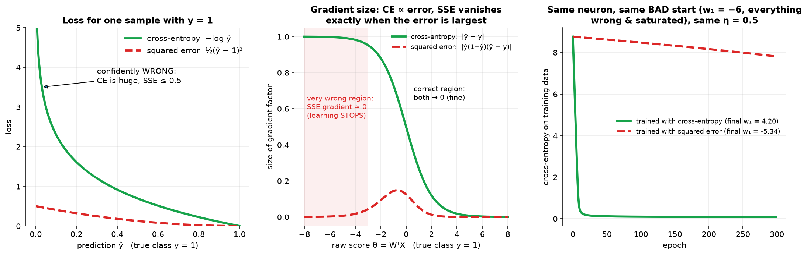
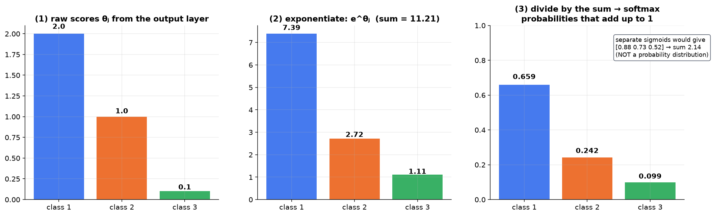

# Lecture 10 — Backpropagation with Cross-Entropy Loss: Exam Questions and Answers

Companion to [activation_crossentropy_backprop_visual_guide.md](../../activation_crossentropy_backprop_visual_guide.md), sections 7–9 (deck `ML_Lec_10_ANN_crossEntropy_training.pptx`). Try each question first, then read the answer.

**Pattern:** Part A = 2-mark questions. Part B = 10-mark questions split (a) + (b), 5 + 5 or 6 + 4.
**Tags:** 🎯 real paper (year, question); ✍️ practice to cover the deck; 📘 beyond the slides. 💡 = memory hook.
This deck is mid-sem material that is also in the end-sem syllabus.

**Symbol key** (this file uses these simple symbols; the last column shows the slides' symbol, so you can recognise it in a question):

| Symbol | Meaning | On the slides |
| :--- | :--- | :--- |
| $x$ | input | $X_i$ |
| $w$ | weight | $W$ |
| $z$ | weighted sum: $z = w \cdot x$ | $\theta$ |
| $a$ | sigmoid output: $a = \sigma(z)$ | $\hat{y}$, $o$ |
| $y$ | target (1 for the true class, else 0) | $y$, $t$ |
| $C$ | cross-entropy loss | $C$ |
| $d$ | delta | $\delta$ |
| $\eta$ | learning rate | $\eta$ |
| $a2_j$, $z2_j$ | output, weighted sum of neuron $j$ in output layer 2 | $o_j^K$, $\theta_j^K$ |
| $a1_i$ | output of neuron $i$ in layer 1 | $o_i^{K-1}$ |
| $W2_{ij}$ | weight from neuron $i$ (layer 1) to neuron $j$ (layer 2) | $W_{ij}^K$ |
| $n$ | number of output neurons (classes) | $M_K$ |

| Topic in the guide | Question |
| :--- | :--- |
| Why squared error learns slowly (§7) | A1, B1(b) |
| Binary cross-entropy from likelihood (§8) | B1(a) |
| Its gradient and update rule (§8) | A4, B1(a) |
| Multi-class cross-entropy and its gradient (§9) | B2(b) |
| Softmax (§9) | A2, A3, B2(a) |

---

## Part A — 2-mark questions

### A1. Why does squared error make a sigmoid network learn slowly? ✍️ [2]

With squared error, the output delta is $d = (a - y)\,a(1 - a)$. When the sigmoid output is near 0 or 1, the factor $a(1 - a)$ is near 0, so the update almost vanishes **even when the network is completely wrong**.

| Output $a$ (target 0) | $(a - y)$ | $a(1 - a)$ | $d$ |
| :---: | :---: | :---: | :---: |
| 0.5 | 0.5 | 0.25 | 0.125 |
| 0.99 | 0.99 | 0.0099 | 0.0098 |

The most wrong neuron gets a correction about 13× smaller than the half-wrong one.

> 💡 Confidently wrong + flat sigmoid = almost no learning.

### A2. Why does multi-class cross-entropy need softmax outputs instead of independent sigmoids? ✍️ [2]

Cross-entropy treats the outputs as a **probability distribution** over the classes. Softmax makes every output positive and makes them **sum to 1**. Independent sigmoids are each in (0, 1) but need not sum to 1: e.g. scores [2.0, 1.0, 0.1] give sigmoids [0.88, 0.73, 0.52], which sum to 2.14, not a distribution.

> 💡 Probabilities must add to 1; only softmax guarantees it.

### A3. Apply softmax to the scores [2.0, 1.0, 0.1]. ✍️ [2]

$$a_j = \frac{e^{z_j}}{\sum_k e^{z_k}}$$

- $e^{z} = [7.389,\ 2.718,\ 1.105]$, sum = 11.213
- $a = [0.659,\ 0.242,\ 0.099]$, which sums to 1

Class 1 is predicted, with probability 0.659. Exponentiating makes all values positive and exaggerates gaps (a score difference of 1 becomes a ratio of $e \approx 2.72$).

> 💡 Exponentiate, then divide by the total.

### A4. What does the cross-entropy weight update do when a sample is misclassified? ✍️ [2]

$$w \leftarrow w - \eta\,\frac{1}{N}\sum (a - y)\,x$$

- Class 1 misclassified ($a$ near 0): $(a - y) < 0$, so the weight **increases**.
- Class 0 misclassified ($a$ near 1): $(a - y) > 0$, so the weight **decreases**.

The step is proportional to the error $(a - y)$: **the bigger the mistake, the bigger the correction**.

> 💡 Cross-entropy: rate of learning ∝ error.

---

## Part B — 10-mark questions

### B1. 🎯 2024 End Q2(b) + 🎯 2025 Mid Q4(a)

**(a)** What is the cross-entropy loss function? Derive the binary cross-entropy loss from the likelihood and find its gradient for a sigmoid neuron. **[6]**
**(b)** Why is cross-entropy preferred over the sum of squared errors (quadratic loss) for training deep neural networks with backpropagation? **[4]**

**(a) Answer.**

A single sigmoid neuron: $z = w \cdot x$, $a = \sigma(z)$, classes $y \in \{0, 1\}$, and $N$ samples.

1. **Likelihood:** $a$ is the likelihood that $x$ is in class 1, and $1 - a$ that it is in class 0.
2. **One formula for both cases:** $L = a^{\,y}(1 - a)^{\,1-y}$. If $y = 1$ it gives $a$; if $y = 0$ it gives $1 - a$.
3. **Log-likelihood** (product → sum): $\log L = y\log a + (1 - y)\log(1 - a)$.
4. **Average and negate** (we maximise likelihood, but minimise loss):

$$C = -\frac{1}{N}\sum\big[y\log a + (1 - y)\log(1 - a)\big]$$

This is the **binary cross-entropy** loss.

**Gradient** by the chain rule:

$$\frac{\partial C}{\partial a} = -\frac{1}{N}\sum\left(\frac{y}{a} - \frac{1 - y}{1 - a}\right) = -\frac{1}{N}\sum\frac{y - a}{a(1 - a)}, \qquad \frac{\partial a}{\partial z} = a(1 - a), \qquad \frac{\partial z}{\partial w} = x$$

The $a(1 - a)$ in the denominator **cancels** the sigmoid's slope:

$$\frac{\partial C}{\partial w} = \frac{1}{N}\sum (a - y)\,x, \qquad w \leftarrow w - \eta\,\frac{1}{N}\sum (a - y)\,x$$

**(b) Answer.**

| Loss | Output delta $d$ | When very wrong |
| :--- | :--- | :--- |
| Squared error | $(a - y)\,a(1 - a)$ | $a(1 - a) \approx 0$ → learning stalls |
| Cross-entropy | $(a - y)$ | large → learns fast |

*Example:* $y = 1$ but $a = 0.1$.

- Squared error: $d = (0.1 - 1)(0.1)(0.9) = -0.081$.
- Cross-entropy: $d = 0.1 - 1 = -0.9$, about **11× larger**.

Reasons it is preferred:

1. **No learning slowdown:** the sigmoid slope cancels, so the update is proportional to the error; confidently wrong outputs get the largest correction.
2. **Probabilistic meaning:** it is the negative log-likelihood, so it fits sigmoid/softmax outputs read as probabilities.
3. **Strong penalty for confident mistakes:** $-\log(0.1) = 2.30$, against $\tfrac{1}{2}(0.9)^2 = 0.405$ for squared error.
4. 📘 For a single sigmoid neuron the loss is convex in the weights, so there are no bad local minima.

In a test with the same bad start, cross-entropy reached 96% accuracy while squared error stayed stuck at 4%.

> 💡 Cross-entropy cancels the sigmoid's slope.

### B2. 🎯 2025 End Q3(b) + ✍️

**(a)** Explain the softmax activation function: its mathematical formulation, working principle and typical applications. **[4]**
**(b)** Write the multi-class cross-entropy loss and derive the weight update rule for the output layer of a multilayer feed-forward network. **[6]**

**(a) Answer.**

$$a_j = \frac{e^{z_j}}{\sum_{k=1}^{n}e^{z_k}}, \quad j = 1, \dots, n$$

**Working:**

1. **Exponentiate** each score: all values become positive, and larger scores are exaggerated.
2. **Divide by the total:** the outputs sum to exactly 1.

So $a_j$ is read as $P(x \in \text{class } j)$, and the class with the largest $a_j$ is predicted. *E.g.* [2.0, 1.0, 0.1] → [0.659, 0.242, 0.099].

**Applications:** the output layer of multi-class classifiers (digits 0–9, Iris species, ImageNet's 1000 classes), always paired with cross-entropy loss; next-word prediction in language models (RNN/LSTM).

**(b) Answer.**

Target $y_j = 1$ for the true class, 0 otherwise. Layer 2 is the output layer and layer 1 the layer before it.

For one output node $j$: $-\big[y_j\log a2_j + (1 - y_j)\log(1 - a2_j)\big]$.

Over all $n$ nodes and all $N$ samples:

$$C = -\frac{1}{N}\sum\sum_{j=1}^{n}\big[y_j\log a2_j + (1 - y_j)\log(1 - a2_j)\big]$$

With $a2_j = \sigma(z2_j)$ and $z2_j = \sum_i W2_{ij}\,a1_i$, the chain rule gives:

$$\frac{\partial C}{\partial W2_{ij}} = -\frac{1}{N}\sum\left(\frac{y_j}{a2_j} - \frac{1 - y_j}{1 - a2_j}\right)a2_j(1 - a2_j)\,a1_i = \frac{1}{N}\sum(a2_j - y_j)\,a1_i$$

$$\boxed{W2_{ij} \leftarrow W2_{ij} - \eta\,\frac{1}{N}\sum(a2_j - y_j)\,a1_i}$$

Compared with squared error ($d_j = (a_j - y_j)\,a_j(1 - a_j)$), the delta is simply $d_j = a_j - y_j$: **bigger error, bigger step**. (📘 With true softmax outputs and the categorical loss $-\sum_j y_j\log a_j$, the delta is also exactly $a_j - y_j$.)

> 💡 Every cross-entropy $d$ is just output − target.
