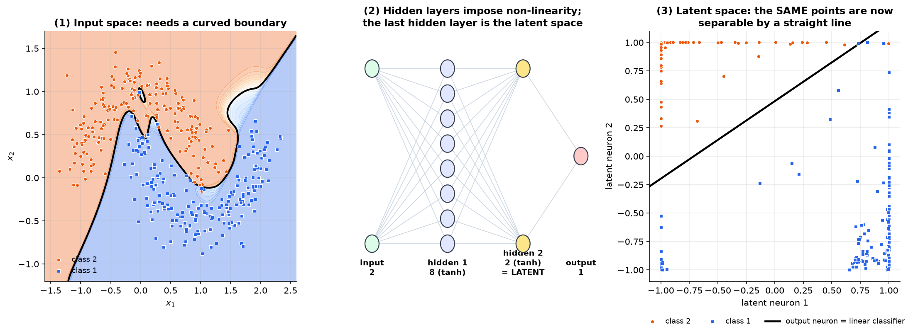
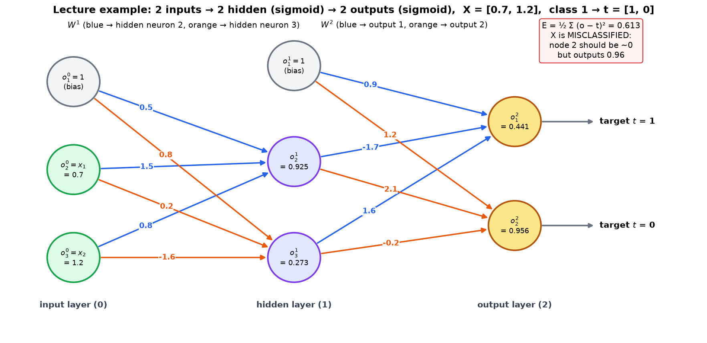
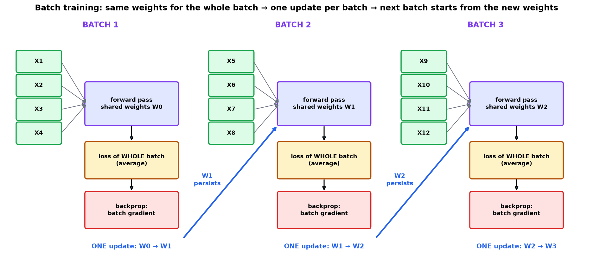

# Lecture 11 — Backpropagation Example and Batch Training: Exam Questions and Answers

Companion to [activation_crossentropy_backprop_visual_guide.md](../../activation_crossentropy_backprop_visual_guide.md), sections 10–12 (deck `ML_Lec_11_ANN_Example.pptx`). Try each question first, then read the answer.

**Pattern:** Part A = 2-mark questions. Part B = 10-mark questions split (a) + (b), 5 + 5 or 6 + 4.
**Tags:** 🎯 real paper (year, question); ✍️ practice to cover the deck; 📘 beyond the slides. 💡 = memory hook.
This deck is mid-sem material that is also in the end-sem syllabus. No past paper has asked this exact example, but backpropagation numericals are standard; the derivation is in [Neural Network 3 Q&A, B2](Neural_Network_3_QA.md).

| Topic in the guide | Question |
| :--- | :--- |
| Hidden layers and the latent space (§10) | A1 |
| Network layout, $K$ layers (§10–11) | A2 |
| Worked example: forward pass (§11) | B1(a) |
| Worked example: output and hidden updates (§11) | B1(b) |
| Slide typo, repeated training, cross-entropy comparison (§11) | A3 |
| Batch training, weight persistence (§12) | A4, B2(a) |
| Parallel processing (§12) | B2(b) |

---

## Part A — 2-mark questions

### A1. What is the latent space of a neural network? ✍️ [2]

Real data is usually **not linearly separable**. The hidden layers apply non-linear mappings that move the samples into a new space, the **latent space**, where they **are** linearly separable. A **linear classifier** at the output layer is then enough. More hidden layers can capture more complex non-linearity. It is the non-linear mapping idea of Lecture 7, except that the network **learns** the mapping.

> 💡 Hidden layers bend the data until a straight line works.

### A2. Describe the layers of a network with $K$ layers. ✍️ [2]

- **Layer 0:** input layer; neurons just pass the inputs on.
- **Layers 1 to K−1:** the $K - 1$ hidden layers.
- **Layer K:** output layer, with **one neuron per class**.

*E.g.* the Lecture 11 example has $K = 2$: one hidden layer and 2 output neurons for a 2-class problem; for $X$ in class 1 the targets are [1, 0].

> 💡 K layers after the input = K − 1 hidden + 1 output.

### A3. In the Lecture 11 example, output node 2 is badly wrong (0.956 instead of 0) but its delta is only 0.0399. Why? ✍️ [2]

With squared error and a sigmoid, $\delta_2 = (o_2 - t_2)\,o_2(1 - o_2) = 0.956 \times 0.956 \times 0.044 = 0.0399$. The sigmoid slope $o(1 - o) = 0.042$ is tiny because the output is saturated near 1, so it shrinks the correction. With cross-entropy the delta would be $o_2 - t_2 = 0.956$, and node 2 drops to about 0.048 within 20 iterations (squared error needs about 50 to reach 0.19).

> 💡 Saturated sigmoid hides a big error.

### A4. What happens to the weights during and between batches? ✍️ [2]

**Within a batch:** all samples use the **same shared weights**; forward pass for the whole batch, loss over the whole batch, backpropagation on the cumulative loss, then **one** weight update.

**Between batches:** the updated weights **persist** and become the current weights for the next batch's forward pass. This repeats over all batches and epochs.

> 💡 One batch, one update; the next batch starts from there.

---

## Part B — 10-mark questions

### B1. ✍️ (numerical, Lecture 11 example)

A network with one hidden layer of 2 neurons and 2 output neurons uses sigmoid activations and squared error, $\eta = 0.5$. Input $X = [0.7, 1.2]$ is in **class 1**, so the targets are $t = [1, 0]$. The first column of each weight matrix is the bias:

$$W^1 = \begin{bmatrix} 0.5 & 1.5 & 0.8 \\ 0.8 & 0.2 & -1.6 \end{bmatrix}, \qquad W^2 = \begin{bmatrix} 0.9 & -1.7 & 1.6 \\ 1.2 & 2.1 & -0.2 \end{bmatrix}$$

**(a)** Do one feed-forward pass. Is $X$ classified correctly? Compute the error. **[4]**
**(b)** Update the output-layer and hidden-layer weights by backpropagation. **[6]**

**(a) Answer.**

With $O^0 = [1, 0.7, 1.2]^T$ (bias first):

$$\theta^1 = W^1O^0 = [0.5 + 1.05 + 0.96,\ \ 0.8 + 0.14 - 1.92] = [2.51,\ -0.98]$$
$$O^1 = [1,\ \sigma(2.51),\ \sigma(-0.98)] = [1,\ 0.925,\ 0.273]$$

(✏️ the slide prints −9.8; it is a typo for −0.98.)

$$\theta^2 = W^2O^1 = [0.9 - 1.7(0.925) + 1.6(0.273),\ \ 1.2 + 2.1(0.925) - 0.2(0.273)] = [-0.236,\ 3.088]$$
$$O^2 = [0.441,\ 0.956]$$

The actual output should be [1, 0], but node 2 (0.956) beats node 1 (0.441): **$X$ is misclassified**.

$$E = \tfrac{1}{2}\big[(0.441 - 1)^2 + (0.956 - 0)^2\big] = 0.613$$

**(b) Answer.**

**Output layer** ($W^2 \leftarrow W^2 - \eta\,\delta^2(O^1)^T$, $\delta_j^2 = (o_j - t_j)o_j(1 - o_j)$):

$$\delta^2 = [(0.441 - 1)(0.441)(0.559),\ \ (0.956)(0.956)(0.044)] = [-0.1377,\ 0.0399]$$

$$W^2_{new} = W^2 - 0.5\begin{bmatrix} -0.1377 & -0.1274 & -0.0376 \\ 0.0399 & 0.0369 & 0.0109 \end{bmatrix} = \begin{bmatrix} 0.9689 & -1.6363 & 1.6188 \\ 1.1801 & 2.0815 & -0.2054 \end{bmatrix}$$

**Hidden layer** (use the **old** $W^2$; skip the bias unit, which has no incoming weights):

$$\delta_i^1 = o_i^1(1 - o_i^1)\sum_j\delta_j^2W_{ij}^2$$

$$\delta_2^1 = 0.925(0.075)\big[(-0.1377)(-1.7) + (0.0399)(2.1)\big] = 0.0695 \times 0.3179 = 0.0221$$
$$\delta_3^1 = 0.273(0.727)\big[(-0.1377)(1.6) + (0.0399)(-0.2)\big] = 0.1984 \times (-0.2283) = -0.0453$$

$$W^1_{new} = W^1 - 0.5\,\delta^1(O^0)^T = \begin{bmatrix} 0.4889 & 1.4923 & 0.7867 \\ 0.8227 & 0.2159 & -1.5728 \end{bmatrix}$$

**One iteration is complete;** the error falls from 0.613 to 0.590. Repeating on the same $X$:

| Iteration | 0 | 20 | 50 | 300 |
| :--- | :---: | :---: | :---: | :---: |
| $O^2$ | [0.441, 0.956] | [0.823, 0.838] | [0.919, 0.191] | [0.966, 0.041] |
| $E$ | 0.613 | 0.367 | 0.021 | 0.001 |

Training continues until node 1 is close to 1 and node 2 close to 0.

> 💡 Forward, deltas from the old weights, then update both layers.

### B2. ✍️

**(a)** Explain batch training of a neural network: what happens inside one batch and how the next batch is trained. **[5]**
**(b)** How is parallel processing used to train neural networks? **[5]**

**(a) Answer.**

Instead of one feature vector at a time, a **batch** of feature vectors is processed together.

**Inside one batch:**

1. **Shared weights:** every sample in the batch uses the same current weights (initially random, or Xavier/He).
2. **Forward pass:** all samples go through the network, usually as one matrix.
3. **Loss calculation:** the loss is computed over the **entire batch** (e.g. the average).
4. **Backpropagation:** gradients are computed from this cumulative batch loss.
5. **Weight update:** the shared weights are updated **once** for the batch.

**Next batch:**

1. **Weight persistence:** the updated weights become the network's current weights.
2. **Next batch processing:** the next batch uses them for its forward pass, then updates them again.
3. This continues through all batches (one epoch) and over many epochs.

Benefit: the gradient averages several samples, so it is less noisy than one sample, and matrix operations make it fast.

**(b) Answer.**

| Technique | Idea |
| :--- | :--- |
| **Batch processing** | the batch is one matrix, so a GPU or TPU computes all rows (samples) at once with highly optimised matrix operations |
| **Data parallelism** | each device holds a full copy of the model and processes a different slice of the data; the gradients are combined (averaged) and all copies are updated |
| **Model parallelism** | the model is too large for one device, so different layers or parts live on different devices |
| **Asynchronous updates** | several workers compute gradients and update shared weights without waiting for each other: faster, but some updates use slightly stale weights |

Together these let very large networks train on very large datasets in reasonable time.

> 💡 Split the data (data parallel) or split the model (model parallel).
