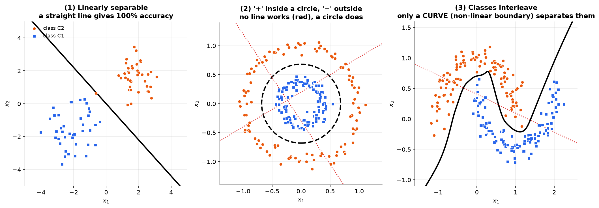
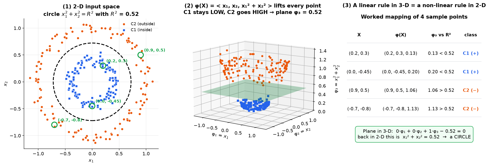
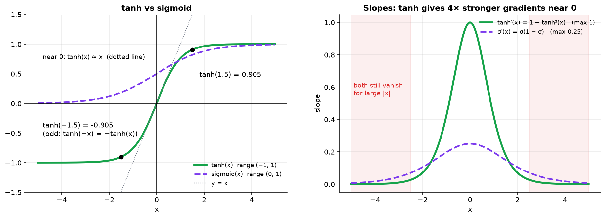
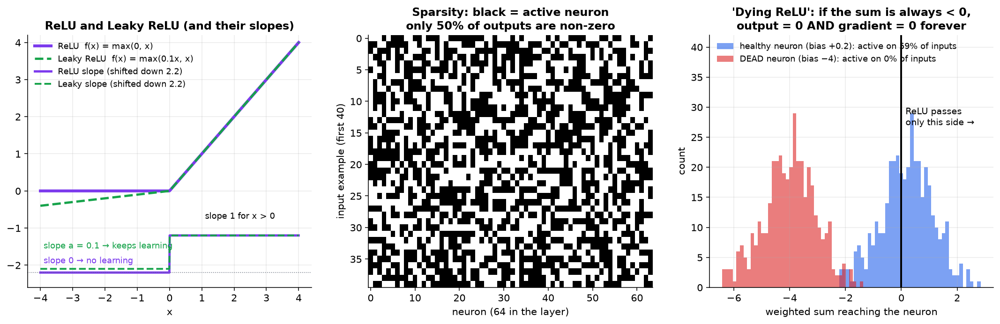

# Lecture 7 — Non-linear Mapping and Activation Functions: Exam Questions and Answers

Companion to [activation_crossentropy_backprop_visual_guide.md](../../activation_crossentropy_backprop_visual_guide.md), sections 1–6 (deck `ML_Lec_7_nonlinear_mapping.pptx`). Try each question first, then read the answer.

**Pattern:** Part A = 2-mark questions. Part B = 10-mark questions split (a) + (b), 5 + 5 or 6 + 4.
**Tags:** 🎯 real paper (year, question); ✍️ practice to cover the deck; 📘 beyond the slides. 💡 = memory hook.
This deck is mid-sem material that is also in the end-sem syllabus. "2026 Mid" = this year's mid-sem paper. **Activation functions have appeared in every paper since 2023.**

| Topic in the guide | Question |
| :--- | :--- |
| Linear vs non-linear problems (§1) | A1 |
| Non-linear mapping, circle example (§2) | B1 |
| Threshold function (§3) | A2 |
| Sigmoid: derivative, non-zero-centred output (§4) | A3, A4, B2 |
| ReLU, dying ReLU, Leaky ReLU (§5) | A5, B3 |
| Sparse gradients (§5) | A6 |
| tanh, which activation to use (§6) | A7, B2 |

---

## Part A — 2-mark questions

### A1. How can a linear classifier solve a non-linearly separable problem? ✍️ [2]

Use a **non-linear mapping** $\varphi$ to move the feature vectors into a **higher-dimensional** space where the classes become linearly separable, then use a plane (hyperplane) there. A linear boundary in the new space is a curved boundary in the original space. In theory, mapping to enough (even infinite) dimensions makes **any** non-linear problem linear; neural networks **learn** such mappings through their hidden layers.

> 💡 Can't separate it with a line? Lift it into a higher space.

### A2. What is the threshold (step) function? What is its main limitation? ✍️ [2]

$$f(x) = \begin{cases} 1 & x \ge \text{threshold} \\ 0 & x < \text{threshold} \end{cases}$$

The simplest non-linear activation; a neuron fires only when its input exceeds the threshold. It was used to build logic gates, e.g. AND = step($x_1 + x_2 - 1.5$).

**Limitation:** its slope is 0 everywhere (undefined at the jump), so it **cannot be trained with gradient descent**. Sigmoid, tanh and ReLU replaced it.

> 💡 A step has no slope, so it can't learn.

### A3. Show that the derivative of the sigmoid is $\sigma(x)(1 - \sigma(x))$. What is its maximum? ✍️ [2]

$$\sigma'(x) = \frac{d}{dx}(1 + e^{-x})^{-1} = \frac{e^{-x}}{(1 + e^{-x})^2} = \frac{1}{1 + e^{-x}}\cdot\frac{e^{-x}}{1 + e^{-x}} = \sigma(x)\big(1 - \sigma(x)\big)$$

using $\dfrac{e^{-x}}{1 + e^{-x}} = 1 - \sigma(x)$. Maximum at $x = 0$: $0.5 \times 0.5 = \mathbf{0.25}$.

> 💡 Sigmoid's slope = output × (1 − output), never more than 0.25.

### A4. Why is the sigmoid's non-zero-centred output a problem? ✍️ [2]

The sigmoid's output is always **positive** (0 to 1, mean about 0.5). A weight's gradient is (delta × its input), so if all inputs to a neuron are positive, **all its weight gradients have the same sign**. The weights can only all go up or all go down together, so training **zig-zags** and converges slowly. tanh (zero-centred) avoids this.

> 💡 All-positive inputs → all weights move the same way → zig-zag.

### A5. What is the dying ReLU problem? How does Leaky ReLU fix it? ✍️ [2]

If a neuron's weighted sum is **negative for every input**, ReLU outputs 0, so its gradient is 0, so its weights never change, and it stays dead forever.

Leaky ReLU: $f(x) = \max(ax, x)$ with small $a$ (e.g. 0.01). Negative inputs still get slope $a$, so the gradient is never exactly 0 and the neuron can recover. $a$ is fixed **before** training (not learned).

> 💡 Zero output, zero gradient, zero learning; a small leak keeps it alive.

### A6. What are sparse gradients? Give their sources, advantages and disadvantages. ✍️ [2]

Sparse gradients = many gradient values are **zero or tiny**, so only a few parameters are updated.

- **Sources:** ReLU (zero for negative inputs), L1 regularization / feature selection, small SGD batches.
- **Advantages:** efficient computation; learning focuses on fewer parameters, which can reduce overfitting.
- **Disadvantages:** slow or poor learning if too little gradient information flows; noisy, unstable optimisation.

Leaky ReLU is used when sparse gradients hurt, e.g. training GANs.

> 💡 Mostly-zero gradients: cheap, but can starve learning.

### A7. Give the key properties of tanh and say why it suits RNNs. ✍️ [2]

$$\tanh(x) = \frac{e^x - e^{-x}}{e^x + e^{-x}} = \frac{2}{1 + e^{-2x}} - 1$$

Range (−1, 1), **zero-centred**, odd ($\tanh(-x) = -\tanh x$), about $x$ near 0, saturates at ±1. Derivative $1 - \tanh^2 x$, maximum **1** (4× the sigmoid's). In RNNs, LSTMs and GRUs gradients are multiplied across many time steps, so a zero-centred, bounded function with a larger slope keeps the signal alive longer.

> 💡 tanh = a zero-centred sigmoid with 4× the slope.

---

## Part B — 10-mark questions

### B1. ✍️

**(a)** Explain with the circle example how a non-linear mapping lets a linear classifier separate two classes that are not linearly separable. **[6]**
**(b)** Using $\varphi(X) = \langle x_1, x_2, x_1^2 + x_2^2\rangle$ and a circle with $R^2 = 0.52$, map the points (0.2, 0.3), (0.9, 0.5), (0.5, 0.5) and (−0.7, 0.4) and classify each. **[4]**

**(a) Answer.**

- Class C1 points lie **inside** a circle $x_1^2 + x_2^2 = R^2$ and class C2 points **outside**. No straight line can separate them.
- Inside: $x_1^2 + x_2^2 < R^2$; outside: $x_1^2 + x_2^2 > R^2$.
- Map each 2-D point to 3-D with $\varphi: \mathbb{R}^2 \to \mathbb{R}^3$:

$$\varphi_1 = x_1, \quad \varphi_2 = x_2, \quad \varphi_3 = x_1^2 + x_2^2$$

- Now C1 points have a **low** third coordinate ($< R^2$) and C2 points a **high** one ($> R^2$), so the flat plane $\varphi_3 = R^2$ separates them.

- A general plane in 3-D: $w_1\varphi_1 + w_2\varphi_2 + w_3\varphi_3 + w_0 = 0$, i.e. $w_1x_1 + w_2x_2 + w_3(x_1^2 + x_2^2) + w_0 = 0$. With $w_1 = w_2 = 0$, $w_3 = 1$, $w_0 = -R^2$ it is exactly the circle.

**Key idea:** a linear rule in the higher space is a non-linear rule in the original space. Mapping to high enough (even infinite) dimension makes any non-linear problem linear (the idea behind SVM kernels). Designing $\varphi$ by hand is hard, so neural networks **learn** the mapping, using non-linear activation functions in their hidden layers.

**(b) Answer.**

| $X$ | $\varphi_3 = x_1^2 + x_2^2$ | vs $R^2 = 0.52$ | Class |
| :--- | :--- | :---: | :--- |
| (0.2, 0.3) | 0.04 + 0.09 = 0.13 | < | C1 (inside) |
| (0.9, 0.5) | 0.81 + 0.25 = 1.06 | > | C2 (outside) |
| (0.5, 0.5) | 0.25 + 0.25 = 0.50 | < | C1 (inside) |
| (−0.7, 0.4) | 0.49 + 0.16 = 0.65 | > | C2 (outside) |

So (0.2, 0.3) → (0.2, 0.3, 0.13), and so on. All C1 points lie below the plane $\varphi_3 = 0.52$ and all C2 points above it.

> 💡 Add a feature = distance² from the centre; the circle becomes a flat cut.

### B2. 🎯 2026 Mid Q2(a) + 🎯 2025 End Q3(a) + 🎯 2025 Mid Q3(b)

**(a)** Write the mathematical expressions of the sigmoid, ReLU and tanh activation functions, sketch them, and compare them (range, gradient behaviour, advantages and limitations). **[6]**
**(b)** Write their derivatives and compute each slope at $x = 0$ and $x = 3$. Which activation would you use where? **[4]**

**(a) Answer.**

$$\sigma(x) = \frac{1}{1 + e^{-x}}, \qquad \text{ReLU}(x) = \max(0, x), \qquad \tanh(x) = \frac{e^x - e^{-x}}{e^x + e^{-x}}$$

| | Sigmoid | tanh | ReLU |
| :--- | :--- | :--- | :--- |
| Range | (0, 1) | (−1, 1) | [0, ∞) |
| Zero-centred | no | **yes** | no |
| Max slope | 0.25 | 1 | 1 (for $x > 0$) |
| Gradient behaviour | vanishes for large $\lvert x\rvert$ | vanishes for large $\lvert x\rvert$ | constant 1 for $x > 0$, 0 for $x < 0$ |
| Advantages | output is a probability; smooth, differentiable | zero-centred, stronger gradients than sigmoid | no vanishing for positives; cheapest; sparse activation |
| Limitations | vanishing gradient; not zero-centred → zig-zag updates; costly exp | still vanishes when saturated; costlier than ReLU | **dying ReLU**; not zero-centred; unbounded output |
| Used in | binary output layer, logistic regression | hidden layers of RNNs/LSTMs/GRUs | default for hidden layers, CNNs |

**(b) Answer.**

| | Derivative | At $x = 0$ | At $x = 3$ |
| :--- | :--- | :---: | :---: |
| Sigmoid | $\sigma(1 - \sigma)$ | 0.25 | $0.9526 \times 0.0474 = 0.0452$ |
| tanh | $1 - \tanh^2 x$ | 1 | $1 - 0.99505^2 = 0.0099$ |
| ReLU | 1 if $x > 0$, else 0 | 0 (taken as 0 or 1) | 1 |

At $x = 3$ the sigmoid and tanh pass back under 5% and 1% of the gradient; ReLU passes all of it. So:

- **hidden layers of a deep network:** ReLU (Leaky ReLU if neurons die);
- **RNN/LSTM/GRU hidden state:** tanh;
- **binary output:** sigmoid; **multi-class output:** softmax.

> 💡 Sigmoid for probabilities, tanh for recurrence, ReLU for depth.

### B3. 🎯 2024 End Q3(b) + 🎯 2023 End Q3(a)

**(a)** Explain the ReLU activation function, highlighting its key properties and limitations. How does Leaky ReLU help address these limitations? **[6]**
**(b)** Explain the significance of the ReLU activation function in CNNs. **[4]**

**(a) Answer.**

$$\text{ReLU}(x) = \max(0, x) = \begin{cases} x & x > 0 \\ 0 & x \le 0\end{cases}$$

**Key properties:**

1. **Non-linear**, although it is made of two straight pieces, so stacked layers can learn complex patterns.
2. **No vanishing gradient for positive inputs:** slope is exactly 1.
3. **Sparse activation:** negative inputs give exactly 0, so for any input many neurons are off (about 50% in a typical layer). Less computation and more specialised neurons.
4. **Cheap:** a single comparison, no exponential.

**Limitations:**

1. **Dying ReLU:** a neuron whose sum is always negative outputs 0 with gradient 0 and never recovers.
2. **Not zero-centred** and **unbounded** above.
3. Not differentiable at 0 (in practice the slope is set to 0 or 1).

**Leaky ReLU:**

$$f(x) = \max(ax, x) = \begin{cases} x & x > 0 \\ ax & x \le 0\end{cases}, \quad a \approx 0.01\text{–}0.1$$

The small slope $a$ for negative inputs keeps the gradient non-zero, so dead neurons can recover. $a$ is a hyperparameter fixed before training. It is popular where sparse gradients hurt, such as GANs. (ELU is a similar variant.)

**(b) Answer.**

1. **Non-linearity after each convolution:** without it, stacked conv layers would collapse into one linear filter; ReLU lets the CNN build hierarchical features (edges → shapes → objects).
2. **Deep CNNs become trainable:** its slope of 1 avoids vanishing gradients through many layers. 📘 AlexNet trained about 6× faster with ReLU than with tanh.
3. **Sparse feature maps:** negative responses are zeroed, so each feature map keeps only where a feature is present; this is efficient and helps against overfitting.
4. **Speed:** a simple threshold, important for millions of activations per image.

> 💡 ReLU: keep the positives, drop the negatives, gradient 1.
