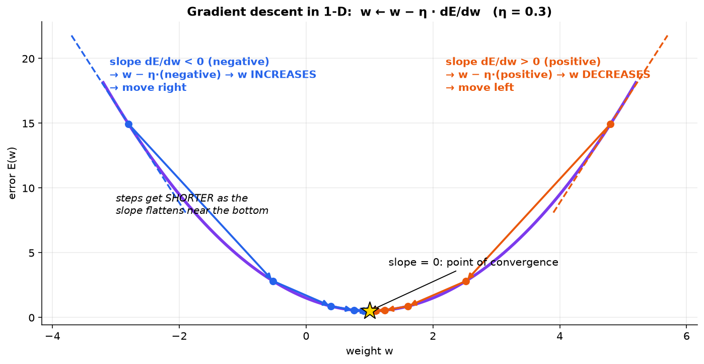
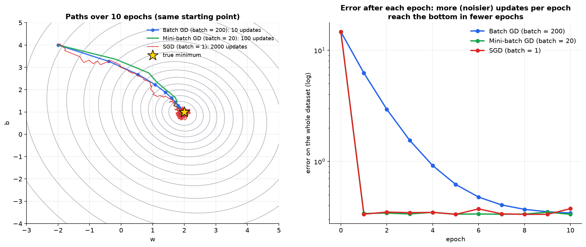
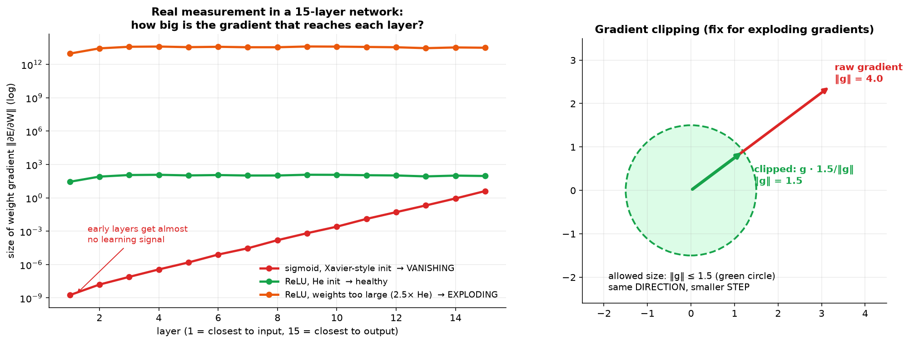
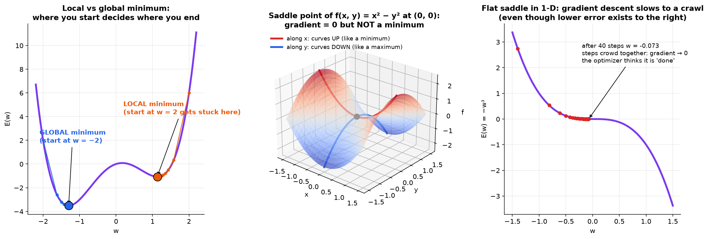

# Neural Network 2 — Gradient Descent, Its Types and Its Problems: Exam Questions and Answers

Companion to [neural_networks_visual_guide.md](../../neural_networks_visual_guide.md), sections 9–11 (deck `Neural_Network_2.pptx`). Try each question first, then read the answer.

**Pattern:** Part A = 2-mark questions. Part B = 10-mark questions split (a) + (b), 5 + 5 or 6 + 4.
**Tags:** 🎯 real paper (year, question); ✍️ practice to cover the deck; 📘 beyond the slides. 💡 = memory hook.
This deck is mid-sem material that is also in the end-sem syllabus. "2026 Mid" = this year's mid-sem paper.

**Symbol key** (this file uses these simple symbols; the last column shows the slides' symbol, so you can recognise it in a question):

| Symbol | Meaning | On the slides |
| :--- | :--- | :--- |
| $x$ | input | $X$ |
| $w$, $b$ | weight, bias | $W$, $b$ |
| $a$ | neuron's output (prediction) | $\hat{y}$ |
| $y$ | true target | $y$ |
| $E$ | squared error | $E$ |
| $g$ | gradient: the slopes $\partial E/\partial w$ | $\nabla E$ |
| $\eta$ | learning rate | $\eta$ |
| $k$ | Leaky ReLU's small slope | $a$ |
| $m$, $s^2$ | batch mean, batch variance | $\mu_B$, $\sigma_B^2$ |
| $c$, $h$ | batch norm's learned scale, shift | $\gamma$, $\beta$ |

| Topic in the guide | Question |
| :--- | :--- |
| Gradient descent, hiker picture, delta rule (§9) | A1, B1(a) |
| Learning rate (§10) | A2 |
| Batch, stochastic and mini-batch GD (§10) | B1(b) |
| Local minima and saddle points (§11) | A3, B3(b) |
| Vanishing and exploding gradients (§11) | A5, B2 |
| Batch normalization, gradient clipping (§11) | A4, A6, B2(b) |
| Overfitting and its remedies (📘, this year's mid-sem) | B3(a) |

---

## Part A — 2-mark questions

### A1. What is gradient descent? Write its update rule. ✍️ [2]

Gradient descent is an iterative optimisation method that minimises the cost function $E(w)$ by moving the parameters a small step **opposite to the gradient** $g$ (the direction of steepest decrease):

$$w \leftarrow w - \eta\,g, \qquad g = \frac{\partial E}{\partial w}$$

If the slope is positive, $w$ decreases; if negative, $w$ increases; at the minimum the slope is 0 and it stops (convergence). Steps are long where the slope is steep and shrink automatically near the bottom.

> 💡 Feel the slope, step downhill, repeat.

### A2. What is the learning rate? What happens if it is too high or too low? ✍️ [2]

The learning rate $\eta$ is the **step size** of each update.

- **Too high:** overshoots the minimum, zig-zags, may **diverge**.
- **Too low:** very slow, may settle in a local minimum.

*E.g.* for $E = w^2$ each step multiplies $w$ by $1 - 2\eta$: from $w = 1$, $\eta = 0.35$ gives 0.3 (fast, stable); $\eta = 1.05$ gives −1.1 (grows each step: diverges). Start around 0.01 or 0.001; adaptive optimisers (Adam, RMSprop, AdaGrad) adjust it automatically.

> 💡 Too big jumps over the valley; too small takes forever.

### A3. What is a saddle point? How is it different from a local minimum? ✍️ [2]

Both have **zero gradient**, so gradient descent stalls there.

- **Local minimum:** the cost rises in **every** direction, but it is not the lowest point overall.
- **Saddle point:** **mixed curvature**: a minimum along some directions and a maximum along others. *E.g.* $f(x, y) = x^2 - y^2$ at (0, 0): along $x$ it is $x^2$ (minimum), along $y$ it is $-y^2$ (maximum).

In high-dimensional networks, saddle points are far more common than local minima.

> 💡 Minimum: up everywhere. Saddle: up one way, down the other.

### A4. Explain the working principle of batch normalization and its advantages. 🎯 2025 Mid Q4(c) [2]

For each mini-batch, normalise each layer's input to mean 0 and variance 1, then scale and shift with learnable $c, h$: $x' = \dfrac{x - m}{\sqrt{s^2 + \epsilon}}$, output $= c\,x' + h$ ($\epsilon$ is a tiny number that avoids division by 0). It is placed **Linear $(wx + b)$ → BatchNorm → Activation**.

Advantages: keeps activations out of the saturated regions, so it reduces **vanishing and exploding gradients**; allows higher learning rates and faster training; has a mild regularising effect. (Full numerical: [Lecture 13 Q&A, B2](../ML_post_midsem_parts_in_endsem/ML_Lec_13_CNN_QA.md).)

> 💡 Re-centre every layer's input so the gradient stays healthy.

### A5. Explain the vanishing gradient problem. How do ReLU and Leaky ReLU help? 🎯 2025 Mid Q3(c) [2]

In backpropagation the gradient of an early layer is a **product** of activation derivatives across all later layers. Sigmoid's slope is at most 0.25 (tanh's at most 1, and near 0 when saturated), so the product shrinks towards 0 and early layers stop learning.

**ReLU** has slope exactly **1** for positive inputs, so the product does not shrink. **Leaky ReLU** also has a small slope $k$ (e.g. 0.01) for negative inputs, so the gradient is never exactly 0 and neurons cannot "die".

> 💡 0.25 × 0.25 × … → 0; 1 × 1 × … stays 1.

### A6. What is gradient clipping? Clip $g = (3, 4)$ to a maximum norm of 1. ✍️ [2]

If the gradient's length exceeds a threshold, rescale it: $g \leftarrow g \cdot \dfrac{\text{threshold}}{\lVert g\rVert}$. Same direction, smaller step. It is the main fix for **exploding** gradients.

$\lVert g\rVert = \sqrt{9 + 16} = 5 > 1$, so $g \leftarrow (3, 4)/5 = (0.6, 0.8)$.

> 💡 Keep the direction, cap the length.

---

## Part B — 10-mark questions

### B1. 🎯 2026 Mid Q3(b) + 🎯 2025 Mid Q4(b) + ✍️

**(a)** Explain how gradient descent works. Derive the weight update rule (delta rule) for a linear neuron trained with the sum of squared errors. **[5]**
**(b)** Explain the difference between batch gradient descent, stochastic gradient descent and mini-batch gradient descent, with examples. **[5]**

**(a) Answer.**

**How it works:**

1. Initialise $w$ (and $b$) randomly: a random point on the cost surface $E(w, b)$.
2. Compute the gradient $g$ (partial derivatives with respect to each parameter); it points uphill.
3. Step the other way: $w \leftarrow w - \eta\,g$.
4. Repeat until the gradient is about 0 (the point of convergence).

Like a blindfolded hiker going down a valley: long strides where it is steep, short strides near the bottom.

**Derivation.** Linear neuron $a_i = w \cdot x_i$, for $N$ samples $i = 1, \dots, N$:

$$E = \frac{1}{2}\sum_{i=1}^{N}(a_i - y_i)^2$$

$$\frac{\partial E}{\partial w} = \sum_{i=1}^{N}(a_i - y_i)\frac{\partial a_i}{\partial w} = \sum_{i=1}^{N}(a_i - y_i)\,x_i$$

(the $\frac{1}{2}$ cancels the 2 from the square, and $\partial(w \cdot x_i)/\partial w = x_i$)

$$\boxed{w \leftarrow w - \eta\sum_{i=1}^{N}(a_i - y_i)\,x_i}$$

New weight = old weight − learning rate × (prediction − truth) × input. If $y = 1$ but $a$ is low, $(a - y) < 0$ and a fraction of $x$ is **added**; if $y = 0$ but $a$ is high, it is **subtracted**; if correct, almost no change.

**(b) Answer.**

| | Batch GD | Stochastic GD (SGD) | Mini-batch GD |
| :--- | :--- | :--- | :--- |
| Samples per update | all $N$ | 1 | a small batch (32, 64, …) |
| Updates per epoch | 1 | $N$ | $N$ / batch size |
| Path to the minimum | smooth, stable | noisy, zig-zag | mostly smooth |
| Speed, memory | slow, needs all data in memory | fast, light | balanced; uses GPU matrix operations |
| Special feature | exact gradient | noise can escape local minima and saddles | **most used in practice** |

*Example:* 10,000 training images.

- Batch GD: 1 update per epoch, using all 10,000.
- SGD: 10,000 updates per epoch, one image each.
- Mini-batch with batch size 100: $10{,}000 / 100 = 100$ updates per epoch.

> 💡 All, one, or a handful per step.

### B2. 🎯 2024 End Q3(a) + 🎯 2026 Mid Q2(b)

**(a)** What are vanishing and exploding gradient problems in neural networks? How do they happen, and what are their causes and effects? **[6]**
**(b)** Outline potential solutions to these problems. **[4]**

**(a) Answer.**

**How they happen:** backpropagation applies the chain rule layer by layer from the output back to the input. At every layer the gradient is **multiplied** by that layer's activation derivative and weights. Multiplying $L$ factors is exponential:

- factors mostly **< 1** → the product shrinks towards 0: **vanishing gradient**;
- factors mostly **> 1** → the product blows up: **exploding gradient**.

The **early** layers are hit hardest, because their gradient passes through the most factors.

Measured in a 15-layer network:

| Setup | Gradient at layer 15 | Gradient at layer 1 |
| :--- | :---: | :---: |
| sigmoid | 4.05 | $1.8\times10^{-9}$ (vanishing) |
| ReLU, He initialisation | 91 | 27.5 (healthy) |
| ReLU, weights too large | $3.1\times10^{13}$ | $9.2\times10^{12}$ (exploding) |

| | Vanishing | Exploding |
| :--- | :--- | :--- |
| Causes | sigmoid/tanh (small slopes, sigmoid ≤ 0.25), many layers or time steps (RNNs) | large weights, poor initialisation, many layers, high learning rate |
| Effects | early layers learn very slowly or not at all; poor feature extraction; training stalls | unstable training, weights overshoot, loss fluctuates or rises, divergence, NaN overflow |

**(b) Answer.**

| Fix | Helps against | Why |
| :--- | :--- | :--- |
| **ReLU / Leaky ReLU** | vanishing | slope exactly 1 for positive inputs |
| **Batch normalization** | both | keeps each layer's input in a healthy range (Linear → BN → Activation) |
| **Xavier / He initialisation** | both | signal variance neither grows nor shrinks layer to layer |
| **Residual (skip) connections** (ResNet) | vanishing | the gradient has a shortcut to early layers |
| **Gradient clipping** | exploding | rescale $g \leftarrow g \cdot \text{threshold}/\lVert g\rVert$ |
| **L2 regularization** | exploding | penalises the large weights that make factors exceed 1 |
| **Smaller learning rate** | exploding | limits the size of each weight change |
| **LSTM / GRU** (📘 Lectures 21–22) | vanishing in RNNs | gated memory path |

> 💡 Clip the explosions; ReLU, BN, good init and skips for the vanishing.

### B3. 🎯 2026 Mid Q3(a) + ✍️

**(a)** Explain overfitting and underfitting in ANNs/DNNs. Discuss regularization, dropout, early stopping and batch normalization as remedies. **[6]**
**(b)** What challenges does gradient descent face on the cost surface of a neural network? Explain local minima and saddle points. **[4]**

**(a) Answer.**

- **Underfitting (high bias):** the model is too simple or under-trained, so both **training and validation errors are high**. Fix: more neurons or layers, more training epochs, better features, less regularization.
- **Overfitting (high variance):** the model memorises the training data, including noise: **training error low, validation error high**. Common in large networks trained on little data.

**Remedies for overfitting** (📘 beyond this deck; see Lectures 13 and 19):

1. **L2 / L1 regularization:** add $\lambda\sum w^2$ (or $\lambda\sum|w|$) to the loss; it keeps weights small (L1 drives some to exactly 0), giving a smoother, simpler model.
2. **Dropout:** during training, randomly switch off a fraction (20–50%) of neurons each step. The network cannot rely on any one neuron, and it acts like averaging many sub-networks. All neurons are used at test time.
3. **Early stopping:** watch the validation loss while training and stop when it starts to rise, keeping the best weights.
4. **Batch normalization:** normalises each layer's input per mini-batch; the batch statistics add a little noise, which has a mild regularising effect (and it speeds up training).
5. Also: more training data or data augmentation.

> 💡 Underfit: bad everywhere. Overfit: great on train, bad on test.

**(b) Answer.**

Gradient descent stops wherever the slope is about 0, so it can get stuck at points that are not the best:

- **Global minimum:** the lowest point over the whole domain; the goal. For a **convex** cost, it is the only minimum and GD finds it.
- **Local minimum:** lowest only in its neighbourhood; the cost rises in every direction, so GD cannot tell it from the global one. The starting point decides where it ends.
- **Saddle point:** zero gradient with **mixed curvature**. *E.g.* $f = x^2 - y^2$ at (0, 0), gradient $(2x, -2y) = (0, 0)$: a minimum along $x$, a maximum along $y$. The algorithm "thinks" it has arrived. Saddles are very common in high-dimensional networks.

Neural network cost surfaces are **non-convex**, so these are real risks. Other challenges are vanishing/exploding gradients (B2) and choosing the learning rate. Remedies: SGD/mini-batch noise, momentum and adaptive optimisers (Adam), several random restarts.

> 💡 Zero slope doesn't mean you've arrived.
