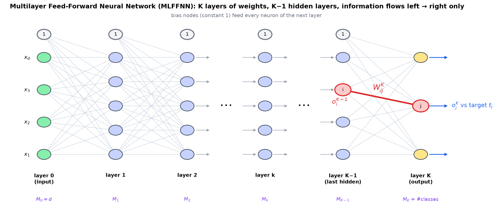
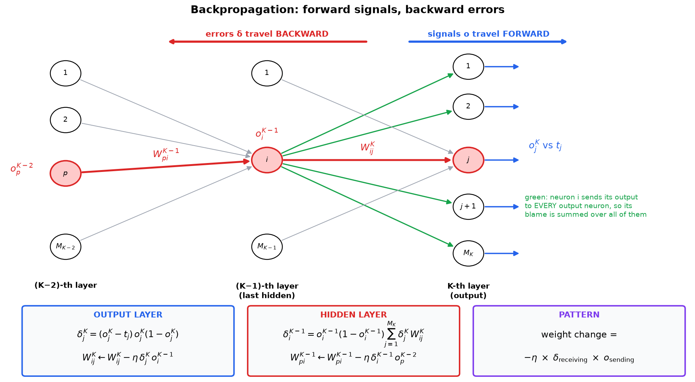

# Neural Network 3 — Backpropagation, Learning Rate, Batches and Epochs: Exam Questions and Answers

Companion to [neural_networks_visual_guide.md](../../neural_networks_visual_guide.md), sections 7, 10, 12 and 13 (deck `Neural_Network_3.pptx`). Try each question first, then read the answer.

**Pattern:** Part A = 2-mark questions. Part B = 10-mark questions split (a) + (b), 5 + 5 or 6 + 4.
**Tags:** 🎯 real paper (year, question); ✍️ practice to cover the deck; 📘 beyond the slides. 💡 = memory hook.
This deck is mid-sem material that is also in the end-sem syllabus. "2026 Mid" = this year's mid-sem paper. Backpropagation is the most-asked derivation in this course.

| Topic in the guide | Question |
| :--- | :--- |
| MLFFNN architecture and notation (§7) | B1(a) |
| Single layer: linear vs sigmoid update (§12, Step 1) | A1 |
| Single layer, many outputs (§12, Step 1b) | A1 |
| Why the error must be propagated back (§12) | A2 |
| Learning rate: choosing it (§10) | A3 |
| Batch size, iteration vs epoch, batching strategies (§10) | A4, B3 |
| Output-layer derivation (§12, Step 2) | B2(a) |
| Hidden-layer derivation, order of updates (§12, Step 3) | A5, B2(b) |
| DNN training process (§10, §12) | B1 |
| Worked example (§13) | B4 |

---

## Part A — 2-mark questions

### A1. Write the weight update rule for a single-layer network with (i) a linear activation and (ii) a sigmoid activation. ✍️ [2]

With squared error and one sample (stochastic):

| Activation | Prediction | Update |
| :--- | :--- | :--- |
| Linear $f(x) = x$ | $\hat{y} = \mathbf{W}^TX$ | $\mathbf{W} \leftarrow \mathbf{W} - \eta(\hat{y} - y)X$ |
| Sigmoid | $\hat{y} = \sigma(\mathbf{W}^TX)$ | $\mathbf{W} \leftarrow \mathbf{W} - \eta(\hat{y} - y)\,\hat{y}(1 - \hat{y})\,X$ |

The only difference is the sigmoid's derivative $\hat{y}(1 - \hat{y})$. The step function is not differentiable, which is why the sigmoid is used. With $M$ outputs, the same rule is applied to every weight: $W_{ij} \leftarrow W_{ij} - \eta(o_j - t_j)o_j(1 - o_j)x_i$.

> 💡 Sigmoid adds one factor: its own slope.

### A2. Why is the algorithm called "backpropagation"? ✍️ [2]

The error can be computed only at the **output layer**, where the true targets are known. For a hidden neuron, no one tells us what its output should have been, so we cannot define its error directly. Instead, the output error is sent **backwards** through the network with the chain rule, layer by layer, to find each hidden neuron's share of the error ($\delta$). The weights are then updated with gradient descent.

> 💡 Errors are known only at the end, so they travel backwards.

### A3. How do you choose the learning rate? ✍️ [2]

1. **Trial and error:** start with a medium value like 0.01 or 0.001.
2. **Monitor the loss:** if it fluctuates wildly or rises, **decrease** $\eta$; if it falls very slowly, **increase** it.
3. **Adaptive optimisers** (Adam, RMSprop, AdaGrad) adjust it per parameter during training.
4. **Learning-rate schedules** decay it as training goes on.

> 💡 Loss jumping → smaller η; loss crawling → bigger η.

### A4. Distinguish iteration and epoch. 1,000 samples, batch size 50, 20 epochs: how many weight updates? ✍️ [2]

- **Iteration:** one weight update, using one batch.
- **Epoch:** one full pass over the whole dataset; it contains many iterations.

$$\text{iterations per epoch} = \frac{\text{dataset size}}{\text{batch size}} = \frac{1000}{50} = 20, \qquad 20 \times 20 \text{ epochs} = \mathbf{400} \text{ updates}$$

For SGD (batch size 1) an epoch has 1,000 iterations; for batch GD it has 1.

> 💡 Iteration = one batch; epoch = all batches.

### A5. In backpropagation, why are all deltas computed with the old weights before any update? ✍️ [2]

Each delta in layer $k$ uses the layer-$(k+1)$ weights **as they were during the forward pass**. If we updated those weights first, we would be differentiating a different network, and the gradient would be wrong. So: forward pass → compute all deltas from the output back to the first hidden layer → then update all weights.

> 💡 Measure everything first, then change it.

---

## Part B — 10-mark questions

### B1. 🎯 2026 Mid Q1 + 🎯 2025 End Q4(a)

**(a)** Describe the architecture of a deep neural network (DNN) and explain forward propagation and the loss function. **[5]**
**(b)** Explain how backpropagation, gradient descent and the parameter updates are used to train it. **[5]**
*(The 2026 mid-sem asked this as one 10-mark question; 2025 End asked it for 6.)*

**(a) Answer.**

**Architecture:**

- **Layer 0 (input):** one neuron per feature; passes the input on ($y = x$).
- **Layers 1 to K−1 (hidden):** fully connected, each with a non-linear activation (ReLU, sigmoid, tanh). "Deep" = many hidden layers.
- **Layer K (output):** one neuron per class (sigmoid or softmax), or one linear neuron for regression.
- Notation: $M_k$ neurons in layer $k$; $W_{ij}^k$ = weight from neuron $i$ in layer $k-1$ to neuron $j$ in layer $k$.

**Forward propagation:** each neuron does two tasks:

1. weighted sum of all inputs from the previous layer: $\theta_j^k = \sum_i W_{ij}^k o_i^{k-1}$ (bias included);
2. activation: $o_j^k = f(\theta_j^k)$.

Layer by layer, from input to output, giving $\hat{y} = f^{(K)}(\cdots f^{(1)}(X))$.

**Loss function:** measures how wrong the prediction is:

- squared error $E = \frac{1}{2}\sum_j(o_j^K - t_j)^2$ (or MSE), for regression;
- cross-entropy $C = -\sum_j t_j\log o_j^K$, for classification.

**(b) Answer.**

**Backpropagation:** compute the gradient of the loss with respect to every weight with the chain rule, starting at the output layer.

- Output layer: $\delta_j^K = (o_j^K - t_j)\,o_j^K(1 - o_j^K)$
- Hidden layer $k$: $\delta_j^k = o_j^k(1 - o_j^k)\sum_t \delta_t^{k+1}W_{jt}^{k+1}$ (sum over all neurons it feeds)
- Gradient: $\partial E / \partial W_{ij}^k = \delta_j^k\,o_i^{k-1}$

**Gradient descent / parameter update:**

$$W_{ij}^k \leftarrow W_{ij}^k - \eta\,\delta_j^k\,o_i^{k-1}$$

weight change = −η × (delta of the receiving neuron) × (output of the sending neuron).

**Training loop:**

1. Initialise weights randomly (Xavier/He).
2. For each mini-batch: forward pass → loss → backward pass (deltas with the old weights) → update all weights once.
3. One pass over all batches = one epoch; repeat for many epochs until the loss stops falling (check on validation data).

> 💡 Forward, loss, backward, update; repeat.

### B2. 🎯 2024 End Q2(a) + ✍️

**(a)** Derive the weight update rule for a sample input $X = (X_1, \dots, X_n)$ at the **output layer** of a multilayer feed-forward neural network with $(K-1)$ hidden layers, using backpropagation with gradient descent. $M_i$ is the number of neurons in layer $i$, $i = 0, 1, \dots, K$; use the sigmoid activation and squared error. **[6]**
**(b)** Extend the derivation to the weights of the last hidden layer. **[4]**

**(a) Answer.**

Output neuron $j$ of layer $K$:

$$\theta_j^K = \sum_{i=1}^{M_{K-1}} W_{ij}^K o_i^{K-1}, \qquad o_j^K = \sigma(\theta_j^K) = \frac{1}{1 + e^{-\theta_j^K}}$$

Error for the sample, over the $M_K$ output neurons:

$$E = \frac{1}{2}\sum_{j=1}^{M_K}(o_j^K - t_j)^2$$

$E$ depends on $W_{ij}^K$ only through $o_j^K$, which depends on it through $\theta_j^K$. Chain rule:

$$\frac{\partial E}{\partial W_{ij}^K} = \frac{\partial E}{\partial o_j^K}\cdot\frac{\partial o_j^K}{\partial\theta_j^K}\cdot\frac{\partial\theta_j^K}{\partial W_{ij}^K}$$

The three factors:

1. $\dfrac{\partial E}{\partial o_j^K} = o_j^K - t_j$ (the $\frac{1}{2}$ cancels the 2)
2. $\dfrac{\partial o_j^K}{\partial\theta_j^K} = o_j^K(1 - o_j^K)$ (sigmoid derivative, since $\sigma' = \sigma(1 - \sigma)$)
3. $\dfrac{\partial\theta_j^K}{\partial W_{ij}^K} = o_i^{K-1}$ (only one term of the sum contains $W_{ij}^K$)

Define $\delta_j^K = (o_j^K - t_j)\,o_j^K(1 - o_j^K)$. Then:

$$\boxed{W_{ij}^K \leftarrow W_{ij}^K - \eta\,\delta_j^K\,o_i^{K-1}}$$

for all $i = 1, \dots, M_{K-1}$ and $j = 1, \dots, M_K$. When $K = 1$, $o_i^0 = X_i$, the raw input.

**(b) Answer.**

Weight $W_{pi}^{K-1}$ goes from neuron $p$ (layer $K-2$) to neuron $i$ (layer $K-1$). A hidden neuron has no target, but it affects $E$ through **every** output neuron $j$, so sum over all paths:

$$\frac{\partial E}{\partial W_{pi}^{K-1}} = \sum_{j=1}^{M_K}\underbrace{(o_j^K - t_j)o_j^K(1 - o_j^K)}_{\delta_j^K}\cdot\underbrace{W_{ij}^K}_{\partial\theta_j^K/\partial o_i^{K-1}}\cdot\underbrace{o_i^{K-1}(1 - o_i^{K-1})}_{\partial o_i/\partial\theta_i}\cdot\underbrace{o_p^{K-2}}_{\partial\theta_i/\partial W_{pi}}$$

$$\delta_i^{K-1} = o_i^{K-1}(1 - o_i^{K-1})\sum_{j=1}^{M_K}\delta_j^K W_{ij}^K, \qquad W_{pi}^{K-1} \leftarrow W_{pi}^{K-1} - \eta\,\delta_i^{K-1}\,o_p^{K-2}$$

The same pattern repeats for every layer $k$ (replace $K$ by $k+1$), working backwards to layer 1.

> 💡 Output delta uses the target; hidden delta sums the deltas above it.

### B3. 🎯 2024 End Q4(b) + ✍️

**(a)** What is meant by batch size in gradient descent? Explain the different batching strategies, with their merits and demerits. How is batch size related to an epoch? **[1 + 4.5 + 1.5 → 6]**
**(b)** How are batches created in each epoch? How does batch size interact with the learning rate? **[4]**

**(a) Answer.**

**Batch size** = the number of training examples used to compute the gradient for **one** weight update.

| Strategy | Batch size | Merits | Demerits |
| :--- | :--- | :--- | :--- |
| Batch GD | all $N$ samples | exact, stable gradient; smooth convergence | slow; whole dataset must fit in memory; can get stuck in local minima |
| Stochastic GD | 1 | fast, frequent updates; little memory; noise can escape local minima | very noisy path; does not use vectorised hardware well |
| Mini-batch GD | between 1 and $N$ (32, 64, 128, 256) | balance of speed and stability; efficient GPU matrix operations; **most used** | batch size is one more hyperparameter to tune |

**Relation to epoch:** one epoch = one pass over all $N$ samples, so

$$\text{iterations per epoch} = N / \text{batch size}$$

Batch GD: 1; SGD: $N$; mini-batch: $N / B$. *E.g.* 1,000 samples, batch 100 → 10 iterations per epoch.

**(b) Answer.**

**Creating batches each epoch:**

1. **Sequential:** split the data in its fixed order (1–100, 101–200, …); no randomness. Simple, but the model can learn the order.
2. **Random (shuffling):** shuffle the whole dataset at the start of every epoch, then split. Batches differ between epochs, which improves generalisation. The usual choice.
3. **Stratified:** each batch keeps the class proportions of the full dataset; important for **imbalanced** data, so rare classes appear in every batch.

**Batch size and learning rate:** a **larger** batch averages more samples, so its gradient is less noisy and it can use a **larger** $\eta$. A **small** batch gives a noisy gradient and needs a **smaller** $\eta$ to stay stable. The batch size is also limited by GPU memory.

> 💡 Shuffle every epoch; big batch, bigger step.

### B4. ✍️ (numerical)

A 2-2-1 network uses sigmoid activations everywhere, squared error and $\eta = 0.5$. Input $x = (0.6, 0.2)$, target $t = 1$. The first column of each weight matrix is the bias:

$$W^1 = \begin{bmatrix} 0.1 & 0.5 & -0.4 \\ -0.2 & 0.3 & 0.8 \end{bmatrix}, \qquad W^2 = [0.2,\ 0.7,\ -0.5]$$

**(a)** Do the forward pass and compute the error and all the deltas. **[5]**
**(b)** Update all the weights and check that the error falls. **[5]**

**(a) Answer.**

Hidden layer:

$$\theta^1 = [0.1 + 0.5(0.6) - 0.4(0.2),\ \ -0.2 + 0.3(0.6) + 0.8(0.2)] = [0.32,\ 0.14]$$
$$o^1 = [\sigma(0.32),\ \sigma(0.14)] = [0.5793,\ 0.5349]$$

Output:

$$\theta^2 = 0.2 + 0.7(0.5793) - 0.5(0.5349) = 0.3381, \quad o^2 = 0.5837, \quad E = \tfrac{1}{2}(0.5837 - 1)^2 = 0.0866$$

Deltas (old weights):

$$\delta^2 = (0.5837 - 1)(0.5837)(0.4163) = -0.10115$$
$$\delta_1^1 = 0.5793(0.4207)(-0.10115)(0.7) = -0.01726$$
$$\delta_2^1 = 0.5349(0.4651)(-0.10115)(-0.5) = +0.01258$$

**(b) Answer.**

Each update is $W \leftarrow W - \eta\,\delta\,[1, \text{inputs}]$:

$$W^2_{new} = [0.2,\ 0.7,\ -0.5] - 0.5(-0.10115)[1,\ 0.5793,\ 0.5349] = [0.2506,\ 0.7293,\ -0.4729]$$

$$W^1_{new} = \begin{bmatrix} 0.1 + 0.00863 & 0.5 + 0.00518 & -0.4 + 0.00173 \\ -0.2 - 0.00629 & 0.3 - 0.00377 & 0.8 - 0.00126 \end{bmatrix} = \begin{bmatrix} 0.1086 & 0.5052 & -0.3983 \\ -0.2063 & 0.2962 & 0.7987 \end{bmatrix}$$

**Check:** with the new weights the output rises from 0.5837 to **0.6043** and the error falls from 0.0866 to **0.0783**. ✓

> 💡 Gradient = δ × [1, inputs]; negative δ raises the weights.
