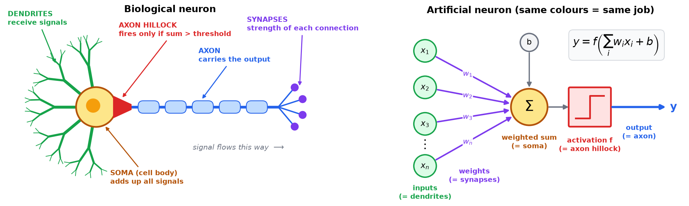
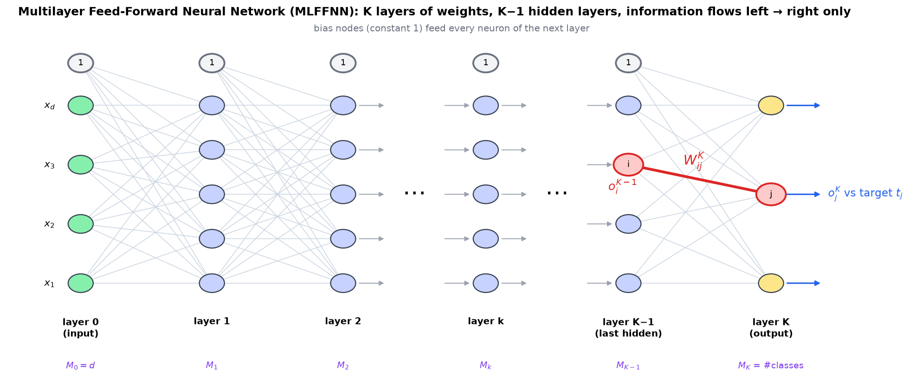
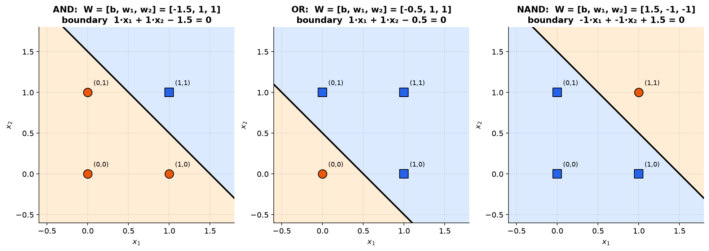
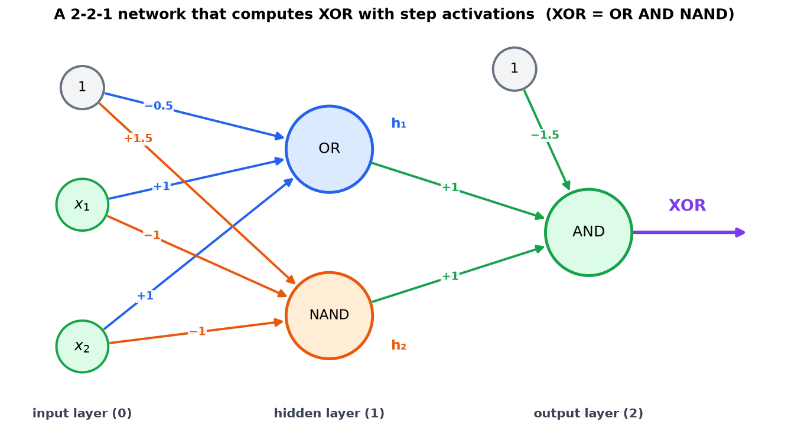
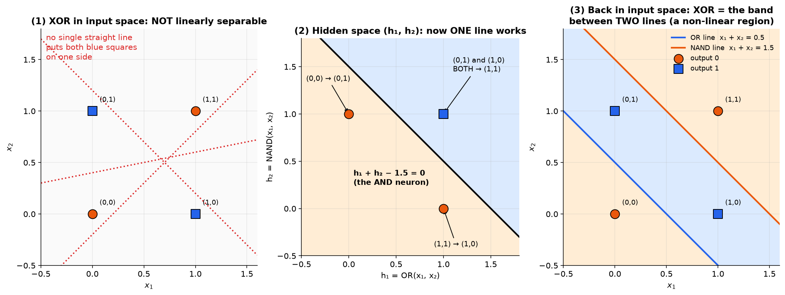
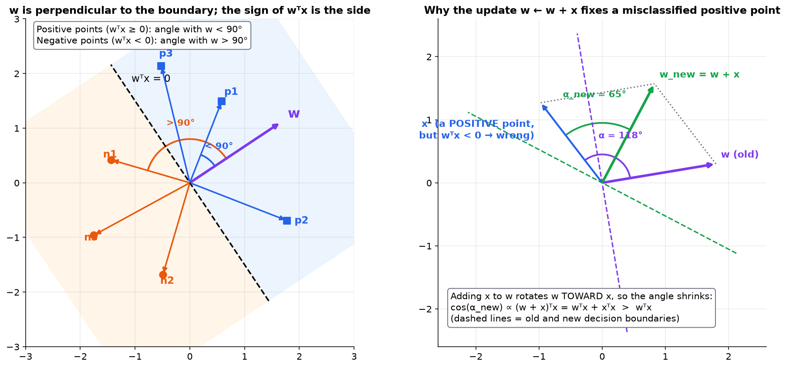

# Neural Network 1 — Neurons, Perceptron, Logic Gates & XOR: Exam Questions and Answers

Companion to [neural_networks_visual_guide.md](../../neural_networks_visual_guide.md), sections 1–8 (deck `Neural_network_1.pptx`). Try each question first, then read the answer.

**Pattern:** Part A = 2-mark questions. Part B = 10-mark questions split (a) + (b), 5 + 5 or 6 + 4.
**Tags:** 🎯 real paper (year, question); ✍️ practice to cover the deck; 📘 beyond the slides. 💡 = memory hook.
This deck is mid-sem material that is also in the end-sem syllabus.

| Topic in the guide | Question |
| :--- | :--- |
| Biological vs artificial neuron (§1) | A1, B1(a) |
| Single neuron output, numerical (§1) | A2 |
| McCulloch-Pitts neuron, inhibitory inputs (§2) | A3 |
| Perceptron, bias trick, bias vs variance (§2) | A4 |
| Logic gates, error surface (§3) | A5, B2(a) |
| Perceptron learning algorithm and convergence (§4–5) | B3 |
| XOR and the hidden layer (§6) | B2(b) |
| MLFFNN, chain of non-linear functions, Iris example (§7–8) | A6, B1(b) |

---

## Part A — 2-mark questions

### A1. How do the parts of a biological neuron correspond to an artificial neuron? 🎯 2024 Mid Q3(a) [2]

| Biological | Artificial | Job |
| :--- | :--- | :--- |
| Dendrites | inputs $x_i$ | receive signals |
| Synapses | weights $w_i$ | set the strength of each signal |
| Soma (cell body) | weighted sum $\sum w_i x_i + b$ | add the inputs up |
| Axon hillock | activation threshold | decide whether to fire |
| Axon | output $y$ | send the result on |
| Synaptic plasticity | weight updates | learning |

So $y = f\big(\sum_i w_i x_i + b\big)$.

> 💡 Dendrites in, synapses weigh, soma sums, hillock decides, axon sends.

### A2. Calculate the output $y$ of a three-input neuron with bias. Inputs $(0.8, 0.6, 0.4)$, weights $[w_1, w_2, w_3, b] = [0.2, 0.1, -0.3, 0.35]$, binary sigmoid activation. 🎯 2023 Mid Q4(a), 2023 End Q4(a) [3]

$$z = 0.2(0.8) + 0.1(0.6) - 0.3(0.4) + 0.35 = 0.16 + 0.06 - 0.12 + 0.35 = 0.45$$

$$y = \sigma(0.45) = \frac{1}{1 + e^{-0.45}} = \frac{1}{1 + 0.6376} = 0.6106$$

> 💡 Weighted sum first, then squash.

### A3. What is a McCulloch-Pitts neuron? What are its limitations? ✍️ [2]

It takes **binary** inputs, has **no weights**, and fires ($y = 1$) when $\sum x_i \ge \theta$. AND of $n$ inputs uses $\theta = n$; OR uses $\theta = 1$. An **inhibitory** input forces the output to 0 (giving NOT, NOR, $x_1$ AND NOT $x_2$).

Limitations: inputs must be 0/1; every input counts equally; $\theta$ is set by hand (no learning); only **linearly separable** functions can be computed.

> 💡 M-P = count the ones and compare with θ; the perceptron adds weights and learning.

### A4. What is the bias in a perceptron and why is it used? ✍️ [2]

Rewrite $\sum w_i x_i \ge \theta$ as $\sum w_i x_i - \theta \ge 0$, and add a constant input $x_0 = 1$ with weight $w_0 = -\theta$. Then $y = 1 \iff \mathbf{w}^T\mathbf{x} \ge 0$. The bias **shifts the decision boundary** (or the activation function left or right), so the boundary need not pass through the origin, and it is learned like any other weight.

Do not confuse it with **bias vs variance**: high bias = large training error (underfitting); high variance = large validation error (overfitting).

> 💡 Bias = a weight on a constant 1 input; it moves the line.

### A5. Give the weights of a single neuron that implements AND, OR and NAND, and verify AND. ✍️ [2]

With weights $[w_0, w_1, w_2]$ on $[1, x_1, x_2]$ and a step function (1 if sum ≥ 0):

- AND: $[-1.5, 1, 1]$; OR: $[-0.5, 1, 1]$; NAND: $[1.5, -1, -1]$.
- AND check on (0,0), (0,1), (1,0), (1,1): sums $-1.5, -0.5, -0.5, 0.5$ → outputs $0, 0, 0, 1$ ✓.

> 💡 AND needs both (threshold 1.5); OR needs one (threshold 0.5); NAND is AND with signs flipped.

### A6. Why must hidden layers use a non-linear activation? ✍️ [2]

Without it, two linear layers collapse into one: $W_2(W_1X) = (W_2W_1)X$, so a deep network could still only draw a straight line. With non-linear activations each layer re-maps its input, $\hat{y} = f^{(K)}(\cdots f^{(2)}(f^{(1)}(X)))$, until the final representation is linearly separable.

> 💡 Linear on linear is still linear.

---

## Part B — 10-mark questions

### B1. ✍️

**(a)** Explain the working of a biological neuron and how an artificial neuron mimics it. **[5]**
**(b)** Describe the structure of a multilayer feed-forward neural network (MLFFNN) and its working principle. Give the network used for the Iris dataset as an example. **[5]**

**(a) Answer.**

**Biological neuron:**

- The brain has about $10^{11}$ neurons, which communicate with electrical impulses.
- **Dendrites** receive signals from other neurons; the **soma** adds them up.
- If the total crosses a **threshold**, the neuron **fires** an impulse (about a millisecond long) along the **axon**; otherwise nothing happens.
- The signal reaches the next neurons through **synapses**, where **neurotransmitters** strengthen or weaken it. Learning changes these strengths (**synaptic plasticity**).

**Artificial neuron:**



$$y = f\Big(\sum_i w_i x_i + b\Big)$$

- inputs $x_i$ ↔ dendrites; weights $w_i$ ↔ synapses; weighted sum ↔ soma; activation function $f$ ↔ axon hillock threshold; output $y$ ↔ axon; weight updates ↔ plasticity.
- The membrane potential corresponds to the sum before activation.
- The refractory period has no direct counterpart (roughly like dropout).

**(b) Answer.**



**Structure:**

- **Layer 0 (input):** passes the features on unchanged ($y = x$); one neuron per feature.
- **Layers 1 to K−1 (hidden):** non-linear activations; at least one hidden layer.
- **Layer K (output):** one neuron per class.
- Layers are **fully connected** and information flows **forward only**. Many layers = a **deep** network.

**Working principle:** each layer computes a non-linear function of the previous layer's output: $f_1(X)$, then $f_2(f_1(X))$, and so on. The input is mapped to intermediate feature vectors again and again, until the last representation is **linearly separable**, so the output layer can act as a linear classifier. The weights are learned by backpropagation with gradient descent.

**Iris example:** 4 features → **10 ReLU** hidden neurons → **3 softmax** outputs (3 species). Features standardised, labels one-hot, 80/20 train/test split, Adam optimiser, categorical cross-entropy loss, 100 epochs, batch size 8. Result: about **96.7%** test accuracy (29 of 30).

> 💡 Input passes, hidden layers bend, output decides.

### B2. 🎯 2025 Mid Q3(a) + 🎯 2024 Mid Q3(b)

**(a)** Draw the neural network structures that implement (i) a 2-input AND gate and (ii) a 2-input OR gate. How do these structures differ from the one required to implement a 2-input XOR gate? **[4]**
**(b)** Draw the structure of a neural network that implements an XOR gate and explain how non-linear mapping is used in this implementation. **[6]**

**(a) Answer.**

AND and OR each need **one neuron** with a step activation and inputs $[1, x_1, x_2]$:

- AND: $y = \text{step}(-1.5 + x_1 + x_2)$
- OR: $y = \text{step}(-0.5 + x_1 + x_2)$



Matrix check, with the four input patterns as columns of $X$ (bias row on top):

$$[-1.5, 1, 1]X = [-1.5, -0.5, -0.5, 0.5] \to [0, 0, 0, 1]\ \text{(AND)}$$
$$[-0.5, 1, 1]X = [-0.5, 0.5, 0.5, 1.5] \to [0, 1, 1, 1]\ \text{(OR)}$$

**Difference from XOR:** AND and OR are **linearly separable**: one straight line splits the 1s from the 0s, so a single neuron (single-layer perceptron) is enough. XOR is **not** linearly separable, so it needs a **hidden layer**: 3 neurons in total (2 hidden + 1 output), a multilayer network.

**(b) Answer.**



XOR = AND(OR, NAND):

- hidden neuron $h_1$ = OR: weights $[-0.5, 1, 1]$
- hidden neuron $h_2$ = NAND: weights $[1.5, -1, -1]$
- output = AND($h_1, h_2$): weights $[-1.5, 1, 1]$

| $x_1$ | $x_2$ | $h_1$ (OR) | $h_2$ (NAND) | XOR |
| :---: | :---: | :---: | :---: | :---: |
| 0 | 0 | 0 | 1 | 0 |
| 0 | 1 | 1 | 1 | 1 |
| 1 | 0 | 1 | 1 | 1 |
| 1 | 1 | 1 | 0 | 0 |

**Non-linear mapping:**

- In the input space $(x_1, x_2)$, no single line separates XOR's classes.
- The hidden layer (with the non-linear step function) maps the inputs to a new space $(h_1, h_2)$: (0,0) → (0,1); (0,1) and (1,0) → (1,1); (1,1) → (1,0).
- In this hidden space the two classes **are** linearly separable, so one line (the AND neuron) splits them.
- Back in the input space, the "1" region is the band between two lines.



For training instead of hand-set weights: 2 inputs → 2 hidden (sigmoid/ReLU) → 1 sigmoid output, binary cross-entropy loss, SGD, many epochs.

> 💡 XOR = OR and NAND, then AND.

### B3. 🎯 2024 Mid Q3(c) + ✍️

**(a)** Describe the perceptron learning algorithm for binary classification and explain geometrically why its update works. **[5]**
**(b)** Prove that the perceptron learning algorithm converges if the data is linearly separable. **[5]**

**(a) Answer.**

$P$ = inputs with label 1, $N$ = inputs with label 0 (each with $x_0 = 1$ for the bias).

```text
initialise w randomly
while not converged:
    pick a random x
    if x in P and w.x < 0:  w = w + x
    if x in N and w.x >= 0: w = w - x
```

It stops when every input is classified correctly. For $m$ output neurons (classes) it is run once per neuron.

**Why it works:** $\mathbf{w}^T\mathbf{x} = \lVert\mathbf{w}\rVert\lVert\mathbf{x}\rVert\cos\alpha$, so the sign depends on the angle $\alpha$. Positive points need $\alpha < 90°$, negative points $\alpha > 90°$.

- Missed positive: $(\mathbf{w} + \mathbf{x})^T\mathbf{x} = \mathbf{w}^T\mathbf{x} + \lVert\mathbf{x}\rVert^2 > \mathbf{w}^T\mathbf{x}$, so $\cos\alpha$ grows and $\mathbf{w}$ rotates **towards** $\mathbf{x}$.
- Missed negative: subtracting $\mathbf{x}$ rotates $\mathbf{w}$ **away** from $\mathbf{x}$.



**(b) Answer.**

**Setup:**

1. Replace each negative point by $-\mathbf{x}$; now we need $\mathbf{w}^T\mathbf{p} \ge 0$ for every point $\mathbf{p}$.
2. Normalise so $\lVert\mathbf{p}\rVert = 1$.
3. Since the data is separable, a solution $\mathbf{w}^\ast$ exists; take $\lVert\mathbf{w}^\ast\rVert = 1$ and $\delta = \min_{\mathbf{p}} \mathbf{w}^{\ast T}\mathbf{p} > 0$.
4. Look at $\cos\beta = \dfrac{\mathbf{w}^{\ast T}\mathbf{w}_{t+1}}{\lVert\mathbf{w}_{t+1}\rVert}$ after $k$ corrections.

**Numerator grows at least linearly** (each correction adds $\mathbf{p}_i$):

$$\mathbf{w}^{\ast T}\mathbf{w}_{t+1} = \mathbf{w}^{\ast T}\mathbf{w}_t + \mathbf{w}^{\ast T}\mathbf{p}_i \ge \mathbf{w}^{\ast T}\mathbf{w}_t + \delta \ \Rightarrow\ \ge \mathbf{w}^{\ast T}\mathbf{w}_0 + k\delta$$

**Denominator grows at most like a square root** ($\mathbf{w}_t^T\mathbf{p}_i < 0$ because it was a mistake):

$$\lVert\mathbf{w}_{t+1}\rVert^2 = \lVert\mathbf{w}_t\rVert^2 + 2\mathbf{w}_t^T\mathbf{p}_i + \lVert\mathbf{p}_i\rVert^2 \le \lVert\mathbf{w}_t\rVert^2 + 1 \ \Rightarrow\ \le \lVert\mathbf{w}_0\rVert^2 + k$$

**Combine:**

$$\cos\beta \ge \frac{\mathbf{w}^{\ast T}\mathbf{w}_0 + k\delta}{\sqrt{\lVert\mathbf{w}_0\rVert^2 + k}}$$

The right side grows like $\sqrt{k}$, but $\cos\beta \le 1$, so $k$ must be **finite**. With $\mathbf{w}_0 = 0$: $\sqrt{k}\,\delta \le 1$, so $k \le 1/\delta^2$. ∎

*Example:* a run on 50 points had $\delta = 0.0627$, bound $1/\delta^2 = 254$ corrections; it actually stopped after 12.

> 💡 Top grows like $k$, bottom like $\sqrt{k}$, cosine can't pass 1.
