# Comprehensive Learning Guide: Convolutional Neural Networks (CNN)

> **Source Material:** `ML_Lec_12_CNN.pptx` (108 Slides)  
> **Topic Domain:** Machine Learning / Deep Learning — Convolutional Neural Networks  
> **Structure:** 4-Part Concept Anatomy (Problem & Intuition $\to$ Technical Mechanism & Architecture $\to$ Visual Anchor $\to$ Verified Formulas, Trade-offs & Calculations)

---

## 1. Foundations of Discrete Convolution & Feature Maps

### 1. The Engineering Problem & Intuition
Standard machine learning architectures treat inputs as flat, unorganized vectors of independent features. In natural imagery, however, spatial structure is paramount: adjacent pixels exhibit extreme mutual covariance (local correlation), whereas distant pixels are relatively independent. Flattening an image and feeding it directly to a standard fully connected network destroys this spatial geometry and discards topological relationships.

Discrete 2D convolution addresses this by treating the image as a 2D spatial grid and sliding a small parameterized weight template (a filter or kernel) across the coordinate space. Rather than evaluating every pixel in isolation, convolution computes localized weighted sums that quantify how well local image patches match the template's pattern.

### 2. Technical Mechanism & Architecture
In the context of Convolutional Neural Networks (CNNs), convolution is defined as an affine transformation applied locally across a grid-structured topology.

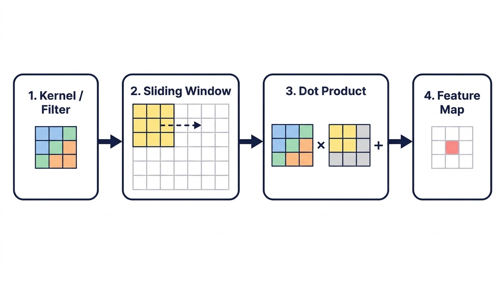
*Figure: The four elements of every convolution: a kernel, a sliding window, a dot product at each position, and the feature map it builds (illustration).*

The operation consists of four core elements:
1. **Kernel / Filter:** A small matrix of real-valued weights (e.g., $2 \times 2$, $3 \times 3$, or $5 \times 5$). It serves as a specialized feature extractor tuned to detect specific localized patterns such as vertical edges, color transitions, or textures.
2. **Sliding Window:** The kernel systematically sweeps across the input matrix from top-left to bottom-right at discrete spatial intervals (strides).
3. **Dot Product (Frobenius Inner Product):** At every discrete position, the kernel performs an element-wise multiplication with the overlapping patch of the input image, followed by a summation of all products into a single scalar value.
4. **Output Feature Map:** As the kernel completes its sweep across all valid positions, the accumulated scalar responses form a 2D matrix called a **feature map** (or activation map). This map spatially organizes the detection strength of the kernel's target pattern.

#### Discrete 2D Walk-Through (Slides 2–9)
Consider a $3 \times 4$ grayscale input matrix $I$ convolved with a $2 \times 2$ kernel $K$:

```math
I = \begin{bmatrix} I_{11} & I_{12} & I_{13} & I_{14} \\ I_{21} & I_{22} & I_{23} & I_{24} \\ I_{31} & I_{32} & I_{33} & I_{34} \end{bmatrix}, \quad K = \begin{bmatrix} K_{11} & K_{12} \\ K_{21} & K_{22} \end{bmatrix}
```

The sliding window proceeds through 6 discrete steps:
1. **Position (1, 1):** Overlaps top-left $2 \times 2$ subgrid $\begin{bmatrix} I_{11} & I_{12} \\ I_{21} & I_{22} \end{bmatrix}$. Output $O_{11} = I_{11}K_{11} + I_{12}K_{12} + I_{21}K_{21} + I_{22}K_{22}$.
2. **Position (1, 2):** Shifts right by 1 pixel to overlap $\begin{bmatrix} I_{12} & I_{13} \\ I_{22} & I_{23} \end{bmatrix}$. Output $O_{12} = I_{12}K_{11} + I_{13}K_{12} + I_{22}K_{21} + I_{23}K_{22}$.
3. **Position (1, 3):** Shifts right to overlap $\begin{bmatrix} I_{13} & I_{14} \\ I_{23} & I_{24} \end{bmatrix}$. Output $O_{13} = I_{13}K_{11} + I_{14}K_{12} + I_{23}K_{21} + I_{24}K_{22}$.
4. **Position (2, 1):** Shifts down to row 2, left column $\begin{bmatrix} I_{21} & I_{22} \\ I_{31} & I_{32} \end{bmatrix}$. Output $O_{21} = I_{21}K_{11} + I_{22}K_{12} + I_{31}K_{21} + I_{32}K_{22}$.
5. **Position (2, 2):** Overlaps $\begin{bmatrix} I_{22} & I_{23} \\ I_{32} & I_{33} \end{bmatrix}$. Output $O_{22} = I_{22}K_{11} + I_{23}K_{12} + I_{32}K_{21} + I_{33}K_{22}$.
6. **Position (2, 3):** Overlaps $\begin{bmatrix} I_{23} & I_{24} \\ I_{33} & I_{34} \end{bmatrix}$. Output $O_{23} = I_{23}K_{11} + I_{24}K_{12} + I_{33}K_{21} + I_{34}K_{22}$.

The resulting output feature map $O$ has shape $2 \times 3$.

### 3. Visual Anchor

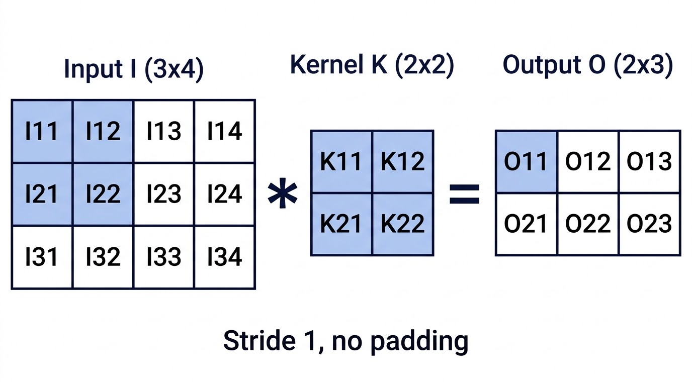
*Figure: The Slides 2–9 walk-through: the 2x2 kernel K over the top-left block of the 3x4 input I produces O11; sliding with stride 1 and no padding fills the 2x3 output O (illustration).*

### 4. Verified Formulas, Trade-offs & Calculations
The discrete 2D cross-correlation (commonly termed convolution in deep learning) for input $I$ and kernel $K$ of spatial dimensions $M \times N$ is:

```math
S(i, j) = (I * K)(i, j) = \sum_{m=0}^{M-1} \sum_{n=0}^{N-1} I(i + m, j + n) K(m, n)
```

*Plain reading:* The scalar response at output location $(i, j)$ is the sum of products of kernel weights and the corresponding input pixels over the spatial extent $M \times N$.

#### Boundary Shrinkage Calculation (Slide 9)
For an input of height $H_1$ and width $W_1$ convolved with a filter of size $F \times F$ under unit stride ($S = 1$) without padding ($P = 0$):
- Height: $H_2 = H_1 - F + 1 = 3 - 2 + 1 = 2$
- Width: $W_2 = W_1 - F + 1 = 4 - 2 + 1 = 3$
- Feature map dimensions: $2 \times 3$.

---

## 2. Spatial Shrinking, Boundary Constraints & Padding Mechanics

### 1. The Engineering Problem & Intuition
When a kernel of spatial extent $F \times F$ is convolved across an image, its center cannot be placed on boundary pixels without the edges of the filter protruding beyond the boundaries of the image grid. If convolution is restricted solely to positions where the kernel fits entirely inside the image, two critical engineering problems arise:

1. **Cumulative Spatial Shrinkage:** Each convolutional layer with filter extent $F$ reduces spatial height and width by $F - 1$ pixels. In deep networks containing dozens of sequential convolutional layers, the feature map quickly collapses to $1 \times 1$, terminating spatial representation before deep hierarchical abstraction can occur.
2. **Edge Information Loss:** Pixels located along the image perimeter participate in far fewer convolution windows than central pixels. A corner pixel is sampled only once by a $3 \times 3$ kernel, whereas a central pixel is sampled 9 times. Border features are systematically under-represented.

Padding resolves this by synthetically expanding the input array with surrounding border values (typically zeros) before convolution.

### 2. Technical Mechanism & Architecture
Padding wraps the boundary of the input tensor with $P$ rows/columns of constant values (zero-padding).

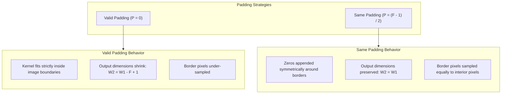

#### Four Engineering Rationales for Padding (Slide 12)
1. **Preserving Dimensions:** Guarantees that output feature maps match input resolution ($W_2 = W_1, H_2 = H_1$), essential when chaining deep convolutional stacks or performing dense pixel prediction (e.g., semantic segmentation, autoencoders).
2. **Edge Feature Extraction:** Centers the filter directly over perimeter and corner pixels, capturing boundary structures that would otherwise be discarded.
3. **Mitigating Spatial Shrinkage:** Decouples network depth from spatial resolution decay, allowing networks to grow arbitrarily deep.
4. **Stabilizing Learning Performance:** Prevents erratic spatial size mismatch across residual skip connections and ensures consistent contextual representation.

### 3. Visual Anchor

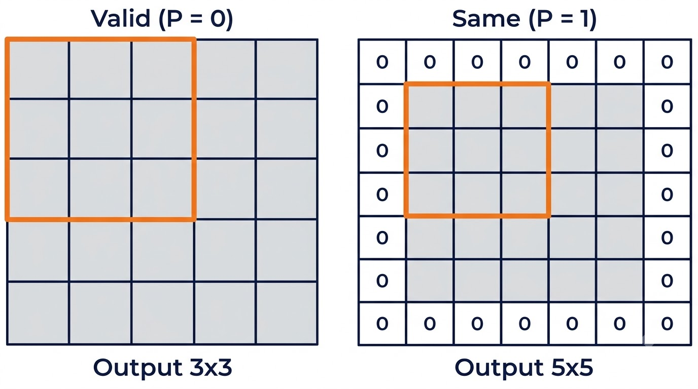
*Figure: Valid (P = 0): a 3x3 window fits in 3x3 positions of the 5x5 input, so the output is 3x3. Same (P = 1): one ring of zeros makes a 7x7 grid, the window can centre on every original pixel, and the output stays 5x5 (illustration).*

The padded array structure for $P = 1$ on an inner $7 \times 7$ grid (producing a $9 \times 9$ padded tensor, Slide 73):

```math
I_{\text{padded}} = \begin{bmatrix}
0 & 0 & 0 & \dots & 0 & 0 \\
0 & I_{11} & I_{12} & \dots & I_{1N} & 0 \\
\vdots & \vdots & \vdots & \ddots & \vdots & \vdots \\
0 & I_{M1} & I_{M2} & \dots & I_{MN} & 0 \\
0 & 0 & 0 & \dots & 0 & 0
\end{bmatrix}
```

### 4. Verified Formulas, Trade-offs & Calculations

#### Mathematical Derivation of Same Padding
To enforce that the output dimension $W_2$ equals the input dimension $W_1$ under unit stride ($S = 1$):

```math
W_2 = W_1 - F + 2P + 1
```

Setting $W_2 = W_1$:

```math
W_1 = W_1 - F + 2P + 1 \implies 0 = -F + 2P + 1 \implies 2P = F - 1 \implies P = \frac{F - 1}{2}
```

*Plain reading:* To preserve spatial dimensions with unit stride, the padding width $P$ must equal half of the filter extent minus one.

> **Constraint:** For symmetric integer padding $P$, the filter extent $F$ must be an **odd integer** ($F \in \lbrace 1, 3, 5, 7, \dots \rbrace$). An even filter size (e.g., $F = 4$) requires asymmetric padding ($P_{\text{left}} \neq P_{\text{right}}$), which introduces coordinate bias.

#### Audited Numerical Examples (Slides 10, 70–74)
- **Valid Padding** ($P = 0$): Input $5 \times 5$, Kernel $3 \times 3$, $S = 1$:

```math
W_2 = 5 - 3 + 2(0) + 1 = 3 \implies 3 \times 3 \text{ output (shrinks by 2 pixels per axis)}
```

- **Same Padding** ($P = 1$): Input $5 \times 5$, Kernel $3 \times 3$, $S = 1$:

```math
W_2 = 5 - 3 + 2(1) + 1 = 5 \implies 5 \times 5 \text{ output (preserves exact spatial dimension)}
```

- $5 \times 5$ **Kernel Same Padding** ($P = 2$): Input $W_1$, Kernel $F = 5$, $S = 1$:

```math
P = \frac{5 - 1}{2} = 2 \implies \text{Add 2 rows/columns of zeros on all sides}
```

---

## 3. Classical Image Processing Kernels & Analytical Filters

### 1. The Engineering Problem & Intuition
Before deep learning enabled networks to discover optimal representation filters via gradient descent, computer vision relied on mathematically designed spatial convolution kernels. Engineers derived specialized matrices to solve specific signal processing tasks:
- **Gradient estimation:** Identifying rapid shifts in luminance to delineate object boundaries.
- **Noise suppression (blurring):** Attenuating high-frequency spatial sensor noise before numerical differentiation.
- **Sharpening:** Boosting high-frequency transitions to restore crispness and accentuate textural boundaries.

Understanding these analytical kernels establishes the theoretical baseline for what convolutional layers autonomously learn during training.

### 2. Technical Mechanism & Architecture

#### 1. Directional Edge Detection: Sobel Kernels (Slide 15)
The Sobel operator estimates the first spatial derivative of image intensity along orthogonal axes:
- **Horizontal Gradient** ($G_x$): Emphasizes vertical edges by calculating the difference between right and left columns, with Gaussian-like smoothing ($[1, 2, 1]^T$) along the vertical axis.
- **Vertical Gradient** ($G_y$): Emphasizes horizontal edges by calculating the difference between top and bottom rows, with smoothing along the horizontal axis.

```math
G_x = \begin{bmatrix} -1 & 0 & 1 \\ -2 & 0 & 2 \\ -1 & 0 & 1 \end{bmatrix}, \quad G_y = \begin{bmatrix} 1 & 2 & 1 \\ 0 & 0 & 0 \\ -1 & -2 & -1 \end{bmatrix}
```

The net edge magnitude and gradient orientation are:

```math
G = \sqrt{G_x^2 + G_y^2}, \quad \theta = \arctan\left(\frac{G_y}{G_x}\right)
```

#### 2. The Canny Edge Detection Pipeline (Slides 16–17)
The Canny detector is not a single filter, but a 4-stage pipeline that eliminates noise and false responses:

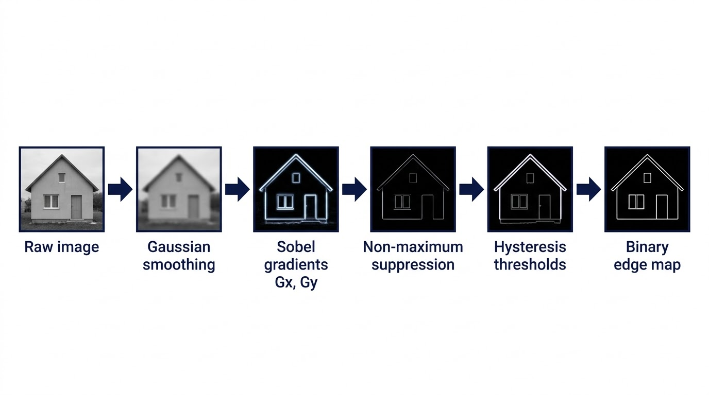
*Figure: The Canny pipeline on one image: smoothing, Sobel gradients, non-maximum suppression, hysteresis thresholds, final binary edge map (illustration).*

1. **Gaussian Smoothing:** Suppresses high-frequency camera noise that causes spurious gradient spikes.
2. **Gradient Computation:** Evaluates $G = \sqrt{G_x^2 + G_y^2}$ and directional angle $\theta$.
3. **Non-Maximum Suppression (NMS):** Scans along the gradient vector $\theta$; suppresses any pixel that is not a local maximum, thinning wide edge responses into 1-pixel wide ridges.
4. **Hysteresis Thresholding:** Applies two thresholds ($T_{\text{high}}$ and $T_{\text{low}}$):
   - Pixels with $G \ge T_{\text{high}}$ are marked as strong edges.
   - Pixels with $T_{\text{low}} \le G < T_{\text{high}}$ are marked as weak edges and retained **only** if connected to a strong edge.
   - Pixels with $G < T_{\text{low}}$ are discarded.

#### 3. Blurring & Smoothing Filters (Slides 18–21)
Blurring suppresses noise by replacing each pixel with a weighted neighborhood average:
- **Gaussian Kernel:** Samples the 2D Gaussian density function:

```math
G(x, y) = \frac{1}{2\pi \sigma^2} e^{-\frac{x^2 + y^2}{2\sigma^2}}
```

  Weights decay exponentially with squared Euclidean distance from the center. $\sigma$ controls blur radius.
  - Normalized $3 \times 3$ Gaussian kernel (sum = 16):

```math
\frac{1}{16} \begin{bmatrix} 1 & 2 & 1 \\ 2 & 4 & 2 \\ 1 & 2 & 1 \end{bmatrix}
```

  - Normalized $5 \times 5$ Gaussian kernel (outer product of binomial vector $[1, 4, 6, 4, 1]^T [1, 4, 6, 4, 1]$, sum = 256):

```math
\frac{1}{256} \begin{bmatrix} 1 & 4 & 6 & 4 & 1 \\ 4 & 16 & 24 & 16 & 4 \\ 6 & 24 & 36 & 24 & 6 \\ 4 & 16 & 24 & 16 & 4 \\ 1 & 4 & 6 & 4 & 1 \end{bmatrix}
```

- **Average / Box Filter:** Replaces each pixel with the unweighted arithmetic mean of its neighborhood:
  - $3 \times 3$ Box filter: $\frac{1}{9} \begin{bmatrix} 1 & 1 & 1 \\ 1 & 1 & 1 \\ 1 & 1 & 1 \end{bmatrix}$
  - $5 \times 5$ Box filter: $\frac{1}{25} J_{5 \times 5}$ (all entries equal $1/25$).

> **Slide Discrepancy Note (Slide 21):** Slide 21 is titled *"Blurring Kernels: Average Kernel"*, but the slide text labels the matrices as *"A 3 x 3 Gaussian Kernel"* and *"A 5 x 5 Gaussian Kernel"* while displaying uniform $1/9$ and $1/25$ coefficients. Those matrices are mathematically **Average (Box) Kernels**, not Gaussian kernels. Gaussian kernels possess distance-weighted coefficients (as shown correctly on Slide 19).

#### 4. Sharpening & Second Derivative Operators (Slides 22–26, 29–31)
- **Laplacian Kernel (Second Derivative):** Measures the divergence of the gradient ($\nabla^2 f = \frac{\partial^2 f}{\partial x^2} + \frac{\partial^2 f}{\partial y^2}$). Detects rapid rate-of-change transitions:
  - 4-neighbor standard Laplacian: $\begin{bmatrix} 0 & -1 & 0 \\ -1 & 4 & -1 \\ 0 & -1 & 0 \end{bmatrix}$ (center = 4, neighbors = $-1$, sum = 0).
  - 8-neighbor inverted Laplacian (Slide 31 Taj Mahal, media/image27.png): $\begin{bmatrix} 1 & 1 & 1 \\ 1 & -8 & 1 \\ 1 & 1 & 1 \end{bmatrix}$ (center = $-8$, neighbors = $1$, sum = 0).
- **Unsharp Masking Kernel:** Enhances fine detail by subtracting a blurred version of the image from the original, then scaling and adding back the high-frequency residue: $I_{\text{sharp}} = I + \alpha(I - I_{\text{blur}})$.
  - $3 \times 3$ Unsharp Mask kernel: $\begin{bmatrix} 0 & -1 & 0 \\ -1 & 5 & -1 \\ 0 & -1 & 0 \end{bmatrix}$ (center = 5, sum = 1).

```math
\text{Laplacian vs. Unsharp Mask Mathematical Structural Difference:} \\
K_{\text{unsharp}} = \begin{bmatrix} 0 & 0 & 0 \\ 0 & 1 & 0 \\ 0 & 0 & 0 \end{bmatrix} + \begin{bmatrix} 0 & -1 & 0 \\ -1 & 4 & -1 \\ 0 & -1 & 0 \end{bmatrix} = \begin{bmatrix} 0 & -1 & 0 \\ -1 & 5 & -1 \\ 0 & -1 & 0 \end{bmatrix} = I_{\text{identity}} + \nabla^2
```

- **Core Difference:** The Laplacian has a center value of 4 (or $-8$) and sums to 0. It eliminates uniform luminance (DC gain = 0), leaving uniform regions completely black. The Unsharp Mask has a center value of 5 and sums to 1 (DC gain = 1). It preserves the underlying image brightness while boosting high-frequency edge contrast.

#### 5. Dilated / Atrous Convolutions & Learned Embeddings (Slides 27–28)
- **Dilated (Atrous) Convolution:** Inserts spaces (zeros) between kernel elements according to dilation rate $r$.
  - Dilation rate $r = 1$: Standard dense convolution.
  - Dilation rate $r = 2$: Inserts 1 zero between adjacent filter taps, expanding a $3 \times 3$ kernel to cover a $5 \times 5$ receptive field without increasing parameter count (remains 9 weights).
  - **Benefits:** Expands receptive field exponentially across layers while preserving native spatial resolution (avoids downsampling artifacts in dense segmentation).
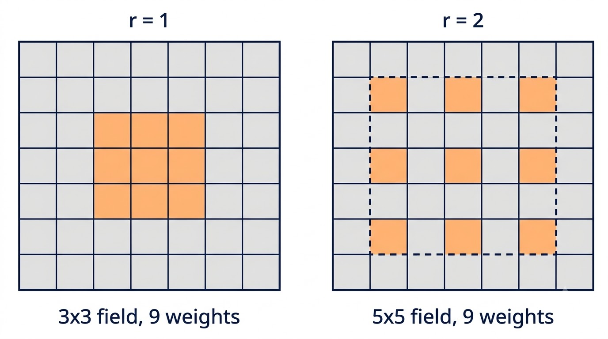
*Figure: Dilation: the same 9 weights cover a 3x3 field at r = 1 and a 5x5 field at r = 2, with one skipped pixel between taps (illustration).*

- **Embeddings / Learned Kernels:** In CNNs, kernels are not hand-engineered; their weights are freely parameterized variables learned directly from data via backpropagation.

### 3. Visual Anchor

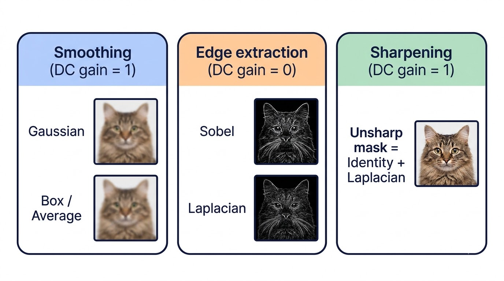
*Figure: Kernel families by DC gain: smoothing kernels (Gaussian, Box / Average) keep brightness (gain 1), edge kernels (Sobel, Laplacian) remove it (gain 0), and the unsharp mask (Identity + Laplacian) sharpens while keeping it (gain 1) (illustration).*

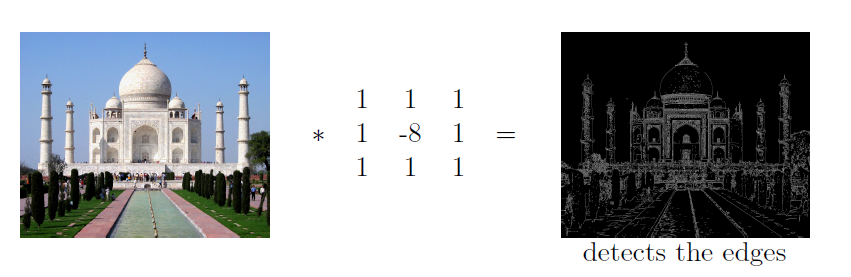

### 4. Verified Formulas, Trade-offs & Calculations

| Filter Name | Spatial Size | Kernel Matrix Form | Kernel Sum (DC Gain) | Signal Processing Function |
| :--- | :---: | :---: | :---: | :--- |
| **Sobel Horizontal** ($G_x$) | $3 \times 3$ | $\begin{bmatrix} -1 & 0 & 1 \\ -2 & 0 & 2 \\ -1 & 0 & 1 \end{bmatrix}$ | 0 | Vertical edge detector; directional derivative $\partial I / \partial x$ |
| **Sobel Vertical** ($G_y$) | $3 \times 3$ | $\begin{bmatrix} 1 & 2 & 1 \\ 0 & 0 & 0 \\ -1 & -2 & -1 \end{bmatrix}$ | 0 | Horizontal edge detector; directional derivative $\partial I / \partial y$ |
| **Gaussian Blur** ($3 \times 3$) | $3 \times 3$ | $\frac{1}{16}\begin{bmatrix} 1 & 2 & 1 \\ 2 & 4 & 2 \\ 1 & 2 & 1 \end{bmatrix}$ | 1 | Low-pass filter; isotropic distance-weighted noise smoothing |
| **Gaussian Blur** ($5 \times 5$) | $5 \times 5$ | $\frac{1}{256}\begin{bmatrix} 1 & 4 & 6 & 4 & 1 \\ 4 & 16 & 24 & 16 & 4 \\ 6 & 24 & 36 & 24 & 6 \\ 4 & 16 & 24 & 16 & 4 \\ 1 & 4 & 6 & 4 & 1 \end{bmatrix}$ | 1 | Broad low-pass filter; binomial approximation to $\sigma \approx 1$ |
| **Average / Box** ($3 \times 3$) | $3 \times 3$ | $\frac{1}{9}\begin{bmatrix} 1 & 1 & 1 \\ 1 & 1 & 1 \\ 1 & 1 & 1 \end{bmatrix}$ | 1 | Unweighted neighborhood mean; blurs edges heavily |
| **Laplacian (4-neighbor)** | $3 \times 3$ | $\begin{bmatrix} 0 & -1 & 0 \\ -1 & 4 & -1 \\ 0 & -1 & 0 \end{bmatrix}$ | 0 | Second derivative $\nabla^2 I$; zero response on uniform regions |
| **Inverted Laplacian (8-neighbor)** | $3 \times 3$ | $\begin{bmatrix} 1 & 1 & 1 \\ 1 & -8 & 1 \\ 1 & 1 & 1 \end{bmatrix}$ | 0 | High-pass edge highlighting across all orientations |
| **Unsharp Mask** | $3 \times 3$ | $\begin{bmatrix} 0 & -1 & 0 \\ -1 & 5 & -1 \\ 0 & -1 & 0 \end{bmatrix}$ | 1 | Detail enhancement; adds edge curvature back to baseline luminance |

#### Dilated Receptive Field Formula
For a kernel of native size $F$ and dilation rate $r$:

```math
F_{\text{eff}} = F + (F - 1)(r - 1) = r(F - 1) + 1
```

- For $F = 3$ and $r = 1$: $F_{\text{eff}} = 1(3 - 1) + 1 = 3 \times 3$.
- For $F = 3$ and $r = 2$: $F_{\text{eff}} = 2(3 - 1) + 1 = 5 \times 5$ (covers $5 \times 5$ region using only 9 non-zero weights).

---

## 4. Dimensionality Extension: 1D Sequences vs 3D Multi-Channel Image Volumes

### 1. The Engineering Problem & Intuition
Real-world perceptual inputs rarely conform to single 2D matrices:
- Sequential data (audio waveforms, text token sequences) exists in 1D.
- Color images possess 3 spectral channels: Red, Green, and Blue (RGB).
- Latent representations in intermediate CNN layers span dozens or hundreds of stacked feature channels ($D_1$).

How must convolution operate when the input has volume ($W_1 \times H_1 \times D_1$)? If we applied independent 2D filters separately to each channel, we would produce multiple disconnected outputs without fusing cross-channel relationships (e.g., combining red and green edge cues). The convolution operator must natively process 3D volumes.

### 2. Technical Mechanism & Architecture

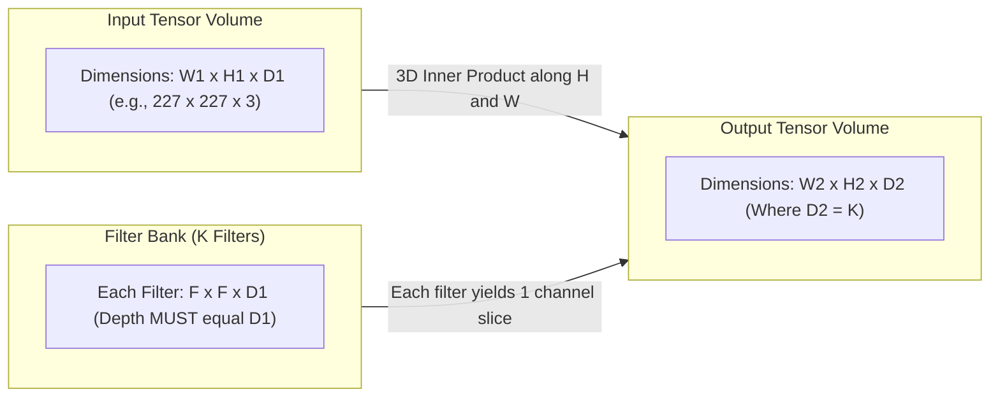

#### Dimensionality Hierarchy (Slides 38–52)
1. **1D Convolution (Slides 38–42):** A 1D kernel slides along a single vector dimension (e.g., an input array $[A, B, C, B, C, A, B]$ convolved with a 1D filter of length 3).
2. **3D Volume Convolution (Slides 43–52):**
   - **Input:** Tensor of shape $W_1 \times H_1 \times D_1$.
   - **Filter Shape:** Every individual filter is a 3D volume of size $F \times F \times D_1$.
   - **The Inviolable Depth Rule:** The depth of every convolutional kernel must strictly equal the depth of the input volume ($D_{\text{filter}} \equiv D_1$).
   - **Movement Dynamics:** The 3D filter slides along the horizontal ($W$) and vertical ($H$) spatial axes **only**. It does **not** slide along the depth axis.
   - **3D Dot Product:** At each spatial position $(x, y)$, the filter multiplies all $F \times F \times D_1$ weights against all overlapping $F \times F \times D_1$ input values. These products are summed into a single scalar value:

```math
\text{Scalar at } (x, y) = b + \sum_{c=1}^{D_1} \sum_{m=0}^{F-1} \sum_{n=0}^{F-1} I(x + m, y + n, c) \cdot K(m, n, c)
```

   - **Output Dimensionality:** Because the filter spans the full input depth, **one 3D filter produces one 2D spatial feature map slice** ($W_2 \times H_2 \times 1$).
   - **Forming Multi-Channel Outputs:** To produce an output volume with depth $D_2$, we apply a bank of $K$ distinct 3D filters. The resulting 2D slices are stacked along the depth axis: $D_2 = K$.

### 3. Visual Anchor

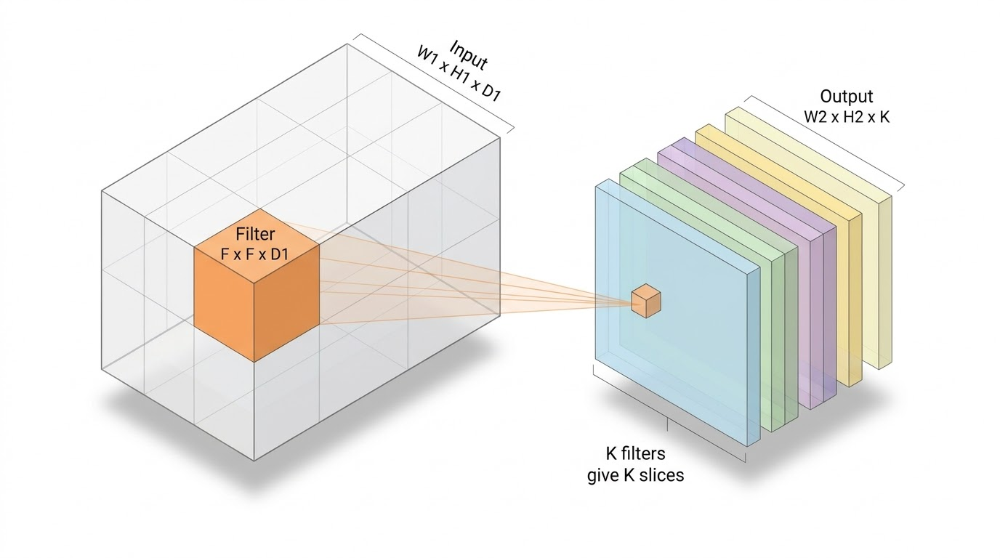
*Figure: Volume convolution: each F x F x D1 filter spans the full depth of the input and gives one 2D slice; K filters give an output of depth K (illustration, after Slide 43).*

### 4. Verified Formulas, Trade-offs & Calculations

#### Multi-Channel Convolution Formulation
For an input volume $I \in \mathbb{R}^{W_1 \times H_1 \times D_1}$ and a set of $K$ filters $\lbrace K_1, K_2, \dots, K_K \rbrace$ where each $K_k \in \mathbb{R}^{F \times F \times D_1}$ with scalar bias $b_k$:

```math
O(i, j, k) = b_k + \sum_{c=1}^{D_1} \sum_{m=0}^{F-1} \sum_{n=0}^{F-1} I(i + m, j + n, c) \cdot K_k(m, n, c)
```

*Plain reading:* The output activation at spatial coordinate $(i, j)$ in channel slice $k$ is obtained by taking the sum of products across all spatial taps $(m, n)$ and all input channels $c$, plus the filter's scalar bias $b_k$.

#### Parameter Budget for Multi-Channel Layers
For a layer with $K$ filters of spatial extent $F \times F$ processing an input volume of depth $D_1$:
- Weights per filter: $F \times F \times D_1$
- Biases per filter: $1$
- Total learnable parameters:

```math
\text{Total Parameters} = K \cdot (F^2 \cdot D_1 + 1)
```

- Total parameters without bias: $K \cdot F^2 \cdot D_1$.

---

## 5. Output Spatial Dimensions & Strided Convolutions

### 1. The Engineering Problem & Intuition
When deploying convolutional neural networks, we must compute the exact spatial geometry of the output tensor produced by every layer. If the spatial footprint cannot be predicted analytically, downstream layers cannot be configured. Furthermore, we need a mechanism to systematically control spatial downsampling: sliding the kernel by 1 pixel preserves fine spatial resolution but is computationally intensive, whereas advancing by multiple pixels skips intermediate positions, rapidly reducing feature map size.

### 2. Technical Mechanism & Architecture

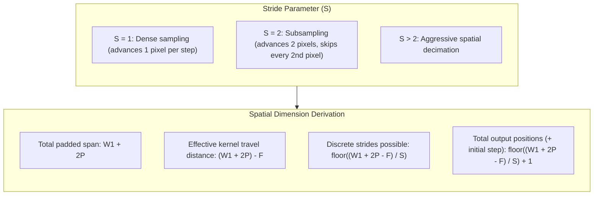

#### Step-by-Step Derivation of Output Spatial Dimensions
1. **Total Padded Width:** The input width $W_1$ is padded with $P$ zeros on both the left and right borders, yielding a total available span of $W_1 + 2P$.
2. **Kernel Footprint:** The filter occupies $F$ contiguous pixels. When the filter is placed at the far left ($x = 0$), its trailing edge reaches index $F - 1$.
3. **Maximum Shifting Distance:** The kernel can shift across the remaining distance before its right edge crosses the boundary:

```math
\Delta_{\text{max}} = (W_1 + 2P) - F
```

4. **Step Discretization via Stride** ($S$): The filter advances in discrete increments of $S$ pixels. The number of non-overlapping jumps it can execute is:

```math
\text{Steps} = \left\lfloor \frac{W_1 - F + 2P}{S} \right\rfloor
```

5. **Initial Position Offset:** Accounting for the initial starting placement at step 0, the total count of valid output coordinates is:

```math
W_2 = \left\lfloor \frac{W_1 - F + 2P}{S} \right\rfloor + 1
```

### 3. Visual Anchor

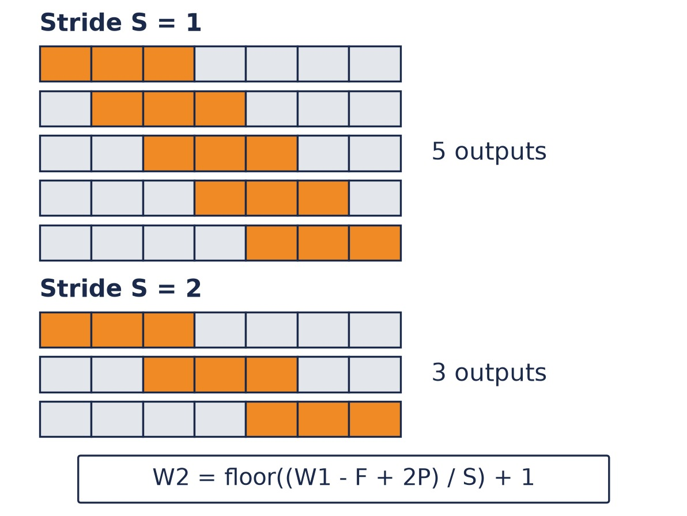
*Figure: Stride on a 7-pixel row with a 3-wide window: S = 1 gives 5 window positions, S = 2 gives 3, matching W2 = floor((W1 - F + 2P) / S) + 1 (drawn with Python for exact counts).*

### 4. Verified Formulas, Trade-offs & Calculations

#### General Spatial Dimension Equations
For any convolutional layer parameterized by filter extent $F$, padding $P$, stride $S$, and filter count $K$:

```math
W_2 = \left\lfloor \frac{W_1 - F + 2P}{S} \right\rfloor + 1
```

```math
H_2 = \left\lfloor \frac{H_1 - F + 2P}{S} \right\rfloor + 1
```

```math
D_2 = K
```

*Plain reading:* The output spatial dimension equals the floor of the quotient of total available shifting distance divided by the stride, plus one; the output depth is strictly determined by the number of filters.

#### Evolution Across Slide Deck Variations
- **Slide 69 (Unpadded, Unit Stride):**

```math
W_2 = W_1 - F + 1, \quad H_2 = H_1 - F + 1
```

- **Slide 74 (Padded, Unit Stride):**

```math
W_2 = W_1 - F + 2P + 1, \quad H_2 = H_1 - F + 2P + 1
```

- **Slide 78** (Padded, Arbitrary Stride $S$):

```math
W_2 = \left\lfloor \frac{W_1 - F + 2P}{S} \right\rfloor + 1, \quad H_2 = \left\lfloor \frac{H_1 - F + 2P}{S} \right\rfloor + 1
```

---

## 6. Audited Numerical Case Studies: AlexNet Conv1 & LeNet-5 Conv1

### 1. The Engineering Problem & Intuition
In competitive examinations and engineering deployments, volume sizing and parameter budgeting must be calculated flawlessly. The first convolutional layers of AlexNet (2012) and LeNet-5 (1998) serve as canonical benchmarks for multi-channel RGB strided convolution and single-channel grayscale unit-stride convolution, respectively.

### 2. Technical Mechanism & Architecture

#### Case Study A: AlexNet First Convolutional Layer (Slides 79–80)
- **Input Volume:** $227 \times 227 \times 3$ (ImageNet RGB image: $W_1 = 227, H_1 = 227, D_1 = 3$).
- **Layer Hyperparameters:**
  - Spatial filter size: $F = 11$
  - Number of filters: $K = 96$
  - Stride: $S = 4$
  - Padding: $P = 0$ (Valid padding)
- **Output Volume Calculation:**

```math
W_2 = \frac{227 - 11 + 2(0)}{4} + 1 = \frac{216}{4} + 1 = 54 + 1 = 55
```

```math
H_2 = \frac{227 - 11 + 2(0)}{4} + 1 = \frac{216}{4} + 1 = 54 + 1 = 55
```

```math
D_2 = K = 96 \implies \text{Output Tensor Dimensions} = 55 \times 55 \times 96
```

#### Case Study B: LeNet-5 First Convolutional Layer (Slides 81–82)
- **Input Volume:** $32 \times 32 \times 1$ (Grayscale digit image: $W_1 = 32, H_1 = 32, D_1 = 1$).
- **Layer Hyperparameters:**
  - Spatial filter size: $F = 5$
  - Number of filters: $K = 6$
  - Stride: $S = 1$
  - Padding: $P = 0$ (Valid padding)
- **Output Volume Calculation:**

```math
W_2 = \frac{32 - 5 + 2(0)}{1} + 1 = \frac{27}{1} + 1 = 27 + 1 = 28
```

```math
H_2 = \frac{32 - 5 + 2(0)}{1} + 1 = \frac{27}{1} + 1 = 28
```

```math
D_2 = K = 6 \implies \text{Output Tensor Dimensions} = 28 \times 28 \times 6
```

### 3. Visual Anchor

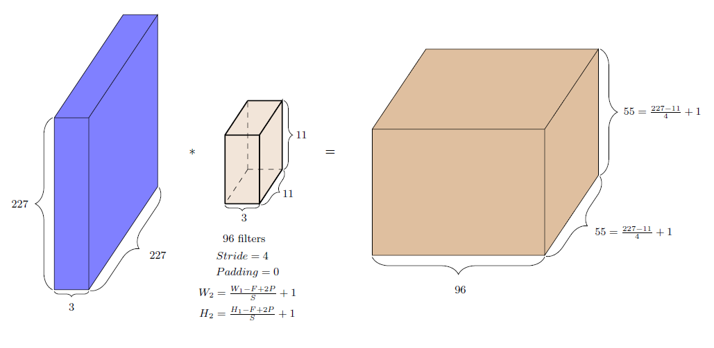

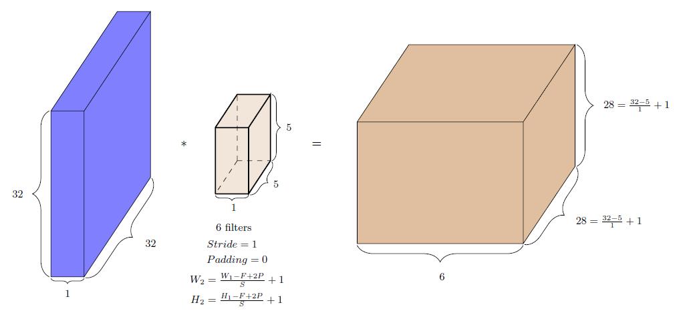

### 4. Verified Formulas, Trade-offs & Calculations

#### Parameter & Volume Comparison Table

| Architecture | Input Shape ($W_1 \times H_1 \times D_1$) | Filter Extent ($F \times F \times D_1$) | Filters ($K$) | Stride ($S$) | Padding ($P$) | Output Volume ($W_2 \times H_2 \times D_2$) | Weights Only: $K \cdot F^2 \cdot D_1$ | Total Params with Bias: $K \cdot (F^2 D_1 + 1)$ |
| :--- | :---: | :---: | :---: | :---: | :---: | :---: | :---: | :---: |
| **AlexNet Conv1** | $227 \times 227 \times 3$ | $11 \times 11 \times 3$ | $96$ | $4$ | $0$ | $55 \times 55 \times 96$ | $96 \times 363 = 34,848$ | $96 \times 364 = \mathbf{34,944}$ |
| **LeNet-5 Conv1** | $32 \times 32 \times 1$ | $5 \times 5 \times 1$ | $6$ | $1$ | $0$ | $28 \times 28 \times 6$ | $6 \times 25 = 150$ | $6 \times 26 = \mathbf{156}$ |

#### Audited Calculation Proofs
1. **AlexNet Conv1:**
   - Single filter weight count: $11 \times 11 \times 3 = 363$ weights.
   - Adding 1 scalar bias per filter: $363 + 1 = 364$ parameters per filter.
   - Layer total: $96 \times 364 = 34,944$ learnable parameters.
   - Activations produced: $55 \times 55 \times 96 = 290,400$ scalar outputs.
2. **LeNet-5 Conv1:**
   - Single filter weight count: $5 \times 5 \times 1 = 25$ weights.
   - Adding 1 scalar bias per filter: $25 + 1 = 26$ parameters per filter.
   - Layer total: $6 \times 26 = 156$ learnable parameters.
   - Activations produced: $28 \times 28 \times 6 = 4,704$ scalar outputs.

---

## 7. CNN Representation Learning Philosophy & Inductive Biases vs. Dense ANNs

### 1. The Engineering Problem & Intuition
Why cannot standard fully connected Multi-Layer Perceptrons (MLPs / ANNs) scale to computer vision?
1. **Parameter Explosion:** In a fully connected layer, every input unit connects to every hidden neuron. Consider an ImageNet photograph ($1000 \times 1000 \times 3 = 3,000,000$ inputs). Connecting this image to a modest hidden layer of 1,000 neurons requires:

```math
3 \times 10^6 \times 10^3 = 3 \times 10^9 \text{ weights (3 billion parameters)}
```

   This causes catastrophic overfitting and makes hardware memory allocation impossible.
2. **Destruction of 2D Topology:** An MLP requires flattening the 2D grid into a 1D vector. This strips all spatial locality: pixel $(1, 2)$ is treated as having no closer relationship to $(1, 3)$ than to $(1000, 1000)$.
3. **Lack of Translation Equivariance:** If an object shifts by 3 pixels to the right, a fully connected network activates completely different weight pathways. It must re-learn the appearance of objects at every individual pixel coordinate across the entire canvas.

### 2. Technical Mechanism & Architecture

#### Core Inductive Biases of CNNs (Slides 87–90)
CNNs replace unrestricted dense matrix multiplication with two spatial inductive biases:
1. **Sparsity of Connections (Local Receptive Fields):** Rather than connecting to the entire input space, each hidden unit connects only to a localized spatial subgrid of size $F \times F$.
   - **Slide 87–89 Walk-Through:** An image of size $4 \times 4$ contains 16 pixels.
   - In a dense feed-forward network (Slide 87), computing hidden activation $h_{11}$ requires connections to all 16 input pixels.
   - In a CNN with a $2 \times 2$ kernel (Slide 88), computing $h_{11}$ requires connections only to local pixels $\lbrace 1, 2, 5, 6 \rbrace$.
   - Computing $h_{12}$ (Slide 89) requires connections only to local pixels $\lbrace 3, 4, 7, 8 \rbrace$.
   - Connections are sparse, reflecting the real-world statistical property that neighboring pixels interact strongly, while distant pixels interact weakly.
2. **Weight Sharing (Parameter Tying):** The exact same kernel weights are reused across every receptive field of the input.
   - Instead of learning separate weights for detecting a vertical edge at coordinate $(0, 0)$ and coordinate $(50, 50)$, one set of kernel parameters scans the entire image.
   - This enforces **translation equivariance**: shifting the input image shifts the resulting feature map by an identical amount without altering feature representation.

#### Representation Learning & Initialization Philosophy (Slides 83–86)
- **End-to-End Representation Learning:** Instead of relying on hand-crafted analytical kernels (Sobel, Gaussian), the kernel coefficients are treated as learnable parameters optimized automatically via backpropagation.
- **Random Initialization:** Kernels are initialized with small, zero-centered random weights using **Xavier (Glorot)** or **He (Kaiming)** initialization:
  - Prevents vanishing/exploding activations and gradient collapse.
  - Breaks symmetry so distinct filters specialize into different detectors.
  - Early layers autonomously discover low-level primitives (Gabor-like edge detectors, color blobs), intermediate layers assemble them into textural patterns, and deep layers form high-level semantic representations (faces, wheels, text).

#### The Six Core Architectural Advantages of CNNs (Slides 91–92)
1. **Reduced Parameter Footprint:** Weight sharing decouples parameter count from image resolution. Filter parameters depend only on kernel size $F$ and depth $D_1$, not image dimensions $W_1 \times H_1$.
2. **Computational & Memory Efficiency:** Sparse arithmetic reduces memory bandwidth and floating-point operations (FLOPs), enabling training on large image datasets.
3. **Translation Invariance / Equivariance:** Enables the network to detect patterns regardless of where they appear on the image grid.
4. **Hierarchical Feature Learning:** Layers compose features hierarchically: low layers extract edges $\to$ mid layers extract textures/shapes $\to$ high layers extract complete object semantics.
5. **Superior Generalization:** Constraining the hypothesis space through weight sharing acts as strong structural regularization, preventing overfitting.
6. **Robustness to Noise & Variability:** Local receptive pooling and shared templates grant resilience against sensor noise, illumination shifts, and subtle viewpoint distortions.

### 3. Visual Anchor

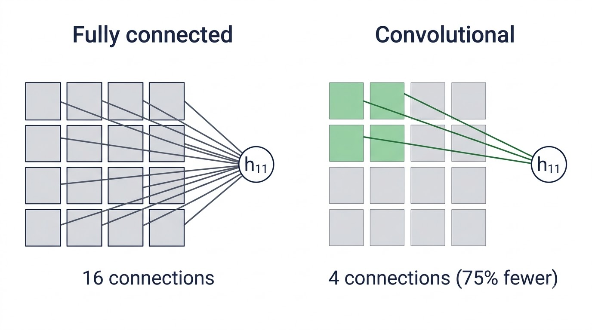
*Figure: Computing h11 from a 4x4 image: a dense layer needs all 16 connections, a 2x2 convolution only 4 (75% fewer) (illustration, after Slides 87–88).*

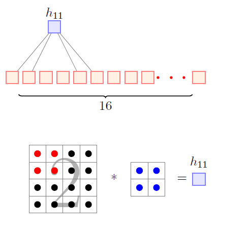

### 4. Verified Formulas, Trade-offs & Calculations

#### Mathematical Proof of Connection Reduction (Slides 87–89)
For an input grid of $N_{\text{in}} = W_1 \times H_1$ units connected to a single hidden unit:
- Dense ANN connection count: $C_{\text{dense}} = W_1 \times H_1$
- CNN connection count with $F \times F$ kernel: $C_{\text{CNN}} = F \times F$
- Percentage reduction in fan-in per neuron:

```math
\text{Reduction} = \left( 1 - \frac{F^2}{W_1 \cdot H_1} \right) \times 100\%
```

- For the slide example ($W_1 = 4, H_1 = 4, F = 2$):

```math
C_{\text{dense}} = 16, \quad C_{\text{CNN}} = 4 \implies \text{Reduction} = \left(1 - \frac{4}{16}\right) \times 100\% = 75\%
```

- Each hidden unit requires 75% fewer incoming synaptic connections.

---

## 8. Downsampling & Pooling Mechanics

### 1. The Engineering Problem & Intuition
As convolutional layers extract feature maps, the spatial resolution remains high. This imposes two engineering bottlenecks:
1. **Computational & Memory Overhead:** Retaining high spatial dimensions throughout deep networks demands unsustainable GPU memory for activations during backpropagation.
2. **Receptive Field Limitations:** If spatial resolution is never reduced, high-level filters with small kernel sizes ($3 \times 3$) can only observe tiny local patches of the original input, never gaining a holistic scene-level receptive field.
3. **Sensitivity to Precise Coordinates:** For recognition, knowing that an eye or nose is present is critical; knowing its position down to the exact sub-pixel coordinate is unnecessary and brittle.

Pooling addresses this by downsampling feature maps, compressing spatial dimensions while retaining essential feature activations.

### 2. Technical Mechanism & Architecture

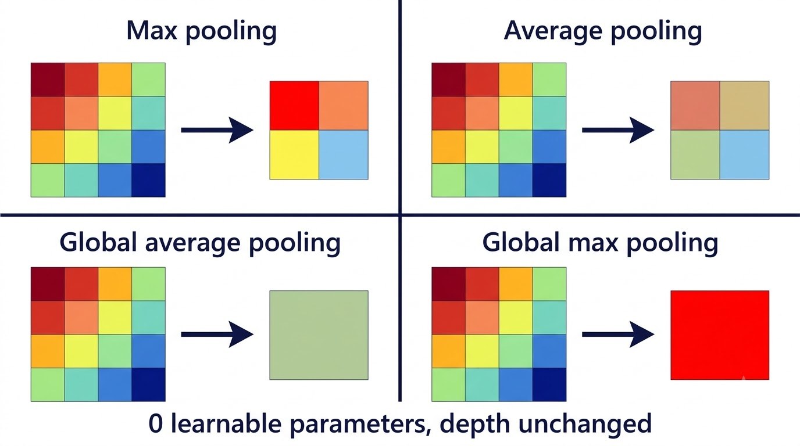
*Figure: The four pooling types on the same 4x4 map: max and average pooling shrink it to 2x2, global average and global max pooling reduce it to one value. None has learnable parameters, and depth is unchanged (illustration).*

#### Taxonomy of Pooling Layers (Slides 93, 95)
1. **Max Pooling:** Selects the maximum value within a spatial window of size $F_p \times F_p$. Retains the strongest activation (prominent edges, distinct textural points) while discarding non-maximal background signals.
2. **Average Pooling:** Computes the arithmetic mean over window $F_p \times F_p$. Produces a smoother feature representation, preventing dominant spikes from eclipsing surrounding context.
3. **Global Average Pooling (GAP):** Computes the mean over the entire spatial grid ($W \times H$) for each channel independently, reducing a tensor of shape $W \times H \times D$ to a $1 \times 1 \times D$ vector. Frequently used to replace heavy fully connected classifier layers in modern architectures (e.g., ResNet).
4. **Global Max Pooling (GMP):** Takes the single maximum activation over the entire $W \times H$ spatial grid for each channel, signaling whether a target feature exists anywhere in the image.

#### Pooling Hyperparameters (Slide 96)
- **Window Size** ($F_p$): Spatial extent of the pooling window (commonly $2 \times 2$ or $3 \times 3$).
- **Stride** ($S_p$): Step size between window placements (commonly $S_p = 2$, yielding a 50% spatial reduction).
- **Padding** ($P_p$): Typically $P_p = 0$.

#### Architectural Trade-offs (Slide 97)
- **Pooling vs. Strided Convolutions:** Modern networks often replace deterministic pooling with strided convolutions ($S \ge 2$), allowing the network to learn its downsampling operator directly via gradient descent.
- **Information Loss:** Pooling discards exact spatial coordinate references. While advantageous for image classification, this loss of spatial fidelity can be detrimental for dense prediction tasks like semantic segmentation, where precise pixel boundaries are required.

### 3. Visual Anchor

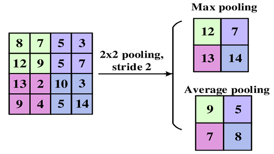

### 4. Verified Formulas, Trade-offs & Calculations

#### Output Dimension Formula for Pooling
Because pooling processes each channel slice independently without altering depth:

```math
W_2 = \left\lfloor \frac{W_1 - F_p + 2P_p}{S_p} \right\rfloor + 1, \quad H_2 = \left\lfloor \frac{H_1 - F_p + 2P_p}{S_p} \right\rfloor + 1, \quad D_2 = D_1
```

#### Worked Numerical Case 1: Max vs. Average Pooling ($S = 2$, Slide 94)
Given the $4 \times 4$ feature map from Slide 94:

```math
I = \begin{bmatrix}
8 & 7 & 5 & 3 \\
12 & 9 & 5 & 7 \\
13 & 2 & 10 & 3 \\
9 & 4 & 5 & 14
\end{bmatrix}
```

Applying $2 \times 2$ pooling with stride $S = 2$ partitions the matrix into four non-overlapping $2 \times 2$ quadrants:
- **Top-Left Quadrant** $\begin{bmatrix} 8 & 7 \\ 12 & 9 \end{bmatrix}$:

```math
\text{Max} = \max(8, 7, 12, 9) = 12, \quad \text{Avg} = \frac{8 + 7 + 12 + 9}{4} = \frac{36}{4} = 9.0
```

- **Top-Right Quadrant** $\begin{bmatrix} 5 & 3 \\ 5 & 7 \end{bmatrix}$:

```math
\text{Max} = \max(5, 3, 5, 7) = 7, \quad \text{Avg} = \frac{5 + 3 + 5 + 7}{4} = \frac{20}{4} = 5.0
```

- **Bottom-Left Quadrant** $\begin{bmatrix} 13 & 2 \\ 9 & 4 \end{bmatrix}$:

```math
\text{Max} = \max(13, 2, 9, 4) = 13, \quad \text{Avg} = \frac{13 + 2 + 9 + 4}{4} = \frac{28}{4} = 7.0
```

- **Bottom-Right Quadrant** $\begin{bmatrix} 10 & 3 \\ 5 & 14 \end{bmatrix}$:

```math
\text{Max} = \max(10, 3, 5, 14) = 14, \quad \text{Avg} = \frac{10 + 3 + 5 + 14}{4} = \frac{32}{4} = 8.0
```

```math
O_{\text{Max Pooling}} = \begin{bmatrix} 12 & 7 \\ 13 & 14 \end{bmatrix}, \quad O_{\text{Average Pooling}} = \begin{bmatrix} 9 & 5 \\ 7 & 8 \end{bmatrix}
```

#### Worked Numerical Case 2: Max Pooling Stride 2 vs. Stride 1 (Slides 98–106)
Given the feature map from Slides 98–106:

```math
I = \begin{bmatrix}
1 & 4 & 2 & 1 \\
5 & 8 & 3 & 4 \\
7 & 6 & 4 & 5 \\
1 & 3 & 1 & 2
\end{bmatrix}
```

- **Stride** $S = 2$ **(Non-overlapping, Slides 98–102):**
  - Quadrant (1, 1): $\max(1, 4, 5, 8) = 8$
  - Quadrant (1, 2): $\max(2, 1, 3, 4) = 4$
  - Quadrant (2, 1): $\max(7, 6, 1, 3) = 7$
  - Quadrant (2, 2): $\max(4, 5, 1, 2) = 5$

```math
\text{Output Shape: } 2 \times 2 = \begin{bmatrix} 8 & 4 \\ 7 & 5 \end{bmatrix}
```

- **Stride** $S = 1$ **(Overlapping, Slides 103–106):**
  - Output size: $W_2 = \lfloor \frac{4 - 2}{1} \rfloor + 1 = 3 \implies 3 \times 3$ output.
  - Row 1: $\max\begin{bmatrix}1&4\\5&8\end{bmatrix}=8$, $\max\begin{bmatrix}4&2\\8&3\end{bmatrix}=8$, $\max\begin{bmatrix}2&1\\3&4\end{bmatrix}=4$
  - Row 2: $\max\begin{bmatrix}5&8\\7&6\end{bmatrix}=8$, $\max\begin{bmatrix}8&3\\6&4\end{bmatrix}=8$, $\max\begin{bmatrix}3&4\\4&5\end{bmatrix}=5$
  - Row 3: $\max\begin{bmatrix}7&6\\1&3\end{bmatrix}=7$, $\max\begin{bmatrix}6&4\\3&1\end{bmatrix}=6$, $\max\begin{bmatrix}4&5\\1&2\end{bmatrix}=5$

```math
\text{Output Shape: } 3 \times 3 = \begin{bmatrix} 8 & 8 & 4 \\ 8 & 8 & 5 \\ 7 & 6 & 5 \end{bmatrix}
```

---

## 9. Classifier Interface: The Flatten Layer

### 1. The Engineering Problem & Intuition
The convolutional and pooling backbone of a CNN functions as a localized spatial feature extractor, producing a 3D tensor of shape $W \times H \times C$. However, the downstream decision-making classification head (a Multi-Layer Perceptron culminating in a Softmax activation) requires a 1D vector of independent feature logits. How is this dimensional boundary bridged?

The network must linearize the 3D spatial tensor into a 1D vector while preserving all numerical activations.

### 2. Technical Mechanism & Architecture
The Flatten layer is an unparameterized topological reshaping operation:

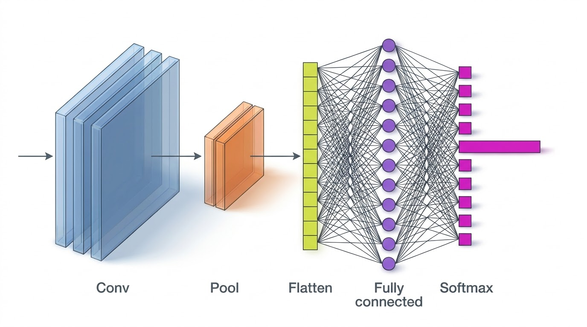
*Figure: Where Flatten sits: conv and pool layers extract features, Flatten unrolls them into a vector, fully connected layers and softmax turn it into class probabilities (illustration).*

- **Topological Boundary:** Separates translation-equivariant spatial representation learning from position-sensitive global classification.
- **Serialization Order:** Unrolls values along a deterministic coordinate hierarchy (typically row-major order: row by row, channel by channel).
- **Slide 107 Walk-Through:** A single-channel pooled feature map of shape $3 \times 3$:

```math
M_{\text{pooled}} = \begin{bmatrix}
1 & 1 & 0 \\
4 & 2 & 1 \\
0 & 2 & 1
\end{bmatrix}
```

Unrolling row by row produces a 9-element 1D vector:

```math
\mathbf{v}_{\text{flattened}} = [1, 1, 0, 4, 2, 1, 0, 2, 1]^T \in \mathbb{R}^9
```

### 3. Visual Anchor

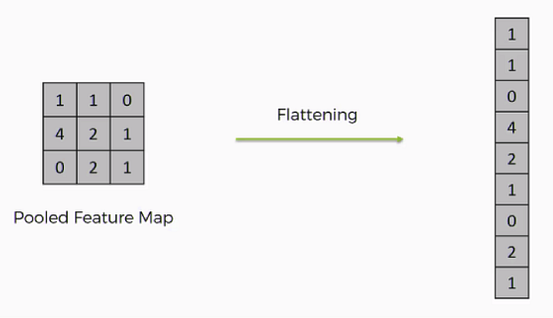

### 4. Verified Formulas, Trade-offs & Calculations

#### Dimensional Serialization Formulas
For an incoming tensor of width $W$, height $H$, and channel depth $C$:

```math
L_{\text{vector}} = W \cdot H \cdot C
```

*Plain reading:* The length of the flattened vector is the exact product of width, height, and depth of the terminal feature map.

#### Classifier Head Parameter Calculation
If this flattened vector feeds into a fully connected layer with $N_{\text{dense}}$ neurons:

```math
\text{Weights} = L_{\text{vector}} \cdot N_{\text{dense}} = (W \cdot H \cdot C) \cdot N_{\text{dense}}
```

```math
\text{Total Parameters (with Bias)} = (L_{\text{vector}} + 1) \cdot N_{\text{dense}}
```

- For the Slide 107 single-channel $3 \times 3$ map ($L = 9$):
  - Connecting to an MLP hidden layer of $N = 10$ neurons:

```math
\text{Weights} = 9 \times 10 = 90, \quad \text{Biases} = 10 \implies 100 \text{ Parameters}
```

- **Trade-off:** Because $L_{\text{vector}}$ directly scales the weight matrix of the first dense layer, excessive spatial resolution at the flatten boundary triggers parameter bloat. Pooling layers and Global Average Pooling are critical in controlling $W \times H$ prior to the flatten boundary.
