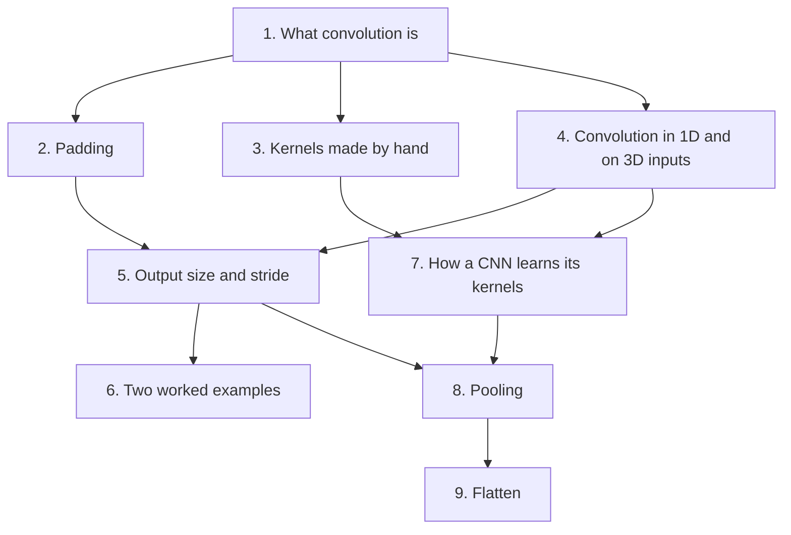

# Convolutional Neural Networks (CNN) — Learning Guide

Source: `ML_Lec_12_CNN.pptx`, Slides 1–108.

**Who this is for:** a beginner studying this lecture. After reading, you can run a convolution by hand, work out the output size of a layer, and explain padding, stride, pooling and flatten.

**How to read this guide:** Read the sections in order. Each section first says why the idea exists, then how it works, then shows a picture, then gives the exact numbers. Every fact comes from the slides.



## Contents

1. [What convolution is](#1-what-convolution-is)
2. [Padding: keeping the edges and the size](#2-padding-keeping-the-edges-and-the-size)
3. [Kernels made by hand](#3-kernels-made-by-hand)
4. [Convolution in 1D and on 3D inputs](#4-convolution-in-1d-and-on-3d-inputs)
5. [Output size and stride](#5-output-size-and-stride)
6. [Two worked examples](#6-two-worked-examples)
7. [How a CNN learns its kernels](#7-how-a-cnn-learns-its-kernels)
8. [Pooling: making feature maps smaller](#8-pooling-making-feature-maps-smaller)
9. [Flatten: from feature maps to the classifier](#9-flatten-from-feature-maps-to-the-classifier)

---

## 1. What convolution is

### 1.1 The Problem & Intuition

An image is a grid of numbers. We want to find small patterns in it, such as edges and textures. Convolution does this. It takes a small grid of numbers and slides it over the image. At each place it gives one number that says how strongly the pattern shows up there.

The slides give the general definition first (Slide 1). **Convolution** is a mathematical operation that combines two functions to produce a third function. The third function shows how one function modifies the other. In a **convolutional neural network (CNN)**, convolution is used on data with a grid-like shape, such as images.

### 1.2 Mechanism & Architecture

Think of the image as a 2D matrix. We use a 2D filter of size $m \times n$ (Slide 2). Convolution has four key parts (Slide 3).


*Figure: The four parts of every convolution: a kernel, a sliding window, a dot product at each position, and the feature map it builds (illustration).*

1. **Kernel / filter.** A small matrix, for example 3×3 or 5×5. It slides over the input. Its job is to extract features like edges, textures or patterns. "Kernel" and "filter" mean the same thing.
2. **Sliding window.** The kernel moves across the image in small steps. The step size is called the **stride**.
3. **Dot product.** At each position, multiply each kernel number by the pixel under it. Then add all the results. This gives one output value. It captures the local pattern at that spot.
4. **Output feature map.** Doing this over the whole image gives a new matrix. It is called a **feature map**. It highlights where the kernel found its feature.

**Walk-through (Slides 2–9).** The slides use a 3×4 input and a 2×2 kernel, written with letters:

```math
\text{Input} = \begin{bmatrix} a & b & c & d \\ e & f & g & h \\ i & j & k & \ell \end{bmatrix}, \quad \text{Kernel} = \begin{bmatrix} w & x \\ y & z \end{bmatrix}
```

The kernel fits in six positions. Each position gives one output value:

1. Top-left, on a, b, e, f: $aw + bx + ey + fz$
2. One step right, on b, c, f, g: $bw + cx + fy + gz$
3. One more step right, on c, d, g, h: $cw + dx + gy + hz$
4. Down one row, back to the left, on e, f, i, j: $ew + fx + iy + jz$
5. One step right, on f, g, j, k: $fw + gx + jy + kz$
6. One more step right, on g, h, k, ℓ: $gw + hx + ky + \ell z$

The output is (Slide 9):

```math
\text{Output} = \begin{bmatrix} aw+bx+ey+fz & bw+cx+fy+gz & cw+dx+gy+hz \\ ew+fx+iy+jz & fw+gx+jy+kz & gw+hx+ky+\ell z \end{bmatrix}
```

So a 3×4 image gives a 2×3 feature map (Slide 9). The output is smaller than the input.

The same idea in short (Slides 32–37): we just slide the kernel over the input image. Each time we slide it, we get one value in the output. The full output is the feature map. We can use many filters to get many feature maps.

### 1.3 Visual Anchor


*Figure: The Slides 2–9 walk-through. The 2x2 kernel K sits on the top-left block of the 3x4 input I and gives the first output value, O11. In the slide's letters this is aw + bx + ey + fz. Sliding one step at a time, with no padding, fills the 2x3 output O (illustration).*

### 1.4 Verified Formulas, Trade-offs & Calculations

**The convolution formula (Slide 2).**

```math
S_{ij} = (I * K)_{ij} = \sum_{a=0}^{m-1} \sum_{b=0}^{n-1} I_{i+a,\,j+b} \, K_{a,b}
```

- $I$: the image.
- $K$: the kernel, of size $m \times n$.
- $S_{ij}$: the output value at row $i$ and column $j$.
- $a$ and $b$: the row and column inside the kernel.

In plain words: put the kernel with its top-left corner on pixel $(i, j)$. Multiply each kernel value by the pixel under it. Add all the products.

Check with the walk-through. The kernel is 2×2, so $a$ and $b$ are 0 or 1. For the first output, the four products are $aw$, $bx$, $ey$ and $fz$. Their sum is $aw + bx + ey + fz$, as on the slide.

**The output size.** With no padding and a step of 1, the output size is (Slide 69):

```math
W_2 = W_1 - F + 1, \quad H_2 = H_1 - F + 1
```

Here $W_1$ and $H_1$ are the width and height of the input. $F$ is the size of the kernel. $W_2$ and $H_2$ are the width and height of the output. The formula counts how many places the kernel can sit along each side.

Check with the walk-through ($W_1 = 4$, $H_1 = 3$, $F = 2$):

- Width: $W_2 = 4 - 2 + 1 = 3$
- Height: $H_2 = 3 - 2 + 1 = 2$

The feature map is 2×3, as on Slide 9. To get a feature map of the same size as the image, Slide 9 adds one extra row and one extra column to the image. This is called **padding**, and Section 2 explains it.

---

## 2. Padding: keeping the edges and the size

### 2.1 The Problem & Intuition

The kernel must fit inside the image. So it cannot be centred on a corner or border pixel. Part of it would cross the input boundary (Slides 61–62). Two things go wrong:

- The output is smaller than the input.
- Features near the edges are used less, so the network can miss them.

A bigger kernel makes this worse. With a 5×5 kernel, even more pixels cannot be used as a centre (Slides 63–68).

**Padding** fixes this. It adds extra pixels, usually zeros, around the edges of the input before the convolution (Slide 11). Now the kernel can also sit on the corners.

### 2.2 Mechanism & Architecture

Padding lets us control the output size and keep important features at the edges (Slide 11). The right type depends on the network and the task. There are two types (Slide 10).

1. **Valid padding.** No padding is applied. The kernel is used only at valid positions, where it fits inside the input. Effect: the output gets smaller. A 5×5 input with a 3×3 kernel gives a 3×3 output.
2. **Same padding.** Enough zeros are added around the input so that the output has the same size as the input. Effect: the size is kept. A 5×5 input with a 3×3 kernel gives a 5×5 output.

If the top-left pixel is the pixel of interest, the filter must be centred on it. Then padding is necessary (Slide 10).

**When padding is required (Slide 12):**

1. **Preserving dimensions.** We want the output size to match the input size. This matters in tasks like segmentation, and when we stack many convolution layers.
2. **Edge features.** We want to capture features near the edges. Without padding, convolutions near the edges can miss relevant information.
3. **Reducing spatial shrinkage.** In deeper networks, each convolution without padding makes the map smaller. After many layers the map is too small to hold a meaningful representation.
4. **Improving network performance.** Padding gives more context around the edges. This can help to stabilize learning and improve the overall performance of the model.

**How to pad (Slides 72–73).** Pad the input with the right number of 0 inputs, so you can apply the kernel at the corners. With pad $P = 1$ and a 3×3 kernel, add one row of zeros at the top and one at the bottom. Also add one column of zeros at the left and one at the right. On Slide 73 a 7×7 input becomes a 9×9 grid.

### 2.3 Visual Anchor


*Figure: Valid (P = 0): a 3x3 window fits in 3x3 positions of the 5x5 input, so the output is 3x3. Same (P = 1): one ring of zeros makes a 7x7 grid, the window can sit on every original pixel, and the output stays 5x5 (illustration).*

### 2.4 Verified Formulas, Trade-offs & Calculations

With padding $P$ and a step of 1 (Slide 74):

```math
W_2 = W_1 - F + 2P + 1, \quad H_2 = H_1 - F + 2P + 1
```

$P$ is the number of rows or columns of zeros added on each side. Padding adds $P$ on both sides, so the input grows by $2P$. The formula again counts the places where the kernel fits.

Check with the numbers of Slide 10 (input 5×5, kernel 3×3):

- Valid padding, $P = 0$: $W_2 = 5 - 3 + 0 + 1 = 3$. The output is 3×3.
- Same padding, $P = 1$: $W_2 = 5 - 3 + 2 + 1 = 5$. The output is 5×5.

Check with Slide 73 (input 7×7, kernel 3×3, $P = 1$): $W_2 = 7 - 3 + 2 + 1 = 7$. The size is kept.

> **Background (not in the slides):** Put $W_2 = W_1$ in the formula and you get $P = (F - 1)/2$. A 3×3 kernel needs $P = 1$, as the slides use.

---

## 3. Kernels made by hand

### 3.1 The Problem & Intuition

Different kernels do different jobs. One kernel finds edges. Another blurs the image. Another makes it sharper. The numbers inside the kernel decide the job. This section lists the kernel types from the slides. Section 7 shows that a CNN does not use these fixed kernels. It learns its own.

### 3.2 Mechanism & Architecture

**What every kernel has (Slides 13–14).** A kernel, also called a filter, is a small matrix. It scans over the input to detect features.

- **Size.** Kernels are usually smaller than the input. Common sizes are 3×3, 5×5 or 7×7 pixels.
- **Feature detection.** Different kernels can be trained to detect different features, such as edges, textures or patterns. Early layers in a CNN learn simple features. Deeper layers learn more complex representations.
- **Stride.** How many pixels the kernel moves after each operation. A larger stride gives a smaller output.
- **Padding.** Zeros added around the input to control the output size. It keeps the dimensions and stops the loss of information at the borders.
- **Multiple kernels.** Each convolutional layer can have many kernels. So the layer can learn many features from the input.

Kernels are how a CNN processes data. They let it learn hierarchical representations, which means simple features first and complex ones built on top.

#### Type 1: Edge detection kernels (Slides 15–17)

The **Sobel kernel** detects edges in the horizontal and vertical directions. It computes gradients in these two directions (Slide 15). A **gradient** is how fast the brightness changes from one pixel to the next.

```math
\text{Horizontal: } \begin{bmatrix} -1 & 0 & 1 \\ -2 & 0 & 2 \\ -1 & 0 & 1 \end{bmatrix}, \quad \text{Vertical: } \begin{bmatrix} 1 & 2 & 1 \\ 0 & 0 & 0 \\ -1 & -2 & -1 \end{bmatrix}
```

The **Canny edge detector** does not rely on a single kernel like the Sobel operator (Slide 16). It is a multi-stage algorithm that detects edges more robustly. It uses a series of steps:

1. **Gaussian filter for smoothing.** This blurs the image a little to reduce noise before edge detection.
2. **Gradient computation.** After smoothing, the gradient is calculated using derivative kernels. These can be similar to the Sobel kernels. The slides show the same two matrices as above for the horizontal and vertical gradient (Slide 17).
3. **Non-maximum suppression.** Keep a pixel only if it is the strongest along the direction of its gradient. This makes the edges thin.
4. **Hysteresis thresholding.** Use two limits, a high one and a low one. Strong edge pixels are kept. Weak ones are kept only if they touch a strong one.

In summary, Canny does not use one kernel. It uses Gaussian smoothing and gradient kernels to identify edges (Slide 17).


*Figure: The Canny steps on one image: smoothing, Sobel gradients, non-maximum suppression, hysteresis thresholds, final edge map (illustration).*

#### Type 2: Blurring kernels (Slides 18–21)

Examples are the Gaussian kernel and the average (mean) kernel.

**Gaussian kernel.** A filter for smoothing or blurring images. It applies the Gaussian function. It reduces noise and detail by averaging pixel values. Pixels near the central pixel count more than pixels far away. The Gaussian function is (Slide 18):

```math
G(x, y) = \frac{1}{2\pi \sigma^2} e^{-\frac{x^2 + y^2}{2\sigma^2}}
```

Here $x$ and $y$ are the distances from the central pixel. $\sigma$ (sigma) controls the width of the Gaussian curve. A larger sigma gives more blurring. A smaller sigma keeps more detail. The formula gives a large weight near the centre and a small weight far from it.

**Kernel size.** The kernel is a square matrix, such as 3×3, 5×5 or 7×7, derived from the Gaussian function. The size is often odd, so that there is a centre pixel.

The normalized 3×3 and 5×5 Gaussian kernels are (Slide 19):

```math
\frac{1}{16} \begin{bmatrix} 1 & 2 & 1 \\ 2 & 4 & 2 \\ 1 & 2 & 1 \end{bmatrix}, \quad \frac{1}{256} \begin{bmatrix} 1 & 4 & 6 & 4 & 1 \\ 4 & 16 & 24 & 16 & 4 \\ 6 & 24 & 36 & 24 & 6 \\ 4 & 16 & 24 & 16 & 4 \\ 1 & 4 & 6 & 4 & 1 \end{bmatrix}
```

**Average kernel.** Also called a **box filter** or **mean filter** (Slide 20). It is a simple smoothing technique. It replaces each pixel's value with the average of the pixel values in its neighborhood. This gives a blur effect and reduces noise.

- **Kernel size.** Commonly 3×3, 5×5 or 7×7. The size sets the area over which the averaging is done.
- **Normalization.** The values in the kernel are equal and sum to 1. So the output image has a similar brightness to the input image.

```math
\frac{1}{9} \begin{bmatrix} 1 & 1 & 1 \\ 1 & 1 & 1 \\ 1 & 1 & 1 \end{bmatrix}, \quad \frac{1}{25} \begin{bmatrix} 1 & 1 & 1 & 1 & 1 \\ 1 & 1 & 1 & 1 & 1 \\ 1 & 1 & 1 & 1 & 1 \\ 1 & 1 & 1 & 1 & 1 \\ 1 & 1 & 1 & 1 & 1 \end{bmatrix}
```

> **Slide note (Slide 21):** The slide title is "Blurring Kernels: Average Kernel". But its text labels the two matrices "A 3 × 3 Gaussian Kernel" and "A 5 × 5 Gaussian Kernel". The matrices have equal values (1/9 and 1/25), so they are average kernels. The Gaussian kernels are the ones on Slide 19.

#### Type 3: Sharpening kernels (Slides 22–26)

A **sharpening kernel** enhances the edges and fine details in an image. It emphasizes the differences between adjacent pixel values. This makes the image appear sharper.

Applications (Slide 22):

1. **Detail enhancement.** Emphasizing edges and textures in images.
2. **Image preprocessing.** Often applied before other processing tasks to improve feature detection.
3. **Artistic effects.** A stylized look, made by enhancing outlines and details.

The most common sharpening kernels are the Laplacian kernel and the unsharp mask kernel.

**Laplacian kernel (Slides 23–24).** The gradient is the first derivative. The **second derivative** measures the rate of change of the gradient. In an image, a large second derivative means a rapid change in intensity. That is an edge. The Laplacian operator calculates the second derivative in both the x and y directions. When applied to an image, it finds the regions where the intensity changes sharply. The Laplacian of an image $I(x, y)$ is (Slide 23):

```math
\nabla^2 I = \frac{\partial^2 I}{\partial x^2} + \frac{\partial^2 I}{\partial y^2}
```

Here $\nabla^2$ is the Laplacian operator. The first term is the second derivative along x. The second term is the second derivative along y. The formula adds the two.

A typical 3×3 Laplacian kernel is (Slide 24):

```math
\begin{bmatrix} 0 & -1 & 0 \\ -1 & 4 & -1 \\ 0 & -1 & 0 \end{bmatrix}
```

This kernel subtracts the average of the neighboring pixels from the center pixel. The result highlights edges and suppresses flat regions. The result can be combined with the original image for further enhancement. This technique is often used in unsharp masking.

**Unsharp mask kernel (Slide 25).** Unsharp masking has three steps:

1. **Gaussian blur.** Blur the original image. This reduces noise and fine details.
2. **Difference calculation.** Subtract the blurred image from the original image. This highlights the edges.
3. **Combination.** Add the result back to the original image. A scaling factor controls the degree of sharpening.

A common kernel for this technique is:

```math
\begin{bmatrix} 0 & -1 & 0 \\ -1 & 5 & -1 \\ 0 & -1 & 0 \end{bmatrix}
```

It is a weighted average where the center pixel gets more weight than its neighbors.

**Difference between the two (Slide 26):**

| | Laplacian kernel | Unsharp mask kernel |
| :--- | :--- | :--- |
| Center value | 4 | 5, so more emphasis on the center pixel |
| How it works | Detects edges from the rate of change. It focuses on curvature, not on enhancing pixel values. | Combines the original pixel value and its neighbors. This sharpens the image. |
| Second derivative? | Yes | No. It accentuates edges by emphasizing differences in pixel intensity. |

Both are used for edge detection and enhancement, but they work on different principles.

**Three kernels on one photo (Slides 29–31).** The slides apply three kernels to the same photo:

- Slide 29: the 3×3 average kernel (all values 1/9). It blurs the image.
- Slide 30: the unsharp mask kernel (center 5). It sharpens the image.
- Slide 31: the kernel below, with center −8. It detects the edges.

```math
\begin{bmatrix} 1 & 1 & 1 \\ 1 & -8 & 1 \\ 1 & 1 & 1 \end{bmatrix}
```

- It can be used for edge detection and sharpening. Its form is similar to a **high-pass filter**.
- **Edge detection.** The kernel weighs the center pixel against its surrounding pixels. The negative center value highlights areas with a large change in intensity.
- **High-pass filter.** It takes the difference between the center pixel and a weighted average of its neighbors. This removes low-frequency components (smooth areas). It enhances high-frequency components (edges).
- **Sharpening effect.** When convolved with an image, it makes edges more pronounced.


#### Type 4: Embeddings kernels (Slide 27)

These are **feature extraction kernels**. In CNNs, they are learned during training. They can capture complex features at various levels of abstraction, such as edges, textures and shapes.

#### Type 5: Dilated kernels (Slides 27–28)

A **dilated kernel** has gaps between its elements. It is also called an **atrous convolution** kernel. The **receptive field** is the area of the input that the kernel sees. A dilated kernel makes the receptive field bigger. It does not add parameters or computation. So the network captures a larger context and keeps the spatial resolution.

- **Dilation rate.** A rate of 2 means there is one pixel of space between the kernel elements. This holds in both the horizontal and vertical directions.

Slide 28 shows a standard 3×3 kernel and a dilated 3×3 kernel with dilation rate 2. The zeros are the gaps:

```math
\text{Standard: } \begin{bmatrix} 1 & 1 & 1 \\ 1 & 1 & 1 \\ 1 & 1 & 1 \end{bmatrix}, \quad \text{Dilated, rate 2: } \begin{bmatrix} 1 & 0 & 1 \\ 0 & 0 & 0 \\ 1 & 0 & 1 \end{bmatrix}
```

- **Application.** The dilated kernel covers a larger area of the input. The output still has the same size as with a regular convolutional layer. This is useful for tasks like segmentation and dense prediction.

Benefits:

1. **Larger receptive field.** The network captures wider context without downsampling.
2. **Preserves spatial resolution.** Useful where the original resolution matters, as in semantic segmentation.


*Figure: Dilation with all 9 weights kept. They cover a 3x3 area at rate 1 and a 5x5 area at rate 2, with one skipped pixel between elements (illustration, not from the slides).*

#### Type 6: Custom kernels (Slide 28)

Users can design their own kernels for specific tasks or datasets. Examples are kernels that detect specific patterns, textures or other features relevant to their application.

### 3.3 Visual Anchor

The figures above carry this section: the Canny steps, the Slide 31 photo and the dilated kernel.

### 3.4 Verified Formulas, Trade-offs & Calculations

Add up the numbers in each kernel. The sum tells you what the kernel does to a flat area, where all pixels are equal.

| Kernel | Sum of its numbers | Effect on a flat area |
| :--- | :--- | :--- |
| Sobel, horizontal or vertical | $-1 - 2 - 1 + 1 + 2 + 1 = 0$ | Output is 0. Only changes show up. |
| Gaussian 3×3 | $16 / 16 = 1$ | Brightness is kept. |
| Gaussian 5×5 | $256 / 256 = 1$ | Brightness is kept. |
| Average 3×3 | $9 / 9 = 1$ | Brightness is kept. |
| Average 5×5 | $25 / 25 = 1$ | Brightness is kept. |
| Laplacian | $4 - 4 = 0$ | Output is 0. Flat regions are suppressed. |
| Unsharp mask | $5 - 4 = 1$ | Brightness is kept, edges are stronger. |
| Slide 31 kernel | $8 - 8 = 0$ | Output is 0. Smooth areas are removed. |

This matches the slides. Blurring kernels "sum to 1" so the brightness stays similar (Slide 20). The Laplacian suppresses flat regions (Slide 24).

Dilation check for the figure: a 3×3 kernel has 3 elements in a row. With rate 2 there is one gap between each pair, so 2 gaps. The row covers $3 + 2 = 5$ pixels. So 9 weights cover a 5×5 area. In the matrix on Slide 28 the same rule shows as 1, 0, 1: two elements with one gap between them.

---

## 4. Convolution in 1D and on 3D inputs

### 4.1 The Problem & Intuition

Not all inputs are flat 2D grids. Some data is a single row of values. A colour image has three layers: red, green and blue. So we need convolution for 1D inputs and for 3D inputs. The idea stays the same: slide a filter and take one value at each step.

### 4.2 Mechanism & Architecture

**1D convolution (Slides 38–42).** In the 1D case, we slide a one dimensional filter over a one dimensional input. The slides use the input row A, B, C, B, C, A, B. The filter moves along the row one step at a time.

**Convolution on a 3D input (Slides 43–48).** What would a 3D filter look like?

1. The filter is also 3D. We call it a **volume**.
2. We slide the volume over the 3D input and compute the convolution operation.
3. The filter moves along the height and the width. It does not move along the depth.
4. So in effect we are doing a 2D convolution on a 3D input.
5. As a result the output is 2D. It has only width and height, no depth.
6. We can apply many filters to get many feature maps.

**The names of the sizes (Slides 49–52):**

- $W_1$, $H_1$, $D_1$: the width, height and depth of the original input.
- $K$: the number of filters.
- $F$: the spatial extent of each filter. This is its width and height.
- The depth of each filter is the same as the depth of the input.
- So an RGB image is $W_1 \times H_1 \times D_1$ and a kernel is $F \times F \times D_1$.
- The output is $W_2 \times H_2 \times D_2$. Section 5 gives the formula.

### 4.3 Visual Anchor


*Figure: Each F x F x D1 filter covers the full depth of the input and gives one 2D map. K filters give an output of depth K (illustration, after Slide 43).*

### 4.4 Verified Formulas, Trade-offs & Calculations

Each filter gives one 2D feature map. With $K$ filters we stack $K$ maps. So the depth of the output equals the number of filters:

```math
D_2 = K
```

Check with Slide 79: the layer has 96 filters, so the output depth is 96. Check with Slide 81: 6 filters give depth 6. Section 6 works both examples in full.

---

## 5. Output size and stride

### 5.1 The Problem & Intuition

Before we build a network, we must know the size of each layer's output. The next layer needs that size. The output size depends on four things: the input size, the kernel size, the padding and the stride. This section builds one formula from them.

### 5.2 Mechanism & Architecture

The slides build the formula in three steps.

**Step 1: no padding (Slides 53–69).** We cannot place the kernel at the corners, because it would cross the input boundary. This is true for all the border pixels. So the output is smaller than the input. As the kernel gets bigger, this is true for even more pixels. In general:

```math
W_2 = W_1 - F + 1, \quad H_2 = H_1 - F + 1
```

**Step 2: add padding (Slides 70–74).** What if we want the output to be the same size as the input? We use padding (Section 2). With pad $P$:

```math
W_2 = W_1 - F + 2P + 1, \quad H_2 = H_1 - F + 2P + 1
```

**Step 3: add stride (Slides 75–78).** The **stride** $S$ is how many pixels the kernel moves after each operation. It defines the intervals at which the filter is applied. $S = 2$ means the kernel moves 2 pixels each time. In effect we skip every 2nd pixel. This again gives a smaller output. A larger stride gives a smaller output size.

### 5.3 Visual Anchor


*Figure: Stride on a 7-pixel row with a 3-wide window. S = 1 gives 5 window positions. S = 2 gives 3. Both match the formula below (drawn with Python for exact counts).*

### 5.4 Verified Formulas, Trade-offs & Calculations

The full formula (Slide 78):

```math
W_2 = \frac{W_1 - F + 2P}{S} + 1, \quad H_2 = \frac{H_1 - F + 2P}{S} + 1
```

- $W_1$, $H_1$: width and height of the input.
- $F$: size of the kernel.
- $P$: padding on each side.
- $S$: stride.
- $W_2$, $H_2$: width and height of the output.

In plain words: take the room the kernel has to move in, divide it by the step size, and add 1 for the starting position.

The output size must be a whole number. So we usually **floor** the result, which means we round it down (Slide 78).

Checks with the figure (row of 7, window of 3, no padding):

- $S = 1$: $(7 - 3 + 0)/1 + 1 = 5$
- $S = 2$: $(7 - 3 + 0)/2 + 1 = 3$

Check with the padded grid of Slides 75–77 (7×7 input, 3×3 kernel, $P = 1$, $S = 2$): $(7 - 3 + 2)/2 + 1 = 4$. The output is 4×4. With $S = 1$ it was 7×7, so the stride made it smaller.

An example where the floor matters: input 8, kernel 3, $P = 0$, $S = 2$. The division gives $5/2 = 2.5$. Round down to 2, then add 1. The output is 3.

---

## 6. Two worked examples

### 6.1 The Problem & Intuition

The slides ask two questions (Slides 79–82). Each gives an input volume and a set of filters. You must find $W_2$, $H_2$ and $D_2$. These are good practice for the formula of Section 5.

### 6.2 Mechanism & Architecture

Use the same three steps each time:

1. Read $W_1$, $H_1$, $D_1$, $F$, $K$, $S$ and $P$ from the question.
2. Put them into the formula for $W_2$ and $H_2$.
3. Set $D_2 = K$.

### 6.3 Visual Anchor


### 6.4 Verified Formulas, Trade-offs & Calculations

**Example A (Slides 79–80).** Input 227×227×3. 96 filters of size 11×11×3. Stride 4. Padding 0.

```math
W_2 = \frac{227 - 11 + 2(0)}{4} + 1 = \frac{216}{4} + 1 = 54 + 1 = 55
```

$H_2$ is the same, because the input is square: $H_2 = 55$. The depth is $D_2 = K = 96$. The output is **55×55×96**.

**Example B (Slides 81–82).** Input 32×32×1. 6 filters of size 5×5×1. Stride 1. Padding 0.

```math
W_2 = \frac{32 - 5 + 2(0)}{1} + 1 = 27 + 1 = 28
```

$H_2 = 28$ as well. The depth is $D_2 = K = 6$. The output is **28×28×6**.

| | Input | Filter | $K$ | $S$ | $P$ | Output |
| :--- | :--- | :--- | :--- | :--- | :--- | :--- |
| Example A | 227×227×3 | 11×11×3 | 96 | 4 | 0 | 55×55×96 |
| Example B | 32×32×1 | 5×5×1 | 6 | 1 | 0 | 28×28×6 |

In both examples the filter depth equals the input depth (3 and 1), as Section 4 requires.

---

## 7. How a CNN learns its kernels

### 7.1 The Problem & Intuition

The kernels of Section 3 were designed by people. A CNN does something better. It treats the kernel numbers as unknowns and learns them from data. This section also explains why a CNN needs far fewer weights than a regular network. Two ideas do this: **sparsity of connections** and **weight sharing**.

### 7.2 Mechanism & Architecture

**From fixed features to learned features (Slides 83–85).** The slides use one task: decide if a photo shows a car, a bus, a monument or a flower. The part that decides is the **classifier**. They show four ways to feed it.

1. **Raw pixels.** Give the pixels of the image directly to the classifier as features.
2. **Edge detector.** First apply an edge detector to the image. Give the edge image to the classifier.
3. **SIFT / HOG.** First apply one of these hand-made feature methods. Give its output to the classifier.
4. **Learned kernels.** Let the network learn the kernels too.

In ways 1 to 3 the slides mark two parts. The first part is "static feature extraction (no learning)". The second part is "learning weights of classifier". So only the classifier learns. The features are fixed by a person.

Slide 84 then asks for more. The picture is Input, then Features, then Classifier. Under the features it shows a kernel of numbers (center −8, with 1s around it) and the note "Learn these weights". So the kernel does not have to be fixed. It can be learned. The last picture has several feature maps after the input, and more feature maps after those. These are many layers of learned kernels.

**Learning the kernels (Slide 85).** We can learn many layers of meaningful kernels, in addition to learning the weights of the classifier. We simply treat the kernels as parameters. We learn them together with the classifier weights, using **backpropagation**. Backpropagation is the usual training method that adjusts each weight to reduce the error.

**How the kernels start (Slide 86).**

- **Random initialization.** When a CNN model is first created, the kernel weights are set randomly, often with small values.
- These random kernels are not useful at first. They evolve during training. They are learned from the data via backpropagation.
- **Why random?** Random kernels have no bias toward specific patterns. So the network can learn a wide variety of features from the data.
- Common initialization techniques are **Xavier initialization** and **He initialization**. They are designed so that the starting weights let the network learn effectively.
- Predefined kernels are generally not used in deep learning. Learned kernels are more effective for complex tasks.

**A regular network has dense connections (Slide 87).** This is what a regular feed-forward neural network looks like. The slide draws one for a 4×4 image of a digit: 16 input neurons at the bottom and 10 outputs at the top, one for each of the 10 classes (digits). There are many dense connections. Every input connects to every neuron in the next layer. For example, all 16 input neurons contribute to the computation of $h_{11}$. Here $h_{11}$ is the first value in the next layer. Contrast this with what happens in a convolution.

**Sparsity of connections (Slides 88–89).** Write the 4×4 image as a vector of pixels numbered 1 to 16. In a convolution, only a few local neurons take part in computing $h_{11}$.

- Only pixels 1, 2, 5, 6 contribute to $h_{11}$.
- Only pixels 3, 4, 7, 8 contribute to $h_{12}$.

The connections are much sparser, which means there are far fewer of them. We take advantage of the structure of the image. Interactions between neighboring pixels are more interesting than interactions between far pixels. This sparse connectivity reduces the number of parameters in the model.

**Weight sharing (Slide 90).** We do not learn only one kernel. We can have many kernels. But each kernel is shared by all locations in the image. The same numbers are used at every position. This is called **weight sharing**.

The slide shows this with colors. In the first picture, two outputs at different places are joined to their inputs by lines of the same color. Same color means the same kernel weights. In the second picture there are three colors at each place. These are three different kernels. Each one is again reused at every place.

**Advantages over a traditional ANN (Slides 91–92).** An ANN here means a regular network with fully connected layers.

1. **Reduced parameters.** The same filter is applied across different regions of the input. A fully connected layer needs a unique weight for every connection. So a CNN has far fewer parameters.
2. **Computational efficiency.** Fewer parameters need less memory and less computation. CNNs are faster to train and easier to deploy. This matters most for large datasets and high-dimensional inputs like images.
3. **Translation invariance.** The model can recognize a pattern wherever it appears in the input. This is very useful in image processing.
4. **Hierarchical feature learning.** Lower layers capture simple features like edges. Higher layers capture more complex patterns like shapes and objects. The localized connections and weight sharing make this possible.
5. **Better generalization.** With fewer parameters and shared features, the model is less likely to overfit than a fully connected ANN. So it works better on unseen data.
6. **Robustness to noise and variability.** The model learns from local patterns and uses shared weights. So it copes better with noise and with changes in lighting, scale and rotation.

Overall, these advantages make CNNs well suited for image recognition, object detection and other tasks with spatial data.

### 7.3 Visual Anchor


*Figure: Computing h11 from a 4x4 image. A dense layer needs all 16 connections. A 2x2 convolution needs only 4 (illustration, after Slides 87–88).*


### 7.4 Verified Formulas, Trade-offs & Calculations

Count the connections into $h_{11}$ for the 4×4 image:

- Dense layer: $4 \times 4 = 16$ connections.
- Convolution with a 2×2 kernel: $2 \times 2 = 4$ connections.

That is $16 - 4 = 12$ fewer connections, or 75% fewer, for each output value.

Now count the weights. The 2×2 kernel gives a 3×3 output, so there are 9 output values. A dense layer with 9 outputs needs $16 \times 9 = 144$ weights. With weight sharing, the convolution needs only the 4 kernel weights for all 9 outputs.

---

## 8. Pooling: making feature maps smaller

### 8.1 The Problem & Intuition

Feature maps are large. Large maps mean more parameters and more computation in the layers that follow. A **pooling layer** makes each feature map smaller. It looks at a small window and keeps one number for it. Then it moves to the next window.

### 8.2 Mechanism & Architecture

**Pooling layer (Slide 93).** It reduces the spatial dimensions of the feature maps. This decreases the number of parameters and the computation in the network.


*Figure: The four pooling types on the same 4x4 map. Max and average pooling shrink it to 2x2. Global average and global max pooling reduce it to one value (illustration).*

**Types (Slides 93, 95):**

1. **Max pooling.** Takes the maximum value from a defined window. It retains the most prominent features. This makes it effective for detecting edges and textures.
2. **Average pooling.** Takes the average value from a defined window. It gives a smoother feature map. It can be less sensitive to noise than max pooling. It is sometimes used where we want to keep more contextual information.
3. **Global average pooling.** Takes the average of the entire feature map. It gives a single output for each feature map. It helps to reduce the size of feature maps and can be effective in classification tasks. It is generally used in the final layers of a CNN, before the output layer.
4. **Global max pooling.** Takes the maximum value from the entire feature map. Like global average pooling, it reduces the size of feature maps. But it keeps the most significant feature. It is also used before the output layer, especially when spatial resolution is less important.

**Pooling parameters (Slide 96).** Max pooling and average pooling generally reduce spatial resolution. How much depends on the settings:

1. **Window size.** The size of the pooling filter, for example 2×2 or 3×3.
2. **Stride.** The number of pixels the filter moves after each operation. A larger stride reduces the output size more.
3. **Padding.** Extra pixels around the input feature map before pooling. Pooling layers typically do not use padding, but it can be useful in certain architectures.

**Trade-offs (Slide 97):**

- Some architectures do not use pooling. They use convolutions with a stride greater than one. This makes the map smaller (**downsampling**) and learns features at the same time.
- Pooling can lose spatial information. This can be critical for some tasks, such as image segmentation.
- The choice between max pooling, average pooling and other techniques depends on the task and the desired outcome.

### 8.3 Visual Anchor


### 8.4 Verified Formulas, Trade-offs & Calculations

**Example 1: max and average pooling, 2×2 window, stride 2 (Slide 94).**

```math
\begin{bmatrix} 8 & 7 & 5 & 3 \\ 12 & 9 & 5 & 7 \\ 13 & 2 & 10 & 3 \\ 9 & 4 & 5 & 14 \end{bmatrix}
```

Stride 2 with a 2×2 window cuts the map into four blocks that do not overlap.

| Block | Values | Max | Average |
| :--- | :--- | :--- | :--- |
| Top-left | 8, 7, 12, 9 | 12 | $36 / 4 = 9$ |
| Top-right | 5, 3, 5, 7 | 7 | $20 / 4 = 5$ |
| Bottom-left | 13, 2, 9, 4 | 13 | $28 / 4 = 7$ |
| Bottom-right | 10, 3, 5, 14 | 14 | $32 / 4 = 8$ |

```math
\text{Max pooling: } \begin{bmatrix} 12 & 7 \\ 13 & 14 \end{bmatrix}, \quad \text{Average pooling: } \begin{bmatrix} 9 & 5 \\ 7 & 8 \end{bmatrix}
```

Both match Slide 94.

**Example 2: max pooling with stride 2 and with stride 1 (Slides 98–106).** The slides apply one filter to the input to get this feature map. Then they max-pool it with 2×2 filters, first with stride 2 and then with stride 1.

```math
\begin{bmatrix} 1 & 4 & 2 & 1 \\ 5 & 8 & 3 & 4 \\ 7 & 6 & 4 & 5 \\ 1 & 3 & 1 & 2 \end{bmatrix}
```

*Stride 2 (Slides 98–102).* Four blocks that do not overlap:

- Top-left: max of 1, 4, 5, 8 is 8.
- Top-right: max of 2, 1, 3, 4 is 4.
- Bottom-left: max of 7, 6, 1, 3 is 7.
- Bottom-right: max of 4, 5, 1, 2 is 5.

```math
\begin{bmatrix} 8 & 4 \\ 7 & 5 \end{bmatrix}
```

*Stride 1 (Slides 103–106).* The window moves one pixel at a time, so the windows overlap. The size formula of Section 5 gives $(4 - 2)/1 + 1 = 3$, so the output is 3×3.

- Row 1: max of (1, 4, 5, 8) is 8. Max of (4, 2, 8, 3) is 8. Max of (2, 1, 3, 4) is 4.
- Row 2: max of (5, 8, 7, 6) is 8. Max of (8, 3, 6, 4) is 8. Max of (3, 4, 4, 5) is 5.
- Row 3: max of (7, 6, 1, 3) is 7. Max of (6, 4, 3, 1) is 6. Max of (4, 5, 1, 2) is 5.

```math
\begin{bmatrix} 8 & 8 & 4 \\ 8 & 8 & 5 \\ 7 & 6 & 5 \end{bmatrix}
```

Both results match the slides. The larger stride gave the smaller output: 2×2 against 3×3.

---

## 9. Flatten: from feature maps to the classifier

### 9.1 The Problem & Intuition

After convolution and pooling we have 2D feature maps. The last part of the network is a **fully connected layer**. It classifies the image, and it needs one long row of numbers as input. **Flattening** turns the 2D maps into that row.

### 9.2 Mechanism & Architecture

Flattening converts all the 2D arrays from the pooled feature maps into a single long continuous linear vector (Slide 107). This flattened vector is fed as input to the fully connected layer, which classifies the image.


*Figure: Where flatten sits. Convolution and pooling layers extract features. Flatten unrolls them into a vector. The fully connected layer uses the vector to classify the image (illustration).*

### 9.3 Visual Anchor


### 9.4 Verified Formulas, Trade-offs & Calculations

Slide 107 flattens this 3×3 pooled feature map:

```math
\begin{bmatrix} 1 & 1 & 0 \\ 4 & 2 & 1 \\ 0 & 2 & 1 \end{bmatrix}
```

Read it row by row, from top to bottom. The vector is:

```math
[1, 1, 0, 4, 2, 1, 0, 2, 1]
```

The vector has $3 \times 3 = 9$ values. No value is changed or lost. Only the shape changes.
