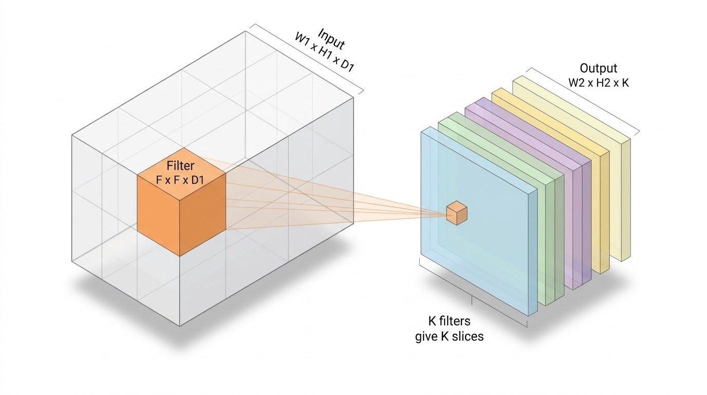
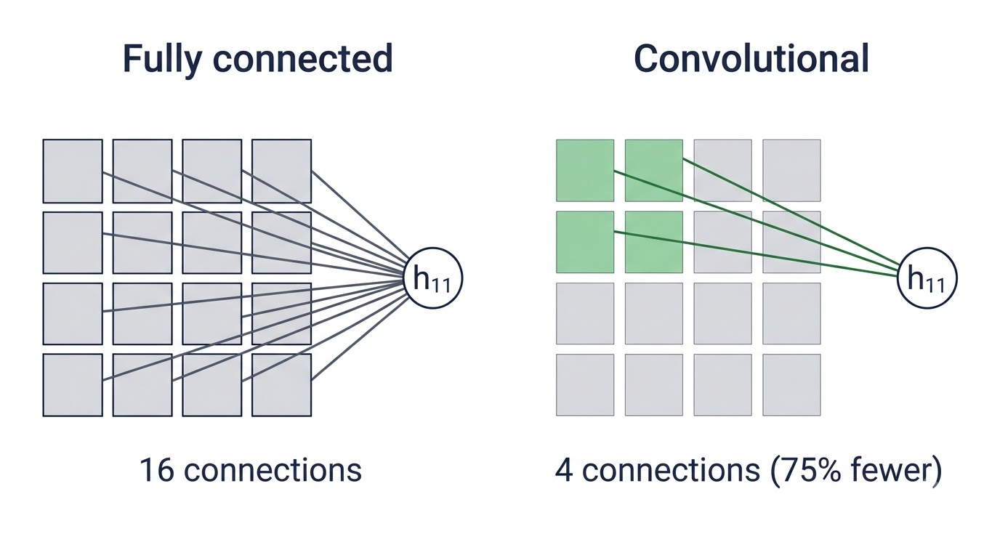

# Lecture 12 — Convolution & CNN Basics: Exam Questions and Answers

Companion to [ML_Lec_12_CNN_Learning_Guide.md](ML_Lec_12_CNN_Learning_Guide.md). Answer the question in your head first, then read the model answer.

**Exam pattern:** Part A has 2-mark questions. Part B has 10-mark questions split into (a) + (b), either 5 + 5 or 6 + 4.
**Tags:** 🎯 = asked in a real paper (year, question); ✍️ = practice question written to cover the rest of the lecture; 📘 = beyond the slides.
**Each answer** = what to write in the exam, then 💡 a one-line memory hook.

| Topic in the guide | Question |
| :--- | :--- |
| Convolution, kernel, feature map (§1) | A1, B1 |
| Padding (§2) | A2, B1 |
| Hand-made kernels: edge, blur, sharpen, dilated (§3) | A4, A6, B4 |
| 1D / 3D convolution, output size, stride (§4–6) | A3, B1 |
| Learned kernels, sparsity, weight sharing (§7) | B2, B4 |
| Pooling, flatten (§8–9) | A5, A7, B3 |

---

## Part A — 2-mark questions

### A1. What is convolution in a CNN? What is a feature map? ✍️ [2]

Convolution slides a small matrix (the **kernel** or **filter**, e.g. 3×3) over the image. At each position it multiplies each kernel value by the pixel under it and adds the products (a dot product), giving one output number:

$$S_{ij} = \sum_{a=0}^{m-1} \sum_{b=0}^{n-1} I_{i+a,\,j+b}\, K_{a,b}$$

Doing this at every position gives a new matrix called the **feature map**. It shows where the kernel's pattern (an edge, a texture) appears. Many kernels give many feature maps.

> 💡 Kernel = pattern detector; feature map = "where the pattern is" map.

### A2. Differentiate valid and same padding. ✍️ [2]

| | Valid padding | Same padding |
| :--- | :--- | :--- |
| Zeros added | None ($P = 0$) | Enough zeros around the border, $P = (F-1)/2$ for stride 1 |
| Output size | Shrinks: $W_1 - F + 1$ | Same as input |
| 5×5 input, 3×3 kernel | $5 - 3 + 1 = 3$ → 3×3 | $5 - 3 + 2 + 1 = 5$ → 5×5 |

Padding is needed to keep the size when stacking many layers, to use edge pixels properly, and to stop the map from shrinking in deep networks.

> 💡 Valid = "only where it fits"; same = "pad so nothing shrinks".

### A3. What is stride? Find the output width for a 7-wide input, 3-wide kernel, no padding, stride 1 and stride 2. ✍️ [2]

**Stride** $S$ is how many pixels the kernel moves after each step. A larger stride skips positions, so the output is smaller.

$$W_2 = \left\lfloor \frac{W_1 - F + 2P}{S} \right\rfloor + 1$$

- $S = 1$: $(7 - 3)/1 + 1 = 5$
- $S = 2$: $(7 - 3)/2 + 1 = 3$

> 💡 Room to move ÷ step size + 1 starting position.

### A4. What is a dilated (atrous) convolution and why is it used? ✍️ [2]

A dilated kernel has gaps between its elements. With dilation rate 2 there is one skipped pixel between elements, so a 3×3 kernel (9 weights) covers a 5×5 area ($3 + 2$ gaps $= 5$).

It **increases the receptive field without adding parameters or computation**, and keeps the spatial resolution. So it is used for dense prediction tasks such as semantic segmentation.

> 💡 Same 9 weights, spread out → wider view for free.

### A5. Differentiate global average pooling and global max pooling. ✍️ [2]

Both reduce each whole feature map to **one number** and are used in the final layers, just before the output layer.

- **Global average pooling** takes the average of the entire map. It is effective for classification.
- **Global max pooling** takes the maximum of the entire map. It keeps the single strongest feature, and is used when spatial position matters little.

*Example:* map [[1, 3], [5, 7]] → GAP = 16/4 = 4; GMP = 7.

> 💡 Global = the window is the whole map.

### A6. How does a Laplacian kernel differ from an unsharp-mask kernel? ✍️ [2]

$$\text{Laplacian} = \begin{bmatrix} 0 & -1 & 0 \\ -1 & 4 & -1 \\ 0 & -1 & 0 \end{bmatrix}, \qquad \text{Unsharp mask} = \begin{bmatrix} 0 & -1 & 0 \\ -1 & 5 & -1 \\ 0 & -1 & 0 \end{bmatrix}$$

- **Laplacian:** centre 4, weights sum to 0. It is a **second-derivative** operator ($\nabla^2 I = I_{xx} + I_{yy}$). It detects edges and gives 0 on flat regions.
- **Unsharp mask:** centre 5, weights sum to 1. It is **not** a second derivative. It adds the edge detail back onto the original image, so brightness is kept and the image is **sharpened**.

> 💡 Sum 0 → edge detector; sum 1 → keeps the picture, only sharper.

### A7. What is flattening and why is it needed? ✍️ [2]

Flattening turns the 2D pooled feature maps into one long 1D vector, read row by row, because the fully connected classifier needs a vector input. Nothing is lost; only the shape changes.

*Example:* [[1, 1, 0], [4, 2, 1], [0, 2, 1]] → [1, 1, 0, 4, 2, 1, 0, 2, 1] (9 values).

> 💡 Unroll the grid into a row for the dense layers.

---

## Part B — 10-mark questions

### B1. ✍️ + 🎯 2024 End Q5(a), second part

**(a)** Explain the convolution operation on a 3D (RGB) input with a 3D filter. Derive the output-size formula step by step for no padding, then padding, then stride. **[6]**
**(b)** An input of size $W_1 \times H_1 \times D_1$ is convolved with $K$ filters of size $F \times F$, stride $S$ and padding $P$. Give the volume of the output. Then compute it for (i) 227×227×3 with 96 filters of 11×11, $S = 4$, $P = 0$ and (ii) 32×32×1 with 6 filters of 5×5, $S = 1$, $P = 0$. **[4]**

**(a) Answer.**

1. **3D convolution.** An RGB image is $W_1 \times H_1 \times D_1$ (with $D_1 = 3$). Each filter is also a volume, $F \times F \times D_1$: **its depth always equals the input depth**. The filter slides only along width and height, never along depth. At each position it takes the dot product over all $F \cdot F \cdot D_1$ values. So one filter gives one **2D** map. Using $K$ filters stacks $K$ maps.
2. **No padding.** The kernel cannot be centred on border pixels without crossing the boundary. Along one side it fits in $W_1 - F + 1$ places:
   $$W_2 = W_1 - F + 1$$
   *E.g.* a 3×4 input with a 2×2 kernel gives a 2×3 output.
3. **With padding $P$.** Add $P$ rings of zeros, so the input grows by $2P$:
   $$W_2 = W_1 - F + 2P + 1$$
   With $F = 3$, $P = 1$, the size is kept ("same").
4. **With stride $S$.** The kernel jumps $S$ pixels, so the available room is divided by $S$:
   $$W_2 = \left\lfloor \frac{W_1 - F + 2P}{S} \right\rfloor + 1, \qquad H_2 = \left\lfloor \frac{H_1 - F + 2P}{S} \right\rfloor + 1, \qquad D_2 = K$$
   We take the floor because the size must be a whole number.

**(b) Answer.** The output volume is $W_2 \times H_2 \times K$, with $W_2$ and $H_2$ from the formula above.

| Case | Width/height | Depth | Output |
| :--- | :--- | :--- | :--- |
| (i) 227×227×3, 96 × (11×11×3), $S = 4$ | $(227 - 11 + 0)/4 + 1 = 54 + 1 = 55$ | 96 | **55×55×96** |
| (ii) 32×32×1, 6 × (5×5×1), $S = 1$ | $(32 - 5 + 0)/1 + 1 = 28$ | 6 | **28×28×6** |

> 💡 Width/height from the formula; depth = number of filters.

### B2. 🎯 2024 End Q4(a) + 🎯 2023 End Q3(c)

**(a)** Justify the properties of "sparsity of connections" and "weight sharing" in CNNs. **[6]**
**(b)** Why do we prefer CNNs over ANNs for image data? **[4]**

**(a) Answer.**

**Sparsity of connections.**

- In a regular (fully connected) network, every input pixel connects to every hidden neuron. For a 4×4 image (16 pixels), all 16 pixels feed $h_{11}$.
- In a CNN, each output looks only at a small local patch. With a 2×2 kernel, only pixels 1, 2, 5, 6 feed $h_{11}$ and only pixels 3, 4, 7, 8 feed $h_{12}$. That is 4 connections instead of 16 (75% fewer).
- **Justification:** in images, neighbouring pixels interact most (edges, corners), so local connections capture what matters. This reduces parameters.

**Weight sharing.**

- The **same kernel** (the same weights) is used at every position in the image. A layer can have many kernels, but each one is reused everywhere.
- For the 4×4 image with a 2×2 kernel: there are 9 outputs. A dense layer needs $16 \times 9 = 144$ weights; the convolution needs only **4** shared weights.
- **Justification:** a pattern such as an edge looks the same wherever it appears, so one detector can be reused at every location.

**(b) Answer.** Compared with a fully connected ANN, a CNN has:

1. **Far fewer parameters**, thanks to sparsity and weight sharing (4 vs 144 above).
2. **Computational efficiency:** less memory and compute, so it is faster to train and easier to deploy on large, high-dimensional images.
3. **Translation invariance:** it recognises a pattern wherever it appears.
4. **Hierarchical features:** early layers learn edges, deeper layers learn shapes and objects.
5. **Better generalisation:** fewer parameters means less overfitting.
6. **Robustness** to noise and to changes in lighting, scale and rotation.

An ANN also flattens the image, which throws away its 2D structure. A CNN keeps it.

> 💡 Local + shared = few weights, same detector everywhere.

### B3. ✍️ + 🎯 2023 End Q3(b)

**(a)** Explain the pooling layer: its purpose, types and parameters. Max-pool the map below with a 2×2 window at stride 2 and at stride 1. **[6]**

$$\begin{bmatrix} 1 & 4 & 2 & 1 \\ 5 & 8 & 3 & 4 \\ 7 & 6 & 4 & 5 \\ 1 & 3 & 1 & 2 \end{bmatrix}$$

**(b)** Explain the max-unpooling operation for increasing the resolution of feature maps. **[4]**

**(a) Answer.**

**Purpose.** Pooling reduces the spatial size of the feature maps. This cuts the parameters and computation in later layers. It has **no learnable parameters**.

**Types.**

- **Max pooling:** takes the maximum of each window. It keeps the most prominent features (edges, textures).
- **Average pooling:** takes the average of each window. It gives a smoother map, is less sensitive to noise and keeps more context.
- **Global average** and **global max pooling:** one value per whole map, used before the output layer.

**Parameters.**

- Window size (2×2, 3×3).
- Stride: a larger stride gives a smaller output.
- Padding: usually none.

**Trade-offs.** Pooling can lose spatial information, which matters for segmentation. Some networks use a stride-2 convolution instead.

**Stride 2** (four separate blocks): the maxima of {1, 4, 5, 8}, {2, 1, 3, 4}, {7, 6, 1, 3} and {4, 5, 1, 2} give

$$\begin{bmatrix} 8 & 4 \\ 7 & 5 \end{bmatrix}$$

**Stride 1** (overlapping windows; the output is $(4-2)/1 + 1 = 3$ wide):

$$\begin{bmatrix} 8 & 8 & 4 \\ 8 & 8 & 5 \\ 7 & 6 & 5 \end{bmatrix}$$

The larger stride gives the smaller output.

**(b) Answer.** 📘 *Max-unpooling is not in the Lecture 12 slides. This is the standard answer.*

1. During max pooling, also record **where** each maximum came from. These recorded positions are called **switches**.
2. Unpooling makes a larger map (back to the pre-pool size), puts each pooled value **back at its recorded position**, and fills every other cell with **0**.
3. Following convolutions then fill in the zeros. This is used in decoder networks (e.g. SegNet, deconvolution networks) to recover resolution for segmentation.

*Example:* in (a), the maxima 8, 4, 7, 5 came from (row 2, col 2), (2, 4), (3, 1) and (3, 4). Unpooling [[8, 4], [7, 5]] gives:

$$\begin{bmatrix} 0 & 0 & 0 & 0 \\ 0 & 8 & 0 & 4 \\ 7 & 0 & 0 & 5 \\ 0 & 0 & 0 & 0 \end{bmatrix}$$

> 💡 Pooling remembers where the winner sat; unpooling puts it back there.

### B4. ✍️

**(a)** Describe hand-designed kernels used for edge detection, blurring and sharpening, with their matrices. **[6]**
**(b)** Why do CNNs learn their kernels instead of using fixed ones? How are the kernels initialised? **[4]**

**(a) Answer.**

**1. Edge detection.**

- **Sobel** finds horizontal and vertical gradients (how fast the brightness changes):
  $$\begin{bmatrix} -1 & 0 & 1 \\ -2 & 0 & 2 \\ -1 & 0 & 1 \end{bmatrix}, \quad \begin{bmatrix} 1 & 2 & 1 \\ 0 & 0 & 0 \\ -1 & -2 & -1 \end{bmatrix}$$
- **Canny** is not a single kernel but a multi-stage method:
  1. Gaussian smoothing.
  2. Gradient (Sobel-like) kernels.
  3. Non-maximum suppression (thin the edges).
  4. Hysteresis thresholding: keep strong edges, and keep weak ones only if they touch strong ones.

**2. Blurring** (weights sum to 1, so brightness is kept).

- **Gaussian:** $G(x,y) = \frac{1}{2\pi\sigma^2} e^{-(x^2+y^2)/2\sigma^2}$. Nearer pixels get more weight; a larger $\sigma$ gives more blur. The 3×3 version is $\frac{1}{16}\begin{bmatrix} 1&2&1\\2&4&2\\1&2&1 \end{bmatrix}$.
- **Average (box) filter:** $\frac{1}{9}$ × an all-ones 3×3 matrix. Each pixel is replaced by its neighbourhood mean.

**3. Sharpening.**

- **Laplacian** (centre 4, a second derivative; it detects edges).
- **Unsharp mask** (centre 5): blur the image, subtract the blur from the original to get the edges, then add them back with a scaling factor.
- The kernel $\begin{bmatrix} 1&1&1\\1&-8&1\\1&1&1 \end{bmatrix}$ (sum 0) is a high-pass filter: it removes smooth areas and keeps edges.

Other types: dilated kernels (wider view), embedding kernels (learned features) and custom kernels.

**(b) Answer.**

- Fixed kernels (edge detector, SIFT/HOG) give **static features**; only the classifier learns. A CNN instead treats the kernel values as **parameters** and learns many layers of them together with the classifier, using **backpropagation**. Learned kernels fit the data and the task better, so predefined kernels are rarely used in deep learning.
- **Initialisation:** small random values. Random kernels have no bias towards any particular pattern, so the network can learn a wide variety of features. Common schemes are **Xavier** and **He** initialisation, which keep the starting signal at a sensible scale so learning works well.

> 💡 People design 1 kernel; a CNN learns hundreds, layer by layer.
