# Comprehensive Learning Guide: Convolutional Neural Networks (CNN) — Architecture, Mechanics & Parameter Audits

> **Source Material:** `ML_Lec_13_CNN.pptx` (50 Slides)  
> **Topic Domain:** Machine Learning / Deep Learning — Convolutional Neural Networks  
> **Structure:** 4-Part Concept Anatomy (Problem & Intuition $\to$ Technical Mechanism & Architecture $\to$ Visual Anchor $\to$ Verified Formulas, Trade-offs & Calculations)

---

## 1. Foundations of Convolutional Networks & Hierarchical Vision

### 1. The Engineering Problem & Intuition
Standard fully connected artificial neural networks (Multilayer Perceptrons, or MLPs) process data as one-dimensional unorganized vectors. When applied to high-dimensional structured grid data—such as two-dimensional images or multi-channel visual volumes—this flat vectorized approach collapses under two fatal engineering failures:

1. **Parameter Explosion and Computational Infeasibility:** Consider a modest $1000 \times 1000$ RGB color image. Flattening this array produces an input vector of $1000 \times 1000 \times 3 = 3 \times 10^6$ features. A single dense hidden layer containing only 1,000 neurons would require:

$$
\text{Parameters} = 3 \times 10^6 \times 1000 = 3 \times 10^9 \text{ weights}
$$

   Storing and optimizing three billion weights for a single layer requires gigabytes of memory, induces severe computational bottlenecks, and makes generalization virtually impossible without catastrophic overfitting.
2. **Destruction of Spatial Topology and Local Covariance:** In natural imagery, spatial structure is paramount. Neighboring pixels exhibit extreme mutual covariance (local correlation), whereas distant pixels are relatively uncorrelated. Flattening an image scrambles these geometric relationships, forcing an MLP to learn spatial adjacency from scratch across all pixel coordinates simultaneously. Moreover, standard MLPs lack translation invariance: a feature learned at the top-left corner must be relearned independently if it appears at the bottom-right corner.

Convolutional Neural Networks (CNNs) resolve these fundamental limitations by encoding spatial structure directly into the network architecture through three foundational inductive biases: **local receptive fields**, **parameter sharing**, and **spatial subsampling**. Inspired by biological vision (Hubel and Wiesel's discovery of orientation-selective receptive fields in the mammalian visual cortex), CNNs construct a hierarchy of visual abstractions directly from raw pixel arrays.

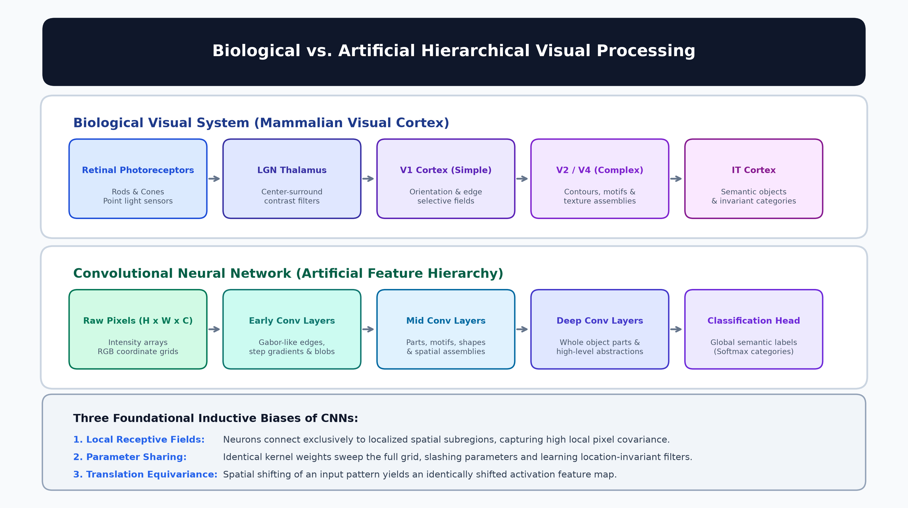
*Figure 2: Comparison between biological visual cortex hierarchies and deep convolutional feature extraction stages, highlighting the three foundational inductive biases.*

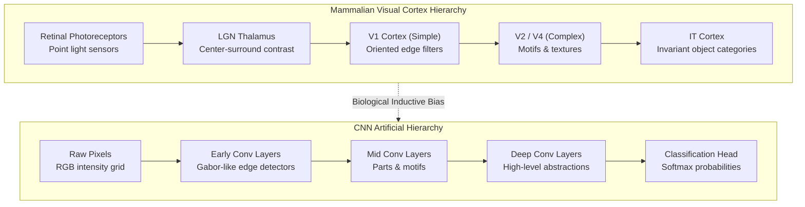


#### Canonical Computer Vision Application Domains (Slide 2)
The automatic hierarchical feature extraction capability of CNNs underpins core visual perception tasks:
1. **Image Classification:** Assigning a categorical class label to an input image (e.g., MNIST digit recognition, ImageNet object tagging).
2. **Object Detection:** Localizing and classifying multiple visual entities simultaneously via bounding boxes.
3. **Image Segmentation:** Classifying each individual pixel into semantic categories (semantic segmentation) or distinguishing distinct object instances (instance segmentation).
4. **Facial Recognition:** Verifying and matching human facial biometrics across varying poses and illumination conditions.
5. **Medical Image Analysis:** Detecting pathologies, lesions, and anatomical structures in MRI, CT, and X-ray scans.

### 2. Technical Mechanism & Architecture
A Convolutional Neural Network is an end-to-end differentiable feedforward architecture organized into five canonical layer categories (Slides 1, 3, 4, 14):

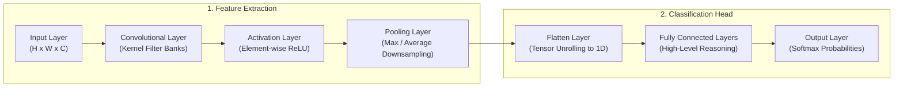

The functional role of each layer in the processing hierarchy is defined as follows:

1. **Input Layer (Slide 4):** Ingests structured multi-dimensional coordinate grids. For visual data, this is represented as a 3D tensor of shape $H \times W \times C$, where $H$ is image height, $W$ is image width, and $C$ denotes channel depth ($C=1$ for grayscale, $C=3$ for RGB color, or $C>3$ for multi-spectral and medical volumetric imagery). While CNNs are primarily designed for visual grids, the same architecture processes non-image structured signals such as 1D audio waveforms, financial time series, and seismic sensor arrays.
2. **Convolutional Layer (Slides 4–8):** The primary computational engine. Parameterized weight templates (kernels) slide across the input volume, computing localized inner products to generate 2D spatial feature maps.
3. **Activation Function (Slides 4, 8):** Non-linear mapping (predominantly Rectified Linear Unit, $\text{ReLU}(z) = \max(0, z)$ ) applied element-wise. Because convolutions are strictly affine operations, stacking linear layers without non-linearities collapses the entire network into a single trivial linear transformation.
4. **Pooling Layer (Slides 9–13):** Fixed non-parametric downsampling operations (e.g., Max or Average pooling) that progressively compress spatial dimensions, expand the effective receptive field of downstream neurons, and confer local translation invariance.
5. **Fully Connected (FC) and Output Layers (Slide 14):** Flattened feature maps are channeled into dense neural layers where every neuron connects to every preceding activation. The FC head performs global semantic reasoning over the extracted spatial primitives, culminating in an output layer governed by Softmax (for multi-class classification) or Linear activation (for continuous regression).

#### The Principle of Hierarchical Representation Learning (Slide 6)
As visual activations propagate through successive convolutional blocks, their representational capacity shifts from concrete spatial geometry to abstract semantic categorization:
- **Shallow Layers (Layers 1–2):** Small spatial receptive fields detect low-level, high-frequency spatial primitives: oriented edges, step transitions, color gradients, and corners.
- **Intermediate Layers (Layers 3–4):** Receptive fields cover broader image patches, combining low-level edges into motifs, repeated textures, contours, and object parts (e.g., eyes, wheels, boundaries).
- **Deep Layers (Layers 5+):** Large receptive fields aggregate complex topological structures into semantic category representations (e.g., animal faces, vehicles, structural silhouettes).

### 3. Visual Anchor

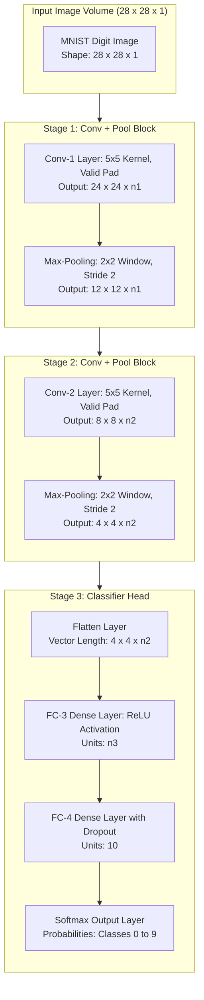

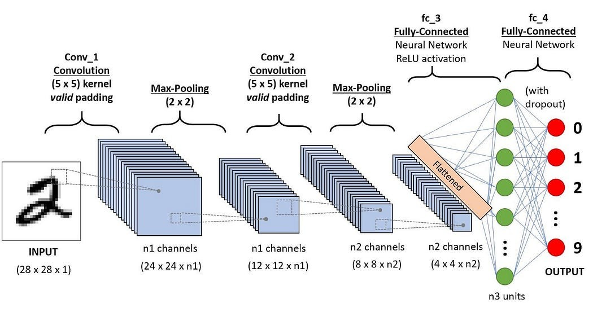
*Figure 1: Canonical Convolutional Neural Network architecture illustrating sequential feature extraction through convolutional and pooling layers, followed by tensor flattening and dense classification with dropout regularization (Slide 3).*

### 4. Verified Formulas, Trade-offs & Calculations

#### Mathematical Formalization of Core Inductive Biases
1. **Local Connectivity:** For an input feature map $X \in \mathbb{R}^{H \times W \times C_{\text{in}}}$, a neuron at spatial position $(i, j)$ in output channel $k$ connects only to a localized bounding volume of size $F \times F \times C_{\text{in}}$, where $F \ll \min(H, W)$.
2. **Parameter Sharing:** The weight tensor $K^{(k)} \in \mathbb{R}^{F \times F \times C_{\text{in}}}$ and bias $b^{(k)} \in \mathbb{R}$ are identical across all spatial positions $(i, j)$:

$$
S^{(k)}(i, j) = \sum_{m=0}^{F-1} \sum_{n=0}^{F-1} \sum_{c=0}^{C_{\text{in}}-1} X(i+m, j+n, c) K^{(k)}(m, n, c) + b^{(k)}
$$

   *Plain reading:* The scalar response at output location $(i, j)$ is the sum of element-wise products between the shared kernel weights and the input subregion across all input channels, shifted by a scalar bias.
3. **Translation Equivariance:** Let $T_{\Delta}$ denote a spatial translation operator shifting an input grid by $\Delta$ pixels: $(T_{\Delta} X)(i, j) = X(i - \Delta_i, j - \Delta_j)$. Convolution commutes with translation:

$$
\text{Conv}(T_{\Delta} X) = T_{\Delta} (\text{Conv}(X))
$$

   If an object shifts within an image, its corresponding activation response shifts by the exact same spatial displacement in the output feature map without altering its numerical profile.

#### Layer Comparison Matrix
The table below contrasts the computational and parametric profiles of the five canonical layers:

| Layer Type | Input Shape | Output Shape | Learnable Parameters | Transformation Type | Representational Role |
| :--- | :--- | :--- | :--- | :--- | :--- |
| **Input** | Raw data | $H \times W \times C$ | 0 | Identity / Normalization | Data ingestion & spatial grid framing |
| **Convolution** | $H_{\text{in}} \times W_{\text{in}} \times C_{\text{in}}$ | $H_{\text{out}} \times W_{\text{out}} \times C_{\text{out}}$ | $C_{\text{out}} \cdot (F^2 \cdot C_{\text{in}} + 1)$ | Affine sliding inner product | Local pattern extraction & feature mapping |
| **Activation** | $H \times W \times C$ | $H \times W \times C$ | 0 | Non-linear element-wise map | Breaking linearity; multi-layer expressivity |
| **Pooling** | $H_{\text{in}} \times W_{\text{in}} \times C$ | $H_{\text{out}} \times W_{\text{out}} \times C$ | 0 | Local order-statistic / aggregation | Downsampling, translation invariance, memory reduction |
| **Fully Connected** | $N_{\text{in}} \times 1$ | $N_{\text{out}} \times 1$ | $(N_{\text{in}} + 1) \cdot N_{\text{out}}$ | Dense matrix-vector affine map | Global semantic reasoning & class scoring |

---

## 2. The Convolutional Layer & Receptive Field Dynamics

### 1. The Engineering Problem & Intuition
In classical image processing, detecting edges or textures required hand-crafting fixed mathematical operators (such as the Sobel, Prewitt, or Laplacian operators). In deep representation learning, the fundamental engineering challenge is: *how can an artificial neural system automatically learn matched spatial templates directly from empirical loss gradients, while keeping the parameter budget invariant to the input image resolution?*

The convolutional layer answers this by deploying a bank of learnable spatial templates known as **kernels** or **filters**. Rather than assigning a distinct weight to every coordinate pair, the filter slides across the coordinate manifold. At every discrete spatial position, it evaluates the local cross-correlation between its weights and the underlying pixel patch. If a patch resembles the pattern encoded by the filter, the inner product evaluates to a large positive activation; if the patch is dissimilar or orthogonal, the response is zero or negative.

### 2. Technical Mechanism & Architecture
The convolutional operation transforms an input tensor $X \in \mathbb{R}^{H \times W \times D_{\text{in}}}$ into an output tensor $Y \in \mathbb{R}^{H' \times W' \times K}$ via a bank of $K$ independent three-dimensional filters, where each filter $K_k \in \mathbb{R}^{F \times F \times D_{\text{in}}}$ has an identical channel depth to the input tensor.

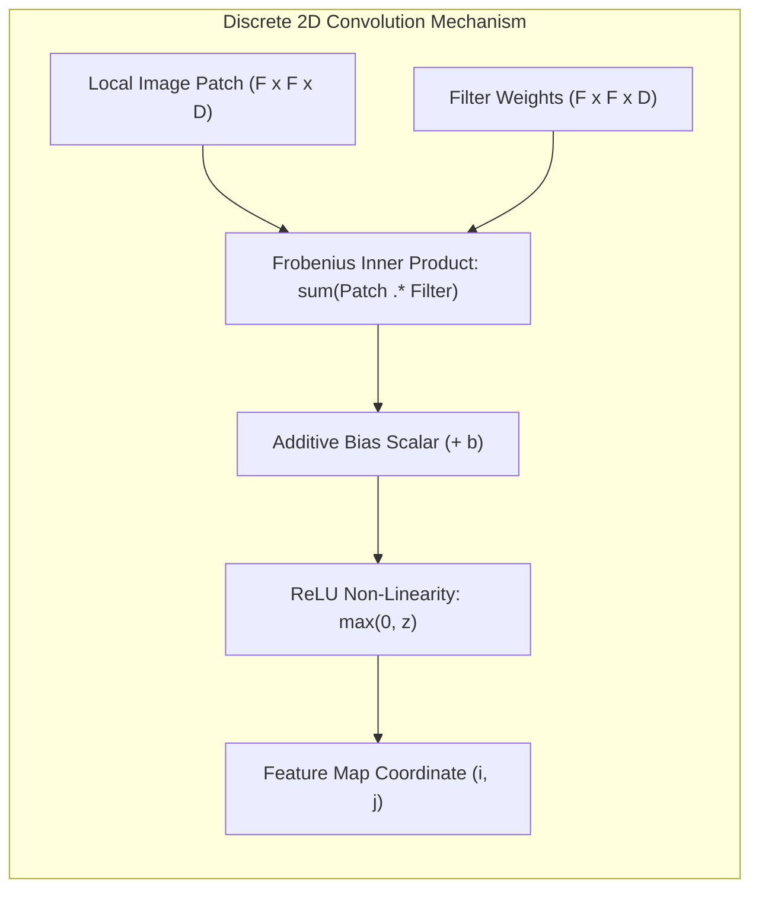

The operation proceeds via four strict execution steps:
1. **Spatial Alignment:** A filter of spatial extent $F \times F$ is positioned over the top-left subregion of the input grid.
2. **Inner Product & Accumulation:** An element-wise scalar multiplication is executed across all $F \times F \times D_{\text{in}}$ corresponding entries, followed by a summation over all spatial coordinates and channels.
3. **Bias Addition & Non-Linear Activation:** A single learned scalar bias $b_k$ associated with filter $k$ is added to the accumulated sum. The affine result is passed through an activation function (typically $\text{ReLU}(z) = \max(0, z)$ ).
4. **Strided Stepping:** The filter advances by $S$ spatial units (stride) horizontally until reaching the right boundary, then shifts down by $S$ units and resets to the left margin, repeating the process across the entire input grid.

#### Rigorous Numerical Walk-Through: Slide 5 Case Study
To verify the operation mathematically, consider Slide 5's benchmark convolution ($H=6, W=6, F=3, S=1, P=0$):

The $6 \times 6$ binary input matrix $X$ and the $3 \times 3$ kernel $K$ are given by:

$$
X = \begin{bmatrix}
1 & 0 & 1 & 0 & 1 & 0 \\
0 & 1 & 1 & 0 & 1 & 1 \\
1 & 0 & 1 & 0 & 1 & 0 \\
1 & 0 & 1 & 1 & 1 & 0 \\
0 & 1 & 1 & 0 & 1 & 1 \\
1 & 0 & 1 & 0 & 1 & 0
\end{bmatrix}, \quad
K = \begin{bmatrix}
1 & 2 & 3 \\
4 & 5 & 6 \\
7 & 8 & 9
\end{bmatrix}
$$

The top-left $3 \times 3$ subregion $X_{[0:3, 0:3]}$ overlapping the kernel at position $(0, 0)$ is:

$$
X_{[0:3, 0:3]} = \begin{bmatrix}
1 & 0 & 1 \\
0 & 1 & 1 \\
1 & 0 & 1
\end{bmatrix}
$$

The Frobenius inner product (element-wise multiplication followed by scalar summation) evaluates as:

$$
\begin{aligned}
Y(0, 0) &= (1 \times 1) + (0 \times 2) + (1 \times 3) \\
        &\quad + (0 \times 4) + (1 \times 5) + (1 \times 6) \\
        &\quad + (1 \times 7) + (0 \times 8) + (1 \times 9) \\
        &= 1 + 0 + 3 + 0 + 5 + 6 + 7 + 0 + 9 \\
        &= 31
\end{aligned}
$$

This exact integer $31$ forms the initial entry at coordinate $(0, 0)$ in the $4 \times 4$ output feature map.

### 3. Visual Anchor

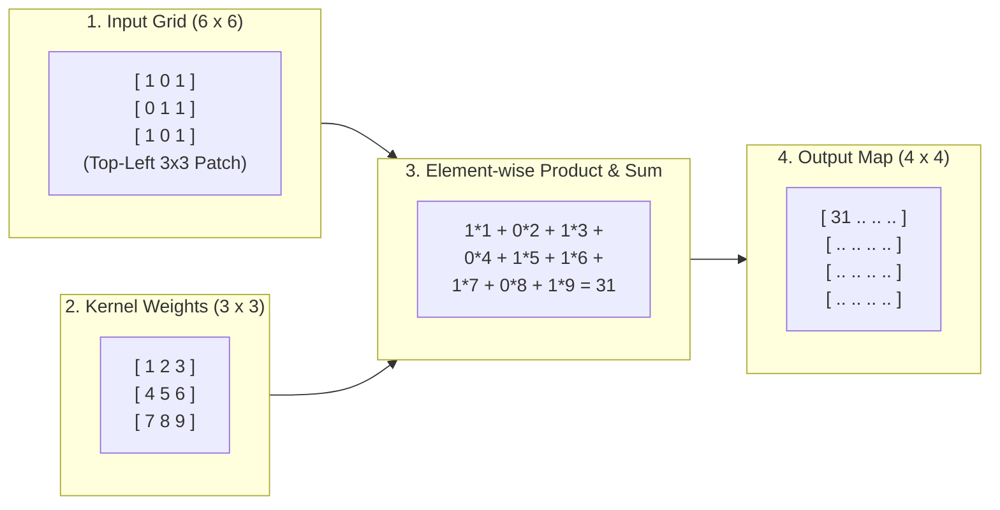

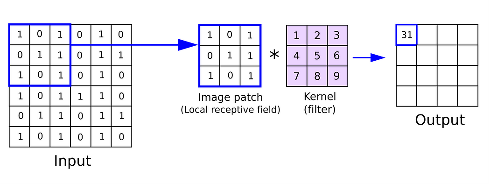
*Figure 2: Step-by-step 2D convolution of a $6 \times 6$ input matrix with a $3 \times 3$ kernel, demonstrating the Frobenius inner product yielding an output activation of 31 at spatial position (0, 0) (Slide 5).*

### 4. Verified Formulas, Trade-offs & Calculations

#### Output Dimension Formulas
For an input tensor of spatial dimensions $W_{\text{in}} \times H_{\text{in}}$, filter spatial extent $F$, zero-padding $P$, and stride $S$:

$$
W_{\text{out}} = \left\lfloor \frac{W_{\text{in}} - F + 2P}{S} \right\rfloor + 1, \quad H_{\text{out}} = \left\lfloor \frac{H_{\text{in}} - F + 2P}{S} \right\rfloor + 1
$$


*Verification on Slide 5:*
- $W_{\text{in}} = 6, H_{\text{in}} = 6, F = 3, P = 0, S = 1$
- $W_{\text{out}} = \lfloor \frac{6 - 3 + 0}{1} \rfloor + 1 = 3 + 1 = 4$
- $H_{\text{out}} = \lfloor \frac{6 - 3 + 0}{1} \rfloor + 1 = 3 + 1 = 4$
- Output feature map dimensions: $4 \times 4$.

#### Parameter Formulation per Convolutional Layer
Let $K$ be the number of filters, $F_w \times F_h$ be the filter spatial footprint, and $C_{\text{in}}$ be the number of input channels. Every individual filter possesses $F_w \cdot F_h \cdot C_{\text{in}}$ kernel weights and exactly 1 shared bias:

$$
\text{Params}_{\text{conv}} = K \times (F_w \times F_h \times C_{\text{in}} + 1)
$$


*Key Architectural Invariant:* The number of parameters in a convolutional layer is **entirely independent** of the input image spatial dimensions ($H_{\text{in}}, W_{\text{in}}$). An identical $3 \times 3 \times 3$ filter operates on a $32 \times 32$ image or a $4096 \times 4096$ image with exactly 28 parameters ($3 \times 3 \times 3 + 1$).

---

## 3. Pooling Mechanics & Spatial Downsampling

### 1. The Engineering Problem & Intuition
As feature maps propagate through deep convolutional stacks, preserving full spatial resolution across all layers introduces severe engineering penalties:
1. **Computational and Memory Overload:** Memory consumption for intermediate activation maps scales quadratically with spatial resolution. Storing uncompressed high-resolution activations across dozens of layers exhausts GPU VRAM during backward passes.
2. **Receptive Field Starvation:** If spatial resolution remains fixed and filter sizes are small ($3 \times 3$), deep neurons remain blind to global image context unless hundreds of layers are stacked.
3. **Overfitting to Irrelevant Micro-Variations:** Image classification requires semantic invariance: an object's identity must remain robust to slight shifts, rotations, or scale changes. Pixel-exact coordinate tracking creates brittle models that overfit to local pixel noise.

The **Pooling Layer** (Slides 9–13) resolves these challenges through non-parametric spatial subsampling. By aggregating local neighborhoods into single summary statistics, pooling compresses spatial tensors, expands receptive fields, and injects translation invariance.

### 2. Technical Mechanism & Architecture
Pooling operates independently on each two-dimensional channel of the input volume ($C_{\text{out}} \equiv C_{\text{in}}$). It applies an aggregation function over a local window of extent $F_p \times F_p$ stepped at stride $S_p$.

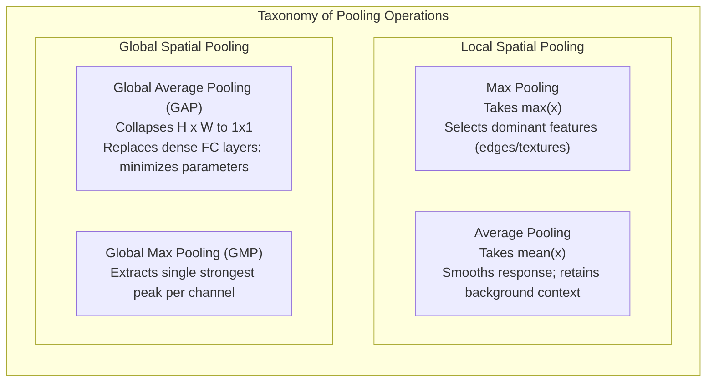

The lecture curriculum defines four fundamental pooling variants (Slides 9, 11):

1. **Max Pooling (Slides 9, 10):** Evaluates $y = \max_{(i, j) \in \Omega} X(i, j)$. It extracts the most prominent activation in each neighborhood, effectively signaling whether a specific feature was detected anywhere in that window. Max pooling acts as a peak detector, making it effective for edge detection, corner extraction, and sparse pattern detection.
2. **Average Pooling (Slides 9, 10):** Evaluates $y = \frac{1}{|\Omega|} \sum_{(i, j) \in \Omega} X(i, j)$. It provides a smoothed summary of the neighborhood, capturing collective spatial presence while dampening high-frequency noise. It is often preferred when contextual or background intensity must be preserved.
3. **Global Average Pooling (GAP) (Slide 11):** Sets the pooling window equal to the entire spatial dimension of the feature map ($F_p = H, S_p = 1$). Each $H \times W$ feature map collapses into a single scalar value:

$$
\text{GAP}(X_c) = \frac{1}{H \times W} \sum_{i=1}^H \sum_{j=1}^W X_c(i, j)
$$

   Introduced in Network-in-Network and modern ResNets, GAP replaces massive fully connected classification layers, eliminating millions of parameters and preventing overfitting.
4. **Global Max Pooling (GMP) (Slide 11):** Evaluates the single maximum activation across the entire spatial map: $\text{GMP}(X_c) = \max_{i, j} X_c(i, j)$. It identifies the single strongest localized signal per feature map, discarding all spatial layout information.

#### Pooling vs. Strided Convolutions (Slide 13)
A prominent architectural debate in modern vision systems is the choice between non-parametric pooling and learned strided convolutions:
- **Strided Convolutions** ($S > 1$): Allow the network to learn optimal downsampling filters during backpropagation. This preserves information adaptively but increases the parameter count and computational complexity.
- **Pooling Drawback (Information Loss):** Pooling irreversibly discards fine spatial coordinate information. While advantageous for categorical invariance (classification), it can be detrimental for dense prediction tasks such as semantic segmentation, depth estimation, or optical flow, where sub-pixel spatial fidelity is required.

### 3. Visual Anchor

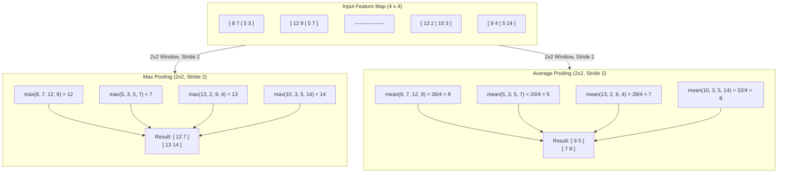

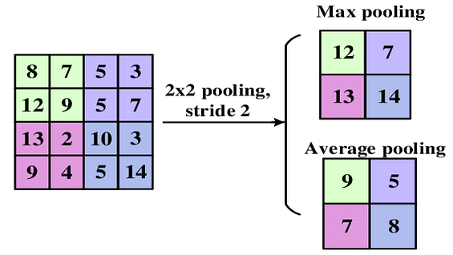
*Figure 3: Numerical verification of $2 \times 2$ Max Pooling versus Average Pooling with stride 2 operating on a $4 \times 4$ activation grid, demonstrating distinct feature retention behaviors (Slide 10).*

### 4. Verified Formulas, Trade-offs & Calculations

#### Pooling Spatial Dimension Equation
For an input tensor of spatial dimensions $W_{\text{in}} \times H_{\text{in}} \times C_{\text{in}}$, pooling window size $F_p$, padding $P$, and stride $S_p$:

$$
W_{\text{out}} = \left\lfloor \frac{W_{\text{in}} - F_p + 2P}{S_p} \right\rfloor + 1, \quad H_{\text{out}} = \left\lfloor \frac{H_{\text{in}} - F_p + 2P}{S_p} \right\rfloor + 1, \quad C_{\text{out}} = C_{\text{in}}
$$


*Zero-Parameter Law:* Standard pooling operations contain **zero learnable weights and zero biases**:

$$
\text{Params}_{\text{pool}} \equiv 0
$$


#### Numerical Walk-Through: Slide 10 Verification
Input matrix $X \in \mathbb{R}^{4 \times 4}$, divided into four non-overlapping quadrants ($F_p = 2, S_p = 2, P = 0$):

$$
X = \begin{bmatrix}
8 & 7 & 5 & 3 \\
12 & 9 & 5 & 7 \\
13 & 2 & 10 & 3 \\
9 & 4 & 5 & 14
\end{bmatrix}
$$

1. **Top-Left Quadrant** ($X_{[0:2, 0:2]}$):
   - Max Pooling: $\max(8, 7, 12, 9) = 12$
   - Average Pooling: $\frac{8 + 7 + 12 + 9}{4} = \frac{36}{4} = 9$
2. **Top-Right Quadrant** ($X_{[0:2, 2:4]}$):
   - Max Pooling: $\max(5, 3, 5, 7) = 7$
   - Average Pooling: $\frac{5 + 3 + 5 + 7}{4} = \frac{20}{4} = 5$
3. **Bottom-Left Quadrant** ($X_{[2:4, 0:2]}$):
   - Max Pooling: $\max(13, 2, 9, 4) = 13$
   - Average Pooling: $\frac{13 + 2 + 9 + 4}{4} = \frac{28}{4} = 7$
4. **Bottom-Right Quadrant** ($X_{[2:4, 2:4]}$):
   - Max Pooling: $\max(10, 3, 5, 14) = 14$
   - Average Pooling: $\frac{10 + 3 + 5 + 14}{4} = \frac{32}{4} = 8$

Resulting Output Matrices ($2 \times 2$):

$$
Y_{\text{max}} = \begin{bmatrix}
12 & 7 \\
13 & 14
\end{bmatrix}, \quad Y_{\text{avg}} = \begin{bmatrix}
9 & 5 \\
7 & 8
\end{bmatrix}
$$

Both outputs match Slide 10 and the Python audit suite exactly.

---

## 4. Fully Connected Layers, Flattening & Output Classification

### 1. The Engineering Problem & Intuition
Convolutional and pooling layers generate three-dimensional spatial representations ($H \times W \times C$) that preserve local geometric arrangements. However, end-stage tasks—such as assigning an image to one of $K$ mutually exclusive categories—require global semantic reasoning. The network must integrate features discovered at opposite ends of the spatial grid (e.g., verifying whether an eye at the top coordinates co-occurs with a mouth at the bottom coordinates).

This requires a topological transition: the 3D tensor must be flattened into a 1D feature vector, and local inductive biases must be replaced with all-to-all connectivity. The **Fully Connected (Dense) Layer** (Slide 14) acts as the high-level semantic reasoning module of the CNN.

### 2. Technical Mechanism & Architecture
The interface between the spatial convolutional backbone and the dense classifier consists of three sequential transformations:

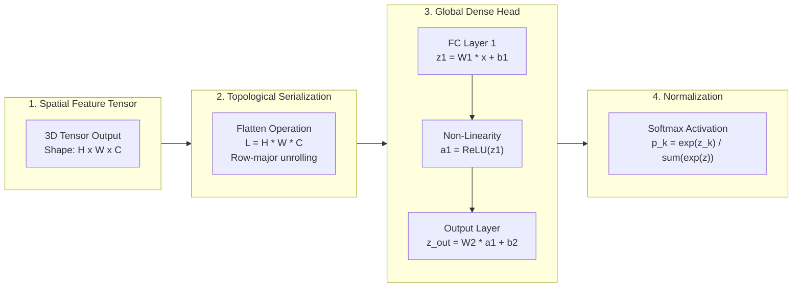

1. **Tensor Flattening (Slide 14):** A deterministic, parameter-free transformation that serializes a multi-dimensional array into a continuous one-dimensional vector. For an incoming tensor $X \in \mathbb{R}^{H \times W \times C}$, the flattened vector $\mathbf{v} \in \mathbb{R}^{L}$ has length:

$$
L = H \times W \times C
$$

2. **Dense Affine Transformation (Slide 14, 34):** Each neuron in the fully connected layer evaluates an inner product across all $N_{\text{in}}$ activations of the previous layer, shifted by a learnable scalar bias:

$$
z_j = \sum_{i=1}^{N_{\text{in}}} W_{ji} v_i + b_j \iff \mathbf{z} = \mathbf{W}\mathbf{v} + \mathbf{b}
$$

   where $\mathbf{W} \in \mathbb{R}^{N_{\text{out}} \times N_{\text{in}}}$ and $\mathbf{b} \in \mathbb{R}^{N_{\text{out}}}$.
3. **Output Layer (Slide 14):**
   - **Multi-Class Classification:** Uses the Softmax activation function to convert raw logit scores $\mathbf{z} \in \mathbb{R}^K$ into a normalized probability distribution over $K$ classes:

$$
P(Y = k \mid \mathbf{x}) = \frac{e^{z_k}}{\sum_{j=1}^K e^{z_j}}, \quad \text{where } \sum_{k=1}^K P(Y = k \mid \mathbf{x}) = 1
$$

   - **Regression Tasks:** Uses a linear activation function ($y = \mathbf{z}$) to predict continuous targets (such as bounding box coordinates or depth values).

### 3. Visual Anchor

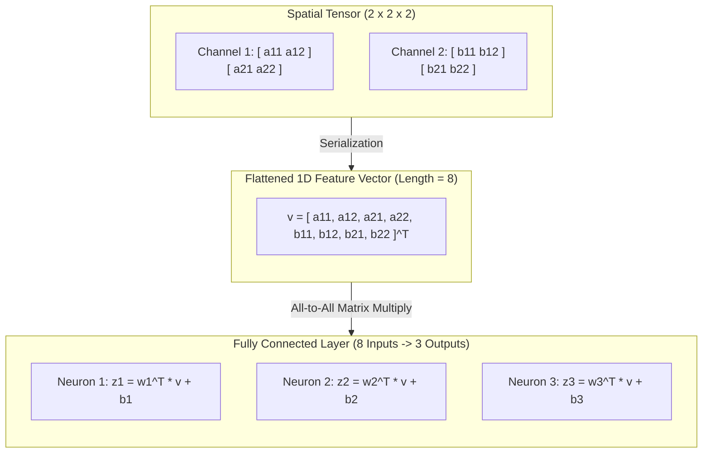

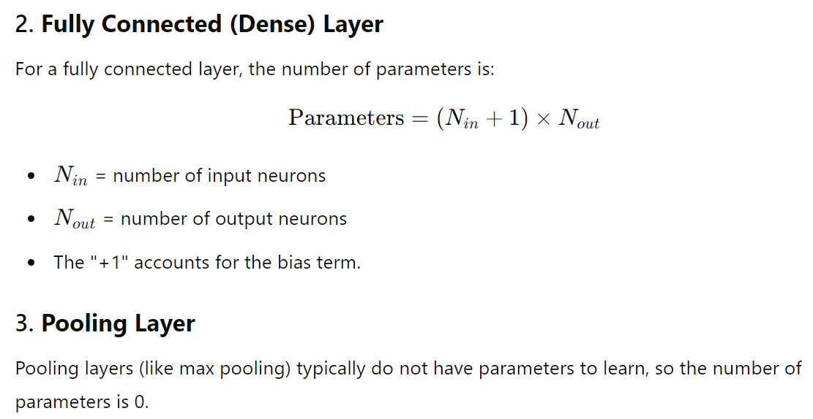
*Figure 4: Formal mathematical specification of Fully Connected layer parameter formulation, indicating $(N_{\text{in}} + 1) \times N_{\text{out}}$ total learnable weights and biases (Slide 34).*

### 4. Verified Formulas, Trade-offs & Calculations

#### Parameter Budget for Dense Layers (Slide 34)
For a dense layer receiving $N_{\text{in}}$ input activations and projecting to $N_{\text{out}}$ output neurons:

$$
\text{Params}_{\text{FC}} = (N_{\text{in}} + 1) \times N_{\text{out}} = N_{\text{in}} \cdot N_{\text{out}} + N_{\text{out}}
$$


- **Weight Matrix** $\mathbf{W}$: $N_{\text{in}} \times N_{\text{out}}$ parameters.
- **Bias Vector** $\mathbf{b}$: $N_{\text{out}}$ parameters.

#### The Fully Connected Memory Bottleneck
While convolutional layers dominate floating-point operations (FLOPs) during the forward pass due to sliding window inner products, fully connected layers account for the vast majority of memory storage in classic architectures.

*Case Study from Slide 32/36 (AlexNet):*
- Conv Layers (Conv1 to Conv5): $3,747,200$ parameters ($\approx 6.01$% of total).
- FC Layers (FC1 to FC3): $58,631,144$ parameters ($\approx 93.99$% of total).
- **Engineering Trade-off:** Dense heads require aggressive regularization (e.g., Dropout) to avoid overfitting the millions of unconstrained weights in early layers.

---

## 5. Regularization in CNNs — Dropout

### 1. The Engineering Problem & Intuition
Deep convolutional neural networks are overparameterized models containing millions of learnable parameters. During training, individual neurons can easily fall into **complex co-adaptations**—a pathological state where specific neurons correct for the statistical errors of other neurons rather than learning robust, independently useful representations. When evaluated on unseen test data, these fragile co-adaptations fail, causing severe overfitting.

**Dropout** (Slides 15–17), introduced by Srivastava, Hinton et al. (2014), addresses this problem through stochastic regularization. During every training iteration, a randomly chosen subset of neurons is temporarily deactivated ("dropped out"). This forces every neuron to learn features that remain useful in conjunction with diverse random subsets of other neurons, preventing reliance on any single pathway and distributing representations broadly across the network.

### 2. Technical Mechanism & Architecture
Dropout acts as a stochastic binary gate applied to hidden unit activations during training (Slide 15).

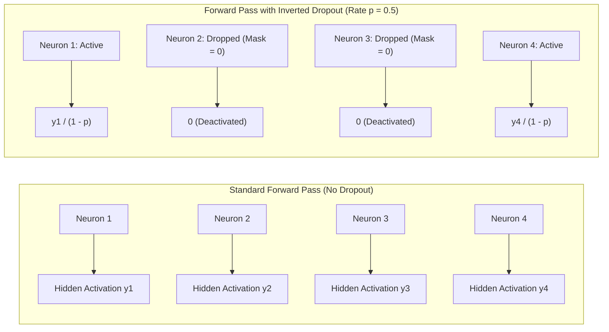

The mathematical mechanics proceed in two distinct modes:

#### 1. Training Phase Mechanics (Slide 15)
For a layer activation vector $\mathbf{y} \in \mathbb{R}^d$, an independent random binary mask $\mathbf{r} \in \lbrace 0, 1 \rbrace^d$ is generated from a Bernoulli distribution:

$$
r_j \sim \text{Bernoulli}(1 - p)
$$


where $p \in [0, 1]$ is the **dropout rate** (the probability of dropping a neuron, typically set between $0.2$ and $0.5$). In standard implementation, **Inverted Dropout** is applied to preserve activation magnitude:

$$
\tilde{y}_j = \frac{r_j}{1 - p} \cdot y_j
$$


Dividing by $(1 - p)$ scales the remaining active neurons upward during training, guaranteeing that the mathematical expectation of the activations remains identical to the unregularized activations:

$$
\mathbb{E}[\tilde{y}_j] = \frac{\mathbb{E}[r_j]}{1 - p} \cdot y_j = \frac{1 - p}{1 - p} \cdot y_j = y_j
$$


#### 2. Inference / Testing Phase Mechanics (Slide 17)
Because Inverted Dropout rescales activations during training, the testing phase operates deterministically:
- The dropout mask is removed ($\mathbf{r} \equiv \mathbf{1}$).
- All neurons remain active simultaneously.
- Zero extra computation or test-time weight scaling is required.

#### Theoretical Justifications (Slides 16–17)
1. **Implicit Ensemble Learning (Slide 17):** A neural network with $N$ regularized units contains $2^N$ possible thinned subnetworks. At each mini-batch step, a different subnetwork is sampled and updated. Dropout effectively trains an exponential ensemble of $2^N$ distinct models with extensive weight sharing. At test time, using all neurons approximates the geometric mean of the ensemble's predictive distributions.
2. **Redundancy and Distributed Representations (Slide 16):** Because any neuron may vanish at any step, the network cannot rely on isolated pathways. Features must be redundantly encoded across multiple neurons, improving robustness to noise and corruption.
3. **Stochastic Optimization (Slide 17):** The stochastic noise injected into weight updates helps the optimizer escape saddle points and shallow local minima.

### 3. Visual Anchor

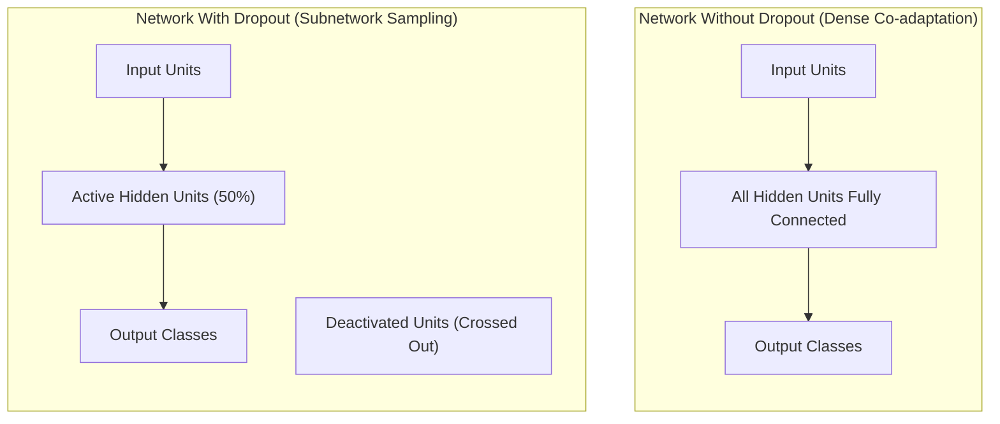

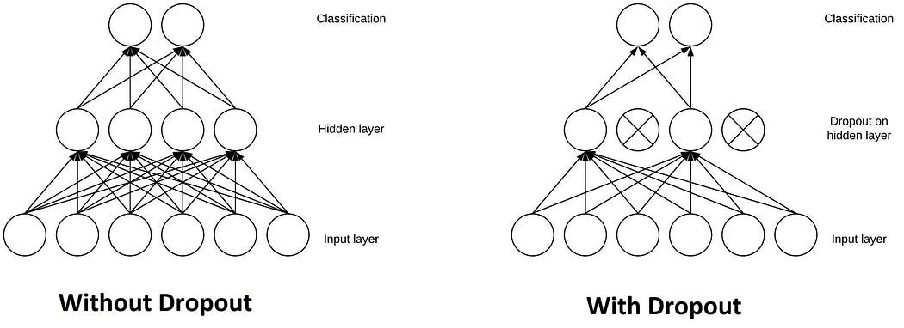
*Figure 5: Schematic comparison between a standard fully connected network and a thinned network generated by applying a stochastic dropout mask during training (Slide 15).*

### 4. Verified Formulas, Trade-offs & Calculations

#### Implementation & Placement Rules (Slide 17)
- **Dropout Rate Guidelines:** In fully connected layers, $p$ is commonly set to $0.5$ (maximizing mask entropy $H(p) = -p \log p - (1-p) \log(1-p)$ ). In convolutional layers, $p$ is typically set much lower ($0.1$ to $0.2$) or omitted entirely, because convolutional filters already share parameters across spatial locations and possess fewer unconstrained weights.
- **Architectural Position:** Applied immediately after activation functions and prior to pooling layers, or between consecutive dense layers in the classification head.

#### Trade-off Analysis

| Criterion | Without Dropout | With Dropout ($p = 0.5$) |
| :--- | :--- | :--- |
| **Training Speed** | Fast convergence per epoch | Requires $2\times$ to $3\times$ more training epochs |
| **Training Loss** | Drops to near zero (memorization) | Slightly higher training loss (stochastic noise) |
| **Validation Loss** | Degrades due to overfitting | Maintains lower loss and superior generalization |
| **Inference Cost** | Standard matrix multiplications | Identical (zero computational overhead at test time) |

---

## 6. Regularization in CNNs — Batch Normalization (BN)

### 1. The Engineering Problem & Intuition
Training deep neural networks using gradient descent is complicated by **Internal Covariate Shift** (Slide 18). As backpropagation updates the parameters of early layers, the distribution of activations feeding into deeper layers shifts continuously at every training step. 

Downstream layers face a moving target: their incoming weight updates must constantly adapt to the shifting distributions of upstream layers. This instability forces engineers to use small learning rates, requires careful parameter initialization, and can saturate non-linear activation functions (causing vanishing or exploding gradients).

**Batch Normalization (BN)** (Ioffe and Szegedy, 2015; Slides 18–24) eliminates this bottleneck by explicitly standardizing layer inputs across each mini-batch, establishing consistent zero-mean, unit-variance distributions throughout the network.

### 2. Technical Mechanism & Architecture
Batch Normalization applies a four-step transformation to a mini-batch of activations $\mathcal{B} = \lbrace x_1, x_2, \dots, x_m \rbrace$ of size $m$ along each channel dimension independently:

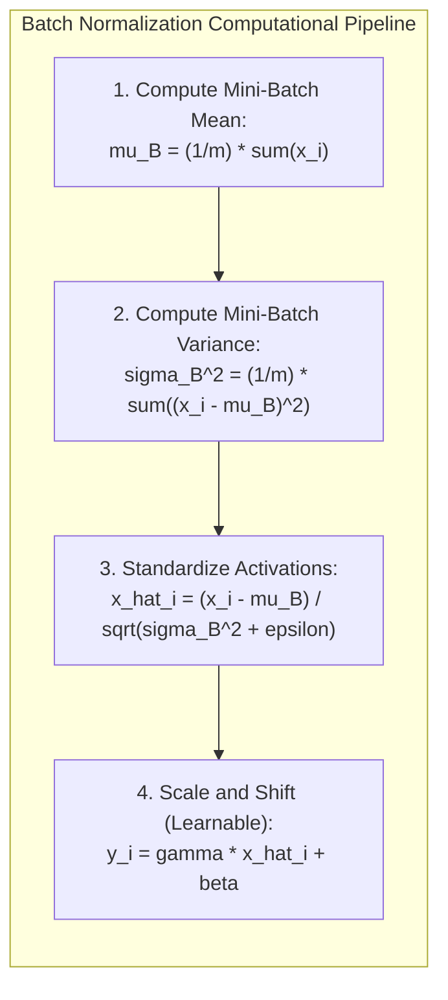

#### Step 1: Mini-Batch Statistics Calculation (Slide 20)
For each mini-batch $\mathcal{B}$, evaluate the sample mean $\mu_{\mathcal{B}}$ and sample variance $\sigma_{\mathcal{B}}^2$:

$$
\mu_{\mathcal{B}} = \frac{1}{m} \sum_{i=1}^m x_i, \quad \sigma_{\mathcal{B}}^2 = \frac{1}{m} \sum_{i=1}^m (x_i - \mu_{\mathcal{B}})^2
$$


#### Step 2: Zero-Mean, Unit-Variance Standardization (Slide 20)
Every activation is normalized to zero mean and unit variance, where $\epsilon > 0$ is a small constant (e.g., $10^{-5}$) added for numerical stability to avoid division by zero:

$$
\hat{x}_i = \frac{x_i - \mu_{\mathcal{B}}}{\sqrt{\sigma_{\mathcal{B}}^2 + \epsilon}}
$$


#### Step 3: Affine Scaling and Shifting (Slide 21)
Standardizing activations directly to zero mean and unit variance can constrain inputs to the linear regime of activations (e.g., around zero for Sigmoid or Tanh), limiting the network's expressive capacity. To preserve representational flexibility, BN introduces two learnable parameters per channel: a scale parameter $\gamma$ and a shift parameter $\beta$:

$$
y_i = \gamma \hat{x}_i + \beta \equiv \text{BN}_{\gamma, \beta}(x_i)
$$


*Identity Recovery Property:* If the optimal representation requires unnormalized distributions, the optimization algorithm can learn:

$$
\gamma = \sqrt{\sigma_{\mathcal{B}}^2 + \epsilon}, \quad \beta = \mu_{\mathcal{B}}
$$

Under these values, $y_i$ reduces exactly to the original unnormalized input $x_i$, proving that Batch Normalization strictly expands the model's hypothesis space without restricting expressivity.

#### Step 4: Training vs. Inference Disparity (Slides 22–24)
At inference time, inputs often arrive individually ($m=1$) or in variable batch sizes. Computing mini-batch statistics during testing would introduce unpredictable fluctuations.

To ensure consistency, BN tracks **running averages** of the mean and variance during training using an Exponential Moving Average (EMA) with momentum $\alpha \approx 0.9$ (Slide 24):

$$
\mu_{\text{run}} \leftarrow \alpha \cdot \mu_{\text{run}} + (1 - \alpha) \cdot \mu_{\mathcal{B}}
$$


$$
\sigma^2_{\text{run}} \leftarrow \alpha \cdot \sigma^2_{\text{run}} + (1 - \alpha) \cdot \sigma_{\mathcal{B}}^2
$$


During inference, these fixed running statistics replace the mini-batch statistics:

$$
\hat{x}_{\text{inf}} = \frac{x - \mu_{\text{run}}}{\sqrt{\sigma^2_{\text{run}} + \epsilon}}, \quad y_{\text{inf}} = \gamma \hat{x}_{\text{inf}} + \beta
$$


### 3. Visual Anchor

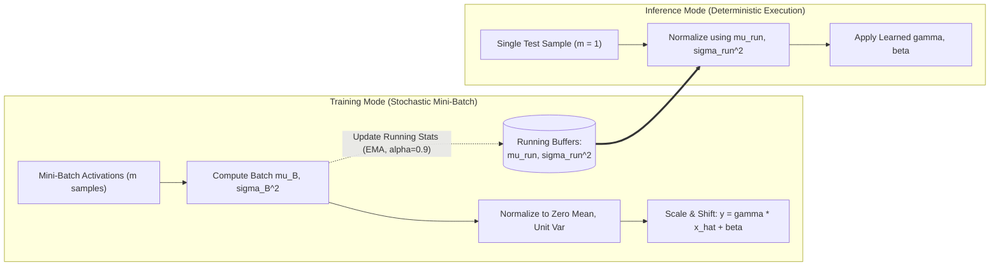

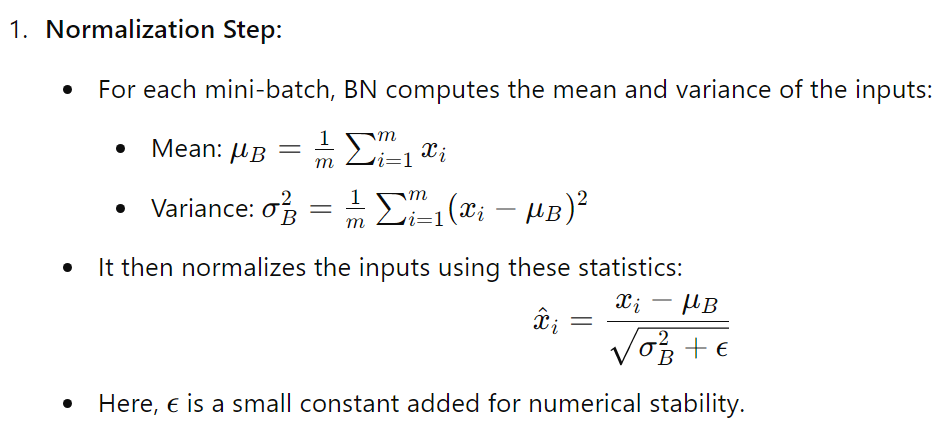
*Figure 6: Formal definition of Batch Normalization mini-batch mean, variance, and normalization equations with numerical stability constant $\epsilon$ (Slide 20).*

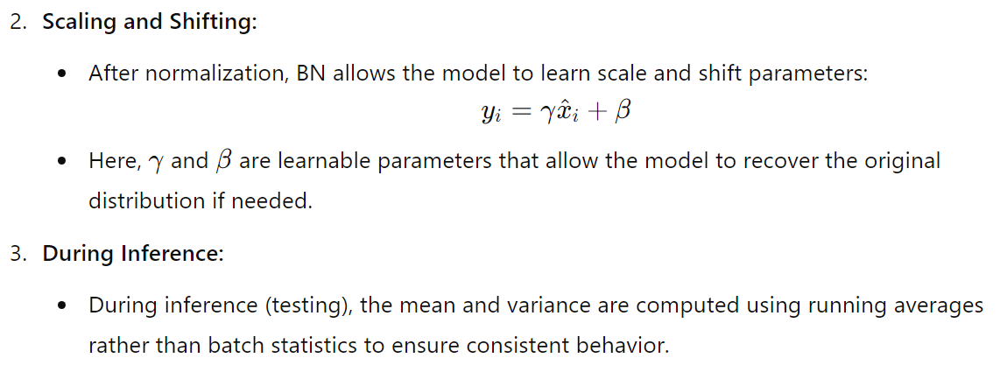
*Figure 7: Affine scaling and shifting transform introducing learnable parameters $\gamma$ and $\beta$ to preserve representational expressivity (Slide 21).*

### 4. Verified Formulas, Trade-offs & Calculations

#### Learnable Parameter Accounting (Slide 35)
For a convolutional tensor with $C$ feature channels, Batch Normalization maintains exactly two learnable parameters per channel ($\gamma_c$ and $\beta_c$):

$$
\text{Params}_{\text{BN}} = 2 \times C
$$


- $\gamma \in \mathbb{R}^C$: Channel-wise scale vector.
- $\beta \in \mathbb{R}^C$: Channel-wise shift vector.
- *Non-Trainable State Buffers:* The running mean $\mu_{\text{run}} \in \mathbb{R}^C$ and running variance $\sigma^2_{\text{run}} \in \mathbb{R}^C$ are tracked via moving averages and updated during forward passes, but they require zero gradient computation.

*Example:* For an intermediate layer with $C = 64$ feature maps:

$$
\text{Params}_{\text{BN}} = 2 \times 64 = 128 \text{ learnable parameters}
$$


#### Four Core Engineering Benefits (Slides 18–19)
1. **Accelerated Convergence & Higher Learning Rates:** Stabilizing intermediate distributions allows learning rates to be increased by an order of magnitude without divergence risks.
2. **Smooth Loss Landscape:** Normalizing layer inputs controls the Lipschitz constant of the loss gradient, smoothing the optimization landscape and improving gradient flow.
3. **Vanishing/Exploding Gradient Mitigation:** Maintaining bounded activation variances prevents gradients from vanishing or exploding in deep stacks.
4. **Regularization Effect:** Mini-batch statistics inject mild stochastic noise into each activation, reducing reliance on heavy dropout.

---

## 7. Rigorous Parameter Calculations — LeNet-5 Architecture

### 1. The Engineering Problem & Intuition
To analyze, optimize, and deploy deep convolutional networks, engineers must compute the exact parameter budgets and tensor dimensions across all intermediate layers. Parameter miscounts lead to memory allocation failures on target accelerators, incorrect gradient tracking, and flawed architectural comparisons.

The **LeNet-5 architecture** (Yann LeCun et al., 1998; Slides 25–30), designed for handwritten digit recognition on MNIST, serves as the standard pedagogical benchmark for verifying layer-by-layer parameter and activation calculations.

### 2. Technical Mechanism & Architecture
LeNet-5 ingests a $32 \times 32 \times 1$ grayscale image and processes it through two Convolution-Pooling stages followed by three Fully Connected layers:

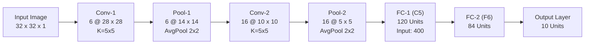

#### Layer 1: Conv-1 (Slide 26)
- **Input Dimensions:** $32 \times 32 \times 1$ ($H_{\text{in}} = 32, W_{\text{in}} = 32, D_{\text{in}} = 1$).
- **Hyperparameters:** $K = 6$ filters, spatial kernel size $F = 5$, stride $S = 1$, padding $P = 0$.
- **Output Spatial Shape:**

$$
H_{\text{out}} = W_{\text{out}} = \frac{32 - 5 + 0}{1} + 1 = 28 \implies 28 \times 28 \times 6
$$

- **Parameter Calculation:**
  - Weights per filter: $F \times F \times D_{\text{in}} = 5 \times 5 \times 1 = 25$.
  - Biases per filter: $1$.
  - Parameters per filter: $25 + 1 = 26$.
  - Total for $K = 6$ filters:

$$
\text{Params}_{\text{Conv1}} = 6 \times (5 \times 5 \times 1 + 1) = 6 \times 26 = 156
$$


#### Layer 2: Pool-1 (Slide 26)
- **Input Dimensions:** $28 \times 28 \times 6$.
- **Hyperparameters:** Subsampling window $F_p = 2$, stride $S_p = 2$, padding $P = 0$.
- **Output Spatial Shape:**

$$
H_{\text{out}} = W_{\text{out}} = \frac{28 - 2}{2} + 1 = 14 \implies 14 \times 14 \times 6
$$

- **Parameter Calculation:** In modern CNN conventions, pooling carries **zero learnable parameters**:

$$
\text{Params}_{\text{Pool1}} \equiv 0
$$


#### Layer 3: Conv-2 (Slide 27)
- **Input Dimensions:** $14 \times 14 \times 6$ ($D_{\text{in}} = 6$).
- **Hyperparameters:** $K = 16$ filters, spatial kernel size $F = 5$, stride $S = 1$, padding $P = 0$.
- **Output Spatial Shape:**

$$
H_{\text{out}} = W_{\text{out}} = \frac{14 - 5 + 0}{1} + 1 = 10 \implies 10 \times 10 \times 16
$$

- **Parameter Calculation:**
  - Weights per filter: $F \times F \times D_{\text{in}} = 5 \times 5 \times 6 = 150$.
  - Biases per filter: $1$.
  - Parameters per filter: $150 + 1 = 151$.
  - Total for $K = 16$ filters:

$$
\text{Params}_{\text{Conv2}} = 16 \times (5 \times 5 \times 6 + 1) = 16 \times 151 = 2416
$$


#### Layer 4: Pool-2 (Slide 27)
- **Input Dimensions:** $10 \times 10 \times 16$.
- **Hyperparameters:** Subsampling window $F_p = 2$, stride $S_p = 2$, padding $P = 0$.
- **Output Spatial Shape:**

$$
H_{\text{out}} = W_{\text{out}} = \frac{10 - 2}{2} + 1 = 5 \implies 5 \times 5 \times 16
$$

- **Parameter Calculation:**

$$
\text{Params}_{\text{Pool2}} \equiv 0
$$


#### Layer 5: FC-1 / Layer C5 (Slide 28)
- **Input Dimensions:** Flattened feature map from Pool-2:

$$
N_{\text{in}} = 5 \times 5 \times 16 = 400 \text{ nodes}
$$

- **Output Units:** $N_{\text{out}} = 120$ nodes.
- **Parameter Calculation:**
  - Weight matrix: $400 \times 120 = 48,000$.
  - Bias vector: $120$.
  - Total parameters:

$$
\text{Params}_{\text{FC1}} = (400 + 1) \times 120 = 48,120
$$


#### Layer 6: FC-2 / Layer F6 (Slide 29)
- **Input Dimensions:** $N_{\text{in}} = 120$ nodes.
- **Output Units:** $N_{\text{out}} = 84$ nodes.
- **Parameter Calculation:**
  - Weight matrix: $120 \times 84 = 10,080$.
  - Bias vector: $84$.
  - Total parameters:

$$
\text{Params}_{\text{FC2}} = (120 + 1) \times 84 = 10,164
$$


#### Layer 7: Output Layer (Slide 30)
- **Input Dimensions:** $N_{\text{in}} = 84$ nodes.
- **Output Units:** $N_{\text{out}} = 10$ nodes (representing handwritten digits 0 through 9).
- **Parameter Calculation:**
  - Weight matrix: $84 \times 10 = 840$.
  - Bias vector: $10$.
  - Total parameters:

$$
\text{Params}_{\text{Output}} = (84 + 1) \times 10 = 850
$$


### 3. Visual Anchor

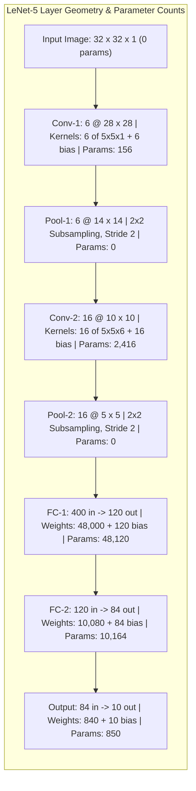

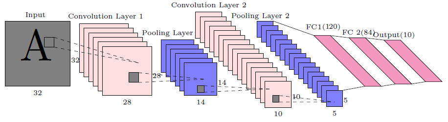
*Figure 8: Layer-by-layer architectural schematic of LeNet-5 for handwritten digit recognition, showing spatial dimension evolution from $32 \times 32$ input to 10-class output (Slides 25–30).*

### 4. Verified Formulas, Trade-offs & Calculations

#### Master Parameter Summary Table for LeNet-5
The layer-by-layer audit verified by our standalone Python suite is summarized below:

| Layer Name | Type | Input Shape | Output Shape | Filter / Connectivity | Weights | Biases | Total Parameters |
| :--- | :--- | :--- | :--- | :--- | :--- | :--- | :--- |
| **Conv-1** | Conv | $32 \times 32 \times 1$ | $28 \times 28 \times 6$ | 6 filters of $5 \times 5 \times 1$ | 150 | 6 | **156** |
| **Pool-1** | Pool | $28 \times 28 \times 6$ | $14 \times 14 \times 6$ | $2 \times 2$ window, stride 2 | 0 | 0 | **0** |
| **Conv-2** | Conv | $14 \times 14 \times 6$ | $10 \times 10 \times 16$ | 16 filters of $5 \times 5 \times 6$ | 2,400 | 16 | **2,416** |
| **Pool-2** | Pool | $10 \times 10 \times 16$ | $5 \times 5 \times 16$ | $2 \times 2$ window, stride 2 | 0 | 0 | **0** |
| **FC-1** | Dense| 400 | 120 | Full matrix $400 \times 120$ | 48,000 | 120 | **48,120** |
| **FC-2** | Dense| 120 | 84 | Full matrix $120 \times 84$ | 10,080 | 84 | **10,164** |
| **Output** | Dense| 84 | 10 | Full matrix $84 \times 10$ | 840 | 10 | **850** |
| **Total** | — | — | — | — | **61,470** | **236** | **61,706** |

$$
\text{Total Parameters}_{\text{LeNet-5}} = 156 + 0 + 2416 + 0 + 48,120 + 10,164 + 850 = 61,706
$$


*Historical Note:* In LeCun's original 1998 implementation, Conv-2 was not fully connected to all 6 input maps (using a custom sparse connection scheme yielding 1,516 parameters), and subsampling layers used 2 learnable parameters per map. However, in the standard deep learning curriculum and as formulated in Slides 25–30, the standard modern definitions derived above are universally examined.

---

## 8. AlexNet Parameter Audit & Slide 36 Discrepancy Reconciliation

### 1. The Engineering Problem & Intuition
The 2012 ImageNet Large Scale Visual Recognition Challenge (ILSVRC) marked the transition to modern deep learning when **AlexNet** (Krizhevsky, Sutskever, and Hinton) achieved a top-5 error rate of 15.3%, outperforming traditional computer vision pipelines by over 10.8 percentage points.

Scaling from LeNet-5 ($61.7\text{K}$ parameters, $32 \times 32$ grayscale) to AlexNet ($62.4\text{M}$ parameters, $224 \times 224$ or $227 \times 227$ RGB) introduced substantial architectural scaling challenges: handling multiple convolutional stages, multi-GPU model parallelism, large $11 \times 11$ receptive fields, overlapping pooling, and thousands of units in dense layers.

#### Architectural Variations: Classic vs. Modern CNNs (Slide 31)
The evolution of convolutional networks divides historically into two major paradigms:
- **Classic CNNs (LeNet-5, AlexNet):** Established the fundamental template of alternating Convolution and Pooling stages followed by massive Fully Connected classification layers. These networks relied on large kernel receptive fields (e.g.,  \times 11$,  \times 5$) and sequential feedforward stacks without residual routing.
- **Modern CNNs (VGG, ResNet, Inception):** Overcame vanishing gradients and degradation bottlenecks in ultra-deep networks by introducing architectural innovations:
  - *Small uniform filters:* VGG stacked  \times 3$ convolutions to achieve identical effective receptive fields with fewer parameters and greater non-linearity.
  - *Residual skip connections:* ResNet introduced identity shortcut mappings ($\mathbf{y} = \mathcal{F}(\mathbf{x}) + \mathbf{x}$) enabling stable backpropagation through hundreds of layers.
  - *Multi-scale inception modules:* Inception processed inputs via parallel  \times 1$,  \times 3$, and  \times 5$ convolutions to capture patterns across diverse spatial granularities.

### 2. Technical Mechanism & Architecture
AlexNet comprises 8 parameterized layers: 5 Convolutional layers (several followed by Overlapping Max Pooling and Local Response Normalization) and 3 Fully Connected layers, terminating in a 1000-way Softmax classifier.

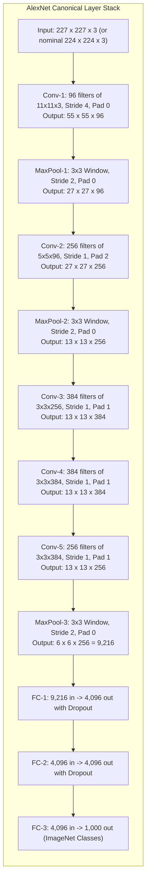

#### Detailed Layer-by-Layer Calculations

1. **Conv-1 (Slide 32/36):**
   - Kernel: $11 \times 11$, $C_{\text{in}} = 3$, $K = 96$, Stride $S = 4$, Pad $P = 0$.
   - Weights: $11 \times 11 \times 3 \times 96 = 34,848$.
   - Biases: $96$.
   - Total Parameters: $34,848 + 96 = 34,944$.
2. **MaxPool-1:**
   - Overlapping window $3 \times 3$, stride $S = 2$, pad $P = 0$.
   - Total Parameters: $0$.
3. **Conv-2:**
   - Kernel: $5 \times 5$, $C_{\text{in}} = 96$, $K = 256$, Stride $S = 1$, Pad $P = 2$.
   - Weights: $5 \times 5 \times 96 \times 256 = 614,400$.
   - Biases: $256$.
   - Total Parameters: $614,400 + 256 = 614,656$.
4. **MaxPool-2:**
   - Window $3 \times 3$, stride $S = 2$, pad $P = 0$.
   - Total Parameters: $0$.
5. **Conv-3:**
   - Kernel: $3 \times 3$, $C_{\text{in}} = 256$, $K = 384$, Stride $S = 1$, Pad $P = 1$.
   - Weights: $3 \times 3 \times 256 \times 384 = 884,736$.
   - Biases: $384$.
   - Total Parameters: $884,736 + 384 = 885,120$.
6. **Conv-4:**
   - Kernel: $3 \times 3$, $C_{\text{in}} = 384$, $K = 384$, Stride $S = 1$, Pad $P = 1$.
   - Weights: $3 \times 3 \times 384 \times 384 = 1,327,104$.
   - Biases: $384$.
   - Total Parameters: $1,327,104 + 384 = 1,327,488$.
7. **Conv-5:**
   - Kernel: $3 \times 3$, $C_{\text{in}} = 384$, $K = 256$, Stride $S = 1$, Pad $P = 1$.
   - Weights: $3 \times 3 \times 384 \times 256 = 884,736$.
   - Biases: $256$.
   - Total Parameters: $884,736 + 256 = 884,992$.
8. **MaxPool-3:**
   - Window $3 \times 3$, stride $S = 2$, pad $P = 0$.
   - Total Parameters: $0$.
   - Output spatial dimension: $6 \times 6 \times 256 = 9,216$ activations.
9. **FC-1:**
   - Input: $9,216$. Output: $4,096$.
   - Weights: $9,216 \times 4,096 = 37,748,736$.
   - Biases: $4,096$.
   - Total Parameters: $37,748,736 + 4,096 = 37,752,832$.
10. **FC-2:**
    - Input: $4,096$. Output: $4,096$.
    - Weights: $4,096 \times 4,096 = 16,777,216$.
    - Biases: $4,096$.
    - Total Parameters: $16,777,216 + 4,096 = 16,781,312$.
11. **FC-3:**
    - Input: $4,096$. Output: $1,000$.
    - Weights: $4,096 \times 1,000 = 4,096,000$.
    - Biases: $1,000$.
    - Total Parameters: $4,096,000 + 1,000 = 4,097,000$.

### 3. Visual Anchor

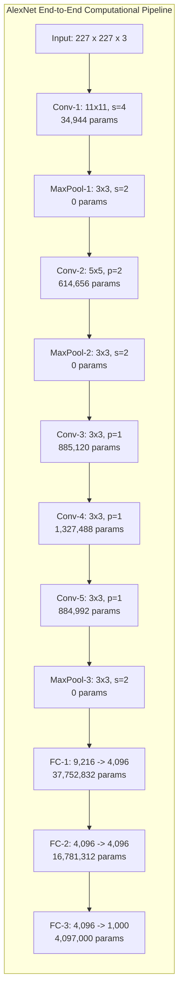

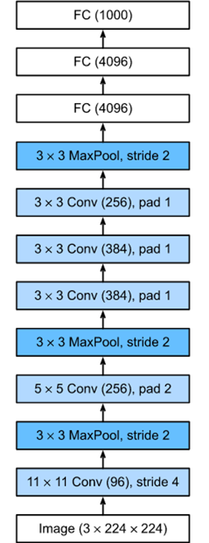
*Figure 9: Vertical architectural stack of AlexNet showing sequential convolutional blocks, overlapping pooling operations, and high-dimensional fully connected classification layers (Slides 32, 36).*

### 4. Verified Formulas, Trade-offs & Calculations

#### Slide 36 Table Error Diagnosis & Mathematical Proof
Slide 36 provides a table and states: *"By default, assume pad=0 and stride=1. There are mistakes in the table. Correct it."*

Our audit identifies the underlying mathematical errors across tensor shapes and parameters:


*Figure 9: Quantitative audit and resolution of the mathematical dimension conflict in Slide 36, proving that canonical Path B dimensions validate the 37.7M FC-1 parameter count.*

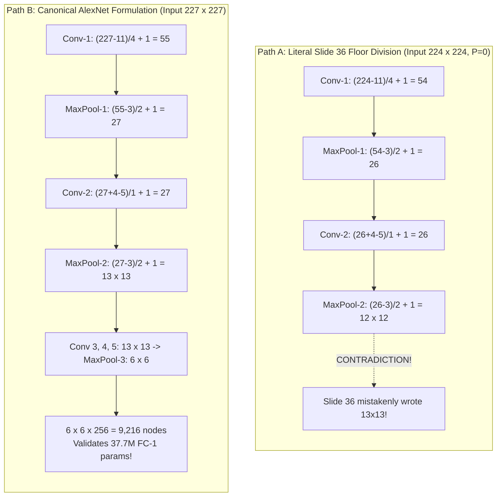


#### Reconciling with the Canonical 227x227 Resolution
In original AlexNet implementations (such as Caffe and torchvision), the input image is sized to $227 \times 227 \times 3$ (or padded by 2 pixels if nominally $224 \times 224$). When evaluated with $227 \times 227$:
- **Conv-1:** $\lfloor \frac{227 - 11}{4} \rfloor + 1 = \frac{216}{4} + 1 = 54 + 1 = 55 \implies 55 \times 55 \times 96$
- **MaxPool-1:** $\lfloor \frac{55 - 3}{2} \rfloor + 1 = \frac{52}{2} + 1 = 26 + 1 = 27 \implies 27 \times 27 \times 96$
- **Conv-2** ($P=2, S=1$): $\lfloor \frac{27 + 2(2) - 5}{1} \rfloor + 1 = 27 \implies 27 \times 27 \times 256$
- **MaxPool-2:** $\lfloor \frac{27 - 3}{2} \rfloor + 1 = \frac{24}{2} + 1 = 12 + 1 = 13 \implies 13 \times 13 \times 256$ (Matches expected downstream shape)
- **Conv-3, 4, 5** ($P=1, S=1$): Maintains $13 \times 13$
- **MaxPool-3:** $\lfloor \frac{13 - 3}{2} \rfloor + 1 = \frac{10}{2} + 1 = 5 + 1 = 6 \implies 6 \times 6 \times 256 = 9,216$ nodes

#### Corrected Master Parameter Table for AlexNet
The corrected parameter counts—matching both standard implementations and the total of $62,378,344$ given on Slide 36—are detailed below:

| Layer Name | Tensor Size (Canonical) | Weights Formula | Biases | Total Parameters | % of Model |
| :--- | :--- | :--- | :--- | :--- | :--- |
| **Input Image** | $227 \times 227 \times 3$ | 0 | 0 | 0 | 0.00% |
| **Conv-1** | $55 \times 55 \times 96$ | $11 \times 11 \times 3 \times 96$ | 96 | **34,944** | 0.06% |
| **MaxPool-1** | $27 \times 27 \times 96$ | 0 | 0 | **0** | 0.00% |
| **Conv-2** | $27 \times 27 \times 256$ | $5 \times 5 \times 96 \times 256$ | 256 | **614,656** | 0.99% |
| **MaxPool-2** | $13 \times 13 \times 256$ | 0 | 0 | **0** | 0.00% |
| **Conv-3** | $13 \times 13 \times 384$ | $3 \times 3 \times 256 \times 384$ | 384 | **885,120** | 1.42% |
| **Conv-4** | $13 \times 13 \times 384$ | $3 \times 3 \times 384 \times 384$ | 384 | **1,327,488** | 2.13% |
| **Conv-5** | $13 \times 13 \times 256$ | $3 \times 3 \times 384 \times 256$ | 256 | **884,992** | 1.42% |
| **MaxPool-3** | $6 \times 6 \times 256$ | 0 | 0 | **0** | 0.00% |
| **FC-1** | $4096 \times 1$ | $9,216 \times 4,096$ | 4,096 | **37,752,832** | 60.52% |
| **FC-2** | $4096 \times 1$ | $4,096 \times 4,096$ | 4,096 | **16,781,312** | 26.90% |
| **FC-3** | $1000 \times 1$ | $4,096 \times 1,000$ | 1,000 | **4,097,000** | 6.57% |
| **Output** | $1000 \times 1$ | 0 | 0 | **0** | 0.00% |
| **Total** | — | **62,317,776** | **60,568** | **62,378,344** | **100.00%** |

$$
\text{Convolutional Parameter Budget} = 34,944 + 614,656 + 885,120 + 1,327,488 + 884,992 = 3,747,200
$$

(Convolutional layers account for 3,747,200 parameters, or 6.01% of the entire model).

$$
\text{Fully Connected Parameter Budget} = 37,752,832 + 16,781,312 + 4,097,000 = 58,631,144
$$

(Dense fully connected layers account for 58,631,144 parameters, or 93.99% of the entire model).


---

## 9. CNN as a Feedforward Network with Sparse Connectivity

### 1. The Engineering Problem & Intuition
A foundational insight in deep learning theory is understanding the structural relationship between Convolutional Neural Networks and standard Feedforward Neural Networks (MLPs). How does a convolutional layer relate mathematically to a general dense layer? Can standard backpropagation be applied without altering fundamental gradient formulations?

Slides 37–42 deconstruct this relationship: **A Convolutional Neural Network is mathematically identical to a standard Feedforward Neural Network operating under two strict linear algebraic constraints: sparse connectivity (structural weight pruning) and parameter tying (weight sharing).**

### 2. Technical Mechanism & Architecture
Consider a localized discrete visual system (Slides 37–42):
- **Input:** A $3 \times 3$ grid of 9 scalar pixels: $\lbrace b, c, d, e, f, g, h, i, j \rbrace$.
- **Output:** A $2 \times 2$ grid of 4 response units: $\lbrace l, m, n, o \rbrace$.

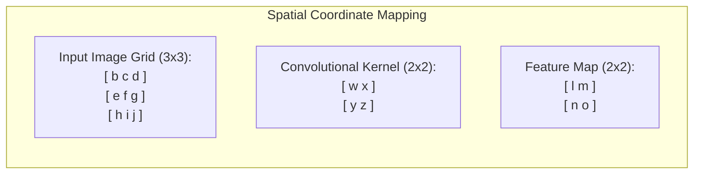

#### Dense Neural Network Representation (Slide 37)
In an unconstrained Multilayer Perceptron, all 4 output neurons connect to all 9 input neurons:
- Every connection possesses a unique, unconstrained weight $W_{k, p}$.
- Number of weights: $9 \times 4 = 36$.
- Number of biases: 4.
- Total parameters: $36 + 4 = 40$.

#### Transformation into a CNN (Slides 38–42)
To convert this dense network into a 2D convolutional layer with a $2 \times 2$ kernel, two constraints are imposed:

1. **Enforcing Sparse Connectivity (Local Receptive Fields):**
   Each output neuron connects only to the 4 input pixels within its localized $2 \times 2$ receptive field:
   - Output node $l$ connects only to $\lbrace b, c, e, f \rbrace$ (Slide 38). Connections to $\lbrace d, g, h, i, j \rbrace$ are set to **zero**.
   - Output node $m$ connects only to $\lbrace c, d, f, g \rbrace$ (Slide 39). Connections to $\lbrace b, e, h, i, j \rbrace$ are set to **zero**.
   - Output node $n$ connects only to $\lbrace e, f, h, i \rbrace$ (Slide 40). Connections to $\lbrace b, c, d, g, j \rbrace$ are set to **zero**.
   - Output node $o$ connects only to $\lbrace f, g, i, j \rbrace$ (Slide 41). Connections to $\lbrace b, c, d, e, h \rbrace$ are set to **zero**.
2. **Enforcing Parameter Sharing (Weight Tying):**
   Rather than learning 16 independent active weights ($4 \text{ nodes} \times 4 \text{ connections}$), the weights across the 4 localized receptive fields are tied to the 4 kernel parameters $\lbrace w, x, y, z \rbrace$:
   - Top-left weight in every patch is tied to $w$ (Red connection).
   - Top-right weight in every patch is tied to $x$ (Blue connection).
   - Bottom-left weight in every patch is tied to $y$ (Brown connection).
   - Bottom-right weight in every patch is tied to $z$ (Green connection).
   - A single shared scalar bias $b_{\text{conv}}$ is shared across all four neurons.

$$
\begin{aligned}
l &= w \cdot b + x \cdot c + y \cdot e + z \cdot f + b_{\text{conv}} \\
m &= w \cdot c + x \cdot d + y \cdot f + z \cdot g + b_{\text{conv}} \\
n &= w \cdot e + x \cdot f + y \cdot h + z \cdot i + b_{\text{conv}} \\
o &= w \cdot f + x \cdot g + y \cdot i + z \cdot j + b_{\text{conv}}
\end{aligned}
$$

### 3. Visual Anchor

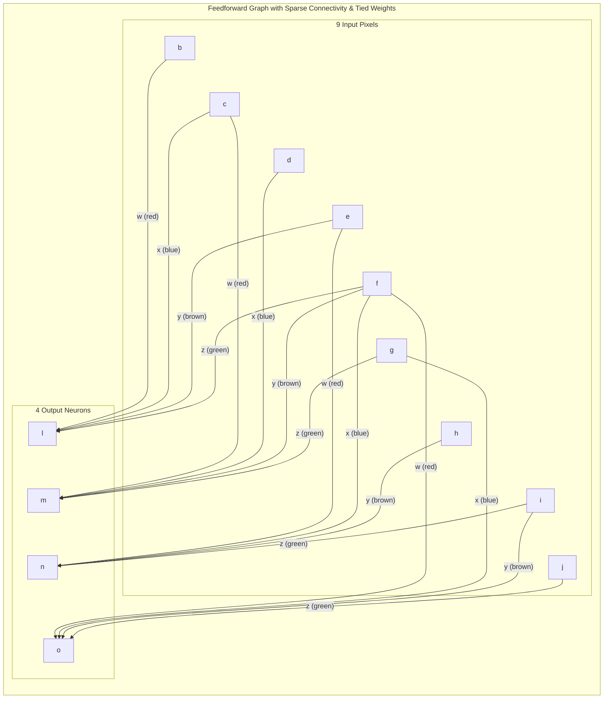

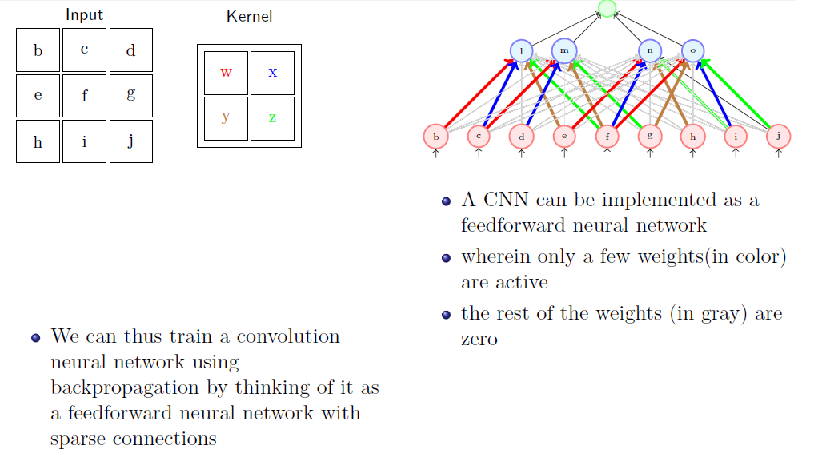
*Figure 10: Structural equivalence between a 2D convolution and a sparse feedforward neural network with parameter sharing, showing active colored weights tied across spatial coordinates while inactive weights are clamped to zero (Slide 42).*

### 4. Verified Formulas, Trade-offs & Calculations

#### Parameter Reduction Calculation
Comparing the dense Multilayer Perceptron against the sparse Convolutional layer:

$$
\text{Params}_{\text{Dense}} = (N_{\text{in}} \times N_{\text{out}}) + N_{\text{out}} = (9 \times 4) + 4 = 40
$$

$$
\text{Params}_{\text{CNN}} = (F \times F \times C_{\text{in}}) + 1 = (2 \times 2 \times 1) + 1 = 5
$$

$$
\text{Parameter Reduction} = \frac{40 - 5}{40} \times 100 = \frac{35}{40} \times 100 = 87.50
$$

Enforcing convolutional inductive biases reduces the parameter budget by 87.5% on this small grid, while simultaneously embedding translation equivariance into the forward pass.

#### Weight Matrix Sparsity Formulation
In general linear algebraic matrix-vector notation, the transformation is written as $\mathbf{y} = \mathbf{W}\mathbf{x} + \mathbf{b}$:

```math
\begin{bmatrix} l \\ m \\ n \\ o \end{bmatrix} =
\begin{bmatrix}
w & x & 0 & y & z & 0 & 0 & 0 & 0 \\
0 & w & x & 0 & y & z & 0 & 0 & 0 \\
0 & 0 & 0 & w & x & 0 & y & z & 0 \\
0 & 0 & 0 & 0 & w & x & 0 & y & z
\end{bmatrix}
\begin{bmatrix} b \\ c \\ d \\ e \\ f \\ g \\ h \\ i \\ j \end{bmatrix}
+
\begin{bmatrix} b_{\text{conv}} \\ b_{\text{conv}} \\ b_{\text{conv}} \\ b_{\text{conv}} \end{bmatrix}
```

- Total matrix entries: $4 \times 9 = 36$.
- Zero entries (sparsity): $36 - 16 = 20$.
- Matrix Sparsity: $\frac{20}{36} \approx 0.5556$ (55.56% structurally zeroed connections).
- Unique non-zero weight entries: Exactly 4 ($\lbrace w, x, y, z \rbrace$).

#### Backpropagation under Weight Sharing
During backward propagation, the gradient with respect to a shared kernel weight (e.g., $w$) is obtained by applying the multivariable chain rule across all output locations where the parameter was deployed:

$$
\frac{\partial \mathcal{L}}{\partial w} = \sum_{k \in \lbrace l, m, n, o \rbrace} \frac{\partial \mathcal{L}}{\partial k} \cdot \frac{\partial k}{\partial w} = \frac{\partial \mathcal{L}}{\partial l} \cdot b + \frac{\partial \mathcal{L}}{\partial m} \cdot c + \frac{\partial \mathcal{L}}{\partial n} \cdot e + \frac{\partial \mathcal{L}}{\partial o} \cdot f
$$


This confirms that training a CNN via backpropagation is mathematically equivalent to training an MLP where gradients from tied weights are accumulated across spatial steps before applying parameter updates.

---

## 10. Transfer Learning Paradigms & Engineering Strategies

### 1. The Engineering Problem & Intuition
Training modern deep convolutional architectures from scratch requires massive compute resources (hundreds of GPU hours) and millions of carefully labeled training examples. In practical engineering, however, real-world target datasets often contain only a few hundred or thousand domain-specific examples (e.g., specialized medical radiographs, manufacturing flaw detection, or satellite telemetry).

Training a deep network with tens of millions of parameters on a tiny dataset inevitably results in catastrophic overfitting. **Transfer Learning** (Slides 43–49) addresses this limitation by repurposing the representations learned by a model trained on an extensive source dataset (e.g., ImageNet with 1.2 million images across 1,000 classes) to solve a distinct target task.

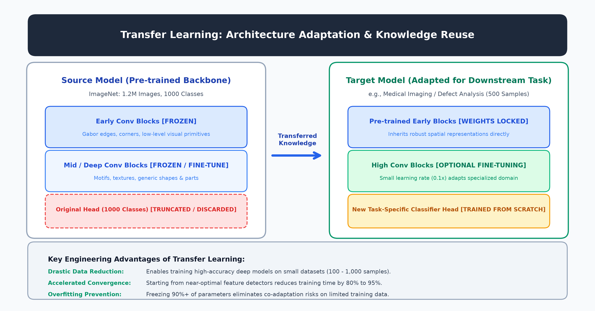
*Figure 11: Architectural adaptation in transfer learning, illustrating pre-trained feature backbone reuse and task-specific classification head replacement.*

```mermaid
flowchart LR
    subgraph Source["Source Domain (ImageNet)"]
        direction TB
        S_DATA["1.2M Images, 1000 Classes"] --> S_FEAT["Pre-trained Convolutional Base<br/>(Low-level edges, textures, shapes)"]
        S_FEAT --> S_HEAD["Original 1000-way Head<br/>(Discarded)"]
    end

    subgraph Target["Target Domain (Downstream Task)"]
        direction TB
        T_FEAT["Reused Feature Backbone<br/>(Frozen or Low Learning Rate)"] --> T_HEAD["New Task Head<br/>(Initialized from scratch)"]
        T_DATA["Small Dataset (e.g. 500 Medical Scans)"] --> T_FEAT
        T_HEAD --> T_OUT["Target Predictions<br/>(e.g., 2 Diagnostic Classes)"]
    end

    S_FEAT ==>|"Knowledge Transfer<br/>(Weights locked)"| T_FEAT
```


### 2. Technical Mechanism & Architecture
Transfer learning operates under two foundational engineering paradigms based on target dataset size and domain similarity (Slides 44–45):

```mermaid
flowchart TD
    subgraph PretrainedModel["Pre-trained Deep CNN (Source Domain: ImageNet)"]
        direction TB
        L1["Early Conv Blocks:<br/>General Primitives (Edges, Gradients)"]
        L2["Mid Conv Blocks:<br/>Textures, Contours, Motifs"]
        L3["Deep Conv Blocks:<br/>Complex Shapes, Object Parts"]
        L4["Classification Head (FC Layers):<br/>Task-Specific 1000-Class Softmax"]
        L1 --> L2 --> L3 --> L4
    end

    subgraph StrategyA["Strategy 1: Fixed Feature Extractor (Slide 45)"]
        direction TB
        F_BASE["Freeze Entire Conv Backbone<br/>(Gradients Locked: dW = 0)"]
        NEW_HEAD_A["Attach New Linear Classifier Head<br/>(Trained on Small Target Dataset)"]
        F_BASE --> NEW_HEAD_A
    end

    subgraph StrategyB["Strategy 2: Fine-Tuning (Slide 44)"]
        direction TB
        FT_BASE["Unfreeze Top Conv Blocks<br/>(Trained with Small Learning Rate)"]
        NEW_HEAD_B["Attach New Task-Specific Head<br/>(Trained with Standard Learning Rate)"]
        FT_BASE --> NEW_HEAD_B
    end

    PretrainedModel --> StrategyA
    PretrainedModel --> StrategyB
```

#### Paradigm 1: CNN as a Fixed Feature Extractor (Slide 45)
- The entire pre-trained convolutional backbone is preserved.
- All convolutional weights are frozen ($\nabla_{\theta_{\text{conv}}} \mathcal{L} \equiv 0$).
- The original $1000$-unit classification head is removed and replaced with a new linear classifier matching the target task's classes (e.g., a Softmax layer with $K_{\text{target}}$ units).
- Only the new classifier weights are updated during backpropagation.
- **When to Deploy:** Small target datasets ($N < 2,000$) where the target visual domain closely resembles the source domain (natural images).

#### Paradigm 2: Fine-Tuning (Slide 44)
- The pre-trained weights initialize the target model rather than starting from random initialization.
- The original classifier head is replaced, and the top convolutional layers (or the entire network) are unfrozen.
- The network is trained end-to-end on target data using a reduced learning rate:

$$
\eta_{\text{fine-tune}} \approx \frac{1}{10} \text{ to } \frac{1}{100} \times \eta_{\text{scratch}}
$$

- **When to Deploy:** Medium to large target datasets ($N > 10,000$) or when the target domain diverges noticeably from the source domain.

#### Systematic 5-Step Engineering Workflow (Slide 46)
1. **Select Pre-trained Architecture:** Choose an established backbone (e.g., VGG-16, ResNet-50, Inception-v3, EfficientNet) trained on a large benchmark dataset.
2. **Modify Architecture:** Truncate the original dense output layer and initialize a task-specific classification head matched to $K_{\text{target}}$ output classes.
3. **Establish Freezing Policy:** Determine layer freezing boundaries based on target data volume and visual domain similarity.
4. **Execute Target Training:** Train the unfrozen weights using learning rate scheduling, data augmentation, and regularization.
5. **Evaluate & Optimize:** Monitor validation loss to detect domain-shift errors or overfitting.

### 3. Visual Anchor

```mermaid
flowchart TD
    subgraph DecisionMatrix["Transfer Learning Decision Matrix"]
        direction TB
        D_SIZE{"Target Dataset Size?"}
        D_SIM{"Target Domain Similarity?"}

        D_SIZE -- Small (<2k samples) --> D_SIM
        D_SIZE -- Large (>10k samples) --> D_SIM_L{"Target Domain Similarity?"}

        D_SIM -- High Similarity --> Q1["Quadrant 1: Fixed Feature Extractor<br/>Freeze entire Conv backbone.<br/>Train linear classifier head only."]
        D_SIM -- Low Similarity --> Q2["Quadrant 2: Early Feature Extractor<br/>Freeze early Conv blocks only.<br/>Train mid-to-high layers + head."]

        D_SIM_L -- High Similarity --> Q3["Quadrant 3: Selective Fine-Tuning<br/>Fine-tune top Conv blocks + head.<br/>Keep early Conv blocks frozen."]
        D_SIM_L -- Low Similarity --> Q4["Quadrant 4: Full Network Fine-Tuning<br/>Initialize with pre-trained weights.<br/>Fine-tune entire network with small learning rate."]
    end
```

### 4. Verified Formulas, Trade-offs & Calculations

#### Mathematical Formalization of Domain Adaptation
Transfer learning operates across two formal mathematical structures:
- **Source Domain** $\mathcal{D}_s$: Defined by feature space $\mathcal{X}_s$ and marginal probability distribution $P(X_s)$, coupled with task $\mathcal{T}_s = \lbrace \mathcal{Y}_s, f_s(\cdot) \rbrace$.
- **Target Domain** $\mathcal{D}_t$: Defined by feature space $\mathcal{X}_t$ and marginal probability distribution $P(X_t)$, coupled with task $\mathcal{T}_t = \lbrace \mathcal{Y}_t, f_t(\cdot) \rbrace$.

Transfer learning seeks to optimize target predictive function $f_t(\cdot)$ using the knowledge base from $\mathcal{D}_s$ and $\mathcal{T}_s$, where $\mathcal{D}_s \ne \mathcal{D}_t$ or $\mathcal{T}_s \ne \mathcal{T}_t$.

#### Multi-Domain Application Paradigms (Slide 49)
While transfer learning originated in visual processing, it is now the universal paradigm across machine learning domains:
1. **Computer Vision:** Adapting foundational backbones (VGG, ResNet, Inception) trained on 1.2M ImageNet samples to specialized downstream tasks such as aerial reconnaissance, agricultural crop monitoring, and autonomous driving.
2. **Natural Language Processing (NLP):** Pre-training massive transformer models on broad web-scale corpora (e.g., BERT for masked language modeling, GPT for autoregressive sequence modeling) and fine-tuning them on specialized tasks such as sentiment analysis, named entity recognition, and text summarization.
3. **Medical Imaging Diagnostics:** Bootstrapping models from general natural imagery to detect subtle cellular abnormalities in histological biopsies, diabetic retinopathy in fundus photography, and pneumonia in chest X-rays where annotated clinical datasets are scarce.

#### Engineering Trade-offs & Failure Modes (Slides 47–48)
- **Domain Shift / Distribution Mismatch (Slide 48):** When the target data distribution diverges radically from natural imagery (e.g., high-altitude radar, infrared signatures, or ultrasound scans), high-level ImageNet features (faces, paws, wheels) provide little positive transfer.
- **Catastrophic Forgetting:** Setting the fine-tuning learning rate too high destroys the pre-trained weight representations, overwriting useful generalized filters with noise.
- **Negative Transfer:** If source and target tasks share insufficient statistical mutual information, initializing with pre-trained weights can yield worse performance than training a smaller model from scratch.

#### Comparative Summary Matrix across Vision Paradigms
The following table summarizes the core trade-offs between learning paradigms across computer vision engineering:

| Dimension | Training From Scratch | Fixed Feature Extractor | Full Fine-Tuning |
| :--- | :--- | :--- | :--- |
| **Data Requirement** | Extreme ($10^5$ to $10^7$ images) | Minimal ($10^2$ to $10^3$ images) | Moderate ($10^3$ to $10^5$ images) |
| **Compute / Training Time** | Days to weeks on multi-GPU | Minutes to hours on single CPU/GPU | Hours to days on single GPU |
| **Overfitting Risk** | Severe on small datasets | Very low (few parameters trained) | Moderate (mitigated via low $\eta$) |
| **Learnable Parameters** | 100% of network weights | < 5% of network weights (head only) | 100% (or top 30–50%) initialized from checkpoint |
| **Target Accuracy on Small Data** | Poor (< 60%) | High (> 85%) | Optimal (> 92%) |

---
