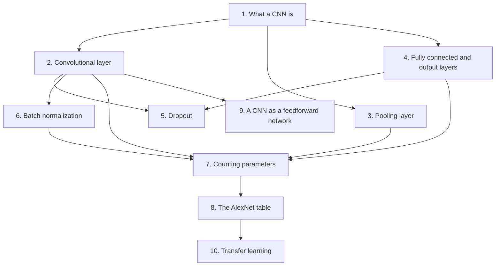
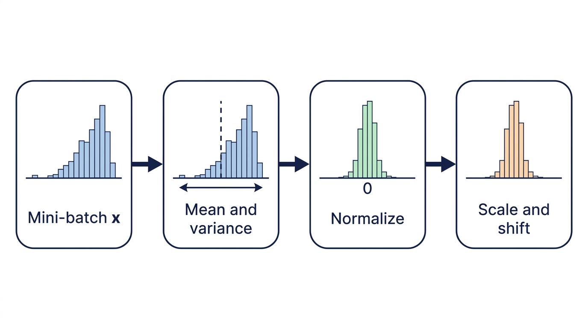
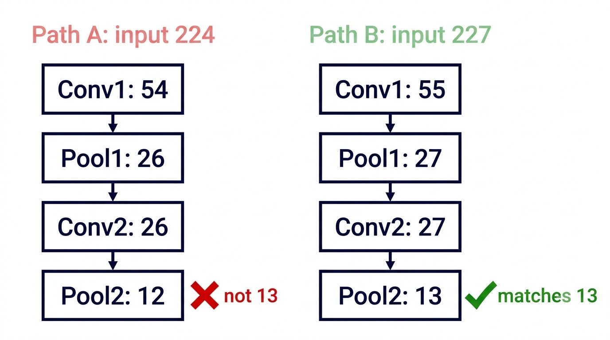
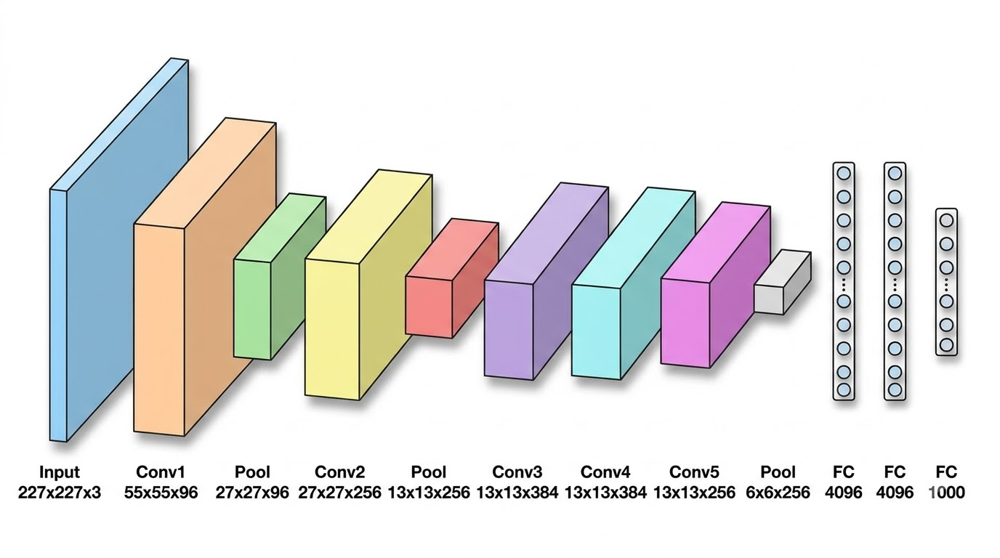

# CNN Layers, Regularization, Parameters and Transfer Learning — Learning Guide

Source: `ML_Lec_13_CNN.pptx`, Slides 1–50.

**Who this is for:** a beginner studying this lecture. After reading, you can name each layer of a CNN and say what it does. You can explain dropout and batch normalization. You can count the parameters of a CNN layer by layer, and explain transfer learning.

**How to read this guide:** Read the sections in order. Each section first says why the idea exists, then how it works, then shows a picture, then gives the exact numbers. Every fact comes from the slides.



## Contents

1. [What a CNN is](#1-what-a-cnn-is)
2. [The convolutional layer](#2-the-convolutional-layer)
3. [The pooling layer](#3-the-pooling-layer)
4. [Fully connected and output layers](#4-fully-connected-and-output-layers)
5. [Dropout](#5-dropout)
6. [Batch normalization](#6-batch-normalization)
7. [Counting parameters in a CNN](#7-counting-parameters-in-a-cnn)
8. [The AlexNet table and its mistakes](#8-the-alexnet-table-and-its-mistakes)
9. [A CNN as a feedforward network](#9-a-cnn-as-a-feedforward-network)
10. [Transfer learning](#10-transfer-learning)

---

## 1. What a CNN is

### 1.1 The Problem & Intuition

We want a network that can look at an image and say what is in it. A **CNN** (convolutional neural network) is built for this. It learns directly from data. It first finds small patterns, then builds bigger patterns from them, and at the end makes a decision.

### 1.2 Mechanism & Architecture

**What it is (Slides 1, 3).**

- A CNN is a network architecture for deep learning. It learns directly from data.
- CNNs are a class of deep learning models designed for structured grid data, such as images.
- CNNs are very useful for finding patterns in images to recognize objects.
- They can also work well for classifying non-image data, such as audio, time series and signal data.
- A CNN has a layered architecture. It learns **hierarchical features** automatically. This means simple features come first and complex ones are built on top. This makes CNNs ideal for many computer vision applications.

**The five layers (Slide 1).** Data passes through them in this order:

1. **Input layer**
2. **Convolutional layer**
3. **Pooling layer**
4. **Fully connected layer**
5. **Output layer**

**The input layer (Slide 4).** The input is a multi-dimensional array that represents an image. Its sizes are height, width and channels. For example, a color image has three channels: red, green and blue (RGB).

**Applications (Slide 2):**

- Image classification
- Object detection
- Image segmentation
- Facial recognition
- Medical image analysis

### 1.3 Visual Anchor


*Figure: The CNN of Slide 3. A 28x28x1 input passes through two convolution and max-pooling pairs. The result is flattened and goes through two fully connected layers to ten outputs, 0 to 9.*

### 1.4 Verified Formulas, Trade-offs & Calculations

The figure gives the size after each layer. We can check each one. A 5×5 kernel with valid padding (no padding) and a step of 1 removes 4 from each side length. A 2×2 max pooling halves each side length.

| Layer in the figure | Calculation | Output size |
| :--- | :--- | :--- |
| Input | given | 28×28×1 |
| Conv_1, 5×5 kernel, valid padding | $28 - 5 + 1 = 24$ | 24×24×n1 |
| Max-pooling, 2×2 | $24 / 2 = 12$ | 12×12×n1 |
| Conv_2, 5×5 kernel, valid padding | $12 - 5 + 1 = 8$ | 8×8×n2 |
| Max-pooling, 2×2 | $8 / 2 = 4$ | 4×4×n2 |

Here n1 and n2 are the numbers of filters in the two convolutional layers. All four sizes match the figure. After that the 4×4×n2 block is flattened. It feeds fc_3 (n3 units, with ReLU activation) and then fc_4 (with dropout).

---

## 2. The convolutional layer

### 2.1 The Problem & Intuition

The convolutional layer is where the CNN finds patterns. It slides a small grid of numbers over the image. At each place it gives one number. That number is large where the pattern is present.

### 2.2 Mechanism & Architecture

The convolutional layer performs two tasks (Slide 4):

1. **Convolution operation.** This is the core building block of CNNs. **Filters**, also called **kernels**, slide over the input image. At each position they compute a dot product. The results form **feature maps**.
2. **Activation function.** A non-linear function is applied to the result. Often it is **ReLU** (Rectified Linear Unit). ReLU keeps positive numbers and turns negative numbers into zero. It is used to introduce non-linearity.

In a CNN, the kernel is nothing but a filter that is used to extract the features from the images (Slide 5).

**Why the convolutional layer is useful (Slides 6–8).** It has six uses:

1. **Feature extraction.**
   - *Local patterns.* The layer detects local patterns in the input, such as edges, textures and shapes in images. It does this through learned filters.
   - *Hierarchical features.* As the network gets deeper, the layers capture more complex features. They move from simple edges to more abstract representations, like shapes and objects.
2. **Parameter sharing.** The same filter is applied across the entire input. So the model learns features that do not depend on spatial location. This needs fewer parameters than fully connected layers. The model is more efficient and easier to train.
3. **Translation invariance.** The filters are applied across the whole input. So the CNN is more robust to the position of features within the image. It can recognize an object wherever it is.
4. **Dimensionality reduction.** Convolutional layers can maintain or reduce the spatial dimensions, using stride and padding. They also create feature maps that summarize important information. So the next layers work on a more compact representation.
5. **Activation functions: non-linearity.** After the convolution, an activation function (commonly ReLU) is applied. This lets the network learn more complex patterns and relationships.
6. **Preprocessing of input.** *Normalizing features.* Convolutional layers help to preprocess the input data. This makes it easier for the network to learn useful representations.

### 2.3 Visual Anchor


*Figure: Slide 5. The 3x3 kernel sits on the top-left 3x3 patch of the 6x6 input. The patch is called the local receptive field. The result, 31, is the first value of the output.*

### 2.4 Verified Formulas, Trade-offs & Calculations

Check the value 31 in the figure. Multiply each number in the image patch by the kernel number in the same place. Then add.

```math
\begin{bmatrix} 1 & 0 & 1 \\ 0 & 1 & 1 \\ 1 & 0 & 1 \end{bmatrix} \text{ and } \begin{bmatrix} 1 & 2 & 3 \\ 4 & 5 & 6 \\ 7 & 8 & 9 \end{bmatrix}
```

Only the places where the patch has a 1 count:

```math
1 + 3 + 5 + 6 + 7 + 9 = 31
```

This matches the figure. The output is 4×4, because a 3×3 kernel fits in $6 - 3 + 1 = 4$ positions along each side.

---

## 3. The pooling layer

### 3.1 The Problem & Intuition

Feature maps are large. Large maps mean more parameters and more computation later. The **pooling layer** makes each feature map smaller. It looks at a small window and keeps one number for it.

### 3.2 Mechanism & Architecture

**Purpose (Slide 9).** Reduce the spatial dimensions of the feature maps. This decreases the number of parameters and the computation in the network.

**Types (Slides 9, 11):**

1. **Max pooling.** Takes the maximum value from a defined window. It retains the most prominent features. This makes it effective for detecting edges and textures.
2. **Average pooling.** Takes the average value from a defined window. It gives a smoother feature map. It can be less sensitive to noise than max pooling. It is sometimes used where we want to keep more contextual information.
3. **Global average pooling.** Takes the average of the entire feature map. It gives a single output for each feature map. It helps to reduce the size of feature maps and can be effective in classification tasks. It is generally used in the final layers of a CNN, before the output layer.
4. **Global max pooling.** Takes the maximum value from the entire feature map. Like global average pooling, it reduces the size of feature maps. But it keeps the most significant feature. It is also used before the output layer, especially when spatial resolution is less important.

**Pooling parameters (Slide 12).** Max pooling and average pooling generally reduce spatial resolution. How much depends on the settings:

1. **Window size.** The size of the pooling filter, for example 2×2 or 3×3.
2. **Stride.** The number of pixels the filter moves after each operation. A larger stride reduces the output size more.
3. **Padding.** Extra pixels added around the input feature map before pooling. Pooling layers typically do not use padding, but it can be useful in certain architectures.

**Trade-offs (Slide 13):**

- Some architectures do not use pooling. They use convolutions with a stride greater than one. This makes the map smaller (**downsampling**) and learns features at the same time.
- Pooling can lose spatial information. This can be critical for some tasks, such as image segmentation.
- The choice between max pooling, average pooling and other techniques depends on the task and the desired outcome.

### 3.3 Visual Anchor


### 3.4 Verified Formulas, Trade-offs & Calculations

Slide 10 pools this 4×4 feature map with a 2×2 window and stride 2:

```math
\begin{bmatrix} 8 & 7 & 5 & 3 \\ 12 & 9 & 5 & 7 \\ 13 & 2 & 10 & 3 \\ 9 & 4 & 5 & 14 \end{bmatrix}
```

The window cuts the map into four blocks that do not overlap.

| Block | Values | Max | Average |
| :--- | :--- | :--- | :--- |
| Top-left | 8, 7, 12, 9 | 12 | $36 / 4 = 9$ |
| Top-right | 5, 3, 5, 7 | 7 | $20 / 4 = 5$ |
| Bottom-left | 13, 2, 9, 4 | 13 | $28 / 4 = 7$ |
| Bottom-right | 10, 3, 5, 14 | 14 | $32 / 4 = 8$ |

Both columns match the figure. The 4×4 map became 2×2. A pooling layer only picks or averages values. So it has no parameters to learn (Slides 26, 34).

---

## 4. Fully connected and output layers

### 4.1 The Problem & Intuition

The convolutional and pooling layers find features. They do not give an answer. The last layers take all the features together and decide the result, for example which class the image belongs to.

### 4.2 Mechanism & Architecture

**Fully connected layers (Slide 14).** After several convolutional and pooling layers:

1. The pooled feature maps are **flattened**. This means they are written as a single long continuous linear vector.
2. The **fully connected layers** do the high-level reasoning in the network. In these layers each neuron is connected to every neuron in the previous layer. "FC" is short for fully connected.

**Output layer (Slide 14).** The output layer outputs the result. Its activation depends on the task:

- **Classification tasks:** typically a **softmax** activation. Softmax turns the outputs into one probability for each class.
- **Regression tasks:** a linear activation. The output is a plain number.

### 4.3 Visual Anchor

Fig 1 in Section 1 shows this part. The 4×4×n2 block is flattened. It feeds fc_3 and fc_4, and ends in the ten outputs 0 to 9.

### 4.4 Verified Formulas, Trade-offs & Calculations

The length of the flattened vector is width × height × depth of the last feature maps. In the example of Section 7 the last maps are 5×5×16 (Slide 28):

```math
5 \times 5 \times 16 = 400
```

So the first fully connected layer there gets 400 input values.

---

## 5. Dropout

### 5.1 The Problem & Intuition

A network can memorize its training data. Then it does well on that data and badly on new data. This is called **overfitting**. **Regularization** is the name for techniques that reduce overfitting. **Dropout** is one of them. During training it switches off some neurons at random. So the network cannot depend too much on any one neuron.

### 5.2 Mechanism & Architecture

**What dropout does (Slide 15).**

- It randomly sets a fraction of input units to zero during training, to prevent overfitting.
- It acts as a mask. The mask cancels the contribution of some neurons towards the next layer. It leaves all the others unchanged.

Dropout is a powerful regularization technique for CNNs and other neural networks. It helps in four ways (Slides 16–17):

1. **Prevents overfitting.** Dropout randomly removes some neurons during training. So the model does not depend too much on certain neurons or patterns. It generalizes better to unseen data.
2. **Encourages redundancy.** Different neurons are dropped at each iteration. So the network learns to spread its learned representations across many neurons, not only a few. This redundancy can improve robustness.
3. **Effective ensemble method.** During training, each mini-batch sees a different subset of the network. In effect we train an ensemble, a group of different models. At **inference** time (when the trained model is used), all neurons are used. This can lead to better performance.
4. **Stochasticity in training.** Dropout adds randomness, so the training is stochastic. This can help to escape local minima and lead to better optimization.

**In practice (Slide 17).**

- In CNNs, dropout is typically applied after activation functions and before pooling layers.
- The **dropout rate** is the fraction of units that are set to zero. It is commonly between 20% and 50%.
- By adjusting the dropout rate, we control the balance between training speed and generalization capability.

### 5.3 Visual Anchor


*Figure: Slide 15. With dropout, two of the four hidden neurons are crossed out. Their connections to the next layer are gone for this training step.*

### 5.4 Verified Formulas, Trade-offs & Calculations

Count the neurons in the figure. The hidden layer has 4 neurons and 2 are dropped. That is a dropout rate of $2 / 4 = 50$%, the top of the common range.

With a rate of 20% on a layer of 100 units, about $0.20 \times 100 = 20$ units are set to zero in each training step. The choice of the 20 changes every step.

---

## 6. Batch normalization

### 6.1 The Problem & Intuition

While a network trains, the weights of every layer keep changing. So the inputs that reach a later layer keep changing their range too. That layer must keep adjusting, and training is slow and unstable. **Batch normalization (BN)** fixes this. It normalizes the inputs of each layer, to improve stability and speed up training (Slide 18).

### 6.2 Mechanism & Architecture

**Why BN helps (Slides 18–19).** The slides list four effects:

1. **Internal covariate shift reduction.** **Internal covariate shift** means the changes in the distribution of a layer's inputs during training. BN normalizes the inputs to each layer. So the layers see the same distribution of inputs during training. This reduces the variability and allows more stable and faster training.
2. **Faster convergence.** BN stabilizes the learning process. So it allows larger learning rates. This can lead to faster convergence and a shorter training time.
3. **Improved gradient flow.** Normalized inputs can lead to a smoother loss function. They help to stop gradients from becoming too small or too large. This improves the gradient flow through the network. It reduces problems like **vanishing gradients** (too small) and **exploding gradients** (too large).
4. **Regularization effect.** BN normalizes over mini-batches, and this adds some noise to the learning process. The noise can have a regularization effect. It reduces the need for other forms of regularization, like dropout.


*Figure: Batch normalization on one mini-batch: take the inputs, compute their mean and variance, normalize them, then scale and shift (illustration).*

**How BN works (Slides 20–21).** A **mini-batch** is the small group of training samples processed together in one step.

1. **Normalization step.** For each mini-batch, BN computes the mean and variance of the inputs. It then normalizes the inputs using these statistics.
2. **Scaling and shifting.** After normalization, BN lets the model learn a scale parameter and a shift parameter. With them the model can recover the original distribution if needed.
3. **During inference.** During inference (testing), the mean and variance come from running averages, not from batch statistics. This ensures consistent behavior.

**Where BN goes (Slide 21).** BN can be applied after the convolutional layer and before the activation function (for example ReLU). It can also be applied after the activation. It improves the training process and allows faster convergence. The model performance is maintained or improved.

**Training and inference are different (Slides 22–23).**

- During training, BN uses the mini-batch statistics, as above. This helps the model adapt to changes in the distribution of inputs.
- During inference, the model does not recalculate the mean and variance from the mini-batch. It uses **running averages**. These are accumulated statistics that were computed during training.

This is crucial for two reasons:

1. **Consistency.** Inference usually feeds in one sample at a time, or smaller batches. With running averages, the normalization is the same for any batch size.
2. **Stability.** With batch statistics at inference, the mean and variance could fluctuate a lot, especially with small batch sizes. The model performance would be inconsistent.

### 6.3 Visual Anchor


### 6.4 Verified Formulas, Trade-offs & Calculations

**Normalization step (Slide 20).**

```math
\mu_B = \frac{1}{m} \sum_{i=1}^{m} x_i, \qquad \sigma_B^2 = \frac{1}{m} \sum_{i=1}^{m} (x_i - \mu_B)^2, \qquad \hat{x}_i = \frac{x_i - \mu_B}{\sqrt{\sigma_B^2 + \epsilon}}
```

- $x_i$: one input value in the mini-batch.
- $m$: the number of values in the mini-batch.
- $\mu_B$: the mean of the mini-batch.
- $\sigma_B^2$: the variance of the mini-batch.
- $\hat{x}_i$: the normalized value.
- $\epsilon$: a small constant added for numerical stability. It stops a division by zero.

In plain words: subtract the mean, then divide by the spread. After this the values have mean 0 and variance about 1.

**Scaling and shifting (Slide 21).**

```math
y_i = \gamma \hat{x}_i + \beta
```

$\gamma$ (the scale) and $\beta$ (the shift) are learnable parameters. $y_i$ is the output of BN.

**A run with numbers.** Take a mini-batch of four values: 2, 4, 6, 8. Ignore $\epsilon$ because it is very small.

1. Mean: $\mu_B = (2 + 4 + 6 + 8)/4 = 5$
2. Variance: $\sigma_B^2 = (9 + 1 + 1 + 9)/4 = 5$
3. Normalize the first value: $\hat{x}_1 = (2 - 5)/\sqrt{5} = -1.342$
4. All four normalized values: $-1.342$, $-0.447$, $0.447$, $1.342$
5. With $\gamma = 2$ and $\beta = 1$, the first output is $y_1 = 2 \times (-1.342) + 1 = -1.683$

**Running averages (Slide 24).** During training, after computing the mean and variance of each mini-batch, we also update the running averages:

```math
\text{running\_mean} = \alpha \cdot \text{running\_mean} + (1 - \alpha) \cdot \mu_B
```

```math
\text{running\_variance} = \alpha \cdot \text{running\_variance} + (1 - \alpha) \cdot \sigma_B^2
```

$\alpha$ is a hyperparameter, often set to around 0.9. It decides how quickly the running averages update. A value near 1 means a slow update.

Run with numbers: the running mean is 4.0, the new batch mean is $\mu_B = 5$, and $\alpha = 0.9$.

```math
0.9 \times 4.0 + 0.1 \times 5 = 3.6 + 0.5 = 4.1
```

The running mean moves a little towards the new batch mean.

**Parameters of a BN layer (Slide 35).**

```math
\text{Parameters} = 2 \times C
```

$C$ is the number of channels (features) being normalized. Each channel has one scale and one shift. For example, BN on 16 channels has $2 \times 16 = 32$ parameters.

---

## 7. Counting parameters in a CNN

### 7.1 The Problem & Intuition

A **parameter** is a number that the network learns: a weight or a bias. The number of parameters tells us how big a model is. This section gives one formula for each layer type. Then it counts every layer of the example network on Slides 25–30.

### 7.2 Mechanism & Architecture

**The formulas (Slides 33–35).**

1. **Convolutional layer.**

```math
\text{Parameters} = (K_w \times K_h \times C_{in} + 1) \times C_{out}
```

   - $K_w$: width of the filter (kernel).
   - $K_h$: height of the filter (kernel).
   - $C_{in}$: number of input channels (depth).
   - $C_{out}$: number of output channels (filters).
   - The "+1" is the bias term for each filter.

   In plain words: count the weights in one filter, add 1 for its bias, and multiply by the number of filters.

2. **Fully connected (dense) layer.**

```math
\text{Parameters} = (N_{in} + 1) \times N_{out}
```

   - $N_{in}$: number of input neurons.
   - $N_{out}$: number of output neurons.
   - The "+1" is the bias term.

   In plain words: each output neuron has one weight for every input, plus one bias.

3. **Pooling layer.** Pooling layers (like max pooling) typically have no parameters to learn. The number of parameters is 0.

4. **Batch normalization layer.** Parameters $= 2 \times C$, as in Section 6.

Slides 25–30 write the convolutional formula with other letters:

```math
\text{Total no. of parameters} = K \times (F \times F \times D + 1)
```

Here $K$ is the number of kernels, $F$ is the kernel size and $D$ is the depth of the input. It is the same formula: $K = C_{out}$, $F = K_w = K_h$ and $D = C_{in}$.

**The settings of the example network (Slide 25).** $S$ is the stride, $F$ the filter size, $K$ the number of filters and $P$ the padding.

| Layer | $S$ | $F$ | $K$ | $P$ | Param on the slide |
| :--- | :--- | :--- | :--- | :--- | :--- |
| Convolution Layer 1 | 1 | 5 | 6 | 0 | 156 |
| Pooling Layer | 2 | 2 | 6 | 0 | 0 |
| Convolution Layer 2 | 1 | 5 | 16 | 0 | 2416 |
| Pooling Layer 2 | 2 | 2 | 16 | 0 | 0 |
| 1st FC layer | none | none | none | none | 48120 |
| 2nd FC layer | none | none | none | none | 10164 |
| Output layer | none | none | none | none | 850 |

**The example network (Slides 25–30).** The layers are, in order:

1. Input: 32×32
2. Convolution Layer 1: output 28×28
3. Pooling Layer: output 14×14
4. Convolution Layer 2: output 10×10
5. Pooling Layer 2: output 5×5
6. 1st FC layer with 120 nodes
7. 2nd FC layer with 84 nodes
8. Output layer with 10 nodes

### 7.3 Visual Anchor


*Figure: Input 32, Convolution Layer 1 (28), Pooling Layer (14), Convolution Layer 2 (10), Pooling Layer 2 (5), then two FC layers (120 and 84) and the Output (10).*

### 7.4 Verified Formulas, Trade-offs & Calculations

**Conv-1 (Slide 26).** $F = 5$, $D = 1$, $K = 6$.

- One kernel: $5 \times 5 \times 1 + 1 = 26$. The 1 is the bias.
- Six kernels: $26 \times 6 = 156$ parameters.

**Pooling.** There is no parameter.

**Conv-2 (Slide 27).** $F = 5$, $D = 6$, $K = 16$. $D$ is 6 because the previous convolutional layer gave 6 feature maps.

- One kernel: $5 \times 5 \times 6 + 1 = 151$.
- Sixteen kernels: $151 \times 16 = 2416$ parameters.

**1st FC layer (Slide 28).** The input is the flattened 5×5×16 block, so $5 \times 5 \times 16 = 400$ nodes. The output has 120 nodes.

- $(400 + 1) \times 120 = 48120$ parameters. The 1 is the bias.

**2nd FC layer (Slide 29).** 120 input nodes, 84 output nodes.

- $(120 + 1) \times 84 = 10164$ parameters.

**Output layer (Slide 30).** 84 input nodes, 10 output nodes.

- $(84 + 1) \times 10 = 850$ parameters.

| Layer | Output size | Calculation | Parameters |
| :--- | :--- | :--- | ---: |
| Input | 32×32×1 | none | 0 |
| Conv-1 | 28×28×6 | $(5 \times 5 \times 1 + 1) \times 6$ | 156 |
| Pooling 1 | 14×14×6 | none | 0 |
| Conv-2 | 10×10×16 | $(5 \times 5 \times 6 + 1) \times 16$ | 2,416 |
| Pooling 2 | 5×5×16 | none | 0 |
| 1st FC | 120 | $(400 + 1) \times 120$ | 48,120 |
| 2nd FC | 84 | $(120 + 1) \times 84$ | 10,164 |
| Output | 10 | $(84 + 1) \times 10$ | 850 |
| **Total** | | | **61,706** |

Every number was recomputed and matches the slides. The total is $156 + 2416 + 48120 + 10164 + 850 = 61706$.

The sizes also check out. A 5×5 kernel with no padding gives $32 - 5 + 1 = 28$ and $14 - 5 + 1 = 10$. Each pooling halves the size: $28 / 2 = 14$ and $10 / 2 = 5$.

Notice where the parameters are. The two convolutional layers have $156 + 2416 = 2572$ in all. The first FC layer alone has 48,120. Parameter sharing keeps the convolutional layers small (Section 2).

---

## 8. The AlexNet table and its mistakes

### 8.1 The Problem & Intuition

AlexNet is a much bigger CNN than the example of Section 7. The same formulas still count its parameters. Slide 36 gives a table for AlexNet and says: "There are mistakes in the table. Correct it." This section finds the mistakes and corrects them.

### 8.2 Mechanism & Architecture

**Kinds of CNN (Slide 31).**

- **Classic CNNs:** like LeNet and AlexNet. They laid the groundwork for modern architectures.
- **Modern CNNs:** such as VGG, ResNet and Inception. They bring in more advanced techniques, like **skip connections**, deeper networks and varying kernel sizes. A skip connection is a path that carries data past one or more layers.

**The AlexNet layers (Slides 32, 36).** From the input to the output:

| No. | Layer | Kernel or window | Filters or nodes | Stride | Pad |
| :--- | :--- | :--- | :--- | :--- | :--- |
| 0 | Image | none | 3 × 224 × 224 | none | none |
| 1 | Conv-1 | 11 × 11 | 96 | 4 | 0 |
| 2 | MaxPool-1 | 3 × 3 | none | 2 | 0 |
| 3 | Conv-2 | 5 × 5 | 256 | 1 | 2 |
| 4 | MaxPool-2 | 3 × 3 | none | 2 | 0 |
| 5 | Conv-3 | 3 × 3 | 384 | 1 | 1 |
| 6 | Conv-4 | 3 × 3 | 384 | 1 | 1 |
| 7 | Conv-5 | 3 × 3 | 256 | 1 | 1 |
| 8 | MaxPool-3 | 3 × 3 | none | 2 | 0 |
| 9 | FC-1 | none | 4096 | none | none |
| 10 | FC-2 | none | 4096 | none | none |
| 11 | FC-3 | none | 1000 | none | none |

The slide figure gives only some of the strides and pads. For the rest, Slide 36 says: "By default, assume pad=0 and stride=1."

**How to check a table like this.** For every layer do two things:

1. Find the output size with the size formula. $W_1$ is the input size, $F$ the kernel size, $P$ the pad and $S$ the stride. Round the division down.

```math
W_2 = \frac{W_1 - F + 2P}{S} + 1
```

2. Find the parameters with the formulas of Section 7.

### 8.3 Visual Anchor



*Figure: Following the size formula from a 224 input gives 12 after the second pooling, not the 13 that Slide 36 states. A 227 input gives 13 and matches the table (illustration).*

### 8.4 Verified Formulas, Trade-offs & Calculations

**Step 1: check the parameters.** These depend only on the kernel sizes and depths, not on the image size.

| Layer | Calculation | Weights | Biases | Parameters |
| :--- | :--- | ---: | ---: | ---: |
| Conv-1 | $(11 \times 11 \times 3 + 1) \times 96$ | 34,848 | 96 | 34,944 |
| Conv-2 | $(5 \times 5 \times 96 + 1) \times 256$ | 614,400 | 256 | 614,656 |
| Conv-3 | $(3 \times 3 \times 256 + 1) \times 384$ | 884,736 | 384 | 885,120 |
| Conv-4 | $(3 \times 3 \times 384 + 1) \times 384$ | 1,327,104 | 384 | 1,327,488 |
| Conv-5 | $(3 \times 3 \times 384 + 1) \times 256$ | 884,736 | 256 | 884,992 |
| FC-1 | $(6 \times 6 \times 256 + 1) \times 4096$ | 37,748,736 | 4,096 | 37,752,832 |
| FC-2 | $(4096 + 1) \times 4096$ | 16,777,216 | 4,096 | 16,781,312 |
| FC-3 | $(4096 + 1) \times 1000$ | 4,096,000 | 1,000 | 4,097,000 |
| **Total** | | | | **62,378,344** |

All of these match Slide 36. The slide writes the numbers with Indian commas, so its total 6,23,78,344 is 62,378,344. The pooling layers, the input and the output row have 0 parameters. The FC-1 number uses a 6×6×256 input, which is $9216$ values.

**Step 2: check the tensor sizes, starting from 224.**

| Layer | Calculation | Correct size | Slide 36 says |
| :--- | :--- | :--- | :--- |
| Conv-1 | $(224 - 11)/4 + 1 = 54.25$, round down | 54×54×96 | 54×54×96 |
| MaxPool-1 | $(54 - 3)/2 + 1 = 26.5$, round down | 26×26×96 | 26×26×96 |
| Conv-2 | $(26 - 5 + 4)/1 + 1 = 26$ | 26×26×256 | 26×26×256 |
| MaxPool-2 | $(26 - 3)/2 + 1 = 12.5$, round down | 12×12×256 | 13×13×256 |
| Conv-3 | $(12 - 3 + 2)/1 + 1 = 12$ | 12×12×384 | 13×13×384 |
| Conv-4 | $(12 - 3 + 2)/1 + 1 = 12$ | 12×12×384 | 13×13×384 |
| Conv-5 | $(12 - 3 + 2)/1 + 1 = 12$ | 12×12×256 | 13×13×256 |
| MaxPool-3 | $(12 - 3)/2 + 1 = 5.5$, round down | 5×5×256 | 6×6×256 |

So with a 224 input, the mistakes on Slide 36 are the five sizes from MaxPool-2 to MaxPool-3. The sizes 13 and 6 cannot follow from 26.

The FC-1 count must then change too. Its input is 5×5×256, which is $6400$ values:

```math
(6400 + 1) \times 4096 = 26{,}218{,}496
```

The other layers keep their parameters. The corrected total for a 224 input is:

```math
62{,}378{,}344 - 37{,}752{,}832 + 26{,}218{,}496 = 50{,}844{,}008
```

**Step 3: the other way to correct it.** Start from a 227 input, the size used in Lecture 12.

| Layer | Calculation | Size |
| :--- | :--- | :--- |
| Conv-1 | $(227 - 11)/4 + 1 = 55$ | 55×55×96 |
| MaxPool-1 | $(55 - 3)/2 + 1 = 27$ | 27×27×96 |
| Conv-2 | $(27 - 5 + 4)/1 + 1 = 27$ | 27×27×256 |
| MaxPool-2 | $(27 - 3)/2 + 1 = 13$ | 13×13×256 |
| Conv-3, Conv-4, Conv-5 | $(13 - 3 + 2)/1 + 1 = 13$ | 13×13×384, 13×13×384, 13×13×256 |
| MaxPool-3 | $(13 - 3)/2 + 1 = 6$ | 6×6×256 |

No division needs rounding here. These are exactly the sizes in the table of Slide 32. They also give the 6×6×256 input that the FC-1 count of Slide 36 uses. So with a 227 input, the Slide 32 sizes and the Slide 36 parameters are all correct together.


*Figure: The sizes for a 227 input, from 227x227x3 down to the 1000 outputs (illustration).*

**Summary of the correction.**

- The parameters on Slide 36 are right for a 6×6×256 map before FC-1. Total 62,378,344.
- The table header says 224, but sizes 13 and 6 need a 227 input. Slide 36 mixes the two.
- If the input stays 224: sizes are 54, 26, 26, 12, 12, 12, 12, 5. FC-1 has 26,218,496 parameters. The total is 50,844,008.
- If the input is 227: sizes are 55, 27, 27, 13, 13, 13, 13, 6. The total is 62,378,344.

In both cases the fully connected layers hold most of the parameters. With the 227 input they hold $37{,}752{,}832 + 16{,}781{,}312 + 4{,}097{,}000 = 58{,}631{,}144$ of the 62,378,344. The five convolutional layers hold only 3,747,200.

---

## 9. A CNN as a feedforward network

### 9.1 The Problem & Intuition

A fully connected network and a CNN look very different. But a CNN is the same kind of network with most connections removed. This matters for training. If a CNN is a feedforward network, we can train it with the same method, **backpropagation**. Slide 37 asks the question directly. It shows a fully connected neural network and asks: how do we make it a CNN?

### 9.2 Mechanism & Architecture

**The setup (Slide 37).**

- The input is a 3×3 grid with the values b, c, d, e, f, g, h, i, j.
- The kernel is a 2×2 grid with the weights w, x, y, z.
- The network has 9 input neurons (b to j) and 4 neurons in the next layer: l, m, n, o.
- In the fully connected network, every input neuron connects to every one of l, m, n, o.

**The idea (Slides 38–42).** The slides build it in steps:

1. A CNN can be implemented as a feedforward neural network.
2. Only a few weights are active. The slides draw them in color.
3. The rest of the weights are zero. The slides draw them in gray.
4. So we can train a convolutional neural network using backpropagation. We think of it as a feedforward neural network with sparse connections.

**Which connections are active.** Place the kernel on the top-left 2×2 block of the input. It covers b, c, e, f. The output value there is l. So l is connected only to b, c, e and f. The other five inputs have weight zero for l.

Slide the kernel one step at a time to get the other three outputs:

| Output | Kernel covers | Value |
| :--- | :--- | :--- |
| l | b, c, e, f | $wb + xc + ye + zf$ |
| m | c, d, f, g | $wc + xd + yf + zg$ |
| n | e, f, h, i | $we + xf + yh + zi$ |
| o | f, g, i, j | $wf + xg + yi + zj$ |

Each color in the slides is one kernel weight. The same four weights w, x, y, z are used for every output. This is the parameter sharing of Section 2.

### 9.3 Visual Anchor


*Figure: Slide 42. The colored arrows are the active weights. The gray arrows are the weights that are zero.*

### 9.4 Verified Formulas, Trade-offs & Calculations

Count the connections between the 9 inputs and the 4 outputs.

- Fully connected network: $9 \times 4 = 36$ weights, all different.
- CNN: each output uses 4 inputs, so $4 \times 4 = 16$ weights are active.
- Weights that are zero: $36 - 16 = 20$.
- Different values to learn in the CNN: only 4, which are w, x, y and z.

The output is 2×2 because a 2×2 kernel fits in $3 - 2 + 1 = 2$ positions along each side.

---

## 10. Transfer learning

### 10.1 The Problem & Intuition

Training a big CNN from scratch needs a lot of data and time. Often we have only a little data. **Transfer learning** solves this. We take a model that was already trained on one task and reuse it for our task. The model has already learned useful features, so we do not start from zero.

### 10.2 Mechanism & Architecture

**Definition (Slide 43).**

- Transfer learning is a machine learning technique. A model developed for one task is reused as the starting point for a model on a second task.
- The knowledge gained from the first task improves performance on the new task.
- It is very valuable when data is limited.
- It uses **pre-trained models** on new tasks to reuse learned features. This reduces training time and improves performance, especially with limited data.

**Key concepts (Slides 44–45).**

1. **Pre-trained models.** These models are typically trained on large datasets, like ImageNet for image classification. They have learned useful features that can help in many tasks.
2. **Fine-tuning.** After we select a pre-trained model, we retrain some or all of its layers on our own dataset. Fine-tuning adjusts the model's weights to suit the new task better. This improves accuracy.
3. **Feature extraction.** We use the pre-trained model as a fixed feature extractor. We remove the last few layers. We use the output of the remaining layers as the input for a new model. This is useful when we have limited data for the new task. We use the learned representations without additional training.

**Steps in transfer learning (Slide 46).**

1. **Select a pre-trained model.** Choose a model trained on a similar task or dataset.
2. **Modify the architecture.** Adapt the model's output layer to match the number of classes in the new task.
3. **Fine-tuning.** Retrain the entire model or specific layers on the specific dataset.
4. **Train on new data.** Train the modified model on the specific dataset.
5. **Evaluate and optimize.** Assess performance and make adjustments as necessary.

**Benefits (Slide 47).**

- **Reduced training time.** The model starts with weights that are already close to optimal. So training is much shorter than training from scratch.
- **Improved performance.** Transfer learning often gives better performance on the new task, especially when the dataset is small. The model benefits from previously learned features.
- **Less data required.** It is very useful where labeled data is scarce. The pre-trained model has already learned from a large amount of data.

**Challenges (Slide 48).**

- **Domain shift.** If the new task is too different from the original task, the transferred features may not be as useful.
- **Overfitting.** Fine-tuning on a small dataset can lead to overfitting. The model then learns noise and not general patterns.

Overall, transfer learning makes many machine learning tasks more efficient and effective, most of all in domains with limited data.

**Applications (Slide 49).**

- **Image classification.** Adapting models like VGG, ResNet or Inception for specific image classification tasks.
- **Natural language processing.** Using models like **BERT** (Bidirectional Encoder Representations from Transformer) or **GPT** (Generative Pre-trained Transformer). Both are pre-trained models for text. They are used for tasks such as sentiment analysis or text summarization.
- **Medical imaging.** Using models trained on general images to help detect diseases from medical scans.

### 10.3 Visual Anchor


### 10.4 Verified Formulas, Trade-offs & Calculations

The slides give no formula for transfer learning. The choice between its two methods is a trade-off:

| | Feature extraction | Fine-tuning |
| :--- | :--- | :--- |
| What is trained | Only the new model placed after the kept layers | Some or all layers of the pre-trained model |
| Pre-trained weights | Stay fixed | Are adjusted to the new task |
| Good when | Data for the new task is limited | Higher accuracy on the new task is needed |
| Risk | Features may not fit a very different task (domain shift) | Overfitting on a small dataset |

A count shows how step 2 changes a model. Take the FC-3 layer of Section 8, which has 1000 outputs. For a new task with 10 classes, the output layer needs 10 outputs. Its parameters go from $(4096 + 1) \times 1000 = 4{,}097{,}000$ to $(4096 + 1) \times 10 = 40{,}970$.
