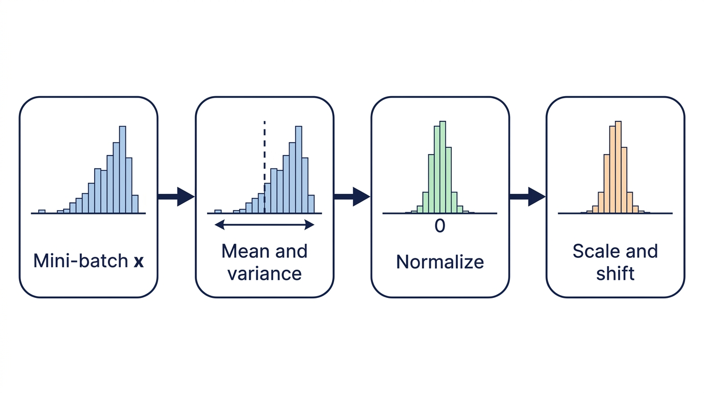
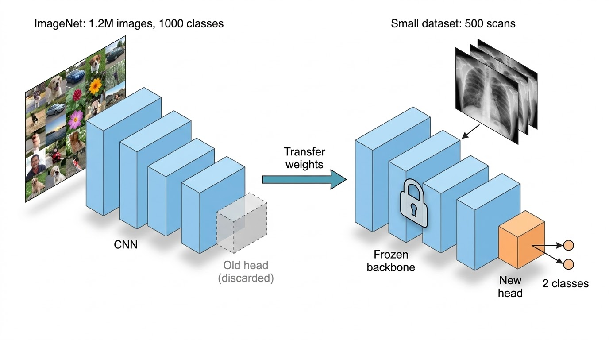
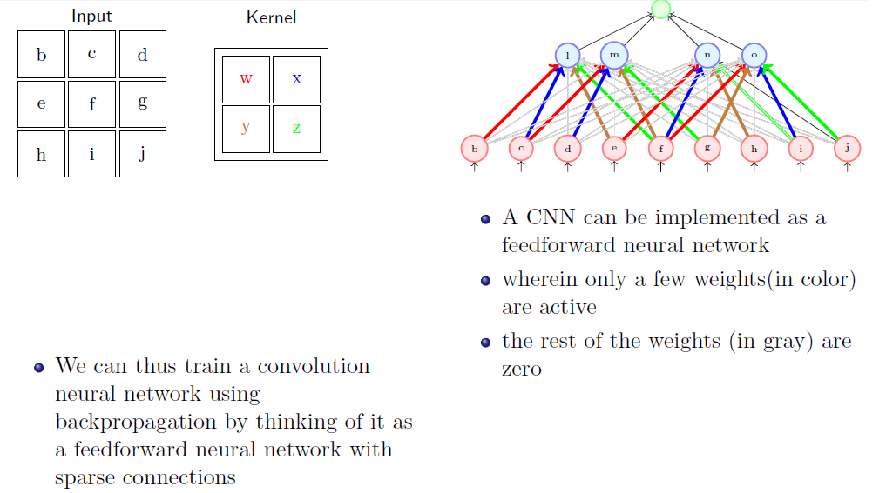

# Lecture 13 — CNN Layers, Regularization, Parameters & Transfer Learning: Exam Questions and Answers

Companion to [ML_Lec_13_CNN_Learning_Guide.md](ML_Lec_13_CNN_Learning_Guide.md). Try each question first, then read the answer.

**Pattern:** Part A = 2-mark questions. Part B = 10-mark questions split (a) + (b), 5 + 5 or 6 + 4.
**Tags:** 🎯 real paper; ✍️ practice to cover the lecture; 📘 beyond the slides. 💡 = memory hook.
**Pooling** (Slides 9–13) is the same material as Lecture 12; see [ML_Lec_12_CNN_QA.md](ML_Lec_12_CNN_QA.md), A5 and B3.
**AlexNet table** (Slides 32, 36) is answered in [ML_Lec_15_AlexNet_CNN_QA.md](ML_Lec_15_AlexNet_CNN_QA.md).

| Topic in the guide | Question |
| :--- | :--- |
| What a CNN is, its five layers, applications (§1, §4) | A1 |
| Usefulness of the conv layer (§2) | B1(a) |
| Dropout (§5) | A2, B2(a) |
| Batch normalization (§6) | A3, A4, B2 |
| Counting parameters (§7) | A5, B1(b), B4(a) |
| CNN as a sparse feedforward net (§9) | B4(b) |
| Transfer learning (§10) | A6, A7, B3 |

---

## Part A — 2-mark questions

### A1. Name the layers of a CNN and give the role of each. ✍️ [2]

1. **Input:** the image as height × width × channels (RGB = 3).
2. **Convolutional:** filters slide over the input and take dot products to make feature maps, followed by a non-linearity (usually ReLU).
3. **Pooling:** shrinks the feature maps (max or average).
4. **Fully connected:** the flattened maps go to neurons connected to every neuron of the previous layer, for high-level reasoning.
5. **Output:** softmax for classification, linear for regression.

Uses: image classification, object detection, segmentation, face recognition, medical images; also audio, time series and signals.

> 💡 See → shrink → think → answer.

### A2. What is dropout and where is it applied in a CNN? ✍️ 🎯 2026 Mid Q3(a) (part) [2]

During training, dropout randomly sets a fraction of units to **zero**. It acts as a mask that cancels those neurons' contribution to the next layer and leaves the others unchanged. At inference all neurons are used.

In CNNs it is typically applied **after the activation and before pooling**. The rate is commonly **20–50%**. For example, with rate 20% on 100 units, about 20 different units are zeroed at each step.

> 💡 Randomly switch neurons off, so no single neuron becomes a crutch.

### A3. What is internal covariate shift? ✍️ [2]

During training, the weights of earlier layers keep changing. So the **distribution of inputs** reaching each later layer keeps changing, and every layer must keep re-adapting, which makes training slow and unstable. Batch normalization reduces this by normalizing each layer's inputs, so layers see a consistent distribution. That allows larger learning rates and faster, more stable training.

> 💡 The target keeps moving because the layer before it keeps changing.

### A4. Why does batch normalization use running averages at inference? ✍️ [2]

At inference we often feed **one sample** or a small batch, so batch statistics are unreliable.

1. **Consistency:** running averages give the same normalization whatever the batch size.
2. **Stability:** batch mean and variance would fluctuate a lot with small batches, giving inconsistent outputs.

They are updated during training as follows ($\alpha \approx 0.9$):

$$\text{running\_mean} = \alpha \cdot \text{running\_mean} + (1-\alpha)\mu_B$$

The variance is updated the same way. *E.g.* $0.9 \times 4.0 + 0.1 \times 5 = 4.1$.

> 💡 At test time, use the long-term average, not one shaky batch.

### A5. Give the formulas for the number of parameters in a convolutional, fully connected, pooling and batch-norm layer. ✍️ [2]

| Layer | Parameters |
| :--- | :--- |
| Convolutional | $(K_w \times K_h \times C_{in} + 1) \times C_{out}$, i.e. $K(F \cdot F \cdot D + 1)$ |
| Fully connected | $(N_{in} + 1) \times N_{out}$ |
| Pooling | 0 |
| Batch norm | $2C$ (one $\gamma$ and one $\beta$ per channel) |

The "+1" is the bias. *E.g.* 6 filters of 5×5 on a 1-channel input: $6 \times (25 + 1) = 156$.

> 💡 One bias per filter or neuron; pooling learns nothing.

### A6. Differentiate feature extraction and fine-tuning in transfer learning. ✍️ [2]

| | Feature extraction | Fine-tuning |
| :--- | :--- | :--- |
| What is done | Remove the last layers; use the pre-trained network as a **fixed** feature extractor feeding a new model | Retrain **some or all** pre-trained layers on the new data |
| Pre-trained weights | Frozen | Adjusted to the new task |
| Best when | Very little data | More data, higher accuracy wanted |

> 💡 Freeze and reuse vs unfreeze and adjust.

### A7. What are the challenges of transfer learning? ✍️ [2]

1. **Domain shift:** if the new task is too different from the original one, the transferred features may not help.
2. **Overfitting:** fine-tuning on a small dataset can learn noise instead of general patterns.

> 💡 The wrong source, or too little target data.

---

## Part B — 10-mark questions

### B1. 🎯 2024 End Q5(a) (first part) + ✍️

**(a)** Discuss the usefulness of the convolutional layer and the pooling layer in a CNN. **[5]**
**(b)** A network takes a 32×32×1 input. It has Conv-1 (6 filters, 5×5), a 2×2 pool with stride 2, Conv-2 (16 filters, 5×5), another 2×2 pool with stride 2, then FC layers of 120 and 84 neurons and 10 outputs. Convolutions use stride 1 and no padding. Find each layer's output size and parameter count, and the total. **[5]**

**(a) Answer.**

**Convolutional layer** (Slides 6–8):

1. **Feature extraction:** learned filters detect local patterns (edges, textures, shapes). Deeper layers build hierarchical features, from edges up to objects.
2. **Parameter sharing:** the same filter is used across the whole input, so there are far fewer parameters than in a fully connected layer.
3. **Translation invariance:** objects are recognised wherever they appear.
4. **Dimensionality reduction:** stride and padding can keep or reduce the size, giving a compact summary.
5. **Non-linearity:** ReLU after the convolution lets the network learn complex patterns.
6. **Preprocessing:** it normalizes and preprocesses the input into useful representations.

**Pooling layer** (Slides 9–13):

- It reduces the spatial size, which cuts the parameters and computation that follow. It has no learnable weights.
- Max pooling keeps the strongest features; average pooling smooths and resists noise; global pooling gives one value per map.
- Its cost: some spatial information is lost.

**(b) Answer.**

| Layer | Output | Parameters |
| :--- | :--- | ---: |
| Input | 32×32×1 | 0 |
| Conv-1 | $32 - 5 + 1 = 28$ → 28×28×6 | $6 \times (5 \cdot 5 \cdot 1 + 1) = 156$ |
| Pool 1 | 14×14×6 | 0 |
| Conv-2 | $14 - 5 + 1 = 10$ → 10×10×16 | $16 \times (5 \cdot 5 \cdot 6 + 1) = 2{,}416$ |
| Pool 2 | 5×5×16 = 400 values | 0 |
| FC-1 | 120 | $(400 + 1) \times 120 = 48{,}120$ |
| FC-2 | 84 | $(120 + 1) \times 84 = 10{,}164$ |
| Output | 10 | $(84 + 1) \times 10 = 850$ |
| **Total** | | **61,706** |

Note that Conv-2's filter depth is 6, the number of maps coming from Conv-1. The two conv layers together hold only 2,572 parameters; the first FC layer alone holds 48,120.

> 💡 Conv filter depth = previous layer's channel count.

### B2. 🎯 2024 End Q5(b) + 🎯 2026 Mid Q3(a) (part)

**(a)** Explain how dropout and batch normalization help with overfitting in deep neural networks. **[6]**
**(b)** Write the batch-normalization equations for training and inference. Normalize the mini-batch {2, 4, 6, 8} and apply $\gamma = 2$, $\beta = 1$ (ignore $\epsilon$). **[4]**

**(a) Answer.**

**Overfitting** means memorizing the training data: good on training, poor on new data.

**Dropout:**

1. **Prevents overfitting:** neurons are randomly removed, so the model cannot depend too much on particular neurons or patterns.
2. **Encourages redundancy:** knowledge spreads across many neurons, which makes the network more robust.
3. **Ensemble effect:** each mini-batch trains a different sub-network; at inference all neurons are used, like averaging many models.
4. **Stochasticity:** the randomness can help escape local minima.

It is applied after the activation and before pooling, at a rate of 20–50%.

**Batch normalization** (the slides' second regularization technique):

1. Reduces **internal covariate shift**, so training is more stable.
2. Allows **larger learning rates**, so it converges faster.
3. Gives **better gradient flow:** a smoother loss and fewer vanishing or exploding gradients.
4. Has a **regularization effect:** statistics computed over random mini-batches add noise, which reduces the need for dropout.

It goes after the conv layer, either before or after the activation.

**(b) Answer.**

Training (per mini-batch of size $m$):

$$\mu_B = \frac{1}{m}\sum x_i,\quad \sigma_B^2 = \frac{1}{m}\sum (x_i - \mu_B)^2,\quad \hat{x}_i = \frac{x_i - \mu_B}{\sqrt{\sigma_B^2 + \epsilon}},\quad y_i = \gamma \hat{x}_i + \beta$$

$\gamma$ and $\beta$ are learnable, so the network can recover the original distribution if that helps. At inference, $\mu_B$ and $\sigma_B^2$ are replaced by the **running averages**.

Numerical:

- $\mu_B = 20/4 = 5$
- $\sigma_B^2 = (9 + 1 + 1 + 9)/4 = 5$, so $\sqrt{5} = 2.236$
- $\hat{x} = (-1.342,\ -0.447,\ 0.447,\ 1.342)$
- $y = 2\hat{x} + 1 = (-1.683,\ 0.106,\ 1.894,\ 3.683)$

> 💡 Normalize to mean 0 and variance 1, then let the network re-scale.

### B3. 🎯 2024 End Q6(b) + ✍️

**(a)** What is transfer learning? Describe its key concepts and the steps in developing a transfer learning model. **[6]**
**(b)** Give its benefits, challenges and applications. **[4]**

**(a) Answer.**

**Definition.** A model trained for one task is reused as the **starting point** for a second task, so knowledge from the first improves the second. It is most valuable when data is limited, and it cuts training time.

**Key concepts:**

1. **Pre-trained model:** trained on a large dataset (e.g. ImageNet); its learned features are useful for many tasks.
2. **Fine-tuning:** retrain some or all layers on the new dataset, adjusting the weights to the new task.
3. **Feature extraction:** remove the last few layers and use the rest, frozen, as an input to a new model.

**Steps:**

1. **Select** a model pre-trained on a similar task or dataset.
2. **Modify the architecture:** change the output layer to the new number of classes. *E.g.* AlexNet's last layer goes from $(4096 + 1) \times 1000 = 4{,}097{,}000$ parameters to $(4096 + 1) \times 10 = 40{,}970$ for 10 classes.
3. **Fine-tune** the whole model or specific layers.
4. **Train** on the new data.
5. **Evaluate and optimize.**

**(b) Answer.**

- **Benefits:**
  - Reduced training time, because the starting weights are already close to optimal.
  - Better performance, especially on small datasets.
  - Less labelled data needed.
- **Challenges:**
  - Domain shift: features may not suit a very different task.
  - Overfitting when fine-tuning on a small dataset.
- **Applications:**
  - Image classification with VGG, ResNet or Inception.
  - NLP with BERT or GPT (sentiment analysis, summarization).
  - Medical imaging: general-image models help detect disease in scans.

> 💡 Borrow a trained brain, then retrain only what you must.

### B4. 🎯 2023 End Q6(a) (style) + ✍️

**(a)** A CNN takes images of size 100×100×3. Find the output size and parameter count of each layer (Input, C1, C2, P1, C3, P2, FC1, Output). Use these settings: C1 has 8 filters of 3×3; C2 has 16 filters of 3×3; C3 has 32 filters of 3×3; all convolutions use stride 1 and no padding; P1 and P2 are 2×2 max pools with stride 2; FC1 has 64 neurons; the output has 10. **[6]**
*(The original paper's layer settings are not in our records, so these are assumed. Practise the method.)*

**(b)** Show how a CNN can be seen as a feedforward network with sparse connections, using a 3×3 input and a 2×2 kernel. **[4]**

**(a) Answer.**

| Layer | Output size | Parameters |
| :--- | :--- | ---: |
| Input | 100×100×3 | 0 |
| C1 | $100 - 3 + 1 = 98$ → 98×98×8 | $8 \times (3 \cdot 3 \cdot 3 + 1) = 224$ |
| C2 | $98 - 3 + 1 = 96$ → 96×96×16 | $16 \times (3 \cdot 3 \cdot 8 + 1) = 1{,}168$ |
| P1 | 48×48×16 | 0 |
| C3 | $48 - 3 + 1 = 46$ → 46×46×32 | $32 \times (3 \cdot 3 \cdot 16 + 1) = 4{,}640$ |
| P2 | 23×23×32 = 16,928 values | 0 |
| FC1 | 64 | $(16{,}928 + 1) \times 64 = 1{,}083{,}456$ |
| Output | 10 | $(64 + 1) \times 10 = 650$ |
| **Total** | | **1,090,138** |

The FC1 layer holds over 99% of the parameters.

**(b) Answer.**

- Input pixels b, c, d / e, f, g / h, i, j; kernel weights w, x, y, z; 4 outputs l, m, n, o (the output is $3 - 2 + 1 = 2$ wide).
- In a **fully connected** layer every input connects to every output: $9 \times 4 = 36$ different weights.
- In a **CNN**, each output connects only to the 4 pixels under the kernel:

| Output | Inputs | Value |
| :--- | :--- | :--- |
| l | b, c, e, f | $wb + xc + ye + zf$ |
| m | c, d, f, g | $wc + xd + yf + zg$ |
| n | e, f, h, i | $we + xf + yh + zi$ |
| o | f, g, i, j | $wf + xg + yi + zj$ |

So 16 connections are active and the other $36 - 16 = 20$ have weight **0**. Only **4** distinct values (w, x, y, z) are shared by all outputs. A CNN is therefore a feedforward network with **sparse, shared** weights, and it can be trained with ordinary **backpropagation**.

> 💡 A CNN is a dense net with most weights forced to 0 and the rest tied together.
