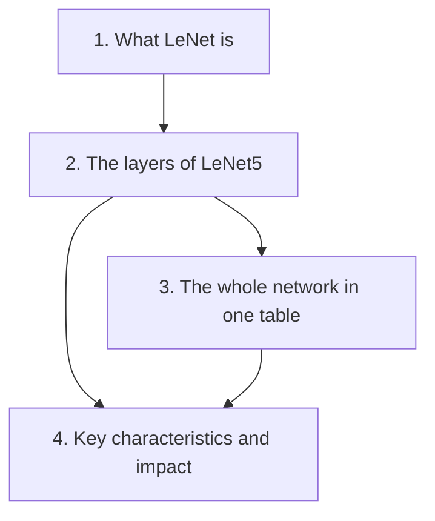
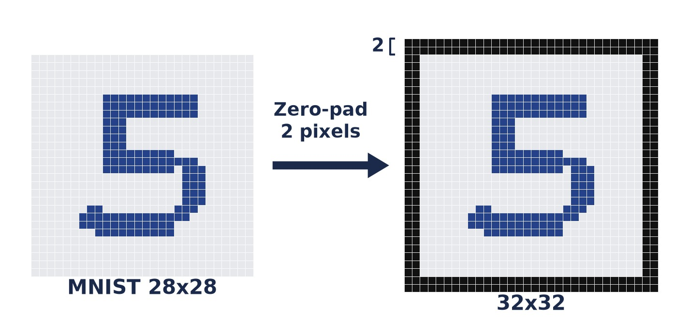
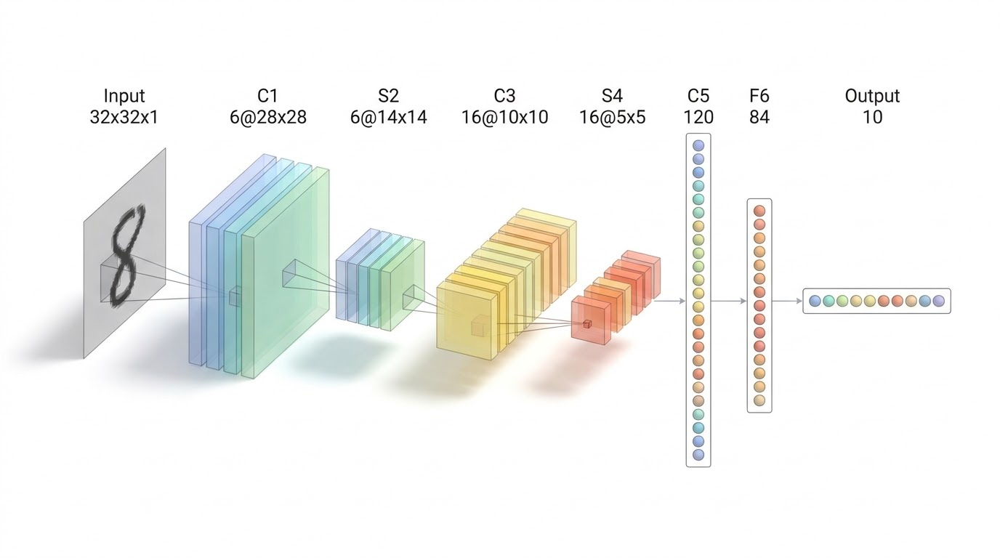

# LeNet-5 — Learning Guide

Source: `ML_Lec_14_LeNeT_CNN.pptx`, Slides 1–14.

**Who this is for:** a beginner studying this lecture. After reading, you can name every layer of LeNet5 in order, give the size of its output, and show how each size is calculated.

**How to read this guide:** Read the sections in order. Section 1 says what LeNet is. Section 2 walks through the layers one by one. Section 3 puts the whole network in one table. Section 4 gives its key characteristics and its impact. Every fact comes from the slides.



## Contents

1. [What LeNet is](#1-what-lenet-is)
2. [The layers of LeNet5, one by one](#2-the-layers-of-lenet5-one-by-one)
3. [The whole network in one table](#3-the-whole-network-in-one-table)
4. [Key characteristics and impact](#4-key-characteristics-and-impact)

---

## 1. What LeNet is

### 1.1 The Problem & Intuition

People write digits in many different ways. A computer had to read these digits, for example the numbers written on a cheque. Writing rules by hand for every style does not work. **LeNet** solved this with a small CNN that learns from examples of handwritten digits.

### 1.2 Mechanism & Architecture

**Popular CNN models (Slide 1).** LeNet is the first in the list of well-known CNN models:

- LeNet
- AlexNet
- GoogleNet
- VGG
- ResNet
- DenseNet
- ResNeXt
- EfficientNet

**Facts about LeNet (Slide 2).**

- LeNet is one of the pioneering CNN architectures. A CNN is a convolutional neural network.
- Yann LeCun and his colleagues developed it in the late 1980s and early 1990s.
- It was designed mainly for handwritten digit recognition, specifically for the **MNIST** dataset. MNIST is a set of images of handwritten digits.
- Many banks used it to recognize the handwritten numbers on cheques.
- It reaches an error rate as low as 0.95% on test data.

**Versions (Slide 5).** There are many versions of the LeNet architecture. This lecture studies **LeNet5**.

### 1.3 Visual Anchor


*Figure: Slide 5. From left to right: INPUT 32x32, C1 (6 feature maps of 28x28), S2 (6 of 14x14), C3 (16 of 10x10), S4 (16 of 5x5), C5 (120), F6 (84) and OUTPUT (10).*

### 1.4 Verified Formulas, Trade-offs & Calculations

An error rate of 0.95% means the network gets 0.95 out of every 100 test images wrong. So the accuracy is:

```math
100 - 0.95 = 99.05
```

That is 99.05%, which is "more than 99%" as Slide 2 says.

---

## 2. The layers of LeNet5, one by one

### 2.1 The Problem & Intuition

LeNet5 turns a picture of a digit into one of ten answers, 0 to 9. It does this in small steps. Convolution layers find patterns. Pooling layers make the maps smaller. At the end, fully connected layers decide which digit it is. To understand the network you must follow the size of the data through each layer.

### 2.2 Mechanism & Architecture

The layer names use letters. **C** is a convolutional layer. **S** is a subsampling layer, which is another name for a pooling layer. **F** is a fully connected layer. The number is the position of the layer.

**Input layer (Slide 3).**

- It typically accepts grayscale images of 32×32 pixels.
- MNIST images are 28×28. They are often zero-padded to 32×32. **Zero-padding** means adding a border of zeros around the image.


*Figure: A 28x28 MNIST digit with 2 pixels of zeros added on every side becomes 32x32 (illustration).*

**Layer 1: Convolutional Layer 1, C1 (Slides 3, 6).**

- It applies 6 convolutional filters of size 5×5.
- The result is 6 feature maps of size 28×28.
- So after the first convolutional layer the 32×32 image becomes 28×28. There are 6 kernels, so the output has depth 6.
- Activation function: typically **sigmoid** or **tanh**. Both are smooth functions that squash a number into a fixed range.


**Layer 2: Subsampling or Pooling Layer 1, S2 (Slides 3, 7).**

- It applies **average pooling** with a 2×2 filter and a stride of 2. Average pooling replaces each 2×2 block by its average.
- The size is reduced to half: from 28×28 to 14×14.


**Layer 3: Convolutional Layer 2, C3 (Slides 3, 8).**

- Convolution happens again, this time with 16 filters of size 5×5.
- The default settings apply: pad = 0 and stride = 1.
- It produces 16 feature maps of size 10×10. The data is now 10×10×16.


**Layer 4: Subsampling Layer 2, S4 (Slides 4, 9).**

- Like S2, it uses average pooling with a 2×2 filter and stride 2.
- The size 10×10×16 is reduced to 5×5×16.
- The feature map of this fourth layer is then **flattened** into a vector of 400 values. Flattening writes all the values in one long row.


**The three fully connected layers (Slides 4, 10).** The flattened vector passes through 3 fully connected (FC) layers for classification.

1. **Fully Connected Layer C5.** It takes the flattened output of S4 and connects it to 120 neurons. This is the 1st FC layer, with 120 nodes.
2. **Fully Connected Layer F6.** It connects to 84 neurons. This is the 2nd FC layer.
3. **Output Layer.** It has 10 neurons, one for each of the 10 digit classes (0 to 9). This is the 3rd FC layer.


> **Slide note (Slide 10):** In this figure the layer with 120 nodes is labelled "C3 layer 120". It should read C5. C3 is the second convolutional layer, with 16 feature maps of 10×10 (Slides 3–5).

### 2.3 Visual Anchor


*Figure: The whole path in one picture: Input 32x32x1, C1 6@28x28, S2 6@14x14, C3 16@10x10, S4 16@5x5, C5 120, F6 84, Output 10 (illustration). "6@28x28" means 6 feature maps of size 28x28.*

### 2.4 Verified Formulas, Trade-offs & Calculations

Slide 6 gives the rule for a convolution with pad 0 and stride 1:

```math
\text{Output size} = \text{Input size} - \text{Filter size} + 1
```

The filter cannot hang over the edge. So it fits in fewer positions than there are pixels. The depth of the output is the number of filters.

For pooling with a 2×2 filter and stride 2, the size is halved. The depth does not change.

| Layer | Calculation | Output |
| :--- | :--- | :--- |
| Input | MNIST 28×28 plus 2 zeros on each side: $28 + 2 + 2 = 32$ | 32×32×1 |
| C1 | $32 - 5 + 1 = 28$, with 6 filters | 28×28×6 |
| S2 | $28 / 2 = 14$ | 14×14×6 |
| C3 | $14 - 5 + 1 = 10$, with 16 filters | 10×10×16 |
| S4 | $10 / 2 = 5$ | 5×5×16 |
| Flatten | $5 \times 5 \times 16 = 400$ | 400 values |
| C5 | fully connected | 120 |
| F6 | fully connected | 84 |
| Output | fully connected | 10 |

Every size matches the slides. The C1 line is the same as the one printed on Slide 6: $(32 - 5 + 1) \times (32 - 5 + 1) \times 6 = 28 \times 28 \times 6$.

---

## 3. The whole network in one table

### 3.1 The Problem & Intuition

Section 2 gave the layers one at a time. For revision you need them side by side. Slide 11 does this in one summary table.

### 3.2 Mechanism & Architecture

The summary table of Slide 11:

| Layer | Filters | Filter size | Stride | Feature map size | Activation function |
| :--- | :--- | :--- | :--- | :--- | :--- |
| Input | none | none | none | 32×32×1 | none |
| Conv 1 | 6 | 5×5 | 1 | 28×28×6 | tanh |
| Pooling 1 | none | 2×2 | 2 | 14×14×6 | none |
| Conv 2 | 16 | 5×5 | 1 | 10×10×16 | tanh |
| Pooling 2 | none | 2×2 | 2 | 5×5×16 | none |
| Fully Connected 1 | none | none | none | 120 | tanh |
| Fully Connected 2 | none | none | none | 84 | tanh |
| Fully Connected 3 | none | none | none | 10 | Softmax |

**Softmax** turns the 10 outputs into one probability for each digit.

The slides use more than one name for the same layer. This table links them:

| Slide 11 name | Name on Slides 3–5 | Name on Slide 10 |
| :--- | :--- | :--- |
| Conv 1 | C1 | first convolutional layer |
| Pooling 1 | S2 | second layer, pooling |
| Conv 2 | C3 | third layer, convolution |
| Pooling 2 | S4 | fourth layer, subsampling |
| Fully Connected 1 | C5 | 1st FC layer |
| Fully Connected 2 | F6 | 2nd FC layer |
| Fully Connected 3 | Output Layer | 3rd FC layer, the output layer |

### 3.3 Visual Anchor


### 3.4 Verified Formulas, Trade-offs & Calculations

Check the table with the general size formula. $W_1$ is the input size, $F$ the filter size, $P$ the pad and $S$ the stride:

```math
W_2 = \frac{W_1 - F + 2P}{S} + 1
```

It counts the positions where the filter fits. All layers here have $P = 0$.

- Conv 1: $(32 - 5 + 0)/1 + 1 = 28$
- Pooling 1: $(28 - 2 + 0)/2 + 1 = 14$
- Conv 2: $(14 - 5 + 0)/1 + 1 = 10$
- Pooling 2: $(10 - 2 + 0)/2 + 1 = 5$

All four match the feature map sizes in the table. The depths 6 and 16 are the numbers of filters.

> **Background (not in the slides):** Lecture 13 (Slides 25–30) counts the parameters of this same network. The total is 61,706.

---

## 4. Key characteristics and impact

### 4.1 The Problem & Intuition

LeNet is old, and later networks changed some of its choices. You should know which choices LeNet made, which ones changed later, and why LeNet still matters.

### 4.2 Mechanism & Architecture

**Key characteristics (Slide 12).**

- **Activation functions.** LeNet originally used sigmoid or tanh. Modern adaptations often use **ReLU**.
- **Pooling.** LeNet uses average pooling, which was common at the time. **Max pooling** has become more popular in later architectures. Max pooling keeps the largest value of each block.
- **Backpropagation.** LeNet was one of the first networks to use backpropagation for training. Backpropagation is the method that adjusts each weight to reduce the error.

**Impact and applications (Slide 13).**

1. **Legacy.** LeNet laid the groundwork for more complex CNN architectures. It influenced later developments in computer vision.
2. **Use cases.** Beyond digit recognition, variations of LeNet have been adapted for various image classification tasks.

**Summary (Slide 13).** LeNet's architecture introduced key concepts in deep learning:

- convolutional layers,
- pooling,
- **end-to-end training**, which means the whole network is trained together, from the input to the output.

It remains a foundational model in the study of neural networks and computer vision.

### 4.3 Visual Anchor

Fig 1 and Fig 6 show these choices in the network itself: "Subsampling" and "Avg Pooling" for the pooling layers, and "Full connection" for the last layers.

### 4.4 Verified Formulas, Trade-offs & Calculations

The slides give no formula here. They give two comparisons:

| Choice | LeNet | Later architectures |
| :--- | :--- | :--- |
| Activation function | sigmoid or tanh | often ReLU |
| Pooling | average pooling | max pooling is more popular |

One number shows the difference between the two kinds of pooling. Take a 2×2 block with the values 1, 3, 5 and 7.

- Average pooling gives $(1 + 3 + 5 + 7)/4 = 4$.
- Max pooling gives 7.
