# LeNet-5 Convolutional Neural Network — Learning Guide

> **Source Material:** `ML_Lec_14_LeNeT_CNN.pptx` (Slides 1–14)  
> **Course Domain:** Machine Learning / Deep Learning — Canonical CNN Architectures  
> **Date:** November 2026  

---

### How to Read This Guide
This guide breaks down Yann LeCun's pioneering 1998 LeNet-5 architecture from first principles to rigorous parameter accounting. Follow the sequential progression: begin with the commercial digit recognition problem on MNIST (Section 1), trace the exact spatial downsampling and tensor propagation across the convolutional-pooling feature extraction backbone (Section 2), master the flattening mechanics and layer-by-layer weight/bias calculations of the classification head (Section 3), and conclude with the structural trade-offs between classic LeNet design and modern deep CNN standards (Section 4).

---

### Conceptual Dependency Map

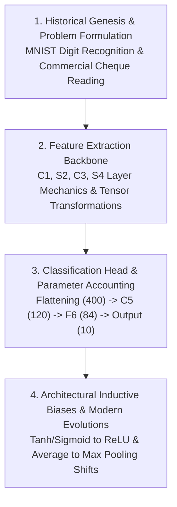

---

## Contents
  - [How to Read This Guide](#how-to-read-this-guide)
  - [Conceptual Dependency Map](#conceptual-dependency-map)
- [1. Historical Genesis, Problem Formulation & MNIST Benchmark](#1-historical-genesis-problem-formulation--mnist-benchmark)
  - [1. The Problem & Intuition](#1-the-problem--intuition)
  - [2. Mechanism & Architecture](#2-mechanism--architecture)
  - [3. Visual Anchor](#3-visual-anchor)
  - [4. Verified Formulas, Trade-offs & Calculations](#4-verified-formulas-trade-offs--calculations)
- [2. Feature Extraction Backbone: C1, S2, C3, S4 Layer Mechanics](#2-feature-extraction-backbone-c1-s2-c3-s4-layer-mechanics)
  - [1. The Problem & Intuition](#1-the-problem--intuition-1)
  - [2. Mechanism & Architecture](#2-mechanism--architecture-1)
  - [3. Visual Anchor](#3-visual-anchor-1)
  - [4. Verified Formulas, Trade-offs & Calculations](#4-verified-formulas-trade-offs--calculations-1)
- [3. Flattening, Dense Classification Head & Parameter Accounting](#3-flattening-dense-classification-head--parameter-accounting)
  - [1. The Problem & Intuition](#1-the-problem--intuition-2)
  - [2. Mechanism & Architecture](#2-mechanism--architecture-2)
  - [3. Visual Anchor](#3-visual-anchor-2)
  - [4. Verified Formulas, Trade-offs & Calculations](#4-verified-formulas-trade-offs--calculations-2)
- [4. Architectural Inductive Biases, Historical Innovations & Modern Evolutions](#4-architectural-inductive-biases-historical-innovations--modern-evolutions)
  - [1. The Problem & Intuition](#1-the-problem--intuition-3)
  - [2. Mechanism & Architecture](#2-mechanism--architecture-3)
  - [3. Visual Anchor](#3-visual-anchor-3)
  - [4. Verified Formulas, Trade-offs & Calculations](#4-verified-formulas-trade-offs--calculations-3)

## 1. Historical Genesis, Problem Formulation & MNIST Benchmark

### 1. The Problem & Intuition

In the late 1980s and early 1990s, automated document reading represented one of the most critical practical bottlenecks in industrial automation. Commercial banks faced an enormous operational challenge: every business day, millions of handwritten cheques had to be manually inspected, read, and processed by human tellers. This manual sorting was slow, labor-intensive, and prone to human transcription errors. Automating this pipeline required computers to read numerical account fields, dollar amounts, and routing numbers directly from physical paper documents.

However, recognizing visual patterns like a handwritten digit proved exceptionally challenging for traditional machine learning algorithms. Early approaches relied heavily on Multi-Layer Perceptrons (MLPs) or classical hand-crafted feature extractors:
- **Parameter Explosion**: A fully connected neural network treats every pixel as an independent feature. If an image is represented as a high-resolution grid, connecting every input pixel to even a modest number of hidden units requires millions of trainable parameters. This caused severe overfitting and rendered training computationally intractable on contemporary hardware.
- **Destruction of 2D Spatial Structure**: An MLP requires flattening a two-dimensional image into a one-dimensional vector. In doing so, the network discards crucial spatial relationships—such as the proximity between neighbouring pixels, continuous stroke contours, and local geometric topologies.
- **Brittle to Spatial Variations**: In reality, handwritten characters vary substantially in scale, line thickness, slant, and placement. A standard MLP possesses no built-in translation invariance: a digit shifted by even two pixels to the right presents an entirely new set of active input coordinates, forcing the network to relearn the representation for every possible spatial offset.

To systematically address and benchmark this challenge, Yann LeCun and his research team standardized the **MNIST** (Modified National Institute of Standards and Technology) dataset. MNIST became the definitive benchmark for handwritten digit recognition, providing a clean, normalized collection of 70,000 grayscale images ($28 \times 28$ pixels) across 10 digit classes ($0$ through $9$). The objective was unambiguous: engineer a learning machine capable of automatically extracting distortion-tolerant, shift-invariant visual representations directly from raw pixel arrays, without manual feature engineering.

---

### 2. Mechanism & Architecture

The response to this fundamental challenge was **LeNet**, a revolutionary convolutional neural network architecture developed by **Yann LeCun** and his colleagues at AT&T Bell Laboratories between the late 1980s and early 1990s. 

Across a decade of continuous research, multiple **versions** of the architecture were explored—beginning with early prototypes in 1989 (often referred to as LeNet-1), followed by intermediate variants such as LeNet-4, and culminating in the seminal 1998 paper *"Gradient-Based Learning Applied to Document Recognition"*, which introduced **LeNet-5**. Among these historical iterations, **LeNet-5** is prominent as the canonical, perfected blueprint that defined modern convolutional vision architectures.

The commercial impact was swift and transformative. Deployed directly into production systems, LeNet was adopted by major commercial **banks** for the automatic reading and verification of handwritten numbers on **cheques**. During the late 1990s, commercial check-reading machines powered by LeNet processed an estimated 10% to 20% of all bank cheques deposited across the United States.

At the core of LeNet's success was the introduction and seamless integration of three foundational deep learning concepts:
1. **Convolutional layers**: Instead of connecting every pixel to every neuron, convolutional layers apply small, learnable filter kernels (e.g., $5 \times 5$) that share weights across the entire visual field. This mechanism imposes two vital inductive biases: *local connectivity* (capturing spatial motifs such as edges, corners, and strokes) and *weight sharing* (ensuring that a feature learned in one region of the image is recognized everywhere, drastically decreasing parameter counts).
2. **Subsampling or pooling**: By periodically performing spatial subsampling (specifically $2 \times 2$ average pooling in LeNet-5), the network progressively halves the spatial resolution of the feature maps. This provides gradual invariance to small translations, rotations, and elastic stroke deformations, while concurrently expanding the effective receptive field of subsequent deeper layers.
3. **End-to-end training**: Prior vision pipelines separated feature extraction (hand-crafted morphological filters or edge detectors) from classification (linear classifiers or support vector machines). LeNet pioneered **end-to-end training**, where all components—from the initial convolutional filters down to the final classification weights—are jointly optimized from raw pixels to class labels through gradient-based backpropagation.

By establishing these principles, LeNet laid the durable **groundwork** for complex CNN architectures across modern **computer vision**. While LeNet was initially engineered for **digit recognition**, the underlying principles generalized immediately. Subsequent research adapted variations of LeNet for broader **image classification** problems—ranging from multi-character optical character recognition (OCR) and facial detection to medical diagnostics and natural object recognition.

The lineage directly connects LeNet to the modern deep learning era:
- The 2012 ImageNet revolution led by **AlexNet** adopted LeNet's fundamental sequence of stacked convolutional and pooling stages, scaling them to millions of parameters and multi-class RGB images using GPUs and ReLU activations.
- Subsequent milestone architectures—including VGG, GoogleNet, **ResNet**, DenseNet, ResNeXt, and EfficientNet—all build directly upon the foundational paradigm first demonstrated by LeNet.

---

### 3. Visual Anchor

The following diagram illustrates the historical evolution of LeNet-5: from the industrial banking bottleneck and MNIST formulation, through its core architectural innovations, to its commercial deployment on bank cheques and its foundational role in modern computer vision.

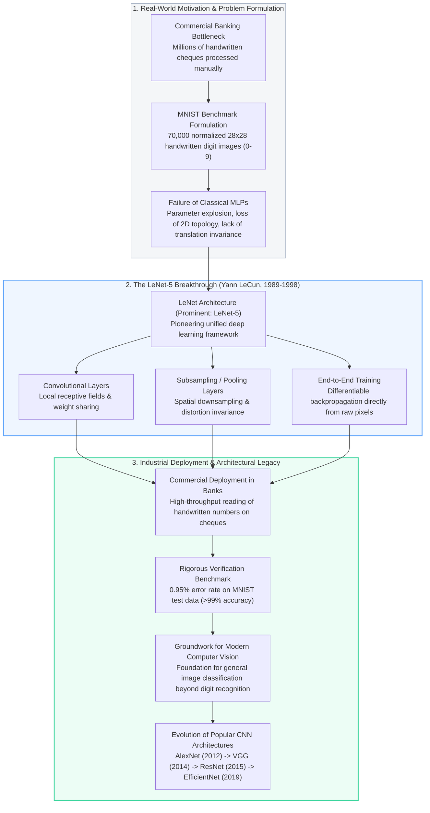

---

### 4. Verified Formulas, Trade-offs & Calculations

#### Error Rate and Test Accuracy Verification

In his landmark 1998 presentation and experimental evaluations on the MNIST test dataset, Yann LeCun reported that the LeNet-5 architecture achieved an error rate as low as 0.95% on test data without distorted training sets, corresponding to an overall classification accuracy exceeding 99%.

Mathematically, let $N_{\text{total}}$ denote the total number of evaluation samples in the MNIST test partition ($N_{\text{total}} = 10{,}000$), and let $N_{\text{errors}}$ represent the number of misclassified samples. The empirical error rate $E$ and classification accuracy $A$ are formally defined as:

$$
E = \frac{N_{\text{errors}}}{N_{\text{total}}}
$$

$$
A = 1 - E = \frac{N_{\text{total}} - N_{\text{errors}}}{N_{\text{total}}}
$$

Substituting the verified test error rate $E = 0.0095$:

$$
A = 1 - 0.0095 = 0.9905
$$

Expressed in percentage form, this yields an exact test accuracy of 99.05%. This confirms the reported claim that test accuracy surpassed 99%, with fewer than 95 incorrect classifications across the entire 10,000-image MNIST test suite.

#### Architectural Chronology: From LeNet to Modern Deep CNNs

The conceptual innovations introduced in LeNet-5 established the foundational blueprint for an entire family of deep convolutional neural networks. The table below traces this evolution across the eight major milestone architectures in computer vision history:

| Architecture | Year | Primary Creators | Key Architectural Innovation | Historical Significance |
| :--- | :--- | :--- | :--- | :--- |
| **LeNet-5** | 1998 | Yann LeCun et al. | Convolutional layers, subsampling (average pooling), weight sharing, end-to-end backpropagation | Pioneered modern CNN design; deployed in commercial banks for automated cheque reading and evaluated on the MNIST benchmark. |
| **AlexNet** | 2012 | Alex Krizhevsky, Ilya Sutskever, Geoffrey Hinton | ReLU activation, Dropout regularization, GPU-accelerated parallel training, overlapping max pooling | Won the ImageNet 2012 competition by a massive margin, igniting the modern deep learning boom. |
| **VGG** | 2014 | Karen Simonyan, Andrew Zisserman | Homogeneous architecture using strictly small $3 \times 3$ convolutional filters stacked deeply (VGG-16, VGG-19) | Demonstrated that network depth and small factorized convolutions yield superior representational capacity. |
| **GoogleNet** (Inception-v1) | 2014 | Christian Szegedy et al. | Multi-scale Inception modules, $1 \times 1$ bottleneck convolutions for dimensional reduction | Achieved high computational efficiency by processing visual features at multiple spatial scales concurrently. |
| **ResNet** | 2015 | Kaiming He, Xiangyu Zhang, Shaoqing Ren, Jian Sun | Residual learning formulation via identity shortcut (skip) connections: $y = \mathcal{F}(x) + x$ | Solved the degradation and vanishing gradient problems in ultra-deep networks, scaling up to 152 layers. |
| **DenseNet** | 2016 | Gao Huang, Zhuang Liu, Laurens van der Maaten, Kilian Q. Weinberger | Dense connectivity pattern connecting each layer to every subsequent layer in a feed-forward fashion | Maximized feature reuse, alleviated vanishing gradients, and substantially reduced parameter redundancy. |
| **ResNeXt** | 2017 | Saining Xie, Ross Girshick, Piotr Dollár, Zhuowen Tu, Kaiming He | Aggregated residual transformations introducing a split-transform-merge "cardinality" dimension | Proved that expanding cardinality (the number of parallel transformation paths) is more effective than increasing depth or width. |
| **EfficientNet** | 2019 | Mingxing Tan, Quoc V. Le | Principled compound scaling method uniformly scaling network depth, width, and image resolution | Set new Pareto-optimal state-of-the-art benchmarks in both top-1 accuracy and computational efficiency (FLOPs). |

This historical trajectory confirms that while modern architectures have expanded in depth, capacity, and topological complexity, their core mechanisms—hierarchical spatial feature extraction, localized receptive fields, and end-to-end gradient descent—remain directly grounded in the fundamental principles established by LeNet.

## 2. Feature Extraction Backbone: C1, S2, C3, S4 Layer Mechanics

### 1. The Problem & Intuition

#### The Spatial Coherence Dilemma
A raw handwritten digit, such as a sample from the standard MNIST dataset, is presented as a two-dimensional grid of $28 \times 28$ grayscale pixels. In a naive classical machine learning approach or a vanilla Multilayer Perceptron (MLP), this grid is flattened into a 784-dimensional flat vector. Doing so discards all 2D topological relationships: a pixel at coordinate $(x, y)$ loses its spatial adjacency to its vertical neighbor at $(x, y+1)$, and slight translations, rotations, or stroke variations drastically shift the vector coordinates. Furthermore, fully connecting every pixel to dense hidden units creates an explosion of unconstrained parameters, making the model prone to catastrophic overfitting.

To solve this, Yann LeCun's LeNet-5 architecture introduces a dedicated **feature extraction backbone** comprising alternating stages of **convolution** (local feature detection through weight sharing and receptive fields) and **subsampling** (spatial pooling for spatial downsampling and translation tolerance).

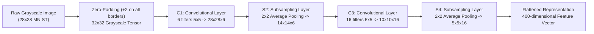

#### Why Zero-Pad 28x28 to 32x32?
The LeNet input layer typically accepts 32x32 pixel grayscale images, with 28x28 MNIST images zero-padded to this size. Adding two pixels of zero-padding on all four borders ($\text{top} = 2, \text{bottom} = 2, \text{left} = 2, \text{right} = 2$) transforms the raw $28 \times 28$ digit into a $32 \times 32 \times 1$ tensor.

This padding satisfies two crucial design principles:
1. **Edge Feature Preservation:** In a $5 \times 5$ convolution without padding, a border pixel is only sampled once by the filter corner, whereas a central pixel is sampled up to 25 times. Centering the $28 \times 28$ digit inside a $32 \times 32$ canvas ensures that stroke endpoints, loops, and diacritical marks touching the boundaries of the $28 \times 28$ region can be squarely centered under the $5 \times 5$ kernel window.
2. **Clean Spatial Downsampling Arithmetic:** Propagating a $32 \times 32$ input through two stages of $5 \times 5$ convolutions and $2 \times 2$ downsampling produces integer dimensions at every transition: $32 \to 28 \to 14 \to 10 \to 5$. This produces a clean $5 \times 5 \times 16$ tensor containing 400 activations before flattening.

---

### 2. Mechanism & Architecture

The feature extraction backbone consists of four sequentially connected layers: C1, S2, C3, and S4.

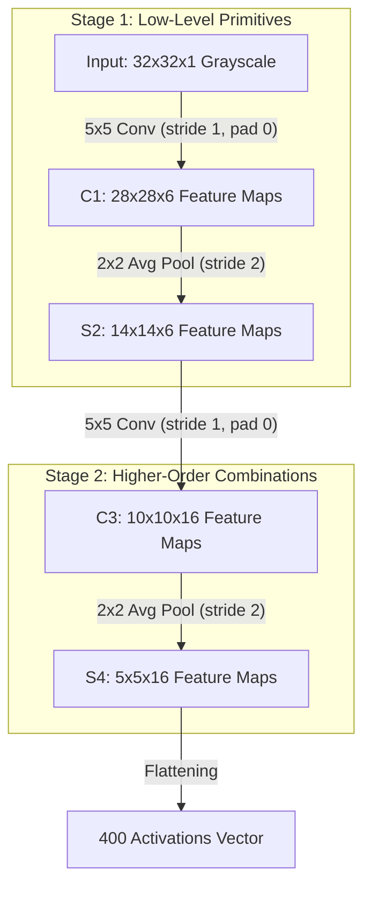

#### Layer 1: Convolutional Layer 1 (C1)
Convolutional Layer 1 (C1) applies 6 convolutional filters of size 5x5, resulting in 6 feature maps of size 28x28.

- **Input Tensor:** A single-channel grayscale input of size $32 \times 32 \times 1$.
- **Kernel Geometry:** There are 6 kernels in the first convolutional layer, so the output feature map has a depth 6. Each kernel has spatial dimensions of $5 \times 5 \times 1$.
- **Spatial Operation:** With a stride $S = 1$ and zero padding $P = 0$, each kernel slides over the $32 \times 32$ grid. The kernel computes a 2D cross-correlation (weighted sum) across its $5 \times 5$ local receptive field, adds a learnable scalar bias, and applies a non-linear activation.
- **Output Tensor:** After the first convolutional layer, the input image is convoluted to a spatial size of 28x28. With 6 filters, the complete output tensor is $28 \times 28 \times 6$.
- **Activation Function:** The activation function in Convolutional Layer 1 (C1) is typically sigmoid or tanh. In LeCun's 1998 formulation, a scaled hyperbolic tangent function $f(a) = A\tanh(s_{\text{scale}} a)$ with $A = 1.7159$ and $s_{\text{scale}} = \frac{2}{3}$ was chosen to ensure variance preservation and accelerate gradient descent (using $s_{\text{scale}}$ as the frequency multiplier to distinguish it from stride $S$).
- **Learnable Parameters:** Each filter has $5 \times 5 \times 1 = 25$ weights and 1 bias. For 6 feature maps, C1 contains $(25 + 1) \times 6 = 156$ trainable parameters.

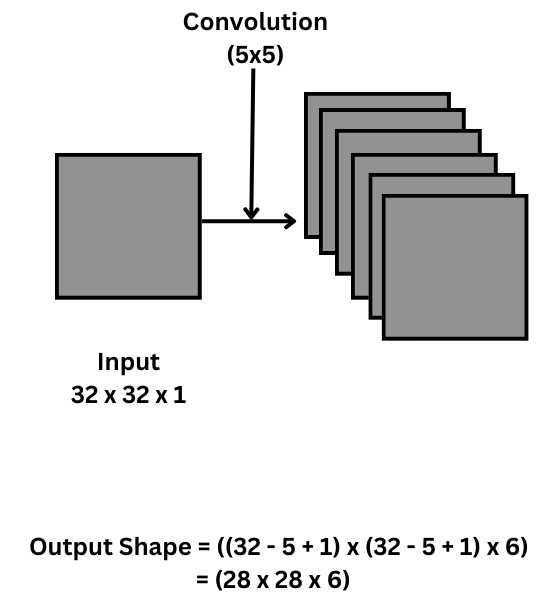

#### Layer 2: Subsampling Layer 1 (S2)
Subsampling or Pooling Layer 1 (S2) applies average pooling with a 2x2 filter and a stride of 2, reducing the feature map size to 14x14.

- **Role:** Introduces local translational and rotational invariance while halving the spatial dimensions to reduce computational load.
- **Spatial Operation:** The second layer is a pooling layer where the feature map size is halved to 14x14 by a 2x2 filter with stride 2. The $2 \times 2$ pooling window moves with non-overlapping steps of 2 pixels across both height and width.
- **Output Tensor:** The subsampling layer transforms the $28 \times 28 \times 6$ feature maps into $14 \times 14 \times 6$ feature maps.

**Modern Standard:** In modern deep learning frameworks, average pooling computes the unweighted arithmetic mean of each $2 \times 2$ window with zero learnable parameters:

$$
y = \frac{1}{4} \sum_{i=1}^{2} \sum_{j=1}^{2} x_{i,j}
$$

**Classic LeNet-5 Formulation:** In the original 1998 design, subsampling was an adaptive operation. The four inputs in each $2 \times 2$ receptive field were summed, multiplied by a single trainable coefficient weight $w$, added to a trainable bias $b$, and passed through a non-linear activation function:

$$
y = \tanh\left(w \sum_{i=1}^{2} \sum_{j=1}^{2} x_{i,j} + b\right)
$$

Because each of the 6 feature maps had 1 weight and 1 bias, classic S2 contained $6 \times 2 = 12$ trainable parameters.

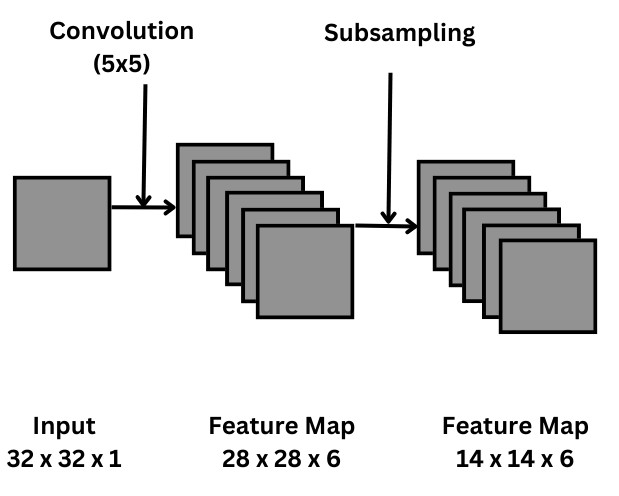

#### Layer 3: Convolutional Layer 2 (C3)
Convolutional Layer 2 (C3) applies 16 convolutional filters of size 5x5, producing 16 feature maps of size 10x10.

- **Input Tensor:** $14 \times 14 \times 6$ feature maps from S2.
- **Convolution Parameters:** In the third layer, convolution occurs with 16 filters of size 5x5, default pad=0, and stride=1.
- **Output Tensor:** After the third layer, the input image dimensions are reduced to 10x10x16.

**Modern Standard (Full Connectivity):** All 16 output filters connect to all 6 input feature maps, requiring $16 \text{ output maps} \times 6 \text{ input channels} = 96$ kernels of size $5 \times 5$. Each 3D filter tensor has shape $5 \times 5 \times 6$ (150 weights plus 1 bias). Across all 16 filters, this yields $16 \times 150 = 2{,}400$ weights and 16 biases, totaling $2{,}416$ trainable parameters.

**Classic LeNet-5 (Sparse Custom Connectivity):** To keep parameter counts manageable on 1990s hardware and force different filters to capture distinct feature combinations, LeCun enforced an asymmetric connection table using only 60 kernels (instead of all 96):
- 6 feature maps connect to contiguous subsets of 3 S2 maps ($6 \times 3 = 18$ kernels of size $5 \times 5$).
- 9 feature maps connect to subsets of 4 S2 maps ($9 \times 4 = 36$ kernels of size $5 \times 5$).
- 1 feature map connects to all 6 S2 maps ($1 \times 6 = 6$ kernels of size $5 \times 5$).

This sparse topology utilized exactly $18 + 36 + 6 = 60$ kernels ($60 \times 25 = 1{,}500$ weights and 16 biases, totaling $1{,}516$ parameters).

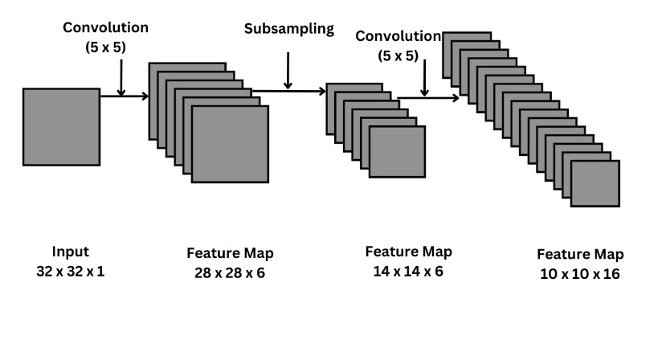

#### Layer 4: Subsampling Layer 2 (S4)
Subsampling Layer 2 (S4) uses average pooling to reduce feature map size to 5x5.

- **Spatial Operation:** In the fourth layer, subsampling reduces the 10x10x16 feature map to 5x5x16 using a 2x2 filter with stride 2.
- **Output Tensor:** Subsampling yields 16 feature maps of spatial size $5 \times 5$, forming a 5x5x16 tensor.
- **Parameter Accounting:** Modern implementation uses 0 parameters. Classic LeNet-5 uses 1 trainable weight and 1 bias per feature map, yielding $16 \times 2 = 32$ trainable parameters.
- **Flattening Transition:** The resulting $5 \times 5 \times 16$ tensor contains $5 \times 5 \times 16 = 400$ activations. In the network progression, this tensor is flattened into a 1D vector of length 400, serving as the direct input to the dense classification head.

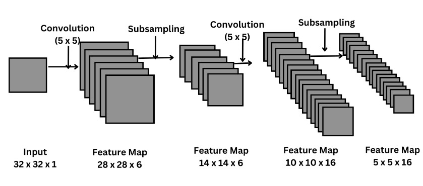

---

### 3. Visual Anchor

The classic LeNet-5 architecture pipeline integrates convolutional feature extraction and fully connected classification into a unified end-to-end differentiable system.

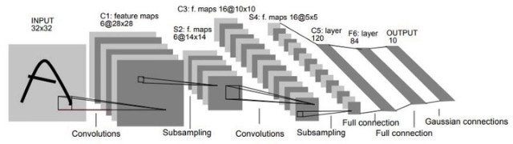

The complete dataflow through the network layers is illustrated below:

```mermaid
flowchart LR
    subgraph Feature_Extraction ["Feature Extraction Backbone"]
        direction LR
        IN["Input<br/>32x32x1"] -->|"5x5 Conv<br/>stride 1, pad 0"| C1["C1 Maps<br/>28x28x6"]
        C1 -->|"2x2 AvgPool<br/>stride 2"| S2["S2 Maps<br/>14x14x6"]
        S2 -->|"5x5 Conv<br/>stride 1, pad 0"| C3["C3 Maps<br/>10x10x16"]
        C3 -->|"2x2 AvgPool<br/>stride 2"| S4["S4 Maps<br/>5x5x16"]
    end
    subgraph Classification_Head ["Classification Head"]
        direction LR
        S4 -->|"Flatten"| FL["Vector<br/>400"]
        FL -->|"Dense / Conv"| C5["C5 Layer<br/>120 units"]
        C5 -->|"Dense"| F6["F6 Layer<br/>84 units"]
        F6 -->|"Euclidean / Softmax"| OUT["Output<br/>10 digits"]
    end
```

The progressive dimensional reduction is summarized in the following structural progression:

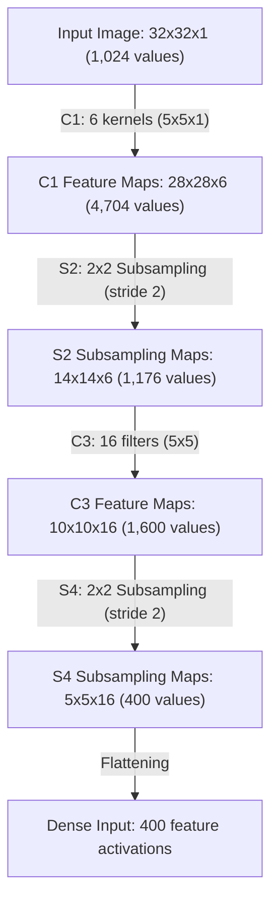

---

### 4. Verified Formulas, Trade-offs & Calculations

#### Universal Spatial Dimension Formulas
For an input map of spatial dimensions $W_{\text{in}} \times H_{\text{in}}$, filter spatial extent $F \times F$, stride $S$, and zero-padding $P$ on each side, the output dimensions $W_{\text{out}} \times H_{\text{out}}$ are calculated using:

$$
W_{\text{out}} = \left\lfloor \frac{W_{\text{in}} - F + 2P}{S} \right\rfloor + 1
$$

$$
H_{\text{out}} = \left\lfloor \frac{H_{\text{in}} - F + 2P}{S} \right\rfloor + 1
$$

#### Layer-by-Layer Derivations

**Input to C1 Convolution Layer:**
Input shape: $32 \times 32 \times 1$ ($W_{\text{in}} = 32$, $H_{\text{in}} = 32$, $C_{\text{in}} = 1$). Filter specs: $F = 5$, $S = 1$, $P = 0$, $C_{\text{out}} = 6$.

Spatial derivation:

$$
W_{\text{out}} = \left\lfloor \frac{32 - 5 + 2(0)}{1} \right\rfloor + 1 = 27 + 1 = 28
$$

Output Shape:

$$
\text{Output Shape} = ((32 - 5 + 1) \times (32 - 5 + 1) \times 6) = (28 \times 28 \times 6)
$$

where 32 is input dimension, 5 is kernel size, 1 is offset, and 6 is number of kernels. *(Note on terminology: In the slide formula, the phrase "1 is offset" refers to the discrete fencepost term $+1$ accounting for the starting window position in discrete convolution, matching the general formula $W_{\text{out}} = \lfloor (W_{\text{in}} - F + 2P)/S \rfloor + 1$ with $P=0$ and $S=1$)*.

Parameter calculation:

$$
\text{Weights}_{\text{C1}} = F \times F \times C_{\text{in}} \times C_{\text{out}} = 5 \times 5 \times 1 \times 6 = 150
$$

$$
\text{Biases}_{\text{C1}} = C_{\text{out}} = 6
$$

$$
\text{Params}_{\text{C1}} = 150 + 6 = 156
$$

**C1 to S2 Average Pooling Layer:**
Input shape: $28 \times 28 \times 6$. Pooling window: $F = 2$, stride $S = 2$, padding $P = 0$.

Spatial derivation:

$$
W_{\text{out}} = \left\lfloor \frac{28 - 2}{2} \right\rfloor + 1 = 13 + 1 = 14
$$

Output Shape: $14 \times 14 \times 6$.

Modern average pooling contains 0 parameters. Classic LeNet-5 contains 1 trainable weight and 1 bias per feature map:

$$
\text{Params}_{\text{S2, classic}} = 6 \times (1 + 1) = 12
$$

**S2 to C3 Convolution Layer:**
Input shape: $14 \times 14 \times 6$. Filter specs: 16 filters of size 5x5, $S = 1$, $P = 0$.

Spatial derivation:

$$
W_{\text{out}} = \left\lfloor \frac{14 - 5 + 2(0)}{1} \right\rfloor + 1 = 9 + 1 = 10
$$

Output Shape: $10 \times 10 \times 16$.

Parameters (Modern Full Connectivity):

$$
\text{Weights}_{\text{C3, modern}} = 5 \times 5 \times 6 \times 16 = 2{,}400
$$

$$
\text{Biases}_{\text{C3}} = 16
$$

$$
\text{Params}_{\text{C3, modern}} = 2{,}400 + 16 = 2{,}416
$$

Parameters (Classic Sparse Connectivity, 60 Kernels):

$$
\text{Weights}_{\text{C3, classic}} = 60 \times (5 \times 5) = 1{,}500
$$

$$
\text{Biases}_{\text{C3}} = 16
$$

$$
\text{Params}_{\text{C3, classic}} = 1{,}500 + 16 = 1{,}516
$$

**C3 to S4 Average Pooling Layer:**
Input shape: $10 \times 10 \times 16$. Pooling window: $F = 2$, stride $S = 2$, padding $P = 0$.

Spatial derivation:

$$
W_{\text{out}} = \left\lfloor \frac{10 - 2}{2} \right\rfloor + 1 = 4 + 1 = 5
$$

Output Shape: $5 \times 5 \times 16$.

Flattened length:

$$
N_{\text{flatten}} = 5 \times 5 \times 16 = 400
$$

Parameters: Modern average pooling has 0 parameters; classic LeNet-5 has $16 \times (1 + 1) = 32$ trainable parameters.

#### Master Feature Extraction Backbone Accounting Table

| Layer | Type | Input Shape | Kernel / Window | Stride, Pad | Output Shape | Modern Params | Classic Params | Functional Role |
| :--- | :--- | :--- | :--- | :--- | :--- | :--- | :--- | :--- |
| **Input** | Raw Input | $32 \times 32 \times 1$ | — | — | $32 \times 32 \times 1$ | 0 | 0 | Zero-padded MNIST digit ($28 \times 28 \to 32 \times 32$) |
| **C1** | Convolution | $32 \times 32 \times 1$ | 6 kernels, $5 \times 5$ | $S=1, P=0$ | $28 \times 28 \times 6$ | 156 | 156 | Low-level oriented edges and stroke primitives |
| **S2** | Avg Pooling | $28 \times 28 \times 6$ | Window $2 \times 2$ | $S=2, P=0$ | $14 \times 14 \times 6$ | 0 | 12 | Spatial subsampling and local shift tolerance |
| **C3** | Convolution | $14 \times 14 \times 6$ | 16 filters, $5 \times 5$ | $S=1, P=0$ | $10 \times 10 \times 16$ | 2,416 | 1,516 | High-level compositional features (loops, arcs) |
| **S4** | Avg Pooling | $10 \times 10 \times 16$ | Window $2 \times 2$ | $S=2, P=0$ | $5 \times 5 \times 16$ | 0 | 32 | Second spatial compression before classification |
| **Flatten** | Reshape | $5 \times 5 \times 16$ | — | — | $400 \times 1$ | 0 | 0 | 1D serialization for dense classification layers |

#### Architectural Trade-offs & Design Choices

1. **Weight Sharing vs. Fully Connected Layers:**
   - In C1, connecting $32 \times 32$ inputs to $28 \times 28 \times 6$ hidden units without weight sharing would require $1{,}024 \times 4{,}704 \approx 4.8 \times 10^6$ parameters.
   - With convolutional weight sharing, C1 requires only 156 parameters, reducing memory requirements and enforcing shift invariance across the entire visual receptive field.

2. **Average Pooling vs. Max Pooling:**
   - LeNet-5 employs average pooling, which computes the arithmetic mean over each $2 \times 2$ neighborhood. Average pooling acts as a spatial smoothing filter, diluting sharp edge signals with background pixels.
   - In modern architectures, max pooling is preferred because it preserves the strongest feature activation regardless of background noise.

3. **Receptive Field Growth:**
   - While the initial C1 kernel has a receptive field of $5 \times 5$ pixels on the input image, the combination of $5 \times 5$ convolution and $2 \times 2$ subsampling exponentially expands the effective receptive field. By layer S4, each neuron's receptive field spans across virtually the entire $32 \times 32$ input, enabling global shape perception before dense classification.

## 3. Flattening, Dense Classification Head & Parameter Accounting

### 1. The Problem & Intuition

The convolutional and subsampling backbone of LeNet-5 (layers C1 through S4) functions as a hierarchical feature extractor. By constraining operations to local receptive fields, sharing weights across kernels, and subsampling spatial resolutions, the backbone captures translation-invariant visual primitives—such as oriented edge segments, corner junctions, and character loops. However, the output of the final pooling layer (S4) remains structured as a multi-channel spatial volume: 16 distinct feature maps, each possessing a spatial resolution of $5 \times 5$.

While localized spatial features are ideal for detecting strokes regardless of slight handwriting variations or shifts, they cannot independently make a final categorical decision. Recognizing whether a handwritten digit is a **"3"**, an **"8"**, or a **"5"** requires global spatial synthesis. A classifier must evaluate the joint co-occurrence and relative spatial geometry of multiple features simultaneously across the entire image—such as determining whether an upper loop is closed or open, whether a central horizontal stroke connects to a vertical spine, and how these stroke geometries terminate at the boundaries.

This creates a fundamental structural transition problem:
1. **Geometric Mismatch:** The feature extraction stage outputs a 3D tensor ($16 \times 5 \times 5$), whereas classification requires a 1D probability distribution across 10 mutually exclusive categorical classes (digits 0 through 9).
2. **Local vs. Global Receptive Fields:** Convolutional kernels operate locally over small patches, whereas categorical classification demands an all-to-all global receptive field where every extracted feature can influence every class decision.

To bridge this gap, LeNet-5 applies a **flattening** operation followed by a dense classification head. Flattening unrolls the 3D tensor into a continuous 1D vector of 400 activations ($5 \times 5 \times 16$). This flattened representation is then processed through a cascade of three fully connected (dense) layers: Layer C5 (120 neurons), Layer F6 (84 neurons), and the final Output Layer (10 neurons). In these dense layers, every neuron computes a full inner product across all activations of the preceding layer, allowing the network to synthesize distributed local representations into global categorical evidence.

---

### 2. Mechanism & Architecture

The classification head of LeNet-5 processes the spatial features through four consecutive stages: tensor flattening, two hidden dense projection layers with non-linear activations, and a final 10-way classification layer.

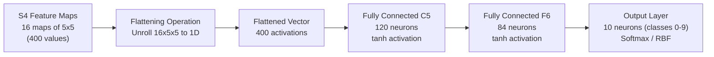

#### Step 1: Flattening the S4 Feature Maps
The fourth layer (S4) outputs 16 feature maps of size $5 \times 5$. To transition from 2D spatial feature maps to dense fully connected processing, the feature map of the fourth layer is flattened into a vector of 400 values:

$$
N_{\text{flat}} = H_{\text{S4}} \times W_{\text{S4}} \times C_{\text{S4}} = 5 \times 5 \times 16 = 400
$$

This unrolling flattens all activations across rows, columns, and channels into a single contiguous 1D column vector $\mathbf{x}_{\text{flat}} \in \mathbb{R}^{400}$. While flattening discards 2D spatial grid coordinates, spatial relationships are already encoded within the high-level semantic features captured by the preceding convolutional filters.

#### Step 2: Fully Connected Layer C5 (120 Neurons)
The flattened vector passes into the first fully connected stage, designated as Layer C5. Fully Connected Layer C5 flattens output from S4 and connects to 120 neurons.

- **Nomenclature Note:** Yann LeCun originally labeled this layer "C5" (Convolutional Layer 5) rather than "F5" because it can be interpreted mathematically as a convolutional layer with 120 filters of size $5 \times 5$. When a $5 \times 5$ filter convolves over an input of spatial dimension $5 \times 5$ with no padding, the output spatial dimension is:

$$
\left\lfloor \frac{5 - 5 + 0}{1} \right\rfloor + 1 = 1
$$

  A convolution of 120 filters of size $5 \times 5 \times 16$ over a $5 \times 5 \times 16$ input yields an output tensor of size $1 \times 1 \times 120$. This $1 \times 1 \times 120$ volume is algebraically and computationally identical to a fully connected layer with 120 nodes. In modern frameworks, C5 is implemented directly as a linear fully connected layer.
- **Linear Transformation:** Each of the 120 neurons computes an affine combination across all 400 input activations:

$$
\mathbf{z}_{\text{C5}} = \mathbf{W}_{\text{C5}} \mathbf{x}_{\text{flat}} + \mathbf{b}_{\text{C5}}
$$

  where $\mathbf{W}_{\text{C5}} \in \mathbb{R}^{120 \times 400}$ is the learnable weight matrix and $\mathbf{b}_{\text{C5}} \in \mathbb{R}^{120}$ is the learnable bias vector.
- **Activation Function:** The pre-activations pass through the hyperbolic tangent ($\tanh$) non-linearity:

$$
\mathbf{a}_{\text{C5}} = \tanh(\mathbf{z}_{\text{C5}}) = \frac{e^{\mathbf{z}_{\text{C5}}} - e^{-\mathbf{z}_{\text{C5}}}}{e^{\mathbf{z}_{\text{C5}}} + e^{-\mathbf{z}_{\text{C5}}}}
$$

  The $\tanh$ function maps activations symmetrically into the open interval $(-1, 1)$, preventing positive mean shift in downstream activations.

#### Step 3: Fully Connected Layer F6 (84 Neurons)
The output of C5 feeds into the second dense layer, designated as Layer F6. Fully Connected Layer F6 connects to 84 neurons.

- **Dimensionality Rationale:** The selection of 84 neurons was motivated by character typography. In LeCun's 1998 system, 84 corresponded to the number of pixels in a standard $7 \times 12$ bitmapped font representation of alphanumeric ASCII characters. The activations of F6 were designed to form a stylized representation of the target character glyph.
- **Linear Transformation:** The 84 neurons compute full inner products over the 120 activations from C5:

$$
\mathbf{z}_{\text{F6}} = \mathbf{W}_{\text{F6}} \mathbf{a}_{\text{C5}} + \mathbf{b}_{\text{F6}}
$$

  where $\mathbf{W}_{\text{F6}} \in \mathbb{R}^{84 \times 120}$ is the weight matrix and $\mathbf{b}_{\text{F6}} \in \mathbb{R}^{84}$ is the bias vector.
- **Activation Function:** Like C5, Layer F6 uses the $\tanh$ activation function:

$$
\mathbf{a}_{\text{F6}} = \tanh(\mathbf{z}_{\text{F6}})
$$

#### Step 4: Output Layer (10 Neurons)
The final stage of the classification head is the output layer. The output layer outputs 10 neurons corresponding to the 10 digit classes from 0 to 9.

- **Linear Projection:** In modern LeNet-5 implementations, the output layer computes 10 class logits:

$$
\mathbf{z}_{\text{out}} = \mathbf{W}_{\text{out}} \mathbf{a}_{\text{F6}} + \mathbf{b}_{\text{out}}
$$

  where $\mathbf{W}_{\text{out}} \in \mathbb{R}^{10 \times 84}$ and $\mathbf{b}_{\text{out}} \in \mathbb{R}^{10}$.
- **Softmax Activation:** The raw logits $\mathbf{z}_{\text{out}}$ are converted into normalized posterior class probabilities using the Softmax activation function:

$$
\hat{y}_k = P(Y = k \mid \mathbf{x}) = \frac{e^{z_{\text{out}, k}}}{\sum_{j=0}^{9} e^{z_{\text{out}, j}}} \quad \text{for } k \in \lbrace 0, 1, \dots, 9 \rbrace
$$

  The Softmax function ensures that $\sum_{k=0}^{9} \hat{y}_k = 1$ with each $\hat{y}_k > 0$, representing the estimated confidence that the input image belongs to digit class $k$.
- **Historical LeCun 1998 Euclidean RBF Formulation:** In the original 1998 publication, the output layer was structured with Euclidean Radial Basis Function (RBF) units instead of a trainable linear layer with Softmax. Each RBF unit $k$ computed the squared Euclidean distance between the 84-dimensional vector from F6 and a fixed, non-trainable 84-dimensional target bitmap vector $\mathbf{w}_k \in \lbrace -1, +1 \rbrace^{84}$ representing a stylized $7 \times 12$ ASCII rendering of digit $k$:

$$
y_k = \sum_{i=1}^{84} (a_{\text{F6}, i} - w_{ki})^2
$$

  The predicted class corresponded to the minimum distance $\arg\min_k y_k$. In modern deep learning practice, the linear projection with Softmax activation has superseded the RBF layer due to superior gradient flow with cross-entropy loss.

Thus, the flattened vector passes through three fully connected layers for classification, consisting of 120 nodes in the first FC layer, 84 nodes in the second, and 10 nodes in the third output layer for digit classes 0 to 9.

---

### 3. Visual Anchor

Below is the complete network diagram illustrating the feature maps and dense classification head from the lecture deck, followed by an architectural flow diagram mapping the dense classification head.

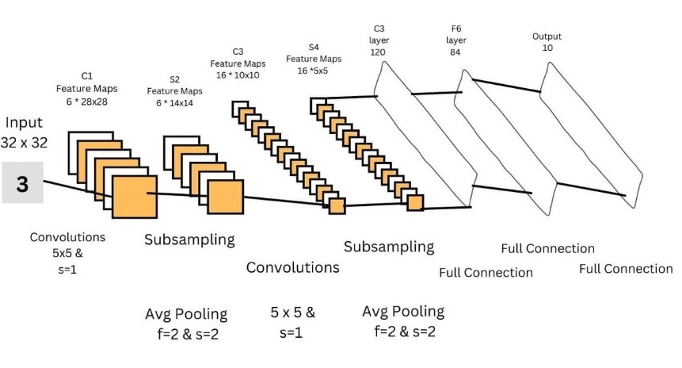

> [!WARNING]
> **Slide 10 Diagram Typo Alert:** In Slide 10 (`image6.png`), observe the label printed above the first fully connected layer of 120 units: it is mistakenly printed as **"C3 layer 120"**. This is an erratum in the lecture slide. Layer C3 was already defined earlier in the pipeline as the second convolutional layer with 16 feature maps of size $10 \times 10$. The 120-unit fully connected layer is canonically **C5** (or FC1).

The following complete LeNet-5 network diagram illustrates the feature extraction backbone and the three fully connected classification layers of 120, 84, and 10 nodes:

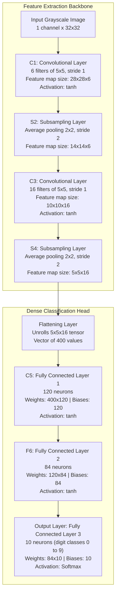

---

### 4. Verified Formulas, Trade-offs & Calculations

To understand the operational and memory profile of LeNet-5, we examine the layer-by-layer architectural summary table, compute exact parameter allocations, and reconcile the classic versus modern parameter accounting.

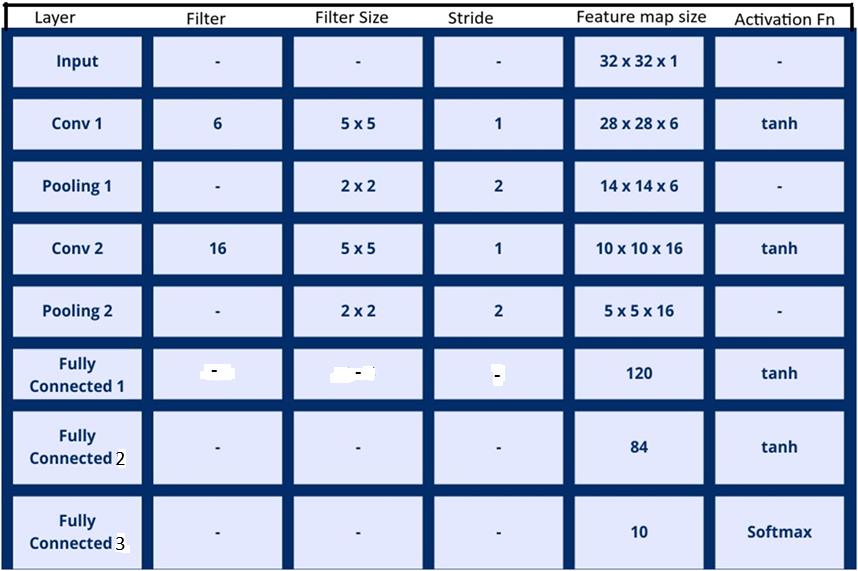

#### Master Architectural Summary Table

The table below reproduces and expands upon the summary table of LeNet-5 architecture presented in Slide 11, detailing the filter count, filter size, stride, feature map size, and activation functions for each layer.

The architecture summary table specifies tanh activation for convolutional and hidden dense layers and Softmax activation for the final classification layer.

| Layer | Type | Filter Count | Filter Size | Stride | Feature Map Size | Activation Fn | Trainable Weights | Trainable Biases | Total Modern Params | Synaptic Connections & MACs |
| :--- | :--- | :--- | :--- | :--- | :--- | :--- | :--- | :--- | :--- | :--- |
| **Input** | Input | - | - | - | $32 \times 32 \times 1$ | - | 0 | 0 | **0** | 0 |
| **C1** | Convolution | 6 | $5 \times 5$ | 1 | $28 \times 28 \times 6$ | $\tanh$ | $5 \times 5 \times 1 \times 6 = 150$ | 6 | **156** | $28 \times 28 \times 6 \times 26 = 122,304$ |
| **S2** | Subsampling | 6 | $2 \times 2$ | 2 | $14 \times 14 \times 6$ | - | 0 | 0 | **0** | $14 \times 14 \times 6 \times 5 = 5,880^*$ |
| **C3** | Convolution | 16 | $5 \times 5$ | 1 | $10 \times 10 \times 16$ | $\tanh$ | $5 \times 5 \times 6 \times 16 = 2,400$ | 16 | **2,416** | $10 \times 10 \times 16 \times 151 = 241,600$ |
| **S4** | Subsampling | 16 | $2 \times 2$ | 2 | $5 \times 5 \times 16$ | - | 0 | 0 | **0** | $5 \times 5 \times 16 \times 5 = 2,000^*$ |
| **C5** | Fully Connected | 120 neurons | - | - | 120 | $\tanh$ | $400 \times 120 = 48,000$ | 120 | **48,120** | $120 \times (400 + 1) = 48,120$ |
| **F6** | Fully Connected | 84 neurons | - | - | 84 | $\tanh$ | $120 \times 84 = 10,080$ | 84 | **10,164** | $84 \times (120 + 1) = 10,164$ |
| **Output** | Fully Connected | 10 neurons | - | - | 10 | Softmax | $84 \times 10 = 840$ | 10 | **850** | $10 \times (84 + 1) = 850$ |
| **TOTAL** | | | | | | | **61,470** | **236** | **61,706** | **430,918** (Classic) / **423,038** (Modern MACs) |

*(Notes on table conventions and multipliers:*
1. *Slide 11 Filter Column: In Slide 11 (`image7.png`), the Filter Count and Size for dense layers C5, F6, and Output are indicated by hyphens (`-`) because fully connected layers operate as 1D matrix projections rather than spatial 2D sliding filters.*
2. *Connection Multipliers in LeCun 1998: The multipliers in the connections column represent the total incoming synaptic edges per neuron ($N_{\text{inputs}} + 1 \text{ bias}$). For C1, each neuron receives $5 \times 5 = 25$ inputs plus 1 bias ($26 \text{ connections} \times 4,704 \text{ neurons} = 122,304$). For C3 under full connectivity, each neuron receives $6 \times 25 = 150$ inputs plus 1 bias ($151 \text{ connections} \times 1,600 \text{ neurons} = 241,600$). For dense layers, the multiplier is $(N_{\text{in}} + 1)$.*
3. *Modern MACs vs. Classic Connections: In asterisked layers S2 and S4, the multiplier 5 reflects classic trainable pooling ($4 \text{ inputs} + 1 \text{ bias}$). Under modern parameter-free average pooling ($y = \frac{1}{4} \sum x_i$), there are zero learnable weights and biases; excluding pooling connections, pure modern trainable layer MACs total $122,304 + 241,600 + 48,000 + 10,080 + 840 = \mathbf{423,038}$ MACs, while classic graph forward connections total $\mathbf{430,918}$).*

#### Parameter Calculation Formulas for Dense Layers

For any dense layer connecting an input vector of dimension $N_{\text{in}}$ to an output vector of dimension $N_{\text{out}}$, the number of learnable parameters is governed by:

$$
\text{Params}_{\text{dense}} = \text{Weights} + \text{Biases} = (N_{\text{in}} \times N_{\text{out}}) + N_{\text{out}} = (N_{\text{in}} + 1) \times N_{\text{out}}
$$

Applying this formula to each layer of the classification head:

1. **Layer C5** ($400 \to 120$):
   - Weights: $400 \times 120 = 48,000$
   - Biases: $120$
   - Total C5 parameters: $48,000 + 120 = 48,120$

2. **Layer F6** ($120 \to 84$):
   - Weights: $120 \times 84 = 10,080$
   - Biases: $84$
   - Total F6 parameters: $10,080 + 84 = 10,164$

3. **Output Layer** ($84 \to 10$):
   - Weights: $84 \times 10 = 840$
   - Biases: $10$
   - Total Output parameters: $840 + 10 = 850$

Summing across all three classification layers gives the total parameters in the dense head:

$$
\text{Params}_{\text{head}} = 48,120 + 10,164 + 850 = 59,134
$$

#### The Parameter Accounting Duality: 61,706 vs. 60,000 Parameters

In machine learning literature and academic examinations, students encounter two different total parameter counts for LeNet-5: **61,706** and **60,000**. Both figures are mathematically grounded under their respective architectural conventions:

1. **Modern Standard Convention (61,706 Parameters):**
   - Standard PyTorch and TensorFlow implementations connect all 6 channels of S2 to all 16 filters of C3, yielding $16 \times 6 \times 25 + 16 = 2,416$ parameters for C3.
   - Subsampling layers S2 and S4 are standard parameter-free average pooling operations (0 parameters).
   - The output layer is a standard trainable affine transformation with Softmax ($84 \times 10 + 10 = 850$ parameters).
   - Total modern parameter count:

$$
156 + 0 + 2,416 + 0 + 48,120 + 10,164 + 850 = 61,706
$$

2. **Classic LeCun 1998 Convention (60,000 Parameters):**
   - **Sparse C3 Connectivity:** To limit computational cost and break architectural symmetry, LeCun et al. connected each of the 16 C3 feature maps to specific subsets of S2 maps (6 maps connected to 3 inputs, 9 maps connected to 4 inputs, and 1 map connected to all 6 inputs). This required only 60 kernels of size $5 \times 5$:

$$
\text{Params}_{\text{C3, classic}} = (60 \times 25) + 16 = 1,500 + 16 = 1,516
$$

   - **Trainable Pooling Parameters:** Layers S2 and S4 assigned one trainable coefficient and one trainable bias to each feature map:

$$
\text{Params}_{\text{S2}} = 6 \times 2 = 12 \quad \text{and} \quad \text{Params}_{\text{S4}} = 16 \times 2 = 32
$$

   - **Fixed Output RBF Weights:** The output layer used Euclidean RBFs with fixed, non-trainable ASCII target vectors, contributing 0 trainable parameters.
   - Total classic 1998 trainable parameter count:

$$
156 + 12 + 1,516 + 32 + 48,120 + 10,164 + 0 = 60,000
$$

The exact arithmetic delta of 1,706 parameters is reconciled as follows:
- C3 Full Connectivity Delta: $+900$ parameters ($2,416 - 1,516$)
- S2 and S4 Pooling Delta: $-44$ parameters ($0 - 44$)
- Output Layer Trainable Delta: $+850$ parameters ($850 - 0$)
- Net Difference: $+900 - 44 + 850 = +1,706$ parameters, yielding $60,000 + 1,706 = 61,706$.

#### Architectural Trade-offs of Dense Classification Heads

1. **Parameter Concentration vs. Computational Footprint:**
   - In modern LeNet-5, the classification head contains 59,134 parameters out of 61,706 total parameters. This means **95.83%** of the entire model's parameter budget is concentrated inside the three fully connected layers ($\frac{59{,}134}{61{,}706} \approx 0.958318$, i.e., 95.83%).
   - Conversely, convolutional layers C1 and C3 account for **86.02%** of all modern trainable Multiply-Accumulate operations ($363,904$ out of $423,038$ MACs; or **84.45%** of the $430,918$ total forward connections when including classic pooling and bias edges), while the dense head requires only 58,920 multiplication MACs (**13.93%**).
   - This creates an asymmetric resource trade-off: convolutional layers dominate execution latency and FLOPs, while dense layers dominate memory bandwidth and storage footprints.

2. **Loss of Spatial Translation Equivariance:**
   - The flattening operation discards 2D coordinate topology. If an object is shifted within the input frame, the flattened activation index changes entirely, forcing the dense weights to learn separate combinations for shifted patterns.

3. **Overfitting Susceptibility:**
   - Fully connected layers with large parameter counts ($48,120$ in C5 alone) are prone to memorizing training samples unless regularized by weight decay or modern dropout.

4. **Evolution Towards Global Average Pooling (GAP):**
   - The parameter inefficiency of dense heads motivated later architectures (such as Network in Network, GoogLeNet, and ResNet) to replace multi-layer dense heads with Global Average Pooling (GAP), which averages each spatial feature map down to a single scalar before a single linear projection, reducing classification parameters by orders of magnitude.

## 4. Architectural Inductive Biases, Historical Innovations & Modern Evolutions

### 1. The Problem & Intuition

When Yann LeCun and his colleagues introduced LeNet-5 in 1998, artificial neural networks operated under drastically different computational and theoretical constraints than those governing modern deep learning. The central engineering problem was both fundamental and daunting: how can an artificial visual system automatically learn hierarchical, distortion-invariant representations directly from high-dimensional raw pixel grids without succumbing to numerical instability or optimization collapse?

In the late 1980s and 1990s, three foundational constraints dictated the architectural design of LeNet-5:

1. **Widespread Skepticism of End-to-End Optimization**: During this era, mainstream computer vision held that deep multi-layer neural networks could not be trained reliably using gradient descent. Prevailing academic consensus maintained that backpropagation through multiple non-linear layers would inevitably get trapped in catastrophic local minima or fail to converge. Consequently, contemporary vision pipelines decoupled pattern recognition into two separate phases: human experts engineered hand-crafted feature extractors (such as edge templates, Gabor filters, or morphological operators), and a shallow statistical classifier (such as a Perceptron or Support Vector Machine) was trained on those fixed representations.
2. **Biological Assumptions and Bounded Saturating Activations**: Early connectionist models drew inspiration from biological neurobiology, where real biological neurons exhibit finite firing thresholds and refractory saturation limits. Researchers reasoned that artificial neurons must similarly squash net inputs into bounded intervals (such as $[0, 1]$ or $[-1, 1]$) using smooth, differentiable functions like **sigmoid** or hyperbolic tangent (**tanh**). These saturating curves were considered essential to prevent internal numerical values from diverging toward infinity during forward propagation.
3. **Subsampling as Noise-Filtering Image Decimation**: Downsampling was conceptualized through the lens of classical signal processing and image decimation. Reducing the spatial resolution of intermediate feature representations was executed via **average pooling** under the premise that computing the local arithmetic mean acted as a smoothing low-pass filter. This averaging was intended to suppress high-frequency sensory noise, mitigate local sensor distortions, and smoothly compress spatial dimensionality.

#### Why Classical Paradigms Failed to Scale Deeper

While these early design principles enabled LeNet-5 to achieve groundbreaking commercial success on MNIST handwritten digit recognition, they encountered severe mathematical roadblocks when researchers attempted to scale networks to greater depths or complex natural imagery:

- **The Vanishing Gradient Bottleneck**: In deep networks, the mathematical properties of **sigmoid** and **tanh** non-linearities proved catastrophic. Because the first derivatives of saturating functions decay to zero as activation magnitudes increase, error signals backpropagating across successive layers shrink exponentially. In networks deeper than five to seven layers, the gradients reaching the earliest feature extraction layers become negligible, completely halting the optimization of fundamental edge and corner filters.
- **Feature Dilution from Average Pooling**: While **average pooling** provides low-pass smoothing, visual pattern discrimination fundamentally depends on detecting salient, high-contrast visual primitives—such as sharp pen strokes, digit intersections, or intense contours. Computing the average across a local receptive window inevitably dilutes strong, localized signals by mixing them with adjacent quiescent background pixels.
- **The Modern Evolution**: Overcoming these limitations catalyzed the deep learning revolution of the 2010s. Modern architectures replaced saturating activations with non-saturating Rectified Linear Units (**ReLU**), transitioned from average pooling to **max pooling**, and extended LeNet's foundational principle of end-to-end **training** via **backpropagation** across hundreds of stacked layers.

---

### 2. Mechanism & Architecture

The historical progression from LeNet-5 to modern deep convolutional architectures is defined by three fundamental evolutionary axes: activation function dynamics, spatial pooling strategies, and the scope of end-to-end gradient-based optimization.

#### 1. Activation Function Evolution: Sigmoid and Tanh vs. Modern ReLU

In the original LeNet-5 architecture, all convolutional layers and hidden fully connected layers employed **sigmoid** or **tanh** activation functions (Slide 3, Slide 11, Slide 12). 

Specifically, LeCun formulated a scaled hyperbolic tangent activation:

$$
f(a) = A \tanh(S a)
$$

with constants canonically configured to $A = 1.7159$ and $S = \frac{2}{3}$. This specific scaling was engineered so that $f(\pm 1) = \pm 1$, and the second derivative achieved its maximum near the operating targets of $\pm 1$. This design established unit variance across intermediate layer outputs when input variables were standardized to zero mean and unit variance, accelerating convergence in shallow networks.

However, saturating activations possess an intrinsic mathematical limitation: gradient saturation. The analytical derivative of the standard hyperbolic tangent is:

$$
\frac{d}{dz}\tanh(z) = 1 - \tanh^2(z)
$$

As the net input $z$ deviates from the origin ($|z| \to \infty$), $\tanh^2(z) \to 1$, driving the local derivative $\frac{d}{dz}\tanh(z) \to 0$. Similarly, for the logistic **sigmoid** function $\sigma(z) = \frac{1}{1 + e^{-z}}$, the derivative is:

$$
\frac{d}{dz}\sigma(z) = \sigma(z)(1 - \sigma(z))
$$

The maximum possible derivative of sigmoid is strictly $0.25$ (achieved at $z = 0$). When chained across multiple layers during backpropagation, these fractional derivatives multiply together, causing the gradient magnitude to decay exponentially toward zero.

To overcome this fundamental limitation, modern convolutional neural networks (beginning prominently with AlexNet in 2012) adopted the Rectified Linear Unit (**ReLU**):

$$
\text{ReLU}(z) = \max(0, z)
$$

The mechanism of ReLU delivers three transformative advantages:
- **Non-Saturating Gradient Flow**: For any positive input ($z > 0$), the derivative is identically equal to $1$ ($\frac{d}{dz}\text{ReLU}(z) = 1$). Because the derivative does not decay with large activations, gradients flow backward through dozens or hundreds of stacked layers without vanishing.
- **Induced Representation Sparsity**: Any neuron receiving negative net input outputs exactly zero ($\text{ReLU}(z) = 0$). This produces sparse representations where only a contextually relevant subset of features is active simultaneously, mirroring biological cortical representations and reducing co-adaptation of features.
- **Computational Efficiency**: Calculating ReLU requires only a basic conditional threshold at zero, completely bypassing the expensive transcendental exponential evaluations required by sigmoid and tanh.

#### 2. Spatial Subsampling Mechanics: Average Pooling vs. Modern Max Pooling

In LeNet-5, spatial subsampling is performed by layers S2 and S4 using **average pooling** with a $2 \times 2$ receptive window and a stride of 2 (Slide 3, Slide 4, Slide 7, Slide 9, Slide 12).

In the original 1998 formulation, subsampling was not merely an arithmetic mean; each feature map was assigned a trainable multiplicative coefficient $w$ and an additive bias $b$. For a $2 \times 2$ neighborhood consisting of four input activations $x_1, x_2, x_3, x_4$, the subsampled activation was computed as:

$$
y = \tanh\left( w \sum_{i=1}^4 x_i + b \right)
$$

*(Note: Some texts present this with an arithmetic mean as $\tanh(w_{\text{avg}} \cdot \frac{1}{4} \sum_{i=1}^4 x_i + b)$, which is mathematically equivalent to LeCun's raw sum formulation under scalar re-scaling $w = \frac{1}{4} w_{\text{avg}}$).*

In modern standardized implementations, this is simplified to parameter-free **average pooling**, where each output node is the arithmetic mean of the local window.

While average pooling preserves the background signal energy and smooths out localized pixel noise, it introduces a severe operational trade-off: **signal dilution**. Consider a sharp edge or the high-intensity stroke of a handwritten digit appearing within a $2 \times 2$ block. If only one pixel contains a strong activation of $1.0$ while the remaining three pixels are inactive background ($0.0$), average pooling outputs $\frac{1 + 0 + 0 + 0}{4} = 0.25$. The prominence of the detected feature is attenuated by 75 percent.

In contrast, modern architectures predominantly employ **max pooling**:

$$
y = \max(x_1, x_2, x_3, x_4)
$$

The mechanics of max pooling provide superior visual representations:
- **Salient Extrema Retention**: Max pooling strictly preserves the maximal activation detected within the spatial window. For the stroke example above, max pooling outputs $\max(1.0, 0.0, 0.0, 0.0) = 1.0$, retaining the full discriminatory potency of the feature detector.
- **Strict Translation Invariance**: If a handwritten character shifts slightly such that an edge moves from the top-left to the bottom-right within a $2 \times 2$ cell, the maximum response remains identically $1.0$. Max pooling thus yields robust local translation invariance.
- **Gradient Sparsity**: During backpropagation, max pooling routes 100 percent of the incoming upstream error gradient directly to the single neuron that achieved the maximum activation, setting the gradient for all non-maximal neighbors to zero. This focuses parameter updates exclusively on the most discriminative visual filters.

#### 3. End-to-End Training via Backpropagation: The Foundation of Modern Deep Learning

LeNet-5 represents one of the first neural networks in computer science history to successfully use **backpropagation** for end-to-end **training** of a multi-layer visual architecture directly from raw pixel arrays (Slide 12, Slide 13).

Prior to LeNet, the prevailing methodology in pattern recognition required manually designing feature extractors based on empirical domain heuristics. These hand-crafted filters were static; they did not learn from classification errors. If the hand-crafted features discarded subtle stroke curves or topological intersections, the downstream classifier could never recover that lost information.

Yann LeCun's decisive insight was to formulate the entire processing pipeline—from raw pixel inputs, through convolutional feature extractors and spatial subsamplers, to dense classification layers—as a single, continuously differentiable computational graph. 

The mechanism operates through global gradient propagation:
1. An input image is propagated forward through all seven layers to produce class scores at the output layer.
2. A global loss function evaluates the discrepancy between the network prediction and the true ground-truth label.
3. The analytical error gradient is propagated backward through the entire architecture using the multivariate chain rule of differential calculus.
4. Every learnable parameter—the convolutional kernels in C1 and C3, the subsampling coefficients in S2 and S4, and the connection weights in C5, F6, and the output layer—is simultaneously updated via Stochastic Gradient Descent (SGD):

$$
\theta_{t+1} = \theta_t - \eta \cdot \frac{\partial \mathcal{L}}{\partial \theta_t}
$$

By proving that multi-layer convolutional networks could be trained end-to-end using backpropagation, LeNet-5 established the foundational blueprint upon which modern deep computer vision is constructed.

---

### 3. Visual Anchor

The following diagram contrasts the classical 1998 LeNet-5 architectural paradigm with modern deep convolutional neural network designs, illustrating the historical evolution across input processing, layer depth, activation dynamics, subsampling methods, and classification heads.

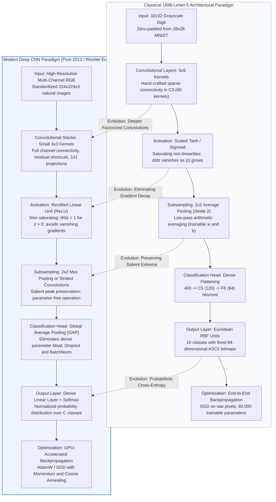

---

### 4. Verified Formulas, Trade-offs & Calculations

#### 1. Mathematical Analysis of Activation Derivatives and Vanishing Gradients

The mathematical root of the vanishing gradient problem lies in the analytical derivative of saturating activation functions.

##### Logistic Sigmoid Activation
The logistic sigmoid function is defined as:

$$
\sigma(z) = \frac{1}{1 + e^{-z}}
$$

Its first derivative with respect to net input $z$ is:

$$
\frac{d}{dz}\sigma(z) = \sigma(z)(1 - \sigma(z))
$$

Evaluating the maximum derivative by setting the second derivative to zero:

$$
\frac{d^2}{dz^2}\sigma(z) = \sigma(z)(1 - \sigma(z))(1 - 2\sigma(z)) = 0 \implies \sigma(z) = 0.5 \implies z = 0
$$

Substituting $z = 0$ yields the absolute maximum derivative:

$$
\max_{z} \sigma'(z) = 0.5 \times (1 - 0.5) = 0.25
$$

For any input where $|z| > 0$, the derivative is strictly less than $0.25$. As $|z| \to \infty$, the derivative rapidly approaches zero ($\lim_{|z| \to \infty} \sigma'(z) = 0$).

##### Hyperbolic Tangent Activation
The hyperbolic tangent function is defined as:

$$
\tanh(z) = \frac{e^z - e^{-z}}{e^z + e^{-z}}
$$

Its first derivative is:

$$
\frac{d}{dz}\tanh(z) = 1 - \tanh^2(z)
$$

The maximum derivative occurs at $z = 0$:

$$
\max_{z} \tanh'(z) = 1 - 0^2 = 1.0
$$

However, because $\tanh(z)$ rapidly approaches $\pm 1$ as input magnitudes exceed $|z| > 2.5$, the derivative rapidly decays toward zero:

$$
\lim_{|z| \to \infty} \frac{d}{dz}\tanh(z) = 1 - (\pm 1)^2 = 0
$$

##### Rectified Linear Unit (ReLU)
The ReLU activation function is defined piecewise:

$$
\text{ReLU}(z) = \max(0, z)
$$

Its derivative (using the standard subgradient convention of $0$ at $z = 0$) is:

$$
\frac{d}{dz}\text{ReLU}(z) = \begin{cases}
1 & \text{if } z > 0 \\
0 & \text{if } z < 0
\end{cases}
$$

##### Vanishing Gradient Compounding Across Network Depth
Consider a deep neural network consisting of $L$ successive layers, where $z_l = W_l a_{l-1} + b_l$ represents the pre-activation vector at layer $l$, and $a_l = \phi(z_l)$ represents the post-activation vector. Applying the multivariate chain rule in column-gradient vector notation ($\nabla_a \mathcal{L} = (\frac{\partial \mathcal{L}}{\partial a})^T$), the gradient of the scalar loss $\mathcal{L}$ with respect to the input activations $a_0$ propagates backward from layer $L$ to layer 1 as:

$$
\nabla_{a_0} \mathcal{L} = W_1^T \operatorname{diag}(\phi'(z_1)) \cdot W_2^T \operatorname{diag}(\phi'(z_2)) \cdots W_L^T \operatorname{diag}(\phi'(z_L)) \cdot \nabla_{a_L} \mathcal{L}
$$

$$
= \left[ \prod_{l=1}^L \left( W_l^T \operatorname{diag}(\phi'(z_l)) \right) \right] \nabla_{a_L} \mathcal{L}
$$

where each layer Jacobian matrix factor $J_l = W_l^T \operatorname{diag}(\phi'(z_l))$ maps upstream gradients from layer $l$ backward into layer $l-1$.

When using the sigmoid activation function, every intermediate layer introduces an upper-bounded diagonal scaling factor:

$$
\Vert \text{diag}(\sigma'(z_l)) \Vert_2 \le 0.25
$$

Assuming normalized weight matrices initialized such that $\Vert W_l \Vert_2 \approx 1$, the gradient magnitude backpropagating to the input layer decays exponentially with depth:

$$
\left\Vert \frac{\partial \mathcal{L}}{\partial a_0} \right\Vert_2 \le \left\Vert \frac{\partial \mathcal{L}}{\partial a_L} \right\Vert_2 \times (0.25)^L
$$

For a network of depth $L = 10$, this attenuation factor evaluates to:

$$
(0.25)^{10} = \frac{1}{4^{10}} = \frac{1}{1{,}048{,}576} \approx 9.537 \times 10^{-7}
$$

The gradient signal reaching layer 1 is attenuated by a factor of over one million, completely paralyzing weight updates in the earliest layers.

In contrast, under **ReLU**, for all active units ($z > 0$), the local derivative is identically $1.0$. The diagonal matrix $\text{diag}(\phi'(z_l))$ acts as an identity operator on all active transmission paths:

$$
\prod_{l=1}^L \phi'(z_l) = 1.0^L = 1.0
$$

This mathematical property preserves healthy gradient magnitudes across arbitrary network depth, enabling the successful training of architectures with hundreds of layers.

---

#### 2. Subsampling and Error Gradient Routing Formulas

The choice of spatial pooling mechanism directly governs how upstream error gradients are distributed among backward-propagating feature maps.

##### Average Pooling Forward and Backward Dynamics
Let $X \in \mathbb{R}^{H \times W}$ denote the input feature map, and let $K \times K$ denote the spatial extent of the pooling filter with stride $S = K$. The forward average pooling operation computes the arithmetic mean:

$$
y_{i, j} = \frac{1}{K^2} \sum_{m=0}^{K-1} \sum_{n=0}^{K-1} X_{i \cdot K + m, j \cdot K + n}
$$

During backward propagation, let $\frac{\partial \mathcal{L}}{\partial y_{i, j}}$ denote the incoming upstream error gradient. Applying the partial derivative with respect to any input coordinate $(p, q)$ inside the receptive window:

$$
\frac{\partial y_{i, j}}{\partial X_{p, q}} = \frac{1}{K^2}
$$

Therefore, the backpropagated gradient with respect to each input element is:

$$
\frac{\partial \mathcal{L}}{\partial X_{p, q}} = \frac{\partial \mathcal{L}}{\partial y_{i, j}} \cdot \frac{\partial y_{i, j}}{\partial X_{p, q}} = \frac{1}{K^2} \frac{\partial \mathcal{L}}{\partial y_{i, j}}
$$

For LeNet-5's $2 \times 2$ pooling filter ($K = 2$):

$$
\frac{\partial \mathcal{L}}{\partial X_{p, q}} = \frac{1}{4} \frac{\partial \mathcal{L}}{\partial y_{i, j}}
$$

Each input pixel receives exactly 25 percent of the upstream gradient. This uniform distribution diffuses the backpropagated error across all spatial locations, penalizing strong and weak activations alike.

##### Max Pooling Forward and Backward Dynamics
Under max pooling, the forward operation computes the supremum over the receptive window:

$$
y_{i, j} = \max_{0 \le m, n < K} X_{i \cdot K + m, j \cdot K + n}
$$

Let $(m^\ast, n^\ast)$ denote the relative spatial coordinate of the element achieving the maximum value:

$$
(m^\ast, n^\ast) = \arg\max_{0 \le m, n < K} X_{i \cdot K + m, j \cdot K + n}
$$

The partial derivative of the max pooling output with respect to any input coordinate $(p, q)$ is:

$$
\frac{\partial y_{i, j}}{\partial X_{p, q}} = \begin{cases}
1 & \text{if } (p, q) = (i \cdot K + m^\ast, j \cdot K + n^\ast) \\
0 & \text{otherwise}
\end{cases}
$$

Consequently, the backpropagated gradient routes all error signal exclusively to the argmax location:

$$
\frac{\partial \mathcal{L}}{\partial X_{p, q}} = \begin{cases}
\frac{\partial \mathcal{L}}{\partial y_{i, j}} & \text{if } (p, q) = (i \cdot K + m^\ast, j \cdot K + n^\ast) \\
0 & \text{otherwise}
\end{cases}
$$

Max pooling routes 100 percent of the upstream error gradient to the single most responsive neuron that produced the output activation, while completely masking non-maximal neighbors. This concentrates gradient updates on dominant feature detectors, sharpening pattern discrimination.

---

#### 3. Mathematical Differentiability of Convolution in Backpropagation

LeNet proved that convolutional operations form an entirely differentiable chain suitable for end-to-end gradient-based optimization.

##### Forward Discrete Cross-Correlation / Convolution
For an input 2D feature map $X$ and a filter kernel $K$ of spatial size $F \times F$ with stride $S = 1$ and zero padding:

$$
Y_{i, j} = \sum_{m=0}^{F-1} \sum_{n=0}^{F-1} X_{i+m, j+n} K_{m, n}
$$

##### Kernel Weight Gradient Calculation
The partial derivative of the scalar loss $\mathcal{L}$ with respect to a specific filter kernel parameter $K_{m, n}$ sums the error across all valid spatial receptive fields:

$$
\frac{\partial \mathcal{L}}{\partial K_{m, n}} = \sum_{i} \sum_{j} \frac{\partial \mathcal{L}}{\partial Y_{i, j}} \cdot \frac{\partial Y_{i, j}}{\partial K_{m, n}} = \sum_{i} \sum_{j} \frac{\partial \mathcal{L}}{\partial Y_{i, j}} X_{i+m, j+n}
$$

The kernel weight gradient is computed as a valid cross-correlation between the input feature map $X$ and the upstream gradient map $\frac{\partial \mathcal{L}}{\partial Y}$.

##### Input Feature Map Gradient Calculation
Similarly, the gradient propagating backward to the input feature map $X_{p, q}$ is obtained by summing contributions from all output locations $(i, j)$ where $X_{p, q}$ participated:

$$
\frac{\partial \mathcal{L}}{\partial X_{p, q}} = \sum_{m=0}^{F-1} \sum_{n=0}^{F-1} \frac{\partial \mathcal{L}}{\partial Y_{p-m, q-n}} K_{m, n}
$$

Let $K^{\text{rot180}}$ denote the kernel rotated by 180 degrees ($K^{\text{rot180}}_{m, n} = K_{F-1-m, F-1-n}$). The backward input gradient is calculated as a full convolution between the upstream gradient map $\frac{\partial \mathcal{L}}{\partial Y}$ and the spatially rotated kernel $K^{\text{rot180}}$. 

Because both parameter gradients and activation gradients reduce to standard convolution operations, the entire network is end-to-end differentiable and highly parallelizable.

---

#### 4. Architectural Trade-Off Matrix: Classical LeNet vs. Modern Deep CNNs

The table below provides a comprehensive comparison between the classical LeNet-5 design paradigms of 1998 and modern deep convolutional architectures:

| Architectural Dimension | Classical LeNet-5 (1998) | Modern Deep CNNs (Post-2012 / ResNet) | Theoretical & Mathematical Rationale |
| :--- | :--- | :--- | :--- |
| **Activation Function** ($\phi$) | Scaled $\tanh$ ($A=1.7159, S=2/3$) and logistic **sigmoid** | Rectified Linear Unit (**ReLU**), Leaky ReLU, or GELU | Tanh/sigmoid saturate at large inputs ($\phi' \to 0$), causing vanishing gradients. ReLU provides constant unit gradient ($\phi' = 1$ for $z > 0$). |
| **Subsampling / Pooling** | **Average pooling** ($2 \times 2$, stride 2, learnable $w$ and $b$) | **Max pooling** ($2 \times 2$ or $3 \times 3$) or strided convolutions | Average pooling smooths features and dilutes sharp signals. Max pooling preserves the strongest salient response and enforces strict translation invariance. |
| **Channel Connectivity** | Sparse, manual connection tables in C3 (60 kernels instead of $16 \text{ output maps} \times 6 \text{ input channels} = 96 \text{ kernels}$ in full connectivity) | Dense, full inter-channel connectivity ($C_{\text{in}} \times C_{\text{out}}$) | Sparse tables broke symmetry and reduced parameters on 1990s CPUs. Modern GPUs leverage dense tensor matrix multiplications efficiently. |
| **Filter Spatial Extent** | Large $5 \times 5$ kernels in convolutional stages C1 and C3 | Factorized small $3 \times 3$ or $1 \times 1$ convolutional stacks | Two stacked $3 \times 3$ filters cover the same $5 \times 5$ effective receptive field with fewer parameters ($2 \times 3^2 = 18$ vs $5^2 = 25$) and greater non-linearity. |
| **Classification Head** | Dense fully connected layers: C5 (120) $\to$ F6 (84) $\to$ Output (10) | Global Average Pooling (GAP) followed by a single linear projection | Dense classification layers account for over 80 percent of parameters in early CNNs. GAP eliminates massive weight matrices and prevents overfitting. |
| **Output Layer Formulation** | Euclidean Radial Basis Function (RBF) units with fixed ASCII bit patterns | Linear projection layer with **Softmax** cross-entropy loss | Fixed RBF centers represented rigid bitmap prototypes. Softmax outputs a normalized probability distribution optimized via maximum likelihood. |
| **Optimization Strategy** | Classical Stochastic Gradient Descent (**training** via **backpropagation**) | SGD with Momentum, AdamW, Cosine Annealing, and Warmup | LeNet established foundational backpropagation; modern optimizers accelerate convergence across complex non-convex loss surfaces. |
| **Regularization Techniques** | Weight decay (L2 penalty) and architectural parameter sharing | Batch Normalization, Layer Normalization, Dropout, and Data Augmentation | Modern normalization stabilizes internal covariate shift, enabling deep gradient propagation without manual scale tuning. |
