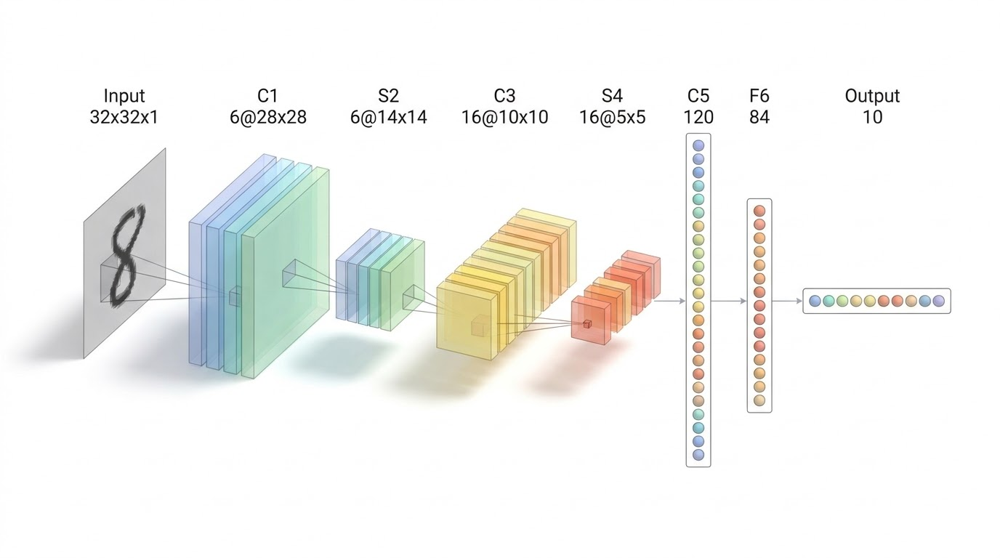

# Lecture 14 — LeNet-5: Exam Questions and Answers

Companion to [ML_Lec_14_LeNeT_CNN_Learning_Guide.md](ML_Lec_14_LeNeT_CNN_Learning_Guide.md). Try each question first, then read the answer.

**Pattern:** Part A = 2-mark questions. Part B = 10-mark questions split (a) + (b), 5 + 5 or 6 + 4.
**Tags:** 🎯 real paper; ✍️ practice to cover the lecture; 📘 beyond the slides. 💡 = memory hook.
No past paper has asked about LeNet directly, but its numbers are the standard CNN numerical (see [Lecture 13, B1](ML_Lec_13_CNN_QA.md)).

| Topic in the guide | Question |
| :--- | :--- |
| What LeNet is, facts, versions (§1) | A1 |
| Input and zero-padding (§2) | A2 |
| Layers, sizes, summary table (§2) | B1 |
| Slide 10 discrepancy (§2) | A4 |
| Parameters (📘, §2) | B1(b) |
| Characteristics and impact (§3) | A3, B2 |

---

## Part A — 2-mark questions

### A1. What is LeNet and what was it used for? ✍️ [2]

LeNet is one of the **first CNN architectures**, developed by **Yann LeCun** and colleagues in the late 1980s and early 1990s. It was designed for **handwritten digit recognition** (the MNIST dataset) and was used by many **banks to read handwritten amounts on cheques**. It reached a test error of about **0.95%**, i.e. over 99% accuracy. The version studied is **LeNet5**.

> 💡 LeNet = LeCun's cheque reader.

### A2. MNIST images are 28×28. Why and how are they fed to LeNet5 as 32×32? ✍️ [2]

LeNet5 expects a **32×32 grayscale** input. The 28×28 digit is **zero-padded**: a border of 2 zero pixels on every side, $28 + 2 + 2 = 32$. The padding lets the 5×5 filters of C1 cover the edges of the digit fully, and C1 then gives $32 - 5 + 1 = 28$, so its maps match the original digit size.

> 💡 Pad 2 on each side: 28 + 4 = 32.

### A3. Average pooling or max pooling: which does LeNet use, and what is the difference? ✍️ [2]

LeNet uses **average pooling** (2×2, stride 2), which was common at the time. Later networks prefer **max pooling**, which keeps the strongest response.

On one block {1, 3, 5, 7}: average = $(1+3+5+7)/4 = 4$; max = 7.

> 💡 LeNet averages; modern nets take the max.

### A4. Slide 10 labels the 120-neuron layer "C3 layer 120". What is wrong? ✍️ [2]

The 120-neuron layer is **C5**, the first fully connected layer. **C3** is the second convolutional layer, which outputs 16 maps of 10×10. The full order is C1 → S2 → C3 → S4 → C5 (120) → F6 (84) → Output (10).

> 💡 Odd numbers are conv/FC (C1, C3, C5); even numbers are pooling (S2, S4).

---

## Part B — 10-mark questions

### B1. ✍️

**(a)** Draw and explain the LeNet5 architecture. Give the output size of every layer with the calculation. **[6]**
**(b)** Calculate the number of trainable parameters in each layer and the total. **[4]**

**(a) Answer.**

C = convolution, S = subsampling (pooling), F = fully connected. Size formula: $W_2 = \frac{W_1 - F + 2P}{S} + 1$.

| Layer | Filters | Size / stride | Output (calculation) | Activation |
| :--- | :---: | :---: | :--- | :--- |
| Input | — | — | 32×32×1 | — |
| C1 (conv) | 6 | 5×5 / 1 | $(32-5)/1 + 1 = 28$ → 28×28×6 | tanh |
| S2 (avg pool) | — | 2×2 / 2 | $(28-2)/2 + 1 = 14$ → 14×14×6 | — |
| C3 (conv) | 16 | 5×5 / 1 | $(14-5)/1 + 1 = 10$ → 10×10×16 | tanh |
| S4 (avg pool) | — | 2×2 / 2 | $(10-2)/2 + 1 = 5$ → 5×5×16, flattened to **400** | — |
| C5 (FC) | — | — | 120 | tanh |
| F6 (FC) | — | — | 84 | tanh |
| Output (FC) | — | — | 10 | softmax |

Explanation: the convolutions find patterns (edges, then strokes); the pooling layers halve the size and keep the depth; the three FC layers combine the 400 features and decide which of the 10 digits it is.

**(b) Answer.**

| Layer | Formula | Parameters |
| :--- | :--- | ---: |
| C1 | $6 \times (5 \cdot 5 \cdot 1 + 1)$ | 156 |
| S2, S4 | pooling has no weights | 0 |
| C3 | $16 \times (5 \cdot 5 \cdot 6 + 1)$ | 2,416 |
| C5 | $(400 + 1) \times 120$ | 48,120 |
| F6 | $(120 + 1) \times 84$ | 10,164 |
| Output | $(84 + 1) \times 10$ | 850 |
| **Total** | | **61,706** |

> 💡 32 → 28 → 14 → 10 → 5; 6 maps then 16; 120 → 84 → 10.

### B2. ✍️

**(a)** State the key characteristics of LeNet and compare them with modern CNNs. **[5]**
**(b)** What is LeNet's impact? Name the key ideas it introduced and the popular CNN models that followed. **[5]**

**(a) Answer.**

| Choice | LeNet | Modern CNNs |
| :--- | :--- | :--- |
| Activation | sigmoid or tanh | ReLU |
| Pooling | average pooling | max pooling |
| Training | one of the first nets trained with **backpropagation** | standard everywhere |
| Size | small: 7 layers, about 61.7 thousand parameters | very deep, millions of parameters (AlexNet about 62 M, VGG16 about 138 M) |
| Input | 32×32 grayscale | e.g. 224×224 colour |

**(b) Answer.**

- **Legacy:** it laid the groundwork for more complex CNNs and influenced later computer vision research.
- **Use cases:** beyond digits, variations were adapted for many image classification tasks.
- **Key ideas introduced:** convolutional layers, pooling (subsampling), and **end-to-end training**, where the whole network is trained together from input to output.
- **Models that followed:** AlexNet, GoogleNet, VGG, ResNet, DenseNet, ResNeXt, EfficientNet.

LeNet remains a foundational model in neural networks and computer vision.

> 💡 LeNet is the grandparent: conv + pool + backprop, end to end.
