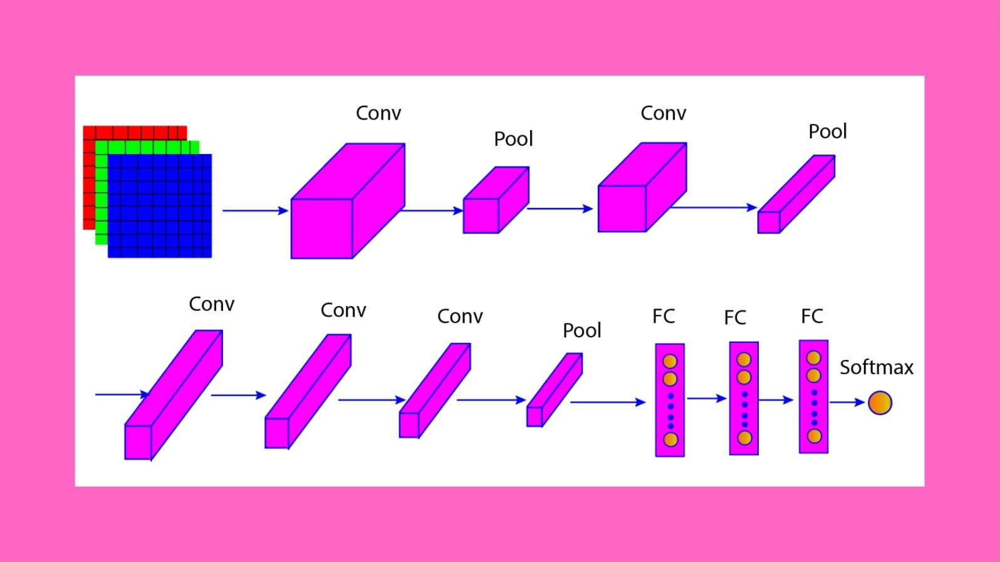
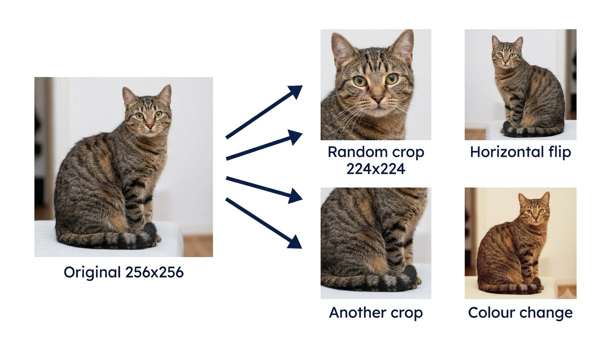
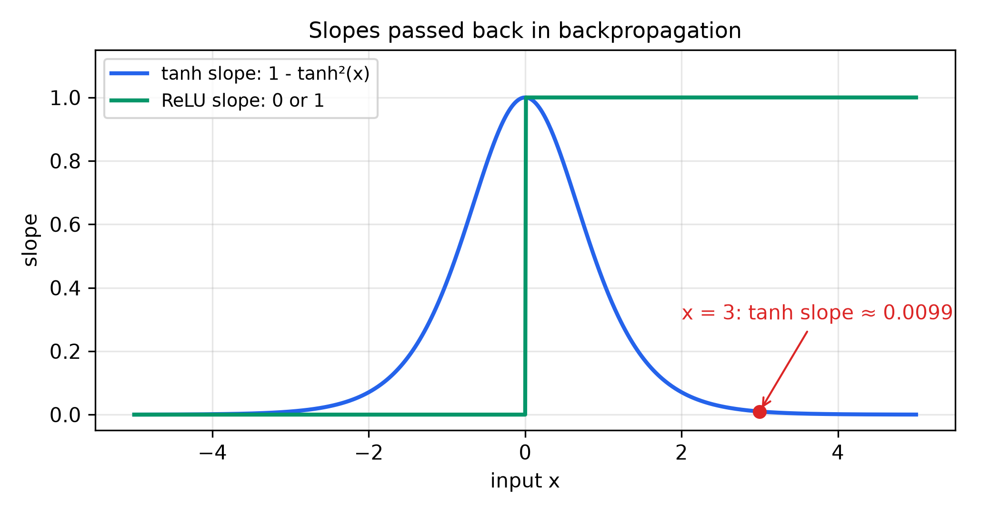

# AlexNet — Learning Guide

Source: `ML_Lec_15_AlexNet_CNN.pptx`, Slides 1–8. Every number recomputed.
**📘 Beyond the slides** = gap filled from outside the slides. **✏️ Slide discrepancy** = a slide is wrong or unclear.

## Contents

1. [What AlexNet is](#1-what-alexnet-is)
2. [The layers and their sizes](#2-the-layers-and-their-sizes)
3. [Counting the parameters](#3-counting-the-parameters)
4. [Why AlexNet worked](#4-why-alexnet-worked)

---

## 1. What AlexNet is

**Why it exists.** LeNet (Lecture 14) read small grey 32×32 digits. Real photos are large, in colour, and show thousands of object kinds in every pose and light. Hand-designed features had hit a ceiling. AlexNet showed that a big CNN, trained on lots of data with fast hardware, learns far better features by itself.

**Facts (Slide 1).**

- Developed by Alex Krizhevsky and colleagues in 2012.
- A groundbreaking CNN that greatly advanced computer vision.
- State-of-the-art in the 2012 **ImageNet Large Scale Visual Recognition Challenge (ILSVRC)**, a yearly contest to classify photos into 1000 classes; it clearly beat the competition.
- Its success showed the power of deep learning for image classification and started a wave of CNN research.
- Its architecture and techniques laid the groundwork for later models in image and video recognition, object detection and more.

> 📘 **Beyond the slides.** The colleagues were Ilya Sutskever and Geoffrey Hinton. Top-5 test error was 15.3% against 26.2% for second place ("top-5 error": the true class is not among the model's 5 best guesses). That is $26.2 - 15.3 = 10.9$ fewer mistakes per 100 images, about $10.9 / 26.2 \approx 0.42$, or 42%, fewer. It trained on two NVIDIA GTX 580 GPUs for five to six days.


*Figure: Slide 2. Top row left to right, then the bottom row: 5 convolution layers, 3 pooling layers, 3 fully connected (FC) layers, softmax output.*

The 5 conv and 3 FC layers have weights; pooling has none. So AlexNet is an **8-layer** network (Lecture 16 uses this count).

---

## 2. The layers and their sizes

**The idea.** A 227×227 photo is big, so Conv1 shrinks it fast with large 11×11 filters that jump 4 pixels. Conv2 then keeps the size (stride 1, padding) but uses many more filters. Conv3–5 stack small 3×3 filters with no pooling between them, building object parts. FC layers combine all that evidence into one of 1000 classes.

**The layers (Slides 3–7).** Every conv and FC layer except the last uses **ReLU** (Rectified Linear Unit), $\max(0, x)$: keep positives, zero negatives. Every pool is **max pooling**, keeping the largest value in each window.

| Layer (slide) | Filters / neurons | Kernel | Stride | Padding | Output |
| :--- | :--- | :---: | :---: | :---: | :--- |
| Input (3) | — | — | — | — | 227×227×3 (RGB) |
| Conv1 (3) | 96 | 11×11 | 4 | 0 | 55×55×96 |
| Pool1 (3) | — | 3×3 | 2 | 0 | 27×27×96 |
| Conv2 (4) | 256 | 5×5 | 1 | 2 📘 | 27×27×256 |
| Pool2 (4) | — | 3×3 | 2 | 0 | 13×13×256 |
| Conv3 (5) | 384 | 3×3 | 1 | 1 📘 | 13×13×384 |
| Conv4 (5) | 384 | 3×3 | 1 | 1 📘 | 13×13×384 |
| Conv5 (6) | 256 | 3×3 | 1 | 1 📘 | 13×13×256 |
| Pool3 (6) | — | 3×3 | 2 | 0 | 6×6×256 |
| Flatten | — | — | — | — | 9216 |
| FC1 (7) | 4096, dropout 50% | — | — | — | 4096 |
| FC2 (7) | 4096, dropout 50% | — | — | — | 4096 |
| FC3 (7) | 1000, **softmax** | — | — | — | 1000 class probabilities |

The input was originally designed for 224×224; Slide 3 says the extra size was added "for compatibility". The slides give no padding for Conv2–5; the 📘 values are derived below.

**The size formula (Lecture 12).**

```math
O = \frac{N - F + 2P}{S} + 1
```

Take the input width $N$, subtract the filter width $F$, add padding $P$ on both sides, divide by stride $S$, add 1.

| Step | Calculation | Result |
| :--- | :--- | :--- |
| Conv1 | $(227 - 11 + 0)/4 + 1 = 54 + 1$ | 55 |
| Pool1 | $(55 - 3)/2 + 1 = 26 + 1$ | 27 |
| Conv2 padding | $27 = (27 - 5 + 2P)/1 + 1 \Rightarrow 2P = 4$ | $P = 2$ |
| Pool2 | $(27 - 3)/2 + 1 = 12 + 1$ | 13 |
| Conv3–5 padding | keep 13 with $F = 3$, $S = 1$: $P = (3 - 1)/2$ | $P = 1$ |
| Pool3 | $(13 - 3)/2 + 1 = 5 + 1$ | 6 |
| Flatten | $6 \times 6 \times 256$ | 9216 |

Depth always equals the number of filters; pooling works per channel, so it keeps the depth. For stride 1, $P = (F - 1)/2$ is "same" padding: the size does not change.

**Why 227, not 224.** With 224: $(224 - 11)/4 + 1 = 54.25$, not a whole number, so the filter does not fit evenly. With 227 the division is exact. That is the "compatibility".

> ✏️ **Slide discrepancy (Slide 3).** The slide says Conv1's 55×55×96 comes "after applying padding". No padding is used: $P = 0$ gives exactly 55. The 3 extra pixels are already in the 227×227 input.

**Overlapping pooling.** The pool window (3) is bigger than the stride (2), so neighbouring windows share one row and one column.

**Dropout** (Lecture 13) switches each FC1/FC2 neuron off with probability 0.5 during training, for regularization. The network cannot lean on any single neuron, so it learns robust features. At test time all neurons are used.

**Softmax** turns the 1000 scores $s_1, \dots, s_{1000}$ into probabilities that add up to 1:

```math
p_k = \frac{e^{s_k}}{\sum_{j=1}^{1000} e^{s_j}}
```

Raise $e$ to each score, then divide each by the total.

---

## 3. Counting the parameters

A conv filter has (kernel × kernel × input channels) weights plus 1 bias. An FC layer with $n_{in}$ inputs and $n_{out}$ neurons has $n_{in} \times n_{out} + n_{out}$. Pooling has none.

| Layer | Calculation | Parameters |
| :--- | :--- | ---: |
| Conv1 | $96 \times (11 \cdot 11 \cdot 3 + 1) = 96 \times 364$ | 34,944 |
| Conv2 | $256 \times (5 \cdot 5 \cdot 96 + 1) = 256 \times 2401$ | 614,656 |
| Conv3 | $384 \times (3 \cdot 3 \cdot 256 + 1) = 384 \times 2305$ | 885,120 |
| Conv4 | $384 \times (3 \cdot 3 \cdot 384 + 1) = 384 \times 3457$ | 1,327,488 |
| Conv5 | $256 \times (3 \cdot 3 \cdot 384 + 1) = 256 \times 3457$ | 884,992 |
| FC1 | $9216 \times 4096 + 4096$ | 37,752,832 |
| FC2 | $4096 \times 4096 + 4096$ | 16,781,312 |
| FC3 | $4096 \times 1000 + 1000$ | 4,097,000 |
| **Total** | conv 3,747,200 + FC 58,631,144 | **62,378,344** |

About **94%** of the weights sit in the FC layers (FC1 alone, almost 38 million, beats all five convs together). That is why dropout goes on the FC layers. The convolutions, though, do most of the computing.

> 📘 **Beyond the slides.** The usual figure is "about 60 million" (Lecture 16, Slide 19). The original split Conv2, Conv4 and Conv5 across two GPUs, so each half saw only half the input channels (48, 192, 192 instead of 96, 384, 384). That gives 60,965,224. The 62.4 million above is the single-GPU version the slides describe.

---

## 4. Why AlexNet worked

**The problem.** Deep networks existed before 2012 but trained slowly and overfit. AlexNet combined practical fixes for both. The slides show three: ReLU after every conv and FC layer, 50% dropout in FC1 and FC2, and 3×3 stride-2 max pooling.

> 📘 **Beyond the slides** (Krizhevsky et al., 2012):
>
> - **ReLU trains faster than tanh.** On CIFAR-10, a 4-layer CNN with ReLU reached 25% training error about six times faster.
> - **Two GPUs**, each holding half the filters.
> - **Local response normalization (LRN)** after Conv1 and Conv2; batch normalization has since replaced it.
> - **Overlapping pooling** cut top-5 error by 0.3% against non-overlapping 2×2 pooling.
> - **Data augmentation:** random 224×224 crops and horizontal flips of 256×256 images, plus small colour changes.


*Figure: Data augmentation (illustration). The label stays "cat" for every version, so one photo gives many different training examples. This made overfitting much harder for 62M weights.*

**Why ReLU trains faster, in numbers.** Backpropagation multiplies layer slopes together. The slope of tanh is $1 - \tanh^2(x)$; at $x = 3$ it is $1 - 0.99505^2 \approx 0.0099$. ReLU's slope at $x = 3$ is exactly 1. So tanh passes back under 1% of the gradient for a large input; ReLU passes all of it.


*Figure: Slope (derivative) of tanh and ReLU. Past about $\vert x \vert = 2$, tanh passes back almost nothing.*

| Choice | Benefit | Cost |
| :--- | :--- | :--- |
| 11×11 filters, stride 4 in Conv1 | Shrinks 227 to 55 in one step; fast | Coarse; can skip fine detail |
| Overlapping 3×3 pooling | Slightly lower error | Slightly more computation than 2×2 |
| Dropout 0.5 | Less overfitting in the huge FC layers | About twice as many training steps |

Lecture 16 shows how VGG16 replaced these large, varied filters with stacks of small 3×3 filters.

---

## References

- Krizhevsky, A., Sutskever, I. and Hinton, G. E. (2012). *ImageNet Classification with Deep Convolutional Neural Networks.* NeurIPS 25.
