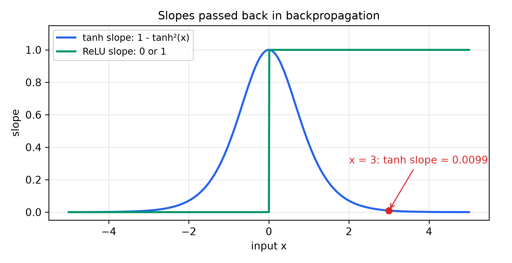
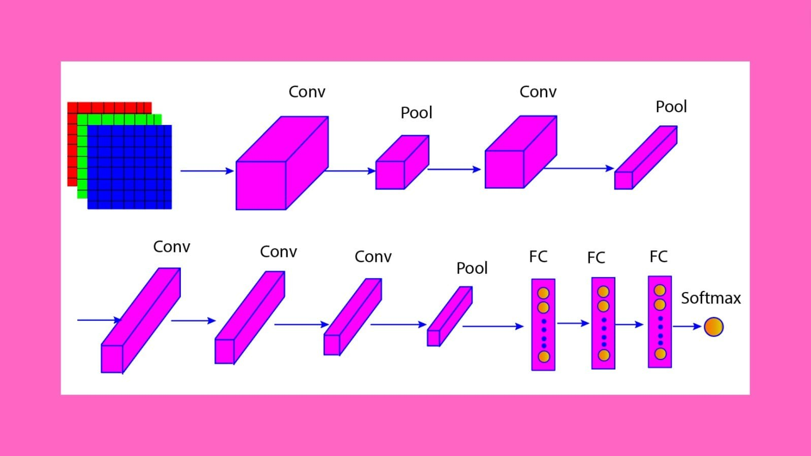

# Lecture 15 — AlexNet: Exam Questions and Answers

Companion to [ML_Lec_15_AlexNet_CNN_Learning_Guide.md](ML_Lec_15_AlexNet_CNN_Learning_Guide.md). Try each question first, then read the answer.

**Pattern:** Part A = 2-mark questions. Part B = 10-mark questions split (a) + (b), 5 + 5 or 6 + 4.
**Tags:** 🎯 real paper; ✍️ practice to cover the lecture; 📘 beyond the slides. 💡 = memory hook.
This file also covers the AlexNet table of Lecture 13 (Slides 32, 36; Lecture 13 guide §8).

| Topic in the guide | Question |
| :--- | :--- |
| What AlexNet is, ILSVRC 2012 (§1) | A1 |
| Layers and sizes, why 227 (§2) | A2, B1(a) |
| Overlapping pooling, dropout, softmax (§2) | A3, A4 |
| Counting parameters (§3) | B1(b), B2(a) |
| Lecture 13's Slide 36 mistakes | B2(b) |
| Why AlexNet worked: ReLU, GPUs, augmentation (§4) | A5, B2(a) |

---

## Part A — 2-mark questions

### A1. What is AlexNet and why is it important? ✍️ [2]

AlexNet is a CNN developed by **Alex Krizhevsky** and colleagues in **2012**. It won the **2012 ImageNet Large Scale Visual Recognition Challenge (ILSVRC)** (1000 classes), clearly beating the competition (📘 top-5 error 15.3% vs 26.2%). Its success showed the power of deep learning for image classification and started the wave of CNN research.

> 💡 2012: the year deep learning won ImageNet.

### A2. Why is AlexNet's input 227×227 and not 224×224? ✍️ [2]

Conv1 uses 11×11 filters with stride 4 and no padding.

- With 224: $(224 - 11)/4 + 1 = 54.25$, not a whole number, so the filters do not fit evenly.
- With 227: $(227 - 11)/4 + 1 = 55$ exactly.

So 227 gives the 55×55×96 output "for compatibility". The 3 extra pixels are in the input itself, not added by padding.

> 💡 227 − 11 = 216, and 216 divides by 4.

### A3. What is overlapping pooling? ✍️ [2]

AlexNet's max pooling uses a **3×3 window with stride 2**. Because the window (3) is larger than the stride (2), neighbouring windows **share one row and one column**. 📘 It reduced top-5 error by 0.3% compared with non-overlapping 2×2 pooling. *E.g.* $(55 - 3)/2 + 1 = 27$.

> 💡 Window bigger than step means windows overlap.

### A4. What do softmax and dropout do in AlexNet? ✍️ [2]

- **Softmax** (FC3) turns the 1000 scores into probabilities that add up to 1: $p_k = e^{s_k} / \sum_j e^{s_j}$.
- **Dropout 0.5** (FC1 and FC2) switches each neuron off with probability 0.5 during training, so the huge FC layers cannot over-rely on single neurons and overfit less. All neurons are used at test time.

> 💡 Softmax picks the class; dropout fights overfitting where the weights are.

### A5. Why does ReLU train faster than tanh? ✍️ [2]

Backpropagation multiplies the slopes of all layers. The slope of tanh is $1 - \tanh^2(x)$; at $x = 3$ it is about **0.0099**, so less than 1% of the gradient passes back. ReLU's slope is exactly **1** for every positive input, so the gradient does not shrink. 📘 On CIFAR-10, ReLU reached 25% training error about **6× faster** than tanh.

> 💡 tanh's slope dies for big inputs; ReLU's stays at 1.

---

## Part B — 10-mark questions

### B1. 🎯 2024 End Q6(a) + ✍️

**(a)** Draw the AlexNet architecture and give the output size of each layer. **[6]**
**(b)** Calculate the number of weights and biases in the first convolutional layer and the first pooling layer. **[4]**

**(a) Answer.**

Conv → Pool → Conv → Pool → Conv → Conv → Conv → Pool → FC → FC → FC (softmax). Five conv and three FC layers have weights, so AlexNet is an **8-layer** network. ReLU follows every conv and FC layer except the last; every pool is max pooling. Size formula $O = (N - F + 2P)/S + 1$.

| Layer | Filters / neurons | Kernel, stride, pad | Output |
| :--- | :--- | :--- | :--- |
| Input | — | — | 227×227×3 |
| Conv1 | 96 | 11×11, 4, 0 | $(227-11)/4+1 = 55$ → 55×55×96 |
| Pool1 | — | 3×3, 2 | $(55-3)/2+1 = 27$ → 27×27×96 |
| Conv2 | 256 | 5×5, 1, 2 | 27×27×256 |
| Pool2 | — | 3×3, 2 | $(27-3)/2+1 = 13$ → 13×13×256 |
| Conv3 | 384 | 3×3, 1, 1 | 13×13×384 |
| Conv4 | 384 | 3×3, 1, 1 | 13×13×384 |
| Conv5 | 256 | 3×3, 1, 1 | 13×13×256 |
| Pool3 | — | 3×3, 2 | $(13-3)/2+1 = 6$ → 6×6×256 = 9216 |
| FC1 | 4096, dropout 0.5 | — | 4096 |
| FC2 | 4096, dropout 0.5 | — | 4096 |
| FC3 | 1000, softmax | — | 1000 |

**(b) Answer.**

**Conv1:** 96 filters, each 11×11×3.

- Weights: $11 \times 11 \times 3 \times 96 = 363 \times 96 = 34{,}848$
- Biases: one per filter = **96**
- Total: $34{,}848 + 96 = 34{,}944$

**Pool1:** max pooling only picks the largest value in each window; it has no learnable weights or biases, so **0**.

> 💡 A filter's depth is always the input's depth (3 for RGB).

### B2. ✍️

**(a)** Calculate the total number of parameters in AlexNet. Which layers hold most of them, and what does this mean for the design? **[6]**
**(b)** A slide lists AlexNet with a 224×224 input but gives the sizes 13×13 after Pool2 and 6×6 after Pool3. Check these sizes and correct the table. **[4]**

**(a) Answer.**

Conv: filters × (kernel × kernel × input channels + 1). FC: $(n_{in} + 1) \times n_{out}$.

| Layer | Calculation | Parameters |
| :--- | :--- | ---: |
| Conv1 | $96 \times (11 \cdot 11 \cdot 3 + 1)$ | 34,944 |
| Conv2 | $256 \times (5 \cdot 5 \cdot 96 + 1)$ | 614,656 |
| Conv3 | $384 \times (3 \cdot 3 \cdot 256 + 1)$ | 885,120 |
| Conv4 | $384 \times (3 \cdot 3 \cdot 384 + 1)$ | 1,327,488 |
| Conv5 | $256 \times (3 \cdot 3 \cdot 384 + 1)$ | 884,992 |
| FC1 | $(9216 + 1) \times 4096$ | 37,752,832 |
| FC2 | $(4096 + 1) \times 4096$ | 16,781,312 |
| FC3 | $(4096 + 1) \times 1000$ | 4,097,000 |
| **Total** | conv 3,747,200 + FC 58,631,144 | **62,378,344** |

- About **94%** of the parameters are in the FC layers; FC1 alone holds almost 38 million, more than all five conv layers together.
- That is why **dropout** is placed on FC1 and FC2, and why AlexNet also used **data augmentation** (random crops, flips, colour changes): 62 million weights overfit easily.
- The conv layers have few parameters but do most of the computation.
- 📘 The usual figure "about 60 million" is the original two-GPU version (60,965,224).

**(b) Answer.**

With a 224 input (rounding down):

| Layer | From 224 | Slide says | From 227 |
| :--- | :--- | :--- | :--- |
| Conv1 | $(224-11)/4+1 = 54.25$ → 54 | 54 | 55 |
| Pool1 | $(54-3)/2+1 = 26.5$ → 26 | 26 | 27 |
| Conv2 | $(26-5+4)/1+1 = 26$ | 26 | 27 |
| Pool2 | $(26-3)/2+1 = 12.5$ → **12** | 13 ✗ | 13 |
| Conv3–5 | $(12-3+2)/1+1 = $ **12** | 13 ✗ | 13 |
| Pool3 | $(12-3)/2+1 = 5.5$ → **5** | 6 ✗ | 6 |

So from 224 the last sizes are 12×12 and **5×5×256 = 6400**. FC1 then has $(6400 + 1) \times 4096 = 26{,}218{,}496$ parameters, and the total is **50,844,008**. The slide's 13 and 6 are correct only for a **227** input; the table mixes the two.

> 💡 224 breaks at the first division; use 227.
