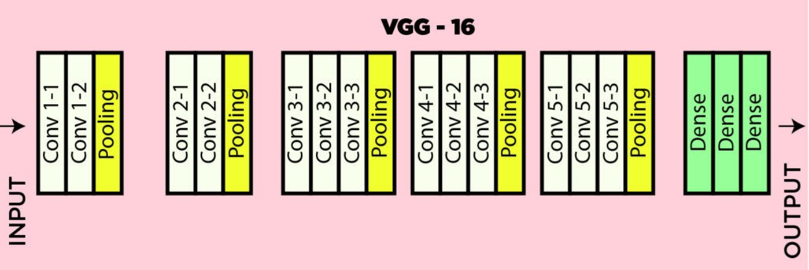
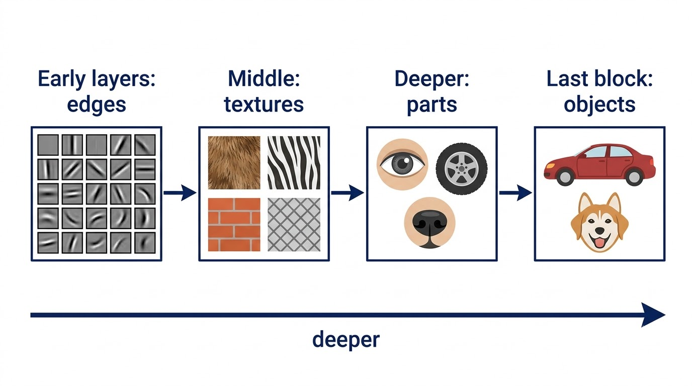
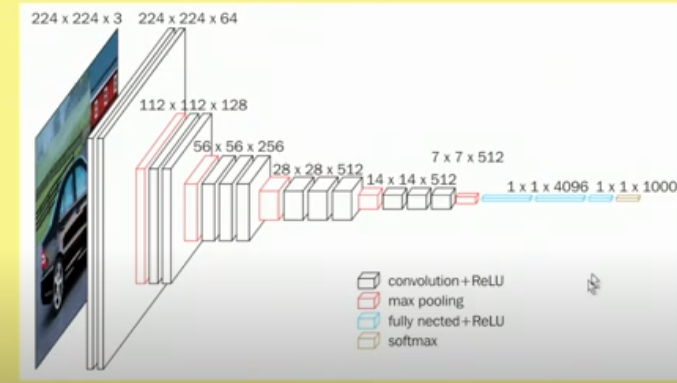
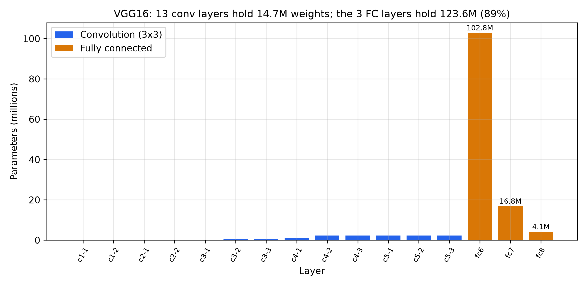
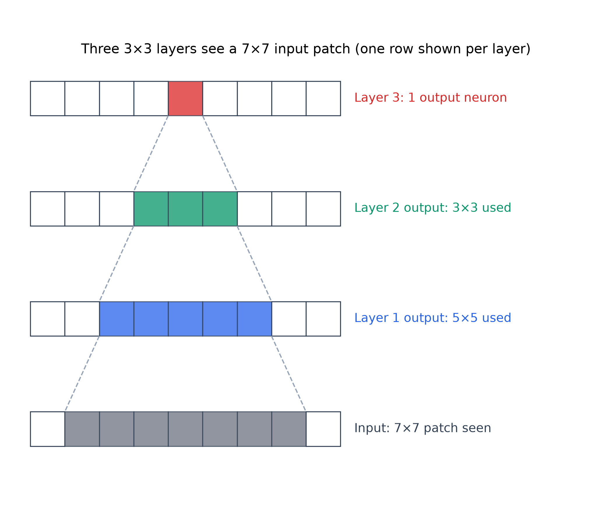

# VGG16 — Learning Guide

Source: `ML_Lec_16_VGG_CNN.pptx`, Slides 1–23. Every number recomputed. Read Lecture 15 (AlexNet) first.
**📘 Beyond the slides** = gap filled from outside the slides. **✏️ Slide discrepancy** = a slide is wrong or unclear.

## Contents

1. [What VGG16 is](#1-what-vgg16-is)
2. [ImageNet and the ILSVRC split](#2-imagenet-and-the-ilsvrc-split)
3. [The design rules and the layers](#3-the-design-rules-and-the-layers)
4. [Why only 3×3 filters](#4-why-only-33-filters)
5. [Results and limitations](#5-results-and-limitations)
6. [VGG16 vs AlexNet](#6-vgg16-vs-alexnet)
7. [Why no K-fold cross-validation](#7-why-no-k-fold-cross-validation)

---

## 1. What VGG16 is

**Why it exists.** AlexNet's design looks arbitrary: 11×11, then 5×5, then 3×3 filters, with different strides. Nobody knew which choices mattered. VGG asked: **what if we keep everything simple and just go deeper?** VGG16 uses one filter size (3×3) everywhere and stacks many of them.

**Facts (Slides 1–2).**

- Proposed by the **Visual Geometry Group (VGG)**, University of Oxford: Karen Simonyan and Andrew Zisserman, 2014.
- **16 layers with tunable parameters:** 13 convolutional + 3 fully connected. The 5 pooling layers have no weights, so they are not counted (counting them gives 21).
- Known for simplicity and effectiveness on image classification and object recognition.
- A stack of conv layers and max-pool layers, with the depth (channels) growing step by step. This lets it learn a hierarchy of features: edges → object parts → whole objects.
- **First runner-up** in ILSVRC 2014 classification; **92.7% top-5 test accuracy** on ImageNet.

**Top-5 accuracy.** The model gives 5 guesses; it counts as right if the true class is among them. 92.7% means the answer was in the top 5 for about 93 of every 100 test images. Top-5 error is the rest: $100 - 92.7 = 7.3$, so 7.3%.

*Figure: Slide 2. "Dense" means fully connected. Conv layers: $2 + 2 + 3 + 3 + 3 = 13$, plus 3 dense = 16.*

*Figure: The "hierarchical representations" of Slide 2 (illustration). Early blocks respond to edges, middle ones to textures, deeper ones to parts, the last to whole objects.*

---

## 2. ImageNet and the ILSVRC split

**The confusion.** Slide 2 says ImageNet has "14 million images belonging to 1000 classes". That mixes the full **ImageNet database** with the smaller **ILSVRC** contest subset. Slides 3–4 separate them.

| Set (slide) | Images | Classes |
| :--- | :--- | :--- |
| Full ImageNet (4) | 14M+, organised by **WordNet** (a dictionary of English nouns grouped by meaning) | 20,000+ categories, called **synsets** |
| ILSVRC subset (3–4) | $1{,}281{,}167 + 50{,}000 + 100{,}000 = 1{,}431{,}167 \approx 1.43$M, about 10% of the full set | 1,000 common objects |
| – Training | 1,281,167, about 1,000 per class | |
| – Validation | 50,000, 50 per class; used to tune hyperparameters | |
| – Test | 100,000, 100 per class; labels kept secret | |

> ✏️ **Slide discrepancy (Slide 2).** The 14 million images belong to over 20,000 categories (Slide 4). The 1000-class contest set has about 1.43 million (Slide 3).

---

## 3. The design rules and the layers

**Rules (Slide 6).** Learn these and you can rebuild the whole network.

1. Input: a 224×224 colour image (3 channels).
2. A stack of conv layers, **every filter 3×3, stride 1**.
3. Rows and columns are padded so the output has the **same size** as the input.
4. Every convolution is followed by **ReLU**.
5. **13 conv layers and 5 max-pool layers**, so not every conv is followed by pooling.
6. Max pooling is **2×2, stride 2**, so windows do not overlap.
7. **3 fully connected layers**.

Two patterns follow: every pool halves width and height, and after each pool the filter count doubles (64 → 128 → 256 → 512) until it stops at 512.

**The two calculations behind the rules.**

- Same padding for 3×3, stride 1: $P = (F - 1)/2 = 1$. Check: $(224 - 3 + 2)/1 + 1 = 224$.
- Pooling with $F = S = 2$: $(N - 2)/2 + 1 = N/2$. Five pools: $224 \to 112 \to 56 \to 28 \to 14 \to 7$, i.e. $224 / 2^5 = 7$.

*Figure: Slide 5. Black: conv + ReLU. Red: max pooling. Blue: fully connected + ReLU. Last: softmax.*

**The layers (Slides 7–10) and their parameters.** A conv layer with $K$ filters of $3 \times 3 \times C$ ($C$ = input channels) has $K \times (9C + 1)$ parameters: $9C$ weights and 1 bias per filter.

| Layer | Output | Calculation | Parameters |
| :--- | :--- | :--- | ---: |
| Input | 224×224×3 | — | 0 |
| conv1-1 | 224×224×64 | $64 \times (27 + 1)$ | 1,792 |
| conv1-2 | 224×224×64 | $64 \times (576 + 1)$ | 36,928 |
| pool | 112×112×64 | — | 0 |
| conv2-1 | 112×112×128 | $128 \times (576 + 1)$ | 73,856 |
| conv2-2 | 112×112×128 | $128 \times (1152 + 1)$ | 147,584 |
| pool | 56×56×128 | — | 0 |
| conv3-1 | 56×56×256 | $256 \times (1152 + 1)$ | 295,168 |
| conv3-2, 3-3 | 56×56×256 | $256 \times (2304 + 1)$ each | 590,080 each |
| pool | 28×28×256 | — | 0 |
| conv4-1 | 28×28×512 | $512 \times (2304 + 1)$ | 1,180,160 |
| conv4-2, 4-3 | 28×28×512 | $512 \times (4608 + 1)$ each | 2,359,808 each |
| pool | 14×14×512 | — | 0 |
| conv5-1, 5-2, 5-3 | 14×14×512 | $512 \times (4608 + 1)$ each | 2,359,808 each |
| pool, flatten | 7×7×512 = 25,088 | — | 0 |
| FC6 + ReLU | 4096 | $25{,}088 \times 4096 + 4096$ | 102,764,544 |
| FC7 + ReLU | 4096 | $4096 \times 4096 + 4096$ | 16,781,312 |
| FC8 + softmax | 1000 (one per ILSVRC class) | $4096 \times 1000 + 1000$ | 4,097,000 |
| **Total** | | conv 14,714,688 + FC 123,642,856 | **138,357,544 ≈ 138M** |

> ✏️ **Slide discrepancy (Slides 8–9).** The slides go from Block 3 (256 filters) straight to Block 4 (512) with no pooling. There is a max-pool after Block 3: without it there are only 4 pools and the map ends at 14×14, not 7×7. Figs 1–2 show it, and Slide 6 says 5 max-pool layers.

> ✏️ **Slide discrepancy (Slide 10).** It says all three FC layers use ReLU. Only the first two do; the third uses softmax, as the slide's own last line says.

*Figure: Parameters per layer, in millions. FC6 alone has 102.8M, about 74% of the network.*

The surprise: convolutions do almost all the computing but hold only about 11% of the weights. Conv1-1 has just 1,792 parameters, yet costs $224 \times 224 \times 64 \times 27 = 86{,}704{,}128$ multiply-adds per image. Large maps make early layers expensive to run; large FC layers make late layers expensive to store.

---

## 4. Why only 3×3 filters

**The idea.** A big filter (like AlexNet's 11×11) sees a large area at once, but has many weights and only one ReLU. VGG replaces it with a **stack of small filters**: same view, fewer weights, a ReLU after each step.

**Slide 15.** VGG16 uses 3×3 in every conv layer; AlexNet uses 11×11 first and 5×5 later. Small filters let VGG16 stack more layers with the same **receptive field** (the patch of input that can affect a neuron), adding depth and finer feature extraction without a big rise in computing cost.

> 📘 **Beyond the slides** (Simonyan and Zisserman, 2015, Section 2.3).
>
> - **Receptive field:** each extra 3×3 layer (stride 1) widens the view by 2, so $n$ stacked layers see $1 + 2n$. Two see 5×5; three see 7×7.
> - **Weights** ($C$ channels in and out, no biases): three 3×3 layers have $3 \times 9C^2 = 27C^2$; one 7×7 has $49C^2$. The stack needs $27/49 \approx 0.55$, or 55%, of the weights. For $C = 512$: 7,077,888 instead of 12,845,056. Two 3×3 against one 5×5: $18C^2$ against $25C^2$.
> - **Non-linearity:** 3 ReLUs instead of 1 make the decision function more flexible.
>
> So "without a significant increase in computational cost" undersells it: the stack is cheaper.

*Figure: Three stacked 3×3 layers. One output neuron (top) depends on a 3×3 patch, which depends on 5×5, which depends on a 7×7 patch of the input: the same view as one 7×7 filter.*

---

## 5. Results and limitations

**Results (Slide 11).** One of the best architectures in ILSVRC 2014. Runner-up in **classification** with **7.32%** top-5 error, behind GoogLeNet's **6.66%** (a gap of 0.66 points). **Won localization** (also drawing a box around the object) with 25.32% error.

**Limitations (Slide 12).**

- Very slow to train: 2–3 weeks on NVIDIA Titan GPUs.
- The ImageNet weights take **528 MB** of disk and bandwidth. Check: $138{,}357{,}544 \times 4$ bytes (32-bit floats) $= 553{,}430{,}176$ bytes; divided by $2^{20}$ that is about 527.8, so 528 MB with 1 MB $= 2^{20}$ bytes (about 553 MB in decimal).
- The slide says the 138M parameters cause the exploding gradients problem.

> ✏️ **Slide discrepancy (Slide 12).** Parameter count does not cause exploding gradients; **depth** does. Backpropagation multiplies one factor per layer, and a long product can blow up or shrink (Lecture 21). VGG's real difficulty was getting deep plain networks to start training: the authors first trained an 11-layer version and used its weights to start the deeper ones. Batch normalization and ResNet's skip connections later solved this better.

---

## 6. VGG16 vs AlexNet

**Advantages of VGG16 (Slides 13–18).**

1. **Deeper:** 16 weight layers against AlexNet's 8 (5 conv + 3 FC), so it models more complex patterns and is more accurate.
2. **Smaller filters:** 3×3 everywhere against 11×11 and 5×5; more layers for the same receptive field (section 4).
3. **Uniform:** same filter size, stride and padding everywhere; easier to understand, implement and extend.
4. **Better generalization:** richer, more general features; often better on unseen data.
5. **Improved accuracy:** top-5 error about 7.4% against AlexNet's about 16.4%, less than half ($7.4 / 16.4 \approx 0.45$).
6. **Regularization via depth:** the slide says each layer must pass on only the most relevant features.
7. **Wider adoption:** pre-trained weights transfer well to other tasks (transfer learning, Lecture 13); AlexNet is used less today.

**Trade-offs (Slide 19).** More computation: 138M parameters against 60M ($138/60 = 2.3$ times), so more memory. Slower training and inference.

**Conclusion (Slide 20).** VGG16 beats AlexNet in accuracy, depth and feature extraction, at a higher computing cost.

| | AlexNet (2012) | VGG16 (2014) |
| :--- | :--- | :--- |
| Weight layers | 8 (5 conv + 3 FC) | 16 (13 conv + 3 FC) |
| Filter sizes | 11×11, 5×5, 3×3 | 3×3 only |
| Strides | 4 in Conv1, then 1 | 1 everywhere |
| Pooling | 3×3, stride 2 (overlapping) | 2×2, stride 2 (non-overlapping) |
| Input | 227×227×3 | 224×224×3 |
| Parameters | ≈ 60M | ≈ 138M |
| Top-5 error | ≈ 16.4% | ≈ 7.3–7.4% |
| ILSVRC | 1st, 2012 | 2nd classification, 1st localization, 2014 |

> 📘 **Beyond the slides — the error numbers.** 7.32% (Slide 11), about 7.3% (from 92.7%, Slide 2) and about 7.4% (Slide 17) do not contradict each other. 7.32% was the contest entry, combining 7 networks; about 7.4% is a single VGG16. AlexNet's 16.4% is its 5-network entry; its best entry, with extra pre-training, reached 15.3% (Lecture 15).

> 📘 **Beyond the slides — "regularization via depth".** The VGG paper says it more precisely: three stacked 3×3 layers are like a 7×7 filter forced to split into three steps with ReLUs between. That restriction regularizes, because the stack has fewer free weights ($27C^2$ against $49C^2$).

---

## 7. Why no K-fold cross-validation

**The setting.** In small problems you often use **K-fold cross-validation**: split the data into $K$ parts, train $K$ times, test on a different part each time, and average. ImageNet papers almost never do this.

**Reason 1: one run is already very expensive (Slide 21).** K-fold (e.g. 5- or 10-fold) trains $K$ separate times. Training VGG, ResNet or a Vision Transformer on ImageNet takes days or weeks on a multi-GPU server and thousands of dollars of cloud computing, too much for most labs, especially when the gain is small on large datasets.

| | Time | Cost |
| :--- | ---: | ---: |
| 1 run (slide example) | 5 days | 1,000 dollars |
| 5-fold | 25 days | 5,000 dollars |
| 10-fold | 50 days | 10,000 dollars |

**Reason 2: the dataset is already massive and stable (Slide 22).** K-fold shines on small datasets (e.g. 1,000 images): it uses all the limited data and **reduces the variance** of the score, i.e. how much it changes from one random split to another. With 1.2M+ training images, one random split is already representative, and a score on 50,000 validation images already has low variance. The extra stability is not worth 5–10 times the cost.

> 📘 **Beyond the slides — why 50,000 is "stable enough".** If true accuracy is $p$ and you test on $n$ images, the measured accuracy wobbles by about one **standard error**, $\text{SE} = \sqrt{p(1 - p)/n}$. The uncertainty shrinks with the square root of the test size. With $p = 0.9$: for $n = 50{,}000$, $\sqrt{0.09 / 50{,}000} \approx 0.0013$, about ±0.13%. For 1,000 images with a 20% validation split ($n = 200$), $\sqrt{0.09/200} \approx 0.021$, about ±2.1%. On ImageNet one split pins the score to a tenth of a percent; on the small set luck alone can move it 2%, so K-fold earns its cost.

---

## References

- Simonyan, K. and Zisserman, A. (2015). *Very Deep Convolutional Networks for Large-Scale Image Recognition.* ICLR.
- Russakovsky, O. et al. (2015). *ImageNet Large Scale Visual Recognition Challenge.* IJCV 115.
