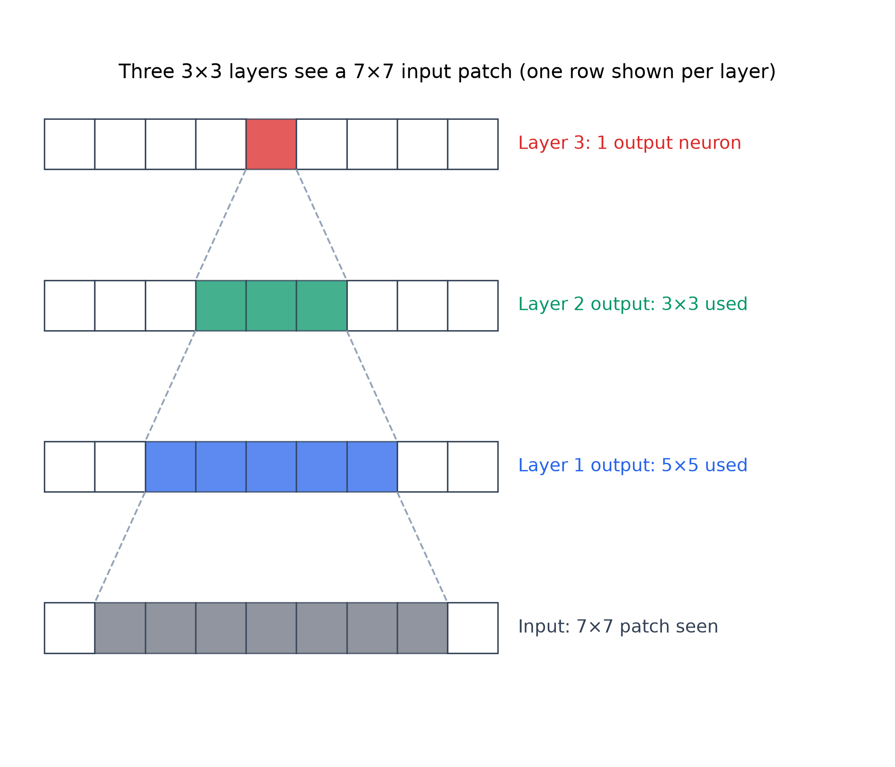
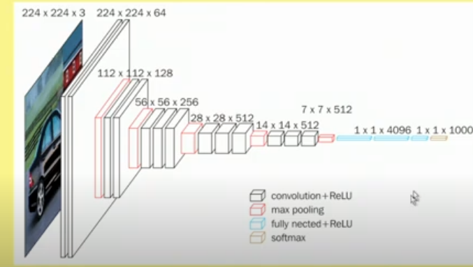

# Lecture 16 — VGG16: Exam Questions and Answers

Companion to [ML_Lec_16_VGG_CNN_Learning_Guide.md](ML_Lec_16_VGG_CNN_Learning_Guide.md). Try each question first, then read the answer.

**Pattern:** Part A = 2-mark questions. Part B = 10-mark questions split (a) + (b), 5 + 5 or 6 + 4.
**Tags:** 🎯 real paper; ✍️ practice to cover the lecture; 📘 beyond the slides. 💡 = memory hook.

| Topic in the guide | Question |
| :--- | :--- |
| What VGG16 is, top-5 accuracy (§1) | A1 |
| ImageNet vs the ILSVRC split (§2) | A2 |
| Design rules, layers, parameters (§3) | B1 |
| Why only 3×3 filters (§4) | A3, B2(a) |
| Results and limitations (§5) | A4 |
| VGG16 vs AlexNet (§6) | B2(a) |
| Transfer learning with VGG16 (Lecture 13 §10, §6) | B1(b) |
| Why no K-fold cross-validation (§7) | A5, B2(b) |

---

## Part A — 2-mark questions

### A1. What is VGG16 and why is it called "16"? ✍️ [2]

VGG16 is a CNN proposed by the **Visual Geometry Group, University of Oxford** (Simonyan and Zisserman, 2014). It has **16 layers with learnable weights: 13 conv + 3 fully connected**. The 5 max-pool layers have no weights, so they are not counted. It was the **first runner-up in ILSVRC 2014** classification with **92.7% top-5 accuracy** (7.3% top-5 error).

> 💡 13 conv + 3 FC = 16; pools don't count.

### A2. "ImageNet has 14 million images in 1000 classes." Correct this statement. ✍️ [2]

It mixes two datasets:

- **Full ImageNet:** 14M+ images in **20,000+** categories (synsets, organised by WordNet).
- **ILSVRC subset:** **1000** classes with about **1.43M** images: 1,281,167 training, 50,000 validation (50 per class), 100,000 test (100 per class, labels secret).

> 💡 14M ↔ 20k classes; 1.43M ↔ 1000 classes.

### A3. Why does VGG use only 3×3 filters? ✍️ [2]

- **Same receptive field:** each extra 3×3 layer widens the view by 2, so two layers see 5×5 and three see 7×7.
- **Fewer weights** (📘): three 3×3 layers have $27C^2$ weights vs $49C^2$ for one 7×7, about 55%.
- **More non-linearity:** 3 ReLUs instead of 1, so the network can learn more complex functions.

> 💡 Three small steps see as far as one big step, more cheaply.

### A4. What are the limitations of VGG16? ✍️ [2]

1. **Slow to train:** 2–3 weeks on NVIDIA Titan GPUs.
2. **Huge model:** 138M parameters, about **528 MB** of weights ($138{,}357{,}544 \times 4$ bytes ÷ $2^{20}$ ≈ 528).
3. **Slow inference** and high memory use. Deep plain networks are also hard to start training; the slides blame the 138M parameters for **exploding gradients**, but the real cause is **depth** (✏️ slide discrepancy).

> 💡 Big, slow and heavy.

### A5. Why is K-fold cross-validation rarely used on ImageNet? ✍️ [2]

1. **Cost:** K-fold trains $K$ times. If one run takes 5 days and 1,000 dollars, 10-fold takes 50 days and 10,000 dollars.
2. **No need:** with 1.2M+ training images, one split is already representative. 📘 With 50,000 validation images, the standard error at 90% accuracy is $\sqrt{0.9 \times 0.1 / 50{,}000} \approx 0.13\%$, so the score is already stable.

> 💡 K-fold buys stability; ImageNet is already stable.

---

## Part B — 10-mark questions

### B1. 🎯 2025 End Q5(a, b)

**(a)** Explain the architecture of the VGG16 model in detail with a neat diagram. Additionally, calculate the total number of parameters in both the first convolutional layer and the first pooling layer of the network. **[6]**
**(b)** What is transfer learning and how can VGG16 be used for transfer learning? **[4]**

**(a) Answer.**

**Design rules:**

1. Input: a 224×224×3 colour image.
2. Every conv filter is **3×3, stride 1**, with **same padding** ($P = 1$), so conv layers keep the size: $(224 - 3 + 2)/1 + 1 = 224$.
3. **ReLU** after every convolution.
4. **13 conv layers in 5 blocks** (2, 2, 3, 3, 3), each block ending in a **2×2 max pool, stride 2**, which halves the size: $224 \to 112 \to 56 \to 28 \to 14 \to 7$.
5. The filter count doubles after each pool: 64 → 128 → 256 → 512 → 512.
6. **3 FC layers:** 4096 and 4096 with ReLU, then 1000 with softmax.

| Block | Layers | Output |
| :--- | :--- | :--- |
| 1 | conv 64, conv 64, pool | 224×224×64 → 112×112×64 |
| 2 | conv 128 ×2, pool | 112×112×128 → 56×56×128 |
| 3 | conv 256 ×3, pool | 56×56×256 → 28×28×256 |
| 4 | conv 512 ×3, pool | 28×28×512 → 14×14×512 |
| 5 | conv 512 ×3, pool | 14×14×512 → 7×7×512 = 25,088 |
| FC | 4096, 4096, 1000 (softmax) | 1000 class probabilities |

Total ≈ **138M** parameters (138,357,544), of which the FC layers hold about 89%.

**Parameters:**

- **First conv layer (conv1-1):** 64 filters of 3×3×3.
  - Weights: $3 \times 3 \times 3 \times 64 = 1{,}728$
  - Biases: 64
  - Total: $64 \times (27 + 1) = $ **1,792**
- **First pooling layer:** max pooling has no learnable parameters, so **0**. It only halves 224×224×64 to 112×112×64.

**(b) Answer.**

**Transfer learning** reuses a model trained on one task (here VGG16 trained on ImageNet's 1000 classes) as the starting point for a new task. Its early layers have already learned general features (edges, textures, parts), which are useful for most images.

**How to use VGG16:**

1. Load VGG16 with its ImageNet weights.
2. **Remove the last FC layer** (1000 classes) and add a new one with the new number of classes. *E.g.* for 10 classes: $(4096 + 1) \times 10 = 40{,}970$ parameters instead of 4,097,000.
3. **Feature extraction:** freeze all conv layers and train only the new head. Best for small datasets.
4. **Fine-tuning:** also unfreeze the last conv blocks and train them with a small learning rate. Best when there is more data.
5. Train on the new data, then evaluate.

VGG16 suits this well because its uniform 3×3 design gives rich, general features, and pre-trained weights are widely available.

> 💡 Keep VGG's eyes, replace its mouth.

### B2. ✍️

**(a)** Compare VGG16 with AlexNet. Why does stacking small 3×3 filters help? **[6]**
**(b)** Why are deep models on ImageNet usually evaluated with one validation split and not with K-fold cross-validation? **[4]**

**(a) Answer.**

| | AlexNet (2012) | VGG16 (2014) |
| :--- | :--- | :--- |
| Weight layers | 8 (5 conv + 3 FC) | 16 (13 conv + 3 FC) |
| Filter sizes | 11×11, 5×5, 3×3 | 3×3 only |
| Strides | 4 in Conv1, then 1 | 1 everywhere |
| Pooling | 3×3, stride 2 (overlapping) | 2×2, stride 2 (non-overlapping) |
| Input | 227×227×3 | 224×224×3 |
| Parameters | ≈ 60M | ≈ 138M |
| Top-5 error | ≈ 16.4% | ≈ 7.3–7.4% |
| ILSVRC | 1st, 2012 | 2nd classification, 1st localization, 2014 |

**Advantages of VGG16:** deeper (more complex patterns), uniform and simple to build, better generalization, less than half the error, and weights that transfer well. **Cost:** 2.3 times the parameters, so slower and heavier.

**Why stack 3×3 filters:**

- $n$ stacked 3×3 layers have a receptive field of $1 + 2n$: 3 layers see 7×7.
- Weights (with $C$ channels): $3 \times 9C^2 = 27C^2$ vs $49C^2$ for one 7×7. For $C = 512$: 7,077,888 vs 12,845,056.
- Three ReLUs instead of one make the function more non-linear.
- 📘 The stack acts as a 7×7 filter forced into three steps, which also **regularizes** it.

**(b) Answer.**

- **K-fold** splits the data into $K$ parts and trains $K$ times, each time testing on a different part. It is used on small datasets to use all the data and to reduce the **variance** of the score.
- **Too expensive:** one ImageNet run of VGG takes days or weeks on GPUs. For a run of 5 days and 1,000 dollars, 5-fold costs 25 days and 5,000 dollars.
- **Not needed:** with 1.28M training images, one split is representative. With $n = 50{,}000$ validation images and $p = 0.9$, the standard error is $\sqrt{p(1-p)/n} \approx 0.13\%$. For a small set with only 200 validation images it would be about 2.1%, and there K-fold is worth it.

> 💡 K-fold pays off only when the data is small.
