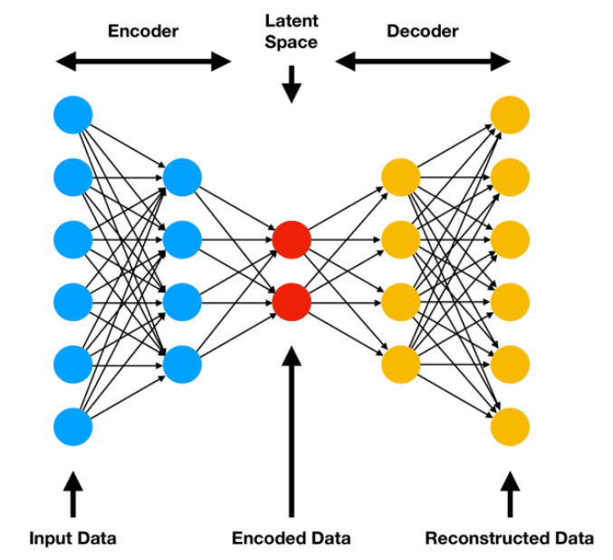
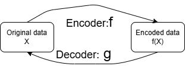
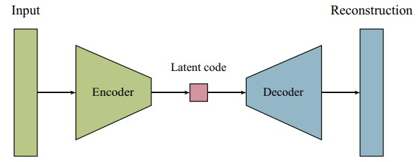
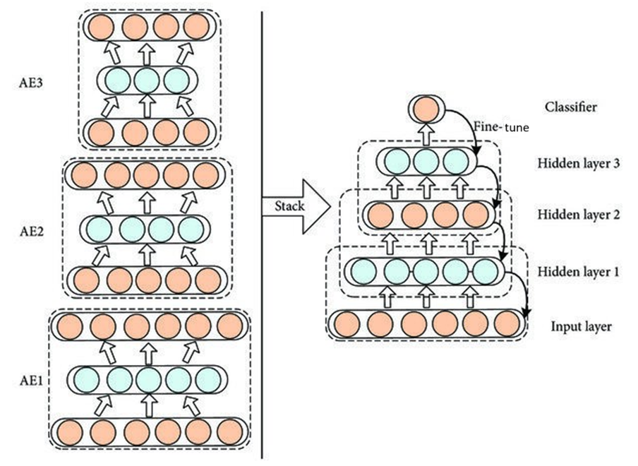
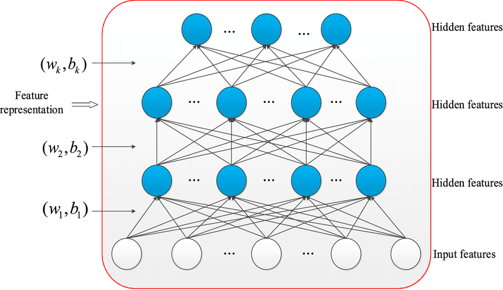
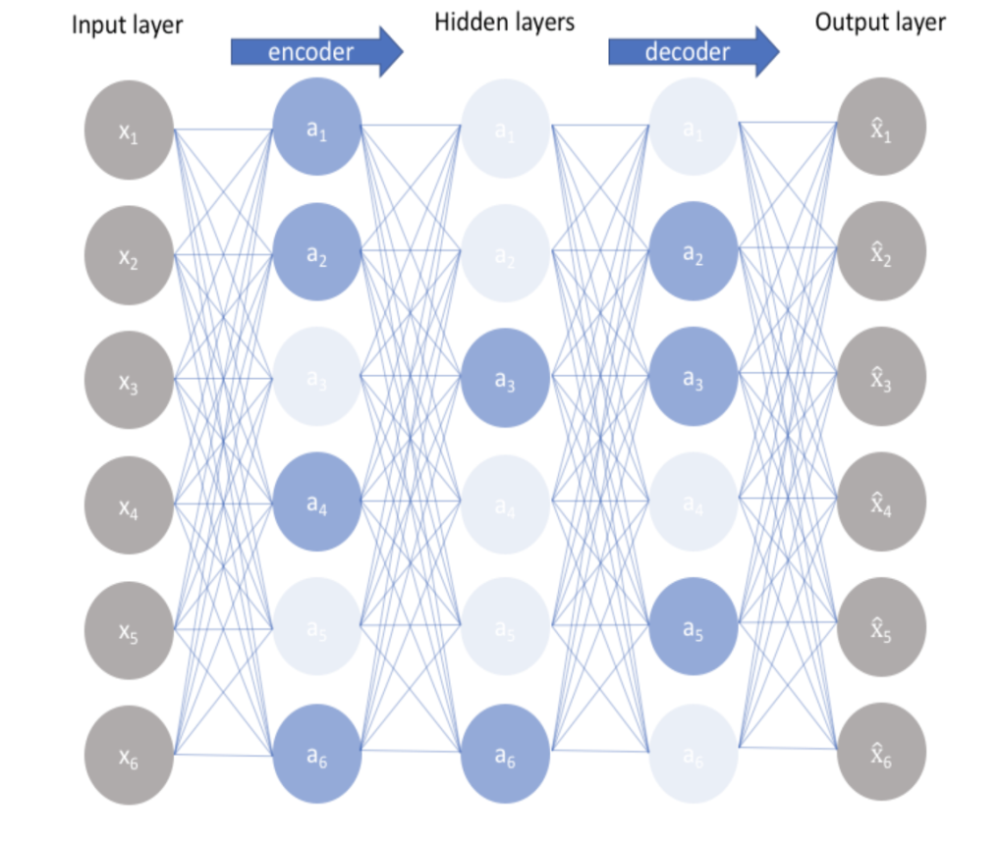
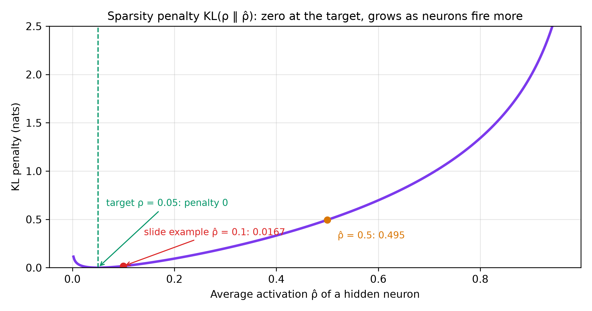
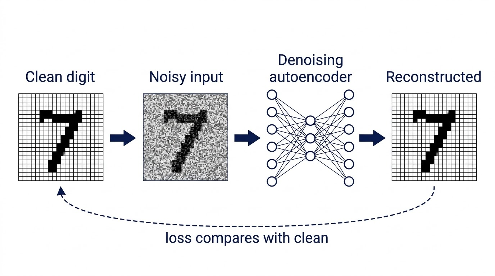

# Autoencoders — Learning Guide

Source: `ML_Lec_19_Autoencoder.pptx`, Slides 1–60. Every number recomputed.
**📘 Beyond the slides** = gap filled from outside the slides. **✏️ Slide discrepancy** = a slide is wrong or unclear.

## Contents

1. [What an autoencoder is](#1-what-an-autoencoder-is)
2. [The bottleneck and the base architecture](#2-the-bottleneck-and-the-base-architecture)
3. [The loss: reconstruction plus regularizer](#3-the-loss-reconstruction-plus-regularizer)
4. [The undercomplete autoencoder](#4-the-undercomplete-autoencoder)
5. [The stacked autoencoder and sentence encoding](#5-the-stacked-autoencoder-and-sentence-encoding)
6. [The sparse autoencoder](#6-the-sparse-autoencoder)
7. [The denoising autoencoder](#7-the-denoising-autoencoder)
8. [Applications and comparison](#8-applications-and-comparison)

---

## 1. What an autoencoder is

**Why it exists.** Data is redundant: neighbouring pixels are nearly equal. A short description that keeps only what matters lets us store data smaller, remove noise, or spot unusual examples, but we rarely have labels saying what matters. An **autoencoder** finds it by itself: it must **copy its input to its output** through a narrow middle layer, so it has to learn what is important.

**Definition (Slides 1, 3, 7).**

- A type of **unsupervised learning** in which a network performs **representation learning** (learning a useful way to describe the data). No class labels needed.
- Purpose: efficient representations, usually for **dimensionality reduction** (fewer numbers per example) or **feature extraction**.
- Trained with **backpropagation** on unlabelled data: the target output is the input itself. It codes the data "on its own"; whatever goes in should come out.
- Training minimises the difference between input and reconstruction, measured by a loss such as **mean squared error**.

**Structure (Slides 2, 7).**

1. **Encoder** $f$: input layer → one or more hidden layers → the **bottleneck** (also **latent space**, **code** or latent layer), the last hidden layer of the encoder.
2. **Decoder** $g$: bottleneck → hidden layers (optional) → output layer, rebuilding the input (or close to it).

```math
\hat{x} = g(f(X))
```

Encode $X$ with $f$, decode with $g$; the output $\hat{x}$ should be (almost) identical to $X$.


*Figure: Slides 2, 8, 9. Six inputs squeezed to two code nodes ($2/6 = 1/3$ of the space) and expanded back to six.*


*Figure: Slide 3.*

---

## 2. The bottleneck and the base architecture

**The identity trap (Slides 4–5).** The output should equal the input, so a roomy network can learn the **identity mapping** $g(f(X)) = X$, i.e. $g \circ f$ is the identity on the input space. It copies perfectly and learns nothing about the data's inner structure. The fix is a **bottleneck layer** that forces a compressed representation: inputs of dimension $m$, code of dimension $d \ll m$.

**The key assumption (Slide 6).** Input features must be strongly **correlated**. If they were independent, each would carry its own information and squeezing would lose salient features. The network compresses by **removing correlation and redundancy**, keeping the uncorrelated part from which the input can be rebuilt.

*Toy case.* If $x = (a, b, a + b)$, then $(a, b)$ rebuilds all three: store $(2, 5)$ for $(2, 5, 7)$ and recompute $2 + 5 = 7$. If the features were independent, like $(2, 5, 9)$, any 2-number code loses one of them.

**Base architecture (Slide 8).** Encoder half + decoder half; one input layer, one output layer, one or more hidden layers including the bottleneck, which has far fewer nodes than the input and holds the compressed knowledge. The error between $X$ and $\hat{x}$ should be as small as possible.

**Counting nodes (Slide 9).**

| Layer | Nodes | Why |
| :--- | :--- | :--- |
| Input | $MN + 1$ | an $M \times N$ image as one vector, plus 1 bias |
| Bottleneck | $d + 1$, $d \ll MN$ | code plus a bias for the next layer |
| Output | $MN$ | must match the input; no bias needed |

So the input layer has one more node than the output layer. *Example:* a 28×28 MNIST digit with $d = 32$: input $784 + 1 = 785$, bottleneck 33, output 784; the code is $784 / 32 = 24.5$ times shorter.

> ✏️ **Slide discrepancy (Slide 9).** "We have to reconstruct $X$ from $\hat{x}$" is backwards: we reconstruct $\hat{x}$ from $X$. Also, the figure mixes $W_1$, $W_2$ (subscripts) and $W^2$, $W^3$ (superscripts); all mean the weight matrices between consecutive layers.

---

## 3. The loss: reconstruction plus regularizer

**Two conflicting tasks (Slides 10–12).** Every autoencoder encodes then decodes, so it must:

1. **Be sensitive to the input**, so $\hat{x}$ is close to $X$. Alone, this invites learning the identity and memorising.
2. **Be insensitive enough not to memorise or overfit.** What we really want is the compressed representation, which other applications use.

**The loss (Slides 13–14)** meets both, and is used in backpropagation:

```math
\text{Loss} = L(X, \hat{x}) + \text{Regularizer}, \qquad L(X, \hat{x}) = \frac{1}{2} \sum_{N} \Vert X - \hat{x} \Vert^2
```

Reconstruction error (squared distance per training example, summed and halved) keeps it sensitive. The **regularizer** works against it: it makes the network less sensitive and forces a low-dimensional representation, so it learns salient features instead of the identity. The $\tfrac{1}{2}$ is only convenience (the derivative of $\tfrac{1}{2}e^2$ is $e$); it does not move the minimum. *Example:* $X = (1, 0)$, $\hat{x} = (0.8, 0.3)$: $0.2^2 + 0.3^2 = 0.13$, so it adds $0.065$.

**Reconstruction losses (Slides 15–17).**

```math
\text{MSE} = \frac{1}{N} \sum_{i=1}^{N} (x_i - \hat{x}_i)^2
\qquad
\text{BCE} = -\frac{1}{N} \sum_{i=1}^{N} \Big( x_i \log \hat{x}_i + (1 - x_i) \log(1 - \hat{x}_i) \Big)
```

- **MSE** (Slide 15): average squared error per feature ($x_i$ original, $\hat{x}_i$ reconstructed). The most common; minimises pixel- or feature-wise error; suits **continuous** data.
- **BCE** (Slide 16): for binary inputs or inputs scaled to [0, 1] (images). Treats each output as a probability: if the truth is 1 the loss is $-\log \hat{x}_i$ (large when the output is near 0); if 0, it is $-\log(1 - \hat{x}_i)$.
- **Custom losses** (Slide 17): **KL divergence** for VAEs (Lecture 20), measuring closeness of the latent space to a standard normal; **perceptual loss** for high-quality images, comparing features from a pre-trained network such as VGG (Lecture 16) instead of pixels; **total variation loss**, penalising jumps between neighbouring pixels for smoother output.

*Worked example.* $x = (1, 0, 1, 1)$, $\hat{x} = (0.9, 0.2, 0.8, 0.6)$, natural log.

| $x_i$ | $\hat{x}_i$ | Squared error | BCE term |
| :---: | :---: | ---: | :--- |
| 1 | 0.9 | 0.01 | $-\ln 0.9 = 0.1054$ |
| 0 | 0.2 | 0.04 | $-\ln 0.8 = 0.2231$ |
| 1 | 0.8 | 0.04 | $-\ln 0.8 = 0.2231$ |
| 1 | 0.6 | 0.16 | $-\ln 0.6 = 0.5108$ |
| **Mean** | | **MSE = 0.25/4 = 0.0625** | **BCE = 1.0625/4 ≈ 0.2656** |

The worst pixel (0.6 instead of 1) gives about half the BCE.

**Regularization (Slides 18–20)** improves the latent space or prevents overfitting. Two kinds act on **weights**, one on **activations**:

| Type | Total loss | Effect |
| :--- | :--- | :--- |
| L2, "Ridge" (18) | $\mathcal{L}_{\text{rec}} + \lambda \sum_{i,j} W_{ij}^2$ | discourages large weights |
| L1, "Lasso" (19) | $\mathcal{L}_{\text{rec}} + \lambda \sum_{i,j} \vert W_{ij} \vert$ | pushes some weights to exactly 0: a more compact model |
| KL sparsity (20) | $\mathcal{L}_{\text{rec}} + \beta \sum_j \text{KL}(\rho \Vert \hat{\rho}_j)$ | most hidden units near 0 for most inputs (section 6) |

$\mathcal{L}_{\text{rec}}$ is MSE or BCE; $\lambda$ is the strength (a hyperparameter); $\hat{\rho}_j$ is hidden neuron $j$'s average activation, $\rho$ the desired sparsity (small, between 0 and 1), $\beta$ the weight of the constraint.

*Example:* $W = (0.5, -2, 0)$, $\lambda = 0.01$: L2 $= 0.01 \times 4.25 = 0.0425$; L1 $= 0.01 \times 2.5 = 0.025$. Why L1 makes exact zeros: the L2 slope $2\lambda w$ fades as $w$ shrinks, but the L1 slope stays $\lambda$ until $w$ hits 0.

---

## 4. The undercomplete autoencoder

**The idea (Slides 21–23).** The simplest way to block the identity: make the code **smaller** than the input, so copying is impossible.

- Insensitivity comes from limiting the number of hidden nodes. A vanilla autoencoder may have a latent space equal to or larger than the input; an undercomplete one is always smaller.
- **Structure:** encoder $z = f_{\text{encoder}}(x)$ with $z$ smaller than $x$ (limits capacity); decoder $\hat{x} = f_{\text{decoder}}(z)$.
- **Objective:** minimise reconstruction error (MSE or BCE). **No explicit regularization:** the bottleneck itself is the regularizer, unlike sparse or denoising autoencoders. Compression forces meaningful patterns.

**Why use one (Slide 24).** Dimensionality reduction (an alternative to PCA); feature learning (for classification, clustering, visualisation); noise reduction (it focuses on main features and tends to ignore noise).

**Relation to PCA (Slide 24).** With a **linear** encoder and decoder it does what **Principal Component Analysis** does: projects onto a lower-dimensional subspace holding the most variance. Non-linear activations (ReLU, sigmoid) let it learn curved mappings.

> 📘 **Beyond the slides.** Baldi and Hornik (1989) proved a linear autoencoder with squared error learns the same subspace as the top $d$ principal components, possibly with rotated axes inside it.

**Limitations (Slide 25).** Too small a code loses needed information. A too-powerful non-linear network (many layers or neurons) can still find a way to memorise; extra regularization or a simpler model helps.

**Applications (Slide 26).** Dimensionality reduction for faster later processing; **anomaly detection** (trained on normal data, it rebuilds unusual inputs badly); **pre-training** deep networks with the learned code as starting features (transfer learning).


*Figure: Slide 21.*

**Example (Slide 25):** 784 → 128 → **32** → 128 → 784. A dense layer has inputs × outputs weights plus one bias per output:

| Layer | 784 → 128 | 128 → 32 | 32 → 128 | 128 → 784 | **Total** |
| :--- | ---: | ---: | ---: | ---: | ---: |
| Parameters | 100,480 | 4,128 | 4,224 | 101,136 | **209,968** |

---

## 5. The stacked autoencoder and sentence encoding

**The idea.** Data has many levels (edges → shapes → objects; letters → words → meaning). A **stacked autoencoder (SAE)** learns them one level at a time.

**Definition and structure (Slides 27–31).**

- An unsupervised network built from **several autoencoders**, each trained on the output of the previous one. Learns efficient codings without labels; works well on large, high-dimensional data; stacking gives more complex representations.
- **How it works:** AE1 encodes the input into its latent layer; that **latent output, not the decoder output**, is the input of AE2, and so on. Each AE has its own decoder, used only to train it to rebuild its own input. Each new AE learns more abstract features.
- **Training:** pre-train the layers **one at a time** without labels (minimising reconstruction error), then **fine-tune together** with supervised learning if labels exist.

```math
h_1 = f_1(W_1 x + b_1), \qquad h_2 = f_2(W_2 h_1 + b_2), \qquad \dots
```

Each level: multiply by weights, add bias, apply activation; the result feeds the next level. *Example:* $784 \to 256 \to 64 \to 16$; AE1 learns $784 \to 256 \to 784$, AE2 $256 \to 64 \to 256$, AE3 $64 \to 16 \to 64$; the stack compresses $784/16 = 49$ times.


*Figure: Slide 28. Left: each AE's middle (green) layer is the code. Right: codes stacked under a classifier; curved arrows show fine-tuning with labels.*


*Figure: Slides 27, 29.*

**Benefits (Slide 32).** Hierarchical features; dimensionality reduction that removes noise and helps later classification or regression; often beats a single AE on complex data. **Applications (Slide 33):** image processing (denoising, features), NLP (semantic representations), anomaly detection.

> 📘 **Beyond the slides.** This "greedy layer-wise pre-training" (Hinton and Salakhutdinov, 2006; Bengio et al., 2007) was how deep networks were trained before ReLU and good initialisation allowed training in one go.

**Semantic representations in NLP (Slide 34).** Input: word embeddings or bag-of-words / sentence vectors. Hidden layers compress them; the output rebuilds them. The middle codes capture **semantic similarity** and filter out variation that does not change meaning (such as word order). "king"/"queen", or "The cat sat on the mat"/"A cat is sitting on a rug", get closer codes.

**Sentence encoding (Slides 35–39).** A dense vector (often 100–768 numbers) representing a sentence's meaning: similar meaning → similar vectors.

| Step | Process | Example |
| :---: | :--- | :--- |
| 1 | Tokenise | The, cat, sat, on, the, mat |
| 2 | Embed each word | Word2Vec, GloVe, or learned with the model |
| 3 | Combine into one vector $s$ | **averaging**, concatenation, or a recurrent layer (LSTM/GRU, Lectures 21–22) |
| 4 | Encode: $h_1 = f_1(W_1 s + b_1) \rightarrow h_2 = f_2(W_2 h_1 + b_2)$ | compress to low dimension |
| 5 | Last hidden output $h_L$ = sentence encoding | dense vector capturing meaning |

*Worked example (Slides 36–38).* Word vectors: The [0.2, 0.1, 0.0]; cat [0.8, 0.5, 0.3]; sat [0.6, 0.4, 0.2]; on [0.1, 0.3, 0.2]; the [0.2, 0.1, 0.0]; mat [0.7, 0.6, 0.4]. Average each coordinate, $s = \frac{1}{6} \sum_i w_i$:

- $2.6/6 \approx 0.433$, $2.0/6 \approx 0.333$, $1.1/6 \approx 0.183$, so $s = [0.433, 0.333, 0.183]$, matching the slide.
- Layer 1 → [0.45, 0.22], layer 2 → **[0.61]**, the encoding. The slide gives no weights, so these are illustrative. Real encodings have 100–512 numbers. "A dog rested on the rug" would get a similar one.

Averaging's weakness: "dog bites man" and "man bites dog" get the same average; a recurrent layer keeps word order.

---

## 6. The sparse autoencoder

**The idea (Slides 40–41).** Let the code be large but allow only **a few neurons to be active** (non-zero) for each input. Each neuron becomes a specialist, giving clear, interpretable features. Encoder and decoder are as usual; sparsity comes from a **penalty** in the loss: L1 on the activations, or a constraint comparing each neuron's average activation with a chosen sparsity value.


*Figure: Slide 40.*

**Loss (Slides 42, 48).**

```math
\text{Total Loss} = \text{Reconstruction Loss} + \lambda \cdot \text{Sparsity Penalty}
```

The penalty is often the **KL divergence** between each neuron's average activation and a target near 0; $\lambda$ balances the two.

> ✏️ **Slide discrepancy (Slides 20 vs 42, 46).** Slide 20 calls the sparsity weight $\beta$; Slides 42 and 46 call it $\lambda$. Same thing.

**KL divergence (Slides 43–44)** measures how much one distribution differs from an expected one. We want each neuron's average activation $\hat{\rho}$ close to a small target $\rho$ (like 0.05). Treating activation as yes/no:

```math
D_{KL}(\rho \Vert \hat{\rho}) = \rho \log\frac{\rho}{\hat{\rho}} + (1 - \rho) \log\frac{1 - \rho}{1 - \hat{\rho}}
```

Compare "active" ($\rho$ vs $\hat{\rho}$) and "inactive" ($1 - \rho$ vs $1 - \hat{\rho}$). It is 0 when $\hat{\rho} = \rho$, always $\ge 0$, and grows as they move apart.

> 📘 **Beyond the slides.** $\hat{\rho}_j = \frac{1}{m} \sum_{i=1}^{m} a_j(x_i)$, neuron $j$'s mean sigmoid activation over $m$ examples; the penalty sums over all hidden neurons. $\rho = 0.05$ means "active for about 5% of inputs".

**Worked example (Slides 45–46).** $\rho = 0.05$, $\hat{\rho} = 0.1$, natural log:

```math
0.05 \ln 0.5 + 0.95 \ln\frac{0.95}{0.9} = -0.034657 + 0.051364 = 0.016707
```

> ✏️ **Rounding note (Slide 46).** The slide gets 0.01665 by rounding $\log(1.0556)$ to 0.054 and the second term to 0.0513 first. Precise: 0.01671. It does not matter in practice.

Step 2 (Slide 46): add it to the loss weighted by $\lambda$: $\text{Total Loss} = \text{Reconstruction Loss} + \lambda \cdot D_{KL}(\rho \Vert \hat{\rho})$.

**Interpretation (Slide 47).** $\hat{\rho}$ near $\rho$: small KL, small penalty, the AE focuses on reconstruction. $\hat{\rho}$ far from $\rho$: large penalty, training pushes weights toward a sparser code. The result is compact and meaningful.

| $\hat{\rho}$ | 0.01 | 0.05 | 0.1 | 0.2 | 0.5 | 0.9 |
| :--- | ---: | ---: | ---: | ---: | ---: | ---: |
| $D_{KL}(0.05 \Vert \hat{\rho})$ | 0.0413 | 0 | 0.0167 | 0.0939 | 0.4946 | 1.9942 |


*Figure: Red point = the slide's $\hat{\rho} = 0.1$. Firing half the time costs about 30 times more than firing 10%. Firing less than the target is penalised too, but gently.*

**Implementation (Slide 48).** Choose the sparsity level by experiment; tune $\lambda$. **Applications (Slide 48):** image denoising with few active features; anomaly detection from unusual activation patterns; NLP features that ignore noise. **Benefits (Slide 49):** interpretable features, efficient dimensionality reduction, robustness to noise and irrelevant variation.

---

## 7. The denoising autoencoder

**The idea (Slide 50).** A **denoising autoencoder (DAE)** reconstructs the **clean** input from a **noisy** version. It cannot just copy, so it learns what clean data looks like: robust features that generalise, and a noise remover for free. The encoder compresses the noisy input; the decoder rebuilds the clean one.

**Corruption (Slide 51).** During training only: **Gaussian noise** added to features; **dropout**, a random fraction of inputs set to 0; **salt-and-pepper**, some pixels set to max or min.

**Loss (Slides 52–53).** MSE or BCE against the **original clean** input:

```math
\hat{x} = g(f(\tilde{x})), \qquad \text{Loss} = \frac{1}{n} \sum_{i=1}^{n} (x_i - \hat{x}_i)^2 \quad \text{(clean } x\text{, not noisy } \tilde{x}\text{)}
```

The noise already regularizes; extra help: **dropout** in the network (stops co-adaptation), **L1/L2 weights**, **early stopping** when validation loss rises.


*Figure: Slide 57's MNIST example (illustration). Gaussian noise makes a grainy digit; it goes in, but the output is scored against the clean digit. After training, a new noisy digit comes out cleaner.*

*Worked example.* Clean $x = (1, 0, 1)$; noise $(+0.3, +0.2, -0.4)$ gives $\tilde{x} = (1.3, 0.2, 0.6)$; output $\hat{x} = (0.95, 0.1, 0.9)$. Error against clean: $(0.0025 + 0.01 + 0.01)/3 = 0.0075$. The noisy input's own error: $(0.09 + 0.04 + 0.16)/3 \approx 0.0967$, about 13 times worse. Scoring against $\tilde{x}$ instead would reward copying the noise.

**Benefits (Slide 54):** robust features, built-in regularization, better data quality (images, speech, signals). **Applications (Slide 55):** image denoising, speech enhancement, anomaly detection by reconstruction error, data augmentation with clean generated data.

**Implementation (Slide 56).** (1) Choose and apply a corruption. (2) Train: noisy input in, **clean** target out, compute loss, backpropagate. (3) Evaluate on clean and noisy data.

**Summary (Slide 58).** Reconstructing clean from corrupted data gives robust representations, better generalisation, less overfitting and better data quality.

---

## 8. Applications and comparison

**Applications (Slide 59).** All variants compress then rebuild; they differ in which part you use.

- **Dimensionality reduction** (use the code): like PCA but non-linear.
- **Denoising** (use the output): noisy inputs, clean targets.
- **Anomaly detection** (use the error): flag high reconstruction error.
- **Generative modelling:** variants such as **variational autoencoders** (Lecture 20) generate new data.

Autoencoders can be feedforward, convolutional or recurrent, depending on the data.

*Anomaly threshold example.* Normal validation MSEs: mean 0.010, std 0.003. Set $\tau = 0.010 + 3 \times 0.003 = 0.019$. Then MSE 0.012 and 0.017 are normal; 0.085 is an **anomaly**.

| Variant | How it avoids copying | Extra loss term |
| :--- | :--- | :--- |
| Undercomplete | Code smaller than input | None |
| Sparse | Few neurons active at once | $\lambda \sum_j D_{KL}(\rho \Vert \hat{\rho}_j)$ |
| Denoising | Corrupted input, clean target | None needed; optional L1/L2 |
| Stacked | Several AEs, each on the previous code | Per-layer reconstruction, then fine-tuning |

---

## References

- Baldi, P. and Hornik, K. (1989). *Neural networks and principal component analysis: learning from examples without local minima.* Neural Networks 2(1).
- Hinton, G. E. and Salakhutdinov, R. R. (2006). *Reducing the dimensionality of data with neural networks.* Science 313.
- Bengio, Y., Lamblin, P., Popovici, D. and Larochelle, H. (2007). *Greedy layer-wise training of deep networks.* NeurIPS 19.
- Vincent, P., Larochelle, H., Bengio, Y. and Manzagol, P.-A. (2008). *Extracting and composing robust features with denoising autoencoders.* ICML.
- Ng, A. (2011). *Sparse autoencoder.* CS294A lecture notes, Stanford.
