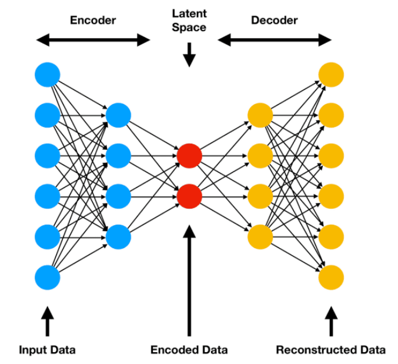
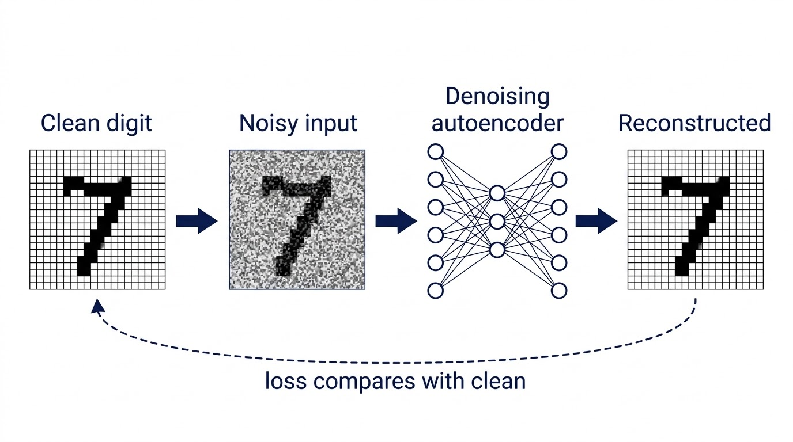
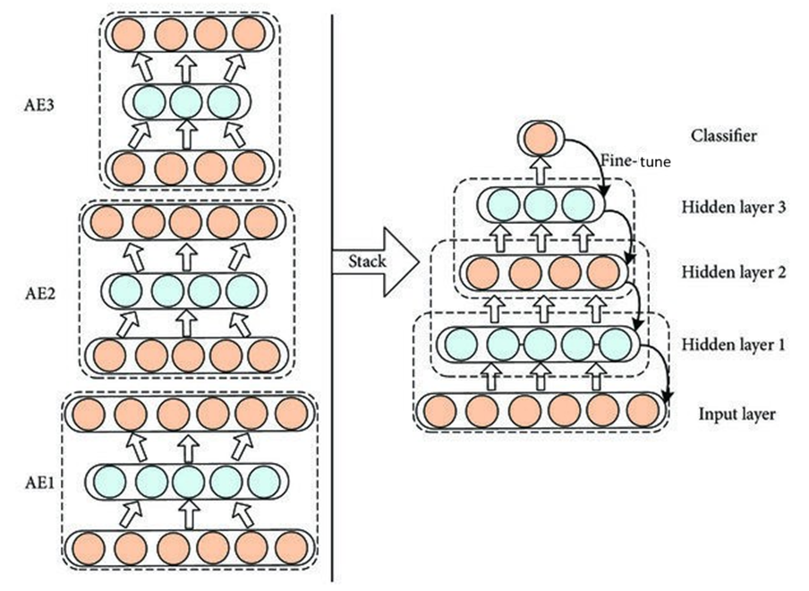
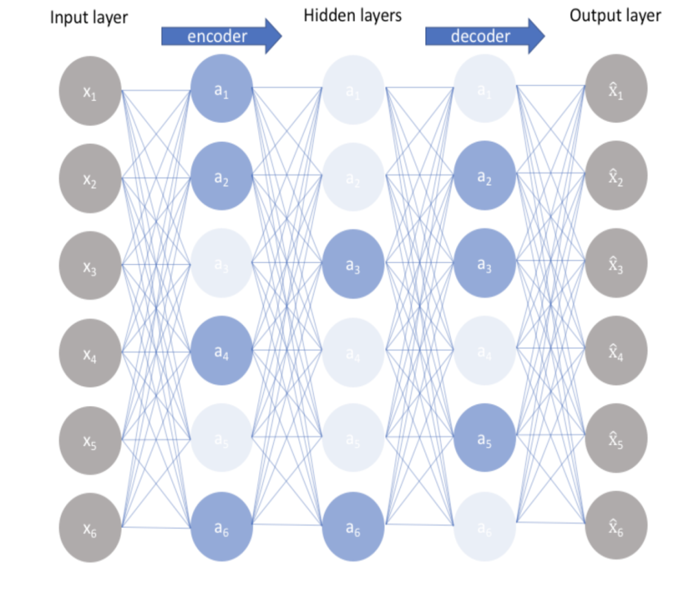

# Lecture 19 — Autoencoders: Exam Questions and Answers

Companion to [ML_Lec_19_Autoencoder_Learning_Guide.md](ML_Lec_19_Autoencoder_Learning_Guide.md). Try each question first, then read the answer.

**Pattern:** Part A = 2-mark questions. Part B = 10-mark questions split (a) + (b), 5 + 5 or 6 + 4.
**Tags:** 🎯 real paper; ✍️ practice to cover the lecture; 📘 beyond the slides. 💡 = memory hook.
Autoencoders have appeared in **every** end-sem paper (2023, 2024, 2025).

| Topic in the guide | Question |
| :--- | :--- |
| What an AE is, encoder/decoder (§1) | A1, B1(a) |
| Bottleneck, identity trap, correlation (§2) | A2 |
| Loss, MSE/BCE, regularizers (§3) | A3, A4 |
| Undercomplete AE, PCA (§4) | A5, B1(a) |
| Stacked AE, sentence encoding (§5) | B2 |
| Sparse AE, KL penalty (§6) | B3(a) |
| Denoising AE (§7) | B1(b), B3(b) |
| Applications, anomaly detection (§8) | A6 |

---

## Part A — 2-mark questions

### A1. What is an autoencoder? ✍️ [2]

An autoencoder is an **unsupervised** neural network trained to **copy its input to its output**: $\hat{x} = g(f(X))$. The **encoder** $f$ compresses the input into a small **latent code** (bottleneck); the **decoder** $g$ rebuilds the input from it. It is trained with backpropagation to minimise the reconstruction error (e.g. MSE). The code is the useful part: it gives dimensionality reduction and feature extraction without labels.

> 💡 Squeeze, then rebuild; what survives the squeeze is what matters.

### A2. Why does an autoencoder need a bottleneck? ✍️ [2]

Without it, a big enough network learns the **identity mapping** $g(f(X)) = X$: it copies perfectly but learns nothing. A bottleneck with $d \ll m$ nodes forces a **compressed** code. This works only if the input features are **correlated**: e.g. $x = (a, b, a+b)$ can be stored as $(a, b)$, but three independent numbers cannot be squeezed into two without loss.

> 💡 A narrow pipe stops copying.

### A3. Write the autoencoder loss and explain its two parts. ✍️ [2]

$$\text{Loss} = L(X, \hat{x}) + \text{Regularizer}, \qquad L = \tfrac{1}{2}\sum \Vert X - \hat{x}\Vert^2$$

- The **reconstruction term** keeps the network **sensitive** to the input, so $\hat{x} \approx X$.
- The **regularizer** keeps it **insensitive** enough not to memorise: e.g. L2 ($\lambda\sum W^2$), L1 ($\lambda\sum|W|$) or a KL sparsity penalty.

> 💡 One term says "copy well", the other says "don't just memorise".

### A4. When do you use MSE and when BCE as the reconstruction loss? ✍️ [2]

- **MSE** $= \frac{1}{N}\sum(x_i - \hat{x}_i)^2$: for **continuous** data.
- **BCE** $= -\frac{1}{N}\sum\big(x_i\log\hat{x}_i + (1-x_i)\log(1-\hat{x}_i)\big)$: for **binary** inputs or inputs scaled to [0, 1], such as images.

*E.g.* $x = (1,0,1,1)$, $\hat{x} = (0.9, 0.2, 0.8, 0.6)$: MSE $= 0.25/4 = 0.0625$; BCE $= 1.0625/4 \approx 0.266$.

> 💡 Real numbers → MSE; probabilities → BCE.

### A5. What is an undercomplete autoencoder? How is it related to PCA? ✍️ [2]

Its latent code is **smaller than the input**, so it cannot copy; the bottleneck itself is the regularizer, and no extra penalty is needed. With a **linear** encoder and decoder and MSE loss it learns the same subspace as **PCA** (the top principal components). With non-linear activations it can learn curved structure, so it is a non-linear PCA. *E.g.* 784 → 128 → 32 → 128 → 784 has 209,968 parameters.

> 💡 A linear AE is PCA; a non-linear AE bends.

### A6. How is an autoencoder used for anomaly detection? ✍️ [2]

Train the AE only on **normal** data. It rebuilds normal inputs well and unusual inputs badly. Set a threshold on the reconstruction error, e.g. mean + 3 std of normal errors: $\tau = 0.010 + 3 \times 0.003 = 0.019$. An input with MSE 0.085 > 0.019 is flagged as an **anomaly**; 0.012 is normal.

> 💡 Can't rebuild it? It's strange.

---

## Part B — 10-mark questions

### B1. 🎯 2023 End Q5(c) + 🎯 2025 End Q6(a)

**(a)** What is the objective of an autoencoder? How is an autoencoder used in dimensionality reduction and image denoising? **[5]**
**(b)** Discuss the different types of noise that can be used in a denoising autoencoder. Describe how a denoising autoencoder learns to reconstruct clean input from noisy data. **[2 + 3 = 5]**

**(a) Answer.**

**Objective:** learn an efficient representation of the data without labels, by making the output $\hat{x} = g(f(X))$ as close as possible to the input $X$ (minimise $L(X, \hat{x})$, e.g. MSE), while a bottleneck or regularizer stops it from simply copying.

**Dimensionality reduction:**

- Use an **undercomplete** AE: e.g. 784 → 128 → **32** → 128 → 784.
- After training, throw away the decoder and keep the **encoder**: each 784-pixel image becomes a 32-number code ($784/32 = 24.5$ times shorter).
- Because the features are correlated, the code keeps the important information. It works like PCA but can be non-linear.

**Image denoising:**

- Train a **denoising AE**: corrupt the clean image $x$ into $\tilde{x}$, feed $\tilde{x}$ in, and score the output against the **clean** $x$.
- After training, a new noisy image goes in and a cleaner version comes out.

**(b) Answer.**

**Types of noise** (applied during training only):

1. **Gaussian noise:** add small random values from a normal distribution to every feature.
2. **Masking / dropout noise:** set a random fraction of inputs to **0**.
3. **Salt-and-pepper noise:** set some random pixels to the maximum (white) or minimum (black).

**How it learns:**

1. Take a clean input $x$ and corrupt it: $\tilde{x}$.
2. Encode and decode the noisy input: $\hat{x} = g(f(\tilde{x}))$.
3. Compute the loss against the **clean** input: $\text{Loss} = \frac{1}{n}\sum(x_i - \hat{x}_i)^2$.
4. Backpropagate and update the weights.

Because the target is the clean input, copying is useless: it must learn the **structure** of clean data and remove what does not fit. *E.g.* clean $(1, 0, 1)$, noisy $(1.3, 0.2, 0.6)$, output $(0.95, 0.1, 0.9)$: error against clean 0.0075, against the noisy input's own error 0.0967, about 13 times better.

> 💡 Noisy in, clean target out.

### B2. 🎯 2024 End Q7(a) + 🎯 2025 End Q4(b)

**(a)** Explain the structure of a stacked autoencoder with a diagram and emphasize its key benefits. **[4 + 2 = 6]**
**(b)** Describe, with an example, how a deep learning model can be used to capture the semantic representations of sentences. **[4]**

**(a) Answer.**

**Structure:**

- A **stacked autoencoder** is built from **several autoencoders**, each trained on the **latent code** (not the reconstruction) of the previous one.
- $h_1 = f_1(W_1x + b_1)$, $h_2 = f_2(W_2h_1 + b_2)$, and so on.
- *E.g.* 784 → 256 → 64 → 16: AE1 learns 784 → 256 → 784; AE2 learns 256 → 64 → 256 on AE1's codes; AE3 learns 64 → 16 → 64. The stack compresses $784/16 = 49$ times.

**Training:**

1. **Greedy layer-wise pre-training:** train each AE alone, without labels, to rebuild its own input.
2. **Stack** the encoders, add a classifier on top, and **fine-tune** the whole network with labels.

**Benefits:**

- **Hierarchical features:** each level is more abstract (edges → shapes → objects).
- Dimensionality reduction that removes noise and helps later classification.
- Often better than a single AE on complex, high-dimensional data. Uses: image processing, NLP, anomaly detection.

**(b) Answer.**

A **sentence encoding** is a dense vector (often 100–768 numbers) that captures a sentence's meaning, so that sentences with similar meaning get similar vectors.

Steps with a stacked autoencoder:

1. **Tokenise:** "The cat sat on the mat" → The, cat, sat, on, the, mat.
2. **Embed** each word (Word2Vec, GloVe): e.g. cat = [0.8, 0.5, 0.3].
3. **Combine** into one vector, e.g. by averaging: $s = [0.433, 0.333, 0.183]$. (An LSTM/GRU can be used instead to keep word order.)
4. **Encode** with stacked layers: $h_1 = f_1(W_1s + b_1) = [0.45, 0.22]$, $h_2 = [0.61]$ (illustrative).
5. The last hidden output is the **sentence encoding**.

The compression keeps **meaning** and drops variation that does not change it. So "The cat sat on the mat" and "A cat is sitting on a rug" get close codes. These codes are used for semantic search, similarity and classification.

> 💡 Stack the squeezes: each level understands a little more.

### B3. 🎯 2023 End Q6(b) + ✍️

**(a)** How do autoencoders handle sparse data? Are there specialised autoencoders for sparsity? Explain the sparse autoencoder and its KL penalty, and compute $D_{KL}(\rho\Vert\hat\rho)$ for $\rho = 0.05$, $\hat\rho = 0.1$. **[6]**
**(b)** Compare the undercomplete, sparse, denoising and stacked autoencoders. **[4]**

**(a) Answer.**

- Sparse data (mostly zeros, e.g. bag-of-words vectors) is high-dimensional but has little information per input, so an AE can compress it into a short **dense** code.
- The specialised architecture is the **sparse autoencoder**: the hidden layer may be large, but only **a few neurons are active** for each input. Each neuron becomes a specialist, which gives interpretable features and robustness to noise.

Loss:

$$\text{Total Loss} = \text{Reconstruction Loss} + \lambda \sum_j D_{KL}(\rho\Vert\hat\rho_j)$$

$$D_{KL}(\rho\Vert\hat\rho) = \rho\log\frac{\rho}{\hat\rho} + (1-\rho)\log\frac{1-\rho}{1-\hat\rho}$$

$\rho$ is the target activation (small, e.g. 0.05); $\hat\rho_j$ is neuron $j$'s average activation over the training data. KL is 0 when $\hat\rho = \rho$ and grows as they move apart, so neurons that fire too often are penalised. (L1 on the activations also works.)

Numerical (natural log):

$$0.05\ln\frac{0.05}{0.1} + 0.95\ln\frac{0.95}{0.9} = -0.034657 + 0.051364 = 0.016707$$

Small, because 0.1 is close to the target; at $\hat\rho = 0.5$ it would be 0.4946.

**(b) Answer.**

| Variant | How it avoids copying | Extra loss term | Main use |
| :--- | :--- | :--- | :--- |
| Undercomplete | code smaller than input | none | dimensionality reduction |
| Sparse | few neurons active at once | $\lambda\sum_j D_{KL}(\rho\Vert\hat\rho_j)$ | interpretable features |
| Denoising | corrupted input, clean target | none needed | noise removal, robust features |
| Stacked | several AEs, each on the previous code | per-layer reconstruction, then fine-tuning | hierarchical features |

> 💡 Small code, few active, noisy input, or many layers: four ways to stop copying.
