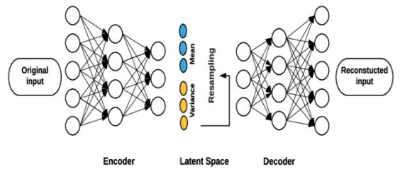
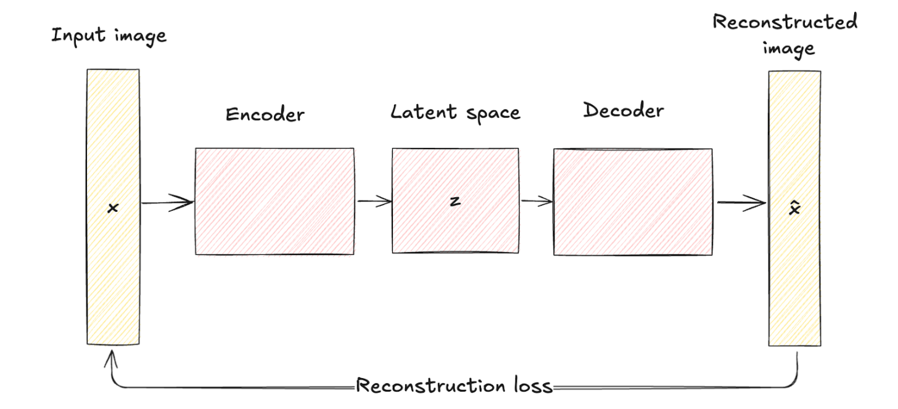
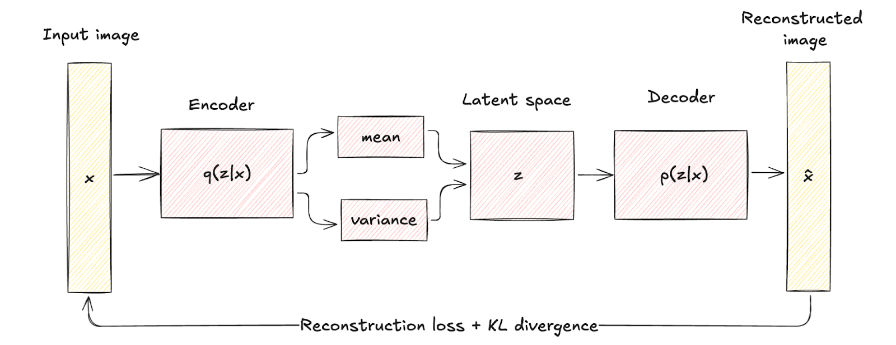
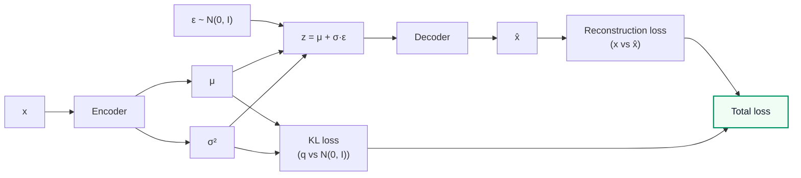
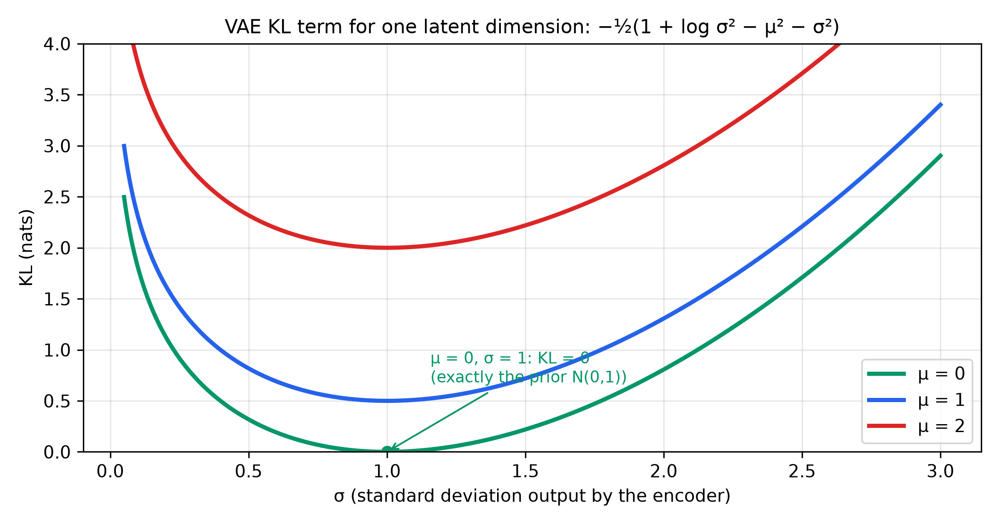
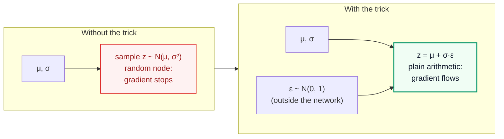
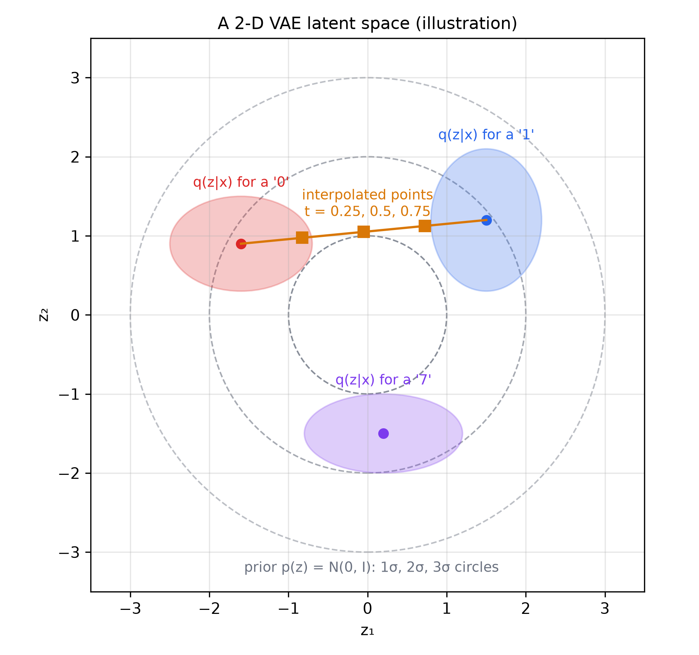
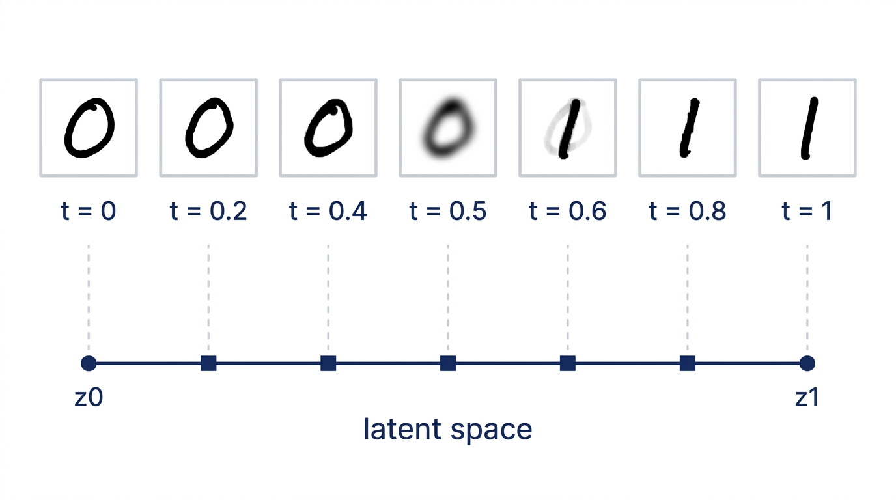
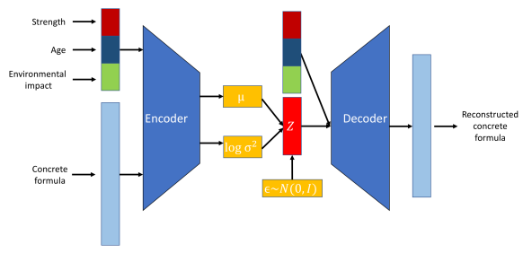

# Variational Autoencoders (VAE) — Learning Guide

Source: `ML_Lec_20_VAE.pptx`, Slides 1–46. Every number recomputed. Read Lecture 19 (autoencoders) first.
**📘 Beyond the slides** = gap filled from outside the slides. **✏️ Slide discrepancy** = a slide is wrong or unclear.

## Contents

1. [What a VAE is and its three components](#1-what-a-vae-is-and-its-three-components)
2. [VAE vs a plain autoencoder](#2-vae-vs-a-plain-autoencoder)
3. [The process flow and the loss](#3-the-process-flow-and-the-loss)
4. [The KL divergence term, derived](#4-the-kl-divergence-term-derived)
5. [The reparameterization trick](#5-the-reparameterization-trick)
6. [Interpolation in latent space](#6-interpolation-in-latent-space)
7. [The conditional VAE and other variants](#7-the-conditional-vae-and-other-variants)

---

## 1. What a VAE is and its three components

**Why it exists.** A plain autoencoder maps each image to one point. Decode a random point and you usually get garbage: real codes sit at scattered spots with gaps the decoder never learned. A **variational autoencoder** maps each input to a small **cloud** (a probability distribution) and pushes all clouds to fill one standard bell-shaped region. Then every point there decodes to something sensible, so you can **generate** data.

**Definition (Slide 1).** A **generative model** that encodes data into a compressed representation and decodes it back. Unlike traditional autoencoders it uses **probabilistic modelling**: it generates new samples like the training data by **sampling from a distribution**, usually Gaussian.

**Why learn VAEs (Slide 2).** (1) **Generative:** new samples like the training data, e.g. new handwritten digits. (2) **Dimensionality reduction** that keeps the important information. (3) **Smooth latent space:** continuous and structured, so you can **interpolate** between data points.

**The three components (Slides 3–5).**

1. **Encoder:** maps input $x$ to the latent space, as a **distribution** (usually Gaussian), not a point. It outputs a **mean** vector $\mu(x)$ and a **variance** vector $\sigma^2(x)$; the code is a sample $z \sim \mathcal{N}(\mu(x), \sigma^2(x))$.
2. **Latent space:** the lower-dimensional space of encoded data, modelled as a **probability distribution**, which is what lets the VAE generate by sampling.
3. **Decoder:** rebuilds $\hat{x}$ from the sampled $z$.


*Figure: Slides 3–5. Blue nodes hold the means, yellow the variances; "resampling" draws $z$ from them.*

With $d$ latent dimensions the encoder outputs $2d$ numbers, and each dimension has its own independent Gaussian, $z_j \sim \mathcal{N}(\mu_j, \sigma_j^2)$. *Running example:* $\mu = (0.5, -1.0)$, $\sigma^2 = (0.25, 1.0)$, so $\sigma = (0.5, 1.0)$; about 68% of $z_1$ samples fall in $[0, 1]$ (one standard deviation either side).

**Generating after training** needs no encoder: draw $z \sim \mathcal{N}(0, I)$, then $x_{\text{new}} = \text{Decoder}(z)$. This works only because the KL term (section 4) forced real codes to look like $\mathcal{N}(0, I)$.

---

## 2. VAE vs a plain autoencoder

**Traditional autoencoder (Slide 6).** The encoder maps $x$ to a **fixed** code $z$: **deterministic**, one input → one point. The decoder minimises reconstruction difference. No probabilistic model, so it cannot handle uncertainty and is poor at generating new, diverse data.

**VAE (Slides 7–8).** The encoder maps the input to a **Gaussian** with mean $\mu$ and variance $\sigma^2$, adding variability and uncertainty. The architectures differ only there: deterministic mapping versus probabilistic encoding plus sampling. Because a VAE must also generate samples resembling the input, its loss has one more term: the **Kullback-Leibler (KL) divergence**.

> ✏️ **Slide discrepancy (Slide 8).** "The goal is not to reconstruct the original input; it's to generate new samples" overstates it. A VAE is still trained to reconstruct (half its loss, Slide 11); generation is the extra ability the KL term adds. Fairer: "not *only* to reconstruct".


*Figure: Slide 6.*


*Figure: Slide 8. $q(z \mid x)$: the encoder's distribution of codes for $x$. $p(x \mid z)$: the decoder.*

| | Plain autoencoder | VAE |
| :--- | :--- | :--- |
| Encoder output | One code $z$ | $\mu(x)$ and $\sigma^2(x)$ |
| Mapping | Deterministic: same $x$ → same code | Probabilistic: same $x$ → different codes near $\mu(x)$ |
| Loss | Reconstruction | Reconstruction + KL |
| Latent space | Scattered points, gaps | Continuous, close to $\mathcal{N}(0, I)$ |
| Generates new data? | Poorly | Yes: sample $\mathcal{N}(0, I)$, decode |

---

## 3. The process flow and the loss

**Process flow (Slide 9).** (1) The encoder outputs the parameters $\mu$, $\sigma^2$ of $q(z \mid x)$. (2) $z$ is sampled from $q(z \mid x)$ with the **reparameterization trick** (section 5). (3) The decoder produces $\hat{x}$, which should resemble $x$.

**Why two terms (Slide 10).** To generate, the latent space must be **regularized** to follow a chosen distribution. The **reconstruction loss** keeps reconstruction accurate; the **KL divergence** makes the latent space follow the distribution. Together they prevent overfitting and give a model that generalises.

**The loss (Slides 11, 23).**

```math
L = L_{\text{reconstruction}} + \beta \, L_{KL}
```

How badly the input was rebuilt, plus $\beta$ times how far the codes are from a standard Gaussian. $\beta = 1$ is the standard VAE (Slide 11). $\beta$ trades reconstruction against regularization (Slide 23): larger gives a smoother latent space but blurrier copies; smaller gives sharper copies but a gappier space and worse generation.

**Steps to compute it (Slide 12).** (1) Encode → $\mu$, $\sigma^2$. (2) Sample $z = \mu + \sigma \cdot \epsilon$, $\epsilon \sim \mathcal{N}(0, I)$. (3) Decode → $\hat{x}$. (4) Reconstruction loss from $x$, $\hat{x}$. (5) KL between the learned distribution and the prior. (6) Combine.



The KL loss uses only $\mu$ and $\sigma^2$, not $z$ or the decoder, which is why it has a closed formula. The reconstruction loss depends on the random $\epsilon$, so it varies a little each time.

**Reconstruction loss (Slide 13).** BCE for binary data (or scaled to [0, 1], like MNIST pixels); MSE for continuous data (sensor readings, audio). $N$ data points, $x_i$ original, $\hat{x}_i$ reconstruction:

```math
\text{BCE} = -\frac{1}{N} \sum_{i=1}^{N} \left[ x_i \log \hat{x}_i + (1 - x_i) \log(1 - \hat{x}_i) \right], \qquad \text{MSE} = \frac{1}{N} \sum_{i=1}^{N} (x_i - \hat{x}_i)^2
```

*Example:* $x = (1, 0)$, $\hat{x} = (0.7, 0.1)$: BCE $= -\tfrac{1}{2}(\ln 0.7 + \ln 0.9) \approx 0.2310$; MSE $= (0.09 + 0.01)/2 = 0.05$.

*β example.* Reconstruction 0.20, KL 0.9431 (section 4):

| $\beta$ | Total | KL share |
| :---: | :--- | ---: |
| 0.1 | $0.20 + 0.0943 = 0.2943$ | 32% |
| 1 | $0.20 + 0.9431 = 1.1431$ | 83% |
| 4 | $0.20 + 3.7724 = 3.9724$ | 95% |

At $\beta = 4$ the optimiser mostly shrinks the KL. Real reconstruction losses are summed over all pixels (784 for MNIST), so the balance is less extreme.

> 📘 **Beyond the slides — where the loss comes from.** It is the negative **evidence lower bound (ELBO)** (Kingma and Welling, 2014): $\log p(x) \ge \mathbb{E}_{q(z \mid x)}[\log p(x \mid z)] - \text{KL}(q(z \mid x) \Vert p(z))$. Minimising $L$ raises a lower bound on how likely the model finds real data. In plain words: we cannot compute "how likely is this image under my model" directly, so we push up a number that is guaranteed to sit below it (rebuild well, keep codes near the bell curve). Large $\beta$ is the **β-VAE** (Higgins et al., 2017), known for disentangled latents.

---

## 4. The KL divergence term, derived

**The idea.** Each cloud $q(z \mid x)$ should stay near $\mathcal{N}(0, 1)$. Clouds that drift away or shrink to dots bring the gaps back. KL measures that distance; for two Gaussians it has a closed form.

**The formula (Slides 14–15).** $q(z \mid x)$ is the **approximate posterior** the encoder outputs; $p(z)$ is the **prior**, usually $\mathcal{N}(0, I)$. In plain words: the **prior** is where we *want* codes to live before seeing any input (a standard bell curve); the **posterior** is where the codes for this particular $x$ really are; "approximate" because the encoder only estimates it with a Gaussian. With $d$ latent dimensions:

```math
\text{KL}(q(z \mid x) \Vert p(z)) = -\frac{1}{2} \sum_{j=1}^{d} \left( 1 + \log \sigma_j^2 - \mu_j^2 - \sigma_j^2 \right)
```

Per dimension: 1, plus log-variance, minus mean squared, minus variance; sum and multiply by $-\tfrac{1}{2}$.

**Derivation (Slides 16–22)**, one dimension, then sum.

1. **Definition (16):** the average over $z \sim q$ of how much more likely $q$ finds $z$ than $p$ does.

```math
\text{KL}(q \Vert p) = \mathbb{E}_{q(z \mid x)}\left[ \log q(z \mid x) - \log p(z) \right] = \int q(z \mid x) \log \frac{q(z \mid x)}{p(z)} \, dz
```

2. **The distributions (17–18):** $p(z) = \mathcal{N}(0, 1)$, $q(z \mid x) = \mathcal{N}(z;\ \mu, \sigma^2)$:

```math
q(z \mid x) = \frac{1}{\sqrt{2\pi\sigma^2}} \exp\left( -\frac{(z - \mu)^2}{2\sigma^2} \right), \qquad p(z) = \frac{1}{\sqrt{2\pi}} \exp\left( -\frac{z^2}{2} \right)
```

3. **Simplify the log (19):** the $\sqrt{2\pi}$ cancel and $\log \exp(a) = a$:

```math
\log \frac{q(z \mid x)}{p(z)} = \log \frac{1}{\sqrt{\sigma^2}} - \frac{(z - \mu)^2}{2\sigma^2} + \frac{z^2}{2}
```

4. **Facts about $\epsilon$ (20):** with $z = \mu + \sigma \epsilon$, $\epsilon \sim \mathcal{N}(0, 1)$: $\mathbb{E}(\epsilon) = 0$ and $\mathbb{E}(\epsilon^2) = \text{Var}(\epsilon) + (\mathbb{E}\epsilon)^2 = 1$. So $\mathbb{E}(z) = \mu$ and $\mathbb{E}(z^2) = \mu^2 + 2\mu\sigma \cdot 0 + \sigma^2 = \mu^2 + \sigma^2$.

5. **Take expectations (21–22):** pull out $-\tfrac{1}{2}$, then substitute:

```math
\text{KL}_j = -\frac{1}{2}\, \mathbb{E}\left[ \log \sigma_j^2 + \frac{z_j^2 - 2 z_j \mu_j + \mu_j^2}{\sigma_j^2} - z_j^2 \right]
= -\frac{1}{2}\left[ \log \sigma_j^2 + \frac{\mu_j^2 + \sigma_j^2 - 2\mu_j^2 + \mu_j^2}{\sigma_j^2} - \mu_j^2 - \sigma_j^2 \right]
```

The $\mu_j^2$ terms in the fraction cancel, leaving $\sigma_j^2 / \sigma_j^2 = 1$:

```math
\text{KL}_j = -\frac{1}{2}\left( 1 + \log \sigma_j^2 - \mu_j^2 - \sigma_j^2 \right)
```

6. **Sum** over the independent dimensions: Slide 14's formula.

> ✏️ **Slide discrepancy (Slide 21).** $E_{q(z/x)}$ should be $\mathbb{E}_{q(z \mid x)}$: "given $x$", not "divided by $x$". The smudged symbol before "(log" in the first image is the expectation $\mathbb{E}$.

**Worked example** ($\mu = (0.5, -1)$, $\sigma^2 = (0.25, 1)$, natural log):

- $\text{KL}_1 = -\tfrac{1}{2}(1 - 1.3863 - 0.25 - 0.25) = 0.4431$
- $\text{KL}_2 = -\tfrac{1}{2}(1 + 0 - 1 - 1) = 0.5$
- **Total 0.9431.** Simulation (2 million samples of $\log q - \log p$): 0.9445.

What it punishes: $\mu_j^2$ punishes means away from 0; $\sigma_j^2 - 1 - \log \sigma_j^2$ punishes variances away from 1 in either direction (0 at $\sigma_j^2 = 1$).


*Figure: KL is zero only at $\mu = 0$, $\sigma = 1$ (the prior itself). Moving the mean adds $\mu^2/2$. Shrinking $\sigma$ to 0 (a "point" code, like a plain autoencoder) makes it shoot up.*

---

## 5. The reparameterization trick

A key technique for training VAEs (Slide 25): it handles the random latent variables during backpropagation, so gradient methods like SGD can optimise the VAE.

**The problem (Slides 24, 26–27).** The encoder outputs a **mean vector** $\mu(x)$ (centre) and a **log-variance vector** $\log \sigma^2(x)$ (spread), and $z \sim \mathcal{N}(\mu(x), \sigma^2(x))$ is a random variable. Backpropagation must send gradients through the whole graph to the encoder, but random sampling is **non-differentiable**: the gradient stops at the random node and training is blocked. Why: backpropagation needs to ask "if $\mu$ grows a little, how much does $z$ change?". A dice roll has no formula connecting $\mu$ to the number that comes out, so there is no slope to answer that question.

**The solution (Slides 28–30).** Move the randomness out of the way: write $z$ as a deterministic function of a fixed random variable.

```math
z = \mu(x) + \sigma(x) \cdot \epsilon, \qquad \epsilon \sim \mathcal{N}(0, 1)
```

Take a standard random number, stretch it by the standard deviation $\sigma(x)$ (square root of the variance), shift it by the mean. $\mu(x)$ and $\sigma(x)$ are deterministic encoder outputs; $\epsilon$ is random but does **not** depend on the encoder's parameters. Sampling $\mathcal{N}(0, 1)$ is easy; then we just shift and scale.

**How it helps (Slide 30).** **Gradient flow:** $z$ is now differentiable in $\mu$ and $\sigma$, so backpropagation and SGD reach the encoder. **Still random:** $\epsilon$ keeps $z$ stochastic, so the VAE can still sample.

**Without vs with (Slide 31).** Without: sample $z \sim \mathcal{N}(\mu, \sigma^2)$ directly; backpropagation stops. With: sample $\epsilon$, set $z = \mu + \sigma \epsilon$; all randomness is in $\epsilon$, and $\mu$, $\sigma$ lie on a deterministic path that gradient descent can update.

> ✏️ **Slide discrepancy (Slides 3 vs 26).** Slide 3 says the encoder outputs the variance $\sigma^2(x)$; Slide 26 says the log-variance. 📘 In practice it outputs $\ell = \log \sigma^2$ (any real number, while a variance must be positive), then $\sigma = \exp(\ell / 2)$.

**By hand.** $\mu_1 = 0.5$, $\ell_1 = \log 0.25 = -1.3863$, so $\sigma_1 = \exp(-0.6931) = 0.5$. With $\epsilon = 0.8$: $z_1 = 0.5 + 0.5 \times 0.8 = 0.9$.

**The gradients it unlocks.** $\partial z / \partial \mu = 1$ and $\partial z / \partial \sigma = \epsilon$ (0.8 here): ordinary numbers the chain rule can carry back. And $z$ still has the right distribution: $\mathbb{E}(z) = \mu$, $\text{Var}(z) = \sigma^2 \text{Var}(\epsilon) = \sigma^2$. (Simulation: 2 million $\epsilon$ draws gave mean 0.0004, mean square 0.9986.)



---

## 6. Interpolation in latent space

**Interpolation (Slide 32).** In a smooth, continuous latent space, walking in a straight line between two codes should give gradually changing images. Take $z_1$, $z_2$ and decode points between them:

```math
z_{\text{interp}} = (1 - \alpha)\, z_1 + \alpha\, z_2, \quad \alpha \in [0, 1], \qquad x_{\text{interp}} = \text{Decoder}(z_{\text{interp}})
```

If the space is well structured, the outputs morph smoothly (one face into another, one digit into another).

**Why it is useful (Slide 33).** (a) **Semantic continuity:** nearby vectors give similar data, proof of a structured latent space. (b) **Data synthesis:** new realistic samples, e.g. a face between two faces. (c) **Latent exploration:** see how moving in a direction changes pose, colour or style.

**MNIST example (Slides 34–41).**

1. **Visualise:** train with a **2-D** latent space, encode every image, colour points by digit ('0' red, '1' blue, …); similar digits cluster.
2. **Pick two digits** (a '2' and a '7', or a '0' and a '1') and interpolate between them.
3. **Encode** a '0' and a '1' to get $z_0$, $z_1$.
4. **Interpolate:** $z = (1 - t) z_0 + t z_1$, $0 \le t \le 1$; $t = 0$ is exactly $z_0$, $t = 1$ exactly $z_1$.
5. **Decode:** $t = 0$ a clear '0'; $0.2$ loses some roundness; $0.5$ a blurry, distorted in-between; $0.8$ straightening into a '1'; $1$ a clear '1'.

*Numbers* ($z_0 = (-2, 1)$, $z_1 = (2, 3)$; Slide 41 uses $t = 0.25, 0.5, 0.75$): each 0.25 step moves $(4, 2) \times 0.25 = (1, 0.5)$.

| $t$ | 0 | 0.25 | 0.5 | 0.75 | 1 |
| :--- | :---: | :---: | :---: | :---: | :---: |
| $z$ | $(-2, 1)$ | $(-1, 1.5)$ | $(0, 2)$ | $(1, 2.5)$ | $(2, 3)$ |


*Figure: Illustration, not a trained model. KL keeps the clouds inside the prior's circles and slightly overlapping, so the straight line between two codes passes through places the decoder knows. A plain autoencoder's codes need not cover that line, so its middle images can be nonsense.*


*Figure: Slide 40's morph (illustration, not real model output). Each marker is one interpolated code with its decoded image above.*

---

## 7. The conditional VAE and other variants

**The idea.** A plain VAE generates "some digit"; you cannot ask for "a 7". A **conditional VAE (CVAE)** adds extra information $c$ so you control what is generated.

**CVAE (Slides 42–44).** Conditions on $c$, given to **both** encoder and decoder. $c$ can be class labels, attributes, or other context.

- **Uses:** controlled data generation (images of specific objects or scenes from labels or descriptions); image-to-image translation keeping some attributes (black-and-white → colour, sketch → photo); text generation for a prompt or topic (stories, chatbot replies, personalised content).
- **Pros:** finer control; better representation learning. **Con:** higher risk of overfitting.


*Figure: Slide 43. The encoder outputs $\mu$ and $\log \sigma^2$; $z$ is formed with $\epsilon \sim \mathcal{N}(0, I)$; the condition vector is attached to $z$ before decoding.*

> 📘 **Beyond the slides.** CVAE loss (Sohn et al., 2015): $L = L_{\text{reconstruction}}(x, \hat{x}) + \text{KL}(q(z \mid x, c) \Vert p(z))$ with $\hat{x} = \text{Decoder}(z, c)$. For MNIST with a one-hot label (10 numbers) and 2-D latent: encoder input $784 + 10 = 794$, decoder input $2 + 10 = 12$. To draw a 7, sample $z \sim \mathcal{N}(0, I)$, set $c = (0,0,0,0,0,0,0,1,0,0)$, decode. The label fixes **what** digit; $z$ controls **how** it is written.

**Other variants (Slide 45).** **Disentangled VAEs** (β-VAEs, $\beta > 1$); **adversarial autoencoders (AAEs)**; **variational recurrent autoencoders (VRAEs)** for sequences; **hierarchical VAEs (HVAEs)** with several levels of latent variables.

---

## References

- Kingma, D. P. and Welling, M. (2014). *Auto-Encoding Variational Bayes.* ICLR.
- Higgins, I. et al. (2017). *β-VAE: Learning Basic Visual Concepts with a Constrained Variational Framework.* ICLR.
- Sohn, K., Lee, H. and Yan, X. (2015). *Learning Structured Output Representation using Deep Conditional Generative Models.* NeurIPS.
