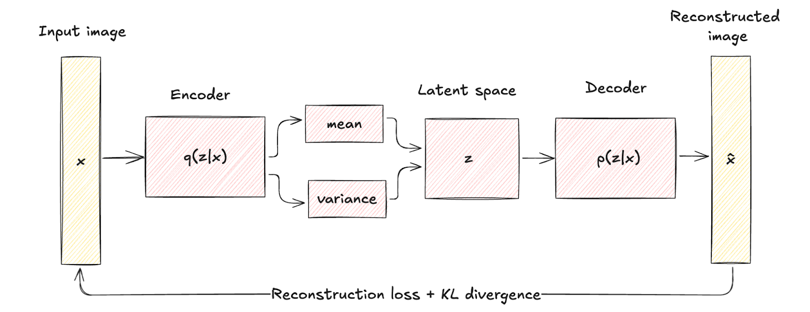
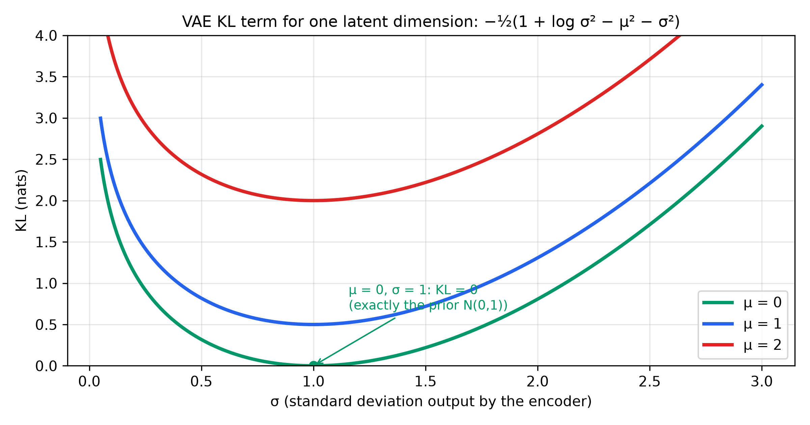
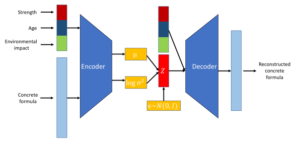
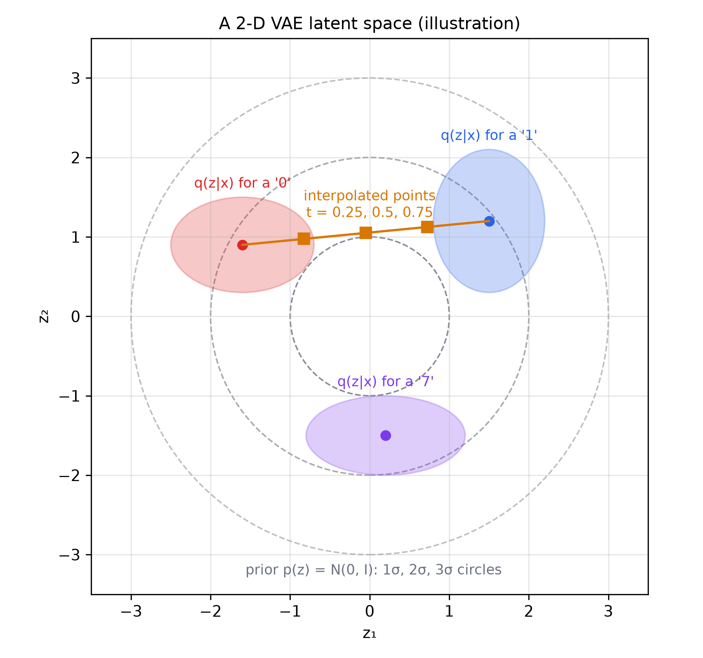
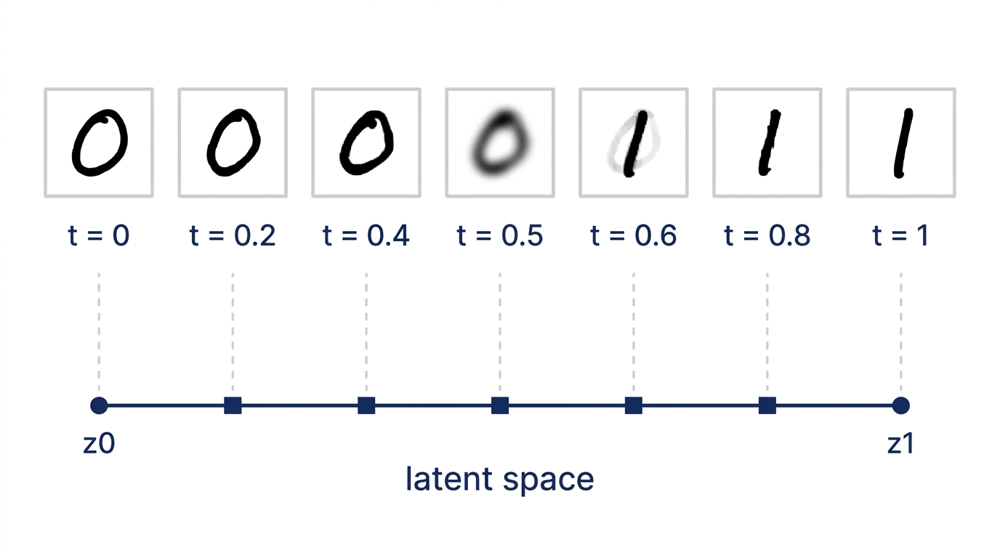

# Lecture 20 — Variational Autoencoders (VAE): Exam Questions and Answers

Companion to [ML_Lec_20_VAE_Learning_Guide.md](ML_Lec_20_VAE_Learning_Guide.md). Try each question first, then read the answer.

**Pattern:** Part A = 2-mark questions. Part B = 10-mark questions split (a) + (b), 5 + 5 or 6 + 4.
**Tags:** 🎯 real paper; ✍️ practice to cover the lecture; 📘 beyond the slides. 💡 = memory hook.
VAEs have appeared in **every** end-sem paper (2023, 2024, 2025).

| Topic in the guide | Question |
| :--- | :--- |
| What a VAE is, three components, generation (§1) | A1, B1(a) |
| VAE vs plain AE (§2) | B1(a) |
| Loss, reconstruction + β·KL (§3) | A2, A3 |
| KL term and its derivation (§4) | B2(a) |
| Reparameterization trick (§5) | B1(b) |
| Interpolation, smooth latent space (§6) | A4, B3 |
| CVAE and other variants (§7) | A5, B2(b) |

---

## Part A — 2-mark questions

### A1. What is a variational autoencoder? How do you generate new data with it? ✍️ [2]

A VAE is a **generative** autoencoder. Its encoder maps each input to a **Gaussian distribution** (a mean vector $\mu(x)$ and a variance vector $\sigma^2(x)$), not to a single point; a code $z$ is sampled from it and decoded. The KL term pushes all these distributions towards $\mathcal{N}(0, I)$.

To generate after training, drop the encoder: sample $z \sim \mathcal{N}(0, I)$ and compute $x_{\text{new}} = \text{Decoder}(z)$.

> 💡 A VAE encodes to a cloud, not a dot, so any point in the bell curve decodes to something real.

### A2. Write the VAE loss and explain the role of β. ✍️ [2]

$$L = L_{\text{reconstruction}} + \beta\,L_{KL}$$

- Reconstruction (BCE or MSE) keeps $\hat{x}$ close to $x$.
- KL keeps the latent distribution close to $\mathcal{N}(0, I)$.
- $\beta = 1$ is the standard VAE. Larger $\beta$ gives a smoother latent space but blurrier reconstructions (β-VAE); smaller $\beta$ gives sharper copies but a gappier space and worse generation.

*E.g.* reconstruction 0.20, KL 0.9431: $\beta = 1$ gives 1.1431; $\beta = 4$ gives 3.9724.

> 💡 β is the dial between "copy well" and "keep the space smooth".

### A3. Why does a VAE need both a reconstruction loss and a KL loss? ✍️ [2]

- **Without KL:** the encoder can shrink each cloud to a point and scatter the points, so it becomes a plain autoencoder with gaps; random samples decode to garbage.
- **Without reconstruction:** every input maps to $\mathcal{N}(0, I)$ and the code carries no information about $x$.

Together they give codes that are both informative and arranged in a smooth, continuous space.

> 💡 One loss gives meaning, the other gives order.

### A4. What is latent-space interpolation? ✍️ [2]

Encode two inputs to $z_1$ and $z_2$, then decode points on the straight line between them:

$$z_{\text{interp}} = (1-\alpha)z_1 + \alpha z_2,\quad \alpha\in[0,1]$$

In a smooth VAE latent space the outputs **morph gradually**, e.g. a '0' slowly turns into a '1'. *E.g.* $z_0 = (-2, 1)$, $z_1 = (2, 3)$, $\alpha = 0.5$ → $(0, 2)$. It shows semantic continuity, synthesises new data and lets you explore what each direction in latent space controls.

> 💡 Walk in a straight line, watch the image morph.

### A5. Name four variants of the VAE. ✍️ [2]

1. **Conditional VAE (CVAE):** conditions encoder and decoder on a label $c$ to control the output.
2. **β-VAE (disentangled VAE):** $\beta > 1$ for a disentangled latent space.
3. **Adversarial autoencoder (AAE):** uses an adversarial network to shape the latent space.
4. **Variational recurrent AE (VRAE)** for sequences, and **hierarchical VAE (HVAE)** with several levels of latent variables.

> 💡 Condition it, weight it, fight it, sequence it, stack it.

---

## Part B — 10-mark questions

### B1. 🎯 2024 End Q7(b) + ✍️

**(a)** What is the primary purpose of a variational autoencoder (VAE), and how does it differ from a simple autoencoder? **[1.5 + 2 = 4]**
**(b)** Explain the reparameterization trick and its significance in VAEs. **[6]**

**(a) Answer.**

**Purpose:** to be a **generative model**: learn a smooth, continuous latent space from which **new samples** resembling the training data can be generated, while also giving dimensionality reduction.

| | Simple autoencoder | VAE |
| :--- | :--- | :--- |
| Encoder output | one code $z$ (a point) | $\mu(x)$ and $\sigma^2(x)$ (a distribution) |
| Mapping | deterministic | probabilistic: $z \sim \mathcal{N}(\mu, \sigma^2)$ |
| Loss | reconstruction only | reconstruction + KL divergence |
| Latent space | scattered points with gaps | continuous, close to $\mathcal{N}(0, I)$ |
| Generates new data | poorly | yes: sample $\mathcal{N}(0, I)$ and decode |

**(b) Answer.**

**The problem.** The encoder outputs $\mu(x)$ and $\log\sigma^2(x)$, and the code is sampled: $z \sim \mathcal{N}(\mu, \sigma^2)$. To train, backpropagation must send gradients from the decoder back through $z$ to the encoder. But **random sampling is not differentiable**: there is no formula linking $\mu$ to the sampled number, so the gradient stops at the sampling node and the encoder cannot learn.

**The trick.** Move the randomness into a separate variable that does not depend on the network:

$$z = \mu(x) + \sigma(x)\cdot\epsilon,\qquad \epsilon\sim\mathcal{N}(0, I)$$

Now $z$ is ordinary arithmetic in $\mu$ and $\sigma$:

$$\frac{\partial z}{\partial \mu} = 1,\qquad \frac{\partial z}{\partial \sigma} = \epsilon$$

*Example:* $\mu = 0.5$, $\log\sigma^2 = -1.3863$, so $\sigma = e^{-0.6931} = 0.5$; with $\epsilon = 0.8$, $z = 0.5 + 0.5 \times 0.8 = 0.9$.

**Significance:**

1. **Gradient flow:** the gradient passes through $z$ to $\mu$ and $\sigma$, so the encoder can be trained end to end with backpropagation and SGD.
2. **Still random:** $\epsilon$ keeps $z$ stochastic, with the right distribution ($\mathbb{E}[z] = \mu$, $\text{Var}(z) = \sigma^2$), so the VAE can still sample and generate.
3. It is what makes VAEs trainable at all.

> 💡 Take the dice outside the network; inside, only add and multiply.

### B2. 🎯 2025 End Q6(b) + ✍️

**(a)** Write the KL divergence term of a VAE for a Gaussian encoder and a standard normal prior. Compute it for $\mu = (0.5, -1)$, $\sigma^2 = (0.25, 1)$. **[5]**
**(b)** Describe the architecture of a conditional variational autoencoder (CVAE) with a neat diagram. What is the KL divergence term in a CVAE, and what is its purpose? **[3 + 2 = 5]**

**(a) Answer.**

$$\text{KL}(q(z\mid x)\,\Vert\,p(z)) = -\frac{1}{2}\sum_{j=1}^{d}\left(1 + \log\sigma_j^2 - \mu_j^2 - \sigma_j^2\right)$$

where $q(z \mid x) = \mathcal{N}(\mu, \sigma^2)$ is the encoder's distribution and $p(z) = \mathcal{N}(0, I)$ is the prior.

How it is derived (one dimension): start from $\text{KL} = \mathbb{E}_q[\log q - \log p]$, substitute the two Gaussian densities, and use $\mathbb{E}[z] = \mu$, $\mathbb{E}[z^2] = \mu^2 + \sigma^2$; the $\sqrt{2\pi}$ terms cancel and the result above follows.

Numerical (natural log):

- $\text{KL}_1 = -\frac{1}{2}(1 + \ln 0.25 - 0.25 - 0.25) = -\frac{1}{2}(1 - 1.3863 - 0.5) = 0.4431$
- $\text{KL}_2 = -\frac{1}{2}(1 + 0 - 1 - 1) = 0.5$
- **Total = 0.9431**

It is 0 only when $\mu = 0$ and $\sigma^2 = 1$; $\mu^2$ punishes means away from 0, and $\sigma^2 - 1 - \log\sigma^2$ punishes variances away from 1.

**(b) Answer.**

**Architecture:**

1. **Encoder** takes the input $x$ **and** the condition $c$ (a class label, attributes or context) and outputs $\mu$ and $\log\sigma^2$ of $q(z \mid x, c)$.
2. **Sampling:** $z = \mu + \sigma\cdot\epsilon$, $\epsilon\sim\mathcal{N}(0, I)$.
3. **Decoder** takes $z$ **joined with** $c$ and outputs $\hat{x} = \text{Decoder}(z, c)$.

*E.g.* MNIST with a one-hot label and a 2-D latent: encoder input $784 + 10 = 794$, decoder input $2 + 10 = 12$. To draw a '7', sample $z$, set $c$ = one-hot 7, and decode. The label decides **what** digit; $z$ decides **how** it is written. Uses: controlled generation, image-to-image translation, text for a given topic.

**KL term** (📘 Sohn et al., 2015):

$$L = L_{\text{rec}}(x, \hat{x}) + \text{KL}\big(q(z\mid x, c)\,\Vert\,p(z)\big)$$

**Purpose:** it keeps the conditional latent distribution close to the prior $\mathcal{N}(0, I)$. This makes the latent space smooth and continuous, so at generation time a $z$ sampled from $\mathcal{N}(0, I)$ together with any condition $c$ decodes to a realistic sample. It also acts as a regularizer against overfitting, which is the CVAE's main risk.

> 💡 CVAE = VAE + a label given to both ends.

### B3. 🎯 2023 End Q6(c) + ✍️

**(a)** What is the basic idea behind a variational autoencoder? How have VAEs been used in transfer learning? Explain smooth latent-space representations with an example. **[6]**
**(b)** Explain the MNIST interpolation experiment between a '0' and a '1'. Find the interpolated codes for $z_0 = (-2, 1)$, $z_1 = (2, 3)$ at $t = 0.25, 0.5, 0.75$. **[4]**

**(a) Answer.**

**Basic idea:** encode each input as a probability distribution $\mathcal{N}(\mu(x), \sigma^2(x))$ instead of a point, sample $z$ with the reparameterization trick, decode, and train with reconstruction loss + KL divergence. The KL term arranges all codes inside one standard Gaussian, so the latent space is continuous and can be sampled to generate new data.

**Transfer learning** (📘 the slides do not cover this):

- The trained **encoder** is a general feature extractor: its $\mu(x)$ can be used as input features for a classifier on a new task with few labels.
- A VAE trained on a large dataset can be **fine-tuned** on a smaller, related dataset (e.g. general faces → medical images).
- Its smooth latent space also allows **data augmentation**: sample near real codes to create extra training examples for the new task.

**Smooth latent space:**

- Nearby points in latent space decode to **similar** outputs, and there are no gaps between classes.
- *Example:* train a VAE on MNIST with a 2-D latent space. Codes of the same digit cluster together. Walking from the code of a '0' to the code of a '1' gives images that change gradually from 0 to 1. In a plain AE, the middle points can decode to nonsense, because nothing forced the space between codes to be filled.

**(b) Answer.**

Steps:

1. Train a VAE on MNIST with a 2-D latent space and plot the codes, coloured by digit.
2. Encode a '0' → $z_0$ and a '1' → $z_1$.
3. Interpolate: $z = (1-t)z_0 + t z_1$, $0 \le t \le 1$.
4. Decode each $z$.

Each step of 0.25 adds $0.25 \times (z_1 - z_0) = 0.25 \times (4, 2) = (1, 0.5)$:

| $t$ | 0 | 0.25 | 0.5 | 0.75 | 1 |
| :--- | :---: | :---: | :---: | :---: | :---: |
| $z$ | $(-2, 1)$ | $(-1, 1.5)$ | $(0, 2)$ | $(1, 2.5)$ | $(2, 3)$ |
| Decoded | clear '0' | less round | blurry mix | straightening | clear '1' |

> 💡 Smooth space: small step in $z$, small change in the image.
