# Recurrent Neural Networks and LSTM — Learning Guide

Source: `ML_Lec_21_RNN.pptx`, Slides 1–73. Every number recomputed.
**📘 Beyond the slides** = gap filled from outside the slides. **✏️ Slide discrepancy** = a slide is wrong or unclear.

## Contents

**Part A: the plain RNN**

1. [Why RNNs exist, and the architecture](#1-why-rnns-exist-and-the-architecture)
2. [Input–output patterns](#2-inputoutput-patterns)
3. [Backpropagation through time (BPTT)](#3-backpropagation-through-time-bptt)
4. [Training, RNN vs DNN, and vanishing gradients](#4-training-rnn-vs-dnn-and-vanishing-gradients)

**Part B: the LSTM**

5. [The LSTM cell](#5-the-lstm-cell)
6. [Example: predicting the next word](#6-example-predicting-the-next-word)
7. [Training an LSTM, and why its gradients survive](#7-training-an-lstm-and-why-its-gradients-survive)

---

## 1. Why RNNs exist, and the architecture

**The problem (Slides 1–2).** To fill "The color of an apple is ___" you must remember "apple" from three words back. A **feedforward network (FNN)** processes each input independently, ignoring order and context, and expects a fixed number of inputs. So it handles sequences badly and misses dependencies between inputs. That makes it poor at **language modelling** (next word from previous words), **machine translation**, **speech recognition**, **time-series analysis** and other sequential tasks. RNNs were introduced to fix this.

**What RNNs add (Slide 3).** A **recurrent connection** passes information from one step to the next: each step's result is fed back as input to the next. This internal **memory** lets the network use earlier steps, learn **temporal dependencies**, and handle **variable-length** inputs.

*Why fixed size hurts:* with 100-number word vectors, a 5-word FNN needs $5 \times 100 = 500$ inputs; a 6-word sentence needs 600, a different network. An RNN takes 100 numbers per step, for any number of steps, with the same weights.

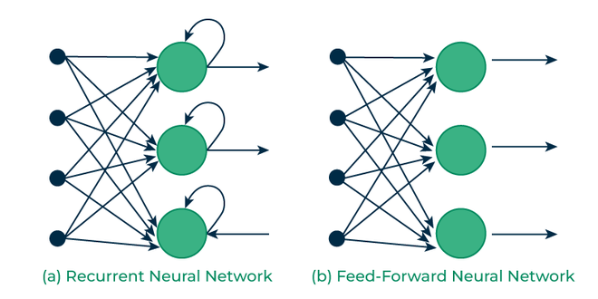
*Figure: Slide 4.*

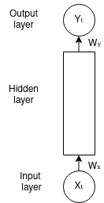

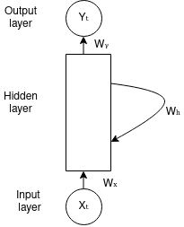
*Figure: Slide 4. The only change from Fig 2 to Fig 3 is the loop $W_h$.*

**Architecture (Slides 5–6).** The RNN scans input sequence $X$ left to right, updating its hidden state and producing output $y$ at each step. It **shares the same parameters across all time steps**:

- $U$: input layer $X$ → hidden layer $h$.
- $W$: hidden layer → itself, from one step to the next.
- $V$: hidden layer $h$ → output layer $y$.

Sharing lets it capture temporal dependencies and process sequences efficiently, keeping earlier information in the current hidden state.

**Equations (Slides 7–9).** The hidden state $a_t$ depends on input $x_t$, previous state $a_{t-1}$ and parameters $\theta$ ($U, V, W, b, c \in \theta$):

```math
a_t = f(a_{t-1}, x_t;\ \theta) = f(U x_t + W a_{t-1} + b) \qquad \hat{y}_t = f(a_t;\ \theta) = f(V a_t + c)
```

Multiply the new input by $U$ and the old state by $W$, add the hidden bias $b$, apply activation $f$. The prediction $\hat{y}_t$ uses $V$ and output bias $c$. Unrolled for $T = 4$ (Slide 8): $a_2 = f(U x_2 + W a_1 + b)$, $a_3 = f(U x_3 + W a_2 + b)$, $a_4 = f(U x_4 + W a_3 + b)$, and $\hat{y}_4 = f(V a_4 + c)$.

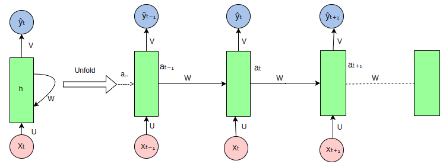
*Figure: Slides 5, 6, 9. "Unfold" draws one copy of the cell per step; all copies share weights.*

**Forward pass by hand.** Scalar RNN, $U = 0.5$, $W = 0.8$, $b = 0$, $f = \tanh$, $a_0 = 0$, input $x = (1, 0, 0, 1)$:

| $t$ | $x_t$ | $U x_t + W a_{t-1}$ | $a_t$ |
| :---: | :---: | :--- | ---: |
| 1 | 1 | $0.5$ | 0.4621 |
| 2 | 0 | $0.8 \times 0.4621 = 0.3697$ | 0.3537 |
| 3 | 0 | $0.8 \times 0.3537 = 0.2830$ | 0.2757 |
| 4 | 1 | $0.5 + 0.8 \times 0.2757 = 0.7206$ | 0.6172 |

Memory at work: steps 2–3 have zero input yet $a_t \ne 0$; the first input fades by about 0.8 per step.

**Parameters** (input $m = 100$, hidden $n = 128$, output $k = 10$): $nm + n^2 + n + kn + k = 12{,}800 + 16{,}384 + 128 + 1{,}280 + 10 = 30{,}602$, the same for 4 steps or 4,000.

---

## 2. Input–output patterns

**Slides 10–12.**

| Pattern | In | Out | Example |
| :--- | :---: | :---: | :--- |
| One-to-one | 1 | 1 | Plain feedforward, a "vanilla" network; not usually counted as an RNN; image classification |
| One-to-many | 1 | $T$ | **Image captioning**: one image → a sentence |
| Many-to-one | $T$ | 1 | **Sentiment analysis**: a sentence → positive/negative |
| Many-to-many | $T$ | $T'$ | **Machine translation** |

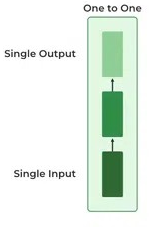
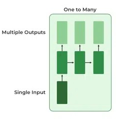
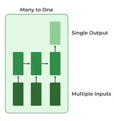
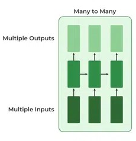
*Figure: Slides 11–12.*

> 📘 **Beyond the slides.** In translation $T'$ often differs from $T$ ("How are you?", 3 words, is "Comment allez-vous ?"); such models read everything first (**encoder**) then write (**decoder**). Per-word tagging (part of speech) has $T' = T$.

---

## 3. Backpropagation through time (BPTT)

**The idea (Slide 13).** Backpropagation adjusts weights and biases from the error between prediction and target, minimising the loss. In an RNN each weight is used at every step, so the error must be traced back **through time** to $t = 1$: **BPTT**, with a **forward pass** and a **backward pass**.

**Forward pass (Slide 14)**, $t = 1$ to $n$ (sequence length):

```math
a_t = \tanh(U x_t + W a_{t-1} + b), \qquad \hat{y}_t = \text{softmax}(V a_t + c)
```

> ✏️ **Slide discrepancy (Slides 14, 21).** The slides write "$a_t = U X_t + W a_{t-1} + b$; $a_t = \sigma(a_t)$": one name for two things, and $\sigma$ for tanh. Clearer: $s_t = U x_t + W a_{t-1} + b$, $a_t = \tanh(s_t)$. In the LSTM part $\sigma$ means **sigmoid**, so avoid it for tanh.

**Loss (Slide 15).** Predictions $\hat{y} = [\hat{y}_1, \dots, \hat{y}_t]$ (how many depends on the architecture and purpose), each compared with its target:

```math
L(y, \hat{y}) = \frac{1}{t} \sum_{i=1}^{t} (\hat{y}_i - y_i)^2 = \frac{1}{t} \sum_{i=1}^{t} \left( \text{softmax}(V a_i + c) - y_i \right)^2
```

> ✏️ **Slide discrepancy (Slide 15).** (1) $t$ here means the number of outputs, not a time step. (2) After softmax the usual loss is **cross-entropy**, $L = -\sum_i \log \hat{y}_{i, \text{true}}$; Slide 57 agrees (cross-entropy for classification, MSE for regression).

*Softmax by hand.* Scores $(2.0, 1.0, 0.5, -1.0)$: $e^{s} = (7.3891, 2.7183, 1.6487, 0.3679)$, sum 12.1239, so $\hat{y} = (0.6095, 0.2242, 0.1360, 0.0303)$. If class 1 is true, cross-entropy $= -\ln 0.6095 = 0.4952$.

**Backward pass (Slides 16–21)**, for the loss at $t = 4$.

- **$V$ (Slide 17):** used only on the way out: $\dfrac{\partial L}{\partial V} = \dfrac{\partial L}{\partial \hat{y}} \cdot \dfrac{\partial \hat{y}}{\partial V}$.
- **$W$ (Slides 18–19):** $a_4$ depends on $W$ **and** on $a_3$, which depends on $W$ and $a_2$, and so on, so there is one term per step that used $W$:

```math
\begin{aligned}
\frac{\partial L_4}{\partial W} =\ & \frac{\partial L_4}{\partial \hat{y}_4} \frac{\partial \hat{y}_4}{\partial a_4} \frac{\partial a_4}{\partial W}
+ \frac{\partial L_4}{\partial \hat{y}_4} \frac{\partial \hat{y}_4}{\partial a_4} \frac{\partial a_4}{\partial a_3} \frac{\partial a_3}{\partial W} \\
&+ \frac{\partial L_4}{\partial \hat{y}_4} \frac{\partial \hat{y}_4}{\partial a_4} \frac{\partial a_4}{\partial a_3} \frac{\partial a_3}{\partial a_2} \frac{\partial a_2}{\partial W}
+ \frac{\partial L_4}{\partial \hat{y}_4} \frac{\partial \hat{y}_4}{\partial a_4} \frac{\partial a_4}{\partial a_3} \frac{\partial a_3}{\partial a_2} \frac{\partial a_2}{\partial a_1} \frac{\partial a_1}{\partial W}
\end{aligned}
```

($\partial a_k / \partial W$ is only the **direct** effect at step $k$, holding $a_{k-1}$ fixed.)

- **$U$ (Slide 20):** the same pattern:

```math
\frac{\partial L_4}{\partial U} = \sum_{k=1}^{4} \frac{\partial L_4}{\partial \hat{y}_4} \frac{\partial \hat{y}_4}{\partial a_4} \left( \prod_{j=k+1}^{4} \frac{\partial a_j}{\partial a_{j-1}} \right) \frac{\partial a_k}{\partial U}
```

- **Key difference from ordinary backpropagation (Slide 21):** gradients are **summed across all time steps**, because the weights are shared.

> ✏️ **Note (Slides 16–20).** The slides' black-background unrolled figure lost its arrows in the file; the diagram below redraws the paths.

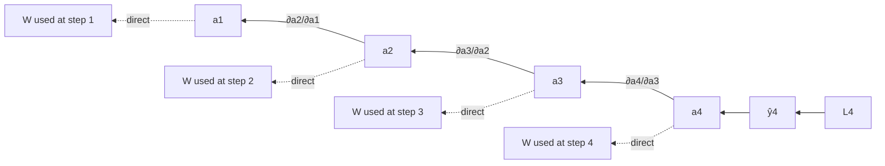

> 📘 **Beyond the slides — the factor that repeats.** For $a_j = \tanh(\cdot)$, one step back multiplies the gradient by $\partial a_j / \partial a_{j-1} = W (1 - a_j^2)$: the loop weight times tanh's slope. With section 1's run: $0.8(1 - 0.6172^2) = 0.4953$, $0.8(1 - 0.2757^2) = 0.7392$, $0.8(1 - 0.3537^2) = 0.6999$. So $\partial a_4 / \partial a_1 \approx 0.256$: after 3 steps, step 1's influence is a quarter.

---

## 4. Training, RNN vs DNN, and vanishing gradients

**Training steps (Slide 22).** (1) Feed one time step of input. (2) Compute the current state from the input and previous state. (3) The current $h_t$ becomes $h_{t-1}$. (4) Repeat as many steps as needed, joining all previous information. (5) Use the final state to compute the output. (6) Compare with the target; compute the error. (7) Backpropagate (BPTT) and update the weights: $W \leftarrow W - \eta \cdot \partial L / \partial W$. *E.g.* $W = 0.8$, $\eta = 0.1$, gradient 0.3 → $W = 0.77$, changing the loop at **every** step at once.

**RNN vs deep neural network (Slide 23).**

| RNN | DNN |
| :--- | :--- |
| Same weights at every step (layer) | Each layer has its own weights |
| For sequential data; number of inputs not fixed | No special sequence handling; fixed inputs |
| Exploding/vanishing gradients are the major drawback | They occur, but are not the major problem |

> ✏️ **Slide discrepancy (Slide 23).** "The number of parameters in the RNN is higher than in a simple DNN" is backwards: weight **sharing** means an RNN unrolled $T$ steps has one step's parameters. With $n = 128$ over 50 steps: 30,602 for the RNN, against $50 \times 16{,}384 = 819{,}200$ for 50 separate hidden-to-hidden layers alone.

**Applications (Slide 24).** NLP (language modelling, text generation, translation, sentiment); speech recognition; time series (stock prices, weather); music generation.

**Limitations (Slide 25).** Travelling back through time, gradients can become **too small** (**vanishing**: long-term dependencies are hard to learn; convergence is very slow) or **too large** (**exploding**: numerical instability, pushes the model away from the optimum, hard to converge). **LSTM** and **GRU** were introduced to address this.

**Variants (Slide 26).** **LSTM:** input, forget and output **gates** control information flow, against vanishing gradients, for longer dependencies. **GRU:** simpler; merges input and forget gates into one **update gate**; similar performance, fewer parameters (Lecture 22). **Bidirectional RNNs:** read forwards and backwards for past and future context; helps text classification and sequence labelling.

> 📘 **Beyond the slides — why they vanish.** The gradient from step $t$ to $k$ contains $\prod_{j=k+1}^{t} W(1 - a_j^2)$. Tanh's slope is at most 1; if a typical factor is $\gamma$, the product is about $\gamma^{t-k}$:
>
> | $\gamma$ | 0.5 | 0.9 | 1.0 | 1.5 |
> | :--- | ---: | ---: | ---: | ---: |
> | after 10 steps | 0.00098 | 0.349 | 1 | 57.7 |
> | after 50 steps | $8.9 \times 10^{-16}$ | 0.0052 | 1 | $6.4 \times 10^{8}$ |
>
> Staying at exactly 1 is a knife edge. Sigmoid is worse: slope at most 0.25, so ten steps with $W = 1$ give at most $0.25^{10} \approx 9.5 \times 10^{-7}$. For vectors, $\gamma$ is the size (largest singular value) of $W$ times the slopes. **Gradient clipping** (scale the gradient down to a maximum length) fixes exploding; vanishing needs a new architecture: the LSTM.

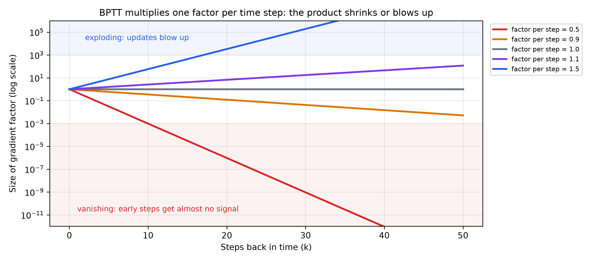
*Figure: Factor 0.5 leaves about a billionth of the gradient after 30 steps; 1.5 multiplies it by over 600 million after 50.*

---

## 5. The LSTM cell

**The idea (Slides 27–28).** A plain RNN rewrites its whole memory each step through a squashing function, so old information fades. The **LSTM** is a special RNN built against vanishing gradients, to learn **long-range dependencies**, using **memory cells** and **gates**. Its core is the **cell state**: a **conveyor belt** through the whole sequence, the network's **long-term memory**, changed only in controlled ways by the gates.

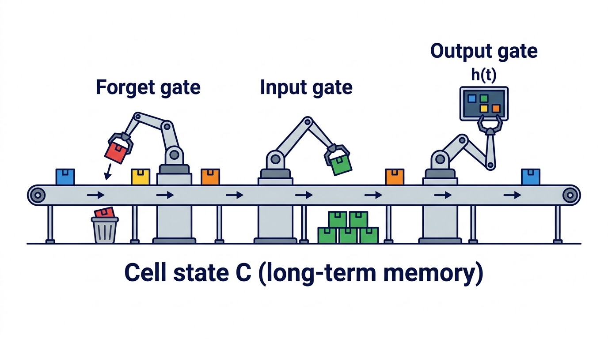
*Figure: Slide 28's "conveyor belt" (illustration). The belt keeps moving; the gates only remove, add or read. That is why memory rides along for many steps.*

**The gates (Slide 29).** **Forget:** what to discard from the previous cell state. **Input:** what new information to add. **Output:** what part of the cell state to output. Each looks at $[h_{t-1}, x_t]$ (previous hidden state joined with current input) through a **sigmoid** $\sigma$, giving values in (0, 1).

**Equations (Slides 30–37).** $\ast$ is element-wise multiplication.

| Step (slides) | Equation | Meaning |
| :--- | :--- | :--- |
| Forget gate (30–31) | $f_t = \sigma(W_f \cdot [h_{t-1}, x_t] + b_f)$ | 0 = completely forget, 1 = completely keep |
| Input gate (32–33) | $i_t = \sigma(W_i \cdot [h_{t-1}, x_t] + b_i)$ | how much new information enters |
| Candidate (34) | $\tilde{C}_t = \tanh(W_C \cdot [h_{t-1}, x_t] + b_C)$ | new values that could be added |
| Cell update (35) | $C_t = f_t \ast C_{t-1} + i_t \ast \tilde{C}_t$ | keep fraction $f_t$ of old memory, add fraction $i_t$ of candidate |
| Output gate (36–37) | $o_t = \sigma(W_o \cdot [h_{t-1}, x_t] + b_o)$ | how much to show |
| Hidden state (37) | $h_t = o_t \ast \tanh(C_t)$ | squash memory to $(-1, 1)$, let through $o_t$; goes to prediction, next step and next layer |

> ✏️ **Slide discrepancy (Slide 37).** Its "Input" line says the output gate uses "$x_t$ and **new cell state** $C_t$", but the formula (and Slide 36) uses $h_{t-1}$ and $x_t$. $C_t$ enters only in $h_t = o_t \ast \tanh(C_t)$.

**Each step (Slide 38):** forget gate sets what fraction of $C_{t-1}$ is forgotten → input gate sets how much of the current input updates the cell → cell state updated → output gate controls what flows into $h_t$, which goes to the next step and may be output.

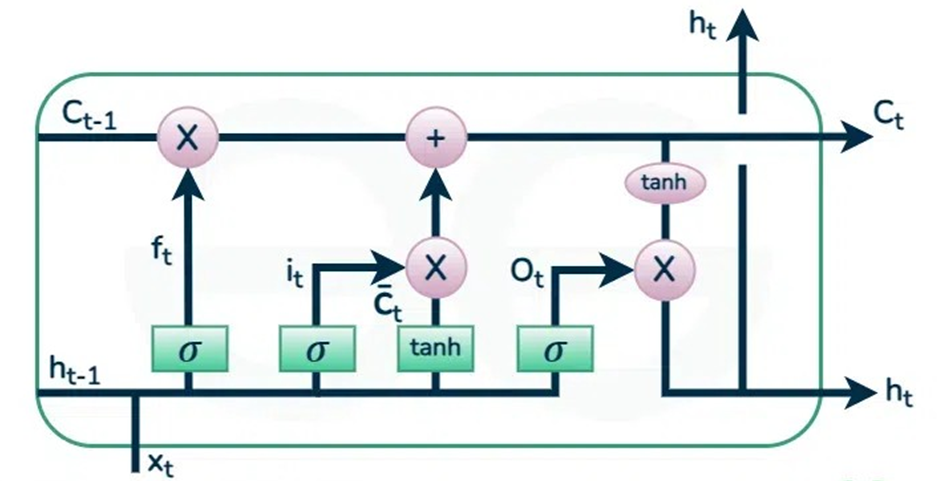
*Figure: Slides 31, 33, 35, 37, 65. The top line is touched by only one multiply and one add per step.*

**Advantages and variants (Slide 39).** **Long-term dependency handling** without loss to vanishing gradients; **selective memory** (gates choose what to keep), good for time series, language modelling, translation. **Bidirectional LSTM (BiLSTM):** forward and backward LSTMs for fuller context. **Stacked LSTM:** several layers for hierarchical features.

**One step by hand** ($h_{t-1} = 0.5$, $C_{t-1} = 1.0$, $x_t = 1.0$; each gate has a weight for $h$ and for $x$):

| | Weighted sum | Value |
| :--- | :--- | ---: |
| $f_t$ | $\sigma(0.5 \cdot 0.5 + 0.5 \cdot 1 + 0) = \sigma(0.75)$ | 0.6792 |
| $i_t$ | $\sigma(1.0 \cdot 0.5 + 1.0 \cdot 1 - 1) = \sigma(0.5)$ | 0.6225 |
| $\tilde{C}_t$ | $\tanh(0.8 \cdot 0.5 + 0.4 \cdot 1) = \tanh(0.8)$ | 0.6640 |
| $C_t$ | $0.6792 \cdot 1.0 + 0.6225 \cdot 0.6640 = 0.6792 + 0.4133$ | 1.0925 |
| $o_t$ | $\sigma(0.6 \cdot 0.5 + 0.6 \cdot 1) = \sigma(0.9)$ | 0.7109 |
| $h_t$ | $0.7109 \cdot \tanh(1.0925) = 0.7109 \cdot 0.7979$ | 0.5672 |

It kept 68% of the old memory, added 62% of the candidate, and showed 71% of the squashed result.

**Parameters.** Four blocks, each $n \times (n + m)$ weights plus $n$ biases; $m = 100$, $n = 128$: $4 \times (128 \times 228 + 128) = 4 \times 29{,}312 = 117{,}248$, about 4 times a plain RNN's recurrent part.

**Input gate vs candidate (Slides 40–47).** Both come from the same inputs but do different jobs.

| | Input gate $i_t$ | Candidate $\tilde{C}_t$ |
| :--- | :--- | :--- |
| Role | **How much**: a filter, a mask on what flows in; a control mechanism, creates no information | **What**: potential new memory, a processed version of $x_t$ and $h_{t-1}$; proposes, controls nothing |
| Activation, range | sigmoid, (0, 1): near 0 lets little in, near 1 lets all in | tanh, (−1, 1): can push memory down as well as up |
| Alone? | No content | No effect unless the gate lets it in |

Together (Slides 46–47) they form $i_t \ast \tilde{C}_t$: the candidate is raw news, the gate an **editor** deciding how much of each item to store. *E.g.* $\tilde{C}_t = (0.9, -0.6, 0.8)$, $i_t = (1.0, 0.5, 0.0)$ give $(0.9, -0.3, 0.0)$: full, half a negative update, ignored.

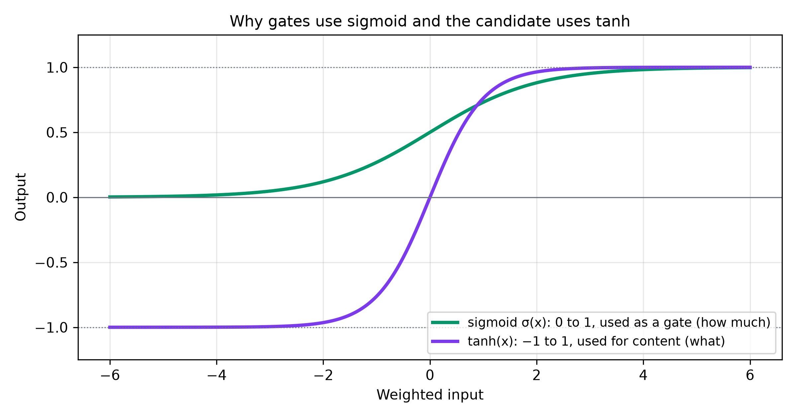
*Figure: A gate must be a fraction (sigmoid); content must be able to be negative (tanh).*

---

## 6. Example: predicting the next word

**Text generation (Slide 48).** **Data preparation:** tokenise into word sequences and convert to numbers (e.g. embeddings). **Training:** feed sequences step by step; the LSTM learns to predict the next word, remembering context with its cell state and gates. **Generation:** start with a seed word, predict the next, feed it back, repeat.

**"The color of an apple is ___" (Slides 49–55).**

1. **Input:** each word → a vector (one-hot or embeddings such as Word2Vec, GloVe): "The" $x_1$, "color" $x_2$, "of" $x_3$, "an" $x_4$, "apple" $x_5$, "is" $x_6$.
2. **Feed** one word at a time, keeping $h_t$ and $C_t$.
3. **Process** each word with the forget gate, input gate and candidate, cell update and output gate (section 5).
4. **Sequential updates:** "The" → $h_1, C_1$; … ; "is" → $h_6, C_6$.
5. **Predict:** $h_6$ holds the whole sentence's context:

```math
P(y_t \mid y_{t-1}, \dots, y_1) = \text{softmax}(W_p \cdot h_6 + b_p)
```

a probability distribution over the vocabulary for the next word.

6. **Interpret:** the highest-probability word, e.g. "red", is the prediction.

*Numbers.* Vocabulary (red, green, sweet, blue), scores $(2.0, 1.0, 0.5, -1.0)$ → probabilities $(0.6095, 0.2242, 0.1360, 0.0303)$: "red" wins. This works only if "color" (step 2) and "apple" (step 5) are still in memory at step 6, i.e. their forget-gate values stayed near 1.

---

## 7. Training an LSTM, and why its gradients survive

**Learning steps (Slides 56–61).**

1. **Forward pass** through the gates (forget: discard; input: store; output: show) and the cell state (memory, updated every step); $h_t$ and $C_t$ pass on.
2. **Loss** at each step: MSE for regression, cross-entropy for classification.
3. **BPTT:** gradients at every step; updates **accumulate** over the sequence. Gates, especially the forget gate, keep important information and drop irrelevant details. With 4 weight blocks, each gradient is summed over time, e.g. $\partial L / \partial W_f = \sum_{t=1}^{T} \partial L / \partial W_f \vert_{\text{step } t}$, and likewise $W_i$, $W_C$, $W_o$ (117,248 parameters here, about 4 times an RNN step's work).
4. **Gradient flow:** gradients flow back **including through the cell state**, which stores information over long intervals; the gates control this flow and limit vanishing.
5. **Weight updates** with SGD or Adam.

Summary (Slide 61): forward through the gates → loss → BPTT (gradients per step, per gate) → update.

**Why the gradients do not vanish (Slides 62–72).** Plain RNN gradients shrink (or explode) over long sequences, so it "forgets" early parts. The LSTM answers with:

1. **Cell state (63):** carries information across many steps with few changes: a **highway for gradients**.
2. **Gates (64):** forget decides what to keep, input adds relevant information without overwhelming the cell, output decides what is used now.
3. **Gradient flow (65–66):** RNN gradients flow only through the hidden state; the LSTM adds a stable path through the cell state, so it suits long-context tasks (language modelling, time series).

Four reasons in detail (Slides 67–71):

1. **Element-wise operations (68):** the cell state passes on with only a multiply (forget gate) and an add (input gate), so it keeps its scale; the forget gate is often near 1 for what must be kept.
2. **Forget gate self-loop (69):** values in (0, 1) keep only relevant information; near 1, cell values and gradients survive many steps.
3. **Controlled updates (70):** gradual changes through input and forget gates, no abrupt rewrites, so the state does not collapse.
4. **Bounded activations (71):** sigmoid gates in (0, 1), tanh candidate in (−1, 1), avoiding extreme values in the products.

**Summary (Slide 72):** a stable, lightly modified gradient path; element-wise updates that limit shrinking or blow-up; forget values near 1 for important information. Plain RNNs cannot manage this.

> 📘 **Beyond the slides — the one-line reason.** From $C_t = f_t \ast C_{t-1} + i_t \ast \tilde{C}_t$, the direct path gives $\partial C_t / \partial C_{t-1} = f_t$, so $\partial C_t / \partial C_k = \prod_{j=k+1}^{t} f_j$. One step back along the memory line multiplies by the forget gate only: no weight matrix, no tanh slope. (Indirect paths through $h_{t-1}$ behave more like a plain RNN.) Over 50 steps: RNN with $\gamma = 0.5$ leaves $8.9 \times 10^{-16}$, $\gamma = 0.9$ leaves 0.0052; LSTM with $f = 0.95$ leaves 0.0769, $f = 0.99$ leaves 0.605. The real difference is control: the LSTM **learns** $f_t$ and sets it near 1 exactly where memory matters. A common trick starts $b_f$ at 1 or more, so $f_t \ge \sigma(1) = 0.73$ and the network remembers by default (Jozefowicz et al., 2015).

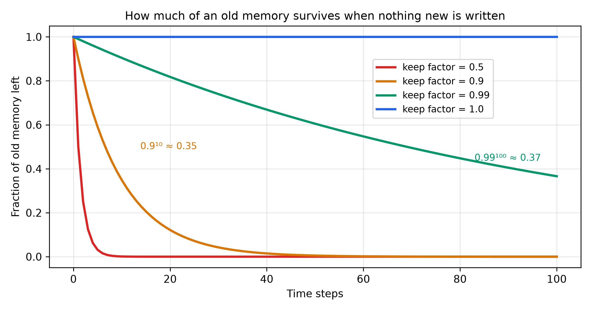
*Figure: With nothing new written, the cell state after $k$ steps is $f^k$ times the original. $f = 0.99$ still keeps 37% after 100 steps.*

---

## References

- Hochreiter, S. and Schmidhuber, J. (1997). *Long Short-Term Memory.* Neural Computation 9(8).
- Bengio, Y., Simard, P. and Frasconi, P. (1994). *Learning long-term dependencies with gradient descent is difficult.* IEEE Transactions on Neural Networks 5(2).
- Pascanu, R., Mikolov, T. and Bengio, Y. (2013). *On the difficulty of training recurrent neural networks.* ICML.
- Jozefowicz, R., Zaremba, W. and Sutskever, I. (2015). *An Empirical Exploration of Recurrent Network Architectures.* ICML.
