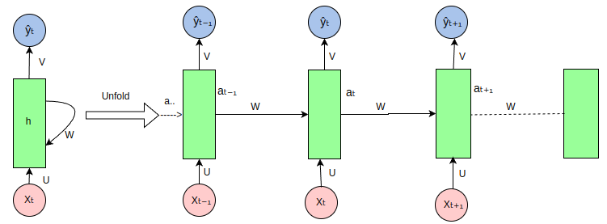
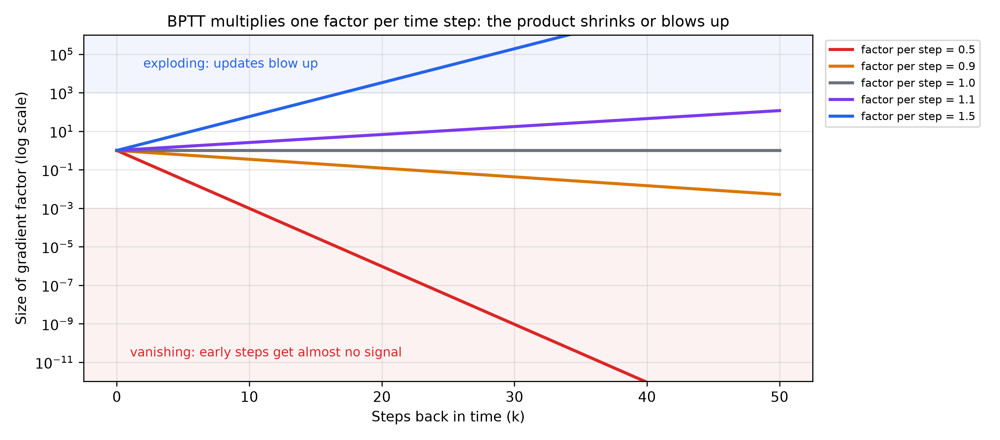
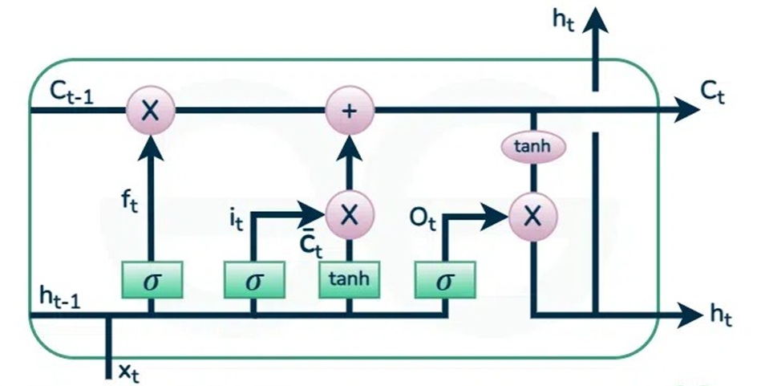
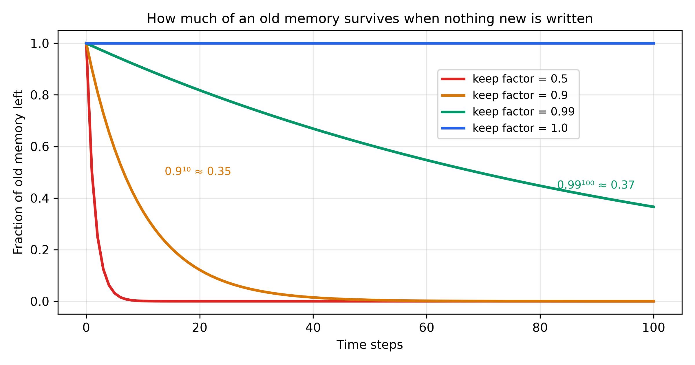

# Lecture 21 — RNN and LSTM: Exam Questions and Answers

Companion to [ML_Lec_21_RNN_Learning_Guide.md](ML_Lec_21_RNN_Learning_Guide.md). Try each question first, then read the answer.

**Pattern:** Part A = 2-mark questions. Part B = 10-mark questions split (a) + (b), 5 + 5 or 6 + 4.
**Tags:** 🎯 real paper; ✍️ practice to cover the lecture; 📘 beyond the slides. 💡 = memory hook.
RNN/LSTM is the **most-asked** end-sem topic: it appeared in 2023 (mid and end), 2024 and 2025, and vanishing gradients were on this year's mid-sem too.

| Topic in the guide | Question |
| :--- | :--- |
| Why RNNs, FNN vs RNN, architecture, equations (§1) | A1, B1(a) |
| Parameter count (§1) | A2 |
| Input–output patterns (§2) | A3 |
| BPTT (§3) | B3(b) |
| RNN vs DNN/CNN, limitations, vanishing/exploding (§4) | A4, B1(b), B2 |
| LSTM cell, gates, equations (§5) | A5, B3(a) |
| Next-word example (§6) | A6 |
| Why LSTM gradients survive, vanilla RNN vs LSTM (§7) | B4 |

---

## Part A — 2-mark questions

### A1. What are the basic differences between a feedforward network and a recurrent network? 🎯 2023 End Q2(d) [2]

| | Feedforward (FNN) | Recurrent (RNN) |
| :--- | :--- | :--- |
| Connections | one direction, no loops | a loop feeds the hidden state back to the next step |
| Memory | none: each input processed independently | hidden state remembers earlier inputs |
| Input length | fixed | variable-length sequences |
| Weights | each layer its own | same $U, W, V$ shared at every time step |
| Training | backpropagation | backpropagation through time (BPTT) |

> 💡 An RNN is an FNN with a loop that gives it memory.

### A2. A vanilla RNN cell is $h_t = \tanh(V h_{t-1} + W x_t + b)$ with $x_t \in \mathbb{R}^3$, $h_t \in \mathbb{R}^5$. How many parameters does it have? 🎯 2023 Mid Q5(a) [3]

- $V$ maps $h_{t-1}$ (5) to $h_t$ (5): $5 \times 5 = 25$
- $W$ maps $x_t$ (3) to $h_t$ (5): $5 \times 3 = 15$
- $b$: one per hidden unit = 5
- **Total = 25 + 15 + 5 = 45**

General rule: $n^2 + nm + n$ for hidden size $n$ and input size $m$. The count does not depend on the sequence length, because the weights are shared.

> 💡 Hidden×hidden + hidden×input + hidden.

### A3. Give the four input–output patterns of RNNs with an example of each. ✍️ [2]

| Pattern | Example |
| :--- | :--- |
| One-to-one | image classification (a plain feedforward net) |
| One-to-many | image captioning: one image → a sentence |
| Many-to-one | sentiment analysis: a sentence → positive/negative |
| Many-to-many | machine translation |

> 💡 Caption = one in, many out; sentiment = many in, one out.

### A4. State two limitations of an RNN. ✍️ [2]

1. **Vanishing gradients:** BPTT multiplies one factor per time step; if these are below 1 the gradient shrinks towards 0, so long-term dependencies are not learned and convergence is very slow.
2. **Exploding gradients:** if the factors are above 1 the gradient blows up, causing numerical instability and divergence.

Also: steps must be computed one after another (slow, no parallelism), and memory of early inputs fades. LSTM and GRU were introduced to fix this.

> 💡 Many multiplications: shrink to 0 or blow up.

### A5. Why do LSTM gates use sigmoid and the candidate use tanh? ✍️ [2]

- A **gate** decides **how much** to let through, so it must be a fraction in **(0, 1)**: sigmoid. 0 = block everything, 1 = let everything through.
- The **candidate** $\tilde{C}_t$ is **content** that can raise or lower the memory, so it must be able to be negative: tanh, in **(−1, 1)**.

*E.g.* $\tilde{C}_t = (0.9, -0.6, 0.8)$, $i_t = (1, 0.5, 0)$ → $i_t \ast \tilde{C}_t = (0.9, -0.3, 0)$.

> 💡 Gates are valves (0 to 1); content can go both ways (−1 to 1).

### A6. How does an LSTM predict the next word in "The color of an apple is ___"? ✍️ [2]

Each word is turned into a vector and fed one per step; the gates update $C_t$ and $h_t$ after every word. After "is", $h_6$ holds the context, including "color" and "apple", kept by forget gates near 1. The output layer gives $P(\text{next word}) = \text{softmax}(W_p h_6 + b_p)$, and the most probable word, e.g. "red", is chosen.

> 💡 Remember "apple" and "color" for four steps, then answer "red".

---

## Part B — 10-mark questions

### B1. 🎯 2025 End Q7(a) + 🎯 2024 End Q8(a)

**(a)** Explain the architecture and working principle of a recurrent neural network (RNN), and discuss the challenges encountered by standard RNNs during training. **[3 + 2 = 5]**
**(b)** Explain the main differences between CNN and RNN models. Describe the limitations of an RNN model. **[3 + 2 = 5]**

**(a) Answer.**

**Architecture:** an input layer, a hidden layer with a **recurrent loop**, and an output layer. Three weight matrices are **shared across all time steps**:

- $U$: input $x_t$ → hidden state
- $W$: previous hidden state $a_{t-1}$ → current hidden state
- $V$: hidden state → output

**Working principle:** read the sequence one step at a time.

$$a_t = \tanh(Ux_t + Wa_{t-1} + b),\qquad \hat{y}_t = \text{softmax}(Va_t + c)$$

The hidden state $a_t$ is the network's **memory**: it combines the current input with everything seen before. *E.g.* scalar $U = 0.5$, $W = 0.8$, input (1, 0, 0, 1): $a = 0.462, 0.354, 0.276, 0.617$. The state stays non-zero even when the input is 0. Training uses BPTT.

**Challenges in training:**

1. **Vanishing gradients:** long-term dependencies are not learned.
2. **Exploding gradients:** unstable training, divergence.
3. **Sequential computation:** slow, cannot be parallelised over time.

**(b) Answer.**

| | CNN | RNN |
| :--- | :--- | :--- |
| Data | grid data: images | sequential data: text, speech, time series |
| Key operation | convolution with filters over **space** | recurrence over **time** |
| Weight sharing | same filter across positions | same $U, W, V$ across time steps |
| Memory | none between inputs | hidden state carries context |
| Input size | fixed (e.g. 224×224) | variable length |
| Training | backpropagation | BPTT |

**Limitations of an RNN:**

- Vanishing and exploding gradients, so it cannot remember long contexts.
- Slow training, because steps run one after another.
- Memory of early inputs fades about geometrically (by ~0.8 per step in the example).
- Hence LSTM and GRU.

> 💡 CNN looks across space; RNN looks across time.

### B2. 🎯 2023 End Q5(a) + 🎯 2026 Mid Q2(b) + 🎯 2023 Mid Q5(b)

**(a)** What is the vanishing/exploding gradient problem, and how is it related to recurrent neural networks? **[5]**
**(b)** What are its effects on training, and what are the remedies? **[5]**

**(a) Answer.**

**Definition.** In backpropagation, the gradient for an early layer is a **product** of many factors, one per layer (or per time step in an RNN).

- If the factors are mostly **below 1**, the product shrinks towards 0: **vanishing gradient**.
- If they are mostly **above 1**, it grows without limit: **exploding gradient**.

**Relation to RNNs.** BPTT unrolls the RNN over time. The gradient from step $t$ back to step $k$ contains:

$$\prod_{j=k+1}^{t}\frac{\partial a_j}{\partial a_{j-1}} = \prod_{j=k+1}^{t} W(1 - a_j^2)$$

The **same** weight $W$ is multiplied in at every step, so a factor $\gamma$ gives roughly $\gamma^{t-k}$:

| $\gamma$ | after 10 steps | after 50 steps |
| :--- | ---: | ---: |
| 0.5 | 0.00098 | $8.9\times10^{-16}$ |
| 0.9 | 0.349 | 0.0052 |
| 1.5 | 57.7 | $6.4\times10^{8}$ |

Long sequences mean very deep unrolled networks, so RNNs suffer from this much more than ordinary DNNs.

**(b) Answer.**

**Effects:**

- **Vanishing:** early layers or time steps barely learn; long-term dependencies are lost; training is very slow or stalls.
- **Exploding:** huge weight updates, loss becomes NaN, training diverges.

**Remedies:**

1. **ReLU** (and Leaky ReLU) instead of sigmoid/tanh: slope 1 for positive inputs (sigmoid's slope is at most 0.25).
2. **Careful weight initialisation:** Xavier or He keep the factors near 1.
3. **Batch normalization:** keeps activations in a good range.
4. **Gradient clipping:** if the gradient norm exceeds a threshold, scale it down. This fixes **exploding** gradients.
5. **Gated architectures (LSTM, GRU):** the cell-state path multiplies only by the forget gate, so gradients survive. This fixes **vanishing** gradients in RNNs.
6. 📘 **Residual (skip) connections** in deep CNNs give the gradient a direct path.

> 💡 Clip the explosions; gate the vanishing.

### B3. 🎯 2024 End Q8(b)

**(a)** Describe the architecture of LSTM. **[5]**
**(b)** Explain how backpropagation through time is used to train LSTM models. **[5]**
*(Original marks 4 + 3.5.)*

**(a) Answer.**

The LSTM is an RNN with a **cell state** $C_t$ (long-term memory, a "conveyor belt") and three **gates** that control it. Each gate looks at $[h_{t-1}, x_t]$ through a sigmoid.

| Part | Equation | Role |
| :--- | :--- | :--- |
| Forget gate | $f_t = \sigma(W_f[h_{t-1}, x_t] + b_f)$ | what to discard from $C_{t-1}$ |
| Input gate | $i_t = \sigma(W_i[h_{t-1}, x_t] + b_i)$ | how much new information to add |
| Candidate | $\tilde{C}_t = \tanh(W_C[h_{t-1}, x_t] + b_C)$ | the new information |
| Cell update | $C_t = f_t \ast C_{t-1} + i_t \ast \tilde{C}_t$ | keep part of old, add part of new |
| Output gate | $o_t = \sigma(W_o[h_{t-1}, x_t] + b_o)$ | how much to show |
| Hidden state | $h_t = o_t \ast \tanh(C_t)$ | output and short-term memory |

*Example:* $f_t = 0.679$, $i_t = 0.623$, $\tilde{C}_t = 0.664$, $C_{t-1} = 1$ → $C_t = 1.0925$; $o_t = 0.711$ → $h_t = 0.567$.

Parameters: 4 blocks of $n(n+m) + n$; for $m = 100$, $n = 128$: $4 \times 29{,}312 = 117{,}248$.

**(b) Answer.**

1. **Unroll** the LSTM over the $T$ time steps of the sequence; all copies share $W_f, W_i, W_C, W_o$.
2. **Forward pass:** compute $f_t, i_t, \tilde{C}_t, C_t, o_t, h_t$ for $t = 1 \dots T$ and the predictions.
3. **Loss** at each step (cross-entropy for classification, MSE for regression), summed over time.
4. **Backward pass:** apply the chain rule from the last step back to the first. Gradients flow through **both** $h_t$ and the **cell state** $C_t$.
5. **Accumulate:** each weight is used at every step, so its gradient is the **sum over time**: $\frac{\partial L}{\partial W_f} = \sum_{t=1}^{T}\frac{\partial L}{\partial W_f}\Big|_t$, and the same for $W_i, W_C, W_o$.
6. **Update** with SGD or Adam: $W \leftarrow W - \eta\,\partial L/\partial W$.

**Why BPTT works better for LSTM than for RNN:** along the cell state, $\frac{\partial C_t}{\partial C_{t-1}} = f_t$, with no weight matrix or tanh slope. If the forget gate learns $f_t \approx 1$, gradients pass back over many steps: $0.99^{50} = 0.605$, against $0.5^{50} \approx 10^{-15}$ for a plain RNN.

> 💡 Unroll, forward, loss, backward through $h$ and $C$, sum over time, update.

### B4. 🎯 2023 Mid Q5(c) + ✍️

**(a)** What is the difference between a vanilla RNN and an LSTM? Why is LSTM not used for small datasets or problems? **[5]**
**(b)** Explain why the LSTM does not suffer from vanishing gradients the way a plain RNN does. **[5]**

**(a) Answer.**

| | Vanilla RNN | LSTM |
| :--- | :--- | :--- |
| State | one hidden state $h_t$ | hidden state $h_t$ **and** cell state $C_t$ |
| Update | $h_t = \tanh(Ux_t + Wh_{t-1} + b)$: overwrites the whole memory | gated: forget, input, output |
| Long-term memory | poor: vanishing gradients | good: cell-state highway |
| Parameters ($m = 100$, $n = 128$, recurrent part) | 29,312 | 117,248 (about 4×) |
| Speed | faster | slower |

**Why not LSTM on small data:**

- It has about **4 times the parameters** of a plain RNN, so on a small dataset it **overfits**.
- It is slower to train and needs more computation and memory.
- Small problems often have **short sequences**, where vanishing gradients are not a problem, so the gates bring no benefit. A vanilla RNN, a GRU (fewer parameters) or a simpler model is enough.

**(b) Answer.**

1. **Cell-state highway:** $C_t = f_t \ast C_{t-1} + i_t \ast \tilde{C}_t$. Going back one step along $C$ multiplies the gradient only by $f_t$, with no weight matrix and no tanh slope: $\frac{\partial C_t}{\partial C_k} = \prod f_j$.
2. **Learned forget gate:** the network sets $f_t \approx 1$ where memory matters, so the product stays large: $0.99^{50} = 0.605$, $0.95^{50} = 0.077$, vs $0.9^{50} = 0.0052$ and $0.5^{50} \approx 8.9\times10^{-16}$ in a plain RNN.
3. **Additive update:** new information is **added** to the memory, not rewritten through a squashing function.
4. **Gates control the flow:** input and forget gates make gradual changes, so the state does not collapse or blow up.
5. **Bounded activations:** sigmoid (0, 1) and tanh (−1, 1) avoid extreme values in the products.

📘 Starting the forget-gate bias at 1 or more makes the LSTM "remember by default".

> 💡 RNN multiplies by $W\cdot$slope every step; LSTM multiplies by a learned $f \approx 1$.
