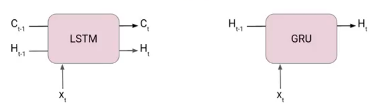
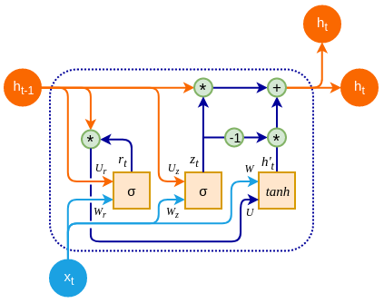
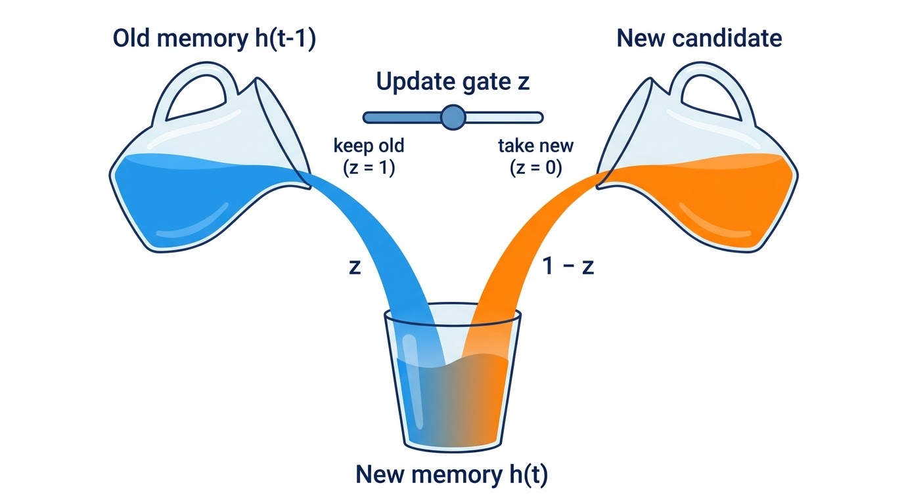
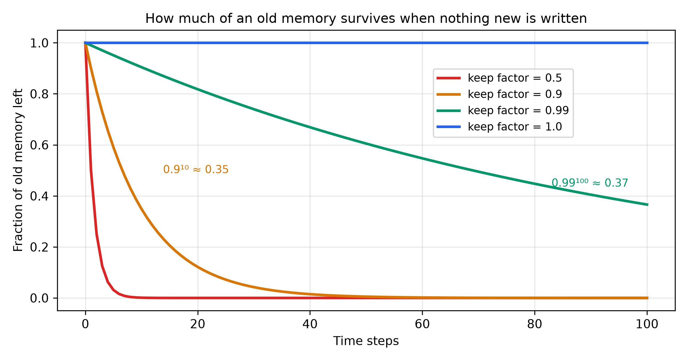

# Gated Recurrent Unit (GRU) — Learning Guide

Source: `ML_Lec_22_GRU.pptx`, Slides 1–18. Every number recomputed. Read Lecture 21 (RNN and LSTM) first.
**📘 Beyond the slides** = gap filled from outside the slides. **✏️ Slide discrepancy** = a slide is wrong or unclear.

## Contents

1. [What a GRU is](#1-what-a-gru-is)
2. [The four equations, step by step](#2-the-four-equations-step-by-step)
3. [What each part does](#3-what-each-part-does)
4. [GRU vs LSTM: advantages, trade-offs and uses](#4-gru-vs-lstm-advantages-trade-offs-and-uses)

---

## 1. What a GRU is

**Why it exists.** The LSTM solved vanishing gradients but is heavy: two states ($C_t$, $h_t$), three gates and a candidate, so four weight blocks. The **GRU** keeps the good part, a memory that can pass through time almost unchanged, with fewer parts: it merges the cell state into the hidden state and uses **two gates**.

**Basic facts (Slide 1).**

- A type of RNN introduced by **Cho et al. in 2014** as a simpler alternative to the LSTM, for sequential data (text, speech, time series).
- **Gating mechanisms** selectively update the hidden state at each step, controlling information flow in and out.
- Two gates: the **reset gate** (how much of the previous hidden state to forget) and the **update gate** (how much of the new input updates the hidden state). The output is computed from the updated hidden state.

**Compared with the LSTM (Slides 2–4).**

- Very similar: both use gates to control information flow.
- **No separate cell state** $C_t$, only $h_t$: simpler, faster to train, fewer parameters, more efficient.
- Main difference is memory handling: the LSTM keeps a separate cell state updated by three gates (forget, input, output); the GRU replaces it with a **candidate activation vector** updated by two gates (reset, update).
- At each step $t$ the GRU takes $x_t$ and $h_{t-1}$ and outputs $h_t$, passed to the next step. The reset gate decides how much of $h_{t-1}$ to forget; the update gate how much of the candidate goes into $h_t$.
- Popular where computing resources are limited or a simpler architecture is wanted.

> ✏️ **Slide discrepancy (Slide 2).** "Relatively new as compared to LSTM. This is the reason they offer some improvement" — newer is not a reason to be better. The GRU is simpler and cheaper and often matches the LSTM, but neither wins on every task (Chung et al., 2014). Slide 15 itself says the LSTM may do better on very long dependencies.


*Figure: Slide 2.*

---

## 2. The four equations, step by step

$\sigma$ is the sigmoid (outputs in (0, 1)); $\ast$ is element-wise multiplication. The slides omit biases; 📘 real implementations add one per line, e.g. $r_t = \sigma(W_r x_t + U_r h_{t-1} + b_r)$.

```math
\begin{aligned}
r_t &= \sigma(W_r x_t + U_r h_{t-1}) && \text{reset gate (Slides 5–6)} \\
z_t &= \sigma(W_z x_t + U_z h_{t-1}) && \text{update gate (Slides 7–8)} \\
\tilde{h}_t &= \tanh(W x_t + r_t * (U h_{t-1})) && \text{candidate (Slide 9)} \\
h_t &= z_t * h_{t-1} + (1 - z_t) * \tilde{h}_t && \text{new hidden state (Slide 10)}
\end{aligned}
```


*Figure: Slides 5, 7, 9, 10. Orange lines carry $h_{t-1}$, blue carry $x_t$. The "−1" circle computes $1 - z_t$. The candidate is $h'_t$ here, $\tilde{h}_t$ in the equations.*

**Reset gate (Slides 5–6).** The slides call it the gate for **short-term memory** (the hidden state). Weigh input and previous state ($W_r$, $U_r$), add, squash into (0, 1) per memory slot. It decides how much of $h_{t-1}$ is forgotten when building the candidate. $r_t = 0$ is a "reset": the past is ignored (useful when a new sentence starts or a sensor jumps to a new regime); near 1 keeps more of it.

**Update gate (Slides 7–8).** The gate for **long-term memory**. Same form, own weights $W_z$, $U_z$. It controls how $h_{t-1}$ and $\tilde{h}_t$ combine into $h_t$, keeping relevant information over time. Note: $r_t$ acts **inside** the candidate, $z_t$ acts **after** it.

**Candidate (Slide 9).** New information that could enter the hidden state, after filtering the past: weigh the input; weigh the old state and scale it slot by slot by $r_t$; add; tanh into $(-1, 1)$. Scaling by $r_t$ lets the network ignore parts of the past; with $r_t = 0$, $\tilde{h}_t = \tanh(W x_t)$. It plays the role of the LSTM's $\tilde{C}_t$.

> ✏️ **Slide discrepancy (Slide 9 formula vs Fig 2).** The formula resets **after** $U$: $r_t \ast (U h_{t-1})$. The diagram resets **before**: $U (r_t \ast h_{t-1})$. Both exist: Cho et al. (2014) used $U(r_t \ast h_{t-1})$; PyTorch and cuDNN use $r_t \ast (U h_{t-1} + b)$. Equal for scalars, different for vectors. *E.g.* $h_{t-1} = (1, 1)$, $r_t = (1, 0)$, $U = \begin{pmatrix} 1 & 2 \\ 0 & 1 \end{pmatrix}$: slide form $r_t \ast (3, 1) = (3, 0)$ silences an **output** slot; Cho form $U(1, 0) = (1, 0)$ silences an **input** slot. Either is a correct GRU; be consistent.

**Final hidden state (Slide 10).** **Linear interpolation**: keep $z_t$ of the old state, take $1 - z_t$ of the candidate. The update gate is a "switch": $z_t \approx 1$ copies the old state forward (**remembers** long-term dependencies); $z_t \approx 0$ replaces it (**resets**). One gate does both the LSTM's "forget" and "input" jobs, because the two fractions add to 1.

> ✏️ **Slide discrepancy (Slide 1 vs Slide 10).** Slide 1 says the update gate sets "how much of the new input should be used"; in Slide 10's formula $z_t$ weights the **old** state and the candidate gets $1 - z_t$. Same dial, read from opposite ends. 📘 Some books and libraries swap roles: $h_t = (1 - z_t) \ast h_{t-1} + z_t \ast \tilde{h}_t$. Check each source's convention.


*Figure: The final hidden state as a blend (illustration). Toward $z = 1$ keeps the old memory; toward $z = 0$ replaces it. The pours always fill one glass, because $z + (1 - z) = 1$.*

**One full step by hand** ($h_{t-1} = 0.5$, $x_t = 1.0$; $W_r = U_r = 0.5$; $W_z = U_z = 1.0$ with a bias of $-1$ added for the example; $W = 0.8$, $U = 0.6$):

| | Calculation | Value |
| :--- | :--- | ---: |
| $r_t$ | $\sigma(0.5 \cdot 1 + 0.5 \cdot 0.5) = \sigma(0.75) = 1/1.4724$ | 0.6792 |
| $z_t$ | $\sigma(1.0 \cdot 1 + 1.0 \cdot 0.5 - 1) = \sigma(0.5)$ | 0.6225 |
| $\tilde{h}_t$ | $\tanh(0.8 \cdot 1 + 0.6792 \cdot 0.6 \cdot 0.5) = \tanh(1.0038)$ | 0.7632 |
| $h_t$ | $0.6225 \cdot 0.5 + 0.3775 \cdot 0.7632 = 0.3113 + 0.2881$ | 0.5994 |

About 68% of the past entered the candidate; the new state keeps 62% of the old and takes 38% of the candidate, landing between 0.5 and 0.7632, nearer the old because $z_t > 0.5$. The LSTM step in Lecture 21 needed 4 sigmoids/tanhs plus a separate cell update; the GRU needs 3 and carries one state, not two.

> 📘 **Beyond the slides — why gradients survive.** Along the direct path, $\partial h_t / \partial h_{t-1} = z_t$ (element-wise), like the LSTM's $f_t$. Learning $z_t \approx 1$ for an important slot passes its gradient back almost unchanged. If nothing new is written, $h_t = z_t h_{t-1}$, so after $k$ steps $z^k$ remains:


*Figure: In a GRU the keep factor is $z_t$. With $z = 0.99$, 37% survives 100 steps.*

---

## 3. What each part does

**Functionality (Slides 11–13).** The GRU captures short- and long-term dependencies.

1. **Reset gate:** forgets irrelevant past information; useful when recent information matters more, as in sentence parsing or real-time sensor data.
2. **Update gate:** balances keeping old against taking new, so information can be tracked over long periods. *Example:* a language model remembers the subject across a long clause. In "The **keys** to the old wooden cabinet **are** on the table", the "plural" slot must survive 6 words; with $z = 0.95$ per step it keeps $0.95^6 \approx 0.735$, enough to pick "are".
3. **Single hidden state:** one state serves as both **memory and output**, cutting parameters while still handling long sequences.

> 📘 **Beyond the slides — mapping onto the LSTM.**
>
> | LSTM | GRU |
> | :--- | :--- |
> | Forget gate $f_t$ (keep old) | $z_t$ |
> | Input gate $i_t$ (add new) | $1 - z_t$, tied to the keep amount |
> | Output gate $o_t$ | None: all of $h_t$ is exposed |
> | Cell state $C_t$ | Merged into $h_t$ |
> | Candidate $\tilde{C}_t$ | $\tilde{h}_t$, with the reset gate inside |
>
> The tie is the key saving. An LSTM can keep 90% **and** add 90%; a GRU that keeps 90% adds exactly 10%, so $h_t$ is always a weighted average of old state and candidate.

---

## 4. GRU vs LSTM: advantages, trade-offs and uses

**Key advantages (Slide 14).**

- **Reduced complexity:** fewer gates, no cell state; simpler, faster to train, efficient where resources are limited.
- **Similar performance, fewer parameters:** comparable to the LSTM on many tasks not needing fine-grained memory control, such as machine translation, text generation, speech recognition.
- **Effective long-term memory:** the update gate keeps important information over time, addressing plain RNNs' vanishing gradient problem.

> ✏️ **Slide discrepancy (Slide 14).** "Solving the vanishing gradient problem" is too strong. The GRU greatly **reduces** it through its near-identity path when $z_t \approx 1$; if $z_t$ stays well below 1, the product of many $z_t$ still shrinks (Fig 3).

**Comparison with the LSTM (Slide 15).** **Parameter efficiency:** fewer parameters, faster training, less overfitting, especially on small datasets. **Longer dependencies:** LSTMs may win on very long ones, since the separate cell state gives finer control. **Computational cost:** GRUs are cheaper, preferred for real-time use or limited hardware.

**Use cases (Slide 16).** Speech recognition (audio sequences to words or phrases); language modelling and machine translation; time series (stock prices, weather, sensor data) with short- and long-term patterns.

**Summary (Slide 17).** A powerful, efficient alternative to plain RNNs and even LSTMs, simpler and faster. Reset and update gates give selective memory and controlled forgetting without a cell state, which suits fast sequence processing and has led to wide use in ML and NLP.

| | Plain RNN | LSTM | GRU |
| :--- | :--- | :--- | :--- |
| States | $h_t$ | $C_t$ and $h_t$ | $h_t$ |
| Gates | 0 | 3 (forget, input, output) | 2 (reset, update) |
| Weight blocks | 1 | 4 | 3 |
| Direct memory path per step | $W(1 - a^2)$ | $f_t$ | $z_t$ |
| Long dependencies | Poor | Best on very long ones | Good |
| Speed | Fastest | Slowest | In between |
| Introduced | 1980s | 1997 | 2014 |

**Parameter counts.** Each block has an $n \times m$ input matrix, an $n \times n$ recurrent matrix and $n$ biases: $n(m + n) + n$. With $m = 100$, $n = 128$: $128 \times 228 + 128 = 29{,}312$ per block.

| Model | Blocks | Parameters |
| :--- | :---: | ---: |
| Plain RNN (recurrent part) | 1 | 29,312 |
| GRU | 3 | 87,936 |
| LSTM | 4 | 117,248 |

The GRU has exactly $3/4$, or 75%, of the LSTM's parameters. 📘 PyTorch and cuDNN give each block two bias vectors, adding $3 \times 128 = 384$ (GRU 88,320) and $4 \times 128 = 512$ (LSTM 117,760); the 3 : 4 weight ratio is unchanged.

---

## References

- Cho, K. et al. (2014). *Learning Phrase Representations using RNN Encoder–Decoder for Statistical Machine Translation.* EMNLP.
- Chung, J., Gulcehre, C., Cho, K. and Bengio, Y. (2014). *Empirical Evaluation of Gated Recurrent Neural Networks on Sequence Modeling.* NeurIPS Deep Learning Workshop.
