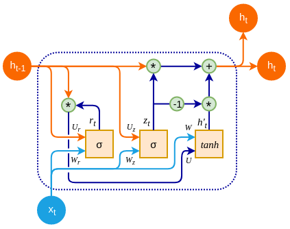
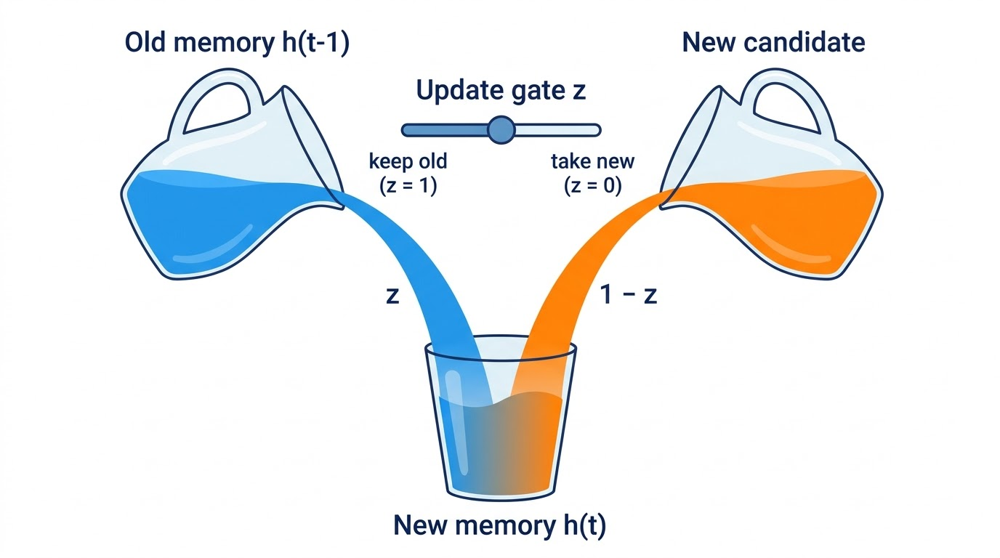

# Lecture 22 — Gated Recurrent Unit (GRU): Exam Questions and Answers

Companion to [ML_Lec_22_GRU_Learning_Guide.md](ML_Lec_22_GRU_Learning_Guide.md). Try each question first, then read the answer.

**Pattern:** Part A = 2-mark questions. Part B = 10-mark questions split (a) + (b), 5 + 5 or 6 + 4.
**Tags:** 🎯 real paper; ✍️ practice to cover the lecture; 📘 beyond the slides. 💡 = memory hook.

| Topic in the guide | Question |
| :--- | :--- |
| What a GRU is, vs LSTM (§1) | A1 |
| Reset gate, update gate, candidate, hidden state (§2) | A2, A3, B1(a) |
| One step by hand (§2) | B1(b) |
| What each part does, mapping onto LSTM (§3) | B2(a) |
| Advantages, uses, parameter counts (§4) | A4, B2(b) |

---

## Part A — 2-mark questions

### A1. What is a GRU? ✍️ [2]

A **Gated Recurrent Unit** is an RNN introduced by **Cho et al. (2014)** as a simpler alternative to the LSTM. It has **no separate cell state**, only the hidden state $h_t$, and **two gates**:

- the **reset gate** $r_t$ decides how much of the previous state to use when building the candidate;
- the **update gate** $z_t$ decides how much of the old state to keep and how much of the candidate to take.

It is faster and has fewer parameters than the LSTM, with similar performance on many tasks.

> 💡 GRU = LSTM with the cell state merged in and two gates instead of three.

### A2. What does the reset gate do? ✍️ [2]

$$r_t = \sigma(W_r x_t + U_r h_{t-1})$$

It works **inside** the candidate: $\tilde{h}_t = \tanh(Wx_t + r_t \ast (Uh_{t-1}))$. With $r_t \approx 0$ the past is ignored and the candidate depends only on the current input (a "reset", e.g. at the start of a new sentence); with $r_t \approx 1$ the past is fully used. It handles **short-term** memory.

> 💡 Reset = how much past goes into the new idea.

### A3. What does the update gate do? ✍️ [2]

$$z_t = \sigma(W_z x_t + U_z h_{t-1}),\qquad h_t = z_t \ast h_{t-1} + (1 - z_t) \ast \tilde{h}_t$$

It works **after** the candidate, mixing old and new. $z_t \approx 1$ copies the old state forward (**remember**, long-term memory); $z_t \approx 0$ replaces it with the candidate. Because the two fractions add to 1, one gate does the jobs of the LSTM's forget and input gates.

> 💡 Update = a mixing dial between old memory and new candidate.

### A4. Give the parameter counts of an RNN, a GRU and an LSTM with input size 100 and hidden size 128. ✍️ [2]

One block = $n(m + n) + n = 128 \times 228 + 128 = 29{,}312$.

| Model | Blocks | Parameters |
| :--- | :---: | ---: |
| Plain RNN (recurrent part) | 1 | 29,312 |
| GRU | 3 ($r$, $z$, candidate) | 87,936 |
| LSTM | 4 ($f$, $i$, $o$, candidate) | 117,248 |

The GRU has exactly **75%** of the LSTM's parameters.

> 💡 RNN 1, GRU 3, LSTM 4 blocks.

---

## Part B — 10-mark questions

### B1. 🎯 2025 End Q7(b) + ✍️

**(a)** Explain the architecture of a gated recurrent unit (GRU) with the help of a diagram, and present the mathematical equations governing its operations, interpreting each term in detail. **[6]**
**(b)** Compute one GRU step for $h_{t-1} = 0.5$, $x_t = 1.0$, with $W_r = U_r = 0.5$; $W_z = U_z = 1.0$ and update-gate bias $-1$; $W = 0.8$, $U = 0.6$. **[4]**

**(a) Answer.**

At each step the GRU takes the input $x_t$ and the previous hidden state $h_{t-1}$, and outputs the new hidden state $h_t$, which is both its memory and its output.

$$
\begin{aligned}
r_t &= \sigma(W_r x_t + U_r h_{t-1}) && \text{reset gate} \\
z_t &= \sigma(W_z x_t + U_z h_{t-1}) && \text{update gate} \\
\tilde{h}_t &= \tanh\big(W x_t + r_t \ast (U h_{t-1})\big) && \text{candidate} \\
h_t &= z_t \ast h_{t-1} + (1 - z_t) \ast \tilde{h}_t && \text{new hidden state}
\end{aligned}
$$

**Each term:**

- $x_t$: input at time $t$. $h_{t-1}$: previous hidden state (memory).
- $W_r, W_z, W$: input weights; $U_r, U_z, U$: recurrent weights (biases usually added too).
- $\sigma$: sigmoid, output in (0, 1), so each gate is a **fraction** per memory slot.
- $\tanh$: squashes the candidate to (−1, 1), so it can push memory up or down.
- $\ast$: element-wise multiplication.
- $r_t$: how much of the past enters the candidate. $r_t = 0$ gives $\tilde{h}_t = \tanh(Wx_t)$: the past is ignored.
- $\tilde{h}_t$: the proposed new memory (like the LSTM's $\tilde{C}_t$).
- $z_t$: fraction of the **old** state kept; $1 - z_t$: fraction of the **candidate** taken.
- $h_t$: a weighted average of old memory and candidate.

**Why it works:** along the direct path $\partial h_t / \partial h_{t-1} = z_t$, so when $z_t \approx 1$ the gradient passes back almost unchanged, which reduces vanishing gradients.

📘 Some books write $h_t = (1 - z_t) \ast h_{t-1} + z_t \ast \tilde{h}_t$; it is the same dial read from the other end.

**(b) Answer.**

| | Calculation | Value |
| :--- | :--- | ---: |
| $r_t$ | $\sigma(0.5 \cdot 1 + 0.5 \cdot 0.5) = \sigma(0.75)$ | 0.6792 |
| $z_t$ | $\sigma(1 \cdot 1 + 1 \cdot 0.5 - 1) = \sigma(0.5)$ | 0.6225 |
| $\tilde{h}_t$ | $\tanh(0.8 \cdot 1 + 0.6792 \cdot 0.6 \cdot 0.5) = \tanh(1.0038)$ | 0.7632 |
| $h_t$ | $0.6225 \cdot 0.5 + 0.3775 \cdot 0.7632 = 0.3113 + 0.2881$ | **0.5994** |

The new state lies between the old state (0.5) and the candidate (0.7632), nearer the old because $z_t > 0.5$.

> 💡 Reset inside the candidate, update after it.

### B2. 🎯 2023 End Q5(b) + ✍️

**(a)** Explain LSTM and GRU. How do they differ from each other? **[6]**
**(b)** What are the advantages of the GRU, and when would you still prefer an LSTM? Give applications. **[4]**

**(a) Answer.**

**LSTM:** an RNN with a **cell state** $C_t$ (long-term memory) and three gates: **forget** $f_t$ (what to discard), **input** $i_t$ (what to add) and **output** $o_t$ (what to show). $C_t = f_t \ast C_{t-1} + i_t \ast \tilde{C}_t$, $h_t = o_t \ast \tanh(C_t)$.

**GRU:** an RNN with only a hidden state $h_t$ and two gates: **reset** $r_t$ and **update** $z_t$. $h_t = z_t \ast h_{t-1} + (1 - z_t) \ast \tilde{h}_t$.

| | LSTM | GRU |
| :--- | :--- | :--- |
| States | $C_t$ and $h_t$ | $h_t$ only |
| Gates | 3: forget, input, output | 2: reset, update |
| Keep old / add new | separate: $f_t$ and $i_t$ (can keep 90% **and** add 90%) | tied: $z_t$ and $1 - z_t$ |
| Output gate | yes | none: all of $h_t$ is exposed |
| Weight blocks | 4 (117,248 for $m = 100$, $n = 128$) | 3 (87,936) |
| Speed | slower | faster |
| Introduced | 1997 | 2014 |

Mapping: the GRU's $z_t$ plays the LSTM's forget gate, $1 - z_t$ its input gate, and $\tilde{h}_t$ its candidate $\tilde{C}_t$.

**(b) Answer.**

**Advantages of the GRU:**

- **Simpler:** fewer gates and no cell state, so it is faster to train and run; good for real-time use and limited hardware.
- **Fewer parameters** (75% of an LSTM), so less overfitting on small datasets.
- **Similar performance** to the LSTM on many tasks.
- **Long-term memory** through the update gate, which reduces vanishing gradients.

**Prefer an LSTM** for **very long dependencies**, where its separate cell state and independent forget/input gates give finer control over what is kept.

**Applications:** speech recognition, language modelling and machine translation, time series (stock prices, weather, sensor data).

> 💡 GRU: lighter and faster; LSTM: finer memory control for very long sequences.
