# Slide Deck Deconstruction: ML_Lec_12_CNN

> **Source Presentation:** `ML_Lec_12_CNN.pptx`  
> **Slides:** 108  
> **Media referenced by slides:** 65 (extracted into `media/`)

---

## Slide 1: Convolution

- Convolution is a mathematical operation that combines two functions to produce a third function, representing how one function modifies the other.
- In the context of neural networks, particularly convolutional neural networks (CNNs), convolution is primarily used for processing data with a grid-like topology, such as images.

---

## Slide 2: Convolution

- We may think the image as a 2D matrix
- We may use a 2D filter of size m×n for convolution.
- The convolution operation applied on image and filter gives the modification of the image by the filter.
- This convolution operation works as follows:

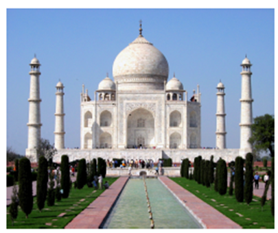

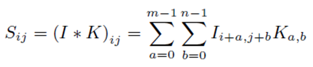

---

## Slide 3: Key Aspects of Convolution

- Kernel/Filter:
  - A small matrix (e.g., 3x3 or 5x5) that slides over the input data (e.g., an image). The kernel is responsible for extracting features like edges, textures, or patterns.
- Sliding Window:
  - The kernel moves across the input image in small steps (called strides), performing the convolution operation at each position.
- Dot Product:
  - At each position, the kernel performs an element-wise multiplication with the portion of the input it covers, and the results are summed up to produce a single output value. This process captures local patterns in the data.
- Output Feature Map:
  - The result of applying the convolution operation across the entire input creates a new matrix called a feature map, which highlights the features such as edges, shapes, and textures detected by the kernel.

---

## Slide 4: Convolution

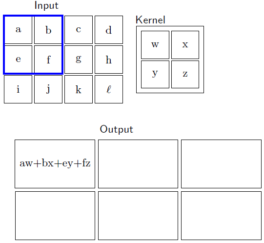

---

## Slide 5: Convolution

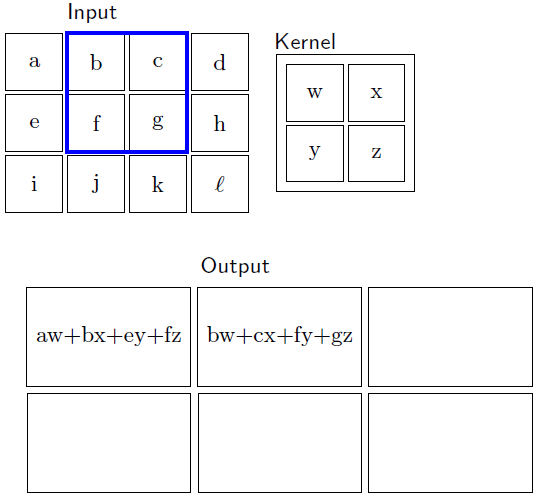

---

## Slide 6: Convolution

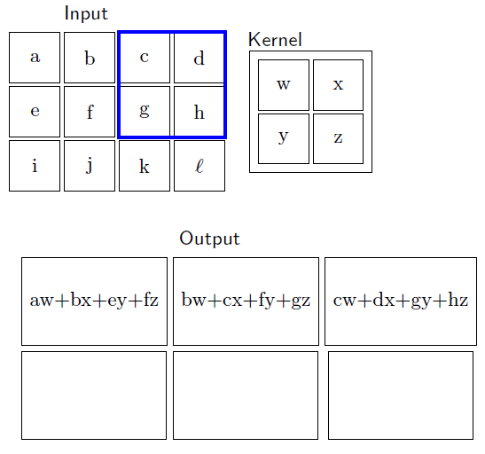

---

## Slide 7: Convolution

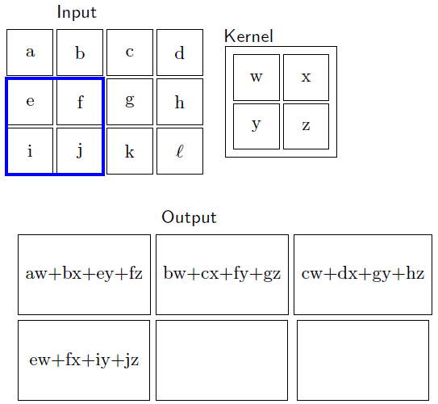

---

## Slide 8: Convolution

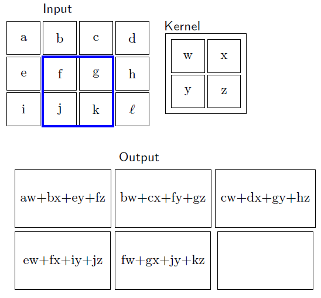

---

## Slide 9: Convolution

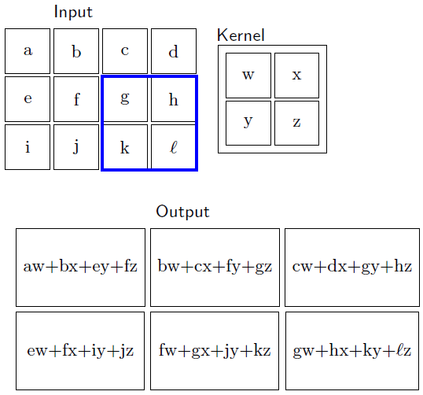

- From an image of size 3× 4, we obtain a feature map of size 2 × 3
- To get the feature map of same size, we need to add one extra row and one extra column in the image, called padding

---

## Slide 10: Padding

- If top left one is the pixel of interest, then we must have to place the filter as shown in the figure. In this case, padding is necessary.
- 1. Valid Padding:
- No padding is applied. The convolution operation is only applied to valid positions where the kernel fits within the input dimensions.
- Effect: Reduces the spatial dimensions of the output. For example, a 5×5 input with a 3×3 kernel will produce a 3×3 output.
- 2. Same Padding:
- Padding is applied such that the output dimensions are the same as the input dimensions. This is achieved by adding a sufficient number of zeroes around the input.
- Effect: Preserves the spatial dimensions. For example, a 5×5 input with a 3×3 kernel will produce a 5×5 output.

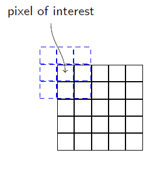

---

## Slide 11: Padding

- Padding is a technique used in convolutional neural networks (CNNs) and other neural network architectures to manage the spatial dimensions of input data during the convolution operation.
- Padding involves adding extra pixels (usually zeros) around the edges of the input data (e.g., images) before applying the convolution operation.
- This extra border of pixels helps in controlling the output size and maintaining important features at the edges of the input.
- Choosing the right type of padding depends on the specific requirements of the neural network architecture and the task at hand.

---

## Slide 12: When is Padding Required?

- 1. Preserving Dimensions: When we want the output size to match the input size, especially in tasks like segmentation or when stacking multiple layers of convolutions.
- 2. Edge Features: To ensure that features near the edges of the input are effectively captured. Without padding, convolutions near the edges can miss relevant information.
- 3. Reducing Spatial Shrinkage: In deeper networks, successive convolutions without padding can lead to significant reductions in spatial dimensions, which can make it difficult to maintain meaningful representations.
- 4. Improving Network Performance: Padding can help in stabilizing the learning process and improving the overall performance of the model by providing more context around the edges of the input data.

---

## Slide 13: Kernel / Filter

- In a convolutional neural network (CNN), a kernel, also known as a filter, is a small matrix used to scan over the input data (such as an image) to detect features.
- Size: Kernels are usually smaller than the input data. Common sizes are 3x3, 5x5, or 7x7 pixels.
- Feature Detection: Different kernels can be trained to detect various features such as edges, textures, or patterns. Early layers in a CNN typically learn simple features, while deeper layers learn more complex representations.

---

## Slide 14: Kernel / Filter

- Stride: This parameter determines how many pixels the kernel moves after each operation. A larger stride results in a smaller output size.
- Padding: Sometimes, zeroes are added around the input data to control the spatial size of the output. This helps in preserving the dimensions and preventing loss of important information at the borders.
- Multiple Kernels: Each convolutional layer can have multiple kernels, allowing the layer to learn a variety of features from the input.
- Overall, kernels are fundamental to how CNNs process data, enabling them to learn hierarchical representations effectively.
- Different types of kernels can serve various purposes depending on the specific application.

---

## Slide 15: Edge Detection Kernel

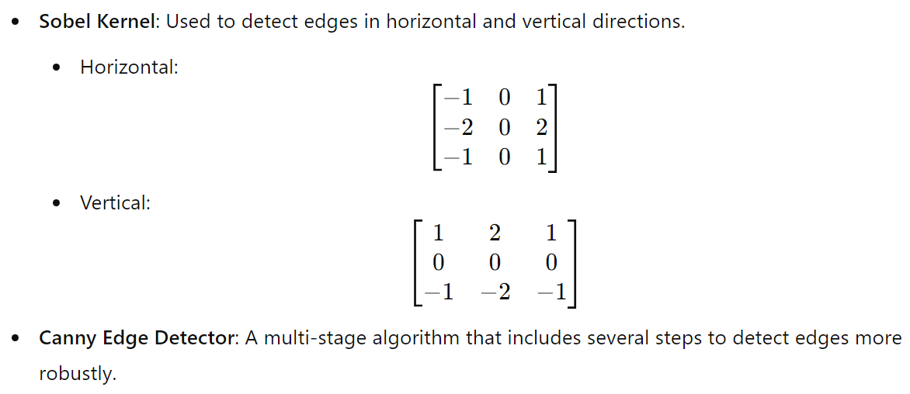

- It computes gradients in horizontal and vertical direction

---

## Slide 16: Canny Edge Detector

- The Canny edge detector doesn't rely on a single kernel like the Sobel operator.
- Instead, it uses a series of steps, including the application of Gaussian filters for smoothing, followed by gradient computation, non-maximum suppression, and hysteresis thresholding.
- However, the gradient computation often involves using derivatives, and the commonly used kernels for this step are:

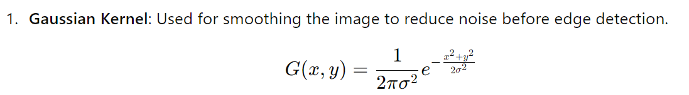

---

## Slide 17: Canny Edge Detector

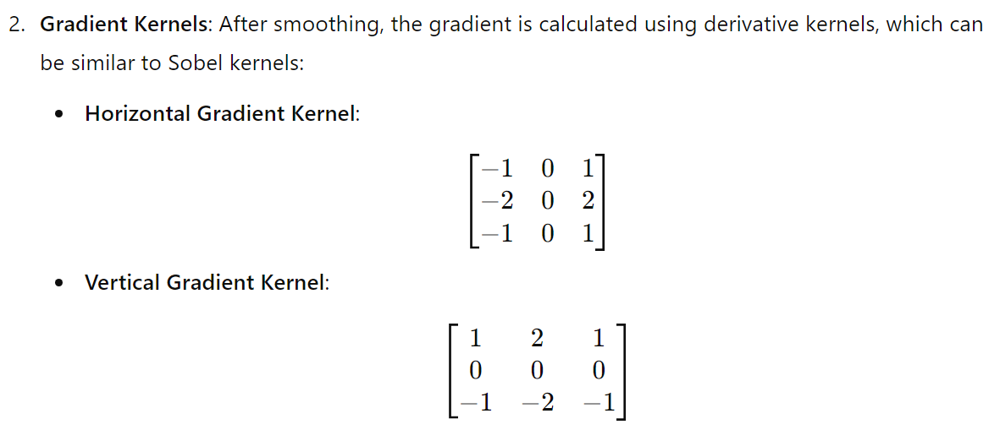

- In summary, while Canny edge detection doesn’t use a single kernel as in other methods, it employs Gaussian smoothing and gradient kernels to effectively identify edges.

---

## Slide 18: Blurring Kernels

- Example: Gaussian Kernel, Average/Mean Kernel
- Gaussian Kernel :
- A Gaussian kernel is a type of filter used in image processing, particularly for smoothing or blurring images.
- It applies the Gaussian function, which helps reduce noise and detail in an image by averaging the pixel values based on their distance from a central pixel. The Gaussian function is defined as:
- where, σ (Sigma) controls the width of the Gaussian curve. A larger sigma results in more blurring, while a smaller sigma retains more detail.
- Kernel Size: The kernel is typically a square matrix (e.g., 3x3, 5x5, or 7x7) derived from the Gaussian function. The size is often chosen to be odd to have a center pixel.

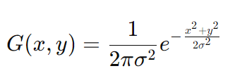

---

## Slide 19: Blurring Kernels: Gaussian Kernel

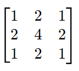

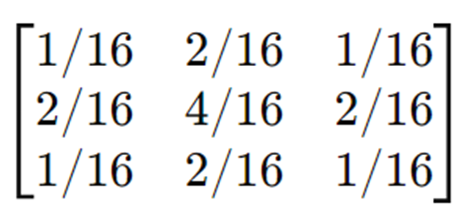

- A 3 × 3 Gaussian Kernel: normalized
- A 5 × 5 Gaussian Kernel:

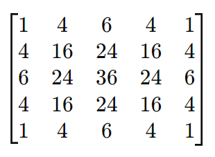

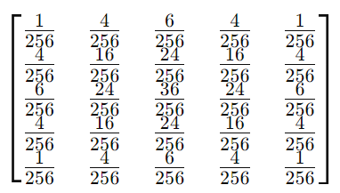

---

## Slide 20: Blurring Kernels: Average Kernel

- An average kernel, also known as a box filter or mean filter, is a simple smoothing technique used in image processing.
- It works by replacing each pixel's value with the average of the pixel values in its neighborhood, resulting in a blur effect.
- This helps reduce noise and blur the image.
- Kernel Size: Average kernels can be of various sizes, commonly 3x3, 5x5, or 7x7. The size determines the area over which the averaging is performed.
- Normalization: The values in the kernel are typically equal and sum to 1, ensuring that the output image has a similar brightness to the input image.

---

## Slide 21: Blurring Kernels: Average Kernel

- A 3 × 3 Gaussian Kernel:
- A 5 × 5 Gaussian Kernel:

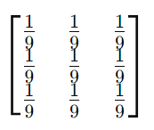

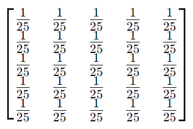

---

## Slide 22: Sharpening Kernel

- A sharpening kernel is used in image processing to enhance the edges and fine details in an image.
- It works by emphasizing the differences between adjacent pixel values, effectively making the image appear sharper.
- Applications:
- 1. Detail Enhancement: Useful for emphasizing edges and textures in images.
- 2. Image Preprocessing: Often applied before other processing tasks to improve feature detection.
- 3. Artistic Effects: Can create a stylized look in images by enhancing outlines and details.
- The most common sharpening kernels include the Laplacian kernel and the unsharp mask kernel.

---

## Slide 23: Sharpening Kernel

- Laplacian Kernel:
- The second derivative measures the rate of change of the gradient. In image processing, this means detecting areas where there is a rapid change in intensity, which corresponds to edges.
- The Laplacian operator calculates the second derivative in both the x and y directions. When applied to an image, it helps identify regions of rapid intensity change (edges) by emphasizing the areas where the intensity changes sharply.

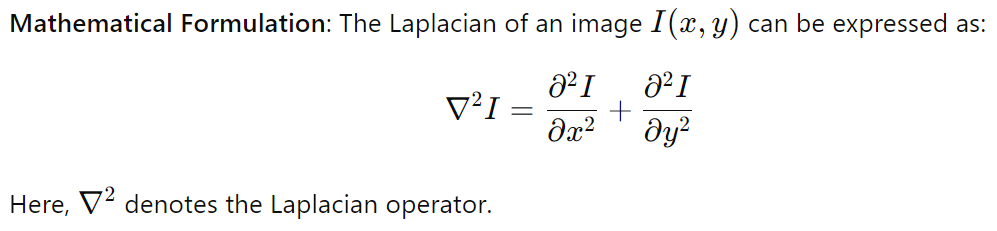

---

## Slide 24: Laplacian Kernel:

- A typical 3x3 Laplacian kernel looks like this:
- This kernel emphasizes edges by subtracting
- the average of the neighboring pixels from the center pixel.
- When the Laplacian kernel is applied to an image, it produces a result where edges are highlighted, and flat regions are suppressed, effectively making the edges more pronounced.
- The result can sometimes be combined with the original image for further enhancement, a technique often used in unsharp masking.

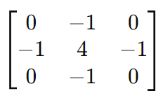

---

## Slide 25: Unsharp Mask Kernel

- Unsharp Masking Process:
- (i) Gaussian Blur: First, a Gaussian blur is applied to the original image to create a blurred version. This helps reduce noise and fine details.
- (ii) Difference Calculation: The blurred image is then subtracted from the original image to highlight the edges.
- (iii) Combination: The result is added back to the original image, often with a scaling factor to control the degree of sharpening.
- A common kernel used in this technique is:
- This kernel effectively enhances edges by applying a
- weighted average where the center pixel gets more
- weight than its neighbors.

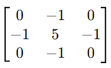

---

## Slide 26: Sharpening Kernels

- Difference:
- In Laplacian Kernel, the center value is 4 (detecting edges by subtracting the average). But in Unsharp Mask Kernel, the center value is 5, which increases the emphasis on the center pixel more than in the Laplacian kernel.
- Laplacian kernel detects edges based on the rate of change, focusing on curvature rather than enhancing pixel values. But Unsharp Mask enhances edges through a combination of the original pixel value and its neighbors, effectively sharpening the image.
- While both techniques are used for edge detection and enhancement, they operate on different principles. The unsharp mask is not a second derivative but a method to accentuate edges by emphasizing differences in pixel intensity.

---

## Slide 27: Type of Kernel

- 4. Embeddings Kernels:
- Feature Extraction Kernels: In CNNs, these kernels are learned during training and can capture complex features at various levels of abstraction (e.g., edges, textures, shapes).
- 5. Dilated Kernels
- Dilated Convolution: Dilated kernels, also known as atrous convolution kernels, are used in convolutional neural networks to increase the receptive field without increasing the number of parameters or the amount of computation. This allows the network to capture larger context while maintaining spatial resolution.

---

## Slide 28: Type of Kernel

- A standard 3x3 kernel can be dilated in various ways. For instance, with a dilation rate of 2, the kernel is applied with gaps between its elements:
- Standard 3x3 Kernel Dilated 3x3 Kernel with Dilation Rate = 2
- Dilation Rate: The number "2" indicates that there is one pixel of space between the kernel elements in both horizontal and vertical directions.
- Application: This dilated kernel can cover a larger area of the input while still producing output of the same size as a regular convolutional layer, making it useful for tasks like segmentation and dense prediction.
- Benefits
- 1. Larger Receptive Field: Allows the network to capture wider context without downsampling.
- 2. Preserves Spatial Resolution: Useful in applications where maintaining the original resolution is important, like in semantic segmentation.
- 6. Custom Kernels
- Users can design custom kernels tailored for specific tasks or datasets, such as detecting specific patterns, textures, or other features relevant to their application.

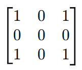

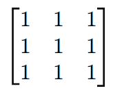

---

## Slide 29: Convolution

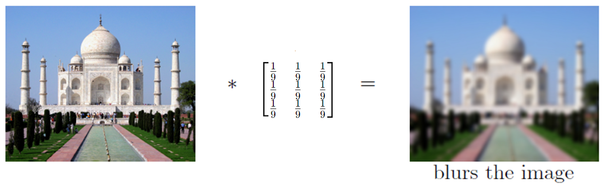

---

## Slide 30: Convolution

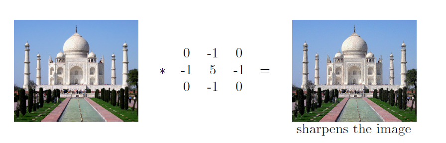

---

## Slide 31: Convolution

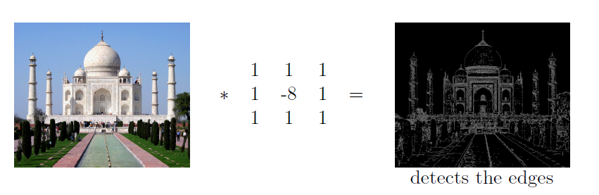

- It can be used for edge detection and sharpening. It has a form similar to a high-pass filter.
- Edge Detection: This kernel emphasizes the center pixel while considering its surrounding pixels. The negative center value effectively highlights areas where there is a significant change in intensity, making it useful for detecting edges.
- High-Pass Filter: By subtracting a weighted average of the neighboring pixels from the center pixel, it removes low-frequency components (smooth areas) and enhances high-frequency components (edges).
- Sharpening Effect: When convolved with an image, it can create a sharpening effect, making edges more pronounced.

---

## Slide 32: Convolution

- We just slide the kernel over the input image

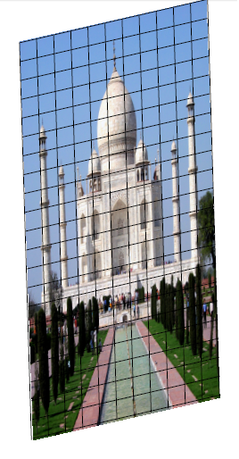

---

## Slide 33: Convolution

- We just slide the kernel over the input image
- Each time we slide the kernel we get one value in the output

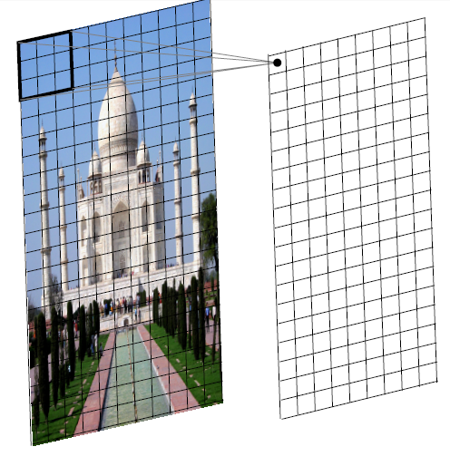

---

## Slide 34: Convolution

- We just slide the kernel over the input image
- Each time we slide the kernel we get one value in the output

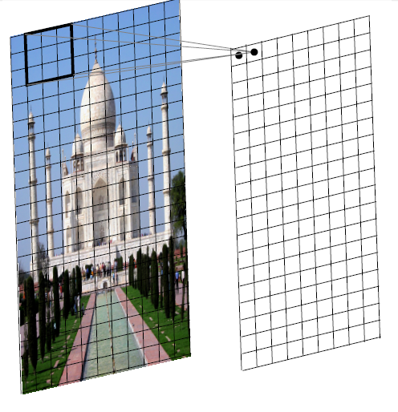

---

## Slide 35: Convolution

- We just slide the kernel over the input image
- Each time we slide the kernel we get one value in the output

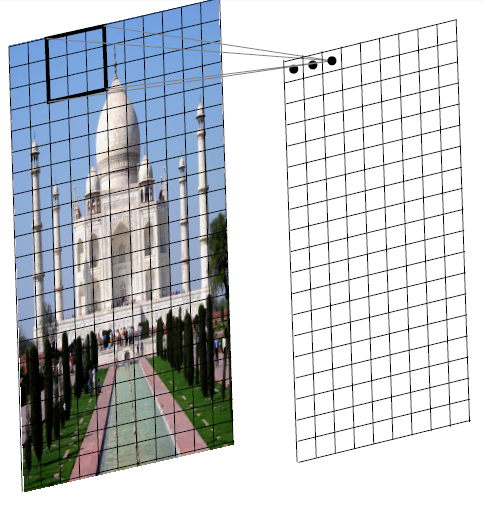

---

## Slide 36: Convolution

- We just slide the kernel over the input image
- Each time we slide the kernel we get one value in the output

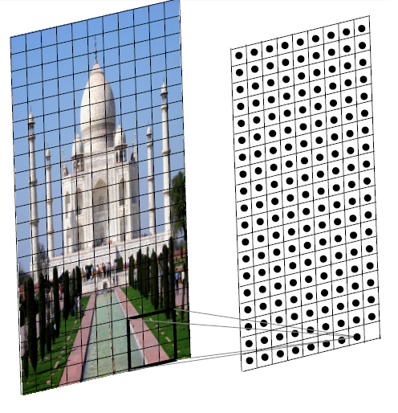

---

## Slide 37: Convolution

- We just slide the kernel over the input image
- Each time we slide the kernel we get one value in the output
- The resulting output is called a feature map.
- We can use multiple filters to get multiple feature maps.

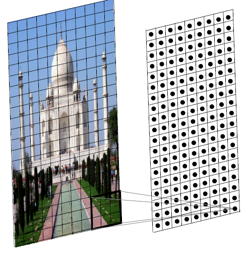

---

## Slide 38: Convolution in 1-D

- In the 1D case, we slide a one dimensional filter over a one dimensional input

| A | B | C | B | C | A | B |
| --- | --- | --- | --- | --- | --- | --- |

---

## Slide 39: Convolution

- In the 1D case, we slide a one dimensional filter over a one dimensional input

| A | B | C | B | C | A | B |
| --- | --- | --- | --- | --- | --- | --- |

---

## Slide 40: Convolution

- In the 1D case, we slide a one dimensional filter over a one dimensional input

| A | B | C | B | C | A | B |
| --- | --- | --- | --- | --- | --- | --- |

---

## Slide 41: Convolution

- In the 1D case, we slide a one dimensional filter over a one dimensional input

| A | B | C | B | C | A | B |
| --- | --- | --- | --- | --- | --- | --- |

---

## Slide 42: Convolution

- In the 1D case, we slide a one dimensional filter over a one dimensional input

| A | B | C | B | C | A | B |
| --- | --- | --- | --- | --- | --- | --- |

---

## Slide 43: Convolution on 3-D

- What would a 3D filter look like?

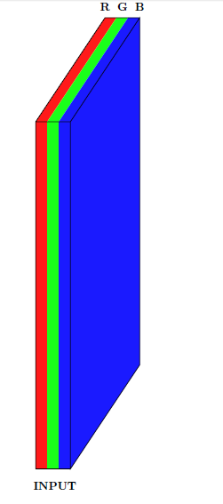

---

## Slide 44: Convolution on 3-D

- What would a 3D filter look like?
- It will be 3D and we will refer to it as a volume

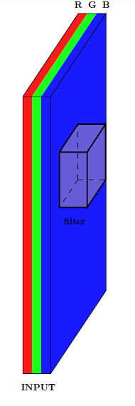

---

## Slide 45: Convolution on 3-D

- What would a 3D filter look like?
- It will be 3D and we will refer to it as a volume
- Once again we will slide the volume over the 3D input and compute the convolution operation

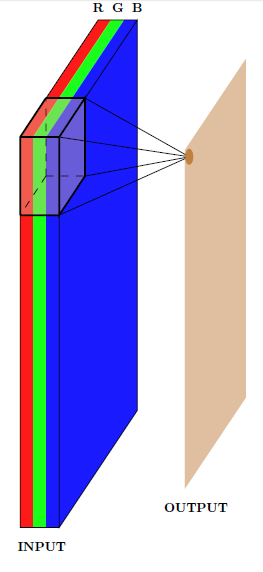

---

## Slide 46: Convolution on 3-D

- What would a 3D filter look like?
- It will be 3D and we will refer to it as a volume
- Once again we will slide the volume over the 3D input and compute the convolution operation

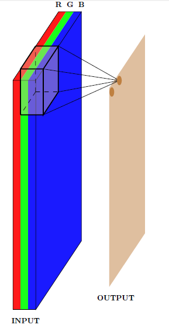

---

## Slide 47: Convolution on 3-D

- What would a 3D filter look like?
- It will be 3D and we will refer to it as a volume
- Once again we will slide the volume over the 3D input and compute the convolution operation

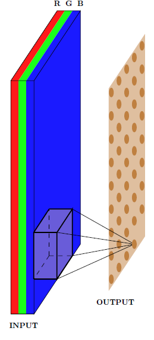

---

## Slide 48: Convolution on 3-D

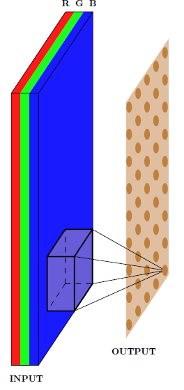

- In effect, we are doing a 2D convolution operation on a 3D input
- Because the filter moves along the height and the width but not along the depth
- As a result the output will be 2D (only width and height, no depth)
- Once again we can apply multiple filters to get multiple feature maps

---

## Slide 49: Convolution on 3-D

- Width (W1), Height (H1) and Depth (D1) of the original input

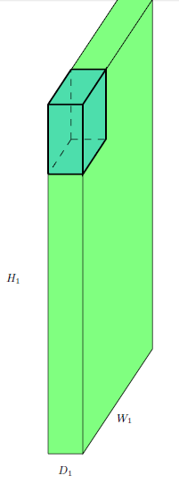

---

## Slide 50: Convolution on 3-D

- Width (W1), Height (H1) and Depth (D1) of the original input
- The number of filters K

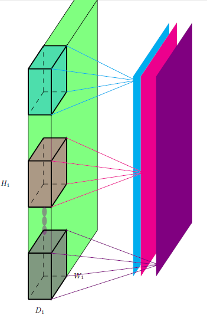

---

## Slide 51: Convolution on 3-D

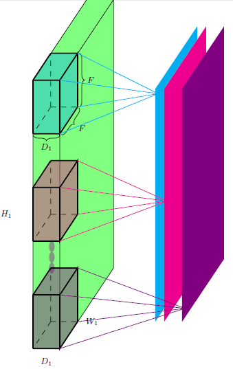

- Width (W1), Height (H1) and Depth (D1) of the original input
- The number of filters K
- The spatial extent (F) of each filter (the depth of each filter is same as the depth of each input)
- So, RGB image is W1 × H1 × D1 and kernel is F × F × D1

---

## Slide 52: Convolution on 3-D

- Width (W1), Height (H1) and Depth (D1) of the original input
- The number of filters K
- The spatial extent (F) of each filter (the depth of each filter is same as the depth of each input)
- So, RGB image is W1 × H1 × D1 and kernel is F × F × D1
- The output is W2 x H2 x D2 (we will soon see a formula for computing W2, H2 and D2)

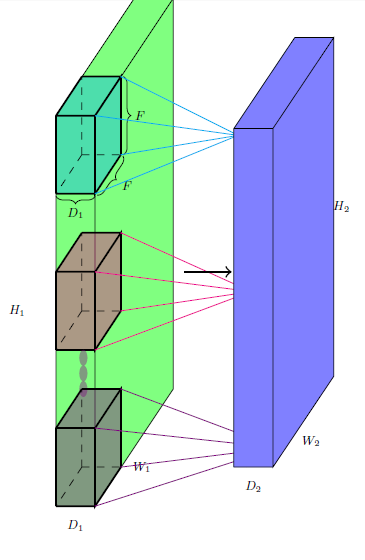

---

## Slide 53: Calculation of Output Dimension

- Let us compute the dimension (W2, H2) of the output

---

## Slide 54: Calculation of Output Dimension

- Let us compute the dimension (W2, H2) of the output

---

## Slide 55: Calculation of Output Dimension

- Let us compute the dimension (W2, H2) of the output

---

## Slide 56: Calculation of Output Dimension

- Let us compute the dimension (W2, H2) of the output

---

## Slide 57: Calculation of Output Dimension

- Let us compute the dimension (W2, H2) of the output

---

## Slide 58: Calculation of Output Dimension

- Let us compute the dimension (W2, H2) of the output

---

## Slide 59: Calculation of Output Dimension

- Let us compute the dimension (W2, H2) of the output

---

## Slide 60: Calculation of Output Dimension

- Let us compute the dimension (W2, H2) of the output

---

## Slide 61: Calculation of Output Dimension

- Let us compute the dimension (W2, H2) of the output
- Notice that we can't place the kernel at the corners as it will cross the input boundary

---

## Slide 62: Calculation of Output Dimension

- This is true for all the shaded points (the kernel crosses the input boundary)
- This results in an output which is of smaller dimensions than the input

---

## Slide 63: Calculation of Output Dimension

- As the size of the kernel increases, this becomes true for even more pixels
- For example, let's consider a 5 x 5 kernel

---

## Slide 64: Calculation of Output Dimension

- As the size of the kernel increases, this becomes true for even more pixels
- For example, let's consider a 5 x 5 kernel

---

## Slide 65: Calculation of Output Dimension

- As the size of the kernel increases, this becomes true for even more pixels
- For example, let's consider a 5 x 5 kernel

---

## Slide 66: Calculation of Output Dimension

- As the size of the kernel increases, this becomes true for even more pixels
- For example, let's consider a 5 x 5 kernel

|  |  | X |  |  |
| --- | --- | --- | --- | --- |

---

## Slide 67: Calculation of Output Dimension

- As the size of the kernel increases, this becomes true for even more pixels
- For example, let's consider a 5 x 5 kernel

|  |  | X |  |  |
| --- | --- | --- | --- | --- |

---

## Slide 68: Calculation of Output Dimension

- As the size of the kernel increases, this becomes true for even more pixels
- For example, let's consider a 5 x 5 kernel

|  |  | X |  |  |
| --- | --- | --- | --- | --- |

---

## Slide 69: Calculation of Output Dimension

- As the size of the kernel increases, this becomes true for even more pixels
- For example, let's consider a 5 x 5 kernel
- In general;
- ${𝑊}_{2}={𝑊}_{1}-𝐹+1$
- ${𝐻}_{2}={𝐻}_{1}-𝐹+1$

---

## Slide 70: Padding

- What if we want the output to be of same size as the input?

---

## Slide 71: Padding

- What if we want the output to be of same size as the input?
- We can use something known as padding

---

## Slide 72: Padding

- Pad the inputs with appropriate number of ‘0’ inputs so that you can now apply the kernel at the corners

---

## Slide 73: Padding

| 0 | 0 | 0 | 0 | 0 | 0 | 0 | 0 | 0 |
| --- | --- | --- | --- | --- | --- | --- | --- | --- |
| 0 |  |  |  |  |  |  |  | 0 |
| 0 |  |  |  |  |  |  |  | 0 |
| 0 |  |  |  |  |  |  |  | 0 |
| 0 |  |  |  |  |  |  |  | 0 |
| 0 |  |  |  |  |  |  |  | 0 |
| 0 |  |  |  |  |  |  |  | 0 |
| 0 |  |  |  |  |  |  |  | 0 |
| 0 | 0 | 0 | 0 | 0 | 0 | 0 | 0 | 0 |

- Let us use pad P = 1 with a 3 x 3 kernel
- This means we will add one row of ‘0’ inputs at the top and bottom, and add one column of ‘0’ inputs at the left and right.

---

## Slide 74: Padding

| 0 | 0 | 0 | 0 | 0 | 0 | 0 | 0 | 0 |
| --- | --- | --- | --- | --- | --- | --- | --- | --- |
| 0 |  |  |  |  |  |  |  | 0 |
| 0 |  |  |  |  |  |  |  | 0 |
| 0 |  |  |  |  |  |  |  | 0 |
| 0 |  |  |  |  |  |  |  | 0 |
| 0 |  |  |  |  |  |  |  | 0 |
| 0 |  |  |  |  |  |  |  | 0 |
| 0 |  |  |  |  |  |  |  | 0 |
| 0 | 0 | 0 | 0 | 0 | 0 | 0 | 0 | 0 |

- Now we have;
- ${𝑊}_{2}={𝑊}_{1}-𝐹+2𝑃+1$
- ${𝐻}_{2}={𝐻}_{1}-𝐹+2𝑃+1$

---

## Slide 75: Stride

| 0 | 0 | 0 | 0 | 0 | 0 | 0 | 0 | 0 |
| --- | --- | --- | --- | --- | --- | --- | --- | --- |
| 0 |  |  |  |  |  |  |  | 0 |
| 0 |  |  |  |  |  |  |  | 0 |
| 0 |  |  |  |  |  |  |  | 0 |
| 0 |  |  |  |  |  |  |  | 0 |
| 0 |  |  |  |  |  |  |  | 0 |
| 0 |  |  |  |  |  |  |  | 0 |
| 0 |  |  |  |  |  |  |  | 0 |
| 0 | 0 | 0 | 0 | 0 | 0 | 0 | 0 | 0 |

- What does the stride S do?

- Stride: This parameter determines how many pixels the kernel moves after each operation.
- A larger stride results in a smaller output size.

---

## Slide 76: Stride

| 0 | 0 | 0 | 0 | 0 | 0 | 0 | 0 | 0 |
| --- | --- | --- | --- | --- | --- | --- | --- | --- |
| 0 |  |  |  |  |  |  |  | 0 |
| 0 |  |  |  |  |  |  |  | 0 |
| 0 |  |  |  |  |  |  |  | 0 |
| 0 |  |  |  |  |  |  |  | 0 |
| 0 |  |  |  |  |  |  |  | 0 |
| 0 |  |  |  |  |  |  |  | 0 |
| 0 |  |  |  |  |  |  |  | 0 |
| 0 | 0 | 0 | 0 | 0 | 0 | 0 | 0 | 0 |

- What does the stride S do?
- S=2 means the kernel moves 2 pixels after each operation.
- It defines the intervals at which the filter is applied (here S = 2)

---

## Slide 77: Stride

| 0 | 0 | 0 | 0 | 0 | 0 | 0 | 0 | 0 |
| --- | --- | --- | --- | --- | --- | --- | --- | --- |
| 0 |  |  |  |  |  |  |  | 0 |
| 0 |  |  |  |  |  |  |  | 0 |
| 0 |  |  |  |  |  |  |  | 0 |
| 0 |  |  |  |  |  |  |  | 0 |
| 0 |  |  |  |  |  |  |  | 0 |
| 0 |  |  |  |  |  |  |  | 0 |
| 0 |  |  |  |  |  |  |  | 0 |
| 0 | 0 | 0 | 0 | 0 | 0 | 0 | 0 | 0 |

- What does the stride S do?
- It defines the intervals at which the filter is applied (here S = 2)
- Here, we are essentially skipping every 2nd pixel which will again result in an output which is of smaller dimensions

---

## Slide 78: Stride

| 0 | 0 | 0 | 0 | 0 | 0 | 0 | 0 | 0 |
| --- | --- | --- | --- | --- | --- | --- | --- | --- |
| 0 |  |  |  |  |  |  |  | 0 |
| 0 |  |  |  |  |  |  |  | 0 |
| 0 |  |  |  |  |  |  |  | 0 |
| 0 |  |  |  |  |  |  |  | 0 |
| 0 |  |  |  |  |  |  |  | 0 |
| 0 |  |  |  |  |  |  |  | 0 |
| 0 |  |  |  |  |  |  |  | 0 |
| 0 | 0 | 0 | 0 | 0 | 0 | 0 | 0 | 0 |

- Now we have;
- ${𝑊}_{2}=\frac{{𝑊}_{1}-𝐹+2𝑃}{𝑆}+1$
- ${𝐻}_{2}=\frac{{𝐻}_{1}-𝐹+2𝑃}{𝑆}+1$

- Since the output size must be an integer, we typically floor the result.

---

## Slide 79: Numerical Example

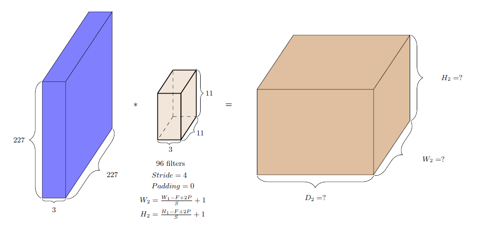

---

## Slide 80: Numerical Example

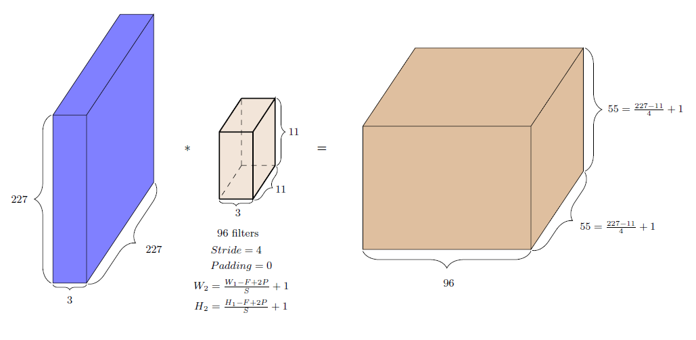

---

## Slide 81: Numerical Example

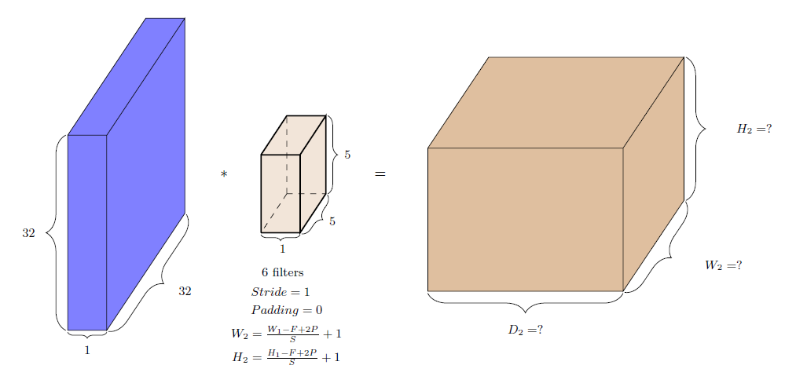

---

## Slide 82: Numerical Example

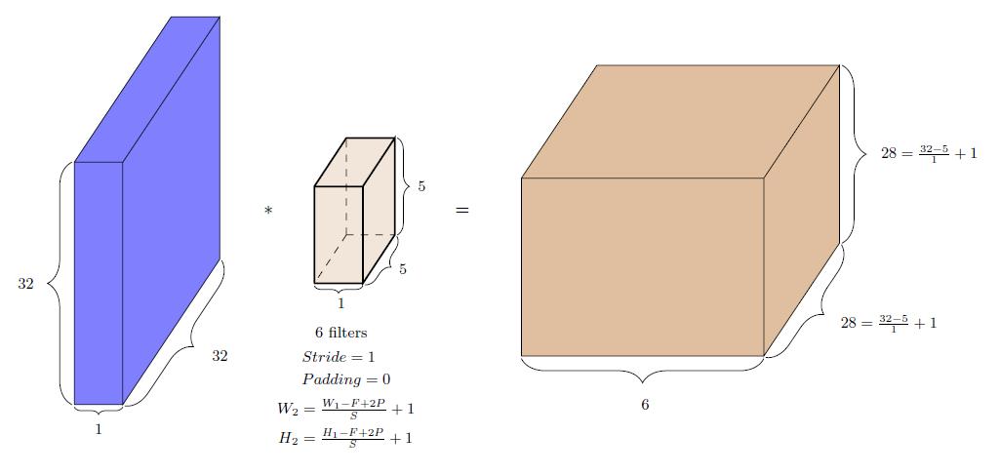

---

## Slide 83: Convolutional Neural Networks

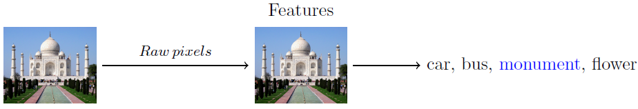

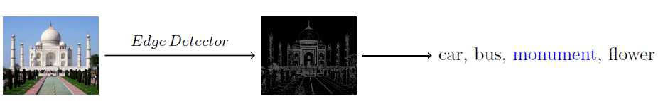

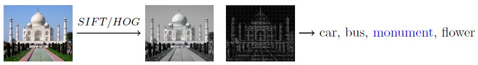

---

## Slide 84: Convolutional Neural Networks

---

## Slide 85: Convolutional Neural Networks

- We can learn multiple layers of meaningful kernels / filters in addition to learning the weights of the classifier
- Simply by treating these kernels as parameters and learning them in addition to the weights of the classfier (using back propagation)

---

## Slide 86: Convolutional Neural Networks

- Random Initialization: When a CNN model is first created, the kernel weights are typically initialized randomly, often with small values.
- These random kernels will not necessarily be useful initially, but they will evolve during training. They are learned through training based on the data via backpropagation.
- Why Random? Starting with random kernels prevents the network from having any bias toward specific patterns and ensures that it can learn a wide variety of features from the data.
- Common initialization techniques include Xavier initialization or He initialization, designed to ensure that the starting weights allow the network to learn effectively.
- Predefined kernels are generally not used in deep learning, as learned kernels are more effective for complex tasks.

---

## Slide 87: Image classification

- This is what a regular feed-forward neural network will look like
- There are many dense connections here
- For example all the 16 input neurons are contributing to the computation of h11
- Contrast this to what happens in the case of convolution

---

## Slide 88: Sparsity of connections

- The image of size 4×4 is considered as a vector [1, 2, 3, 4, 5, 6, 7, 8, 9, 10, 11, 12, 13, 14, 15, 16]
- Only a few local neurons participate in the computation of h11
- For example, only pixels 1, 2, 5, 6 contribute to h11

---

## Slide 89: Sparsity of connections

- Similarly, only pixels 3, 4, 7, 8 contribute to h12
- The connections are much sparser
- We are taking advantage of the structure of the image (interactions between neighboring pixels are more interesting)
- This sparse connectivity reduces the number of parameters in the model

---

## Slide 90: Weight sharing

- We are not learning a single kernel
- We can have many such kernels but the kernels will be shared by all locations in the image
- This is called “weight sharing"

---

## Slide 91: Advantages of sparsity of connection and weight sharing in CNN

- CNNs offer several advantages over traditional ANNs due to their use of sparsity of connection and weight sharing.
- Reduced Parameters: In CNNs, the same filter (or kernel) is applied across different regions of the input. This significantly reduces the number of parameters compared to fully connected layers in ANNs, which require a unique weight for every connection.
- Computational Efficiency: Because of the reduced number of parameters, CNNs require less memory and computational resources, making them faster to train and easier to deploy, especially for large datasets and high-dimensional inputs like images.
- Translation Invariance: The sparse connections allow CNNs to learn features that are translation invariant. This means that the model can recognize patterns regardless of their position in the input, which is particularly useful in image processing.

---

## Slide 92: Advantages Contd..

- 4. Hierarchical Feature Learning: CNNs can learn hierarchical representations of data, where lower layers capture simple features (like edges) and higher layers capture more complex patterns (like shapes and objects). This hierarchy is facilitated by the localized connections and weight sharing.
- 5. Better Generalization: The reduction in the number of parameters and the emphasis on shared features can lead to better generalization on unseen data, as the model is less likely to overfit compared to a fully connected ANN with many parameters.
- 6. Robustness to Noise and Variability: The ability to learn from local patterns and use shared weights makes CNNs more robust to noise and variations in the input data, such as changes in lighting, scale, and rotation.
- Overall, these advantages make CNNs particularly well-suited for tasks like image recognition, object detection, and other applications involving spatial data.

---

## Slide 93: Pooling Layer

- Pooling Layer: Reduce the spatial dimensions of the feature maps, which decreases the number of parameters and computation in the network.
- Types:
- Max Pooling: Takes the maximum value from a defined window. It retains the most prominent features, making it effective for detecting edges and textures.
- Average Pooling: Takes the average value from a defined window. It provides a smoother feature map and can be less sensitive to noise than max pooling. It is sometimes in cases where we want to retain more contextual information.

---

## Slide 94: Pooling

---

## Slide 95: Pooling

- (iii) Global Average Pooling
- It takes the average of the entire feature map, producing a single output for each feature map. It is helpful for reducing the size of feature maps and can be effective in classification tasks. It is generally used in the final layers of CNN architectures before the output layer.
- (iv) Global Max Pooling
- It takes the maximum value from the entire feature map. Similar to global average pooling it is helpful for reducing the size of feature maps but it retains the most significant feature. It is also used before the output layer, especially when spatial resolution is less important.

---

## Slide 96: Pooling

- Pooling operations like max pooling and average pooling generally reduce spatial resolution.
- However, the specific impact on spatial resolution depends on how the pooling is configured (e.g., window size and stride).
- Pooling Parameters
- (i) Window Size: The size of the pooling filter (e.g., 2x2, 3x3).
- (ii) Stride: The number of pixels the filter moves after each operation. A larger stride reduces the output size more significantly.
- (iii) Padding: Adding extra pixels around the input feature map before pooling. Typically, pooling layers don’t use padding, but it can be useful in certain architectures.

---

## Slide 97: Pooling

- Instead of pooling, some architectures use convolutions with strides greater than one to achieve downsampling while learning features.
- Pooling can lead to a loss of spatial information, which might be critical for some tasks (e.g., image segmentation).
- The choice between max pooling, average pooling, or other pooling techniques often depends on the specific task and desired outcomes.

---

## Slide 98: Pooling layer

| 1 | 4 | 2 | 1 |
| --- | --- | --- | --- |
| 5 | 8 | 3 | 4 |
| 7 | 6 | 4 | 5 |
| 1 | 3 | 1 | 2 |

- Feature Map

---

## Slide 99: Pooling layer

| 1 | 4 | 2 | 1 |
| --- | --- | --- | --- |
| 5 | 8 | 3 | 4 |
| 7 | 6 | 4 | 5 |
| 1 | 3 | 1 | 2 |

| 8 |  |
| --- | --- |

---

## Slide 100: Pooling layer

| 1 | 4 | 2 | 1 |
| --- | --- | --- | --- |
| 5 | 8 | 3 | 4 |
| 7 | 6 | 4 | 5 |
| 1 | 3 | 1 | 2 |

| 8 | 4 |
| --- | --- |

---

## Slide 101: Pooling layer

| 1 | 4 | 2 | 1 |
| --- | --- | --- | --- |
| 5 | 8 | 3 | 4 |
| 7 | 6 | 4 | 5 |
| 1 | 3 | 1 | 2 |

| 8 | 4 |
| --- | --- |
| 7 |  |

---

## Slide 102: Pooling layer

| 1 | 4 | 2 | 1 |
| --- | --- | --- | --- |
| 5 | 8 | 3 | 4 |
| 7 | 6 | 4 | 5 |
| 1 | 3 | 1 | 2 |

| 8 | 4 |
| --- | --- |
| 7 | 5 |

---

## Slide 103: Pooling layer

| 1 | 4 | 2 | 1 |
| --- | --- | --- | --- |
| 5 | 8 | 3 | 4 |
| 7 | 6 | 4 | 5 |
| 1 | 3 | 1 | 2 |

| 8 |  |  |
| --- | --- | --- |

---

## Slide 104: Pooling layer

| 1 | 4 | 2 | 1 |
| --- | --- | --- | --- |
| 5 | 8 | 3 | 4 |
| 7 | 6 | 4 | 5 |
| 1 | 3 | 1 | 2 |

| 8 | 8 |  |
| --- | --- | --- |

---

## Slide 105: Pooling layer

| 1 | 4 | 2 | 1 |
| --- | --- | --- | --- |
| 5 | 8 | 3 | 4 |
| 7 | 6 | 4 | 5 |
| 1 | 3 | 1 | 2 |

| 8 | 8 | 4 |
| --- | --- | --- |

---

## Slide 106: Pooling layer

| 1 | 4 | 2 | 1 |
| --- | --- | --- | --- |
| 5 | 8 | 3 | 4 |
| 7 | 6 | 4 | 5 |
| 1 | 3 | 1 | 2 |

| 8 | 8 | 4 |
| --- | --- | --- |
| 8 | 8 | 5 |
| 7 | 6 | 5 |

---

## Slide 107: Flatten

- Flattening is used to convert all the resultant 2-Dimensional arrays from pooled feature maps into a single long continuous linear vector.
- The flattened matrix is fed as input to the fully connected layer to classify the image.

---

## Slide 108: Thank You

---
