# Slide Deck Deconstruction: ML_Lec_13_CNN

> **Source Presentation:** `ML_Lec_13_CNN.pptx`  
> **Slides:** 50  
> **Media referenced by slides:** 25 (extracted into `media/`)

---

## Slide 1: Convolutional Neural Networks

- A CNN is a network architecture for deep learning which learns directly from data.
- CNNs are particularly useful for finding patterns in images to recognize objects.
- They can also be quite effective for classifying non-image data such as audio, time series, and signal data.
- CNNs are powerful tools for visual data analysis, leveraging their layered architecture to automatically learn hierarchical features, making them ideal for a variety of applications in computer vision.
- The CNN consists of the following layers:
- (i) Input Layer (ii) Convolutional Layer (iii) Pooling Layer (iv) Fully Connected Layer, and (v) Output Layer

---

## Slide 2: Convolutional Neural Networks

- It has many applications including:
- Image classification
- Object detection
- Image segmentation
- Facial recognition
- Medical image analysis

---

## Slide 3: Convolutional Neural Networks

- Convolutional Neural Networks (CNNs) are a class of deep learning models specifically designed for processing structured grid data, such as images. The architecture of a CNN is:

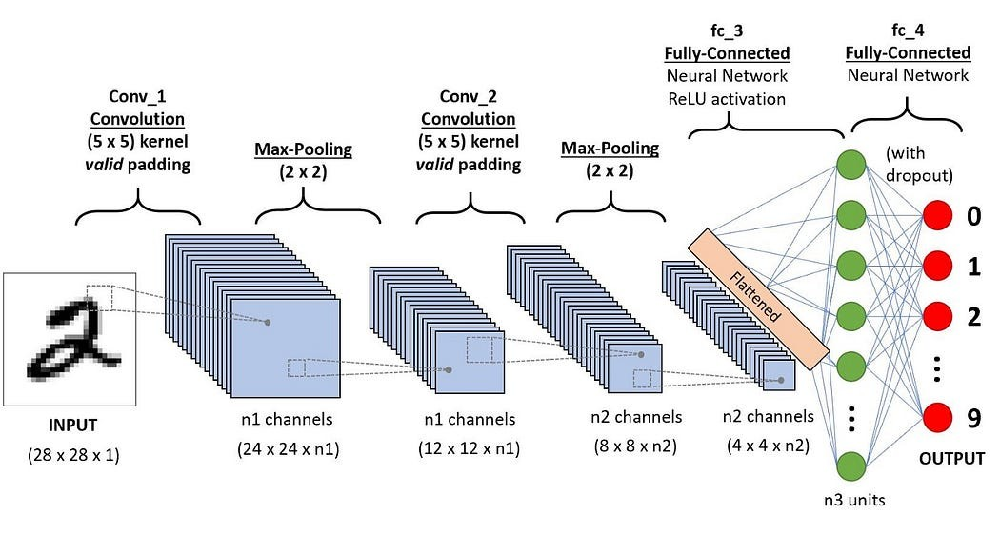

---

## Slide 4: Convolutional Neural Networks

- 1. Input Layer:
- Image Input: Typically, the input is a multi-dimensional array representing an image (height, width, channels). For example, a color image might have three channels (RGB).
- 2. Convolutional Layers: It performs following tasks:
- Convolution Operation: The core building block of CNNs. Filters (kernels) slide over the input image and compute dot products to create feature maps.
- Activation Function: Often a non-linear function like ReLU (Rectified Linear Unit) is applied to introduce non-linearity.

---

## Slide 5: Convolutional Layer

- In a convolutional neural network, the kernel is nothing but a filter that is used to extract the features from the images.

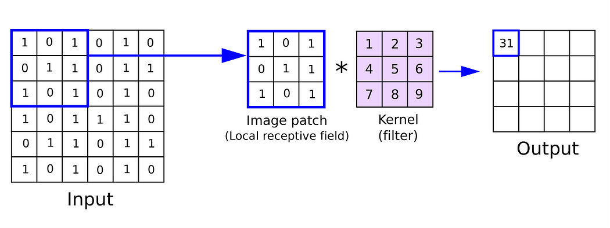

---

## Slide 6: Usefulness of Convolutional Layer

- Its uses are manifolds: Already discussed in previous slide.
- 1. Feature Extraction
- Local Patterns: Convolutional layers are designed to detect local patterns in the input data (e.g., edges, textures, and shapes in images) through learned filters (kernels).
- Hierarchical Features: As the network deepens, these layers can capture increasingly complex features, transitioning from simple edges to more abstract representations (like shapes and objects).

---

## Slide 7: Usefulness of Convolutional Layer

- 2. Parameter Sharing
- The same filter is applied across the entire input, allowing the model to learn features that are invariant to spatial location.
- This reduces the number of parameters compared to fully connected layers, making the model more efficient and easier to train.
- 3. Translation Invariance
- By applying convolutional filters across the input, CNNs become more robust to the position of features within the image. This helps in recognizing objects regardless of their location.

---

## Slide 8: Usefulness of Convolutional Layer

- 4. Dimensionality Reduction
- While convolutional layers can maintain or reduce spatial dimensions through techniques like stride and padding, they also create feature maps that can summarize important information, allowing subsequent layers to operate on a more compact representation.
- 5. Activation Functions: Non-Linearity:
- After the convolution operation, activation functions (commonly ReLU) are applied to introduce non-linearity. This allows the network to learn more complex patterns and relationships.
- 6. Preprocessing of Input
- Normalizing Features: Convolutional layers help preprocess the input data, making it easier for the network to learn useful representations.

---

## Slide 9: Pooling

- 3. Pooling Layer
- Purpose: Reduce the spatial dimensions of the feature maps, which decreases the number of parameters and computation in the network.
- Types:
  - (i) Max Pooling: Takes the maximum value from a defined window. It retains the most prominent features, making it effective for detecting edges and textures.
  - (ii) Average Pooling: Takes the average value from a defined window. It provides a smoother feature map and can be less sensitive to noise than max pooling. It is sometimes in cases where we want to retain more contextual information.

---

## Slide 10: Pooling

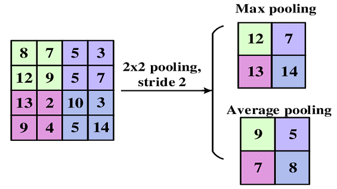

---

## Slide 11: Pooling

- (iii) Global Average Pooling
- It takes the average of the entire feature map, producing a single output for each feature map. It is helpful for reducing the size of feature maps and can be effective in classification tasks. It is generally used in the final layers of CNN architectures before the output layer.
- (iv) Global Max Pooling
- It takes the maximum value from the entire feature map. Similar to global average pooling it is helpful for reducing the size of feature maps but it retains the most significant feature. It is also used before the output layer, especially when spatial resolution is less important.

---

## Slide 12: Pooling

- Pooling operations like max pooling and average pooling generally reduce spatial resolution.
- However, the specific impact on spatial resolution depends on how the pooling is configured (e.g., window size and stride).
- Pooling Parameters
- (i) Window Size: The size of the pooling filter (e.g., 2x2, 3x3).
- (ii) Stride: The number of pixels the filter moves after each operation. A larger stride reduces the output size more significantly.
- (iii) Padding: Adding extra pixels around the input feature map before pooling. Typically, pooling layers don’t use padding, but it can be useful in certain architectures.

---

## Slide 13: Pooling

- Instead of pooling, some architectures use convolutions with strides greater than one to achieve downsampling while learning features.
- Pooling can lead to a loss of spatial information, which might be critical for some tasks (e.g., image segmentation).
- The choice between max pooling, average pooling, or other pooling techniques often depends on the specific task and desired outcomes.

---

## Slide 14: Convolutional Neural Networks

- 4. Fully Connected Layers
- After several convolutional and pooling layers,
- - the pooled feature maps are flattened into a single long continuous linear vector and
- - a high-level reasoning in the network is done via fully connected layers, where each neuron in these layers is connected to every neuron in the previous layer.
- 5. Output Layer
- The output layer outputs the result, typically using a softmax activation for classification tasks or linear activation for regression tasks.

---

## Slide 15: Regularization Techniques

- Dropout:
- Randomly sets a fraction of input units to zero during training to prevent overfitting.
- It acts as a mask that nullifies the contribution of some neurons towards the next layer and leaves unmodified all others.

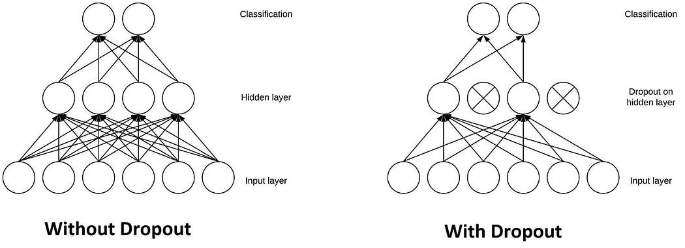

---

## Slide 16: Regularization Techniques:Dropout

- Dropout is a powerful technique used for regularization in Convolutional Neural Networks (CNNs) and other neural networks. Here’s how it helps:
- Prevents Overfitting: Dropout randomly removes some neurons during training, which helps prevent the model from depending too much on certain neurons or patterns. This helps the model generalize better to unseen data.
- Encourages Redundancy: Since different neurons are dropped out at each iteration, the network learns to spread or distribute the learned representations across many neurons rather than focusing on a few. This redundancy can improve robustness.

---

## Slide 17: Regularization Techniques:Dropout

- Effective Ensemble Method: During training, each mini-batch sees a different subset of the network, effectively training an ensemble of different models. At inference time, all neurons are used, which can lead to better performance.
- Stochasticity in Training: The randomness introduced by dropout creates a form of stochastic training, which can help escape local minima and lead to better optimization.
- Conclusion: In practice, dropout is typically applied after activation functions and before pooling layers in CNNs. By adjusting the dropout rate (commonly between 20-50%), we can control the balance between training speed and generalization capability.

---

## Slide 18: Regularization Techniques

- 2. Batch Normalization (BN): Normalizes the inputs of each layer to improve stability and accelerate training.
- Internal Covariate Shift Reduction:
- Batch normalization addresses the issue of internal covariate shift, which refers to the changes in the distribution of inputs in the layer during training, i.e., same distribution of inputs is considered in the layers during training.
- By normalizing the inputs to each layer, BN reduces this variability, allowing for more stable and faster training.
- (ii) Faster Convergence: By stabilizing the learning process, BN allows larger learning rates. This can lead to faster convergence and reduced training time.

---

## Slide 19: Regularization Techniques

- (iii) Improved Gradient Flow:
- Normalized inputs can lead to a smoother loss function. So these inputs helps prevent gradients from becoming too small or too large
- This can improve gradient flow through the network and mitigate issues like vanishing or exploding gradients.
- (iv) Regularization Effect:
- BN introduces some noise into the learning process by normalizing over mini-batches.
- This can have a regularization effect, reducing the need for other forms of regularization like dropout.

---

## Slide 20: How Batch Normalization Works

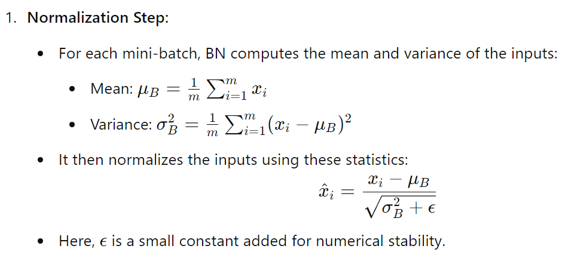

---

## Slide 21: How Batch Normalization Works

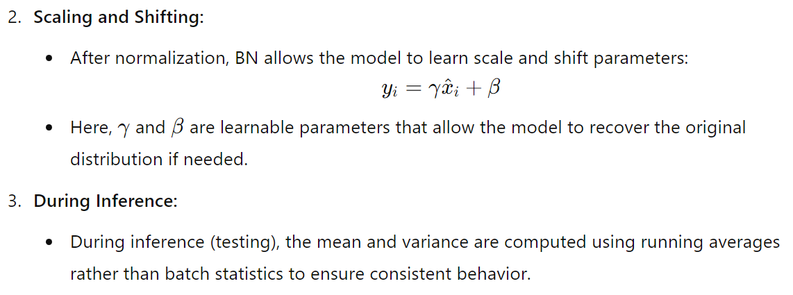

- Batch normalization can be applied after the convolutional layer and before the activation function (e.g., ReLU) or after the activation, which helps improve the training process and allows for faster convergence while maintaining or improving model performance.

---

## Slide 22: How Batch Normalization Works

- During training phase, how mini-batch is applied is discussed earlier, which helps the model adapt to changes in the distribution of inputs.
- But during inference, instead of recalculating mean and variance from the mini-batch, the model uses running averages (accumulated statistics) that were computed during training.

---

## Slide 23: How Batch Normalization Works

- This is crucial for a few reasons:
- (i) Consistency: Inference usually involves feeding in data one sample at a time or in smaller batches. Using the running averages ensures that the normalization is consistent regardless of the batch size.
- (ii) Stability: If we used batch statistics during inference, the mean and variance could fluctuate significantly, especially with small batch sizes, leading to inconsistent model performance.

---

## Slide 24: How Running Averages Work

- Updating Running Averages: During training, after calculating the mean and variance for each mini-batch, we also maintain running averages:
- Mean Update: running_mean=α⋅running_mean+(1−α)⋅μB​
- Variance Update: running_variance=α⋅running_variance+(1−α)⋅σB2
- Here, α is a hyperparameter (often set to around 0.9) that determines how quickly the running averages update.

---

## Slide 25: Convolutional Neural Networks

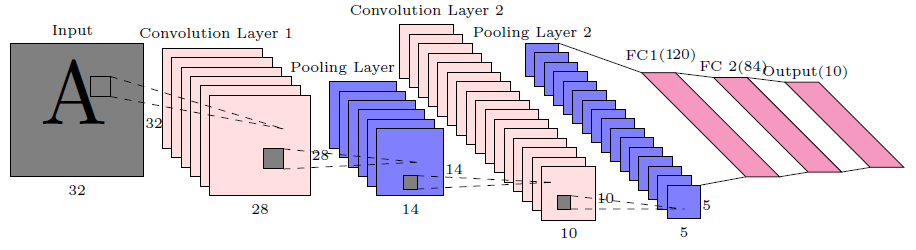

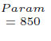

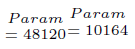

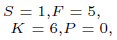

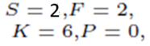

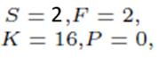

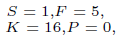

- $𝑃𝑎𝑟𝑎𝑚=156$

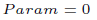

- $𝑃𝑎𝑟𝑎𝑚=2416$

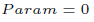

- Total no. of parameters: $𝐾\times(𝐹\times 𝐹\times 𝐷+1)$

---

## Slide 26: Convolutional Neural Networks

- Parameters in Conv-1: For each kernel of size F × F × D = F × F × D +1, 1 accounts for the bias term for each filter = 26, as D=1
- Total Parameters in Conv-1: For K=6 kernels = 26 ×6 = 156
- For pooling, there is no parameter.

- $𝑃𝑎𝑟𝑎𝑚=156$

- $𝑃𝑎𝑟𝑎𝑚=2416$

- Total no. of parameters: $𝐾\times(𝐹\times 𝐹\times 𝐷+1)$

---

## Slide 27: Convolutional Neural Networks

- Parameters in Conv-2: For each kernel of size F × F × D = F × F × D +1, 1 for bias = 151, as D=6, which is the number of layers in the previous Conv. Layer.
- Total Parameters in Conv-2: For K=16 kernels = 151 × 16 = 2416
- For pooling, there is no parameter.

- $𝑃𝑎𝑟𝑎𝑚=156$

- $𝑃𝑎𝑟𝑎𝑚=2416$

- Total no. of parameters: $𝐾\times(𝐹\times 𝐹\times 𝐷+1)$

---

## Slide 28: Convolutional Neural Networks

- Parameters in 1st FC Layer: No. of nodes in input layer = 5 × 5 × 16 = 400, and no. of nodes in output layer=120.
- Total Parameters in 1st FC Layer = (400+1) × 120 = 48120, 1 added with 400 as bias

- $𝑃𝑎𝑟𝑎𝑚=156$

- $𝑃𝑎𝑟𝑎𝑚=2416$

- Total no. of parameters: $𝐾\times(𝐹\times 𝐹\times 𝐷+1)$

---

## Slide 29: Convolutional Neural Networks

- Parameters in 2nd FC Layer: No. of nodes in input layer = 120, and no. of nodes in output layer=84.
- Total Parameters in 2nd FC Layer = (120+1) × 84 = 10164, 1 added with 120 as bias

- $𝑃𝑎𝑟𝑎𝑚=156$

- $𝑃𝑎𝑟𝑎𝑚=2416$

- Total no. of parameters: $𝐾\times(𝐹\times 𝐹\times 𝐷+1)$

---

## Slide 30: Convolutional Neural Networks

- Parameters in output Layer: No. of nodes in input layer = 84, and no. of nodes in output layer=10.
- Total Parameters in output Layer = (84+1) × 10 = 850, 1 added with 84 as bias

- $𝑃𝑎𝑟𝑎𝑚=156$

- $𝑃𝑎𝑟𝑎𝑚=2416$

- Total no. of parameters: $𝐾\times(𝐹\times 𝐹\times 𝐷+1)$

---

## Slide 31: Architecture Variations

- Classic CNNs: Like LeNet, AlexNet, which laid the groundwork for modern architectures.
- Modern CNNs: Such as VGG, ResNet, Inception, which introduce more advanced techniques like skip connections, deeper networks, and varying kernel sizes.

---

## Slide 32: AlexNet

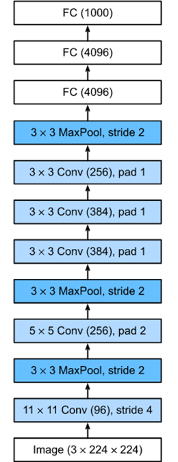

| Layer Name | Tensor Size | Weights | Biases | Parameters |
| --- | --- | --- | --- | --- |
| Input Image | 224x224x3 |  |  |  |
| Conv-1 | 55x55x96 |  |  |  |
| MaxPool-1 | 27x27x96 |  |  |  |
| Conv-2 | 27x27x256 |  |  |  |
| MaxPool-2 | 13x13x256 |  |  |  |
| Conv-3 | 13x13x384 |  |  |  |
| Conv-4 | 13x13x384 |  |  |  |
| Conv-5 | 13x13x256 |  |  |  |
| MaxPool-3 | 6x6x256 |  |  |  |
| FC-1 | 4096X1 |  |  |  |
| FC-2 | 4096X1 |  |  |  |
| FC-3 | 1000x1 |  |  |  |
| Output | 1000x1 |  |  |  |
| Total |  |  |  |  |

---

## Slide 33: Parameters in Different Layers in a CNN

- AS we discussed earlier,

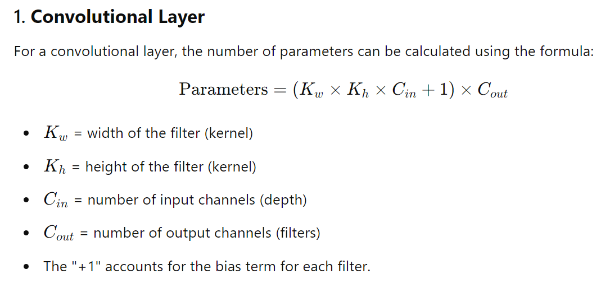

---

## Slide 34: Parameters in Different Layers in a CNN

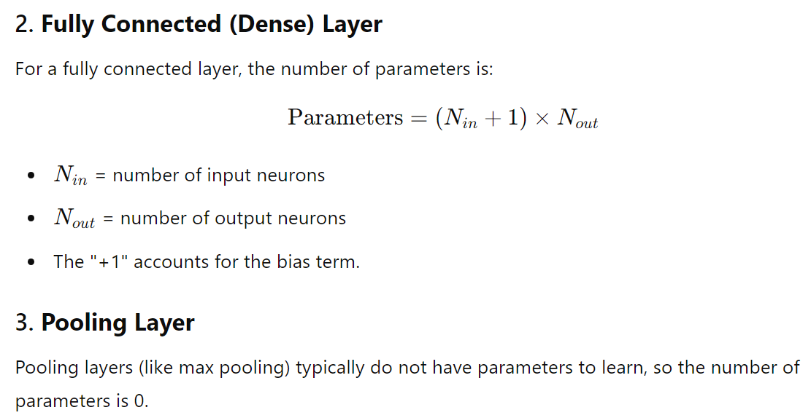

---

## Slide 35: Parameters in Different Layers in a CNN

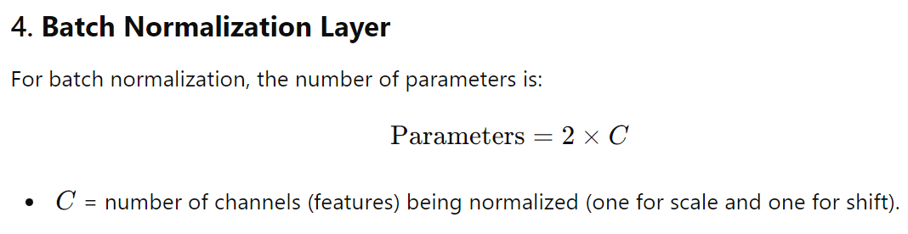

---

## Slide 36: AlexNet

- By default, assume pad=0 and stride=1. There are mistakes in the table. Correct it.

| Layer Name | Tensor Size | Weights | Biases | Parameters |
| --- | --- | --- | --- | --- |
| Input Image | 224x224x3 | 0 | 0 | 0 |
| Conv-1 | 54x54x96 | 34,848 | 96 | 34,944 |
| MaxPool-1 | 26x26x96 | 0 | 0 | 0 |
| Conv-2 | 26x26x256 | 6,14,400 | 256 | 6,14,656 |
| MaxPool-2 | 13x13x256 | 0 | 0 | 0 |
| Conv-3 | 13x13x384 | 8,84,736 | 384 | 8,85,120 |
| Conv-4 | 13x13x384 | 13,27,104 | 384 | 13,27,488 |
| Conv-5 | 13x13x256 | 8,84,736 | 256 | 8,84,992 |
| MaxPool-3 | 6x6x256 | 0 | 0 | 0 |
| FC-1 | 4096X1 | 3,77,48,736 | 4,096 | 3,77,52,832 |
| FC-2 | 4096X1 | 1,67,77,216 | 4,096 | 1,67,81,312 |
| FC-3 | 1000x1 | 40,96,000 | 1,000 | 40,97,000 |
| Output | 1000x1 | 0 | 0 | 0 |
| Total |  |  |  | 6,23,78,344 |

---

## Slide 37: Untitled Slide

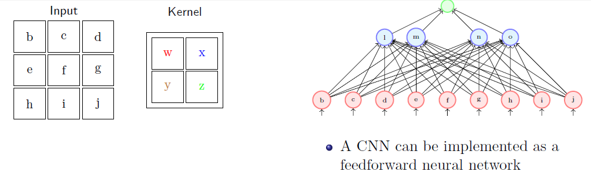

- The above network is a Fully Connected Neural Network.
- How to make it a CNN?

---

## Slide 38: Untitled Slide

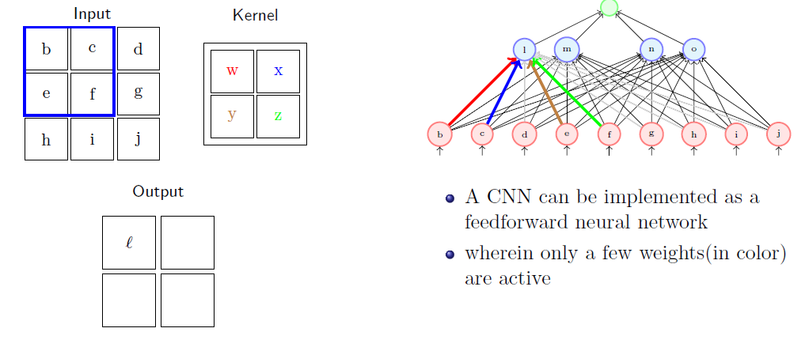

---

## Slide 39: Untitled Slide

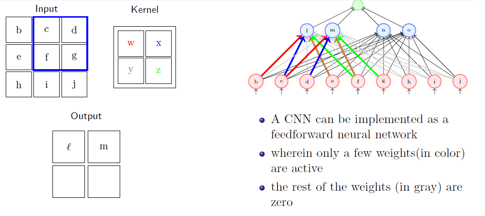

---

## Slide 40: Untitled Slide

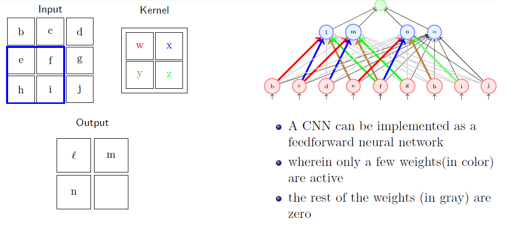

---

## Slide 41: Untitled Slide

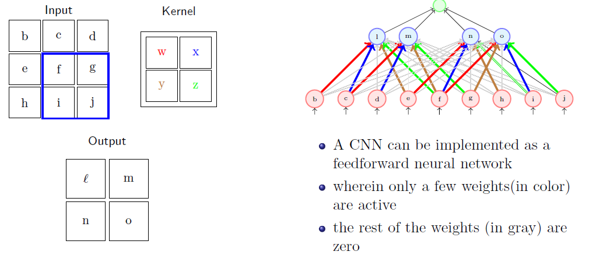

---

## Slide 42: Untitled Slide

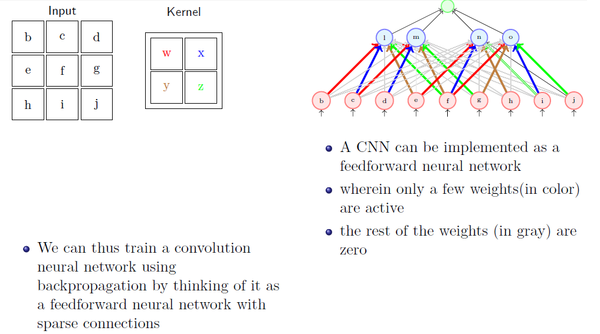

---

## Slide 43: Transfer Learning

- Transfer learning is a machine learning technique where a model developed for one task is reused as the starting point for a model on a second task.
- This approach helps to gain the knowledge from the first task to improve performance on the new task.
- It is particularly valuable in scenarios with limited data.
- It uses pre-trained models on new tasks to utilize learned features and thus reduces training time and improves performance, especially with limited data.

---

## Slide 44: Key Concepts of Transfer Learning

- Pre-trained Models:
  - Models are typically trained on large datasets (like ImageNet for image classification).
  - These models have learned useful features that can be beneficial for various tasks.
- Fine-Tuning:
  - After selecting a pre-trained model, we can fine-tune it by retraining some or all of its layers on our specific dataset.
  - Fine-tuning adjusts the model's weights to better suit the new task, improving accuracy.

---

## Slide 45: Key Concepts of Transfer Learning

- Feature Extraction:
- We can use a pre-trained model as a fixed feature extractor, where we remove the last few layers and use the output from the remaining layers as input for a new model.
- This approach is useful when we have limited data for the new task, as it allows us to utilize the learned representations without additional training.

---

## Slide 46: Steps in Transfer Learning:

- (i) Select a Pre-trained Model: Choose a model trained on a similar task or dataset.
- (ii) Modify the Architecture: Adapt the model's output layer to match the number of classes in the new task.
- (iii) Fine-Tuning: Retrain the entire model or specific layers on specific dataset.
- (iv) Train on New Data: Train the modified model on the specific dataset.
- (v) Evaluate and Optimize: Assess performance and make adjustments as necessary.

---

## Slide 47: Benefits:

- Reduced Training Time:
  - Since the model starts with weights that are already close to optimal, training time is significantly shortened compared to training from scratch.
- Improved Performance:
  - Transfer learning often leads to better performance on the new task, especially when the dataset is small, as the model benefits from previously learned features.
- Less Data Required:
  - It is particularly useful in scenarios where labeled data is scarce, as the pre-trained model has already learned from a large amount of data.

---

## Slide 48: Challenges:

- Domain Shift: If the new task is too different from the original task, the transferred features may not be as useful.
- Overfitting: Fine-tuning on a small dataset can lead to overfitting, where the model learns noise instead of general patterns.
- Overall, transfer learning is a powerful technique that enhances efficiency and effectiveness in various machine learning tasks, particularly in domains with limited data.

---

## Slide 49: Applications:

- Image Classification: Adapting models like VGG, ResNet, or Inception for specific image classification tasks.
- Natural Language Processing: Using models like BERT (Bidirectional Encoder Representations from Transformer) or GPT (Generative Pre-trained Transformer) for tasks such as sentiment analysis or text summarization.
- Medical Imaging: Leveraging models trained on general images to assist in detecting diseases from medical scans.

---

## Slide 50: Thank You

---
