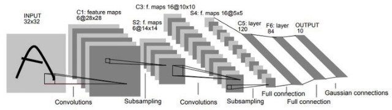
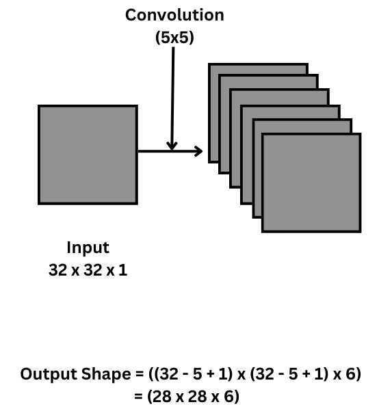
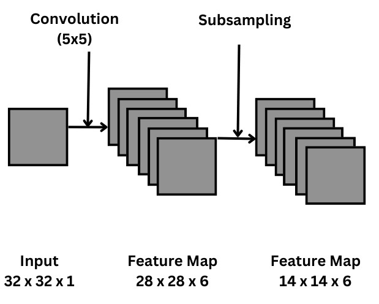
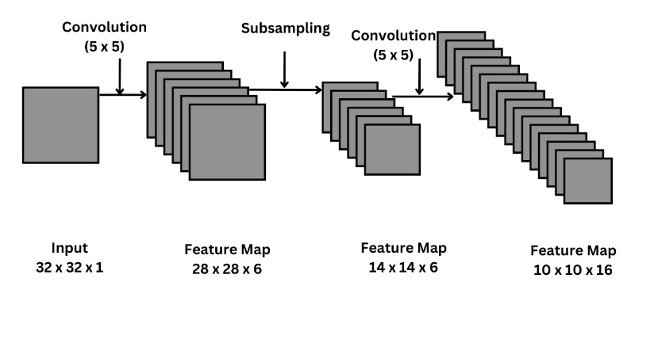
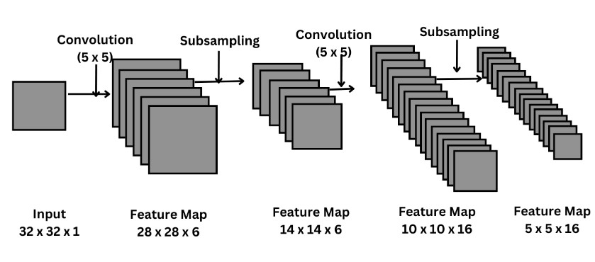
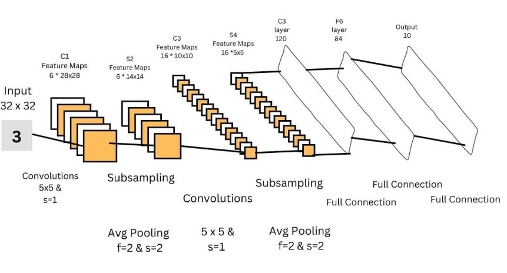
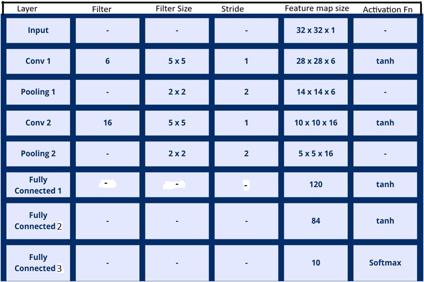

# Slide Deck Deconstruction: ML_Lec_14_LeNeT_CNN

> **Source Presentation:** `ML_Lec_14_LeNeT_CNN.pptx`  
> **Slides:** 14  
> **Media referenced by slides:** 7 (extracted into `media/`)

---

## Slide 1: CNN Architecture

- Some popular CNN models are:
- LeNet
- AlexNet
- GoogleNet
- VGG
- ResNet
- DenseNet
- ResNeXt
- EfficientNet

---

## Slide 2: LeNet

- LeNet is one of the pioneering convolutional neural network (CNN) architectures, developed by Yann LeCun and his colleagues in the late 1980s and early 1990s.
- It was primarily designed for handwritten digit recognition, specifically for the MNIST dataset.
- It was used by many banks for recognition of hand written numbers on cheques.
- This architecture achieves an error rate as low as 0.95% on test data, i.e., accuracy was more than 99%.

---

## Slide 3: LeNet: Architecture

- Input Layer:
  - Typically accepts 32x32 pixel grayscale images. MNIST images (28x28) are often zero-padded to this size.
- Convolutional Layer 1 (C1):
  - Applies 6 convolutional filters of size 5x5, resulting in 6 feature maps of size 28x28.
  - Activation function: typically sigmoid or tanh.
- Subsampling or Pooling Layer 1 (S2):
  - Applies average pooling (subsampling) with a 2x2 filter and a stride of 2, reducing the feature map size to 14x14.
- Convolutional Layer 2 (C3):
- -- Applies 16 convolutional filters of size 5x5, producing 16 feature maps of size 10x10.

---

## Slide 4: LeNet: Architecture

- Subsampling Layer 2 (S4):
- -- Similar to S2, it uses average pooling to reduce the feature map size to 5x5.
- Fully Connected Layer (C5):
- -- Flattens the output from S4 and connects to 120 neurons.
- Fully Connected Layer (F6):
- -- Connects to 84 neurons.
- Output Layer:
- -- Outputs 10 neurons corresponding to the 10 digit classes (0-9).

---

## Slide 5: LeNeT5

- There are many versions of LeNet architecture.
- Following is the LeNet5 CNN

---

## Slide 6: LeNeT5

- After first convolutional layer, the input image is convoluted to the size of 28x28.
- There are 6 kernels, so the output feature map is of depth 6.

---

## Slide 7: LeNeT5

- Second layer is the pooling layer where the size is reduced to half, i.e., 14 × 14, by 2 × 2 filter with stride 2.

---

## Slide 8: LeNet5

- In the third layer, convolution occurs again, but this time with 16 filters of 5x5 size, default pad=0 and stride=1
- After this layer, the size of the input image is reduced to 10x10x16.

---

## Slide 9: LeNet5

- In fourth layer, the subsampling takes place, and the image size 10x10x16 is reduced to 5x5x16, by 2 × 2 filter with stride 2.
- The feature map of fourth layer is flattened into a vector of 400 values.

---

## Slide 10: LeNeT5

- Finally, the flattened vector passes through 3 fully connected layer for classification, where 1st FC layer consists of 120 nodes, 2nd of 84 nodes, and the 3rd one which is the output layer consists of 10 nodes, one for each class (here, digit 0 to 9).

---

## Slide 11: Summary of LeNeT5 Architecture

---

## Slide 12: LeNet: Key Characteristics

- Activation Functions: Originally used sigmoid or tanh, but modern adaptations often use ReLU.
- Pooling: Utilizes average pooling, which was common at the time. Max pooling has since become more popular in later architectures.
- Backpropagation: LeNet was one of the first networks to use backpropagation for training.

---

## Slide 13: LeNET

- Impact and Applications
- (i) Legacy: LeNet laid the groundwork for more complex CNN architectures, influencing subsequent developments in computer vision.
- (ii) Use Cases: Beyond digit recognition, variations of LeNet have been adapted for various image classification tasks.
- Summary:
- -- LeNet's architecture introduced key concepts in deep learning, such as convolutional layers, pooling, and end-to-end training, and remains a foundational model in the study of neural networks and computer vision.

---

## Slide 14: Thank You!

---
