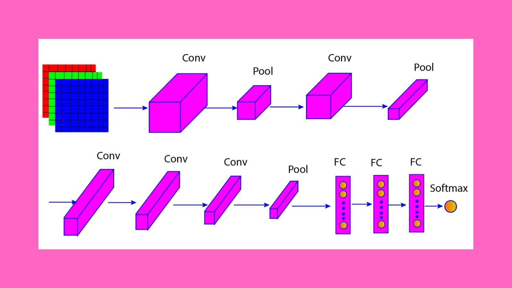

# Slide Deck Deconstruction: ML_Lec_15_AlexNet_CNN

> **Source Presentation:** `ML_Lec_15_AlexNet_CNN.pptx`  
> **Slides:** 8  
> **Media referenced by slides:** 1 (extracted into `media/`)

---

## Slide 1: AlexNet

- AlexNet, developed by Alex Krizhevsky and his colleagues in 2012, was a groundbreaking convolutional neural network (CNN) that significantly advanced the field of computer vision.
- AlexNet achieved state-of-the-art performance in the 2012 ImageNet Large Scale Visual Recognition Challenge (ILSVRC), significantly outperforming the competition.
- Its success demonstrated the power of deep learning in image classification tasks and spurred further research and development in convolutional neural networks.
- Overall, AlexNet's architecture and techniques laid the groundwork for many subsequent deep learning models, paving the way for advances in various applications, including image and video recognition, object detection, and more.

---

## Slide 2: AlexNet

---

## Slide 3: AlexNet Architecture

- 1. Input Layer:
- Input Size: 227x227 pixels (originally designed to accept 224x224, but the extra padding was added for compatibility). Each image has three color channels (RGB).
- 2. Convolutional Layers:
- Conv Layer 1:
  - Filters: 96
  - Kernel Size: 11x11
  - Stride: 4
  - Activation: ReLU (Rectified Linear Unit)
  - Output Size: 55x55x96 (after applying padding and the convolution operation)
- Pooling Layer 1:
- - Type: Max Pooling
- - Kernel Size: 3x3
- - Stride: 2
- - Output Size: 27x27x96

---

## Slide 4: AlexNet Architecture

- Conv Layer 2:
- - Filters: 256
- - Kernel Size: 5x5
- - Stride: 1
- - Activation: ReLU
- - Output Size: 27x27x256 (after padding)
- Pooling Layer 2:
- - Type: Max Pooling
- - Kernel Size: 3x3
- - Stride: 2
- - Output Size: 13x13x256

---

## Slide 5: AlexNet Architecture

- Conv Layer 3:
- - Filters: 384
- - Kernel Size: 3x3
- - Stride: 1
- - Activation: ReLU
- - Output Size: 13x13x384
- Conv Layer 4:
- - Filters: 384
- - Kernel Size: 3x3
- - Stride: 1
- - Activation: ReLU
- - Output Size: 13x13x384

---

## Slide 6: AlexNet Architecture

- Conv Layer 5:
- - Filters: 256
- - Kernel Size: 3x3
- - Stride: 1
- - Activation: ReLU
- - Output Size: 13x13x256
- Pooling Layer 3:
- - Type: Max Pooling
- - Kernel Size: 3x3
- - Stride: 2
- - Output Size: 6x6x256

---

## Slide 7: AlexNet Architecture

- 3. Fully Connected Layers:
- FC Layer 1:
  - Neurons: 4096
  - Activation: ReLU
  - Dropout: 50% dropout rate during training for regularization
- FC Layer 2:
  - Neurons: 4096
  - Activation: ReLU
  - Dropout: 50% dropout rate during training for regularization
- FC Layer 3:
  - Neurons: 1000 (for 1000 classes in the ImageNet dataset)
  - Activation: Softmax (to produce class probabilities)

---

## Slide 8: Thank You

---
